# UCLA《模式识别和机器学习｜Introduction to Pattern Recognition and ML Winter 2024》中英字幕 - P3：[03]Introduction to Pattern Recognition and ML -- Lecture 3 - Winter 2024.zh_en - GPT中英字幕课程资源 - BV167BfB8ETK

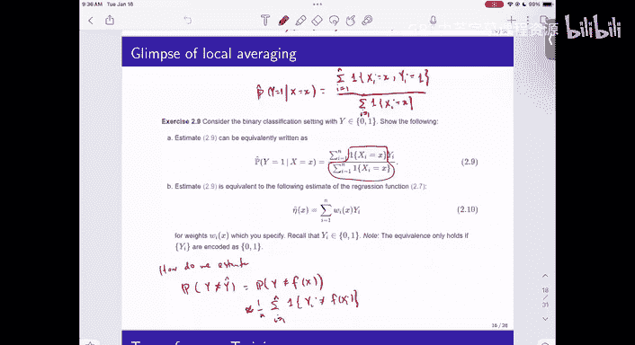

So yeah， we were discussing the idea that。It's the majors that we were looking at。嗯。Can be viewed as。

Approximating this regression function。This is an approximate regression function。

 which is the probability of y equal1 given x is equal to x。They're approximating this as。

The form of local averaging， so you have these weights for any new data point x。

Or feature X that comes in。 You have this weight that you assign to each of the training data points。

 So I is the。嗯。The index in the data set， which let's say it's treated it as a training set。

So you thank Wait。To those data points。For every given X and in these days have some sort of a similarity interpretation or sleep。

In this case， they're going to be exactly zero。😊，Because you're looking at discrete features。

 if this particular feature like in the training is XI and the one that I'm going to try to predict is X。

😊，If if they match， then it's going to be one， otherwise it's going to be zero。

 so I'm going to look at all the training data for which。

Their feature matches exactly my feature and then this weight is basically like one over the total number of those so it's like if。

😊，There are five examples in the training dataset whose features match the current one that I'm looking at will F then this weight is going to be one over five and then I'm just going to sum the YI's with this late so the five of them so essentially'm averaging so one over five sum of five YI's so I'm going to average over YI's for which。

My。Current feature matches exactly those trends features。

And then later we'll relax this and this gives a wide range of。

Estimators they fall into this category。Okay， and then。

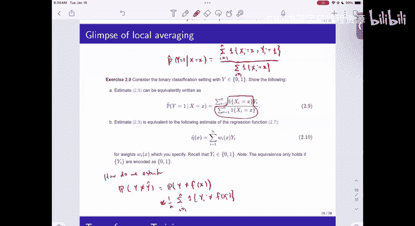

So I'm going to come back to this multiple times， any question about this？

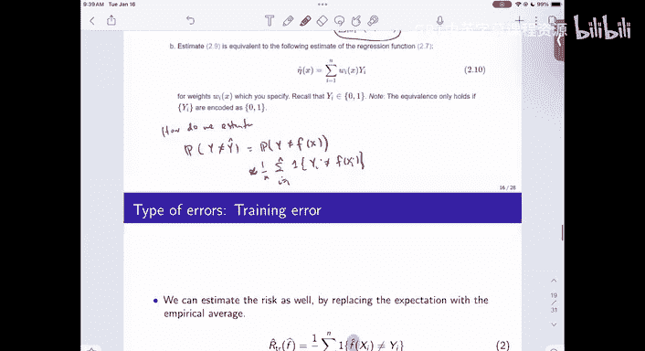

And then you talked about the way like we evaluated the performance using the risk or the probability of error。

 let's say， or probability classification。😊。

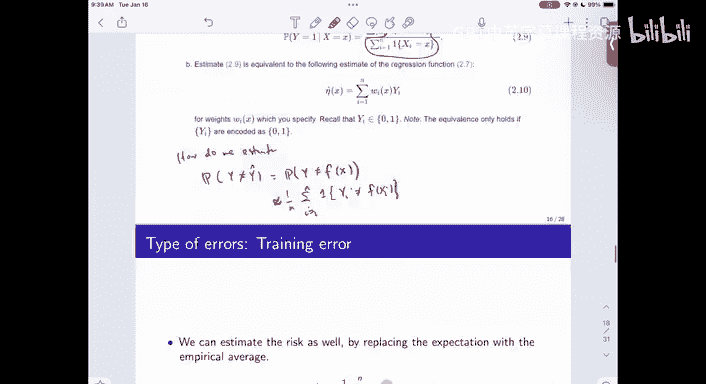

If we knew the actual distribution。

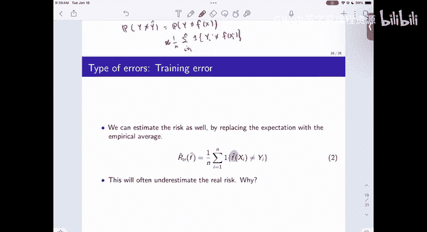

But recall that we switch to the case of real data so we don't have the actual distribution。

 so the question was how do we measure the error or the risk in this case？

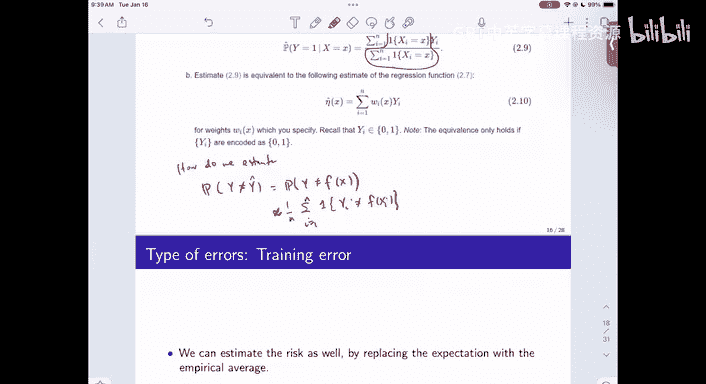

And the simplest idea is that， okay， I had this probability of。

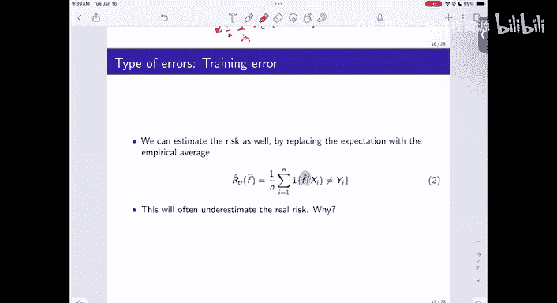

嗯。Y not equal f of x， that was my risk for the particular F， so if I have an F。This is my true risk。

So maybe I can just replace。The probability with the empirical version using the sample that they have。

So I'm going to replace the probability of the average。Over the training data。

 So if you're comfortable with。嗯。你。Thanks。Brequent disinterpretational probability。

 so probabilitybil is really。😊，An abstract idea interpretation is like if you repeat the experiment many times if you sample of。

😊，Ex just one interpretation so if you sample a lot of data points。

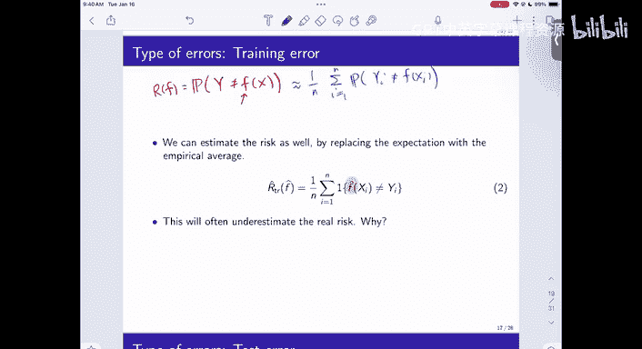

X I， Y， eyes。From P to IAD。Then the average is of whatever event you want to calculate。

 so averaging over this。😊，Msures the probability。 So I'm going to average sorry this is not probability。

 This is the indicator so I'm going to average so count the fraction of times basically or how many how many times。

😊，I observed that Y I is not equal to f of X I and then divide by the total。

 So it's the proportion of times that。This event happens in the sample。

And that's approximately equal to。This F is large。In fact。This is going to converge。

To that probability。As then goes to infinity。If。F is a fixed function。Nonran。

So the fact that that step converges is really。Rigrous， it's like a rigorous。

Statement of the fact that。The probability is really likere approximately using vehicle a so that has a name that convergence anyone knows with that。

😊，But the average converges to the population。Okay。

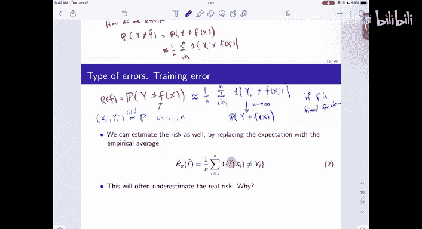

I suppose I have。Zva up to ZN。Their IID from。对。呃。Some distribution， let's say。As's a cue。

 it' a matter。So one over in summation。So let's say they IID and they have the same distribution as a random variable Z。

 I'm going to write it like this， so they all have the same distribution。😊。

I from one to n summation Z this converges in general。Has engustted infinity to something。

Anyone knows what this cons to？😔，How many haveve taken the probability course， 100 A。

So towards the end of that course。Did they talked about？Asyyntctic results in probability。

There are two main results in classical probability。What are those two。Cent New is the second one。

What is the first one？The easiest part， love large numbers， okay。So does this resemble one of those。

So law of large numbers， what does it say？明明没。If we collect enough sample。

 then our sample status will conge to where population from。Right。

 so sample statisticsistic what is the simplest？It's like。

The simplest statistic that you can think of。Mean mean， the sample mean。

 sos it's a statement about sample mean， so this is the sample mean。If I have any eyes。

 if I take the average， that's the sample me。So it can merge does the population mean。

 so what does the population mean？How do you write it？The population mean is the expectation。

 so I can write the expectation of one of them or expectation of Z if you want。Or z1， okay。

 so this average converges to the expectation of that random variable。Right。

 so now imagine these are ZIs。So these are benuity variables。

Because they're indicators so let's call this the I so this is an empirical average variable。

 it's a binary variable。😊，And so' the sample average and the Zs are independent because the X X I。

 Y I pairs are independent。 So this converges to the expectation of。Like one of them。

 like expectation of Z1。And。The expectation of a binary variable we've seen is just the probability that it's one。

Okay， so this is really the expectation of， for example， Z1。Or any of them okay？Or if you can't。

 you can call it Z if you want to the IadD from X and Y。

This notation they the same distribution is expire， all of them are from some unknown distribution。

So if I call the Z。This is really the expectation of Z and the expectation of Z。Is。

Really the power of。It's being done like being one。So if you think about it。

 it's just an application of。Love large numbers。Does that sort of make sense？Okay。

 so the training error for fixed function converges to。The true risk， the probability of error， okay？

And this is just a fact from love of large numbers。嗯。So if you forgot。

 just review a law of large numbers。And。This would be obvious sort of。Okay。😊。

So if I fix the function F， then the eyes are。Just independent。And their IID。

 they have the same distribution as Z I or Z sorry this is not Z I made a mistake so this is X Y Z would be here like one。

😊，Y not equals of x。Okay， so or you can just。Might be a little bit easier to do。Let's just do y 1 x1。

 and this is really the expectation of indicator of。Y1 not equal to f of x prime。

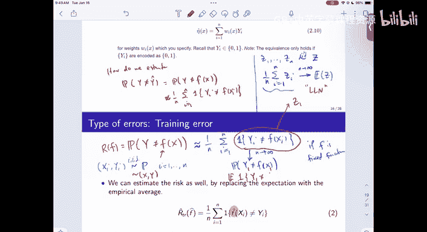

It to be less confusing。So you can say this converges to the expectation of Z1。Okay。

Let's do it this way。And。Y1 pair x x1， y1 is just。Just in generic sample。

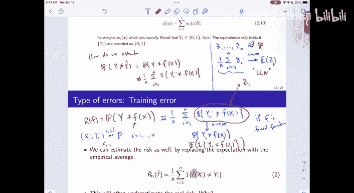

This is also equal to。And。To this。Because that's also a more X and Y xY her is also a generic XN。

It's little near here。Okay， questions。So。哎。So this is called the training error。

So why I mentioned last time that this would。Underestimate the real risk and in fact。

 if you look at the estimator that we did like the plugin estimator。

 the plugin estimator this guy basically can。

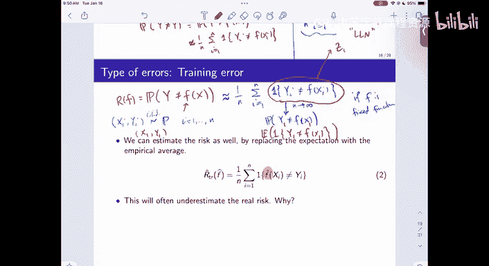

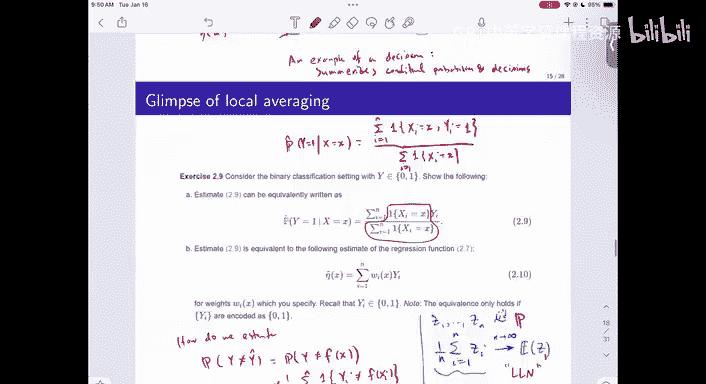

This is the estimator that。

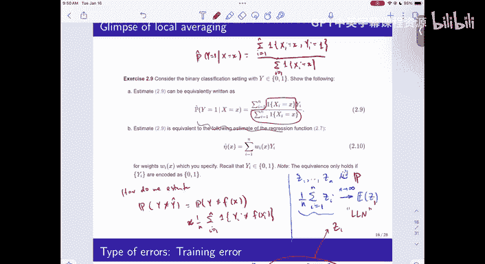

Goes into the optimal rule， which was。

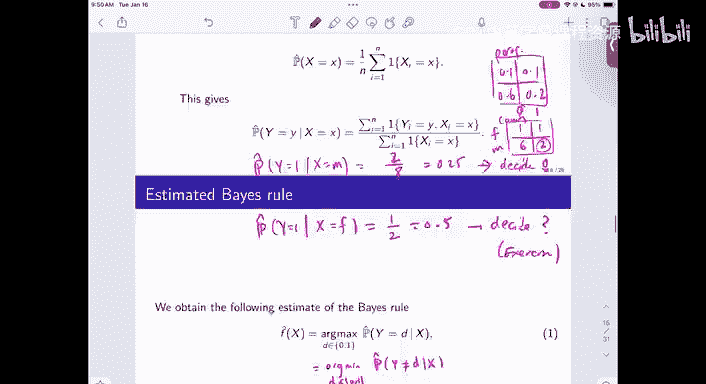

嗯。Yeah， so okay。

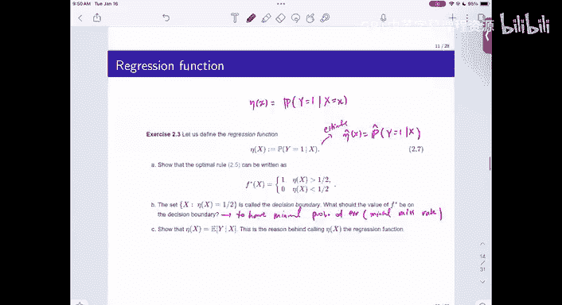

So you do this estimate and it compare it with one that。

So that's see sort of plugin optimal tomorrow。That if you go through the argument that we did。

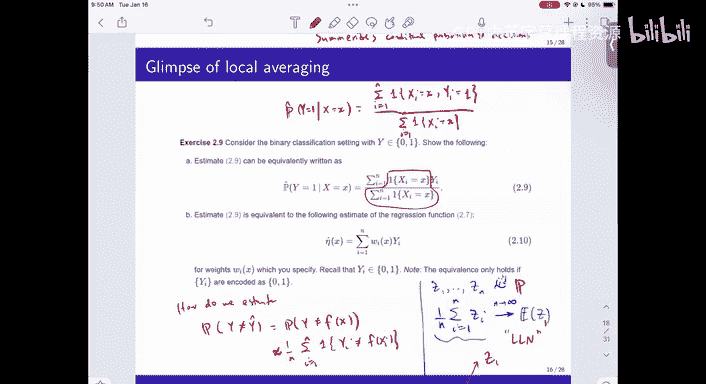

That's going to be the estimate of minimizing this time year。

And so you minimize this training error under the zero1 loss that we have。

The estimate that it comes out is that。So it seems like everything is good so I have this estimate of the risk and I minimize it that's my plug and optimal rule I can compute everything。

😊，And so we would be fine， okay？but I mentioned something that why this is going to be usually a problem evaluating the risk。

Using this would be a problem。So you remember拜。对。喂。Yes， yeah， so the issue is right。

 the issue is going to minimize this。Depending on how large class a functions minimizing or so I really you minimize this。

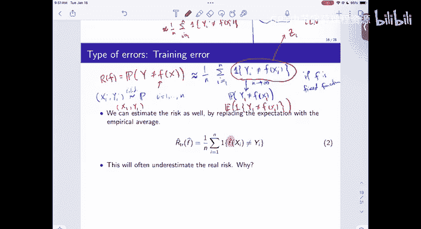

Minimize over if that's what what I'm saying， so if I minimize。FO X I minus。

So I'm going to search all a class of functions， I'm going to introduce this notation so that he gets comfortable with this is like I have a class of functions。

😊，In our case， we've got four possible punishment。So I'm going to plug in every one of those four possible functions and then evaluate it is going goingll find the minimum so arguing the function that minimizes this。

 that's going to be our hat。And that turns out to be。Turns out。Turns out to be。He tag in up tomorrow。

Okay， so。哎。The issue is that in practice I can inunciate the four points。

 but in the continuous states， let's say。嗯。Imagine if for for a minute that we have a continuous space then the space of functions is infinite dimension they're infinitely many functions and then I can read enjoy the function that make this。

There for every in， I can find a function that map all the Xs to the Yi。

As I can make the training error exactly zero， and there are actually many functions。

 the solution is what we need。The issue is that I know that。Probably theres an annoying。

There's no evidence in the problem， but so I don't want to exactly match why I。

So your labels my touch me。嗯。Might be sort of wrong in a sense， it's harder to。

Justified in this case， but there is noise in the data and and you don't want to perfect get the noise so if there is noise you want to sort of。

Guard gets that and this doesn't。Doesn't tell you that and what happens is in practice you rule。

To underestimate the real risk because for the real risk。So I've seen like n samples。

 but they're infinitely need more samples as just to perfectly match these。

 but this might do a lot worse on an unseen example。

And this really measures the average overallhaul of the possible stuff the infinite。Sample rate yes。

 the reason it underestimate is because it overfits chemistry data you really an underestimate because you。

Her like it by。Delierately minimize this risk so that's that's so you're forcing it to be smaller okay and so oftentimes it's smaller than it has to be right and the reason yeah and the reason is also like you can say overfitting overfitting exactly this good because you minimize risks tend to get things for me this is smaller。

And the fact that the smaller is that you overfied the data if your loss is measuring。

Like to zero around thats measuring that agreement， when you minimize it。

 you also like over fit perfectly to the training data。

 which is called the work meeting because you don't run film that。嗯。There are examples。

 this is not always bad those modern machine learning。

 there are examples where you that tend to see overpintting like could basically have zero training repair and also good population rates。

 but the classical especially intervention。The reverse you have maybe see。

 or you have seen it like why I is。X I， let's say， plus noise。

So I know that there is an image in observation， I really don't want or sorry that at。Lets say FSR。

 there is a true function。That I'm trying to estimate。So regret an example。Is F a star of X。

 and then if you try to minimize usually you minimize the squared loss， a squared not the01 loss。

 so you minimize y I minus F of。And let's say F of X I。Minus y I is squared。Argument。

classification is harder to see and actually it's less severe overfitting。😊，嗯。

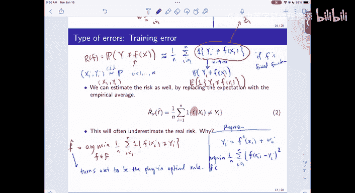

So then you minimize。The squared no you're trying to match F of Xi to Yi。

 but if you really noise that you know that Yi has noise you really don't want to perfectly fit it because you know there is a component of noise there so if you perfectly fit it youre not only like。

If this part you want to did this part and you don't want to fit this part so if you hit that part perfectly。

 then you'd expect that in the future they could good that part is going to change。

You're going to probably pay a price。Neither heuristic arguments， they're not exact。

 but that's the idea， okay？But the isn that I mentioned and the earth。

Deli may it smaller than taking in advance。不同。Thats sort of clear。

So the real thing that we want to do is this， one of the mindsets that we better not have。

But there you have this and。Theres always not always， but often underestimate his needs。So。

What is a solution this， what is our solution？Is there a way value there risk？

Population is there more。Neutral， like。That's an unbiased。

Anyone has seen any like real machine learning applications。

If use like a different loss function like you use altitude loss instead of。Animizing square error。

Use a different last question。So if you use a different last function you get a different estimator right。

 so for a different reason you might more than do that， even in transportation。

 it can use the a last for example。啊。But that we change the estimate there。

 it doesn't help you necessarily volumeing3， so you want to also apply to last year。诶。Yeah。

 I'm not sure that would necessarily help。Try to estimate the L2 loss。

 let's say I want a01 last maybe。对。And this issue啊。So the actual issue here that you see that。

 for example， why this doesn't work because I'm saying as inmost to infinity。

The law of our number should kick in and they after that。

But it wouldn't work for this one reason it wouldn't work for this one is that this F is on fixed so if I fix the function as my sample grow grew this would be a good S this would be a consistent estimate in the language of staistic in a sense ofverence。

 but because so this is true but this F being a big finite type speed that I wrote。

If F is obtained by minimizing this F itself depends on the training。

 so this F is really if you want to be careful。

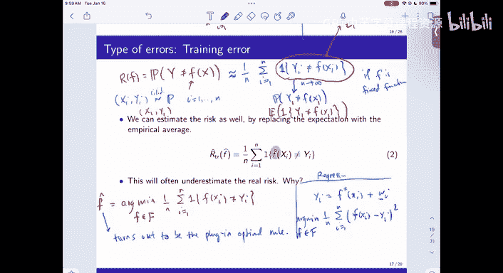

呃。I need to write。嗯。So you'd see sometimes I might write F hat of the function is right like there's a x that I take in。

 but there's really a DN here， which is our。The data our training data X1。Why one up to it？😔，X and Y。

 N， so it really depends on。The training data you can see it easily like in this formula。

 for example。So this is like that and the weight depends on everything and NYI depends on everything so when you evaluate to a single point。

 it also includes all the other training data， so it's really dependent in the entire data。😊。

Because it depends on the entire data， these terms， individual pair in that some are not independent。

😊，Because when I look at like the I1 versus the J1， the X IY I is independent of XJ Yj。

 but the DN is like linking them， okay， so there's their data。

 the entire data is not into they're both them， so the terms are not independent。

So we can use the laws owner again， because F had depends on the entire data。Because。If that depends。

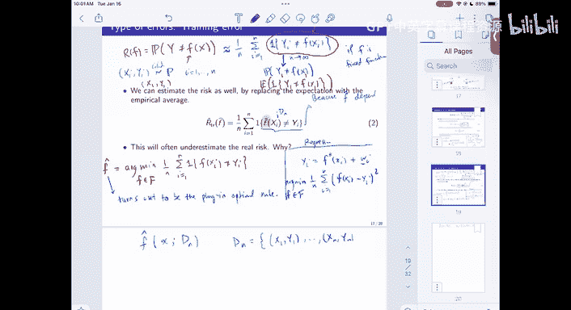

In the entire day。The terms。Are not independent。Even。Identative everything depend。

And the independence is really key。So。Cannot。Use Lent。Okay， so that's that's a real thing。

 So if I change the loss， this issue of dependence doesn not go away。

I want to restore independence so that。Like law of large number kicks in。Okay。

 I want to add independent tariffs。So what would be the solution。

 what do you want to be independent individual fairs at this time？

YeahBecause the long noise number requires you to sum like average pair that are independent。

 basically IIB。Right if I fix F。So this is like a fixed function and so these these are going to be just random because of X I and Y I and so X IY an independent。

😊，Or IIA answer of these terms of the IA。But then I plug in N F hat。

 which is constructed based on the entire data itself。你三六万嘅系。about the training set and my。

Thanks you have sorry you have to show some that you I' not shown in the training set and then tested on that so you can get the risk out of those and we're not in the training set Okay。

 so we have okay， so we have to show the algorithm。

Example of sampling but are not in the that you said and then allowed so what is that you wanted to say？

Oh yeah， I was just going to say you could have like a training data another split for like testing okay slightly into training test that's what they do and and that's exactly what also So the idea that you want examples that you haven't seen in the training。

And assuming those are II those are going to be independent from that okay and then once I if I use that I think that's a condition on training data my condition on training data thisad is fixed now the randomness assuming those I'm seen sample on those are independent the conditional on training data I have the IID nature so what happens is that I would do。

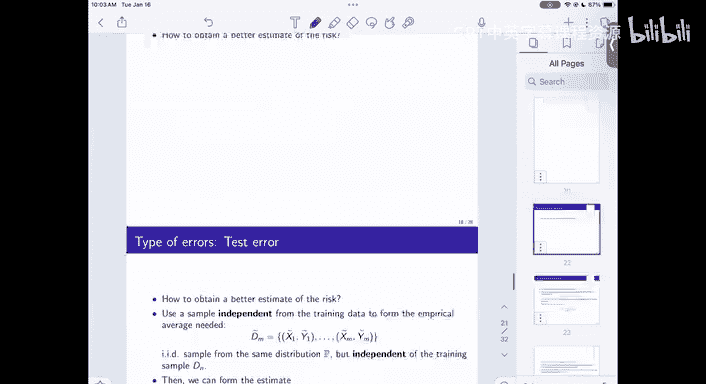

Let's say another sample like tilde of size M。😊，And let's say I gather a different sample size M these are different from the training data。

 which was。Without the and end of them。Right。And then I evaluate the function on my function。

 which is trained on sort of hat trained on。The end trained or like drive basically the train means like I。

Like construct the out of it that yeah the way that we did so in China yeah end but youre going test on this PM killed there so I'm going to evaluate it on these examples that I haven't。

training and if these are independent， then conditional。And this是你们。On the end。All the terms of。

Above our IID。

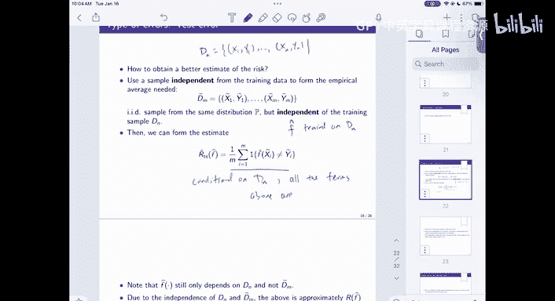

So this is called， let's see。And this would be a consistent estimate of。The is as M goes inly。

 in verge。To really。嗯。The risk of effort。So I can consistently them。I get the consistent estimate。

There is going。So all you need is make a different sample and in practice。

Sometimes you have the entire data so you have to construct your own。

This c has so you have to construct this test sample or like unseen samples you just。

split your data into two pieces。You put one piece aside for future。

 you don't touch it and then you just train on。With the first piece。So you split your own data。

Into two pieces， the end。And the M。So train on this。And then test on this part。Okay。

 so that ensures that。The data points that going into this far。系。Not seen in the training。

You can restore independence of these terms when you have it。Okay， yes you mean by。

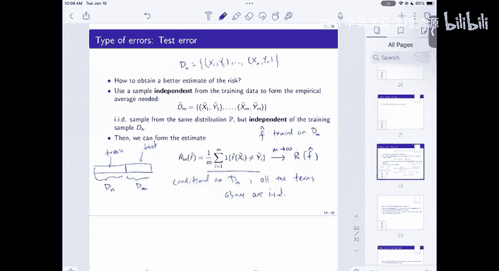

So the model， then minimize the training。啊 which mean by啊。L。Well， yeah。

 so that's my name I gave to this estimator E， so if you recall we build an estimator。

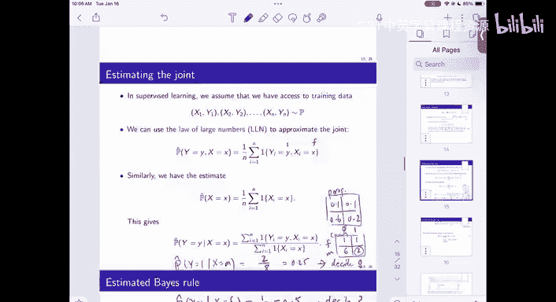

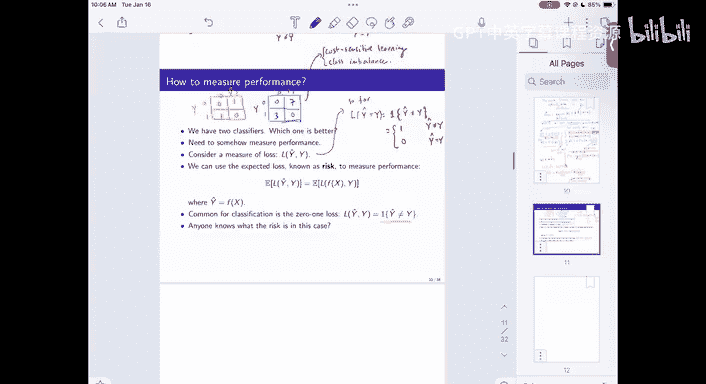

Right， so there was。嗯。

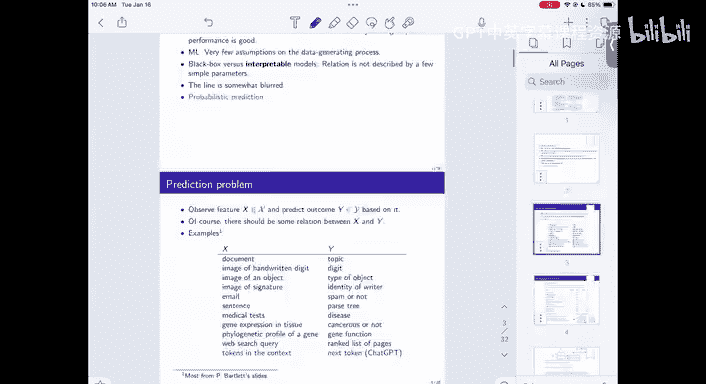

Let's go back。

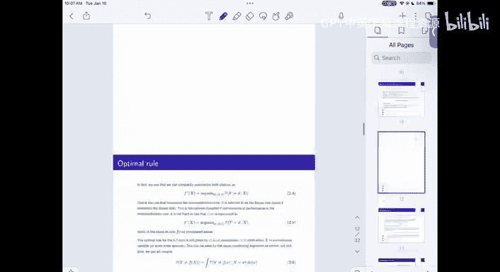

So this is sort of the optimal rule， if you recall。So the decision will the minimize is。

So this is the optimal rule so you go back to the previous lecture we built towards this。

 so this is the optimal classifier。In practice you can't calculate it because you know this is dependent on the conditional distribution y givenx which I don't have first I assume that I know the joint distribution so I have this conditional distribution and then from this I can calculate this optimal decision which is something called the base rule。

嗯。Ael。Or optimal。But the parents I don't have it， I can for estimates of the join using patental algorithms again by the amount background and then we can also have an estimate of this so we have an estimate P hat。

Of this probability and then this wouldP had that F half that's that's what I call plugin plugin because I plug in my estimate of P in this and just calculate the rule。

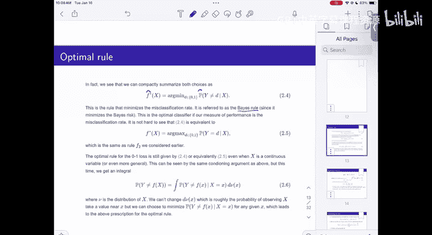

So that's our plugin estimate。Or plug an optimal rule so that that comes from this so if you go back through these that's how we estimate the joint this is also by the law of large number vacancies here this converges to the probability joint probability segment。

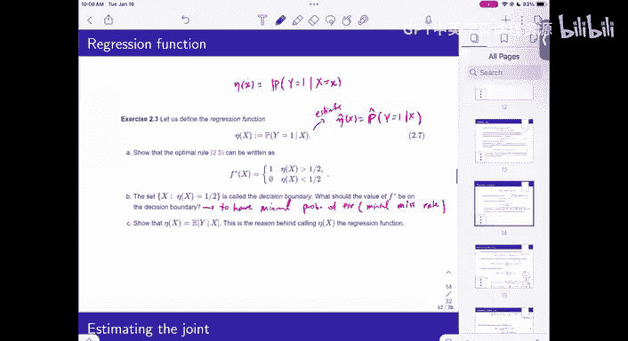

And so this is a good approximation of the condition distribution and I plug that into that formula。

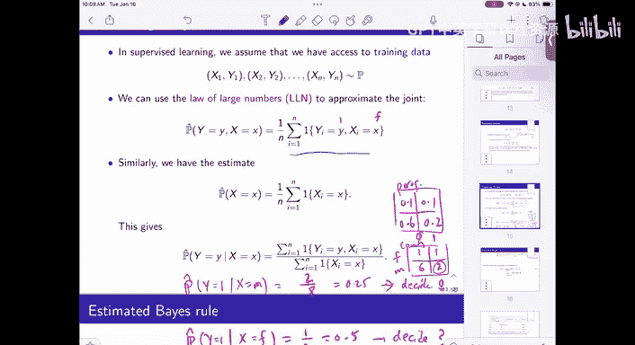

And that would be my role， so that's the plugin。

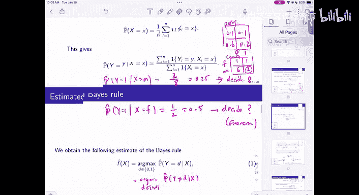

Oh。I should see what I call plugin。Or you can't say estimate again。Optimmal rule。

The one that has this here， just plug an estimate。And。So if you go through the argument that we did。

 really minimize。😊，The risk， but in this case， because I'm replacing it with this P hat。

 I'm really minimizing the risk with respect to this quality distribution。😊。

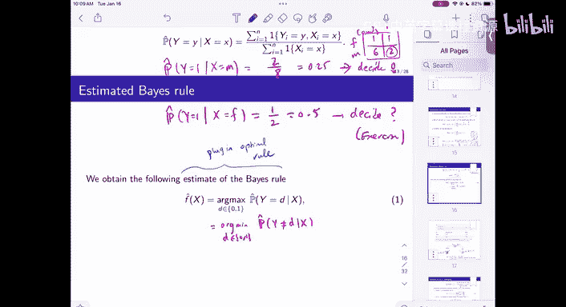

Which is effectively giving me the training error。

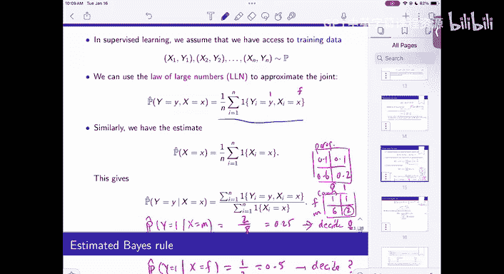

So， so if you。Follow through the argument why the optimal rule minimizes the base risk。

 you see that this minimizes the training because that's the equivalent element of。

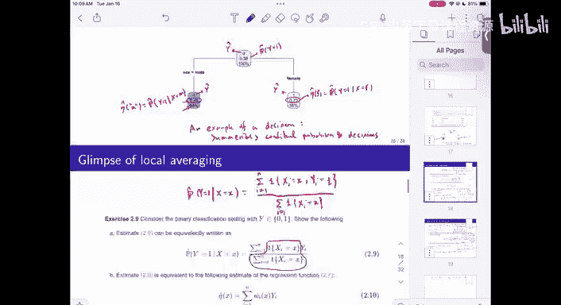

大ジ夫です。

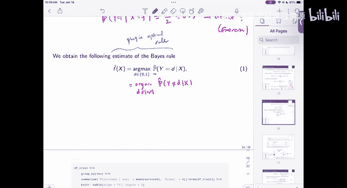

When we use empirical sounds。嗯。So if you understand this。

 you understand most of the things that we discussed in the past too。Lture。

 it's a very good exercise try to。嗯。I argue why this is。You can just think of this as。If you want。

You， this P hats。Of F of Xi， not equal to Yi， where this P hat is my estimate of the joint。

There's this guy， this joint。

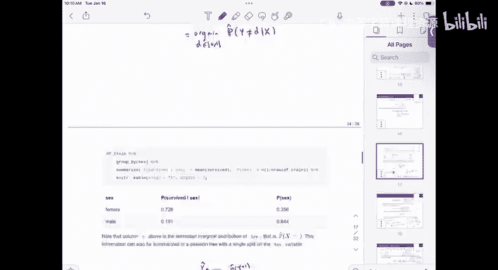

Thisjo estimate， I'm really evaluating。

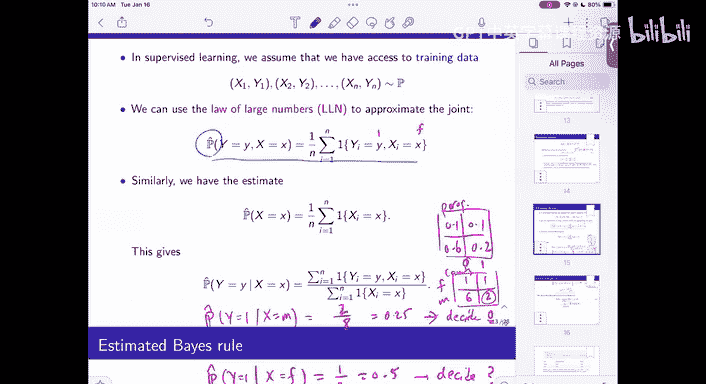

My error。Like the risk under there is。

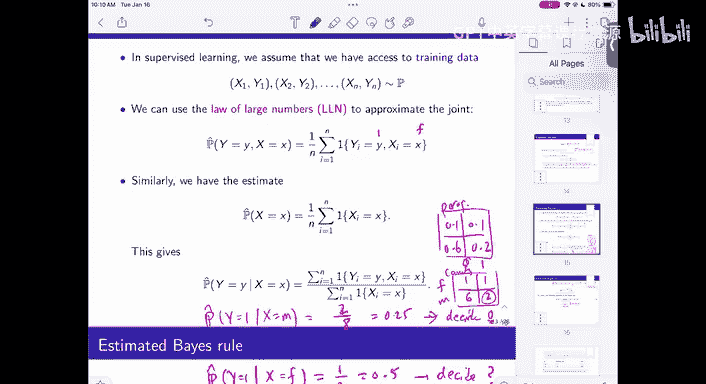

Probably their views。So if you plug that in， so if you think of this that as that then what I'm really doing is I think you can condition because its a value problem so usually this behind is a value。

😊，Pro all these survey with everything about probability goes truly to the condition on X and then the for that x what you should do sorry I shouldnt do Xi。

Here is just X。So what this is saying is assume that x and y are from P hat。

Then everything that we did just goes through， just just put ahead on the things。Sounds good。好的。

Any other questions？

So this is what we usually do entertaining to solve painting as split or splitting。

And it's the most common thing that people do machine learning。嗯。

There's another split's like train validation tests， three split。😊，So you can think of it as。

This training， I might split into like a really training part and an evaluation part。嗯。

That plays a role of test because。Do you want to train your pacifier and then there's something that you want to choose。

Based on the true error so you want an estimate of the true error when during your training and so what you do is really keep this part and then the validation say this any you like log the class and this part this gives you like an estimate of the true risk view the training and then can use it to optimize your classifier once you're done and you're kind classifier now I'm going to just apply once on the test to see like what the final is so this train validation test。

Is often used。Then during training， you want to like have a prediction of the actual risk。

So North can we like。诶。Like it this that you shouldn't use your training loss you can you always have training loss。

 but training loss so during're training you also like split it into a piece， don't touch it。

For your optimization， so usually you want to optimize like minimize or like a loss。

And so you do it on this。This key is the cloud validationle and then you buy the it allow on evaluation set and then based on that you do something like。

We' do some operation that makes like minimizes this validation bias。And then by the end。

 you have like this available， you have it passed by。

That set in the stone and just test it on the rest day that to each other。Report， okay。

 sometimes don't even see the test， some， some some people。

Keep the test out for you and then just publish a classifier they evaluate that for you。

Give you the results like so thats the state in not every single thing。呃。

One word of caution is that if you have the test， you might have the tendency to train you classifier and what you want and then test it and then go back and then pivot it and then go back and test it on this again and keep doing this。

 keep using your tests to evaluate the classifier and then modify at that point you another test because you're effectively using it again to train the fastifier so。

All events are often again so you do it kind like transparently it might be fine。

 but if you really heavily try to test it and then optimize okay this issue is going to happen so you overfit to the test data and so so it's the best if you want to do things to have a test data that you just apply once and in the end never like use it your anything if you want to do your entry and you can use evaluate。

U。So in this course， I'm usually not going to worry about the previous late。

 I'm just reading the test as validation。And there's no final as well I just really paint this。

If you wanted to do anything。But in practice， you usually do this like train validation tests。

Sounds good。It's like one of the most important things to understand。

 I think in machine learning it's not that easy so this idea of worth're fitting is。😊。

It's tricky so for a long time people thought if you。Drive the train error to zero necessarily。

 you're going to overfi and the testsser is going to go up。😊。

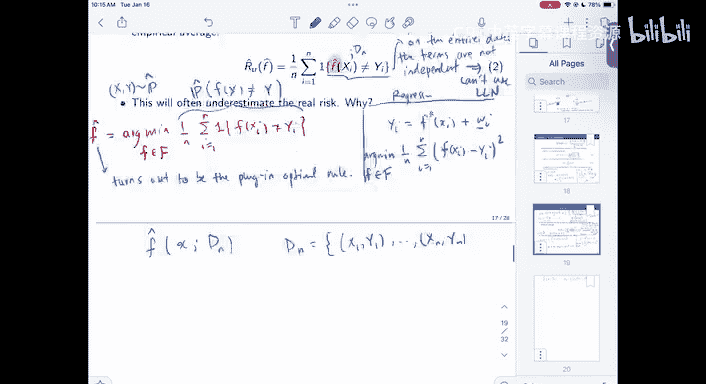

But for like deep learning， some of these deep models。

People observe that this is not necessarily happening。And then caused the lot。

Like surprise and interest in trying to understand so， but the overall idea is。Okay。

 the overall idea is fine， you have to understand first。Why in practice。

 like what in Prince thought it's not。嗯。Necessary that this is a good estimate of the risk because of the data dimension。

 why if you do the test it is going to be a good estimate。

 but why in some cases it might be that even if you drive this down to zero you're just little as good。

 this is making a more advanced。is it not fully understood。But during this chapter。

 I'm giving you like。Im here I fly up with be。可以。But that's for now， I a the classical。Picture。

That at some point。This is very clear why you do train test that？

Why the training error might not be a。Neither unbiased nor consistent， I think in the notes I have。

I it says， there's a statistical bias。So what you can ask， for example。

 is the expectation of this quantity。The same as this that's called unbiedness so I have an estimate is the expectation。

Does the expectation match？The actual thing I had one estimate consistency means usually you had an estimate。

 which is a function of n does the estimate converge。😊。

And probably you let's bring to the through one and end those thinking。So here are the space。

This is both on biased and consistent， but if F becomes of chain data is not on biased more can system you general but if you do this。

It becomes both unbiased。The expectationation of this。

But the conditional that kind of the expectation would be passive through the expectation each one of them would be the probability the there and then M of them is just they have the same footage so they they can。

ACorrect one and also convert to points input。

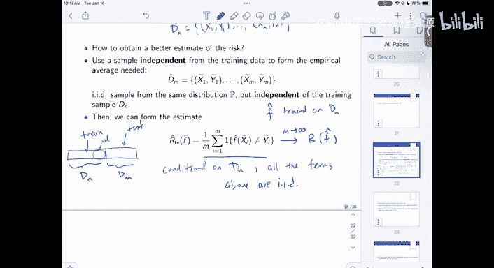

I'm biased and。诶。Unbiased。And consistent。As M goes to infinity， let's say conditional。AndD end。

It's like tribit。Unbiased is。We qualification as a conditionで。Okay， that's training， this validation。

 any questions？他ments。

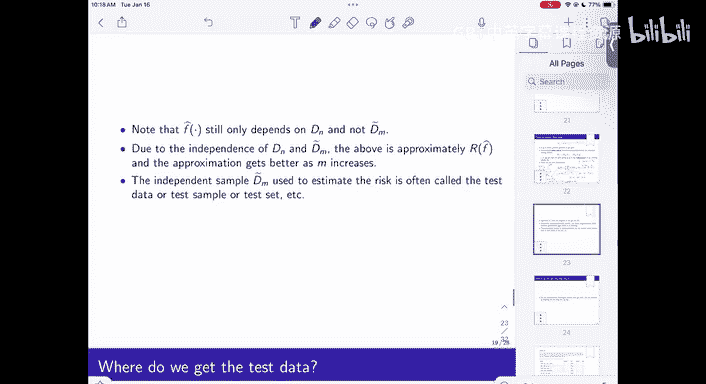

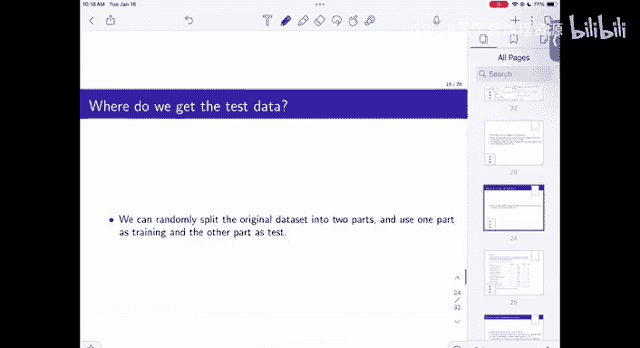

OrWhere you get the test data usually spent。If you have access to the data generating process。

Like if you're doing simulations， you're actually generating your samples。

 you don't have to display so you have the training data whenever you need new data just generate okay I've seen people。

Do this split even if they have access to the later process。

 you don't need to do that as long as you understand what you're doing。In simulation。

 once it's in your hand then。Just generate more samples。

 but in practice you cant you just have this fixed data set that's what you。Have to spare some part。

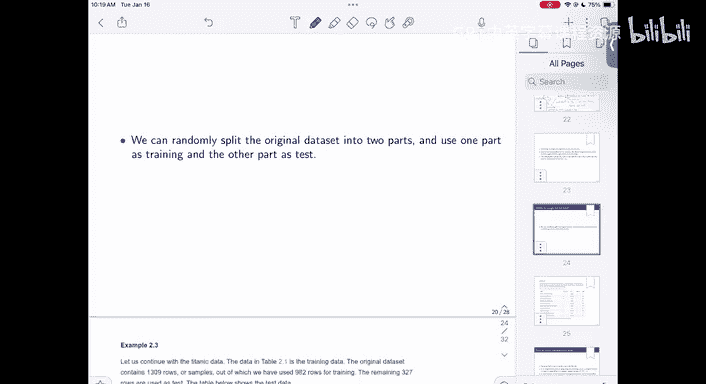

Okay， I guess this on this side。Use to。E value， I'm gonna escape。

So I think this deficit I might probably share。诶。This is the entire Titanic data set is more so okay。

 this many data set，m sorry they're dis tiny rows。😊，1，809 isolated each these two parts， let's say。

982 for training and 3274 it。My test， the 982 is what I showed you and what we built the classifier。

O of' a very blue glassifier based on these two。Um。And。We calculated the training error， actually。

 the training error is 0。22。That we have seen it because the numbers that I did was for training and if you do it on the test data depends on that。

The test error would be 0。217， which is very close。诶就。Okay。So in this case。

 actually the training area is not bad。呃。And the reason why it's not that that your function class is very small。

 like pointed that。So you really can't drive the train error to zero。

 because just add four function and there just many example。You don't have a lot of me rate。

 I shouldn write it down so because of this on class。He doesn prevents it from over。

It turns out that this is happens。And。In this case。Which might like also hint。

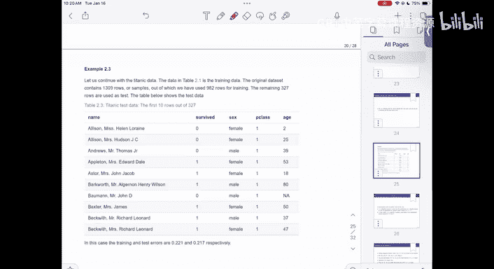

Why sometimes poorfe might not be。An issue。

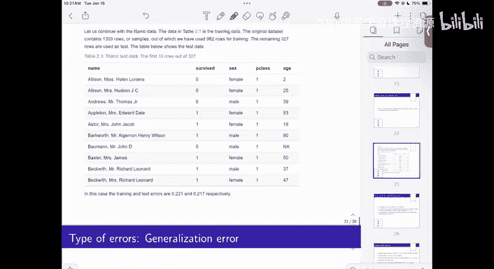

呃。Okay。

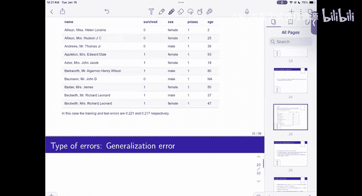

I don't have much to say here， you have to get evaluated on。

P data it's really easy so you have can classifier and just go classify。Each of these。

 the classifier gives you like the prediction that you can also have them true well and you just con and encounter all these matches of your test there。

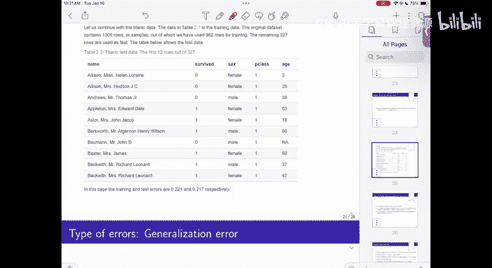

So generalization error， generalization error is another name for the risk or the population quantity that we look at。

 okay， so that's that P need。😊，嗯。F of x not equal to y so the tests are usually an estimate of you can say the risk is the decision we call the risk machine learning people usually call generalization error because we want to say how the performance generalizes to unseen data。

That's not actually。诶。How the performance of S and generally to generate and。

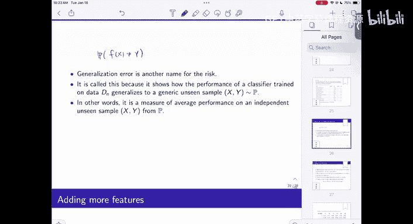

嗯。Okay， so it's just another name for。And。Name for the risk。

And we have restricted ourselves if we class to this particular01 loss。

 but remember the risk is really expectation of the loss。😊。

So you can have a general loss function here。嗯。That's the risk。You want， this was the risk。

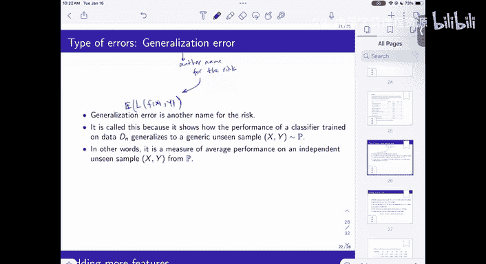

Okay， generalization is not bad any questions？

So now let's get back to the the。

More features。 So I want to add more features。 and I also mentioned this earlier。

 So let's say I want to。

At this P class， so this is going to be my。X， this was a simple essay say this is going to be y。

This is going to be my ex。Yes to be my x now， let's say this is x1， and this is x2。

So I'm going to classify based on these two features and I'm hoping that I'm going to do better because I'm using more information。

Okay， so collectively， this is my X。So x is now a vector there sort of for。嗯好了。So how do we go about？

Within class five based on these the class is still categorical that's three classes。

 so this is in one， two three。This is there。Passenger class。This has two values。So what is。

What is an approach can we like get the classifier here？Do I have to do it anything special or？

What we have used before， like the ideas can a cell apply。are you。

Maybe do recall what we did for and just had this be sharing。我会听你听唔见。How do we build decclassifier？对。

That plugin up tomorrow。Okay。Yes we guess probably。

Y given right so the rule if you go through is going to be the same so you want to calculate the probability that y is equal to d or not equal to D given x is equal to x。

 you want this conditional probability。And for a given X。

 I'm going to maximize so find the decision that maximizes this or。The decision that minimizes this。

对。It's ag max。嗯。We talked about this peer review， it's the same idea。But X is now。嗯。

the thing to note is although it's like a Victor with two coordinates。

 it's reading another category are valuable with six level。If you count all the combinations。

Email one， male one， email two， male two， female tree， male stream。

 there's another categorical value once you have two categorical variables。

The number of you can think of it as a new categorical variable with the level as being all the possible companies。

Okay， so it really goes back to a single category of variable。

And I just knew。Contract a new categorical variable which has six feet。对。

Then I can compute the join distribution， for example。

Which is going to be like why and what' one side and then。This new X， let's call this， I don't know。

呃。X prime if you want， this x prime on this side。ok。给他。嗯。Zero， one， and then all these levels。

And then， you can。Compe the joint distribution。嗯。But the case elaborate telling the samples and like or zero and。

They're combined assistance。And then just fill out the proportion。From your training date。

So you'd get a table like this。So this is really easy to calculate so you go through all the training data countcoming habit its care few。

Okay， this this。Response or this target and this error feature。

so you get an estimate of the joint for all distribution from this。

 you can calculate the probability of survival。Y is equal to1， given that x。Is a particular one。

 so that would be the regression function in our case。Okay。啊。So I want to compute the probability。

 conditional probability， right？So， that would be。The probability that y is equal to one。

And x is equal to x divided by the probability that x is equal to x。So for example， ifx is like。

I don't know。没有。😔，Two， okay， that that's maybe like nail tree。Then。

That's the joint the probably if you have one equal one and that it's this。Divided by。

So what is the probability of aB。What is this。Yeah， you just had up those too。Point。Three， seven，7。

And then it turns out to be something it definitely less than one half， so I know the decision here。

 right？走得 definitely该什么呢。跟我就一起去。That是 by人。There， there。 And then if you look at these， you would see。

The same idea is and is divided but the some of the two。ItAbout 8。02。Deided by 0。1。

102 divided by 01 would be with。So about。002 divided by 0。1。我会你边。I point too， okay。

The still like classifier as we are。This one。可可对。Like 49 divided5。诶。对。0。

049 divided by the sum of the two。Yeah， I let you figure this out， okay。

 so you can just compute the conditional problem basically you。😊。

 and for this table we did that are many comparatives to one high threshold。Okay。

 does that make sense， this is the same procedure we get if you go back。

This is the joint distribution calculated from empirical averages， you can fill out this table。

 hopefully everyone can do this if you given the data they I can complete the conditional probability。

This is the regression function I just need to activate the survival probably because the other then the rule would be this is like estimate okay so that's like I want to be precise this is my estimate this is my estimate that the regression function and the decision rule is really f hat of X is saying。

😊。

One， if Ada had is bigger then。One， half and zero。If a hat is less than one hair and then if a is equal to1。

嗯。So this one， for example， you can see like 。1 divided something was very。Couse one。

 so there is going to be a yes， like so it finally is。这本天对吧。This one is tricky。

But once you go through that。

If you would end up with， I can summarize the whole thing again in a decision tree。诶。

And these things if you remember are those conditional probabilities， okay。

 so this is the conditional probability probability of y even one conditional and nothing。

 but the base probability 38% of people alive and then you go all the way down。😊。

And this is that that like this is 0。99 so this is like。

嗯。If you divide this by the P sum it iss like 09， so that's f1。

So female and passing class one。99% of9 survive， so that's like the decision and the one I thought so award。

And's aena and passing class two the condition following point then then you can have it all following。

有 thank you。Email and3 is  point4 hands like know bit threshold and so you best here。

But the male population portion doesn matter just very well。呃。

Not so why but there is a reason why this happened， but you can read about this Soviet Titanic。

 you probably know all what happened。So I think Patrick pass doesn't make much if you remember。

 the decision was like females survived without male that survive， if you don't。

And the if the add present class doesn't change the decision here。

 but changes the decision with email branch delivered。So if they。

Our passing class trees is like they're barely below the threshold。嗯。

You get so you can see the numbers， so these are the conditional probabilities。😊。

And this decision tree just summarizes everything if you stop at this level。😊，呃。

They have our previous classifiedifier， Okay， so that's like 019， if you remember。

 is like the probability key enough。The I name you that the real， it probably survive。

So at this level， I'm just let they go down the past final so this is a very nice pictorial way of summarizing that conditional distribution at different levels and also the classifier。

At the base level I it was saw here， addressed by everyone in not majority。Okay。

 and so you can have the tree branches all the way so the way the software doesnt our part package。

 it just it doesn is stay until by area stay based you dont have to do smoothing，嗯。

That's what it does in this state。Does that make sense yes what is the percentage is it the of data yes。

 so this last one is how many of the data like fall into these。that one going 36% were female。36。

Ptside verina。And okay， I think the for man and so I'm sorry。Okay， any question？

WellI can mention lectures or like what is the condition of probability is exactly like 。

5 is either decision so that's the homework problem so you have to think about it based on so our if your goal is to minimize the probability of error。

Right。Go through the argument that we did， just just for the binary case。

See what what you should decide， does it matter or does does it not matter so you can see from the。

Thevation that we did whether it matters or my goal is to minimize the probability either there。

 assume that you know the actual final probability predict the P， you know。

So you have to go to the variation of our optimal roof。诶是。And if you understand how we did that。

 you understand what you should do that。Okay， any other questions？

It's very unlikely that happens in practice， but if your data is like very sparse。

 then it would have if you have a lot of data then it's like。😊。

So one of the things statistically doesn't matter using do 9 or 9 or。即系赶翻嚟，你真唔系咩嘢。

1 five and this is really not the conditional fault we need to remember this is our estimate of condition building。

 there's a margin error。As the margin areas in。Lge。诶。

Then this decision is not really certain and in this case you think I'm going to go a little bit over。

 you're not going to do a lot of statistics but a little bit than it doesn't have so statisticians would worry about because it's really near boundary and our sample size is finite is made this is below low 0。

5 because we maybe it's really 052 in the population that what have there。So we have naza。

Dealing so your're statisticians majority of you so you probably know how to do a test。

 whether this is significant。Different than maybe be00。5 or not。I'm going to talk about。

Similarar idea， pretty shortly。没关事。Okay， so this can be simplified just after remaining9。

If male in South here at this level， in female know we're going to do this in here。

 but really I don't have this right here， but I don't have to live here so it's radio。If you do it。

 I do it with it I did it with an option， I forgot what the option is to just go all the way。

 but if you do it with the default in package there which is like a simplified version。😊。

So this is different than the classifier that we had before we think that this here。

Potentially a bit pro， so now you can evaluate the training error and you would see that。😊，诶。

The Fing areas point。2，1，9。The previous one that we had to say since was 0。221 very close。

And the test area is 0。211， the other one front is 0。217 and very close。嗯。

But now that I should use another variable。The class of functions has become larger。

 so the number of potential classifiers is no longer at four。But much more， anyone。

Thats how many classifiers are dealinging it now。They have like basically have a category variable of six levels。

😊，So having categor line potentially six levels walls。And I have a binary slide。

 so I'm looking at functions that map the categorical labels with six levels。To a binary response。

This might be a homework call， although I don't know sign it or not， but you have how many functions。

第二。Anyway。Off the top of their heads now， like I want to like calculate the number of functions from a set x to y。

😊，The cardinality of this set is x， the number of elementsity， the cardinity of the set is y。嗯。

In this case， it's two， this is six， but there's a general formula。Right two to the six。Yes。

 because it might be a homework problem。Oh right as you before the carinality of that was two so yes。

 was the two to the two yeah， it was it was hard to see which one one of the three one， but yeah。

 this is so two to the six is。What is it。64。So right。So it's exponential I can see it。

If I had that 1 maybe60 level， that was 160， it would be 64 to the 10， this is very large。

Theequ grow the stays a function。And then once your space of function is large and you have to worry about all the things that I mentioned。

Then you start to like have potential for or。64 is still like maybe not too bad because you have like a thousand samples。

But by the time your number function much larger than the south of then you have to starts to worry。

嗯。

So what I want to mention okay now。

AnyQuestions， I just want to do this statistic a little bit and the want is this really statistically significant。

 So the difference So have now better class part currently so。Asary is 0。311。

 the one that just doesn't based on site is 0。2178 next segment，2。7。t217。

The errors in studio encouraging。Is it treating that much better？

SoAnd machine learning people fight over like these 1% of the in kilogram。Is it。And we like evaluate。

诶。So this is a simplepl classifiedifier that fix is extra complexity work do I want to？

Because I can always drive the training error down。By increasing the class of functions。

 not always the test error， but in this case on it seems like the test error also let down。

 it seems like we're under good。S of things， but is it extra like this extra complexity warrant it and you can do a little test you can do a little。

The statistical test， which maybe I briefly mentioned， so suppose I have。

If you remember these test errors are basically added than indicator variable。

 so the test error was like。One over， and I'm going to condition on。I's say one over am。

I from one to N。Indicator。Fhead of X I Tilda。Not equal to Y I tillda。So condition on。And condition。😔。

And the training data。Yeah。So now I've had this fixed and then myself was already so think of these as。

😊，Now， the eye。嗯。This is like F hat1。And then I have this is M I'm lets say I'm testing on the same test data。

 so i from1 to M。And then I have。U。Have had two。Of X I not equal to Yi。So call these WI。

So I have average of the I and an average of WIs， and these are maybe to two tests。

And VIs and Y look atvalued， they're binary rate and they have a second problem with a probability。

But the same one is really there risk the actual because that being expectation or the problem the probably this is that you call we that this is the all or this this is true is the truest theres the eye。

You can think of it as the eyes is like bare newly。With probability， which is the true risk of。

F has one， I'm calling it the P1 and the same for the other one。And。R of F hat2， this is really P2。

Okay， so there are these two probabilities that interview there。We can Paris for the rest。

And now I just want to compare the two hours， so assume my assumption is if they're equal。诶。

You can also test it and you want bigger than， but let's say， I want to say another that。

 should I reject and should I reject the assumption that they're equal when they have。

The same kind of there。Now to assume that theyre嗯。Equal then well first this is a good estimate of P1。

 but this is like as we mentioned， so this we can think of it as P hat1。

And then this you can think of as P hat2， and then I can look at the difference。

 the difference of these is P hat1 minus P hat2， and if I have a measure of the variance，😊。

So let's say have measure of the variance the standard error of this。

 though this is like an estimate， it has a standard error， but it has a variance。

The variance turns out to be。嗯。Okay， so some issues is like these are not independent。

Because they're based on the same thing here I'm assuming that they are independent。

 but the calculation also gives you。helello。On the so it is okay。

 but as it pretend that they're independent based on independent test data。

 So say I have to explain my test data into two parts。

This is one like one class and this the other one or that。

 I have to divide just by like a standard error。

And in this case， it would be approximately normal。Will be roughly normal and then can I can check。

I don than know that he had one is going to be roughly。Okay P hatAT one is going to be。嗯。Oh。Okay。

 I think the other thing but the thing is that under the nu the knee goes away and so this is going to be expectation zero divided by this standard error roughly normal and then I the normal。

😊，Consistently， the normal distribution would much bigger and it can quite bigger the normal in there。

If it's not I not back because we're other of time you come out and do this project。

 but you can think about this， I'm just doing simple hypothesis script what key want。

If I can reject it then the different class， if I can't reject it then then say you don't have lot。

AndSo probably the statement is smaller and didn simple。

And I think it there's not really enough data to reject the know that they have the same。

They population risk。