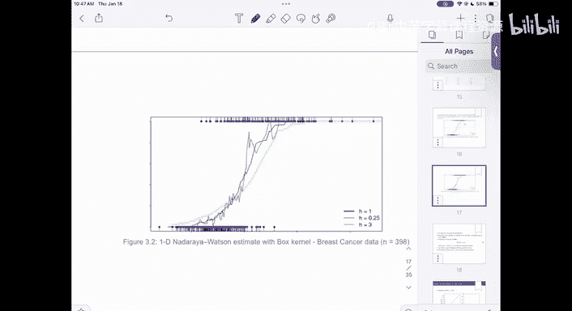

# UCLA《模式识别和机器学习｜Introduction to Pattern Recognition and ML Winter 2024》中英字幕 - P4：[04]Introduction to Pattern Recognition and ML -- Lecture 4 - Winter 2024.zh_en - GPT中英字幕课程资源 - BV167BfB8ETK

And here we。Last time we ended up here。We considered。

Two classifier one days and signal finally teacher the other one days on。系。

Let's see pair are teachers。But one binary or the other one category called the tree in level。And。

So argue that we can view another case again as a new category variable with six levels。

And so we did our like plugin estimate of the optimal rules。By a B meeting we joint distribution。

So if you recall， we had the joint disturb oceanion from these empirical averages the condition third oceanion and can supply there。

On Bas rule or the Gtimore rule， which is its threshold these kind of local abilities ats over one half。

And so you'd end up getting。This simple picture。Like summarization that's simple summarization of the A or the conventional distribution given all the possible choices of the two variables and so this gives you the optimal classifier well sort of the S estimate and so it turned out to be like this and so this is more complicated than the original one that we had based on just say so we wanted to compare or' say whether this is much better than the previous one so we did calculate the this errors this one is like 0。

 11 and for the other one0。210。So at this point in machine learning community。

You're good so you this one beats the other one so it's a better estimator they do report error bars so they will。

你问就边个死仔。They out that you put an error bar around those okay。

 so if they  point211 plus minus 1 error， which is dependent on your let's say test sample。

And so basically you want to do that。And so。Maybe this is considered area or not。That's good okay。

So that's sort of a little bit of a statistics there。

Started doing this there are a couple of days of doing it。

 the simplest way of doing it is just to recall。That these test errors。this aver。

 so average we indicated variable and with indicated variable energy。诶这。嗯。

This indicated that you're classifier。嗯。Caked with。Is not like a。get a mismatch。

 we can class output and the actual labels on the test data。The probability here。

This quantity and the population knowledge is just the risk。

And so this been a critical average and it's just an average of a bunch of beno variables。

 each of which has this quality the probability even。

This is one it's just the risk because that' evolving into there。

 so you're the sampling of M very only variable each with the correct color I probability that you want。

And so for example， so this would be if I have a random variable instead of certain way with Z1 up to z net's say M。

Very only， let's say P1。What you're doing is really。Forming this estimate， he has one。

Which is the sample average。Of these guys。Okay， and。And then you can also form。Vance。

Right like you can compute the variance of this estimate so what is the mean of thisestimator let's see see how many of you。

A you staff neighbors？What is the mean of the sampling？These are IAD。

The expectationplication of simple link。Yeses。The population the population mean right so it's like just the expectation of one of them which is P1 so this is unbiased forest P1。

 which is our risk。So what is the variance？Of this estimator。なさ。怎样。So开体先的 iIデ。

So what is the variance？这三公面。So this is really not。Machine learning is versus statistics。

 so whenever M comes out， you get M squared and then the variance of the sun。😊，Which is the。

Some of the variance is because。Because of independence okay。

 so you get m times the variance of one of them。So the entire like in the end， you'd get。

There's an MS squared and there's an M so you get1 over Mvari of z1。So if you have an IAD sample。

 the variance of the sample mean。Is one over M divided of one of them。情况系。

The the expectation doesn mean one basically， but the variance goes down by one over。

The entire sort of the statistics is built on the fact that the variance or the sample means sort of goes down okay。

 so you get a better estimate more accurately。So。Is this sort of？So I can。

So what is the variances you want， anyone knows what the variance are。嗯。He me more。

What is the variance so the bear newly valuable？One times oneYes， exactly so that's。Okay， I can't。嗯。

So里 goes here。I'm here。 We're gonna come here。And then so basically variance of P hat1 would be。

P1 times1 minus p1 over。M， and so we don't know Q1 but you have an estimate and you plug you have one here and using an estimate of the variance。

If the variance is this then the standard deviation。It's just the root of it， okay。

 root p times1 minus p。Delighted by Ruth M。And the standard error， the so called the standard error。

Is an estimate of the standard deviationation， so you just put the P hatth。This is Pland。

Do what he had one here。Okay， now this one you can compute。It goes not like one where we him。

 but that's also there。The really whatever weekend is what matters， so this tells me how。

So basically， you're thinking of。This we have one plus minus the factor that's your error and how many M you use to calculate it determine how small this gets。

Okay， so for example， I can compute this。嗯。So you can compute it， for example。There be room there。

So let's do it here。😔，嗯。ItYes。It's really。你还做的是心态。Thank you it is this imperative thing。So。嗯。Right。

 so for example， I can calculate what was the other one。Right， this one like。So let's say Pha one is。

211。And I think， was。诶。Yeah， if I believe， I believe it was。嗯。Yeah， so 327。T。

So the size of the test data is that。Okay， so I can calculate， for example。This standard error。

You guys can calculate brace like root。One， two， one， one times one minus two， one， one。

Divided by its3，2，7。Anyone can care it？感 you later。六 point two one one。That is one minus 21 word。

Dvied by three2 seven。So it's like maybe roughly 0。02。You buy something like that。

What we' is saying is like， okay， it's like plus 2。1 plus minus factor。

 let's say if I want to do like who standard deviation the they would be like。

Plus minus either date they reported as。The variance， or you can say like， okay。

 about two times these are rough calculations， two times。It's called the Sigma hat。嗯。

I want to go to a standard deviation array like that。嗯。Point4 okay。And me say 0。

4 the other one is like 0。217 so the error is I got the order of like 02 0。02 0。

04 just covers the other one so the other one is Nik。He had two is like 0。

217 so if it's like maybe0 this is maybe 0。0 to one1 maybe plus or minus。

This in the second digit could go up or down。系。By two or maybe four。

 so they say out to dominate it so it's like。你你。They're going to be careful deciding that this is really better as enough because if you add the error。

 this is within the range of errors of this。YesThank you。Saying， okay， I did think T1 is here。

And my interval was like P hat one plus minus like our plus。It's say two sigma hasline。

He had one minus two sigma has one。So this is were assuming that P1 is here。吓。And。

So really P1 could be here， okay， but if it's here then。嗯。Really honestly。

 you have to also like compute that。没有了。Instead of the fact that this also has a standard error。

 some don't even agree deliver on property。But this rough calculation tell you yes who would be like okay so if your sample sizes it these off the same order so this' is going to have the same uncertainty if you do it for this it would be like。

F don know if he had to。Would be rude， it's the same kind of object。By Ruth M。

And this is going to be root 0。0217，1 minus 0。0217。

 so de numerator is going to be roughly the same but the denominator is roughly the same so this is going to be also roughly 0。

02。So you have this and the other one is。诶。There's also the P2。嗯。Yes， so imagine。

Its the key like seminar by again this plus minus that， so these two interval wallss overlap the lot。

Okay， so they're really not。And any of you are think key1 is much different than P or the other ones probably。

We don't really know P1 or P1 ist it？We know the P1 is in this interval。

The other one is like slightly。About this。So this is for P1， this is for P hat2。嗯。

He had two is slightly above because the center is above。嗯。I think I had to bring into。Okay。

 so there not much。Confidence that they're different。So we can't tell。

If you want to do it a little bit more properly， you can for example。

 just look at P hat1 minus P hat2。And then divide by the standard error of this。

I'm calculating the standard error of this would be a little bit tricky because。

These two guys are not independent。These survey variables are based on the same sample。

You can actually ja。Yeah actual。嗯。Estimate of the variance。

 but considering the covariance of these two， but I'm going to let's say if you pretend， for example。

 if you pretend。嗯。That they're independent， Okay， they're based on different samples。

 the variance of。He had one minus P hat two would be anyone knows if they're independent。

Assuming independence。If you things are independent in the variance， race up。

Like with variance of he hats。One plus variances if P had2。Really， there's a term here minus two。

Covariance if he had one and he had to I really don't know what this is。

 but we're pretending that this is zero。Exactly is the if that's the case。

 then this is just going to be。And so under no， so under the null。

You're going to assume know that p1 is equal to p2 is equal to p and the variance answer this would be p times1 minus p over m。

 the variance answer of this would be p1 minus p over m。

 so this whole thing would be 2 p1 minus p over m。Okay， so the standard error would be。P1 minus。

So a deviation would be root of this。Okay。standardandard error would be an approximation I can put。嗯。

If I have an estimate of P so under the null I can I can combine everything so under the null because I know they have the same P they're the same very nuly I can just form for example。

 P hat instead of。Phad， it would be like one over2 m。Sation， let's see。Z I啊。

LastWI are these guys from the other estimator。So if you do this it turns out to be like one half p hat one plus P hat two it's rather simple so this is Id like a cold estimate of P under the nu you can plug it in there right it's a better estimate of the variance broadly。

😊，So this is still in our case， will be about roughly 。0。2， one， let's say， because they match up to。

Up to this。Or 0。02 I mean you can do rough calculation the real the real thing that matters is this。

Okay， so you plug this in and so the standard error would be。嗯。这はです。The square root。诶 two time。

R these point。2， I guess it's like okay， 0。211 that's 0。2。On seven， divided by two。Yeah。12， one。

 one plus  point two， one， seven。Right it by to。like point okay point。Two， one， four。

They plug it in square root。T times 0。214 and1 minus。1，2，1，4。Deivided by。t three seven。

I believe it's like， okay， this is going to roughly turn out to be points。0，3， two。

If I haven't made mistake， I'm not sure。can you guys can check， but that's that's going to be that。

And then the idea is that you can argue this is not hard if you。K ashnttic distribution in this case。

 you can argue that let's say this basically P had one LP had two。Invided by this standard deviation。

Which you're approxiating this is the trues standard of the age。

 this is going to converge to a normal which means zero and。嗯。V slide can this survey under the note。

And so with large sample size， we're going approximate it see approximately this and I'm plugging in the estimate of this。

 but that's also you can also show this as well like。This， I believe， is also true， a standard error。

 which is an approximation。This also converges to the normal so in any case I have calculated this。

 this thing turns out to be。In our case， turns out to be。U。The difference would be like。217。So。Yeah。

 p minus 0。211 minus 0。217 divided by 0。032。What is this for。21，1， minus1，2，1，7。Devied by。发现者有吹潮。嗯是。

嗯。Let me calculate this correct。Can you do the calculations？Yeah， okay great。

There's going to be negative 0。18。7even five， something like that。ok。So。Under0 to know。

 this is approximately normal and what we observed is like negative。我点点。Something like that。

 is is this consistent with the null。Usually if you're stattician， you'd say， yeah， very good。

Consistency with dental。But if I know is not correct， we expect it to be late。5， six， back two， a。

So this is the probability you observed something like this under normal their。Theyre probably。

 is there something interesting。So the probability that this is bigger in absolute value than it is large。

So usually we reject this is quite not the absolute take absolute value and then kind parent。

They quantize what so you do think that it's bigger in a 1。9 set sink than agree。

This is really not bigger than what。So it is a little bit more proper， yes。

You said that P had one minus P hat2 by standard error a poly normal distribution rate yes and what is the value we calculated  minus0。

1 so this is the reallimination this in this experiment that we have。

So if these are if you repeat this and these are random variables right。

 so the random variable as a random variable they're miscon in， what is the saying is。

Let's say for how a sample size M。Thats the data weight you calculate once and again's like driving this and next time you calculate it it will be something else next time it will be something that we did very many。

Not发。Assuming that the no distribution was correct。And however， I myll hypothesis is true。

So you don't say like you don't say the know how about is true， you'd say。

If the no hypothesis is true， I'm expecting to observe this to be like。

If you repeat the experiment many times， you'd expect to observe that this is。嗯。嗯。有。

This this looks like this when you repeat it many times so now you observe something like this like something here is very close to the ball distribution so you don't reject if you want to be really statistical what you'd say is okay i'm going to。

I'm going to re right of time I can space again。So let's say site。Not。So re reject。

If let's say P hat1 minus P hat2。Divided by standard error of P hat one minus P hat2。

 if this is bigger than a threshold。Okay， if I reject like this， then the probability to reject。

It's not if。Yes， so that then the probability of。Reject。It's not。Given like under the H knot。

 so you I'm going to put an H knot here， so assuming that the H knot is true。

 the probability you rejected is the same as the probability to your normal distribution。😊。

It means zero is bigger than 1。So you'd set it equal to alpha， let's say a certain size。

 so let's say I want to 0。05 and this turns out to be like 196 So what is the saying is it？嗯。

The model is gray， and then all is true， then if I reject it at this level。

5% of I' going to be wrong。Okay， so not in this particular example， but if you do it many times。

 let's say with different samples。5% of the time on know you're going to reject。

 but like 95% of time you're going to be okay， okay。

 so so this is going to be your rule that you're going to do in like an experiment just apply this rule。

is this bigger at than 1。96？No， so we don't re numbers。そで对。You can also calculate the P value of这个。

Just the probability。The probability that enormous the reason likely absolute value and this value。

This is another way of doing it so you can say what is the probability that a normal distributionserv just value bigger in this。

And now we need the P value and the P value is。Let's say lesson。

005 regular logic that's going to be equivalent。But。In this case。

 declared that P value would be large to probability the normal distribution bigger。

And so it's value than this。like。8' don't worry about PI if you know like statistics you can also call compute PI it's an equivalent way of doing it。

But otherwise。You just want to say it's consistent like clearly， if I expect normal the。

 I see something like this I fine if I see something you may hear and then very unlikely。Yeah。

The reason that P1 hat and P2 hat are actually are not necessarily independent and we have to assume if they were is because they have the same test data right yes yes。

 yes exactly test P1 on M1 yes P2 on M2 then you're going to go that would be perfectly so the reason why I'm worried is that I'm using the same test data but if put they't put and then one on1 and the then everything would be and then it's the standard error is equal to dis of2 P hat and1 minus P hat over and if the sample size are the same for the yes yes yes yes exactly yes even if the sample sizes are not and actually doing the calculation here you can do it for yourself they' not you can because the variances would be the sum of the variances just。

P minus p divided way m1 plus p times0 minus m2 so thinking the new M D that your harmonic mean up the two that's what happened。

It would be like this so an our。Yeah， so this is a good point。So it would be safer。

You split your sample， but the issue is the if you split your sample then。嗯。You're less accurate。

 okay， there's a bit of。嗯你在 thank。Decrats。The are interesting things if you want to like dig into the statistics a it in this experiment。

 the data is like I think posted， I probably not posted it。

 but I'm going to post it during doing that。You can do different things you can go calculate select to three point。

You sell many two pieces for yourself and tab it。B errors and then do this test again。

The other thing is that you can actually calculate this variance here so you can。嗯。

You can exactly calculate this。And the way to do it is。你。I you can calculate the answer。

The sample means or you can just。It turns out it would be like。诶。

It's enough to actually calculate the covariance of these two like individual ones。

 you can see it's like I can just add the covariance here minus two。😊，嗯。D would turn out to be。And。

Should we say it。呃。Okay， so you can either can the variance at this level。

 but it turns out that it's going to be like one over and then minus two。

And of the covariance of paires， so you just have to calculate the covariance of。These two objects。

This and that and these are two be newly variables because I guess the two be newully variables is easy。

So expect the expectation of the product。Minus the expectation product expectations the expectation of product is where both of them are one probably that both of them are one so you're going to have to calculate make the go over your test data and see for which ones both of them。

Make a mistake。Okay， that would be the probability that。ZI is one and WI is one。

 which is the expectation of ZI times W1。Minus the expectation of this。

 I the expectation of this this is that here had one time that。So that one you， you know。

 but you have to compute an extra。Thing which is how many times these make mistakes at the same time。

And that gives you the co I'm going you think about this。

 but you can actually calculate the clients here from the same dynamic adjust for that。

And hopefully get a better test。嗯。Yeah， but the main like idea is I guess if you're a statistician。

 you're going to figure this out for yourself at some point， okay。

 the main idea is that the sample size random。😊，Okay， and then the error is going down like one over。

So this guy is going to be。Es。Well in general， let's say it's that not， but this is one the one that。

It's going to be determinant。And so you want to like the rough idea is like one over root and。

Gives you like roughly。The scale obtained thing up to a factor of four。

 So this is either when it's close to0 or one。 this is0， by it's one half， it's maximum。

 means it's one half is。嗯。One， four， say one half and one half。

 so one four and it's like one half so it's from zero to one half。The key is like this。

And so check this like one over am just to do it a rough definition。

They may be multiplly by root of one half。That's the more safe that it can be。And then this。

See if your differences if you observe are within this tolerance。Theyre reallyal。And。

Then you can do like having that it classifierifies better agree。

So you want these intervals to be separated or distributed in large。So buy difference wanted to unit。

Myてで so that's me like to。Bigger than 1。96 or negative 1。96 smaller than。ok。😊，Yeah。

 so in the case shown in the slide is the testing data the same or yes， yes， yes。

 you're using the same testing so this is likely that accurate I actually don't know what the covari is。

Because it's not enough to。Just compute individual。

 So you have to also evaluate and enjoy the diversity how fashion of the。This case is we both。嗯。

ですからすね。你哋开唔得。Theres a good site， if you want I can assign it does a homework problem and you can go in。

Check， maybe that's a good homework problem。But sort of roughly。

Im assuming that if you have taken the statistics with district these or sounds familiar and you testing two proportions。

 really two proportions are the same we not very very classical。A statistical。就啲啊。Okay。

I the innovativenova investment comment。Okay。So we concluded that they're not maybe maybe。

 so the thing is。People usually go with a simpler model if there's no reason for this。

Looks slightly better classifiedifier， but you're not sure so will stick with this in practice。

It's often safer to be to use a simpler model so in general when you add more complexity to the model the training error is going to go down sometimes the test error also goes down but as a can see it's not obvious。

That the more complex loan that it' always been。And so the idea of choosing between two different fastifier and two different models and then multiple four different passifier and statistical they call it model selection and what we did was a very simple idea of model selection。

 but in general， like within two models often you can do a test。But when you have multiple models。诶。

Then the share is the same。Is a problematic because。

So you're going to incar the penalty of mal testing， but the。There other rates， other ways for go。

Into that。This just gives you an idea it。You don't want to always necessarily go with a more complex one。

ok。Sounds good。对。Okay， let's go back。Okay， now you're going to move on。You the next order。啊。

After there the notes。Which is so how to deal with a continuous teacher。

So lets suppose I have a feature Victor there， which is an RD。诶。So it's a D dimensional lake there。

If you want。M is x1 up to xb and again in the simplest case， x is just。a real lawyer。

 it's the simplest case。It is one。 So I just have。诶s了。X is an R。But it's not discrete。

So now the question is that how can I like any of the things that we developed can be extended through this game？

An example in the de case is just normal zero and identity covariance matrix or a uniform distribution on the。

It's called the cube。大就是 thank。In two dimensions is's just。嗯。The square。点点话 two。

And so it's like that the big coordinates are independent new form3 that as0 to one。

 this is coordinates are independent kind of any coordinate3 like normal distribution。

 but more generally the。The coordinates are also correlated， this is a very simple idea。

Many practical solutions at you assume that there's covariance here， for for non identity。

这 the features都是 coordinateor。W for some。NowThe issue is that。For a continuous trend variable。

 there is this idea from probably that if I observe a sample of size n。

 probably that all of them are distinct same as well。没得。With zero colleagues with observed ties。Okay。

 so that's set the issue。So why this is the issue。Because if you recall。The classifier that。

We were looking at。It was doing something like this。If you remember。

The estimate of the regression function， so this is an approximation of eta of x。

Which is the expectation of Y given X。Whi is also the probability that y is equal to1 given x。

 so we're still looking at the classification， so x is。Binary， so our estimate was this。

Inlicator X is equal to x。hy爱。In this sumation right from one to end。Indicator X is equal to x。Okay。

 so。What is the problem with this？Esimator。So in the street case。If you recall what this is doing。

I can also write it likeness。I from1 to n。W， I of X， Y， I。Or this is W of X。3WX。

Indicator X equal to x。And I'm going to use a different notation here， so for the to avoid for J。

X J is equal to x or。Confusionly this。OkayOkay， so you can write that this as an average of what I with the weight of doesn on x x little x and these know the weights。

So thank you， Lee， what happens if that very dramatic thanks that。嗯。Which。

Training data points match basically because which of the training data has features exc size。

The match。And then over those this week is going to be one over how many of those there are and then zero so compute and averaging over all the training data that share the same feature as。

So now if I have this continuous setting where all data pointss are the same。

 that comes in good development。So what what we just produce you know， zero， Yeah。

 so it's going to be。Not zero， so it's going to be basically undefined。This would be， let's say。

If x is equal to not equal to other， it think is not equal to any other training data point。

This is very easy。And this is going to be zero so0 divided the human undefin。

 It makes match one of the。顶唔几就肺。Train data points。

 probably one there's no other training data point that matches。So there's just one。

 so this is going to be one and here' going to be just a that X， so it's going to be one y by one。

 so it's going to be just one， it's going to be Y I。So what this does is。

Effectively produces this classifier。So what this does is。In the continuous case， a of x would be。

Basically， M I。If x is equal to X。嗯。Like for some of that， for one of。Where someone。Bye。

We' learn end in the training data and undefined。That was very。Basically， at all the training exit。

 I'm pretty the exact Y I for that and everywhere else I don't know what to do。あ。

So this has an interesting feature。It's an example over。And suppose I managed to define it。

Like I can define it to be like arbitrarybiter like a one or like bit coin actually sort of making it all the fine for everyone else。

So。Let's say flip a coin here。Y。to decide whether zero to one elsewhere。

 there it's going to be a to elsewhere has this feature that reproduces the train data perfect。

This is called an interppoating。Asifier interpoly。But it's probably going to be doing a poor job for anything else and and you this data point because it is property is going to be guaranteed to not match any other。

Any of the training data， so for a new data you're pretty sure。Like sure， like for all you want。

 it's not going to be one to training that's are going to fall here and you're listen you're doing something random。

所以个系。那没有。So although it interpolates as an example an interpoolatingestim is an interpolation。

 which is not very useful。😊，So you're produces the training data， but not。嗯。

Does like something completely。I unsconified or just random。And。And。嗯。

Maybe if you have time and come back， they're intertpolating as that are good。

 so you can be interolating and then do something reasonable outside。But this doesn't work。

 this idea that we had doesn't work。So what do you guys think we should do？So here's an example。

 for example， let me show you。An example。This phone data set。

Well share response data and so the tumorber。Okay， this's an example of tissues and。嗯。

This column tells you what it is alignment or like's alignment is like cancer。

 so let's call this one。It's called the zero。 So that would be a y。You want to pray the wither。

It's like that based on some measurements。So youre trying to measurements， radius and texture。

Mean radism and extra of the cells， I guess or the mean of the radius of the cells。

And so these are numericals， these are real value。So。If I try to apply that class start。

 I'm run to the issue that for this exact， let's say I'm going to create based on this this one for this exact one I'm going to create。

And。one， but that's also for this， but for not for the things in between I don't know you can imagine this is not a good class。

So is there a way to modify？This idea。对。W IF actually can the period。谢谢见 from w i啊。The then。呃。Okay。

 interesting。That's okay， that's one way of thinking about it So you can， okay， going on like。

You can think of this as。Probably the distribution， right？So what is what is。

What is this doing actually， is it probably a evolution？

actually it's not probably distribution isn't it a probability distribution with all its mass at one point yeah it's a problem so that's yeah that's the issue so if I if I aggregate it so's un counted I your X match little X。

Right， I don't know。Anyway， yeah， it's a probably the solution that all the mass at one point。

Which is X。So。诶。Is it possible to bury the into？Okay。嗯。But there is a lot for that youth here。

 which is。The growth probably is distribution， what fraction of data painting that have match each number of the features。

ok。诶。两个单裤街。我。Oh。Okay， so let me maybe mention that this is good。So let's say instead of。

Trying to estimate this regression function， let's say I wanted to estimate this probability distribution。

But Mar will probably be the effects。Okay， so that we have done， it would be like one over n。

Sumation iPhone 12。Indicator x is equal to x so that was part of the calculation that went into this Okay so this is the marginal distribution so this is like a probability mass function as x varies low x。

So in the container states， I can replace it with the density。嗯。Of X。And then somehow do。

Modify this to get an estimate of the density。Okay。And。But then I'm going to so firstly。

 the question is that how should I estimate the sense and if I estimate this goes into the denominator here right so if you remember this this was。

Like the joint。De it so I can put the P hat X here downstairs， so I have to do something here。

And personally this is a joint bridge。But it's on the right track so if you the thing that I want to discuss。

That idea can be used to turn dip into an estimate of the density。嗯。

So that's also density estimation is like one of the other classical areas。But。你哋别 say。

I still have an issue with the density so what should like let's go back to this because the equivalent so if I figure this out。

 I can also do the density this。呃。Is there a way to fix this？系啊。You can change the loss function。

The last one， okay。I still like the last function， so we the last the last is on the why eyes so why and they still discrete remember the why。

The last that we look at。I think whether。嗯。W I have matches why and why is binding so I really don't need to change that my features are different。

But my why hat is still binding right so this is okay。I can change it。

 but it's not going to help us because。That's not directly affecting the future。

So the simplest idea somewhat came up the previous course。

 but I can describe that so your feature is。Coninuous， okay， I can like look at the integer part。

All right， so let's say， for example， this a very interesting idea is like， okay， these are。😊。

Real value， I can make it addible ordial， let's say just round if 154 but around 14， for example。

Right， I get a lot of4。And a lot of the things that the kingdom。

hours yes the support is within one yes， but then you can also change your threshold so I can for example I can get around do to think by。

Okay， so if you think a lot of these lines， you'd see， okay， maybe。

You see along this line and say okay i'm going to look at x and i'm going to consider everything that's nearby in some sense Okay I up by rounding or by some other measure so I just going to replace。

So this is saying x is exactly equal to Xi， I'm going to say replace this。😊，With。

X is approximately close。That was to X。And whatever closeness you want to put。

Is going to give you an  estimate close。😊，In the end， close or similar， okay， distance or similarity。

那识 similar未来。Too exciting。So what I want to do is I want to replace。This。嗯W。

With the indicator with some general measure of similarity， that's they call it internal。

between think X I and x。So what is this is any general measure of sity？嗯。Once I era that indicator。

Then you're going to be in business。Okay。😊，So very simple， the simplest case is perhaps。Do。Say。

 for example that。This is indicator that。X i minus x is less than or equal to h。

So that I'm looking at that。In very case， but in the。嗯。If don one case you quit。For example。

 norm here， so the norm。With the distance of X I x the I is sending1 otherwise going0。

 this is very similar to this， except that I'm allowing a tolerance of x。Okay， if you're within。Yes啊。

If I data a point， then this is going to be one it's not going to be exact， but if I expand my law。

It's going to maintain a lot of these points。Okay， then averaging kicks in because that have。

Many barbeane points within， hopefully within the band size edge。诶。Yes。

 the denominator in the W is still right Glen they say。确里的声音。问题。Okay。

 so this weight and then our my estimator would be。嗯。对。Okay。And。So for example， with this one。

There's something called a box streal。Because it looks like a box in the Uniivarith case。

So these are you can write it as let's say。你 don't know。Z and x， please say x prime。In X。It's just。

 just by various functions。So if you have byvaried function。It measures similarity。Then。

You can turn it into。And estimate that。These are called kone regression estimators， as we'll see。

 they call the Darioattson estimators。So it's a box kernel because let's say if x prime is here。

 if I apply as a function of x。It's going to be like。1。😔，In a band of size edge。Around x。

This would be edge。This would be it。So it looks like yeah。😔，That function in iron looks like a box。

你知嗰个咋。And so this is going to capture everything。H啊 next。Okay。So you would go， for example here。

 let's say I want to calculate the theta hat of x。诶。Or X。Hes 14。Like my bandwidth， let's say。

 is this is called the bandwidth。Bandths。It's a parameter called bandwidth， so the bandwidth is。

And then 0。5， so this is saying anything。嗯。Any data point？诶。It is like。嗯。13。

5 up to like 145 is allowed。So I go over this。This is allowed。This is not them。This one is allowed。

Okay。And you go down。嗯。In other days。So two data points。If I'm not wrong， so anything。

Thing exccisising。13。5 and 14。5。Right， and so I'm going to average。你这边爱你这边爱。The average like zero。

 plus zero by be that。对系。嗯。The type B is the bandwidth so let's say edge is now one so anything between 13 and 14 would do so now I get a lot of things right so。

诶。This would work， this would work。嗯。So anything between 15 and 150？So these all work。嗯。Right。

So if the bandwidth is， this is for it。不是。Ths equal one。So I get0，0。Now we have a line。😔。

I thought this is one。The1，0，0。😔，0，1， one，0，0， zero， one。But what I get is1，0，2，0。2 ones。And。

No there's zero，'s zero， anothers zero。The average family compared to one hat， right？

So basically the majority among being within your decision， so they're more zero then。

One so you impressed by it here。So classification by hand。

 so you can implement this class just by hand easy。still decision doesn't change。

 but you can see the effect of the band to the average or like consider more data points or less data points。

Yeah。我想死。There's an immediate question on what it should be。The issue here。

 like it wasn't there in the escape case like no I have benefit it that can just smell away。

Like that next。So that's that and then。诶。If're getting you that thing， so let's say if I。

The rest is always quality the data。If you can visualize in this simple case is。

Let's say if I want to do the two coordinates， my ex two feature perhaps has two features a2 red flow and I can plot the standard plot at these points and then color and play diagnosis and this is the plot that I get。

This is very good because you look at it and you say， okay， there is a separation， okay。

 I can probably。😊，Like just even a line would do a good job of separating sort of。

And so we're just looking and see you can see you can do classes again， you look at this。

 everything is like mesh better。It's， the problem。呃。But we'll come back to this start。

 you can't do all of this soon。In the simple cases， we'll do that。So that's our。Oh yeah， I sorry。

Waits。slide， yeah， so this is， this is sort of the summary。

So you replace this gun with a seminarity measure。And the way to definediseminity image is sometimes called the kernelnel。

 the kernelnel has different meaning of machinery， but general idea is a binary various function that measure seminarity。

We can add more。I strain on it， but generally something that。嗯。没现在。

Someone else said that the kernel is something that a official used k to be noted。

That it's so general， but it's like usually my marry。嗯。I send的没ですね。嗯。So。

What are examples of these channels， so general framework is really translation learning kernel。

To start from。Like a base panel。Now， these kernels are being varied， so that's good。

It's good fascinating seem carology but it like from so right now the box kernel would be like the base kernel would be this。

And then。You can apply to the site in the。But B41 is just the dividedvari function and implies x minus x divided variation。

So this is basically saying this is a difference and usually going it by edge so scales are upwardward out so they can just scale the difference。

So that's what the bandwidth is doing and so for example， you applied this formula。With this guy。

You see that it gives you that。So K zero of。X minus。X divided by edge。It's going to be indicator。

X minus x divided by h less than equal equal to1。It be like indicator of。X minus X。

That's not equal to h， which is the same thing that we need so in these slides you is just this scale difference which is。

You can think of it yeah as a down variable which we then replace sit with that takes minus x by Thank you should we think about each little X and big X as。

Like column vectors yes， yes， you can think of them as so in this case I'm thinking of them as vectors and RD。

 just just D dimensional vectors。If you want to be usually easier to think of them as colorly so why do you use divided by H to scalar here yeah so。

You can imagine that， okay， so let's say's let's do with the Gaussian。

And I'm going to do univari case actually the k0 would be r to r so this u is Uniivari so this Gaussian kernel is u squared over two so if you look at it。

It's just something like that has a。Sort of。Thing like this。嗯。The thing is I'm interpreting it as a。

As a similarity measure， okay， so things that are here。A so the effect of applying this to。嗯。

Let's say x minus x。Divided by edge。Is that。I'm going to get- so let's say a difference of example two。

呃。In this case would be here， but the difference of like 0。1 wouldn't be here if it is one。

 let's say okay， if it is one。诶。if x minus x is two， I here if x minus x is 01 avenue。But if I H 。

001。Right0001， a difference of0。1 is going to be 10 so。我 delighted by。

10 one depends are made here and just scaling like similar you like what just the resolution Okay。

 so do you want to consider differences of this order to be。Its similar。

Or differences so this is saying things that of the order of let's say one are the similarimil the difference of the order one is the similarimil the same things that the order of1001 are the similarimil an easier way to saying it is just。

Look at this guy。I don't know， let's call this V divided by edge before applying to the differences。

This is just going to basically a Gaussian with variance， which is etch。Sort of。

 so this is going to be like。I don't like this。It it is small， so this is H。Small or like flat。

Laathther。If it is big。All right so。So this is like an absolute difference。

And I'm putting in understand so if I'm working with like actually big differences that are。

Beta are so similar， and I'm working in that its very small for for instance they're beta。

Wait listen I guess Scott will turn around why you also multiply by the one over Yes。

 that's a good question。 so that's that one is。Why this one is a yeah， yeah， okay。

 so for this particular adultia Wason doesn't matter because the one where it cancels out。😊。

Right so if I apply this， so imagine this kernel now。Right。

Use this because the one over edge outside is from like numer de just goes out。

 but the reason is like you want。So this is used elsewhere。

 for used in the car density estimation as well the problem that we mentioned earlier trying to estimate the。

PDf。I want to estimate the PDF。I can use the same idea。And in fact， like he hat of X。

 you can imagine if you go back。Can we do it again here？So that was。He had of x is equal to x。

Was whatever an summation iPhone one to end。Indicate they X minus x。If I'm going to do the PDF。

 I'm going to replace this with。That caro， right？X and X。And so it's going to be like one over n。

And then it goes here， right summation。Okay。I guess I wrote it the other way。San x。

 so k now X i minus x divided by edge。Okay， so here it matters。

 so the reason why people do this is that usually。😊，Suppose I didn't show it here。

 but let's say I normal there's a constant on here， so usually you want the Knot。You do you。

 for example， be one。So you want the integral to be one， and if this is one。

 then the integral of this also going to be one。So then when I integrate this thing against the x。

 the integral goes n， so you get one over n， so you get one over n times the integral of these。

 the integral all of these is one， so it's a proper density。so this is done to like。嗯。

Because they they't figure it out basically， right？It doesn't matter for that。嗯。

Reggression is vinegar because you divide and dispose goes away， but the same idea is used to do。

D estimation。Again if you remember it's like easy， like just replace this indicator with the kernel。

 but when you's going to have a density， this this one。

 is the key by somewhere x immediately each show and the song goes in and then just one the density has to inte to one and so I need to like make sure that this ins one and easy is just if each one of these integrates to one。

😊，You get one over animation sum one I from1 to n121。

 in order to preserve that as cannot in that it one， and believe it can from it and it can。

Easily argue。That if Canard is like that。Then integral of Kx。Well x x is going to be one as well。

And the translation doesn't matter。Okay so this is N RD。Or you can do it in R。This was a。ご解ていただきます。

AndThis just preserves the。Normalization wide it' it's a good question， but not as a consequence。

 you also learned about。Dancy the estimator， so this is called kernel density the estator。

Nancy estimation。This is called。It's called his KbeE if you want or carenel。N city。

Ination it's apar's called nonpartry estimator in density。

has a host of parametric estimations so you can impose a parametric model so you can for example so obesity is a normal and an estimate to mean in variance。

 this is going what。I doesn't assume anything about the distribution for that we installed not actually estimate。

Okay。😊，Thatす。So this bandwidth that you see like this is。Again。

 the similarity may not be of this form， but this particular this translation sort of invari this obtain thing by trans and this is very common they have been a traditionally colon statistics's say and this particular is called notvari do that a contract kernel similarity like this and there is all thing like densityestimator is called kernel density estimate and you can see there is a bandwidth the book for both the choice of the bandwidth matters at what the scale I want to declare can。

😊，And this choice of the like the base can also matter and people talk about this or what is optimal optimal for。

 but for us it is just。Doesn't matter as much at this point。I any reason why that where should work。

 here some common kernels。And。So if you do it， just let me show you what happens if I do it with the same thing thiss not Darria Watson。

 just with this column， if you calculate that edge hat， so I a a hat。This guy。

Within a Dar what's and kernelnal estimate， this is the kind of plot that you get。嗯。

So for different angle， you can see the black one is， so these are the two samples。诶。

These are the ones that are classified as zero。 so this is like the ra expensive。

 one of the xs that one coordinate is one。 so these excesss all have0。

Label these all have label one and you can see that theta has so the transition is from zero to1 it and correspondingplay everything here。

 so this is de estimate and then we cut if that's one half。So these are 8 hat。X。

 and then he cut it at one half。It tells you。Basically this one is saying anything below this because Eta is zero。

 say these are all passed by zero these are all passed by this positive。

 whereas these guys like cut off here。So there's a cutoff。

So this results basically in like the threshold so your threshold in accent and below is。

I don't plus minus is zero if5 one and we can see the difference of the difference of value。Okay。

 I'm going to come back maybe talk a bit about this later， but it's worth noting that for。

 they spend it too large maybe problematic， but once as smaller it's harder than to。啊这有 leader报做系。

s difference of time but you can see the behavior of the function is different but the size but more video there the band is smaller it is another one so this is for the Gaussian kernel this is I think for the box kernel you can see the band smaller band is more visual。

Yeah， irrelevant。And the large values are smoother。

Okay so this is an issue which often referred to as bias variance trade off。

 so this depends the cr of the bias for the variance。

 and this is something that we're going spent some discussing because it's an important image。

What sorry。Okay， so I think。Great for today， right。开始。So see you next time there。Oh。

