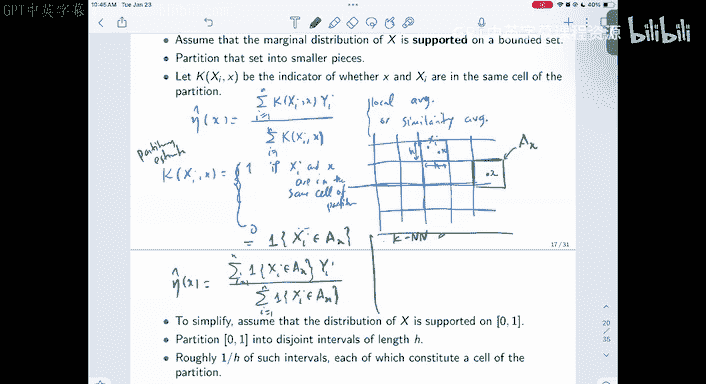

# UCLA《模式识别和机器学习｜Introduction to Pattern Recognition and ML Winter 2024》中英字幕 - P5：[05]Introduction to Pattern Recognition and ML -- Lecture 5 - Winter 2024.zh_en - GPT中英字幕课程资源 - BV167BfB8ETK

How do they do this？

The point of this exercise is to。Through this sort of general case in the general case， you can。

Write the meta staation error as an integral is a some used to be。A sound， right？

Then we condition on X。This was。Probability of x is equal to x， so that's。One way of writing things。

嗯。给你呃。More general case， you can write it as an integral in the continuous case， this is just。

 let's say。I can write it as Pxx if you want。The电 o拍。And so if you try to minimize this。

 you would easily argue that you have to minimize this， you pick FX such that。This is arguing。

Over all the。Now地 could be。Oh I think still zero one for us。Such that。

This is minimized because this term you can't do anything about so one thing that I wanted you to do is to calculate this rule。

 this optimal rule in this example。So this。It's an example where we given X given and Y very exponential。

And the whole point is trying to。嗯。Computering the conditional distribution of y given x。

 given thisination and the marginal distribution of y。Okay。

 and so this is sort of a stake if you go back through for course。

The only difficulty is that one of these randoms three， the other is Ania。 so I'm going to do maybe。

诶。Not exactly the exponential， but I'm going to do something in between 26 and 2。7。

 suppose for example， you have x given y。Its normal， but mean let's say why。Where is one。Okay。

 so what this is saying is that。If why is。Z， this is normal 01。FY is one。This is normal。

 one and what。Okay， so the first。Argument here is the mean， the second is the variance。

 so the variance is the same。So depending on。Which class you are。

 so these are some what call class conditional， so cing what is the distribution of x？

On there each are the two classes， though if you plot， for example。

So this is saying that if x is under。Yhy zero so if you're generating。

So imagine like a genetic process， you first sample the label zero， and then you sample a Gaussian。

Which mean0。Standard Gaus， so that's a distribution of x so you can represent it with。Yeah。

 I'm going to use this notation so P of x given。Y equals z。

 that's the conditional conditional density of x cuben。Y equals the or I'm going to write P not of x。

Okay， so that would be like one over root2 pi。E to the negative x squared over2。

And then we have P of x given y equal one。Illinois does p1 of x， so these are densities。

 so it's going to be one over root2 pi。Anyone on mar like this slide？我斌。I'll show you what this is。

 it's going to be like centered at one。They can shift the doors and the other one。So this is P1 of x。

The other one is P of H。嗯。我 this。嗯。yeah， x minus1 squared over two。系。So we have these two。

And then I'm going to also give you the probability of y equals zero。

 which I'm usually right as this。It discussions， and then I also have probability Y equal one。

Which I'm going to write as pi1， and you also know that these are these some to one services。嗯。

Not necessary。Extract， so I have these the marginal distribution of y。Given here。And then I have。

The additional distribution of x here and y here in the basic。No， the idea is how to compute。

Let's say I just need to compute something like this， probability wide。

Equal x at1 given x is equal to x。然后就系。Good this calculation。Okay。Baual。

 so how do you write for visual。So even was discrete you would write probability of x is equal to x given y equal y times the probability of y equal1 divided by the probability of x is equal to x。

 so that's the base rule。With this fee events。So now what we are going to sort of argue。

 I'm going to replace this with。Just a density。Y equal 1。 And this also with the density。Okay。

 the best deal。 so if you think about this like。Working with infinitemal events。

 that's what the rights formula is for。Probably a y equal1 given x equals to x。

So we need we know this， so this one I have here， so what is P of x the basically marginal density of x。

Like this， this guy。What is that one？I given my no poverty of fine。是。Can you say it again。

Property of X given5 equal0 property of5 quarter0 plus。So that's like the density， basically yeah。

Density of x given y equal1 times the probability of y equal1。 So you can。Doing the same thing。

 just do the density。So， this is。Ie， okay， Pf。0 x， this is。平。1 of x， and this is pi0。And this is pi1。

Okay， so this is really a mixture， so pi zero。pineine knot。Thanks， pi up pi one off。

Piina times pi0 x and then pi1 times pi。K1 of X， so it's a conant average。Okay。

 so you just sum these to the weights and if the weights are the same basically you average these two out。

 you get something like。Yes。Okay， so that's the。Marginal distribution of x。

Ignoring this once you like marginalize like why， so if you don't know why。

 that's how the distribution makes。对。Maybe's our basic call editing ideas。嗯。唔听。没聊天。

So any questions so far。Okay， and then。You realize that these are also like we have shorthands for those。

 so once you write everything down you would get。So this goes here。Probability of y equals1。

 given x is equal to x。Is basically pi1， that's this part。Tine is P of I P of P1 of x divided by。

I not。Yeah a X plus I1。Yeah， Max。Okay， so you can calculate what this is。诶。But me really。

Don't need the actual， this is doable， you can write it down， it's just a function of x。

What we really need is is this is like our eda of x， this is irrigation function， so they classifier。

😊，Is one if a of x is bigger than one half if you remember， zero if a of x is。Less than one half。And。

Since people， some people are expenses， I'm not going to tell you what happened with the boundaries。

 so you can told figure it out。 but that's the the。Pifier。

 so I really need to compare this quantity with one half。ok。就。If you do8X， bigger than one half。

So this is equal to pi1， Pf， p1 of x。Divided by pi 0。I want up here。

Figre in one half and then you do the algebra， everything is positive。有点啊这。我会太。快个四 one佢就发六。Yes。

 so if you multiply。We get one not by not in enough。Of x plus one half。one so you get something like。

诶。One half pi1 of x P x。P1 of x is bigger than。And then these will cancel out so you get。

How want to mix divided divided by pi0 x figure in。Isai divided by Taiwan。

So our classifier tells you like this does this one if this happens。Zero。

 if the other side have Okay， so that'。So this is the， the region where you。That I have one。

Does this look familiar to people， does this have a name？可以设置。然聊我就。希话 x分 p。嗯对。Yeah， starts with hell。

Thank you。😊，Likeli ratio so that's called the likelihood ratio so really we can see that classifier is just the likelihood ratio class I would say call likelihood ratio classifier。

😊，Forarren's elective ratio。But is the likely rich， go back to your standpoint。With难。

Usually in the context of testing， the hypothesis testing disappeareds。

So you pressure the likelihood ratio if it's bigger than something you go for one and it's less than something you go for zero and so if you do it here。

Io x another X for the Gaussian case， he had one root2 pi e to the negative。X minus1 half squared。

Deided by one over root2 pi equal the negative x squared over two。And。对。So what would happened here。

Sorry， so you get okay8 to them8X squared minus。嗯。Could anyone have this？See。

I'm not sure if I'm going to do the calculation correctly， but it's like going to be。X。S。

Minus one fourth。嗯。Square this。They have the quadinetic times early。

Then you get negative to x divided by  two so you get x and then。That correct？系关闭度。One way two。

 where is that。能知道吧？呃。I'm saying that x were minus2 x plus one。Or to okay please。Good。One half。

So if I want to compare this to the threshold， so another way of doing it is like， okay。

 in this case I'm going to take the log， so log p1 of x， P out of x has to be bigger than log。

Ps zero or pi1 if pis zero and pi1 are one path。Then what would this be？Z。

 so this would be zero in the balance case the classes are50 is0 to51 so log of1 is0 and this in this case it's going to be x minus1 half。

So you really like classify。That's the way。One， if x is bigger than1 half， which is very reasonable。

Right。So they're saying。If the classes are like that if I'm bigger than one half， I'm from class one。

 I'm less than one half I'm from class two， and you can see if the classes are on balance。

Then this threshold is going to change so this is not going to be zero。

 it's going to be something else。Like change at threshold。

 but the structure of the class is already mix。Okay， so you do this for that exercise。

 you get an like class which with it exponential you get something like that either。

You classifiedify this video doesn something or less's not something。

 depending on which one next to the other side or the other。Okay， so that's sort of。In between。

 and so this problem。Lanar discriminant analysis， one of the classic results。

Andceptical learning thats very before like machine learning。

It like the fisher similar the conditional the。Yeah， not everything is in argument。

 so you to units this omega size。So the meaning depends on the first of the semi neurons in sigma。

 if you want you assuming to be identified it's easier。But works with and sigma。

 you assume that like in this。Setting doesn know the you know years， you know sigma。

 and then you want to show that you go through this argument， you end up。你系你同那一下身咩最标 end会。诶。

So the difference time the sigma inverse is this wave like that。

 So then when you transpo sign is actually figured and seeing you。Say very fast one。

 it is less than very fast。嗯要的所以 in our case。嗯。This is basically one。And this is one， this is zero。

 so this double is is one。でユバ材でして。The same one makes we。In this state one a C。

 can also be see dependent on the ratios。嗯。Like the class conditions。But that's the the idea。Okay。

So this is like in the multivari case， this leads to this idea that。

This is going to be a hyperclaime in RD。So that's in two dimensional。

You have a two dimensional problem。What is' saying is that one。One of the classes is like。Maybe this。

These are the levels sets the other classes like this。

 these are the levels sets of the density and and the classifier sort of。😊，Is a line。

So classifies to one side as。One， either are side to zero。好对。

I do it doesn in the size and think about it。系啊。And so以 this是说明 that you know。Theyserv。

 so remember we started the may general this。Join distribution first you assume that you know it。

 then this is alcohol classifier again。And you try to like disseminate it from data。

 so this lead model a similar para form， so the ones that we discussed or discussed today as well again。

 we're trying to not impose any para types here。But together to this assumption。On the classes。

Thats the assumption and the conditionals， this specifiedifies a very specific joint distribution。😊。

For X and Y。One whose marginal of x cube and Y are the multivari。This is my。But， but this is the key。

 so this might not be true fact， but if you assume it then。This is D pest。And in practice。

 what happens is that you estimate estimate one you to and from data。

It's easy to do like you have training data， you estimate， you get an estimate to this。

 you don't have to do that。Okay of next to the estimate or the more fancy estimate that we're be talking about。

Does estimates much private you not you know how to do。

You know how you like to estimate a mean just by sampling of class zero or sampling of class one and then the sigma you can just pull together everything and the sig to share you can get an estimate of query these are similar things and specific。

And then once you have it， you just ads its here everywhere year。So get the hat here， hat here。

 and then get the hat there。There we didn as well。So you get to make a plugin in a clin a a plugin in of isolation today that。

诶。Sounds good。No questions anymore about 2。6。So I'm going to use this location。你对对类。5 0，5。

 this is one thing assist by individual stage。嗯。And not of X， you want to X。Okay。It。Oh。so we're back。

Where you left up。So again， we are in the continuous。Feature case and you're trying to estimate the。

Reuc function， and then we sort of argue that we can live。系。

Basically extend the idea that we had for estimating this under discrete days the continuous days but just replacing these used to be like strict。

😊，Indicators here X would like a soft similarity metric， which is often called a carnel。

And so these would effectively average。For every that tests will x average Ys that are similar。

A wise for the samples that have similaroticx IuX。And a particular case was this Naorio also called Nado what's an estimator。

 it's an not so called nonchar estimator of irrigation function， as opposed to for example。

 what we did just now know the parameters for the approachs and things。So GP for that as。嗯。

Itt and transs。Translated in the scaled version of like a mother parent。The thing。And so。

If you have a gaussing kernelnel， for example， scaling by edge would change the basically variants like the sharps if you。

The sharpness of the kernel depends on this edge， which is called the bandwidth， the smaller it is。

 the sharp it is that the the bigger it is the black。So and then you translate it around， okay？

Translate this one around。嗯。Andson get you get。A similar can to plug this into your formula here。

 you get you get an estimate Okay， so you get， for example。So ATS would cancel out。啊，一在天涯。

Let's say X i minus x。That's why I divided divided my edge。And then sumation of these。Okay。

So that's what would happen。And then if you apply this in practice。

You can try to think about this is safe folks。And they real line and then some of them。

 but Im an escape。嗯。So if you apply， youll get things like this。So this is the breast cancer data。

We had this diagnosis column。Or gather one being the line。

so on and I'm predicting based on this radius column using this not already Wason with the Gao shape panel and you can see well。

Noello。Thank you， can。嗯。So if you look at this。The X axis is these features， so the radius。いですね。

So it goes from， I don't know， you don't have the range， but let's say round， let's say 11。Maybe to。

20 or something。系。Right and then there are a lot of things around the middle like 15 and so these are the data points。

So this is， for example， one data point that has。Maybe 18 as the radius and then this is why。Okay。

 this is one， this is zero。 so you can see some samples。How。Have a。Response3大 one。ま。

And you learn access for that， and sometimes zero， and you learn access that。

And you can see the trickyy part is around the middle that then hangs at our thoughts。

you want to just make class what me on the X and sorry for telling that's safe。

There these things that are zero things that are。So you form that the function。

 you can see that this is what it does， so it just。嗯。This quantity。

I'm computing this quantity with the Gaussian kernel and a certain bandwidth edge so the plus that you see for different edge and then I worried it a little x okay so if you varied the little x you'd get these plots。

And so you can see as I。So the green one is actually of the tree。And the。Bd one is at equal to 025。

So it gets more legal。But you can see it's like gets a little bit better so as we go to trees。

It's very smooth。But it's not necessarily quite detecting that boundary as you increase decrease edge。

Black font seems to be quite optimal， it's like a smooth pen。嗯。

Get the boundary right and the red one is more more legally。

 buts quite well and so it later classifies that approximate this regression function and then you cut it that one half。

So remember there。ItSome me I've had of access。One， if this is bigger than one half0。Okay， so。

The the， the critical thing is this line one half。 So what happens with the the green one is that I'm going to decide everything to the。

嗯。To this site。I is class one with that。For example， black one， I'm going to decide here。

 okay everything 2D。right you look at it to this side。Offf the line is。That'ent okay。嗯。

But the fact that the pandemic is。Got to give you a different result tells you that you have to choose the bandwidth somehow and you can see smaller bandwidth gets more。

Regally， so that's a manifestation of the variance to be variance of the estimated ignorance。嗯。

Larger a the variance is not this legalle it's just。

The variance is if you repeat the experiment many times， so like this is for one。

Training set if I had another training set I would repeat the experiment I give a different a that and if you do it again you it to get a differentator。

And I can look at each particular x and this is going to vary this location is going to vary because the next sign gets something like that。

 the next sign gets something like that like that， and so the range of the vability is the variance of the estimator add x。

And there's something else called the bias， which is。So there's the variance。Ive eat had eggs。

 I'm going to put it together there。what say respect to the training data and then there is an expectation of Eta head x again respect to the training data minus theta of x the actual。

Eta， so this is called the bias。The other one is called the variance。

So the value of your respect to training。So intuitively， if you increase edge。诶。

The variance goes down because you're averaging over more and more things。So if you think of this。

This picture for edge large， this is very wide and so when you try to average you average or a lot of training data and when you average or a lot of training the variance goes down。

And so you can think that they're smooth， but because you're aboigginal 11 things and those like saying that the far away have probably different a depths than the current one。

 then you would increase your bias。So this would generally go up。

And this would go down as you increase。Thattch。And the variant sort of like the population levelble thing or live ensble thing。

 but it's manifested as the reles， it's not exactly the vehiclesles are not the variants。

And sort of see in one picture， yes。I sorry。Yeah的。That。Okay， that makes sense。

 So this is the another carnel which is not smooth， so this is the box。

 so gasian kernelnel is very smooth and it smoothest。This box scale。This one a box。No。

So instead of these。You would get like a box。嗯。One and then zero here。And then you'd get。

It's like variation in this box。Things like this。It it's not the smooth。As I jump discontinuity。

And if you do it with this channel， you see something like that。So the same type of behavior。

 so this one is like。The smooth but still like we can see a stepwise。

 the other ones are less smooth and。嗯。So you can see a seminar behavior with this car as well。嗯。Okay。

😊，Sounds great。So how do we choose the bandwidth？If you understand what it is not I need to actually choose the itch。

Bandroid selection， it's like one of the classical things。

Many pages of statistical literature before the teaching。Here we have a gasing journal。 Yes。

 what is the。So Na wasson means exactly this estimator with K， which is this。

So you flag in this particular can now。Translated in a scaled version of like a bass cannel。

Into this formula so basically I've written it here。

 so this is not Daria Watson Watson just a person that can figure。The refuge button。Not to continue。

 so it's like this particular estimator the。😊，This one。嗯对。Okay。

 so now prior gets to me through education。It's very similar I closing this that we also。

Take translation for the the variant sort of。Okay开。Yesさ。Obtained by trans in based。

 so this should be like came out。So Nadalia Wason to me there he's like Ada hat。

X is sum I from1 to end。Okay， X I minus little x divided by h。Why I divided by。

Soalution high12 and can。S， thanks。That was good。This also works if y is not。Minary。そうです。

Can think about this？Profectally approximate flies by real value as well。And in fact。

 we're going to analyze it in that case， it's easier and very efficient when the regression case。

 you can see because why binary。And you know that these this is approximating。Raccinating。

The actual regaant function。So the regression function in this case。

So generally it's expectation of Y given X。But。For binary you know no matter what's the same it's probably your Y or one given an x and probably is the things around one。

 you' expect the regression some factor usually got one。

And this is a like you can also verify that this is going to be always between zero and one。

And I can see here so it goes。IIt doesn't have to be monotone always。是个。if you have a case where。

So some of the data points that are zero are here， some are here。

 and the data points that are one are here。If you plot this estimator， I would like。Go of like yes。

 and then come back down。Okay。And then when you threshold it， you get to。

Cut points and then so you classify in between to be。Anything here would be like one。

 anything outside would be zero。Okay， my ethnicity is not profit。嗯。All right， yeah please。ででちら。

Wellsonator is one of Colonel density the estimation and no Colonel density the estimation usually refers to。

Anyone remembers Chanel D yesterday？So that goes back to the question of why I have one over edge here Okay。

 so there's like a companion through this this like theres a very similar through。

 but estimates the density of it like key on X that we have today。

The can densityity estimate usually refer to that estimator。Of the density itself， there's no wider。

Okay， so that estimator is。We have it here。That I mentioned it somewhere last time。Yeah， okay。

 so that's the。This part。Okay。没 I know。Yess this thing you。It's called hernal densityism。

Density estimation is like a companion problem， it's not exactly this problem。And cityity。什么意思。

So an estimator of the if it was like a discrete value， if x was discrete。

 it has a probability mass function and you can estimate the probability mass function like that。

It just counts the number if you replace this indicator with a similarity measure it would be like that。

😊，And if you place it with this。St say the and it would be。

That a road that's not kind of subsid is a very similar idea too。Not otherwise。

 not arguments are usually used for regression like the third initial definition y than y equal one given x or Y given x in expectations or expectation of y。

This is forestimating the density see that。It continues right away。

And that's where this extra edge comes into。It's there to make sure that this integrates the one。

That's only the key out to。Okay， so。Another question。You don't have any questions。

 let's see if someone can answer my question， how do we choose the bandwidth EH？

So that you minimize the MSE。EMSSE， so there's no MSE here because we're doing that we MSC。

 but we're doing that classification。😊，You can do a because I'm doing classification education once I care about them probably there。

So you can try to minimize the problem there。大觉系点样。呃明 loss。The loss。hich would be。对对。

optimalSo the issue is that I don't have so okay， so going back risk。

Cl ifify it was like expectation of the loss。Depending on I forgot which3， I wrote it， but like okay。

And be like， I really like this F of x and Y。In our case， we the zero1 loss。

Can to apologize any need of what。F of x not equal to y， but I don't have this probability。

 this is unknown。I don't know the joint distribution of X and Y。Okay。So I cant tag you。

 let's say optimal，'s not optimal lets say the actual。Or the base errors。But I talked about。

This course so how how do you doing this guys you can estimate get estimate。ありでますね。

G minimizeize the sum of bio and variant。诶。So that's related bias sort those I will the energy you willll talk about that and we doesn't try to do that。

 but again if I try to learn I mean I need those disils because the calculate that I not actually。

But there is an optimal value theoretically， but if I know this this usually it's a good problem as you ci it。

 so I know that key， I can try minimize S because I can calculate the attention in this theoretical space and then there's an optimalal edge。

But in practice， I can' back。This in the class just this laws。Or does this quality impaired？から。

Similarly， M areas， what about red。But the index had this factorization of numerical plus by squared and thought about。

 but they're the same， so trying to minimize some of these activity。

Or finding minimize is the same and neither I can do in graduates， the period I can do it。But差个开哎。

There's one thing like General Ru and she learned。来嘅。系见诶。F into what。

YouSo you need to have a test sample and then you get to log I remember this。Are of tests。

 let's say if you want。Itch is like。1 over M if I have a test sample of size M。

Indicator F of x tde I not equal to y tde。So I can actually evaluate this。Okay you have that sample。

 you have your classifier， which is this。You go and apply to each of the test sample and count how many times you make a mistake divided to total number。

 that's your test error。Okay， and then very actually you did the different test there。

And he applied that as a function of that。Can you see where。

You don't have to apply it fine air right。Makes sense。

So you do that you get a plot like this you have to it's the rate for the fall 31。

They can see you going down to make a very better。And the zoom version。Right。I left large。

So the other side is。诶。Thisn't out version。呃 za。The same not bad but they not bad。

If you z mean type difference is by 0。0 change。Sorry，0。22 versus about01。But isn't。

So then let you go here and just Mary then in the red and then just review the test and just spotted it。

感 answer变 a sweet spot。But we can also see it a two sensitive because of the effect classification。

And so you really care about the boundary and see it's like as I。

 so this is where the bandwidth gets large。And。So this is where things are close。

No think it's too large to say，Like modrating ours doesn't matter that because they just care about that。

Boundary it's okay if I make errors here this irr function is not correct there I don't care it is not correct here I don't care if I have a lot of data points around the boundary then this part is going to be accurate and I really care about the boundary。

Okay， I really need this this to be correct So the access for which I。Like close to one hat。

As because slid goes， depending what happens or what deigation point does outside is not of interest or doesn't matter as much。

For that reason， in a sense， classificationation is easier than regression。

And this largely means like more forgiving than anything so N care about what this regression was function does everywhere。

This only cares about theation error and just because the instruction is only cares about the boundary。

は。But that's what you do in practice okay practice。Easly which is the battery experience。

This is sometimes referred to as。Hyperpriome are tuing in。Actually both。嗯。

By by statisticians and machine learning because。I found this selection。都你该是。It the2ning plan。

So this is part of the。嗯。Estimation procedure so really that the test error that we use here is actually you should be basically the validation set if you remember so you shouldn't use your actual test data so it's part of the training so you split your training into a piece which we call validation so it really should be validation。

Do you do you have your training data。So there's the test。

Because I'm not going to touch any other training。And then he has split one part。Call it validation。

So and and so you train on the rest， playing in is just formal classifier based on that we did and then you validate it give the error on this and then you should change the value and then you reevalue it on this part and then once you're done you have your bandwidth now your entire classifier depends on this entire train the use this part you should expand it then you go and tested it once on the actual list。

Or there's another one that people like in statistics use。Which is。To do。嗯。Pss evaluation， okay。

What is cost validation？Take different validations you take different validations。

 so the issue with this is that I'm just this part of the data to validate。

 but what I can do is that I can。I train on this part basically form the pass part the one that we do and this part validate on this and then you do a different split you train a different split and then and repeat this process many I you take the average and in practice what they do is they do K full trust validation。

So k fold alternatively。Do kfold。R validation is used to say I just let say with K equals a tree。

Say k is equal to three。What I'm going to do is break this data into three pieces。Okay。

First I'm going to take this as training and the last piece as tests， then I'm going to keep。

The middle piece out of the accommodation and the other piece is training。

 and the last I'm going to do this。This is going to be validation or this is going to be training。

So kind so the class course change because your training are like using different training data。

 but what I really care about is a good approximation of the risk in a sense or like the good bandwidth so this rate on。

Trains on every portion of the data and tests on every portion of the data hopefully you get the better as what your average。

But there are like attempts instead like that decide to try to say okay。

This is a good estimator of their risk。There is an issues because there're dependent， so it's hard。

So you can do it once these pieces are very independent and once I do multiple times。

 anything independent and encouraging or independent things， but intuitively。

 this is a good estimateator。There is and then you plot this as a function of age and you evaluate this functional of age and you choose it。

So for one of those plugs we get a plug right， yes， and then we select an edge。Yes。

 if you just want to do one so very importantly we have three different edge down so no。

 that's not what you do in this case， you just compute for every event you compute the average of the risk you just sort it at one part you get a better。

大好。Okay， so you know't you different thoughts for。They evaluate the risk。仔。

And then you have a plot can you get the applies from the average applies？

For each one million they phase that。You get as sort of the risk as a as a。Rralities another way。

Some of的好。But that's another assumption。Hopefully basically it's have three curves and the average of the three curves is another curve and you take extra start of that。

And then using that next step we report our test yes。

 so then S would be a like defines your actual estimate for that then you report。What that问题。

So why do I have to do this？So why do we have some you telling me， why are we doing the validation？

We will have to choose the bandwidth。Yeah yeah， I mean why do we have to do it three night？

You can do his five times if you want because。对 three拜。

But in why you need to do cross validation because these are all estimates， right？

So if you do it like case， for example， it could be that many you in there are outliers in this part and it's going to be variable that' in the more audience more certainly。

But once you do it in practice， it just validates like this and this is large。

 it's a good that thing about， I think what I'm doing to here on this one。

You don't necessarily say need to do ca but sta like how marginalize this particular procedure。

I get to use all the data once for training and once for reality because you sort of。诶 if I。那个。

If I use all my data for this probably， I'm going to do cycling that any better。对。

 does it make sense。So in this way， everything goes into training and test once for like validation。

 this day like just random on one goes to can one testss。

It's not necessarily clear that it's going to matter。😊，Much social agree data is used for。

 but if data has outliers then。By chance， this is outlis。Oh。And things are going to do as turn up。

 So this is going to ultimately avoid that。theoretically flow that doesn't better not。

That's an different story， whether you can theoretically prove it or not， I'm not sure。嗯。

In various respects， specific setting people。嗯。Okay at this。

 but if you're interested in looking to learn and let me know any other approved that。

Youions say very not sure。And you get kind of prove that this is exists thing。系。

Where it does's better than。And then also the can matters， so what should be now you have a K。

 so it should I should be twofold， threefold。B default basically that once you investigate the smaller the sample is that can get more readily here。

And think when my value just is smaller， anythingtime you're like。

That'stim based on a small sample get more valuable。 but then you have more and the average one more。

第 that here said刚。Depend I can。Yes。That's not worried like a period。It's an interesting question。

Short answer， I don't know。Jason， you like or you where I want just better than that。你确定没吃都拜的。

The advantage of this is with take a single class but yeah when you do it that you have different past。

哎。That makes you complicated to analyze。Thatま。So this procedure you can do like more generally for any method that has a toning parameter or you have like something that we need to determine。

Okay。Yeah， it's just the bandwidth。诶。But in该。Some models， there's some other parameter。

 like a number of layers of a neural network or whatnot。You can do this。Sounds good。Last time。

just to testing based on the validation the two parts are the same。

 so here applying ploting the validation there is excluded training to one part on one part the actual committee。

And you usually but this is something's called grid search as well。Read search。

So you have a range of bandwidth， potential bandwidth， let's say I'm going to choose from 01。

0 to like maybe 10 okay and you have to split this internal into like a certain set of points let say I just check this maybe 0。

05， maybe one。Two， maybe five and 10。They'll just take these。They got six values for bandwidth。

 compute the test error and they choose to one。As the smallest。接前米死一啫后嘅。

Training validation group a test site word right so。The thing is。You want to。Use your。

Estimate after is or estimate of the generalization are the same。And that is done by。

Breaking up a sample which is independent of your。train and then train the tests on that， okay。

So the reason why I'm doing this tree layers stick is that in this case。

 I'm using this part of the data to actually optimize the class by itself。Okay。

 so the band is part of the plastic， so you have this， you can think of it as I have F hat。Of et。

Which is one， if I'm going to rate that8 hat h of x bigger than1 half。A a hat it。

U next less than one half。And so what you really have is this is the family of classified。😊。

And they play the standard， and I need to choose the standard in the end one I have an H hat here hat that will be my final test。

Okay， so this this chat that I'm going to choose， if I'm going to use this part of the data。

 the Penn data to choose it， this also went into the training numbers。

The training means at formation and the request。Okay then this effectively would be my training data it doesn't make sense test on it because my choice the specifically optimize learning。

So for that reason I'm going to take my training like NS ism to like complete the separate。

 visit it for testing this one final the final essay。

 so if you hit decide because I'm like choosing it is is part of training classs why I just this part this system what getting into validation then to make it independent of the rest。

Then I formed my password based on this test on this and very edge now I have it with because the training data and this are also independent。

Okay， so when I evaluate this task and this， I get a estimate there is because of。

And they very edge bridge by a illegal customer。And。嗯对 the right one and the inside game。

So final estimator， so let's say family estimator。Im Leah estimators。And then the final one。

Is F hat of H hat of x。Your edge head is。Obtained。By minimizing。validationidation error。Okay。

 so that's my final pacifier。But this H will depend on both the training and validationmination。

 F depend on this part， so in the end this imperativeing with not is imperative。

But it's independent tests， so now one last time I tested test that and that's my final creation of what it does or like。

唔系单啱发俾你钱。So the why is really for validation so the y absence of thes rates validation set validation validation so this is yeah。

 so I mentioned I usually don't mix validation test because we usually don't have an extra test but yeah if you want to be precise this is validation。

哎不行。Yeah。You can think of the test as someone else holds the test data for us if they have no access to it。

So that's why I's a training aspect but but I should probably be more precise for students。啊该。

Everyone else says well reading the tree is basically。Okay。好的好的。Yeah。

 but we open hard to change that。The like which there are three animation do the building for the。

That' one you can do， but in practice， again， people just usually have like a particular test set。

That they use because that would complicate because you have to output like multiple classifiers。

So let's say you have a competition， if I have multiple test data。Then they have to。嗯。

Or it's harder because。嗯。I guess some people do it and practically have。嗯。I'm not sure if they do it。

But yeah， I think some people， as long as you're consistent and Congress。

 let's say if you want to compare with someone else。you want this place to be the same， but you say。

 I'm going to train on this。P on that and then train on this。

 test on that thing and then everyone will do that and they report yeah。That's beautiful。嗯。

But there are complications because if you start doing this。Then诶。

you tend to end up like overfeeding probably to your request as well it's like it's hard to say。

 but potentially you can do it actually you can do it but this is easier with one that get of the representative and data yes so if you only split one slide operator might not be the representation of the right the same issue happens here but with as I mentioned if you do it random and the data is sort of。

Uniform。那挺款的。Even if you have heterogeneity， it you do in a behave issue。

Part of the population was this we。诶，系家点样未听过谢谢。some people I can do it and you go back and see。

 but both are common backward in the case in people have competitions。

 usually you have a single test， they default part of the data and then just train them which you can do whatever you want here and then they test it for you。

But when people have their own data of the data or data in there， you can do multiple splits。

 but then you have to to like be like consistent， everyone has to use the same displays。ありがとうございます。

Like not yes。But the staistic you could think about it。Once you I any三 box。I if you do randomly。

 then this should be presented about。think I can use the same argument validation I can yes， yes。

 so that's why I said it's not necessarily clear this is going be better than case once so I can see I'm doing it once again it's fine。

对。诶。Yeah， so that's like a very like a like， I would say。

Fine detail of whether macro to be with one plus but think consolidation by once consolidation is that is been big enough。

一直在 match。When its very small。 So this often。Matterers if your big， let's。嗯系咁觉得佢三。

S so it's a physician traditionally thought about that beta scarcity。

 the situation where like you maybe 50 samples。So he wanted to like extract all the potential in。

If you're doing machine learning， data is like 10 to the 12， like tri of like billion of everything。

 the data abundance savings， don't worry too much。Thank。诶。Sounds great。

Because you can try think like teach inter course and class validation and I was prepared for that course differently。

 but let's say don't worry too much about。😊，Bookです。Any other questions？Okay。U。So。If not， so let's。

I'm going to come back to the theory of this in the regression context。

 but to do the theory and also in practice there are other variants of this local averaging of interest so if you remember this local averaging was。

😊，I wrote it a little bit more generally than Nadoia Watson。So if you have a similarity metric。嗯。

This is your local origin， this doesn't have a particular name I'm going to call it local a because。

It's what it is。诶。Or singularity average if you want。Local everything。Thank。

Or better like similarity a。One example of this similarity metric is if I， I'm not assuming。

 let me do it in the two dimensions， which what I have there。

What I can do is I can partition the space。Into like fixed portions。Okay。

 this is the easiest way to make a similarity metric。

And then say I'm going to say that two data points are similar。

 let's say X is similar to x if they're in the same cell of the port。Okay。嗯。

This is the similarity matrix of。K。X I X is1 F。X， I and X are in the same cell。

This cannot be written in the translation way in case。And the idea is very similar to the priest。

Okay， one is in the same same cell， zero otherwise。 Okay。

 so this has the effect that I'm going to only for this X。

I'm going to only average the y for the beta points x liesizing itself。Okay。

 so this is the easiest like estimated to analyze and this is what we are going to analyze sort of by right is very similar to the box candle。

😊，Nar you wants box scanner， but Na that you wants on box scanner。

 what it does is that it puts a box around X。The difference here is that the partitions or that the lines are faced ahead of the time that one is like dynamic so at x if I have an x。

 I'm going to put the rectangle around it。off side like that。This is slightly different。

 but it's much easier to analyze this one。So here you still have probably like side link edge here as well。

And so the band would beで。嗯。Sci point on the diameter itself。对。嗯。

What I'm going to do often is I'm going to call。So the cell of the partition that contains a particular x。

 I'm going to write it as a of x。Okay， so we have test point x， the cell would be a of x。

 so I can write this estimator as a ahead of x， so this this is going to be an indicator that X belongs to A of x。

Then my estimator would be summation。嗯。诶。Why I and then divided by sum。

So this one we're going to come back and analyze in the context of regression actually。Okay。

 there is this one and then another one， which is very popular。Which falls within this category。

 so this is partitioning。The other one is the Canest neighbor。Caning your snakes meator。

This one has k of X I and x。Is one if X I is among。你企。Mears。Neighbors。little X。

 so I go look at the little X。Look at my training data。

 all the training points for this XI is the ten too。

Will x among all the one so the simplest one is the one year's neighbor so you go look at X look at all your training the X thats closest you take the y of that there's no average。

The one year think was a very excellent blessing。嗯。

It's essentially similar I take to the one of the little screen case to bring this the Yi up there。

Like the hours are all the white eyes still exist exactly。Equal to x your little x here。

 just take the y I up then。嗯。Particular excited break into years and every1 years。嗯。

It is smaller than it。Okay。走。OkayOkay， make time and come back， hopefully and talk about。

These two us say there's mostly a lot of practicing trying to analyzealize that see that bioos sign is trade on in theory。

Thank you， see next。It。Yes。