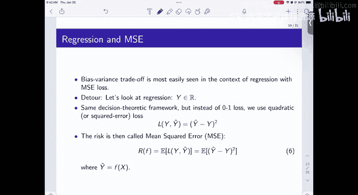
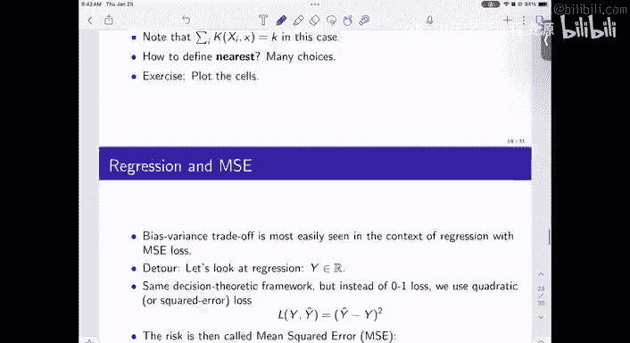
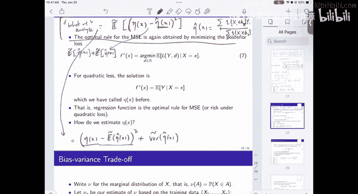

# UCLA《模式识别和机器学习｜Introduction to Pattern Recognition and ML Winter 2024》中英字幕 - P6：[06]Introduction to Pattern Recognition and ML -- Lecture 6 - Winter 2024.zh_en - GPT中英字幕课程资源 - BV167BfB8ETK

Yeah。Yeah。그。Yeah。Yeah。Yeah。Yeah。Yeah。그。Yeah。Yeah。Yeah。Yeah。嗯。Yeah。Yeah。Yeah。Yeah。그。Yeah。Yeah。Yeah。

Yeah。그。Yeah。그。Yeah。Yeah。그。Yeah。Yeah。Yeah。Yeah。Yeah。嗯。Yeah。Yeah。Yeah。Yeah。Yeah。Yeah。Yeah。Yeah。Yeah。

Yeah。Yeah。Yeah。Yeah。嗯。그。Yeah。그。Yeah。Yeah。Yeah。Yeah。Yeah。그。Yeah。Yeah。Yeah。Yeah。Yeah。그。Yeah。Yeah。그。

Yeah。Yeah。그。Yeah。Yeah。Yeah。그。Yeah。그。Yeah。Yeah。Yeah。嗯。Yeah。Yeah。Yeah。Yeah。그。Yeah。Yeah。Yeah。Yeah。Yeah。

Yeah。Yeah。Yeah。Yeah。Yeah。Yeah。Yeah。그。Yeah。그。Yeah。Yeah。Yeah。Yeah。그。Yeah。그。Yeah。Yeah。Yeah。Yeah。Yeah。

Yeah。Yeah。Yeah。그。그。Yeah。Yeah。Yeah。

Yeah。Yeah。

。Yeah。Yeah。그。Yeah。그。Yeah。그。Yeah。Yeah。Yeah。Yeah。그。Yeah。Yeah。Yeah。Yeah。Yeah。그。Yeah。그。Yeah。Yeah。Yeah。

Yeah。Yeah。Yeah。Yeah。Yeah。Yeah。Yeah。Yeah。Yeah。嗯。Yeah。Yeah。Yeah。그。Yeah。Yeah。Yeah。Yeah。Yeah。Yeah。嗯。Yeah。

Yeah。Yeah。Yeah。Yeah。Yeah。Yeah。Yeah。Yeah。Yeah。Yeah。Yeah。Yeah。Yeah。Yeah。Yeah。Yeah。Yeah。Yeah。Yeah。Yeah。

Yeah。Yeah。Yeah。Yeah。Yeah。Yeah。Yeah。Yeah。Yeah。Yeah。Yeah。Yeah。Yeah。Yeah。Yeah。그。Yeah。Yeah。Yeah。Yeah。그。

Yeah。Yeah。Yeah。Yeah。嗯。Yeah。Yeah。Yeah。Yeah。Yeah。Yeah。그。Yeah。Yeah。Yeah。Yeah。Yeah。Yeah。Yeah。Yeah。Yeah。

Yeah。Yeah。Yeah。Yeah。Yeah。그。Yeah。Yeah。그。그。Yeah。그。Yeah。Yeah。Yeah。Yeah。Yeah。그。Yeah。嗯。Yeah。그。Yeah。그。Yeah。

Yeah。Yeah。Yeah。Yeah。Yeah。Yeah。Yeah。Yeah。Yeah。그。Yeah。Yeah。Yeah。Yeah。Yeah。그。그。Yeah。그。Yeah。Yeah。Yeah。그。

Yeah。Yeah。Yeah。Yeah。Yeah。Yeah。Yeah。Yeah。Yeah。Yeah。Yeah。Yeah。Yeah。Yeah。Yeah。Yeah。그。Yeah。Yeah。Yeah。

Yeah。그。Yeah。Yeah。Yeah。Yeah。Yeah。Yeah。Yeah。Yeah。Yeah。Yeah。Yeah。Yeah。Yeah。Yeah。그。Yeah。Yeah。그。Yeah。Yeah。

Yeah。Yeah。Yeah。Yeah。Yeah。Yeah。Yeah。Yeah。嗯。그。Yeah。Yeah。Yeah。그。嗯。Yeah。嗯。Yeah。Yeah。그。Yeah。Yeah。Yeah。

Yeah。Yeah。Yeah。嗯。Yeah。Yeah。Yeah。嗯。Yeah。Yeah。Yeah。Yeah。Yeah。Yeah。Yeah。Yeah。Yeah。Yeah。그。Yeah。Yeah。Yeah。

Yeah。Yeah。Yeah。Yeah。Yeah。Yeah。Yeah。Yeah。Yeah。Yeah。Yeah。Yeah。그。그。Yeah。Yeah。Yeah。Yeah。그。그。Yeah。Yeah。

Yeah。Yeah。Yeah。Yeah。Yeah。그。Yeah。Yeah。Yeah。Yeah。Yeah。Yeah。Yeah。Yeah。Yeah。Yeah。Yeah。Yeah。Yeah。Yeah。그。

Yeah。그。Yeah。嗯。Yeah。Yeah。Yeah。Yeah。Yeah。Yeah。Yeah。Yeah。Yeah。그。Yeah。Yeah。Yeah。Yeah。Yeah。Yeah。그。Yeah。그。

Yeah。Yeah。Yeah。Yeah。Yeah。Yeah。Yeah。그。Yeah。Yeah。Yeah。Yeah。Yeah。그。Yeah。Yeah。그。Yeah。Yeah。Yeah。Yeah。Yeah。

Yeah。그。Yeah。그。Yeah。그。Yeah。Yeah。Yeah。Yeah。Yeah。Yeah。Yeah。Yeah。Yeah。Yeah。Yeah。Yeah。Yeah。Yeah。그。그。Yeah。

Yeah。그。Yeah。Yeah。Yeah。Yeah。Yeah。Yeah。Yeah。그。Yeah。Yeah。Yeah。Yeah。Yeah。그。Yeah。Yeah。Yeah。Yeah。Yeah。Yeah。

그。그。Yeah。Yeah。Yeah。Yeah。Yeah。Yeah。Yeah。Yeah。Yeah。Yeah。Yeah。Yeah。Yeah。Yeah。Yeah。Yeah。Yeah。Yeah。Yeah。

Yeah。Yeah。Yeah。Yeah。Yeah。Yeah。Yeah。Yeah。Yeah。Yeah。Yeah。그。Yeah。Yeah。Yeah。Yeah。Yeah。Yeah。Yeah。Yeah。

Yeah。Yeah。Yeah。Yeah。Yeah。Yeah。Yeah。Yeah。Yeah。Yeah。Yeah。Yeah。Yeah。Yeah。Yeah。Yeah。Yeah。Yeah。그。嗯。Yeah。

Yeah。Yeah。Yeah。그。Yeah。Yeah。Yeah。Yeah。그。Yeah。그。그。Yeah。Yeah。Yeah。그。Yeah。Yeah。Yeah。그。그。Yeah。Yeah。Yeah。

Yeah。Yeah。Yeah。Yeah。Yeah。Yeah。그。Yeah。Yeah。Yeah。Yeah。Yeah。Yeah。그。Yeah。Yeah。그。Yeah。Yeah。嗯。Yeah。Yeah。

Yeah。Yeah。Yeah。그。Yeah。그。Yeah。Yeah。Yeah。Yeah。Yeah。Yeah。Yeah。Yeah。Yeah。Yeah。그。Yeah。Yeah。Yeah。Yeah。Yeah。

Yeah。그。Yeah。그。Yeah。Yeah。그。Yeah。Yeah。그。Yeah。嗯。Yeah。Yeah。Yeah。Yeah。Yeah。Yeah。Yeah。Yeah。Yeah。Yeah。嗯。

Yeah。Yeah。그。Yeah。그。Yeah。Yeah。Yeah。Yeah。Yeah。Yeah。Yeah。Yeah。Yeah。Yeah。Yeah。Yeah。Yeah。Yeah。Yeah。Yeah。

Yeah。Yeah。Yeah。Yeah。嗯。그。Yeah。Yeah。Yeah。Yeah。그。그。Yeah。Yeah。Yeah。Yeah。Yeah。Yeah。Yeah。Yeah。Yeah。Yeah。

Yeah。Yeah。Yeah。Yeah。Yeah。Yeah。Yeah。Yeah。그。그。그。Yeah。Yeah。Yeah。그。Yeah。Yeah。Yeah。Yeah。Yeah。Yeah。嗯。그。

Yeah。Yeah。Yeah。그。Yeah。Yeah。Yeah。그。Yeah。Yeah。Yeah。Yeah。Yeah。Yeah。Yeah。Yeah。Yeah。Yeah。Yeah。그。Yeah。Yeah。

Yeah。Yeah。Yeah。그。Yeah。Yeah。Yeah。Yeah。Yeah。Yeah。Yeah。Yeah。Yeah。嗯。Yeah。Yeah。Yeah。嗯。Yeah。Yeah。Yeah。Yeah。

Yeah。Yeah。Yeah。Yeah。그。Yeah。Yeah。Yeah。Yeah。Yeah。Yeah。Yeah。Yeah。Yeah。Yeah。Yeah。Yeah。그。그。Yeah。그。Yeah。

Yeah。Yeah。Yeah。Yeah。Yeah。Yeah。Yeah。그。嗯。Yeah。Yeah。Yeah。Yeah。Yeah。Yeah。Yeah。Yeah。Yeah。Yeah。Yeah。Yeah。嗯。

Yeah。Yeah。Yeah。Yeah。Yeah。Yeah。Yeah。Yeah。그。Yeah。Yeah。Yeah。Yeah。그。그。Yeah。Yeah。Yeah。Yeah。Yeah。그。Yeah。

Yeah。Yeah。Yeah。Yeah。그。Yeah。Yeah。

Yeah。Yeah。嗯。그。Yeah。Yeah。Yeah。Yeah。Yeah。Yeah。Yeah。Yeah。Yeah。Yeah。

