# UCLA《模式识别和机器学习｜Introduction to Pattern Recognition and ML Winter 2024》中英字幕 - P7：[07]Introduction to Pattern Recognition and ML -- Lecture 7 - Winter 2024.zh_en - GPT中英字幕课程资源 - BV167BfB8ETK

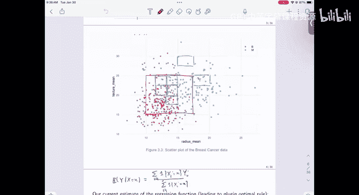

So we had this general leader and then。A particular example is where you partition the states end at the time。

And if you give me an a。I'm going to look at the cell。In which。The data point lies on the average。嗯。

边呢度。So this is a simple example， another example is this painting or snakeberries。

 another example is what you had like a Gaussian cannon we put there。

Another example is where you have like a boxster a boxsterial was very similar to this。

Not quite the same。So we're going to analyze this as a。我 the day。

And it is hopefully going to give us a lot of intuition。So。诶。

We are not going to analyze it in the context of classification。

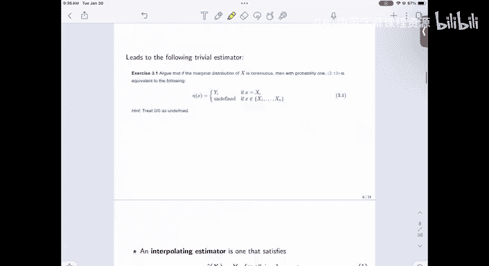

Because as I mentioned， in classification things are little more。😊，S is the only care about。

What happens at the decision boundary So if you。Make a mistake let's say or like add errors or your regression function outside your classification boundaries you're not going to see it as much and this one。

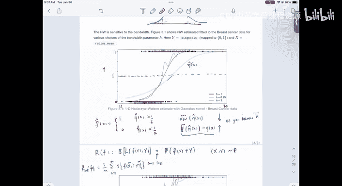

Sort of。Invidence in this。B that the bandwidth that you choose， for example。呃。

We going get this is sort gas there is an optimal value that expect in this particular example。

 there's not much difference between。Like the best and like the worst that they affected。

B like points0，5。T get 5% difference in specification rate。诶。6%。

And so we talked about how to choose the bandwidth using。

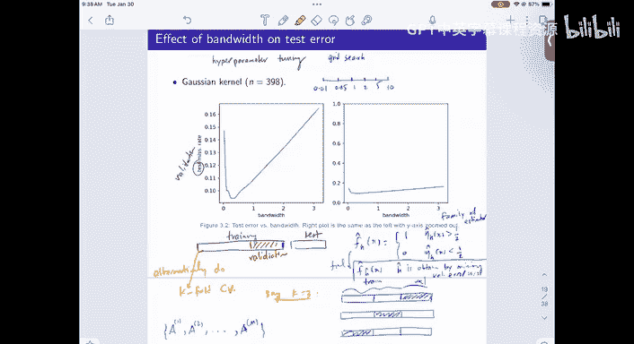

Either train test late or train validation tests and consolidate。

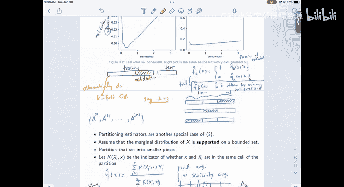

What I want to do is like how to set it like an electric and internal。呃The problem。诶。

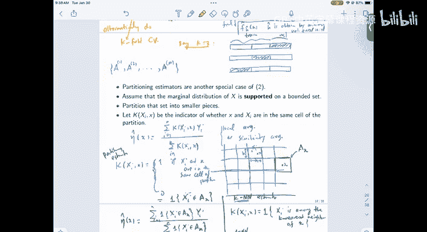

They would like they call。This is the partition yesterday said partition the States。

And As is the cell of the partition that contains x。

 and so the partition ismeter would be something like that。

So I average the Y I is over the x sense that from A of x。Divided by how many of the exc are in As。

 so this is the average。Okay。And then we did go over some。

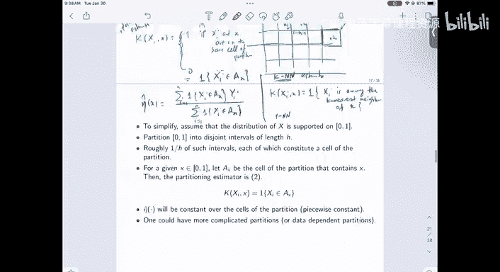

嗯。So it to regression the sense make voice regression。And regrets and things are simpler， in a sense。

So we often look at the stored error and we say they talking about the optimal。

 the optimal on the main stored error was just a conditional。

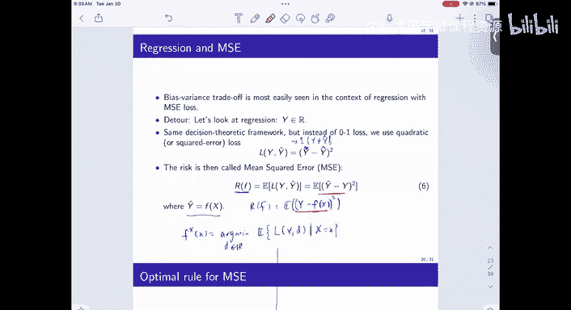

Mean， so that's like the optimal rule so the regression function is the optimal。うエ明かこうですを。

And then we guys how to make this idea discussion of。

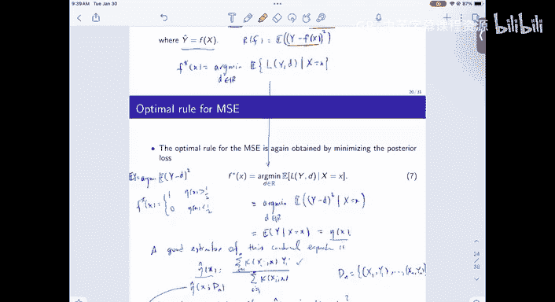

Sort of matters or。啊。The sta rates where you look at the risk of an estimator， but that would be。

A random quantity， and then you take the citations under。

Your change the end and then we be are the risk that we werere analyze。

 so this is not the risk for a particular realization。

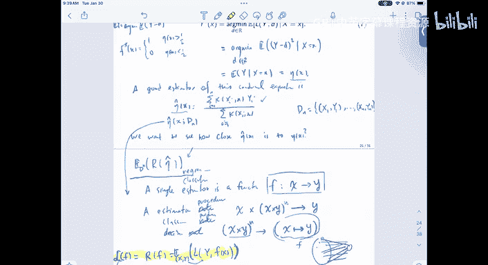

The estimation procedure， I rather like a property or estimation procedure across all the training date。

So I'm not going to go over and read what this。But suffice it to say that once you look at this expectation。

 I think would。

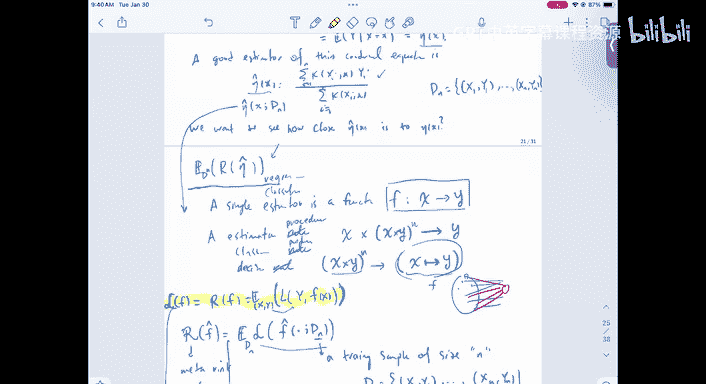

Reduce to。

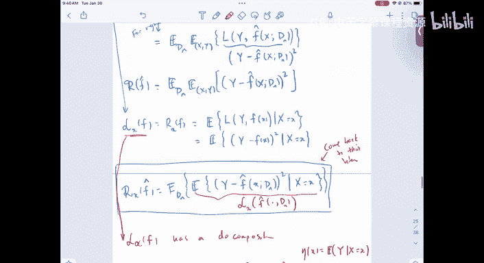

To analyze something like that。So when I to take the expectation of the training data of this。

 what we be looked at is this pointwise loss function。

 and this we use this further to and so this is the prediction error in a sense。

 the predictions of a  pointwise prediction error reduced to component， which is the variance。

 initial variance of Y genetics。

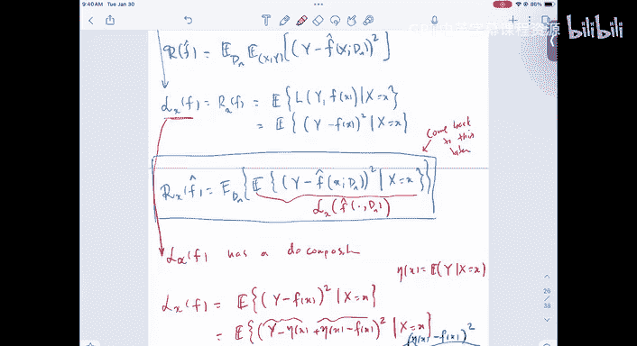

And then the difference of their addition function to。嗯，そ。So F is like candidate。

This is your candidate regression estimatedsimator data is zero， the true regression function。

 and so how how much you are。Yes square error plus impairment has not been useful we go through this calculator this point wise is lots to be introduced does that and so the whole point was motivated looking at the difference of the function written part is good or not so you can moate it in a different way。

 but if you care about prediction error in the MSE sense。

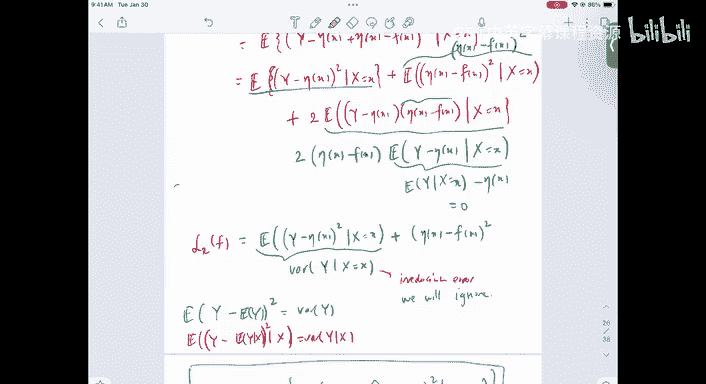

There is a virus you can improve。So that side， there's a part of which you can improve。

 pretty now it takes this F to to X by and this would be the best possible but I don't know it。

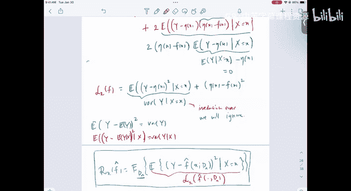

That's the price that I'm going to pay so in the end at the end of the day。

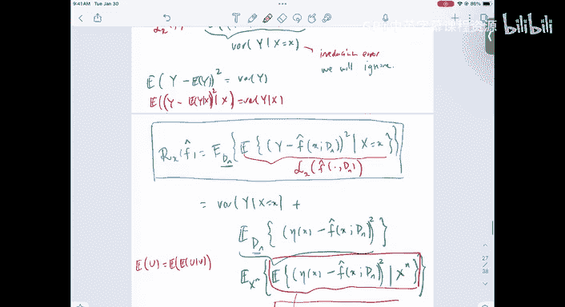

诶。I argued that were going to look at this one。So a out x minus or f5 of x squared。

 depending then the conditions on the training x。If you paid another expectation under。

Exent that would need that。Po advice whenever us want or rememberorist。

But anyway is very own focus on this part。

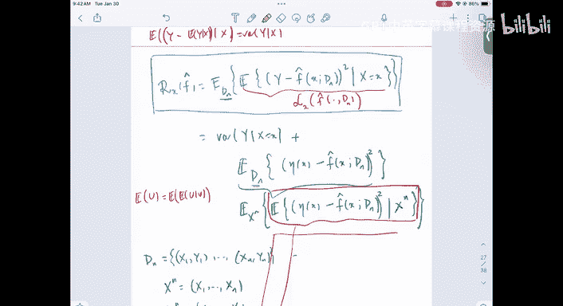

So at the end of the story that I just wanted to。

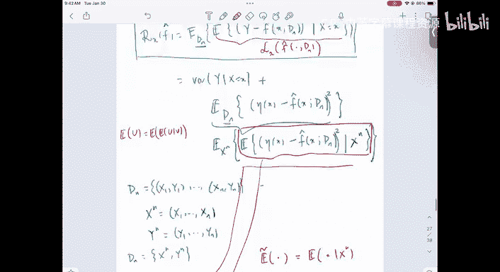

嗯。To justify what we look at and then I called F hat a to half。

 so at the end of the day we ended up with this quantity。

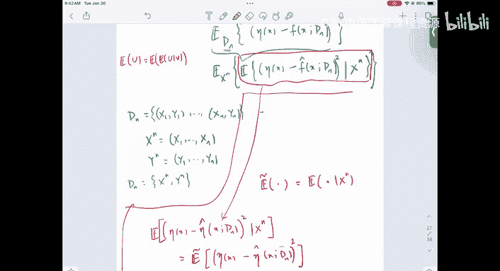

Okay， so that's the thing that we want to look at。We want to look at the difference of ir regulationation function。

The true regression minus are estimate of the regression is square and then I take expectation。

 this t that is expectation with respect to the randomness in why the training wise condition on the same index。

😊，So I'm in everywhere condition training it。I replaced with the altic definition the thex the X is smaller than legs。

 so we were just carrying them forgo diets。But you have it and orha the like whys okay。

 the noise are why。啊。We can forget about all of that just says this is the quantity that we this is。

The easiest thing that he can earn life and it gives you。

Intuition of what is going so have an estimator that's going to be mine and you can see that the at area like pointing out in this particular core depends on the training data and also like the point of that estimating F yeah so this is this eta x。

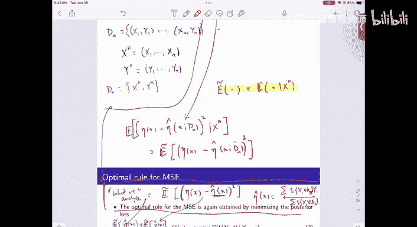

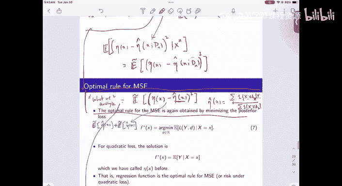

This particular partitioning estimator at MLLQ Okay so what we' going to do is。Basically。

 and then'm usually that drop at the end so a ahead x。

 some is just this implicitly not that depends on。All the paintings， and so it's random。

 it's random quantity。And then minus8 x squared and another50。The Asian hundred。Sort of， okay。

 so that's the plan。So want to analyze this and show you where the bandwidth comes into today。Okay。😊。

Okay， so。

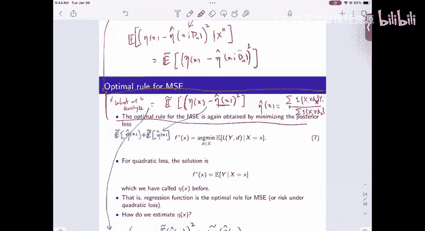

Let's focus on this。诶。

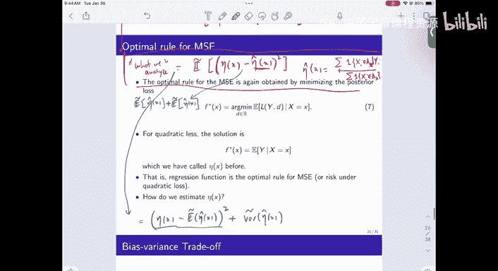

和你上音。😔。

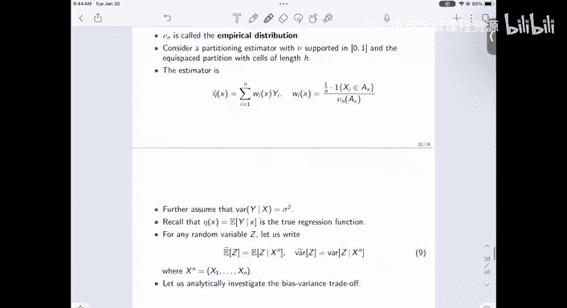

Okay， so how should you go about doing this。😔。

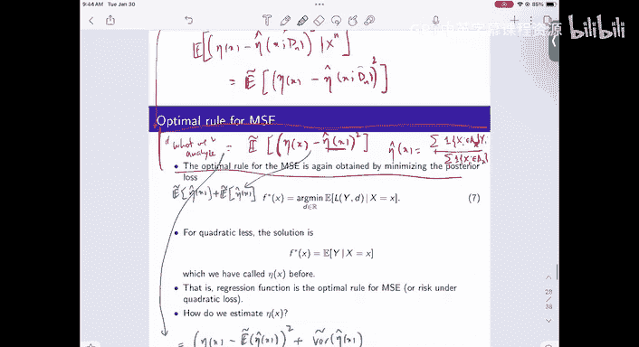

你仔。😔，嗯。

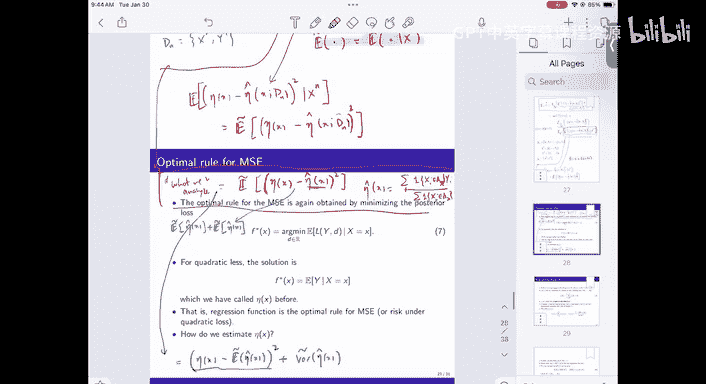

So， plan。Or today。It's to analyze life。This quantity expectation of ada x。

 the true regression function minus our estimate。Squared。So very。This a Eda is。

If I apply to anything， it's。And， just。Let's say apply it to Z。

 it's just Z conditional on x1 of 2 x n。Which I also write as x to the N。Okay。

 it's all the 5 days with no till dog right now。Yeah， I， right， so this is the usual regret， yeah。

 right。So my short path and that like eight by condition。So we want to analyze that。

 the first thing interview and then E actually is that particular thing。

 but there is there is something more general。😊，So the first thing to note。

I don't know what I should call this。But whatever this is， this has a decomposition， okay。

And this has this famous flag against the composition， which often occurs。

 you also saw it I mean write down the prediction error of the MSE。Relative to why。

 but the way to look at it is if you add a subtract the meet expectation of data。这个艾。

And subtract the expectation。So this is the trick that you do。We buy for in thecomposition。

I add and subtract the expectation of Edaha， okay， so adaha is random， it has an expectation。

 which is non random。诶。Get this entire thing squared。And to put a bracket here or like racists。Okay。

 so I just kind to subtract the expectation of data and all my expectations are killed on sitting ignored to watch this just to remind us that yourre conditioning on came。

Okay， so that's the。I like algebra， and then a squared their terms。So， you squared this。

So the whole thing is square， okay。So a plus b is squared。Right， you get this for workshop。

So the first same A is squared。So this would be like expectation。

OhA is squared plus b is squared plus 2 AD。So as where comes out。

They say theyre out there sick please。Why do it come else。对。对。Yeah， exactly me。

 so I can just do this。

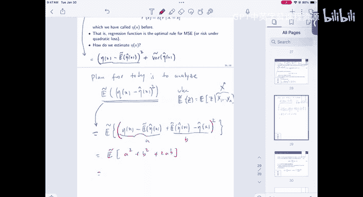

Expectation of。A squared plus expectation of G squared。Plus twice expectation of AV。

But I'm saying that a squared。你等你水。Because this iss constant， this is is constant， this is constant。

这个上的。嗯吧。There this guy is the of the squared。So what is this quantity？对。That's the variance。

 so Eta had x minus its expectation square， and then it have an expectation so which quantity do you do the variance。

I a had eggs。I' with the Tilda because they're all conditioned on。Training exists。呃。

And then I have this hair。Which again， a comes out because a is constant。

 so this is going to be twice a expectation of B。So what is the expectation of B。You。0 and y。

But you didn make that the expectation of this。嗯。对对。So expectation B。W linearity。

 the first time comes out。Wch is expectationation of a to half x。Minus。

 and then I have the expectation of theta at x。That the expectation moves inside。

And so this would be zero。Oh think this is constant。This quantity is constant。

So it comes out of the expectation， expectation moves inside and applies。To this。

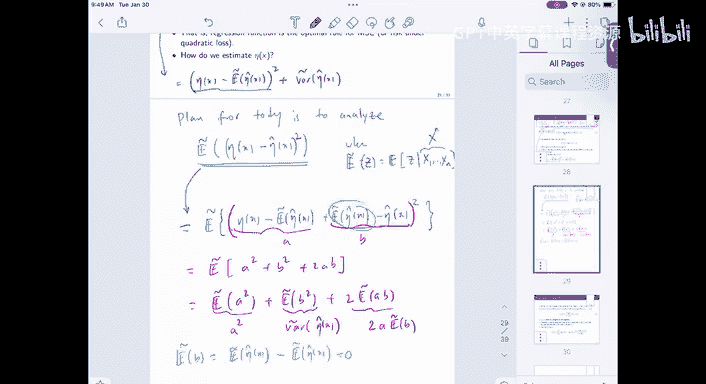

But that's the same thing as the first term so you get zero， so this is zero。

 so the cross term goes a， so this entire thing goes away。So what I'm left with is a squared。

Which I'm now going to plug in， so Eta x minus expectationation。It had x squared。Plus。

 the variance of。没的。

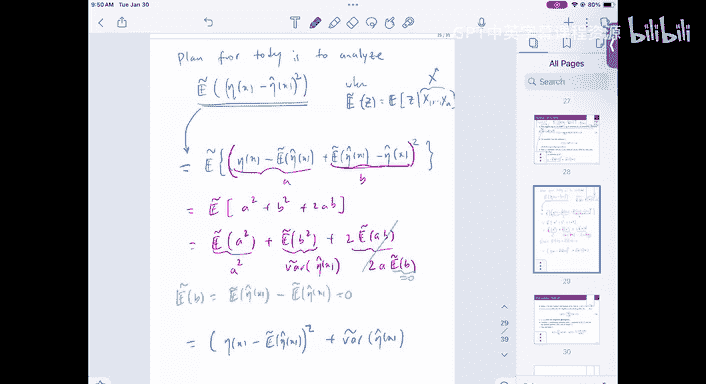

so this is a fairly general formula。嗯。This is called the bias。Or bias is squared。

 so the quantum unfortunately estimated a had x。And this is my expectation of the estimator。

 so the expectation of an estimator minus the quantity your interest。Is the bias does。But岁。

What this is saying is that the MSE， this is a form of MSE， okay， particular。

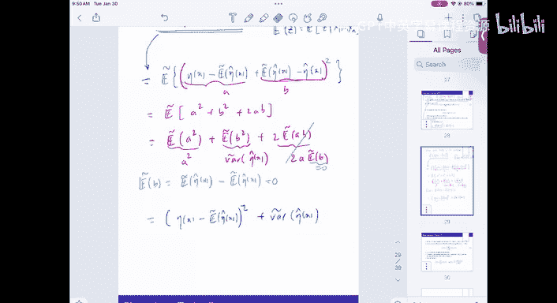

A quite right。Ris， the form of MSE is like has this decomposition bias。

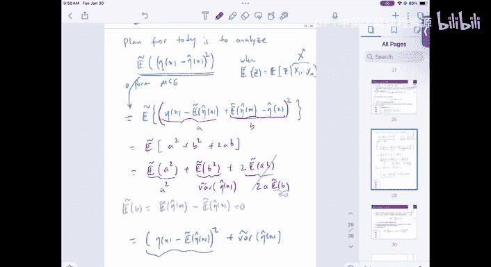

Squared plus variance。Bs and estimated plus the bias square。

And oftentimes they're conflict so when they tend to use the dis usually bias those up。

 I try to use bias it those up and so there is none。That。Any questions about that？

As anyone seen bias science to compositions。How many people have seen blessing namess？Okay， so this。

你看厉看能们自可。Some errors blur in the expectation you can do this trick。かがで。

So if you want to analyze that quantity of interest。

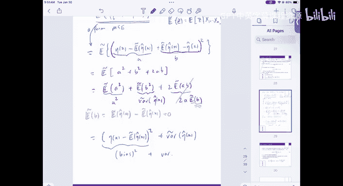

Which is this guy for us， it's a form of MSE， how close Eda hat is to Eta x。

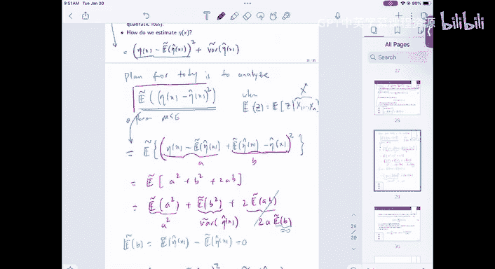

I just have to worry about variance how much it had makes variance。

And how would you be from meta so squared。

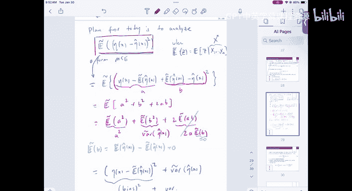

Okay。😊，So this is fairly general works for estimator at this point。I'm going to do I want to。

Analyzing for。やぱ theかパでです。还是上 good。好拜。

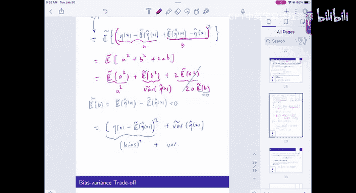

Okay， so let's keep this in mind。诶。And then。

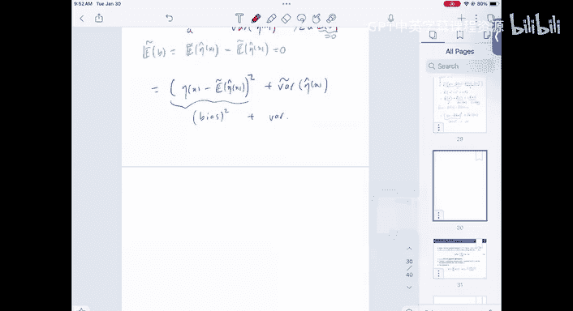

嗯。

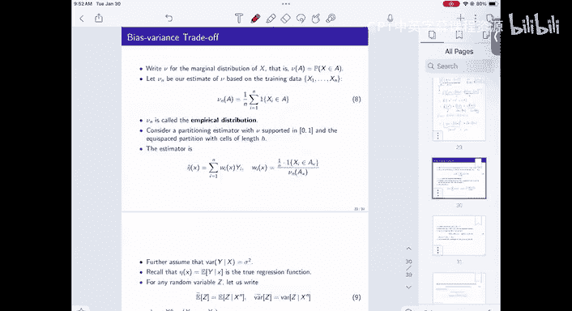

So let's now move on to the partitioning yesterday so I want to rewrite the partitioning。呃。

And let me introduce this notation。So remember we have training data。嗯。

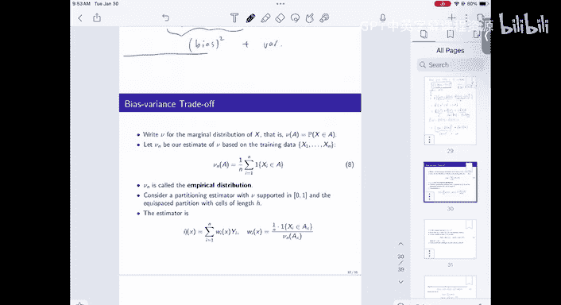

Rewrite。So this is general。Old spray。Generalimator。Let's。And。Rewrite。The partitioning yes me。

So there we be right， so remember we had this training data X1 y1。With that X and Y N。完了了6月。诶。

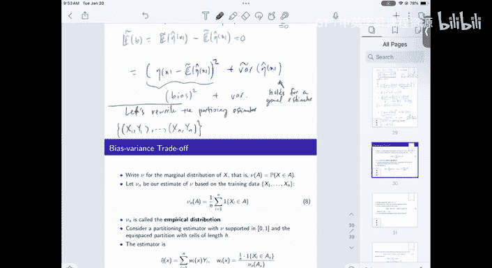

嗯没了多天嗯。This object。Okay， so if you give me a set a。嗯。

And we're going to count how many of the a size are in a divided by the proportion of ethnic size that bought fall within in a。

This is called the empirical distribution。Ex thats called measure if you know measure hearing。Okay。

 so this is within the approximation of the distribution。没事。So what is their distribution。

The distribution can write it as a generic。For a generic x， so assume that we're assuming that x1。

Up to XN。Our IID from some distribution P or actually this is a P and the right is。

New this is the marginal distribution and you can also assume that x is distributed like new and this new is defined like this x。

诶。But not sure how。不行。You saw the solutions in probabilityability theory like 1008 per。我可。

But this is the definition of this each other。嗯。So what is the solution random manual its AS function？

That tells you what is the problem that that random id that actually for instance。

So if I give you this nu or a to the one a or any a。

 I have described the the x for that's sort of a definition it's not the P on the TM this definition stage。

So if it's criteria than a Pf， for example， you would have a Pf。And对。Continuous variable。

There is a PDF。Let's say P of x such that I can describe this v of a。

 which is the probability as integral over a of P of x dx。

But the new Orleans new Orleans the x a is just a big B x。But I can specify this without tool。嗯。

And so that's what we're going to worth it。对他这里serv啊。

The random variable was the set functions the problem measure。

The science to already said the problem in answer to that said。And this is an approximation of that。

 so there's the K color， so instead of the probability either the random ones to a。

 if I have't any examples， this is this approximate that probably is this well hopefully like you remember all the things that we were doing like they can use approximate。

So this empirical。Dserv。Or the new NA put an hand here and just make decide that this an estimate you can put hat if you was on it。

make it the next咩。Emphasize it an estimate so this is the good approximation of the day。

Bu a certainpen moment known Beck。So why this is a good approximation？Certainly。

 so let me see if someone else knows。Why news， why， why sort of。Why do want AnnaA。

Is a good approximation。啊。因为。Let this be the only thing that you learn in the sense。

It leaves me like saying this many many times but the first thing I the celebrate is like。

 what is why？Why this is a good price when n gets large large large numbers。

 so there's a lot and there's something large so large is。Like large numbers the sample size grows。

 this converges asngng goes to infinity。

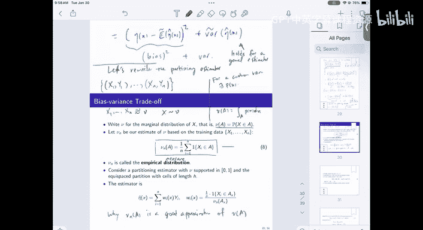

This goes to that。By the law of large numbers。And we have independence we have the idea。

 we have to we we have to idea we have。But as somesh the X are IAD， so this is a good estimate。

And where is add那个身 to。嗯，是。We are assuming IAD。Yeah， that's key。Okay。

 so the impact on the distribution is equal to approximation and it's worse in a very general city。

 you don't have to assume it it this says density or mass moisture。

Basically for anything or visits this makes sense and mean this makes sense for any random variable so any random variable has this probably makes sense so the reason why this is truly because this converts to the expectation of the expectation of any candidate is a problem。

So this converges to。The expectation of the indicator and the expectation of the indicator is the probability again it's the same to all of right。

Okay， so questions。So now what I introduce is because you can now write down this partitioning estimator in this very nice form。

If you remember。So what I'm going to do is again remind you。

What we're going to do is we're going to work with uni dimensional。😊。

One dimensional x is so and I'm going to assume that basically all the x's belong to so x belongs to01。

Like Xs， basically all of them belong to zero and they're the same kind of at the same distribution is。

So they have maybe some。PDf。Supported0 so let's think P of x， the PDFF of x。

What I'm going to do is I'm going to support like。Divide this into pieces， okay。Of length edge。

And so these are the cells of the partition here at four four cells。And then again， to remind you。

I have this notation。 if x is here。This is the cell that contains it okay so a of x is always the cell of the partition that contains it and so my partitioning estimator if you recall is going to sum over Xs in AX。

Why I divided advise。I don't want to end。X I in A mix。Okay。So。If you look at this。

 you recognize that if I。嗯。I can divide presumably and by one over and you recognize that this quantity is。

What is this。That's this new end of AOic so this is the empirical measure or empirical distribution of this aOotic basic discount is like。

Or this fraction proportion of the training data the point that lies within the。AXO对。

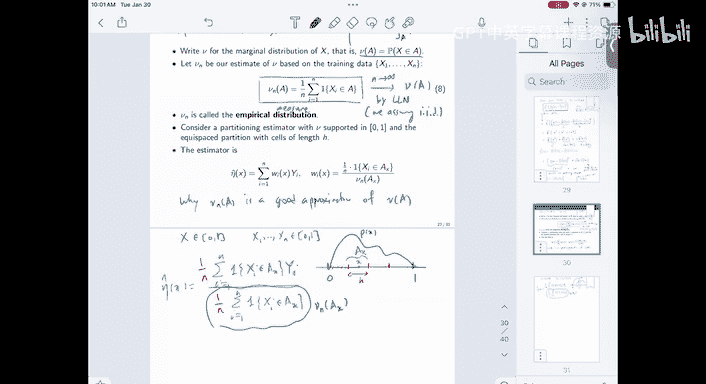

And so if you。Like move that in， this is like goes inside the so I just move it inside the summation in the numerator。

What I would get is indicator Xi divided by AX。Divided by。new N of AX。

And I also put one other hand inside。So I get one over and dot。This is like product。And then why？

Okay， so now this is my。嗯。Wait， if you remember I can write this as， I'll be invited。

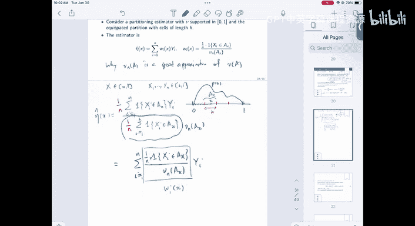

So my  eximator is just。嗯。Sation iPhone from one to N。So this is not new。

 we have seen that all of these can be written like that。Data dependent， very， basically。

This this tells me how much if I example I have to wait for this ice when I'm averaging my eyes and this particular rate is。

1 over an indicator， X I and AX。Okay。嗯。So that's a nice format。I was good。Okay。

 so that's my eta of x， eta head of x。Okay。And I know what， for example。

 this part converges which is good。

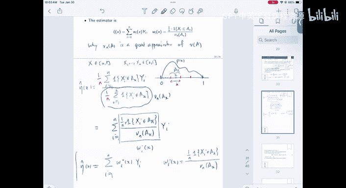

嗯。W't like that。Now， what I want to do now is to calculate the two quantities。

 so I need to calculate the bias。And then squared and then the variance of be the height。

So let's now。I calculateulate。Bias， squared and variance。Ofpha addicts。Okay。

 so let's start with the bias。Only， let's start with the variance variance is easier。So variance。

 so A like sorry。Let's do variance， yeah， variances。F Ata had x。Which is just the variance of。

Sation I from one to an end。WIX。喂爱。Okay， so you can see how why like conditioning on the training access is helpful because if you notice this is these days only depend on the training exit。

And thet that that I have of a sudden the conditioning has a train access。

 so these ratess are called separate。It's a really constant。

 but why I randomly so because conditional on the chain makes as big as random as as my eye。

So what can I do。对对。It all my eyes。And by the way， the variance of they is constant。听错了喂辛错了。呃。

It's certainly a new company on。Its okay and then we pass the sun。Ex in the the are they in。

So what we're working with is like Y eyes。Conditionalal x1 of the x because we're conditioning。

hy want to I am condition。So you went all the excellent under。对对。If you think about it。

 it is because the pairs are independent， so x1， y 1 is independent x to y 2。

 so then a condition on the x is。Still Y1 I worked for internet because Y1 just depends on its solid X what I need other820。

So even conditionally doing the so。AndThey are。So why eyes are？Our independence。嗯。

Even when we condition。On Xend is this。

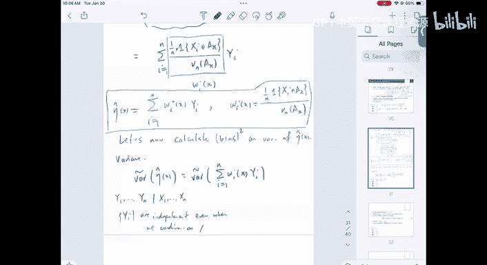

So I can move it past。So let's do this as a side note here。😔，嗯，是的。Small side note goes there。So。

This is gonna be。Sation i from one to N， very。If they weren't。Independence。

 then you would get the covariances as well， but fortunately for us。So三がカな演。

And then normally my eyes are awesome and I can pull them out， so what happens when I pull them out？

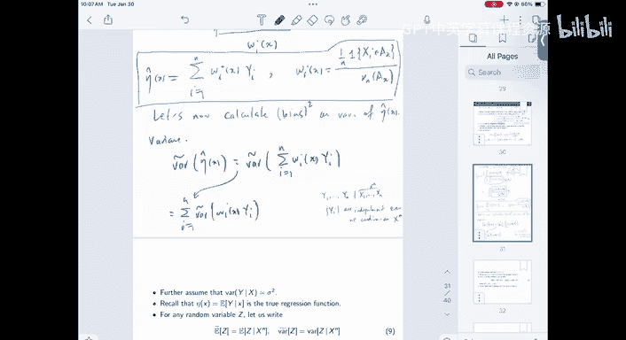

对。Yeah， they come out of the squared because it's a variance， so I get the squared。

And then the variance of Y I。Okay， so this is really the variance of Y I conditional on all the training exit。

走。I don't know wonder if I told you about this， but。

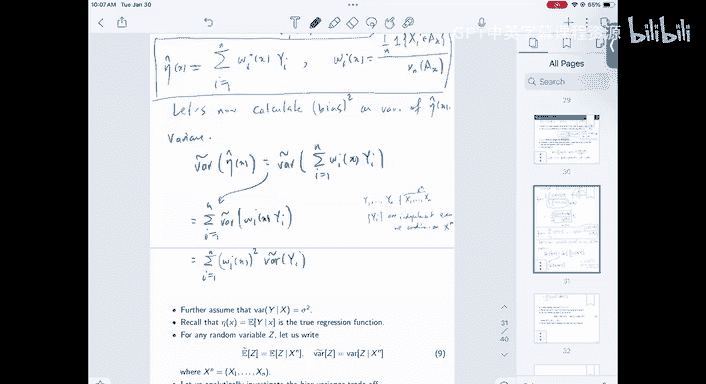

嗯。Talk about this sorry so what is this going to be？

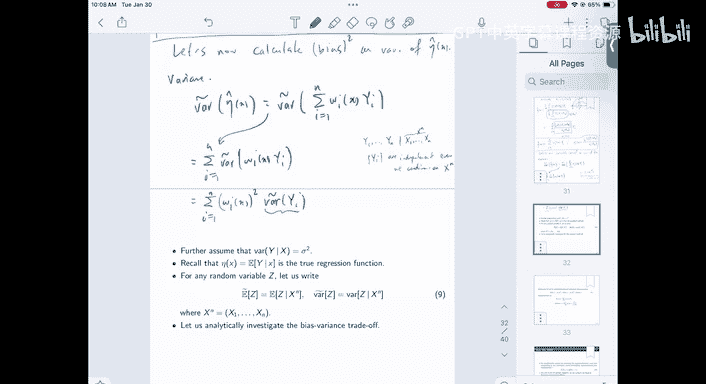

So this is really variance of Y I conditional on X1 up2 xN。It's not hard again to convince yourself。

 this is really variance why given an XI。Because given X， y depend on everything else。

 and this is really the conditional variance of。It is their view。诶。So remember。

 there is a distribution， you assume generally。

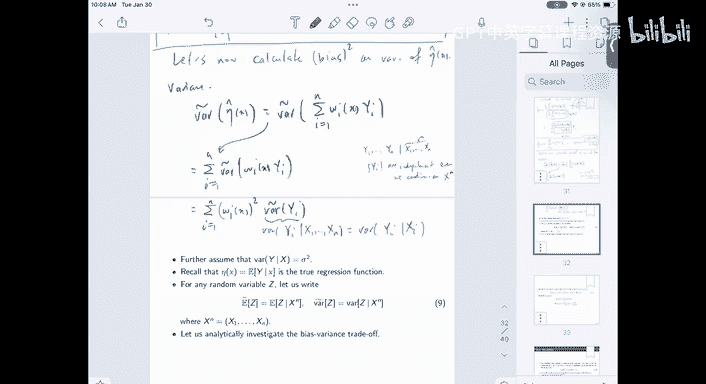

And all these conditional variances are related to so just the distribution has a marginal of x。

 so the we one way describing it is the marginal of x。Wheres in all of X。And then。Sort of times the。

Conditional。Of Y given X。Okay， so you can be compute into the vector product of these two things and the condition of like x is what you're dealing it and this a variance variance so there is a variance associated with this。

 I can say variance of y given x is equal to x， for example。And this potentially could depend on x。

But here we are going to assume that this is really constant for simplicity。

So this is really would be like this conditional variance。Xi if you want。

 it potentially depends on Xi。嗯。But I'm going to assume that it's really constant。

If you go back on the notes， you also see this so I the official variance why I this。我是不行。对。Or。真佩似你。

And this happens， for example， if you have a revision problem， it doesn't mean plus some noise。

 which is just。那 the same way是不多了。嗯。思てです。As a boss head said。啊不到存怪。这个 very颜色怎么转。

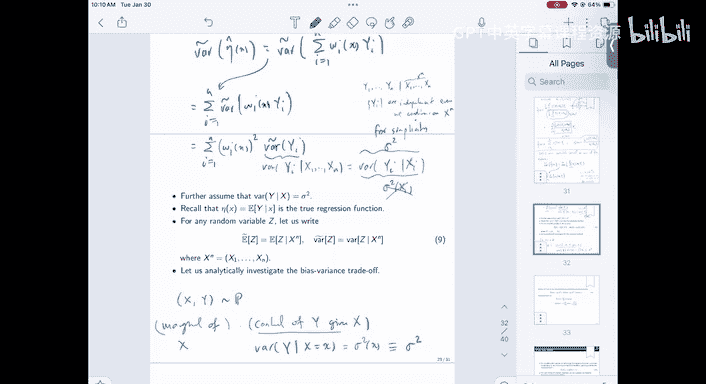

Okay， so then things would simplify。诶。

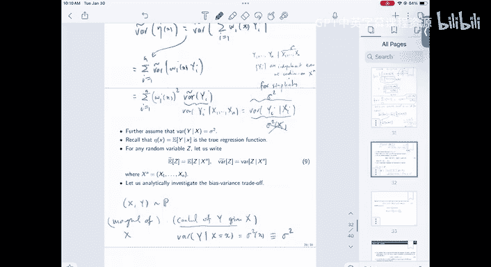

What can they do here？Okay。All of that。

H。我嚟听真哋好天。So this is the side note here。Yes思。Or simplicity。That。系啊。

Varariance of Y given x does not depend on X。Okay， so if that's the case。

 then my formula for the variance。So， basically， variance of。

In thanks。Becomes。Sigma squared comes out because they're all on the same sum i from one to n。

WIX squared。Okay。包餐。

哎い。老子 good。And then one more thing is that's WI squared。

I I know thisI， the next stories。呃。我会睇。

So squareness。Okay。

发题。So that's WI。

嗯。What will happen if I squared this？

Whatever嘅。我 there's fun especially。Right， so this is like going to be sigma squared and then summation i from one to end。

1 over n squared， the indicator squared is just itself because it's either one or0。In the new end。He。

Squared。And then something very interesting happens here。

So I'm going to pull one of the model right inside。So you get sigma squared over n。

And then the denominator does not depend on it。Bye， so this also comes out。

So sumanation goes on de numerator。Vviided by human NX。Squared。And we noticed that。

This thing is the coffee of communicate in。Right， so sigma squared n。New N of A X divided by。

They squared and so one of them cancels out。So the variance is really sigma is squared over n。

Times no in age。It is得 pretty nice。对。你几。Right。Sounds good。

This gives me an exercise still can assign it as an exercise if you go through it for yourself and convince yourself。

你啦你啊。Difficult here is just。Some calculation， but this form is very interesting。没是。

Why it's interesting because if you remember。

This new end of Ax converges or for any a， it converges to the new of a， which is the callability。

They very assigned me。

To assume， let's say I'm going to assume that let's say the marginal distribution of X's are uniform。

 let's say for simplicity。

嗯。Okay， so by the law of large numbers I'm going to say this is approximately because there's n in it if I let end infinity。

 which is going it go to zero because n goes to zero but。😊，I mean。

 you can make this more precise but approximately from very large end。This is really new of AX。Okay。

 because we're very large on the sameverence in neuro other X。

And I want to say what you have a access， so by the law of large numbers。Were large end。

we can make it precise if you like， if you know below old screen。

But days I like you probably but this is good enough for us so i'm going to and i'm going to say that that's the case Okay。

 so for very large and this new and this conversion just place it there so that's my。Var surveyard。

As you can see it's going down next more than can， and there's a back here here。Yes。

 so like intuitively the new of AX is like a measure of size right yes as the ax regions get larger this gets variance of eight a half our estimate or goes down goes down yes so I want to show you what exactly it is so。

Exactly。So it depends on this， this measure depends on the distribution of x。

 but let's say'101 and the distribution is uniform， so it has a density， which is。1。

 and then drops to0。Okay， and if you subdivide this into， let's say three pieces or four pieces。

Let's say three pieces。I have a partition。Let's say tree cells。And it has side linked edge。啊。

Then it doesn't matter which one a x is， so if AX， for example， is this one。So what is new of AX。喂。😊。

The I it isn't like the pro BDP that they're underway large things。关闭。关灯。1 her， right。 So okay。

 that's it in terms of it。Does divided this into。嗯。嗯。And this particular case is one third。

 but I want to do it in terms of the general edge。So partitioning into a number of。

Sell each of blank edge， the number would be one over edge。

 but I like roughly one over edge cells each of blank that。

So what is the the probability of the chance that。Random x size hch， so it's a uniform。

 so it's like inch divided by one basically。So this is going to be in July and on my  third we the partition。

So in the end， the variance that's what the punchline is。The variance of it had x。

I's approximately for large n sigma squared over n divided by h。Yes感系个班行。

So the larger it is the smaller values you're averaging or more things。It goes down like one bit。

 it actually goes to zero and this blows up。Thanks。The variance is better。I learned H bigger。

I'm going to aggregategreg the reward and this is sort get increasing。This is a again mean goingが。

一般指的意是这样。the fastest magnitude01 average or areas taking the point。So there he is。Goes up。

If it goes down。Wice first。Bene in the end。And。Like equivalent at environment。

And it's like basically partition like the next side too。Okay， so we analyze the variance，Yeah。

 when you use law flat numbers is what happens to sigma square。What did you say？

That is cinemama square where okay。So I had the sequence for over in here。这样。Well that not多。Right。

 so that's why I'm saying approximation so this is the border of this。

 so this is ending of the order of this。Eventually it's going to go to zero。

 right it might be precise。

嗯。If you want to be precise in something like that， so new N of x。Is really new of X。嗯。

Tines 1 plus O of light。Its like this。something which is like0 opio one because probability。

 then one over one plus opio1 is so plus op one so in the end。

 you can say that this thing this quantity is。Sigma squared N H。

 the first order is one and then the rest thank you。And the first order is of this order。

And then there are some things。So if I divide the final quantity， I'm going to go what you want。

But as a whole is going to snow what is here， but its same the first quarter。啊。

There's finding any of this。So the best way to take note is that divide is by that， it was one。呢个。

Okay。😊，Is going。走。

What remains is the bias， no questions， comments。So this wasn't that bad。

It's just simple properties。

So the bias is a little more tricky， but not too much。

So again， my estimator is something like that， what I need to do because calculate the bias that got the expectation。

Okay so let's try to do that。

So。My。So we need to calculate the expectation。the patient tillde data。And this is expectation。

ASoation I from one to end。W IX。喂爱。Okay， so what kind of simplification happens here？嗯。Yes。

 so similar the vein are and then expectation， this is always true。😊，Because expectation is linear。

 so this goes in。Here I don't care about independence and then WIs come out because they're。Also。

 constant。So， I get this。Ass Y I。And this is really， again， under the hood。

 it's an expectation of why I。Given the rest。And again， by conditional dependence。

 it only depends on。Make expectation of why I given Xi。Now it please know why I。Heer the next。Great。

 this is the a of x expectation of like a generic y given x with equal to little x is a w of x。

So now， what is this？Is very close。But there's no X here。

 there's Xi so this is going to be8 out Xi because this is saying once I conditioned on an X。

Thetation Y given network is just in X。Or you can say expectation of why given。X is ata x。

 that's like random x。They think of why I the X size。

 they have all the same experiences and the same conditional needs。

 so it's like a single function but they value at the X time。So you end up with something like that。

对。X and then ata  Xi。嗯。Okay， so you're basically like averaging means true function。Sorry。对南aging a的。

And Xs that have high rates。Okay， so you really want theta of x， little x。

But you're not going to get eta of level x， you're going to get average of eta of X's that are nearby。

And that's produceddive the bias。Because you're not evaluating in that particular kind that' value work you have any everything。

And the XI that if you've seen the train， you're not going to see this button that exc in the train。

 you're going to see XIs， we're going to have additional these X ashes。The closer。

 there are the X potential。ok。我跟诶。It's the bias and not it's a legal definition like it's okay the quite email。

Well they turning exit and it's。What we want。我 far社各。So I want to do a little bit more。

So we have these veins， right？And。I can plug this in through。Their quantity。And。

So if I plug that into this quantity， I would get。So I'm going to put that new end。AX out。

 so there's a new NX that they pull out doesn't depend on I。

And then I get one over n sum I from one to end。Indicator。X， I and A X。

And then Eta of X so this formula by the way works for any of these。

Socal average bit the local averaging looks like this。

 so this formula at this point works for any of them。

the same goes for the variance， the way we wrote the variance。

And this is for a general local a， so this works for the Ken nearest neighbors for like kernel estimators。

 so this comes out up to this point。😊。

Worse for all of them。And we're going to in the particular formula the May for the part that's not specific to the purchase。

 but these formulas still apply。So for example， this helps you find the likeing the initial variance of the nearest neighbor very simple。

So that。That's have to plug into the these for that。ItWork for any。Any local as？Itsator。

Like particular， Sir。This is for that。你别切啦。Okay。So I know as antically as in goes what happens to so we emerged in one of it。

what happens to this other so this other thing comes out the whole thing comes out that when I plug in okay I plug in debates。

And you can verify that this is what happens。So what about this？

So what can we say about this quantity？As in goes in Trinity。Does this converge to anything？

What happens？You this。As N goes to infinnity。It's one over an summation of a bunch of things。

each term depends on X， so this whole thing is a function of X。Like that's saying it's like ZI。

Does that look coming here？On over N iPhone want2 N ZI N ZI is are IA。

 they're independent and they have the same because they size so this is just function size make size their are in each so this is8 negative。

Some function of， let's say， Gf Xi。But X are I， I mean a geoxis or I need involved。进去。好知。

expectationYes， okay， so that's the that's great。 So it's going to conge to。

Why does it converse to a of large numbers， okay？Now large numbers and goes and you can see this like how useful it is。

 so it goes to expectation of， let's say Z1。But if you want expectation of G of x1， one of them。

Which is。It's equal to what。嗯该 lastね。So suppose。The X have best in T X the case only of the two。对XI。

Exent。What is this one。Any the expectation and G。As。Theres a we get。InterIn figure， yes。

So can you tell me how to write down？G， thanks。嗯 donで。Okay yeah integral offering G F it was yeah。

 okay， so you're good so yeah， so I used to write it like that。Or like the U say the U of X。But。

That's major theory。 So that's like fancy。 It's just， let's say this。 Yes， yes。Okay， this is good。

 That's the same new and。Is， so if you work at the segreg today even we know x like that there're going be se。

 but any this mean for no measure is the integral over eggs。At this point no， when it comes out。

 so this is like G X， just just the entire thing。If I had， I wrote the entire thing as G of XI。

So this is going to converse to the expectation of G here GX so I can plug in GX， it would be。😊。

Indicator of。Now this is going to be like problematic because I have an X here。

 which I don't want to confuse with so I'm let's let's do。😊，Let's say tea， for example。

 this is like dummy valuable。I think I do you in the notes。

It's integral and' very integral as a matter。So you in A of X， because I don't want to confuse。

So either of U T U B U。Let's do properly somewhere else。

嗯。

嗯。So expectation that comes here。Infiral of G U EU E U， that's the density。

嗯。Explain race。All right， so this is going to be integral GU is just indicator。

Where you have exerciseised， that's going to be you。You and A X。

皮了电了。Okay， now I have the indicator there。So this is going to be zero doesn。Yes， ain't that sorry。

There's Ata as well。Thank you。Aer you。PSo this indicator generally zero or one and it's only one when you is an egg so I can really write it like this。

And then ignore that。 So Ata you。电友电友。Orth be like measure， Carri。嗯。

It's a little cleaner to write it as。嗯。Micer。So you don't have to know what it is you can pretend to know。

 so it's like integral AX。Eta of U， D new， the same new that we talked about， right？

N of a was the probability of x in a somehow if I can differentiate this。Is their view？

That would be like this replaces that whole thing。Because I'm just averaging a to x。

 so this is like an average rate average about eight to。

With the base that our use is lower and support and this region。Good。

ok。So what it does， let's say in the case， so okay， let's let is this a clear。

 so by the law of large number this converges through。

That， and then I had a term here。

This one by the law of large numbers。Converge us to new of。EX。

Okay， so if you talk everything back together， the bias。

So expectation of Eta had x。So the converges to as and goes to infinity。To one over new of X Ax。

And then this quantity， AX。8 of you啊。When你的 or的 you。Or yeah。It's going to be a little confusing。

Any case， it's just the same quantity that appears here so this is this quantity is if I integrating one here。

 if I integrating new。诶对在系。Overげでな integrating data。嗯。

So what this really is is like a weighted average。😊，Okay， so the sum of the entire rate is list。

 the one it is and then I in this this one so in the simple case that we have。Simple。Uniform101。

Right。Zero， one。This is one。So that's that distribution。

 this I can just write as one over this turns out to the edge right so Ax has length edge， remember。

嗯。An integral over AAX again， the same。Thank Ata， U， and then this is just one， I a the U。

Theity is one， so basically everything you can think of it as sort of。

It's some some sort of interval like this Okay， so what happens what I'm saying is if you have the function。

Your regression function is something like that。What this is going to do is going to take the integral of this averages this out。

😊，This integral is going to average it over this region and then divide by the length。

 so you get some sort of an average function here。😊，I they expanded a better。So you。

Estd。Let me show you the bigger picture。 so it's like0 to one。So let's say ask something like that。

And let's say my。Itch happens to be like this big。So this is very valuable。

 so let's say something like that。😊，Okay， and then it is something like this。

So this is aX the link is edge what I'm going to do I'm going to integrate this out and divide by edge I'm going to get somearrow so over this region it's going to be just constant。

😊。

Or this other region is going to be another constant， it's like the average value of the function。

So this is going to be average value of this here is going to be that so what I'm really doing this estimator is like averaging。

Approximating the sedition function what out。And if you think about this like partitioning is exactly doing that so over these regions。

Our estimator even is constant， okay， because this average is over this region is's going to be constant。

 the same all the points x that are here are going to have the same data at x。And it' the average。

 so there is some so in practice what you have is is the this is not the actual thing that you observe。

 the actual thing is like a level which is variable。

That has a variance and the mean so it's going to be center up around this once can I also go down open down is by the variance over your computing here is the mean so the mean is going to be this constant。

Peace wise constantSo it's the piece wise constant。你ter。The bias is， like， approximately。

1 over h theta x。Is a peacewise constant。Right depends on exus。next here。

 and it's easy to conse yourself all that really a function。

integratetegrate this out and then divide by one what issues the size we didnt that。

And so it gets better if you decrease edge， so if I decrease edge。

I'm going to average over smaller pieces， okay， so this is maybe。嗯。

They're the one that whose partitions。So they the bandwidth is like this。Right。

So it's going to be like piece vice constant， but you can see it's a better approximate。

If I average it over， it's not edge。So this is general not。 So what we want is we want this to be。

We want to compare this。For the bias， need to compare this。Compare it。To a of x。

 so8 of x is really for a given x。AW x is like here the difference to this。😊。

Coss and line in the bites。So for example here at the end。

 I'm doing a very good job that' here I'm getting back So given an x。

 how far the actual thing is from this。Excitation is likewise。So， bias。Is going to be。

 that's the absolute value the bias is。Eta x， the true thing minus1 over edge。And this is non zero。

 okay？For any fixed edge， this is going to be not zero。

The only way that they can make the zero is to that edge go to zero。As it goes to zero。啊。

This thing converges。As it goes to zero to。Ata of x， so the average of the function over。

That think one convertverges to AWX。That's sorry， that's sorry this is going to only go to zero。

Only if。It goes to zero in general。Yeah。What income that the this is the eight of the actual Es。No。

 we don't know it。But we wouldn't have vaccinated。And the bias is like how far you accommodation？

We are completing ata x minus Eta had x expectations square。

And then it have the bias language the compositionposition so you're looking at。

Okay。嗯。

我都 we looking。You're looking at this quantity。嗯。😊。

我尾的设置。YeahThey're looking at this slide compared two analyticss。

And then this is the bias。It it terms on the expectationeration here in all of these ADI things。

 but not the ADL eggss， but in average data older death。

So interval。

so the expectation of this contains the true function that you don't know， which is good。

 but not the actual。Vue assumptions point that you have that's reasonable and so you can very much easily see but I need to let H go to zero。

呃。For this to go to zero and if I let it should go to zero。

 then what would happen is I blow up the variance。

调鬼。

嗯。

So the the variance was， but like exciting。

H should be large for the variance of the， the H is not in my bias if I want to make a bias that is to zero and thiss。

So I have to balance out if you want a particular hand， there's an optimal battery cash。

So one question is， can I do better， can I give you like an approximation of their bias？

嗯。So can then sort of give you another plantation bias that shows you how fast it build easier as function to edge。

answer is that the ultimate makes assumptions about data， but very you need that。But here。

 for example， if Etime itself is peace size constant。

You'd imagine that you get a much smaller bias versus if something which is like a sine wave。

 if you forget a sign is very， very much approximated by something which is piece by concept。

Itll be much harder there。So I'm going to have to make some assumptions， so the smooth that is。

Or that actually I took the closer it is piece by content for soon， every soon it's not that sub。

supposeuppose that this is like that。Like this is the regression function then like piecewise constant approximations are not that。

But if it's like this。

He's my the country that so how fast it goes to zero is Eric depends on。The nature幸。So next time。

 come back and just make one simple assumption。And tell about what the order is and then we can write the binaryary with value H optimal but on this if you guys can go over this and think about it。

 this is just to capture。A lot of these ideas。So this is going to and bias I the composition。

All good， nice move。