# UCLA《模式识别和机器学习｜Introduction to Pattern Recognition and ML Winter 2024》中英字幕 - P8：[08]Introduction to Pattern Recognition and ML -- Lecture 8 - Winter 2024.zh_en - GPT中英字幕课程资源 - BV167BfB8ETK

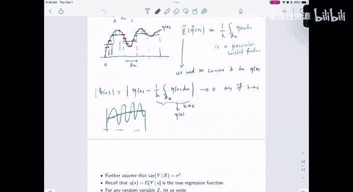

。So last time we were analyzing。

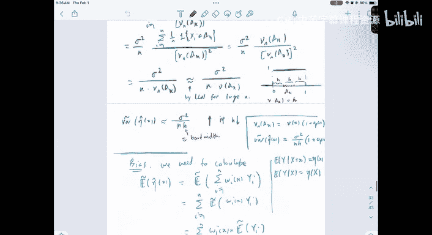

你啊。啊啲声嘢嚟嘅。

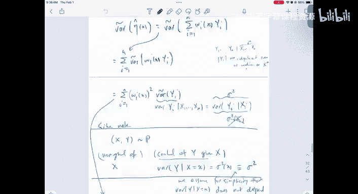

And。Okay， so the idea was to write。

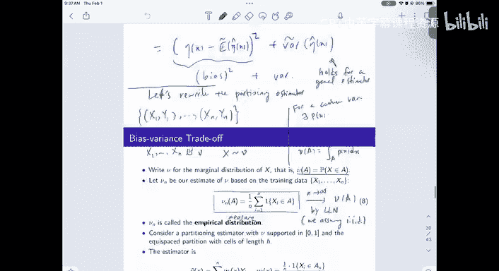

This quantity of interest。Which we sort of convince ourselves it's a good thing to look at it's a form of conditional MSC condition on the training access。

And so the fact you see native regression function。Ins to the true version function。

And we argue that this can be done。

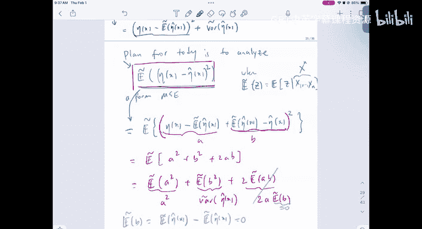

In two the steps basically because it's the MSE， it has this decomposition in terms of the bias squared plus variance。

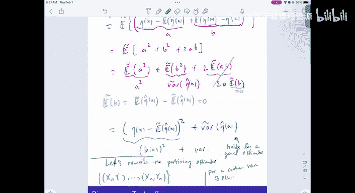

And then。嗯。

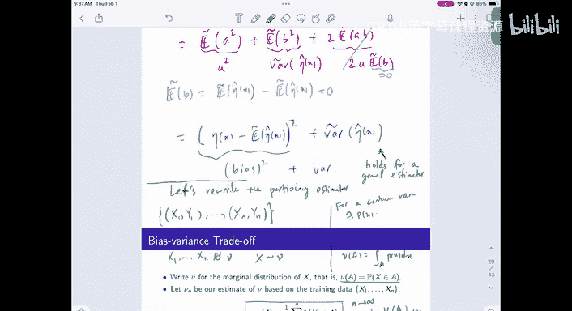

嗯。We focused on so this is called the bias variance decomposition or。

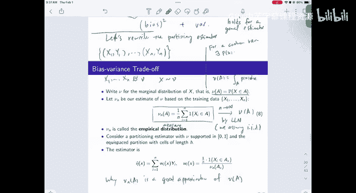

B variance trade off， is this not a trade off but？When you try to use this to。optimizeimize the。嗯。

This is equation。

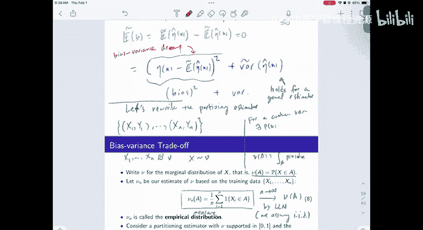

When you try to optimize or use this to optimize。

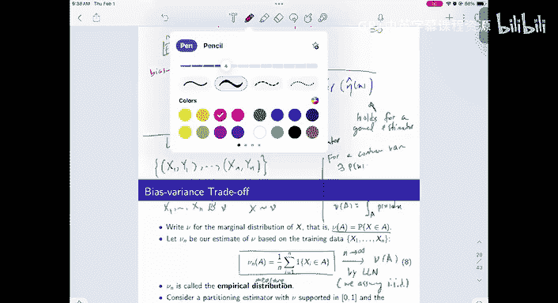

The嗯。Estator is called bias nametra。And嗯。The idea was as we wanted to compute this for photopartitioning estimator and we so introduce some notation。

 so there's this empirical。

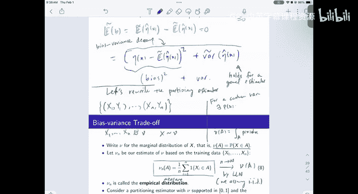

Distribution or empirical measure。 This is the empirical distribution of the axis。

And by a law of large number we mentioned or like argued that this converges to the。

True distribution， which is this probability measure or probability distribution。

The probability that x belongs to any set is given by basically it's the definition of the distribution。

This distribution is a set function assigned to a reset this probabilityability。

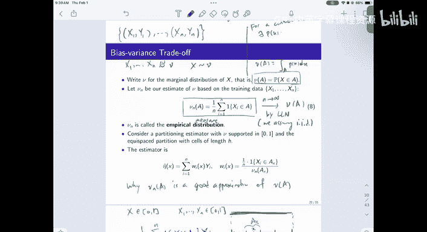

And so。We wrote down the partitioning estimator like this， so it's a weighted average of YIs。

In these particular mas。

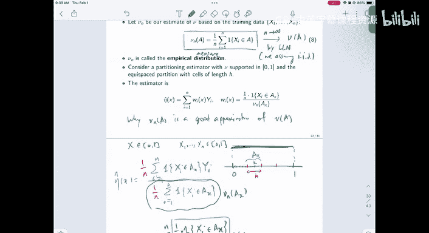

And we went on to calculate the。

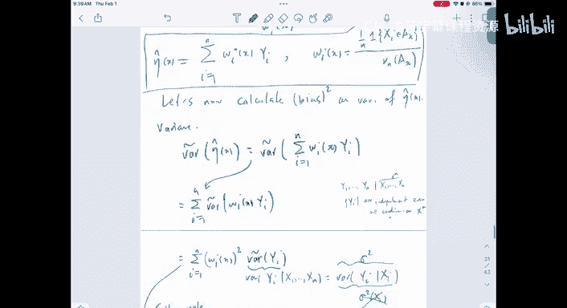

The variance is。So the variance was。

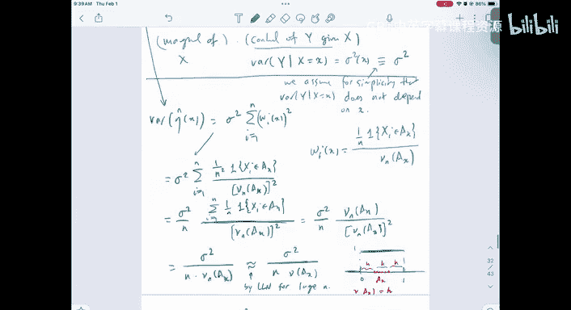

A nerdy assumption that the variance argument X is constant。So。This is an assumption that we make。

We could drop that， but for simplicity， so under that assumption its ends up being the variance ends up being this。

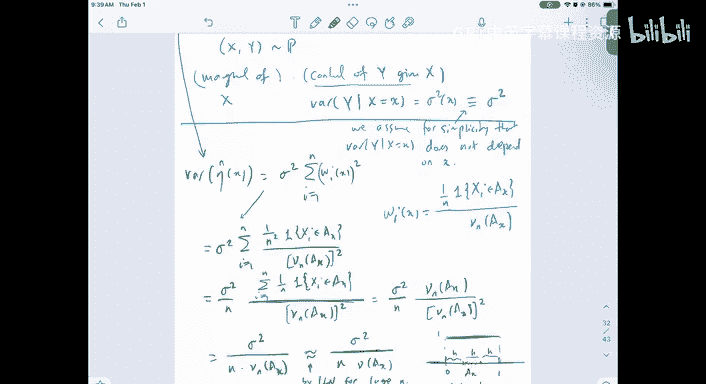

The simple start over in。This encap distribution applied to the cell of the part that contains x and that's approximately in s square n。

Times this measure of the set under the actual disturb so by the law of large numbers。This happens。

 And so if we looked at the case where。You just have zero to one。If they need like one dimensional。

In space and we partition it into interval of blank edge。Then， then。And then theserv is very。那是搞微些。

诶对。A random the next lies within one of the inner wallss is they edge。So that's the repeat。

N of AX is going to be edge and so we saw that this is like a good approximation of the variance for large n。

And。As the et the bandwidth here pays the role of the bandwidth， it's not exactly the bandwidth but。

As the same interpretation has the benefit in that。No。

And or how you want I guess it shows the mirror and this goes to low infffinity。

So it also makes sense that you make it smaller， there are fewerer points， the this is basically。

By fraction of points that lie on land within AX。And so as I made it smaller。

 there are a smaller number of points that land in there and so this is capture data edge。

 is the proportion of the points that land in。That cell is。

And so maybe must spread over him kind that， so this blows up。So you want answer to be large。

 capture more fine to the advance。On the other hand。😊。

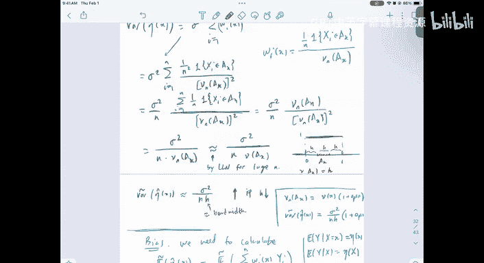

We analyzed the bias。Which is a little tricky here。 And we ended up showing that the bias is。

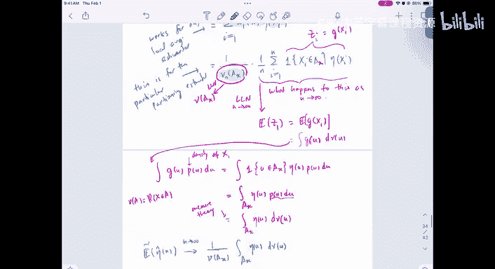

诶。

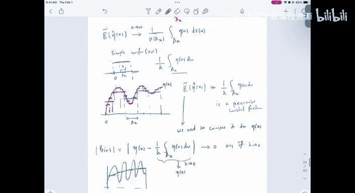

Or I should the mean？This conditional mean of。8 ahead is。This quantity， it is。

Saying that we averaged。In general， it's this。So it's the weighted average of eightIs by the ways that are given by the。

Over over that cell or in a simple case is just。empplified so distribution of the X' universe in Europe and basically integrating A and itself。

And then divide divide by the length of the cell， so it's like really an average。Think of the。诶。

If it was disc， it would be like a sum。呃。Over a bunch of points divided by how many they are。And。

Just this edgech is basically integral draw of。H。Just one the X over Ax， Okay， so integrating Eta。

Or aX divided either ethical one or。Yeah， so it's really a late average if you think about it。嗯。

And so what matters is that for any exerciseile。That is in this part。 So it's like this。

So of the part can take eggs， but for any other eggs， this is going to be the mean。Okay。

 so this is going to be constant for every other point which is in here。

 it will be the average of the data。Or that stuff and so effectively on expectation this partitioning estimator behaves like the piece vice constant excellent sorry piece vice constant in the sense that it's constant over these cells and it' it's not。

It's actually true， even not in expectation。Because of the way you constructed， you always。Yes。

The same value for Ada hadx whereas a solar partition。But， but。

So it's going to be a piece by constant general， but the mean is also going to be piece by response and it's going to have some variation in our。

 So when it will be brought in a had X。Because of the randomness。And the these these。嗯。呃这 levels。

Shift， but they're centered around this value of each childhood Okay， so theres some variance of。

So it sometimes might be like here， sometimes might be here， sometimes might be there。

 but on average， they're there。 Okay， and then the variance we calculated。

 So the variance exactly is what we calculated Sigma squared over。😊，It doesn't depend on。

so you can actually put a confidence around this。Okay as it go。Anyway， so that's that， yes。

 what's not happening that here， the why， Whys not happening that。Now。

 having multiple so I'm fighting the expectation here that's what I'm doing。

 So it had X itself would be valuable I'm fighting the expectation。

So expectation is assuming that we condition on the training data， this is like the training access。

 this is fixed。

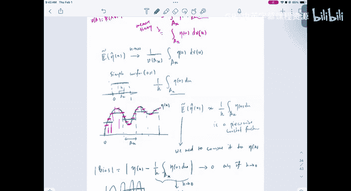

诶。And so the thing is that。Even if I had this， this is not necessarily with the approximation of Eta unless I let the lamb for this h code to zero。

 as they make h go to zero， I get a bit of approximation and so you can calculate the error。

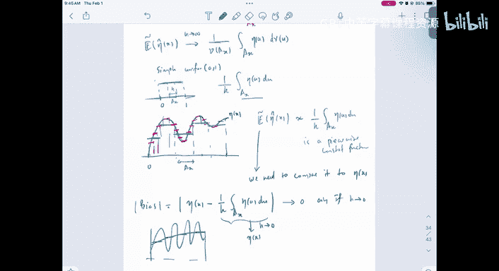

Of approximation， which is really the bias because this is the。

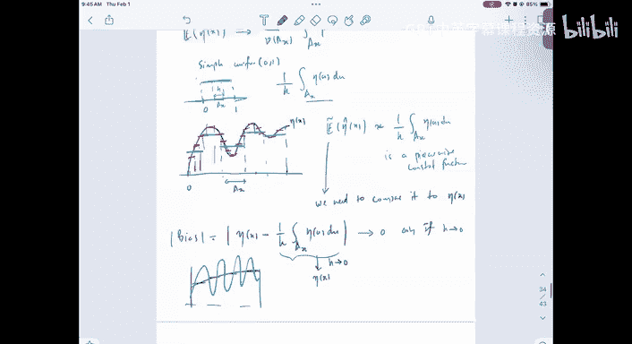

Expectation。And you're comparing the two a to x， so that's we the bias and the bias where it appears in the MS so this is not going to go zero on this H goes to zero it means yourself。

 this is a result。In analysis there。As it goes to zero。

 this converges to the point because the Ax is shrinking。So you have。Okay， the cell could be like。

This。And then as I make it smaller， so this shrinks to this point like and then this point。

 so AX is always containing x， but the size is smaller and smaller and average8 over the smaller and smaller portion eventually I'm just averaging over a very tiny neighborhood of X so this is going to be2。

Let's say for simplicity that it 15 years， I guess it's a little more demo。这 converence。Okay。

To a x for almost every x。I that say these8 continues in those actually。诶。

So in order for me to make the bias go to0， I have to make the H go to zero and do a little bit more so you can。

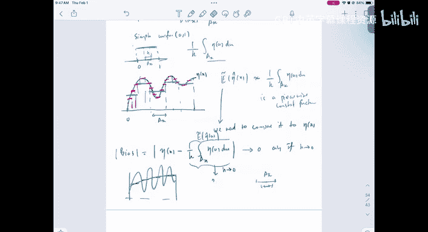

Find the order of。Our fast this goes through Europe， if you assume something about B。

 it's a complexity of F。Okay， so intuitively position think that people have organization here。

 you think of the functions that are smooth as less complex， so this is smoother。

This one is like rock like less smooth and the less smooth is the worst dis approximation we be so you have to make it very small if it's very flat like smooth is like supposed to be flat。

And you can measure it actually by the derivative， how pass the derivative the safety we have this early。

Sll care for A to X， then you hope that this goes to0 faster as it goes to zero versus this but this have to like。

Make it's just smaller， so the way that people measure it is like with how fast it goes to zero。

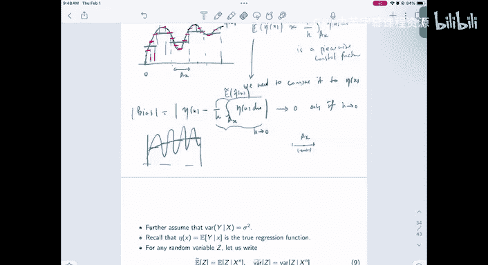

So what I'm going to do is like I just I'm going to mention。

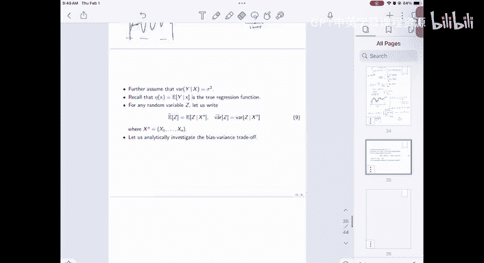

This condition， so so far is it good like people are on board？

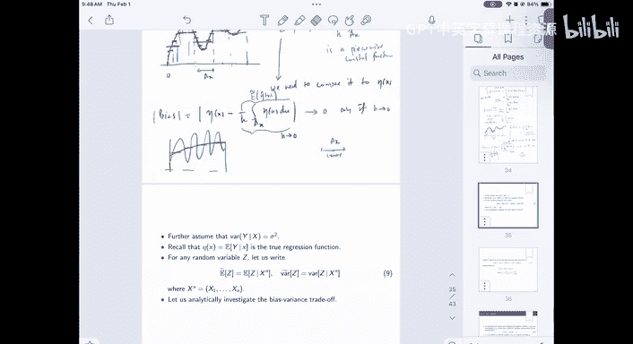

Okay， so。What I'm gonna to do is I'm gonna。Make an assumption here， I want to give you something。

Irete， so assume。So， in order。Are there。To analyze。I like you。Found。The buy it's fair there。We need。

Okay。Iposed some assumptions and the true regression function。

And ata its through regression function。Okay。What I'm going to assume。Let us assume。See that。

Data is M eips。是是。So anyone knows what。There shits me。Okay， so no。

 so this is a very cool assumption then。With Larry。

 this is another thing that he can learn in this class。

 so these are functions very many have don't change much。So an easier way to say is like。

It's Lipes is if a of x。 if I look at two points。You get the absolute value， I take two points。

 like X explain why， maybe that's why pray。Two different points。Okay， unless to X and y。

系 let's do x and z。Okay， X and Z I take two points， look at the difference of the function。

 this is bounded by L times。😊，Let's say in the uniary case， everything on the real line is slide。

It boundunded by how those things are CR。So in the 1D case like that。In the general case。

General D dimensional case。You get l times the norm of x minus z， so this is the L2 norm。

Let's say focus on the one knee case for that。So actually you can do it the general case what it'm saying is that。

If I know how close。A and z are， then also by a factor L， that's how much the eta can change。

 so it can't change too much if I'm not far away。For this， you can show there's a ti。

I believe I rather the mocker。That functions that look like this affect you are defensable everywhere。

 almost everywhere。😊，And like this is equivalent to saying aA is differentiable。Almost everywhere。

And the derivative。Is bounded by L for all X。嗯。Or in the case of three dimensional case。

 the gradient。The norm of the gradient is bounded by。The the gradient is the very's like bound。Okay。

 so you can't have like。Too much。 so this is， if you look at this function， for example。

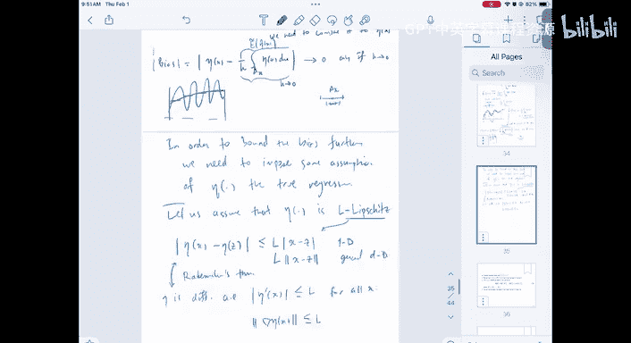

This has the derivative is like very moving R it slowly。 This one has a very like sharp derivative。

 right， So derivative is like the slope of the magic。😊。

So this is going from derivative to zero to a very large like yeah absolutely value you're derivative but this one is controlled。

 so by controlling the derivative， you can control this weaknessness。

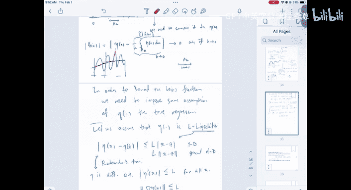

And it can go with like higher order derivatives you get higher order notion of smoothness so controlling。

😊，Controlling。你。There it is。Very bit。Or there it is the functions。In the general name。To control。

It's roughness or smoothness。The opposite。Soいで。And smoothness is a good condition to assume about plants because。

This controls how well can approximate them。

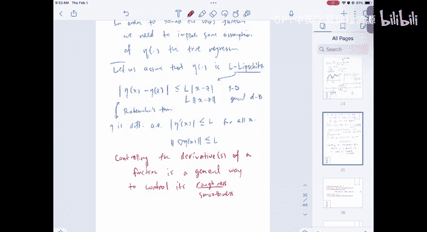

This is like。刚说我操了。😔，Okay。Yeah， sure what is spell looking？L L is like a constant of amino。

 so I want to say it's elements it defaults with this condition。The we two is twoage all one。

 just across so does that mean a constant times that。后来。It costs sometimes the also value。

 so for example it could be like two times x minus z then it's two lipss。Okay。

 it's just just a constant that。喂。And it's called lighting help throwinging。Data x is with。

So it controls how data values。How close they are is so needed。Like let us say anything inside。

Their inputs are closed like by a factor。So let's do this， for example。So suppose the example。

What is simple the simplest example in one need that you can think of？Of a liftist function。嗯。对。No。

 the simple is constant， so the constant function definitely。

 So if like let's say a of x is a constant， we're all C。😊，Right then8 of x minus8 of z is 0。

Ithich is definitely less than。Anything that you want。 So it's like L lipsitz。So it's El liftchitz。

Renie Elen。This is very smooth， the constant function is。

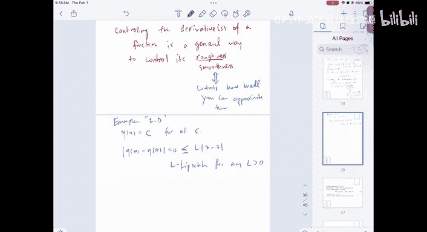

But the tricky the better one is like a out of x is like。F thanks。Okay， for some offer。Manar。

 actually like a fine。So， let's say A X。Let be。Forward。A and B。Real， okay， X is also in R。 Okay。

 so this is a linear function or like a fine function if you plot it it's。Like that。嗯。Okay。

 so is the slips？嗯。Aipicks or lipss with constant， you can say ill lipss or lipss with Constele。

A on x minus a out z。It's gonna be what。A times x minus z。Right， and so this is exactly a。X minus C。

 so it's definitely less than equal to。X minus the。

People with this this condition serve so it's actually the absolute value of aships， so Ata is。

E elipians。Usually you would say this with L positive。

 it has to be positive because it's on the other side， so it could be like negative too。

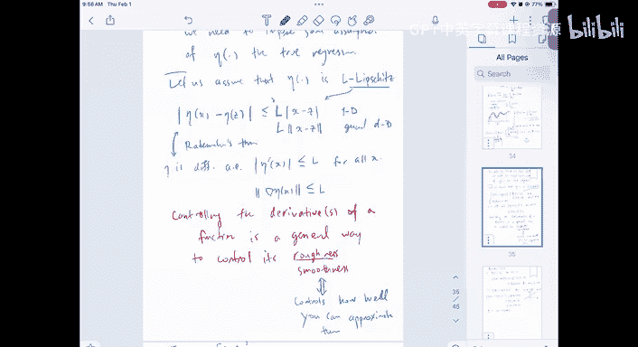

Maybe it's one two are the same as as the， so this is like the absolute value of the slope。

If you believe rather the marker theorem。😊，Tells you another me to characterize it is by controlling by looking to see absolute value so what did they review of this？

😊，A so this is going to be absolute value is a this is for all a for all x。

 so it's really definitely less than or equal to a for all a so by rather the market theorem that's another way of showing that slip yes one lips more more than。

😊，Sort of， but。So if you want to really like look look at it from an approximation perspective。

 then look at this class， so that constant doesn't really matter as much。😊。

So this the class of Lipes because I can always like， so for example。

 you have something which is Lipes if I divide it by L。😊。

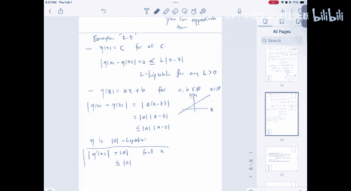

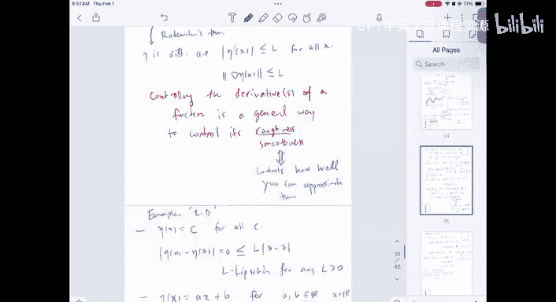

And it's going to be one lipss So it's really that a scale is not。😊，As important。

 you can think of it Yes。 So， for example， if you think of this。

This function is less smooth than this。 I wouldn't， I wouldn't say。That if you want it。

 you can you can say that， but usually you looked at this class。

 the fact that the derivative is bounded is what matters。Okay， so the class of Ls。

Usual don't worry too much about the constant， it comes up， that constant comes up。But this class。

 for example， versus the class for recent derivativemeter is unbounded。Okay， that's。The tricky part。

 So an example which is not lipschs is， can you give me an example which is not lipschs。嗯但。

Can in verse。Yes， okay， so that goes to infinity true， so 10。Anys。What is 1 inverse Beck you。But。

I think that10 I forgot what tangent looks like。How does it look like mentioned？This is T play。对。

So let's not inver it。It itself is like problematic， right？Yeah。

Let's do something which is not going to infinity you。Mar Elizabeth Elizabeth。マジ的 sex。

What what does that mean？Oh， that's okay。Is this not lipsshicks？

So write the mark here and tell you it has to be almost everywhere defensiable。

 so this is all very defiable so except that point so it's a finite number of points fine calculated linear。

Almost a very essential there is either one or minus1， so that's what。Its really one lips shift。

Aal X is absolutely tall your X is。1 lipss。

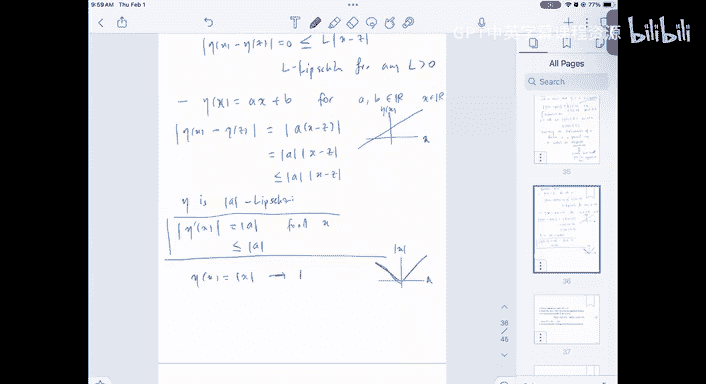

A simpler example， like just simple example， this guy is not。X squared is not。Yips。Why。

 it's not Fmp shades， you rather want her。A of x squared。Theta prime of x is 2 x。

 so this is unbounded it's not lipses over the real line。So， not。Lipss。Over all right。B lipsshs。

Over let's say01 or like any bound that set So if I bounce。

The Senate bound said very video is controlled。Good。Whats。Not lips word the real life， okay？

Another example is。Like this guy。Root eggs。So this one the derivative goes to zero ads。

At zero goes to zero so so this is not。嗯。Okay。So it matters like the domain matters as well。

So this guy is sometimes called local es。So any bound that's said is lipsts mixed squared。

 but not over the entirely right。So no cutting spending the neighbor or。Some point， it is lipsious。

 but not。So if you want， this is this we don't really need， but。And say local Egyptians。

This is more problematic，ative load up。嗯。Thatunds good。对。

An example of a good one from like later might be。

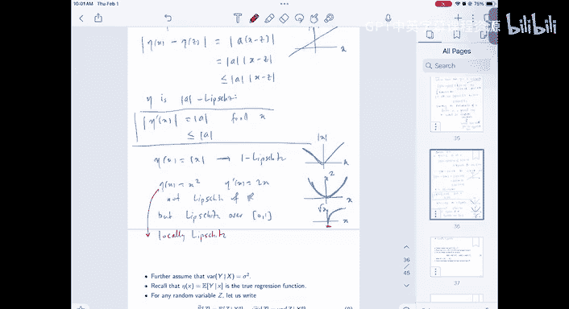

So the things that people use in neural networks like。Sigmoid function， so the sigmoid function。

 if you look at it。

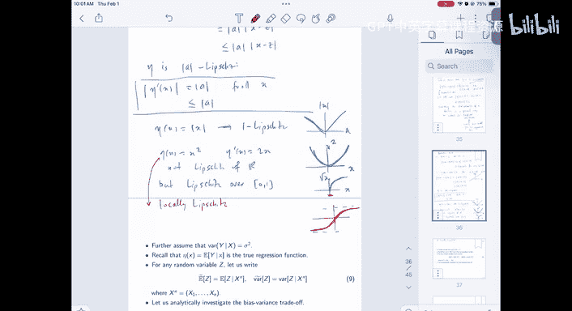

And。嗯。

嗯。It's1 over1 plus e to negative x。So it gets flat here and the worst case the derivative is at zero is one half。

 that's the largest， sorry it's a litus fl。Another one is。The Red which people use in。

Weural networks。This is we had linear addictions。And it hand it。

That's also very similar to this similar looking like tang high。Okay， so people are happy。

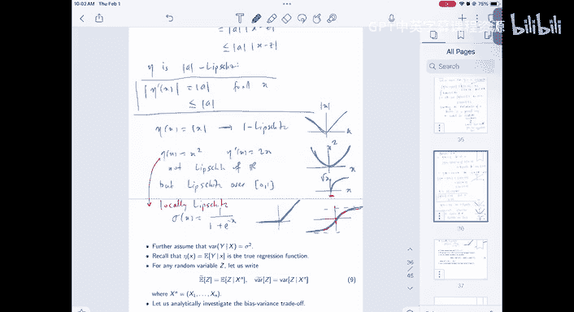

other， so this this more general， so generally any a fine or linear function is slip。嗯。So this in in。

Higher dimensions。So D dimensional。So if I want to write a linear function of prime function in D dimensions。

 how would it look like？Okay。对。It would be like some theta。

 let's say transpose times x plus B a would be okay， that's do a。A would be a nectar。

 so a trans those x if you have seen regression。Right， and then you can do the same thing。

Or you can take the derivative if radian of x would be。B them at the AX we be like。对。Sorry， a。

 so the norm of gradient of x。Its bounded definitely equal to， but definitely also bounded by。Yes。

 we're all x， so it's associated with the volume to the normal a。Okay， so I got。

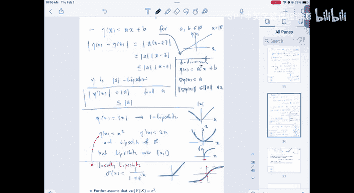

是的。Okay， sounds good。Yeah sorry， can we come back to the graph of y equal x squared do you say that's locallysheds over 021？

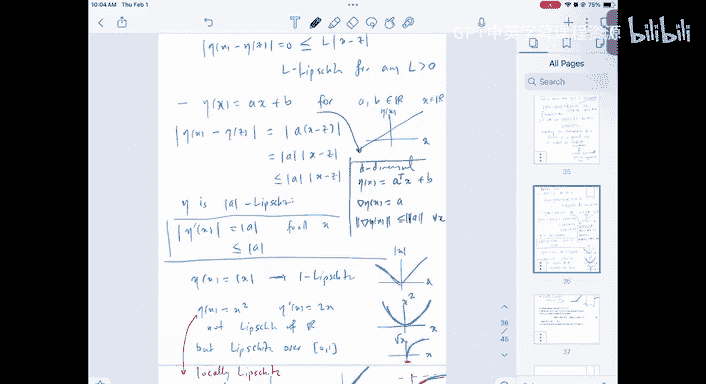

What's our value going on this week？You think that when I say Dlta language is a little bit more demo。

 he is already down that set。So but because okay loop chip over zero1。

 what the value of L is is we can take the maximum value of the derivative。

In this sense we you too to these village。They will show that。

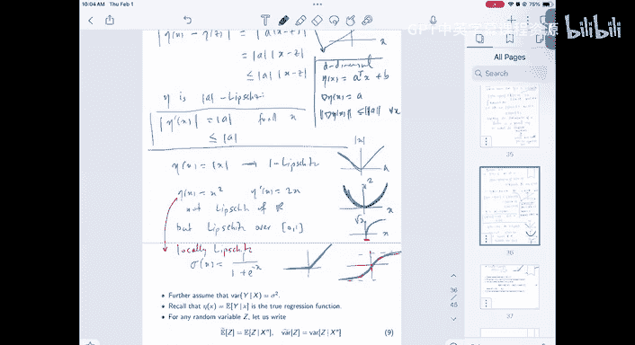

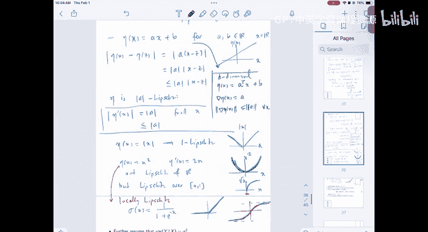

So one way of it is sort okay， this is really。

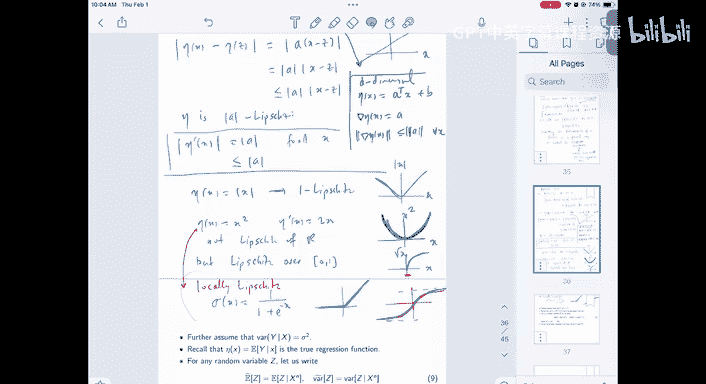

We had analysis， but let's say if you want to see why that's related to。Yeah。So ratherocum。

 half of the rh markum is sort of easy。So。One下。I right much sorry。Yeah。

 it says that let's say it's a 1D。If Eta prime of x is less than or equal to L， or x。In the domain。

 whatever domain we have， let's say in R。Then8 of x minus。A of z is bounded by L x minus c。

Anyone know it's like an easy way to prove this？It be useful for us。Can I write。

A of x minus a of z in terms of the derivative of the function。And remember is calculus。

Fundamental here。But the limit extends those a topics when I see size。

 I cant say again but limit extends to see。Oh， you want to take the definition of the derivative。

 let's go the other way， let's think of the integrals。😊，No， I don't want to write it as a limit。

 I want to write it as like exact expression。Inteegral derivatives。Thank you。Yes。

Anti derivatives before remember。So tell me what this would be， there's a derivative。Inteegral。So。

 let's say X is。Bigger than Z。X。自。A primeCT这天。Fundamental ti of calculus，So then the absolute value。

Would be that so the value of this integral？And I can put the actual value inside an inequality。

 so it's like the this is called the tri inality。And a sum。

 the absolute value of the sum and less than the sum of the absolute values。Z to X。

 I put the integral inside。By assumption， this is always bounded by L。So this L comes out。

 they get z to x。嗯，李听。But this is nothing but x minus z。

She's also equal to x minus c now so its value because youre in this。

This is the proof of one day of it？Oh triangs。Some other in trying。你不一点。😔，For integral。O。嗯。喂。😊。

The other way is a very nice result。In advance mathematic。And。If this sold。

Make sure that if this solve and this solves in this hold， then it's almost everything differential。

 doesn't have to be differential everywhere。没没错能。That's absolute value or moduluous if you want。

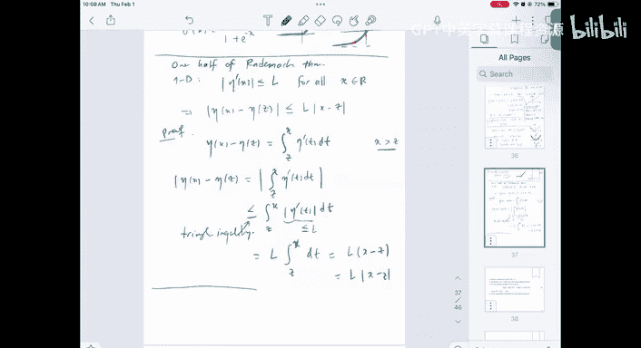

This one is。

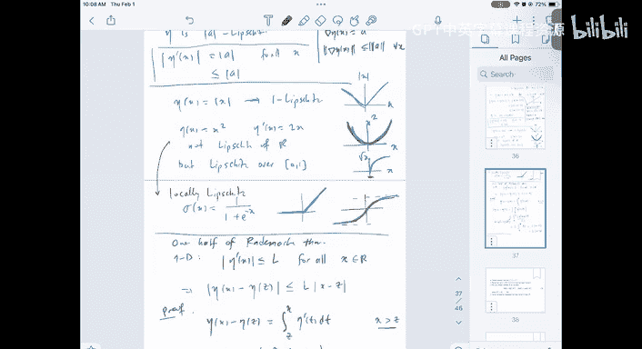

No。F everybody slip shits。

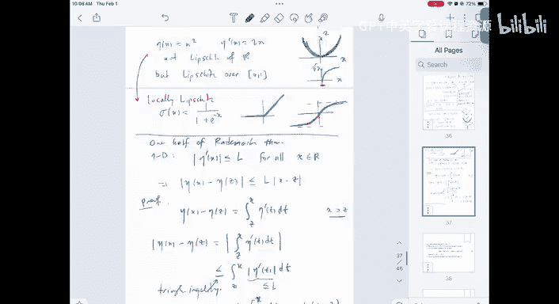

Okay， so this was a side note what I want to do is I'm going to make this assumption yes。

 despite curiosity， it has to be an experiment to。sAnalytic。So a means。

So I think it the def or order， so this is not necessarily athletic in that case of human。

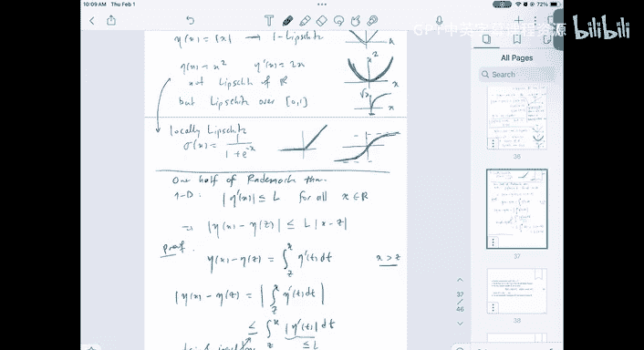

so for example， this is not differential at this point。

So analytic quick function with the differentialiable area。Okay， this is a little bit different。

Also everywhere is like like I measured your response so you could have like。

ThePoins of non dependability。But they're countable。It or measure you。It's a little bit different。

And。And it doesn't have to be differenti of all order， right， it's just the first area of it。😊。

Thanks would be very。Not as more in the sense that you could have like a lot of。Jaggedness。

 so something that like sawitude， something like this is。ItSo lips shits。系い。Not different。

 not different everyone。Okay。

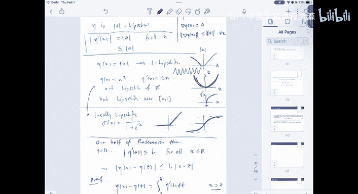

诶。

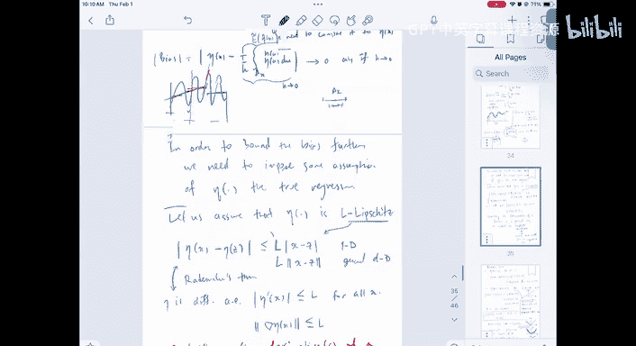

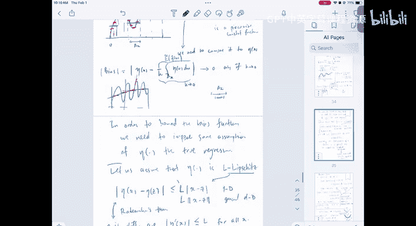

So what I want to do is assume that and then control this bias。

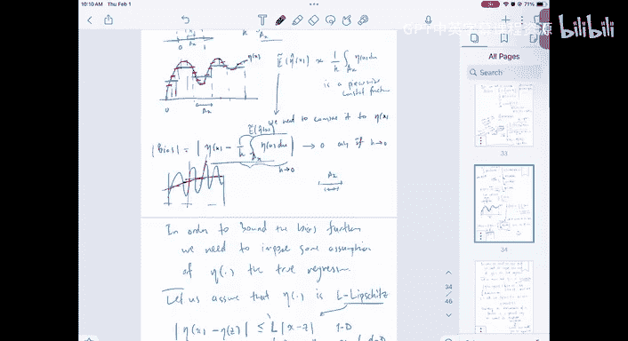

So， let's do this。

你算。Eta is elyitz。And let's control the bias。So if I do that， I get eight of。X minus that integral。

 So it was like something like that。If you remember， and this was etched。

 but I maybe want to do it more generally。嗯。Let' see。This又拼 you。B you okay。

We can do it more generally。So this is this was uniformH important。

But they could do it more generally like that， the way to do it is that I can move this inside。

Or I can write it as。1 over x。Inteegral AX。Oh actually， this is， if you want to be very general。

 this would be。N X。嗯。This is any units。And等电 of AX。嗯。I can write it as。PX U， DU。

 this is just the probability that X so this is really this this guy。Okay。That's okay。

 let's not do this that way， do it simpler。M be confusing。Let's do it very simple。This was E。

 this was D。Okay， the simple case。So this I can write as one over edge。

So one integral of D over Ax is just one because this is an integraltherol like it。就。

What over edge size anything would you want so I can write it as。E of x D U。

 so A r x is constant comes out。 so if I integrate a x， this doesn't go into over Ax。This is8s。

Aver in the cost basically but then they look the same so this is going to be equal to。

1 over edge integralte AX， I have a w x here。 that's the first term minus aw U。理 you。

I have absolute value inside， I can move it outside。

 I can move it by the triangle equality similar to what we just did inside I get Eta x。Mus8 A。第一。😔。

Okay。😊，Now， what can I do here。Thanks， myam。拜拜。Not of it like financial it likeex。

This is bounded by L times x minus u， so I get。1 over edge L comes out。Thanks mind to see you。没有。

Okay。And so do you remember？So ARX is an interval linked edge。Oh sorry， right， yeah， okay。

 the same X， this is x good。So X is somewhere here。And U is also integrating over AX。

 so U is also somewhere here。So the distance x minus series is at small stage。So this is North edge。

So I get L H， the H comes out integral AXdu。But this is also。Sorry， this is it。This is H as well。

 so that once the dust settle， this is LH。没。You could repeat this experiment， like not experiment。

 the analysis。呃。More generallyly， emotionally new。The same idea happens， but。

And you can also do it with higher dimensions。诶。Let's say if it was meaningful the international field。

You you go through this。呃。This would be H T the D， because that's the。Volume of the queue。

 but then when you integrated the。This would cancel that and this would be the norm if you're in the queue。

 the norm would be。So bounded by。Itch so。Yeah so the sorry， it doesn't attached to the。

They on the yesterdays， this is also the yesterdays because this was the size of the this was really。

😊，嗯。The length now will be the volume。嗯。So if you do it properly。

 these will cancel out basic data would be you don't even have to do edge here because。

This would be like one over。1 over this， and then this would be integral of AX。嗯。X minus Z。D U。

 you bound this by， let's say some edge。 and then you have the integral over Ax。 and this is just。

That volume the cancel。 So you don't， if you do it properly， you don't even see。As to the D here。

This would be either in the T showcase， either edge or root D timess edge。But if you already have X。

 okay， is that having S to D right now？W， is that's the。嗯。The order of the bias okay。

 so here there it send the bias goes linearly to zero。No， because I have， so is this quite clear？

So he呢。Expand this。

Now this extent， just put back everything together。嗯，不定是。They're waiting together。

I would get something like this expectation。Of Eta had x minus eta of x squared。

 remember it was by a squared。Plus variance。So this is less than or equal to。

I'm going to complete the approximation because the variance is approximate。

 this is sort of also a little bit approximate。Because of。

There was an approximation if you remember。

Heres a low large number， so the。你嗯。Use law of large numbers so it's not exact。

 but if you put alwayss， little os it would work so but approximately for large n。

 this would be this squared， this would be sigma squared over in。It's again， in one dimension。

They can easily see now that then I in page edge。The bias therefore this gets better by decrease edge。

This gets better it just gets worse and if you plot it it would be something like。

The bias is quadratic， right？And in the other one， the variance goes down like that。

And the plot would be。Somewhere between。So the sum would look like this so you get these。

Nice shape that people like that characterize the so as a function of it。

Let's say the bandwidth a we big， it blows out， manage go to zero and blows up and it goes throughfinity。

One because of the variance one because of the device， and there's some sort of optimal here。

A choiceice。Okay， so this confirms， so we did it for classification， which is quite different。

But you saw the same kind of behavior just we did it for regression for regression iss more like。嗯。

Comes out very naturally。诶。Because you're working with the MSC and you can do this calculation。

 this is what it looks like asonically so if you plot it it's going to be some like ws around this because we're using law of large numbers so if you in practice it would be something like that。

😊，Okay then is not approximately1 thing。And then I those sort of varying sort of scale not from this scale。

But。Things go down。That's the nature of that。Okay， and then there's some optimal。

Choyice here that became like2 intervals this function over edge you're ignoring that like the。没事不上。

 but一 trying to啊。Mimize this you can sort of convince yourself like here take derivative sub equals to zero if you want or you can just argue that I'm going to set these two equal I'm going to work with edge that makes the two contributions equal because otherwise one bigger than the other and this is roughly the optimal thing to do so if I do that then you can calculate what the optimal edge has to be so you get El squared。

😊，Its to the third sigma squared over n。嗯。And the edge would be。嗯。What would it be。

Sigma squared over。And El squared。Let let's do L we call one， I don't want to worry about L L1。

Then this would be just squared。And so what they get is it。Would be。This is Anne。

So sigma squared overang to the power1 third。And when I plug back in， the two terms would be similar。

 right， so it be like。嗯。诶。Would be less than or equal to approximately。

 so the first time is h squared， the second is sigma squared and edge， and both would be the same。

 so well be roughly two times h squared。Because the way I say it， don't say okay。

 this is it just star。you want。Should I get。Roughly。Two sigma squared over n to the two third。

So with this choice， it's going to go up to zero。So it's like an optimal choice so you can see the band has go to zero at this rate like the single score the but rate like one over into the one third and if it goes like that then。

Both of these would go to zero at this rate。So that's the sort of optimal rate that you can achieve for the MS coast is zero but。

It goes to zero rather slower than。If you know， classical statistics。呃。Le'sten， for example。

 linear regression and the function was actually linear with a sequence word overhead。

This is slower like care because we are working with a general function class。And he says。

 if it's lipsches， you don't know anything。嗯。This is what you can do and you can actually show that you can improve this。

 so there are e lipst functions。So you can for every estimate that you can find the religious functions I said about at least as much。

Thiss an example a nonparmetric rate。嗯。So like goes to like if you know say it like going to zero。

 like n to the negative2 third is a nonparmetric rate。

Because we have a non parametric estimate that we're not for like assuming a paraic form which we'll do next。

You're not assuming that the poton is linear， you're assuming it' delicious and class is very large。

And so that's what we get。Thatunds great。Okay， so this is biosvari decomposition。

 these curves I call the biosvari decomposition curves。😊，嗯。And it's often。

Viewed as this simple graph。 this， this simple picture is for this kind of bandwidth。

or like partitioning estimator is not already Wa， so if the bias and the variances look like this when you get these posts in general it could be more complicated。

 but generally you'd expect there is some trade off。嗯。Okay。Yeah question age。

LoHow do you go from the last step of the a green color to Oh this one the steps right， Okay。

 so this is， this is。So this quantity is like x minus u。

We absolutely so high and this is bound by hand。Because both takes and we in this AX。So， that's my。嗯。

A X。It's a cell the part the U is vary in Ax。X is also in there because by in definition x is in AX。

And there's some other participants that。is Because we're integrating forward so A here means new range in this effort you go back。

嗯。

Where this came from。嗯。

There was this indicator that Xs belongs to Ax， this converge to this indicator that you belong as to AX。

😊，Its just this takess you to the I put it down here it has zero it is on in the cell and one so intuitively I'm just averaging more all the expire better in the cell so I'm going to only get。

In us that are related to those you're worrying about I the bias would be related。

To the things that are in that zone。

Okay。So this is a pretty interesting result there is a bit approximation but you can make it work now you understand sort of where the self sort of。

诶。Any questions？So I'm going to maybe assign it as an exercise if you do it a de dimensional case。

By the hand waving argument that I did， this part。Would be of the same order。

Maybe you would depending on what kind of lipss you are。嗯。

If you're working with a like the dimensional cube， that's a uniform and the dimensional cube。嗯。

And if you believe the lips shifts is。

嗯。

It's like so so the point is I can change this norm as well。

 so this is the alal usualult I can change to a different norm。

 for example I can change to infinity norm so the function could be say to the onfinity norm。

And I'm think ignore the maximumimal absolute value of deviation。E2 is just the sum of the square。

But let's say if is。诶 if I on the queue。And it is certainly L too。

Because Elfinity had the exactdi that I mentioned。

So let's take this afinity。诶。

This still would be of this order。If it's L2 which is split to L2 and D dimensions。

 then if you're on the cube， then it's in the root d times h because that's how we can say but the thing is the order of is sub chain so there's any constant independent dimension but you get h squared so the order of the bias is h squared is for the h the thing that in D dimensions happen which is interesting is the variance gets much worse so in the D dimensions so let's say okay so D dimensions。

呃，D dimensionional。You， let's sayipes with the definition that I mentioned， what you would get is。No。

I believe something like this。Yet El root the edge。Squared。So this is h squared， there's a D。

 but that's like a constant there。And class。You get sigma squared and the problem here is that you get edge to the D。

And this I want you to do as an exercise for yourself。

 go back to the variance and see where this edge comes from。

What was that？And so this edge， so up to this point， everything is fine。But indeed dimensions。

 this is no edge Are you about this going to end up being edge squared？

So H， sorry。 So that's that's the problem。 So what happens is that。

The in the dimension the queue is the。In a sense。Carner so the volume is like spread out。

So you get this issue the D factor here。 and so this is going to。

Blow up much faster when it goes to zero， so imagine like if I had n times edge。呃。

Let's say ifH was like 0。1， this would be 1 over 0。1 will be 10。Right， so。

Sle was like Sigma squared over N it。Seid h equal to 0。1。

 it would be like sigma squared over n times 10。But if it's like sigma squared and it's to the D。

 and let's say D is 10。In 10 dimensions I would get hs 0。1， I get sigma squared and n to the 1。Okay。

 so with the battery of 0。1， this is not by by pen， it can be killed by。

Maybe making the samples as 10 times as big， but the same dynamic here， the legal pen。

Would you take this 10 to the 10 so I have to multiply my sample side by 10 to the 10。Okay。

 so this this sort captures。The difficulty of estimating a general， let's say，ipititz function。

Indeed， dimensions。Because of the scale of the marriages。So this means to a very dramatic。

Drough generate destination。I believe can I forgive about the constant give。

 for example you can do equate tool again and if I'm not drawing， so the optimal。

Optimmal choice to sort of find the optimal choice of edge。

 and then the optimal MSE would be roughly。Like sigma squared over n。2 over two plus D。

So in D equal one， would be like compared to over chain， but as to the two plus and then we goes to。

They get light light this the mirror。 And so this gets very slow。

It's like instead of n to the two third when get n to the 0。0001。

So you hear a amount of samples actually dry this area here。

So this' thing it's called care like this type of rate or this behavior is called the carousel dimensionality。

嗯。So what it said is that it's hard to estimate。The function。嗯。In。A general function in dimension。

So for example， something which delicious which looks sort of nice。

 the still is pretty general and if I just assume that she cant make answers。

 at least need an estimate pair you pay this this much price。So you might think okay。

 I might be able to like change the estimator I could do better。

 but this fundamental problem is there the thing is that in a D dimensional space there's not enough。

PointsSo if you have to make h go to zero approximate to make the bias go to zero。

 but once it gets smaller it's very hard for points to hit that flux。Yeah。

Because the volume goes down very fast， the volume won' like box of length， side length。

So the last sign that is edge。So you're randomly picking the training point。

 let's say this is dimension and can box zero to one。

The probability at the nine case of the index squared。

And the don7 yesterday and that probably is very smaller。

 So if if you if you do it a real life probability here。没在我的ね。

But if you do it in the square we did a square in the case it be s to the third and in the D shell will be to the So if this box small enough to approximate data here properly。

 you need a lot of samples to get the split enough to make the virus to out Okay。

 that that fundamental problem cannot。Be fixed， so。

So these things are sort of theastic can we that we don't prove it here， but if your function slips。

 just just you know that slip shifts。诶。This for exampleで。啊你住。And mean this is so much this is thank。

嗯。Best study can do。 The alternative is to assume something about more about the function。 Okay。

 so if I assume that my function is actually lean there。I don't have the biggest this price。

Because for example， indeed measures have P parameters。

 I can just try to estimate those and I know the inform function going assume that barmetric form。

And then I'm not going to say this there's a image that so a lot of like。

Machine learning or statistical learning is focused on trying to find good parametric models or good low dimensional models that。

Capture。It's like the true function and then you avoid this， so that you need need many。

So this these are sort of these things that we talked about like local averaging at least okay local averaging is more general so they're okay at least this partitioning estimator that we analyze is going to be okay in general in like low dimensions。

😊。

That's going to start with deter。With the dimension of the inside。

And so be the reason why you switch to some of these parametricic models。Is to avoid this issue。

Thatunds good。嗯。Yeah， I'm going to assign this one as the more call if it's like you go through this argument from the start to finish like the bias scenario you get a lot of intuition once you do it for yourself。

It's not too difficult and you can see why， for example， different parents look the way they are。

 but these indicates the case where the data is uniform in either zero to1 or the square or the Q。

 this is so the training data is uniform。

And then these interesting sort of results that you can find rather with simple arguments。

Okay。Are we going。Okay， so this concludes our discussion。Of。For local editing for now。

 So what I'm going to do is I'm going to switch to like。Something that's left over from。

Chapter one and then move on to these para models。That tried to avoid this issue。

Maybe。

So this is like switching gear a little bit then going back to。嗯。大概几高。

We should really talk about this a chapter one unfortunate here so let's talk about this so let's go back to the idea of the。

Measuring performance of classifier。Any questions for switch？Like measuring performance。

So we' back to classification。And。One thing that we can do with classification is。If you remember。

 we had this。Los。That's how he measured or like I don't know y minus my hat。So that was a risk。

A a classifier。So this was LY。And so y hat is F of x？So it took， for example， the last to be 01。

 but can also you also saw in your。Homework problems that you could do more general losses。

Why not equal Y hat。That was a zero one last and this would be the probability error。

 So another way to measure the performance is to separate。诶。

The performance on the zeros and the performance of the ones。And in particular。

 many of these classifiers that we have。He' been be written as something like。

We estimate the regular function and the interest threshold folded by some。But that isさ。For example。

 for the optimal rule is like threshold is one half if。This is e sta rate， but in your overallflow。

 we also take so that we can change the mass。You get different to potential candidates have but the idea general idea that we have followed so far is an est the regression function and the threshold so this is the plug and rule and this is more generally true and you would try to construct an estimator here and then threshold and so the performance depends on this threshold so you really get a found that classifiers。

And。You can try to report the。Accuracy is a function of power。

That's one way and then you can also try to choose Ta that way。

 but oftentimes they we can characterize the performance of the entire family using this thing called the RsC so instead of choosing actually a articulate notal we can say what is the performance of this entire family class。

And the way it's done is。

嗯。Right， not happen here。 so what you would do is。

You would calculate these these quantities。 So instead of。

嗯。The accuracy， what you would do is you calculate the probability of one given or y hat given1。

 given y is equal to zero and the probability that y hat is equal to。嗯。One。

 given that y is equal to one。给你发现这个。嗯。If if I know also these。Then for example。

 given this information I can calculate the mis classification。

 but the focus we did on these two and because the classifier depends on how。

So this would be let's say you can say this is Y hat tau， so this quantity would depend on tau。

And so I get two numbers this is called。嗯。Anyone knows what this called。There are domain many names。

 I usually forget， sorry。Okay。So this is false positive rate。

So we're declaring the case to be positive。So when the true case is negative。So， false positive rate。

嗯。So it's a rate because the probabilitybabil is this between zero and 1。

 it's like a fraction of if you think of the thing。😊，Interly incredibly estimated using colleges。

Among all possible cases that are zero。Po fraction we declare as one。

 so this is false followinging ring。And this is true positive rate。

They have other names like sensitivityidity， a specific specificity， which is not。呃。

False positive so if you look at WikipedD to for these things。

 there are many different names for these， but I'm going to go it's like more clear false positive way too positively。

😊，And so this is going to be a function of tau。😊。

It's going to be a functional tau and this ignore north is possible March 3 nights because it discounts。

😊，呃，不。The baseball English classes。If I look at the specification rate， this goes in and for example。

 if one of these classes is very。The quality is much smaller than would affect the the performance the result。

 But this is like conventional on on why So discounts this factor。 So it's sort of。

Niceer to work with。And。In cases where you have unbalanced classes。

 because that would sort of skew that。There is also if my， for example。

 negative is this is very large deposits are very small。

 even if I do very bad here when specification is going to be fun because this gets multiied by bad。

诶。Plus this gets more further。 So it's like you can have it there。 but。

 but errors are like modulated by these numbers。 I mean one of them is very large now them is very small。

 but I doesn't matter the way to do one the other。 So accuracy is not necessarily a good measure of。

Overall。Performma it's a matter of overall performance if you're actually sampled from the data。

 but it doesn't tell you。They like the perform an individual fast so this gives you a better picture and then when you plot this。

 what happens is you would get as a function of how you get this this interesting plot usually that goes from so zero to one you plot a false positive rate。

😊，As a function of tau， where it's this true positive rate as a function of tau。

 this is called the RC when you plot it as a function of tau， it does something like that。😊。

The idea of thinking is like。Like this。Like perfect like that。 And then the worst is like。Like this。

嗯。And so above this line， it's good。

And it tells you the overall behavior this， this is a good way of measuring performance pest like family pest far parentism this。

这个。like that means that if I change how to allow a little bit of false positives。

 then my true positive is very。Cl to one So this is great。

 So you have to allow for a little bit of error on this。 So I can always， for example。

 make this equal to one， but always dec one， but that not good because then this is also equal one。嗯。

Sorry， this I kindt hit this one， but by saying that past is output was one。

 but then this is going to be also one which is not Google。嗯。So at this point。

 pause positive one and one like two positive is easy to achieve this one is also easy to achieve as they always declare zero。

The easier so I want to to be small。 I want this be。Okay。

 so I can make about zero and make one you two minutes， but what happens in between is interesting。

 if I allowing myself o。Pause positive， if I can jump to the high to positive rate as impressive if not。

 then。Things like so this can be achieved by just randomly for。Let's say probability alpha。嗯。

Alput one， so's going to be alpha is's going to be alpha so I can trace this line pause alpha probably by randomized class。

And so you want to do that。Re the and this would be you can talk this。

 the other thing that people do is they look at the area under this， it's called AUC。

A under the care of the ROC， so this curve is called the ROC receiver operating characteristic because it's。

And from the radar。我定未上诶。But rate， I can like classify the target like if there's something you want to know。

Not detected， that would mean that something falls lot from the decide anyone else would to detection。

part these to be driven but anyway is。The area on there this also is good measure。

 So if you think about this， the area the best case would be one it was in with。

So this the optimal is。One， the worst case is zero， but usually like 0。5， which is the。

A you see of this is the minimum， so you can always achieve 0。5 so anything 0。5 is。

I can have for two first I can have the same area， but one is more preferred than other。

So that's the thing so the care has more information， but whether you prefer it or not that's yeah。😊。

I not sure so yeah it gives you more information so it could have like they have the same area， but。

U。Depends on your applications。So one could go like this， the other could go like that right。

 which one do you prefer？It's a different story， right？It depends on what you want， right？So。If you。

 for example， can tolerate， I don't know， if we can tolerate fast positive。

This means you better before us if you can tolerate them probably be the first one please。

but gives you a full picture， whatever you want to do if your application time requires you to have a very false no false so in the statistics usually like this is very related to hypothesis testing so you set your false positive rate and then that one is clearly better than the other if you have a budget false on。

But this is see the full picture， right。It's common that people like report that they use single pills。

It's like a single measure performance and it has an interpretation so this interpretation the result in the vectors that they have so if you pick two random I we actually had time if you pick two random point one from the a0 the other from case one。

 this is the probability it class by classifies let this is a score ata hat x is higher。

Or the positive growth so this has a nice quality basically。

