# UCLA《模式识别和机器学习｜Introduction to Pattern Recognition and ML Winter 2024》中英字幕 - P9：[09]Introduction to Pattern Recognition and ML -- Lecture 9 - Winter 2024.zh_en - GPT中英字幕课程资源 - BV167BfB8ETK

嗯。I pointed out that there is another way of measuring performanceal classifiers。

Which is through this idea of RSC and。The one thing that I wanted to emphasize because it's often confusing to people。

So this RC is really the property family of classifier index by threshold。

So it's not a measure of the problem a single passifier give you a single passifier its just binary。

Deciion， so give me， give me answers。I give you。The binary decision。

 we can't do the RSA is in impact so71 point here， so there's one false positive rate for there is one true positive rate。

And then。So false flood integrating the problem that they care。嗯。

Why had pretty wise or one So why had one given the。

The true level Y is0 and2 positive rate is the problem that。诶去佢。To able to be sorry。

 predicted able to be one， so why having one y is equal to one。So the easiest way is to see this。

The definition of true positive rate and false positive rate is true this idea of condition so one。

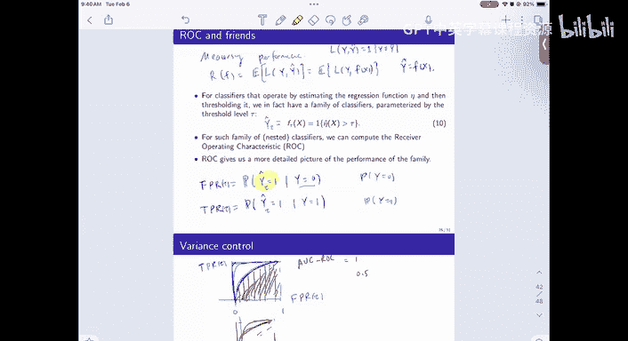

I have like four quantities， basically， probably your Y hat。Equal one given y equal one， beia。

Y had equal one given that y is equal to zero and two。Okay。

Other quantity y hat is equal to zero given that y gets equal to one。

The probability T of y hat is equal to zero given that。Y equal to0。

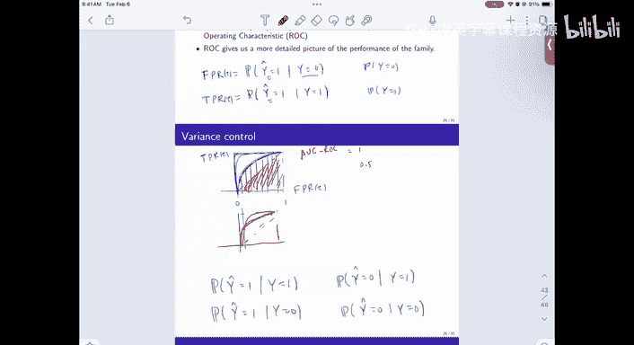

And so。嗯。So this is called true positive rate。This is a。Pase positive rate。

This you can imagine is called。So yeah， false negative rate， yes。Just the true negative rate。 Yeah。

 so negative is like zero positive is one， and so you have two。Positive race。

Rates means like probably give you fraction。Yeah。To far lady the was father and your Philip father。

That wasn been so many audienceで。诶。Not positive negative， but you positive。

 so it's a false positive and it is a false negative because predict negative like the children was not negative in。

So， so these two you can imagine these are like。Related to like this， because。

And binary classification when you。啊。B one。呃这 it is that way need一 nice。And so。

One is one minus the other， so you just focus on these two。Yeah。呃。

So it's basically the probability you decing positive under。The two classes。

And so for a single classifier， you get just one of these and one of these and then a vacaped average of them will give you the specification error。

 the risk that we're talking about， and it's easy to calculate that service。Basically。

 the rest of team。Yeah， at these well there is， I'd say if you want to like the risk exchangeification numbers。

falseity。All sponsor are made plus great， but that wouldn't work because like potentially this would be two it's the probabilityities that like be close to one so theres like a like a site week。

这边快啲上课。 so what I want like if you want to calculate the problem in error。Okay。

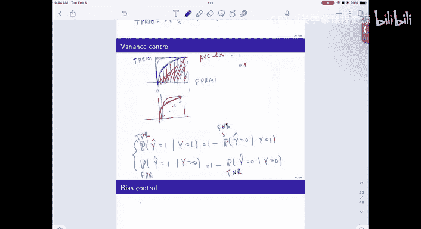

Probably any our risk was。This probability of y had not equal to y for the zero one lot。

You can go ahead by condition。The conditional wide being zero， conditional wide being1。

But then you have to also multiply by the probability。Right， so you can anyone help me？Or know。

 I get false positive rate。So there's the probability of making an error under mirror。Times。是。

The marginalYeah， the marginal value of y equals zero。

Plus false negative rate how is the probability of。W equal one。So if he called this pi1。

I think if you look atukedia， sometimes it' called pre， pre but that makes。

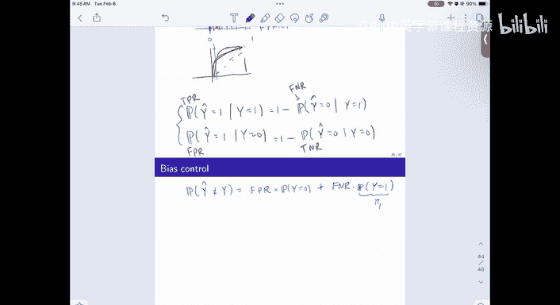

I believe。Okay， so this would be1 minus pi1。And so， this would be。Al positive rate。

Times or you can say pi0 if you want。Maybe a little bit easier。嗯。Plus1 minus throughos rate。

quite so you how this information it calculates theclassification error。

 but you can see the the classification error depends how comes。我做。Oh we need to take passes。

 create ons if you want， base rate， some people call it base rate。

And thing is that if one of them is very close to zero， then that quantity doesn't have an effect。

 say for example， let' say the number of positives is very small， then this term。

 because of pi1 being very small term equals to zero， that doesn't matter if you do。

If youre fall negative and you high or if you keep positive rate small。

 so it doesn't tell you much about that。Performance and then in fact the majority classifier。

 we will classify the class slide everything as zero。That can have cost positive对我 want。Declre zero。

 always。Maybe it's not really the majority， but it will be majority business。

 it finds you in Z one the majority your train would have。

Would negative and we declare negative so the majority rule would have this would be zero and is very close to zero so you would take like point maybe 97% accurate and that one might be proceededing because you you care about two positive rates。

呃， it是告 name等二楼。And fact in from that case， it's zero to be declared zero than 20 million is。

Zero as though because we never particular that project。So for that reason， the ROC。

 the view of so discovery for baseball amenities。And just viewing as these classic conditional properties basically。

Detection or the。Pacification and these are。Maybe a more interesting or more robust。

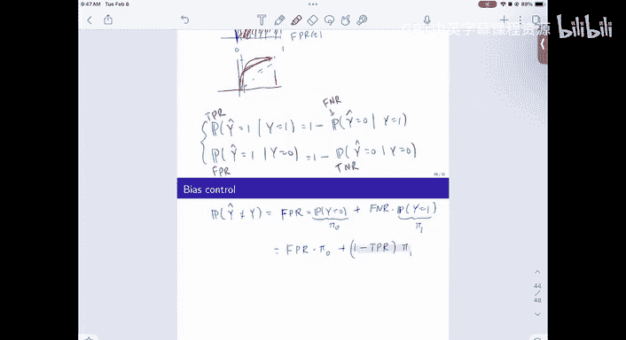

In in。In measuring the component if you haven a fun the classifiers。

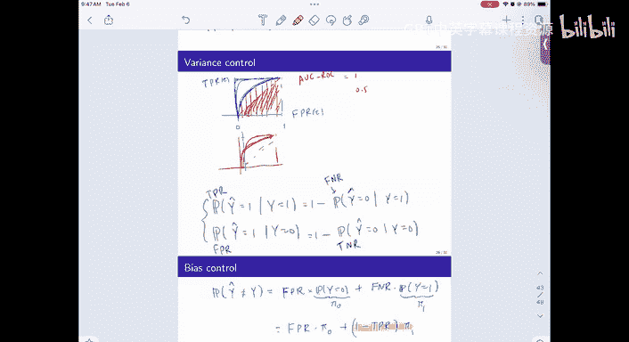

Then you would have this tau。😊，Let's say a threshold， but it could be a parameter。

 but usually people。But the RRCs were classifiers that those like this。

 so the threshold in a particular function so this you can think of as the probability your estimate the probability that's y equal to one given x so this is the just our estimate regression function remember this is just usually。

The prediction of this probability probability the why。Equal one given x is equal to x。

 that's our prediction he。So this is something we think you have on feedback on and if it's of all a certain number。

We say press one it can feel all the second say by zero and the create by zero and that threshold。

If our loss is misclassification has gone hand， if your loss gender is not seeing homework problems。

 it central threshold here so any kind of threshold here is would amount loss like。诶。

And so as I married special。I'm going to face different points for each one of these tasks that had fall positively and actually positively。

chair the Odyey。And then a measure of。How good it is is is the area under it。And。

So it they get random。Decision would be呃。

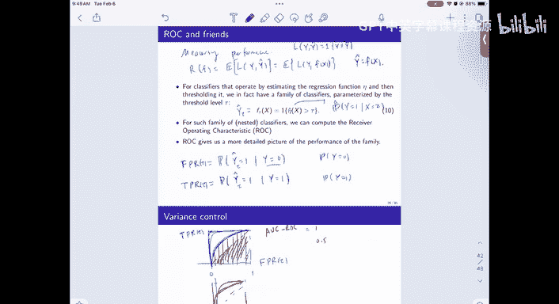

But we have this RSCF。This 45 degree line。And the perfect classifier with need a line jump from the the line goes all the way。

And so you practice you get something in between and the closer to the ideal classacifier the better。

 then RA is like area under the curve called ABC， or ABC RSC here is a good measure。

 area under the RC here， if it's the her classifier you did one。

Because the area would be just the whole tank if you have the random classifier。

You get one half with's the area of the strangle in practice。Pas hard live on team。

 so he didn't care yet。Between like 0。5 and one， the closer to one year。

 the better and it has an interpretation。

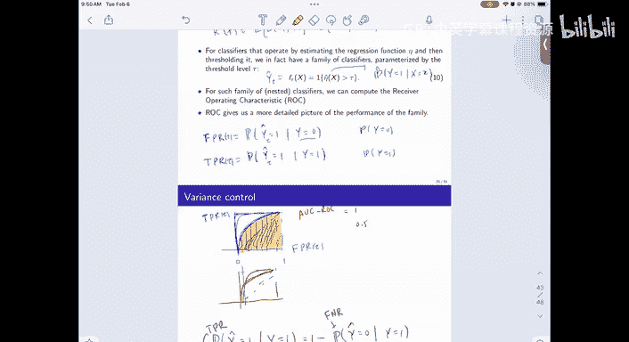

诶。I like proof in the notes if you want。That this AEC is basically。

Can be covered as a probability if I if it randomly pick one positive case， one negative case。

 what is the chance that。It's like the probability that I。Score a positive case。

 so let's say x is from。U。I don't know if we have annotation for this， that's say key。1。

 and x prime is from P not， so this is the。诶。The class additional。

So remember this notation is okay so let me。

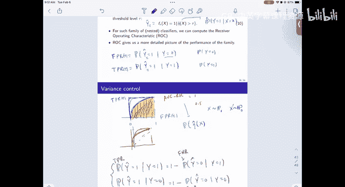

Go down here bitter。Good。So I don't know if I introduced this notation。

 but if you go back one way to model the joint distribution of X and Y。

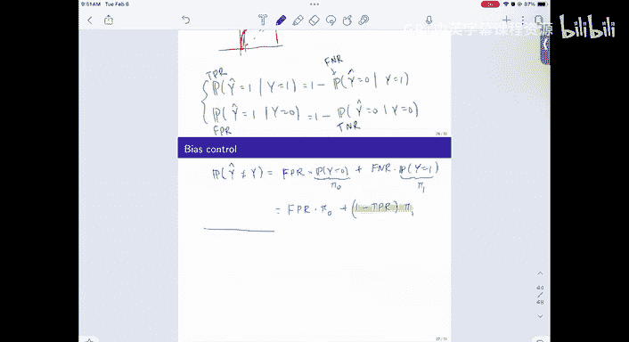

Is to specify the probability of。Or the density。Right， the density of。

X given y equals to zero and the density of。Ex one so these are the class functional densities or more generally they're going to be。

What we call the probability measure distribution， I might write it， I don't know I don't know。呃 new。

Dnu of X。

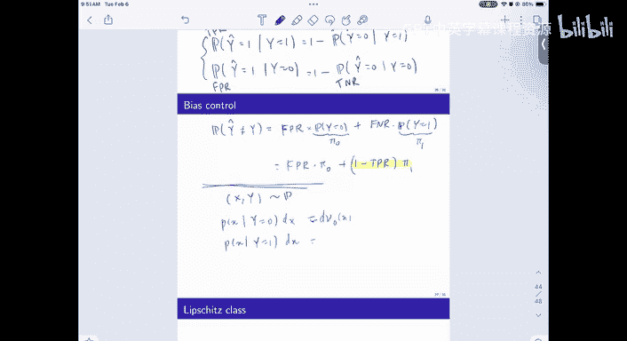

He knew one of like， these are just the tro executive。So if I sample the results， like。For example。

 this is the Gaussian industry。即第三个诶。One x from the positive distribution。

And one x from the negative distribution independent of each other。 then the probability that。Eta of。

E hat of x is bigger than 8 hat of x prime。Would be that AUC under ROC and this probability is over just the x and x prime。

Randomly be the best point。Depoitive distribution and this from the negative distribution。

 the chance that score so you can think of the eight a half of accessor four somewhere between3N1 the closer to one to closer prediction。

Well， so the probability' be used for。The positive example higher than example with exactly this area the camera。

All right， since I has this nice。Thank everybody for。Okay， it's not a very difficult result， but。

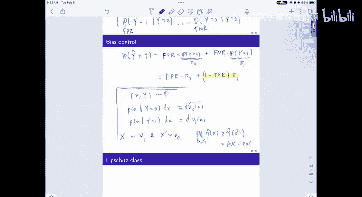

But as was pointed out last time， it doesn't tell you the entire sort， it's just a number。

 so there could be two different RCs that have the same name AucC but the difference sort across each other。

你就啊。In that case it depends what level all cost positive rate you want， yes。

So if like you said that we generate the draft by vary tau from0 to1， Yes， yes。

 but have we guaranteed that if tower is from zero to one fall positive rate will also vary from0 to one。

呃。

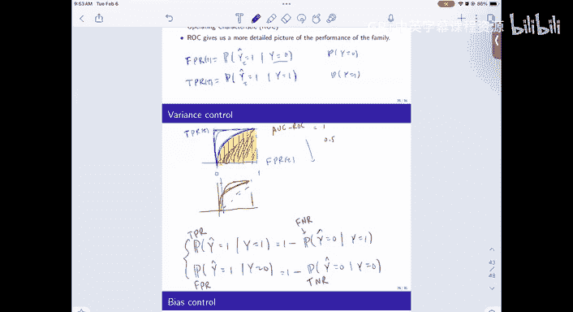

嗯。So how we don't vary from zero to one， tell you vary from the entire rate。

 like negative community between between。

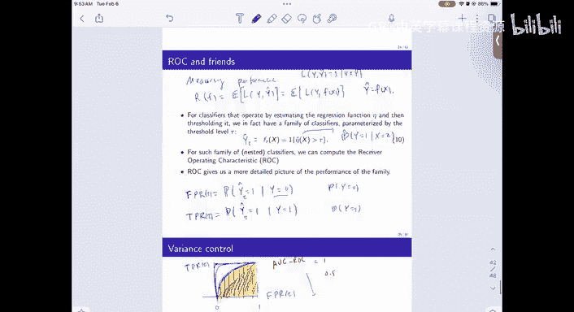

That's the entire range oh in this case yes， I mean the state。

If youre personifier let's say eight highest is between0 and1。对， so你们 social说的 negative。In general。

 this may not be the。还这问题。It may not be exactly probably it might be like something related to like the largest or C。

 but let's say if this probably is zero to one， so let's say it0 less than zero。

The chance that this is bigger than your。不是上微像旅馆。And being than one， this is always been easier。

And so basically at some point， you get the classified and classified。Perfectly at0。

And perfectly point。

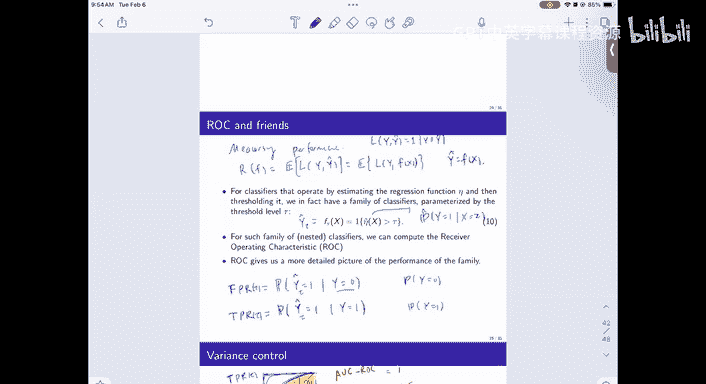

Okay and those are these two points， so the classified is always。I puts one。

I two positive which one and positive which one。And the one that's often zero is going here。

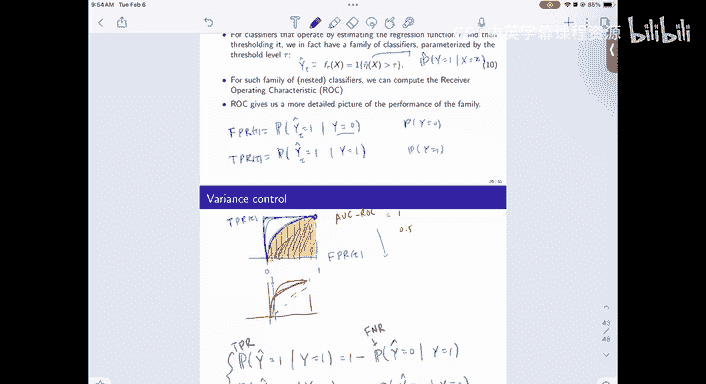

So if you vary a threshold such that it just falls below the range or above the range of datada effects。

Then this would happen and if Eta had really probably we even them get zero ones。

Sometimes you add something which is mean by addiction like want to want to respond that way。诶。The嗯。

Probably so for example， in a lot of。Neural networking out。Architectures。You are with the larger， so。

There's a lot of divided by what one thing is allowed。在大部别了。多是的诶。So anyway， how familiar it is。Okay。

 other question， why can you have two ROs why you have the Yeah。

 so this is usually to use this compared to estimators or two。

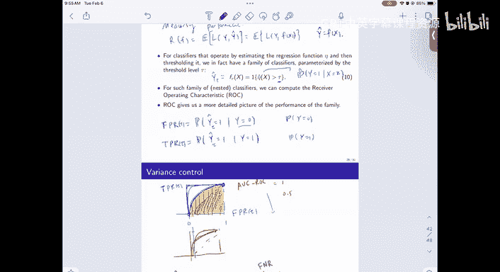

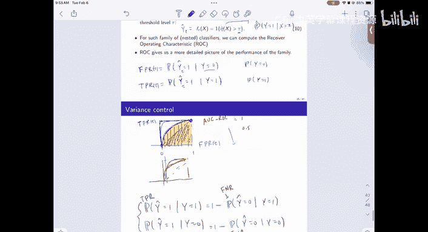

Classifier， so what we have here is。I have one， for example， for。This is my， let's say。Eta hats one。

And then I have another one for。Ada had two would be like that。Okay。

So we can try compare them using this， but this picture tells you。I with the story。

 so if you care about like small false positive aids， this is going to better。Unfortunately。

 this blue one is not way。Appeaing somebody maybe。Goes like that if you allow for higher false positive rates。

Then then the blue one is so it depends on your。And tolerance will cost povertyity。系。そるてがアケーションにするく。

 so you get just out with this and let people just like yes。

 like in practice the way you make one of these because you let。

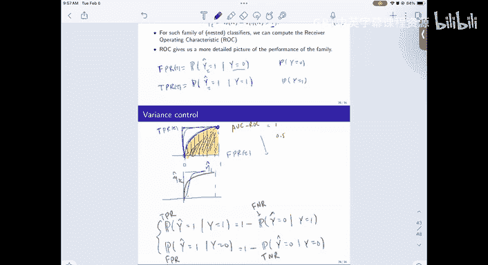

How take its range and then plot points for。

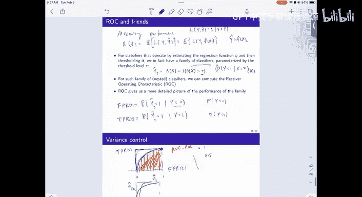

Or a given classifier like80 one and the example you just drew the way you make that to move on you let have tickets range and then plot the。

SPR and TPR along yes， exactly so in practice actually what you do is you estimate。

These probabilities right， so the true false positive rate is another level population which you don't have。

嗯。

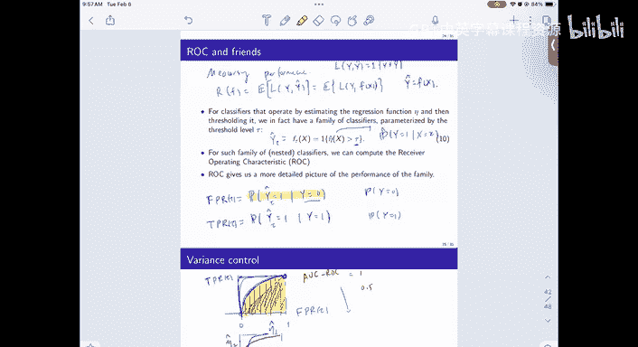

So this sea remember， this is like。

Like in our test data。It is for a test data yet， so it's like your。Let's say F。Hats or if cow。U x。

 given that y is not equal to zero， so this is one yeah sir。It is property。

This would be the problem of ETF。F tau x equal one given that y is equal to zero。

 so it depends on the joint distribution X y for it unknown test which is dependent on that unknown probability distribution。

 but in practice again you can approximate this by。

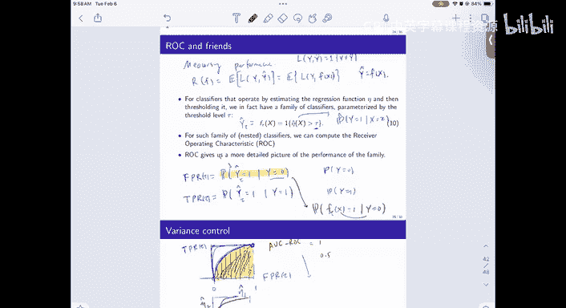

An average， right？So you know how to do it， like just a frequency so you can take like an。诶喂。

And we had a big size on Y eyes， and then this would be the fraction。One they class by one。

 we think the zero。And those indicators do want sumation I from one to M， let's say。

Indicator F of poweru of X not or say1。And y I is equal to zero divided by summation。

WhatMy I equal to zero。So that's how you calculate it and this is for a single tau。

And that you say it for part for this one and not to be a point here in any director。

If you think about it because of the discrete nature of this。

 you don't need to compute all the paths。嗯。Because in the end。

 you're going to have only this many values of。A a have。And so it has taste。

Like you have like M test points and it don't have taste as many values。

And so for the thousand between those values， things wouldn't change。

so you just can just sort all these values and just value your threshold along those values。

And so fact you like have sub approximately。Right。喂。Okay。

All that we need to know about RSCs any other。So， yeah。

So when you have a different tile you would have like different like ROC No。

 so they entire range of how that could use a single ROC separate given howu you get just one point here。

So yet， like this point。And then you already tell you get another point。

 so for each time you get a classifier， basically once you' fixed tile。

This is a classifiedifier has false positively and2 positive。

So that would indicate one point of this。对，As you very trace think her。Sounds good。

It might be a little tricky because you'd see that people just say， okay。

 this is my class part are seeing that you have to remember。😊。

They're varying some threshold sort it safely。Most of these classified the we have this built penetration。

Because usually they're putting in probably these or the module。And so human。

嗯 that they all share that's that's what they did。喂。So there are other variations。

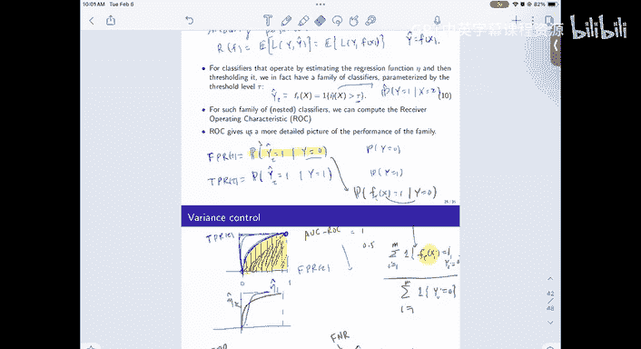

Given these four you include other measures， so if you look up enkipedia。

And thank you if I'm not drawing。I usually mix these up， but this is also called sensitivity。

 sensitivity。And one minus this is called a specificity， so one minus the specific maybe believe。

And so if you check sensitivityity and specific， youll see that theres a long list of other methods。

And these also have other names， so this is also called recall。Different termin。

 different literature， different types。杀死的 people。Through positive rate sensitivity。

 there is another concept which is all precision。And in major precision we all care so but that's against not specificity or FR。

 but against precision， so what is precision。

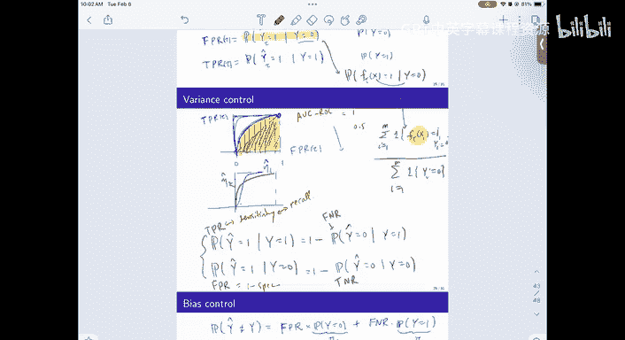

诶。Precision is basically this probability flipped so instead of。

Incalalculating the probability your Y high equal one given y equal one calculate the probability Y equal one year Y4。

Okay， so。

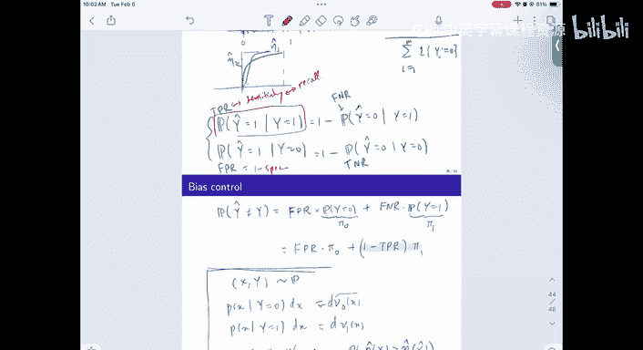

What I would calculate is。So， precision。Also called predictive。Positive value。According to Wikipedia。

So。Recision， so what it is is。The probability of。我呀。Equal one， the true label equal one。

 given that y hat is equal to one。Okay， so that's precision or PPV。

And then probability of y equal one， like I say， y hat equal one。

 given y equal one is just the true positive act。Where recall call。Or many other names。

So then you're often one of the things that people but it decision going as recall。

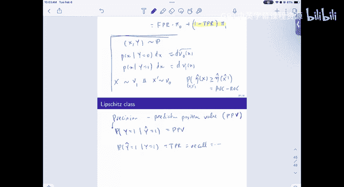

So they thought。We called PRR care。Precision versus recall。对。

So you plot it and it just goes down something like that。啊。And。So advantage嘅 this somehow。Kind of。

Captures that class imbalance issue， so if you。

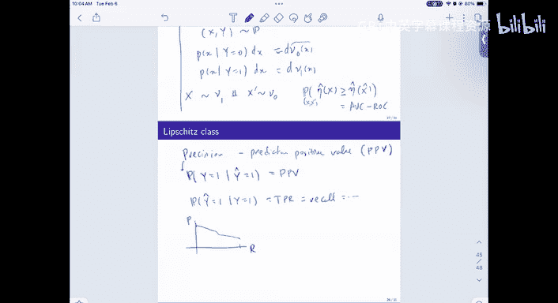

For example。呃。So first， we can fasci these this this， you know。

And this you can calculate based on those four probabilities on the base probably So this is by days rule we can translate it back So it's going to be the probability of why animal equal equal1 given more or this times something divided by this can be that this president can be calculated based on the RRC and the base probability we don't need anything extra information。

 but it's helpful because。This quantity is of interest。

 so sometimes you want to know how like what fraction are the ones that you because quality were actually true labels。

And these two together for Venre。So the fraction。啊这周我要在进。Dlarre what。 So for example。

 I always declare one my recall would be。One， but really not one。

 so this is sort of has this all positive being。And it's really good in cases there。

To public is already scarce and。You really want to know what fraction are the ones。

Preuce is actually true。嗯。Sounds good。But this has like the class。Probably is baking for it。

 but it's not like the RSC。嗯。This is an animal class。 for okay， so it's a nice mix of。

Yeah idea have RC to end。It doesn't suffer as much from the class balance than just aggregate classification。

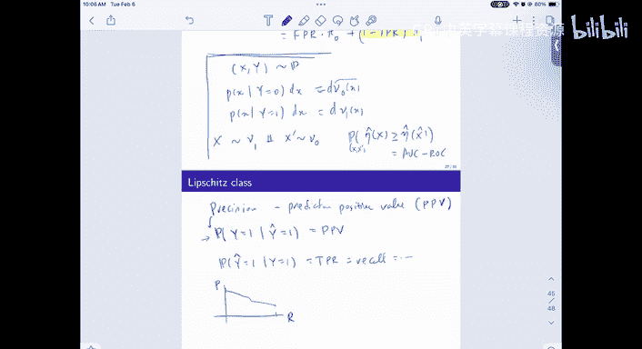

And then there's an area under this for which I don't know。

 so it's called AU under the ER caravan and so on。

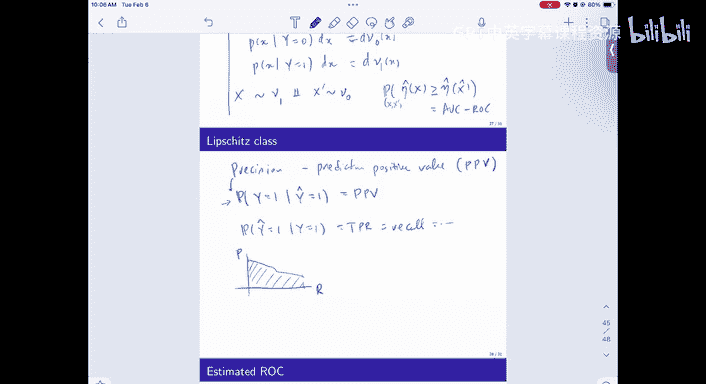

Have。Good。😊，So these， I think are in， and then this is also like one minus。FDR false discovery rate。

 which is。😊，啊。讲呢件啫。嗯。Why is Z or why had to go so you discovered something about this false and this false discovery rate is very popular。

And the statistics or in the hypothesis hypothesis。

 the terminology of hypothesis testinging and classifications were overlap that because there is a nice connection you haven't talk about that。

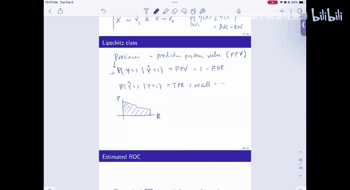

你さ就。That's really good to do so the main thing is the RRC and then if you flip the two positive rate around get the precision the precision。

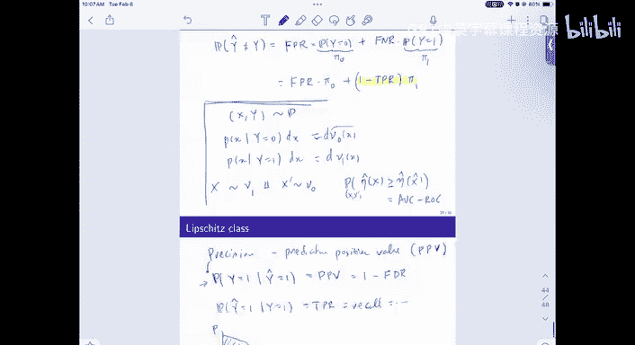

If you are personally called that。找 good。Okay。Qu friends。

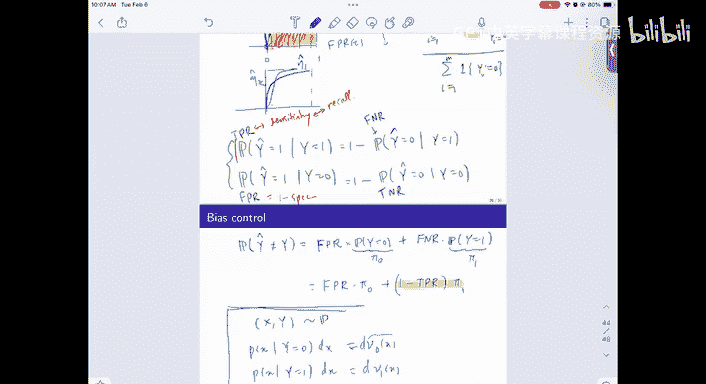

So you're done with this chapter for now， I want to go back to。

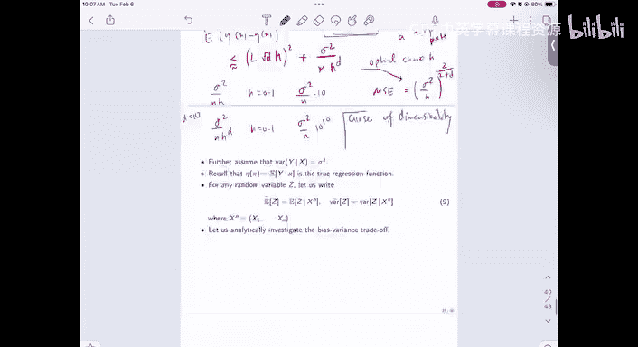

His idea and。

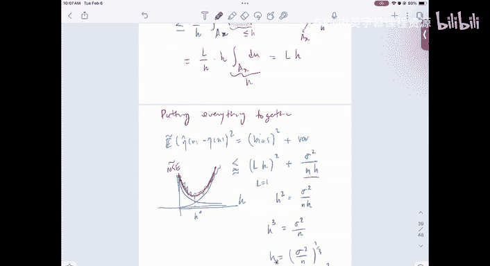

If you recall， one of the issues that we like arises in the local averaging。

 especially in this parting that we did。

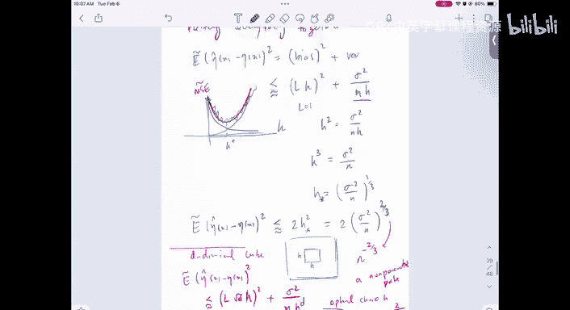

Is this step of nationality？Enya， which is。呃。Suggesting that as dimension mentioned grows。

 so the number of features， especially like me。嗯。It means case gross。

 then the variant suffers greatly and the world of O suffers as a result。One question is。

 can we mitigate this and one approach？Is to assume that the the true function comes from a certain like small class or function。

 So this doesn't assuming。Sort of regularity， let's say in this， this lectures regularity。

 the lectures is way in general。But if I enforce more structure。

Let's say if I assume that my function work on parameter class and that parameter class is simple。

 especially， for example， linear function。That might not seen before then I can get around this so instead of having a rate which does an optimal weight in this case and it case electrical with a two or two plus D and it gets like very slow as the gross I might paint like a。

m诶。More beyond price and dimension， if I， for example， I know that one my actual function in England。

啊， so。

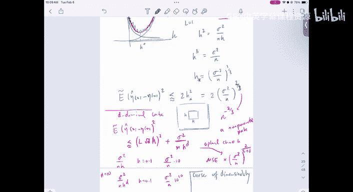

For that reason people。Often a start doing。

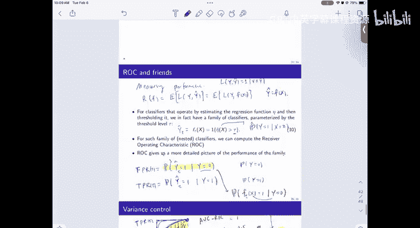

嗯。I'm to keep approaching this problem as。Imossing a model for the class of functions that we have and then trying to find within that class。

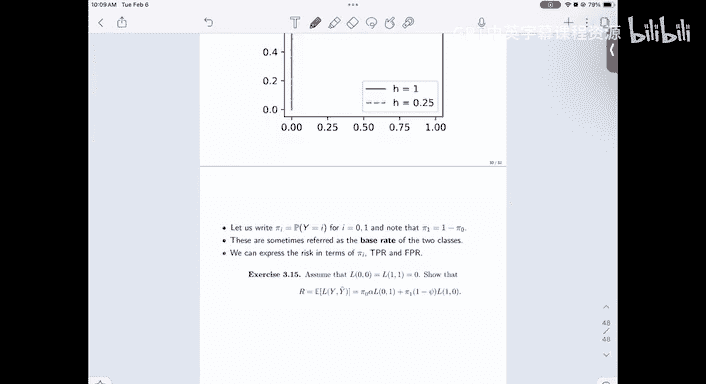

An estimator。

That's， that sort of。Fates the training data。So I want to back off a little bit。

To give you the general picture， so remember that so this this is like a chapter that we talked about for a while and you're going to call it empirical call。

Risk minimization。😊，So before talking about the function class， let's go back and。就分边认真咯。

Approach to constructing estimators， which is then amenable to。

Re usinging the bunch fast to specific so the idea is that if you recall。

The original data that we looked at。Pasification was to minimize。The risk。

 so we try to find the function at that minimize this risk for a particular loss function。And。And。

In practice， the approximated just loss using， let's say， test sample。

Or I can approximate using a training sample for a single fixed X， so suppose I have training data。😊。

So I have x1 of2 x y 1。Up to X and Y N。And so what I can do is I can approximate this risk。😊。

By the empirical version。So we're going to call this our hat。You what I called。

 but this is also called like R of training if you remember you I called it like this。😊，I 1 to n。

L FY I F of X I， okay， so I can evaluate。This expectation as an average。

Sorry it approximate this expectation by an average or which explain they get the same Pay average。

 or this is my peer called risk。Which is also。Just the training risk or training error。

In our previous terminology theory。です。A， a training error。A risk。And。

Because now I have an estimate and for a fixed that。

 this is a good estimate is un biasased and convers by the multi vector。

And this one to quite example。 So I had a good estimate。 Now， I can I want to minimize this。

 which would lead to that optimal rule， which would was based on the initial。

Mimizing the conditional pass loss or the pass loss。

Additional probability y1 given x in the case want instead of doing that I can just do it minimize this Yeah I can say instead of trying to minimize the property actual last which I don't know I have this I'm going to minimize this I'm going to argument。

Over R had of F。Over F。Or arguing basically one over in sumation I for one to n。LF Y， I， F of X I。

Okay， so imagine L is。Just啊 the。0，1， last。Then if I do this。

 you can easily show if this replace with your well you can easily show that minimizing this will give you that plugin optimal the。

So try to minimize this。诶 basically。This is like key had applied to。It an example that。I don't argue。

 but if you argue for yourself， this is exactly the same type of argument that we did that led to the optimal rule。

 this will lead you to plug and optimal so the solution of this would be plug optimal rule indicates the case where x is discrete so x is are discrete。

 this is not a bad estimate。In the case where x is continuous。The so would be like a th rule。

 but then the fighting rule would be like failure would be like interpoating rule。

 so it wouldn't be useful。So in general， when I try to do it with the0 on laws。

 they can make this zero， I can find the function that templates perfectly。嗯。

And that wouldn't be very useful so for that reason。

 you'd introduce some restriction here so you'd assume that instead of minimizing this already they all possible functions and were not restrict it to the pass function。

Okay， and this is the general blueprint for all these vehicles risk miniizations。

So depending on the class， I get different estimators， but by controlling the class。

 I can avoid that interrelation issue。So this class if is。嗯。A class of。Ms。

From the sample of space to。How。That's a zero one。In the binary case。诶。Over bits。

So we minimizes basically。Minimize。P。Yeah。Bemirical risk。So this idea is very general， I can do it。

 for example， in the regression so for classification。😊，But I can do it for regression。

 so very general idea。can be done。In principle， is for any。Or any last thanks。For example。

 if the problem is regression。差不呢。And I can take。You can take out。嗯。To be the quadratic loss。

Why might is my hat？then。Are imp or risk minimizer with the argument。I sorry，F in some class。

Function class one over n summation I from one to n， I'm going to replace this L of Y and F Xi。

 which is this loss you get Y I。嗯。This might look very familiar you know。

So if you see no pattern degreg， that's how you do it。Like at least said lots of things like that。

 and then I'm minimizing the or about of publishers。Again， for regression。

 things are easier to analyze so or like look at during the first look at regression and then。

Go back to classification。The regression pen is a nice feature that this last function is smooth。

But right so when I form this ERM， so let's call this the ERM empirical risk。

Man know what ERM estimateimator。You want。Yeah， I can usually solve this， isn。For example。

 this is aarra found private inriaraic form and smooth anything。

T to solve this by using your medical techniques as we'll see。

This01 loss is problematic because it's continuous。

 oftentimes you replace verar and get loss functions and then you minimize that set up the deal。嗯。

So it's the idea of empirical risk minimization。Sort of clear。

 so this encompasscompes a large passive。Thisim there is a amazing。

Good estimators need classical estimators fall within this category so what is the class capital F eliminate that deals with that interpolation problem so at this point now i'm leaving it very general but。

There are many choices and we're going to see the most simple one， what is the most simple class？对不对。

But。So yeah， so this is the regression problem， but。

Theyar linear regression and the class linear functions so the causal linear functions。Okay。

That would deal with that。呃。I care so the measure issuing the variance。But。

That will mean that the true function is also linear than you wouldt pay a bio stress one of the issues is that by restricting this class to be small I can control the variance。

But if the actual function is outside this fast， then I pay a big price in the bike so what what we were going to do so for example。

The simplest case。case is。嗯。Yes。Being the class of。Usually the class of a fine function。

 but we'm write that f theta。Like this where if theta of x is just theta transpose x。Here， let's say。

All right， the sample of space is RD。So these are unique functions from RD to one。Okay。

 so this notation in this notation， this is。E there's a parameter in RD。And X is also a vector in RD。

So really f theta of x。嗯。Is like theta 1 up to theta D transpose times x1 up two。TheXD。

 if you recall your vector matrix， this is like theta 1 to theta D。And then x102 xd。

 so you do the matrix multiplication， this is really801。

theta I X I i from12 D this is really another way of writing this is just inner product these are all different notations so it the usual inner product X X like this if you write it like this we can initiate CDC it's D here。

😊，It's basically being a combination of the components。parameters so that's a general form。

For a linear function， oftentimes you'd add an intercept as well， so you would look at。😊。

F Theta and B， let's say。That look like theta transpose x plus b or b is a scalar。嗯。

He is in our in practice， we'll do that， but for now， I'm just going to drop this。

If you have saying like there's easy ways of absorbing this into that by introducing an extra feature of one so you can write it as。

啊theta and B。And then X and1。So this is啊。So I took transse。 So this would be Nik。Data B transpose。

P one。And so if I。And just one。E like fix elements the one to my feature so there's an R&D in R&D。

Both are AurRD。This can be taught as a name parameter。

And this is a new feature So from this way you think it's tricky that these are kind to find as。

Like really is the do linear case don' carry it。The intercept。

 this is called the interceptal bias in MLl。Reass。这还可你。It's not unfair。

 but it's very confusing call this bias because。Eing bias versus staisticians is something that we talked about。

But so this is whatで said。要是想到我拜一。these are called rates the bias， rates of bias。

But said decisions they're all parameters。And so I'm going to worked with this for now。

So let's restrict this so this is the class of linear functions。SF。Linear functions on RD。Okay。

 so that's perhaps the simple guys。 There's a class which is simpler than is because a constant functions。

😊，Okay， you can go there if you want， just assume that the F is constant。你。

If you minimize this function that' similar to the majority rule class in classification that's the baseline。

 they might ignore all the features that's equivalent to taking this pass you pass all functions and so in that case I would have an estimator of the regressionation function CASA as' just wide bar。

And you can use it as a basement。If you can't beat that then there's no point and continue。

But then the next level is like you being。Okay， so if I any questions about this。

So let's plug this into that problem。Now if so with the linear class， let's call this F0。

So with the linear class。嗯，也是林。My estscalator would be。The fact is。Argument。嗯。嗯。

So I'm going to plug in because they're all looking like this， I'm going to plug this。

Or that and then optimize data。 Okay， so that's what we mean is a pmetric class。

 It paraically is p data。 Once I know data I know the function。

 So there's a correspondence basically between the dimensional parameters and this this function class。

 So let's say F is。😊，嗯。Any function。And if then。Is in one to one。Chrispondence。嗯。With a vector。

Any function of data。Is in one to one correspondence with？Evic there。Data in RD， So our F hat。

Would be just F of theta hat。Or let's say this function would be like that where datata hat is minimizing。

嗯。1 over and sum iPhone 1 to end。Y I minus F theta of X。Okay， instead of minimizing over。

The class is equivalent get where we work and state。I that replace the F in N。

By a cater and environment。没。And if you' plug in the form， this is equal to。

That's the equal argument。Argu。Data in this case， is R& D。

But I can also restrict my data if you want，t if you I want RD one over N summation i one to n。喂爱。

I also usually write this， sorry X。At this point。I usually write the。

Training data with lower case symbols， it's a little bit hard to see in writing but。不。

For most of the future developments。Things are small， these are realizations of train data。

Rather than wedding a math and variables it a little bit。嗯。Easier to do this， or。More natural。

 so it's going to be Y I minus F theta X I。Squared。this is the same thing。

 I just want to replace this w。Y I minus state of transs X。It， okay， so I just replaced the the that。

And so this is an optimization problem in RD， which we can hopefully solve and you hopefully know how to solve。

So this is really linear regression。This problem centered by restricting our F2 certain as will get rid outside of time。

Yes， but here we still are dealing with data belong， yes， certainly we also are。

But you're dealinging your care tootic。The case of theity is not this。The private is R&。

Because the data is also in RD right the care of dimension mentality is this this horrible。😊。

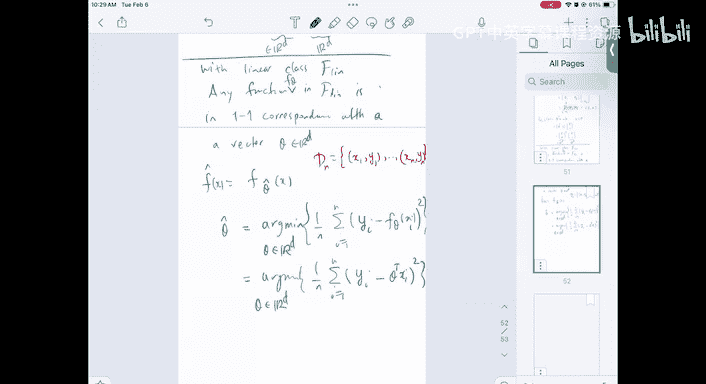

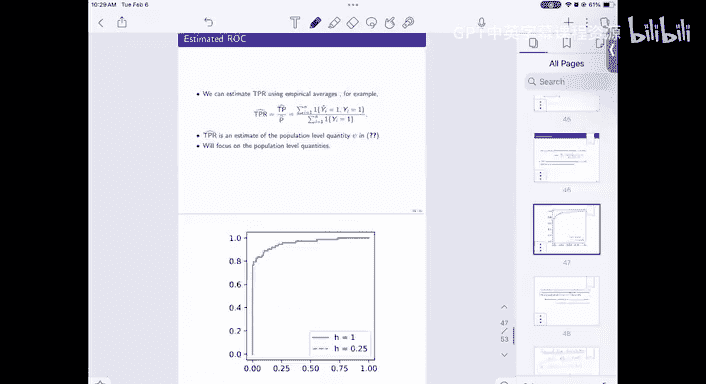

哎。However rates。So the fact that the variance goes like H to the D， and then which results in this。

Ray， this is like。One read， I haven't shown you reading yeah。So there is dimensions。

 so we have to have like three dimensions， but。

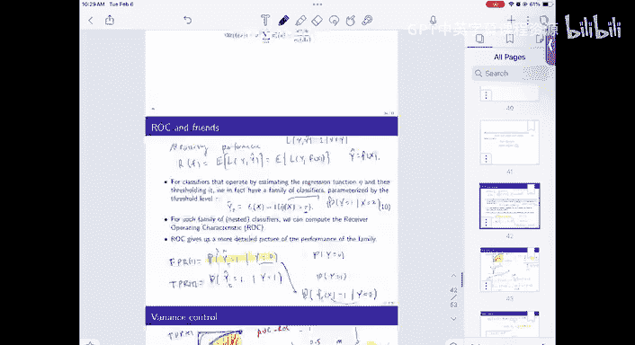

Since the asked， we can now do an analysis。We can try to analyze this US see。How the appears。嗯。

Let's do that。This analysis。So what I'm going to do actually for the most of this chapter is trying to solve this using general a general technique。

The song called Gr Anden， which will work for any differential loss function on their general side。

Ss， but this particular problem， is a quaratic problem is convex。

 It has a it's actually the the loss is slightly conx as as a unique global minimum like。

Solution global minimum， which can be obtained by differentiation。

 and then you can actually solve the subject for the actual from solution。

So we're gonna do that hopefully most of you know that already。

 but then we switch to how to solve this using a more general numerical technique which can be extended to other parent yes just before we move on could so back at the sort of head of this section like if you minimize the empirical risk for the training error get the plug yes you get that you said we're not going to do this argument because you've done it a few times but could you remind me like when you're going to argue that minimizing this it the plug optimal rule what's the next thing you do per so you want that argument you' talking about the argument to go from minimizing this gives the plug optimal。

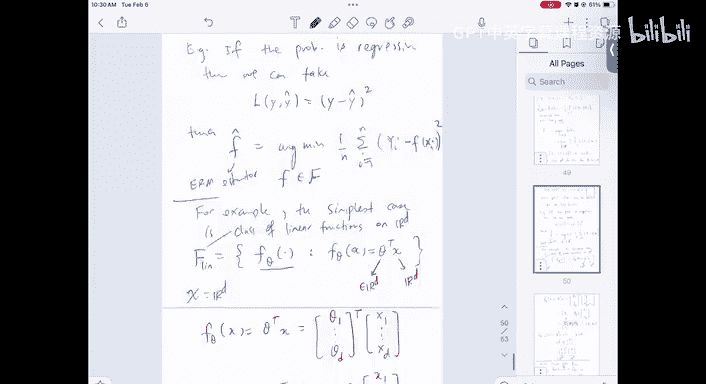

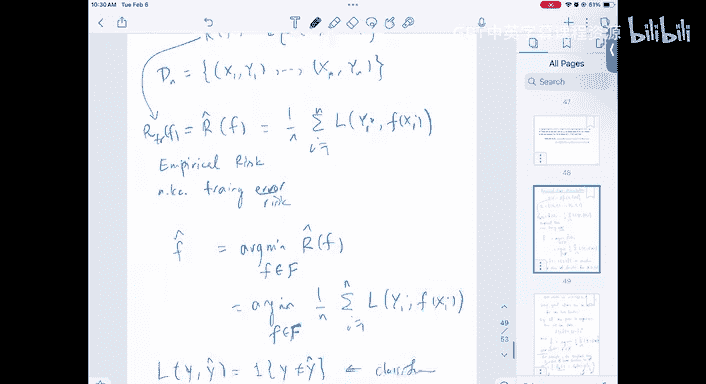

Right， okay， so the idea is。If you think about this。

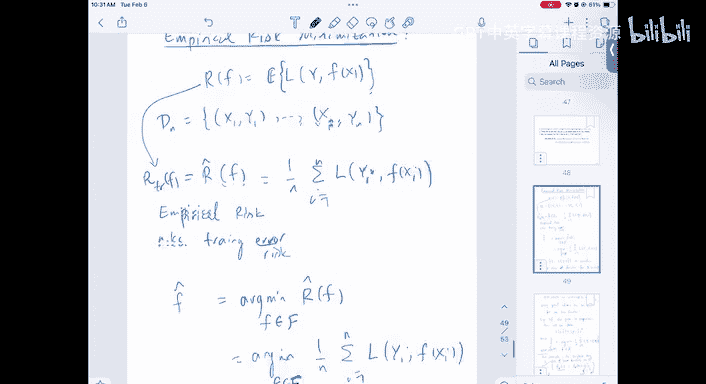

And。The different ways of doing it so we can do it for the  zero one loss。

 maybe do it with zero one loss so。

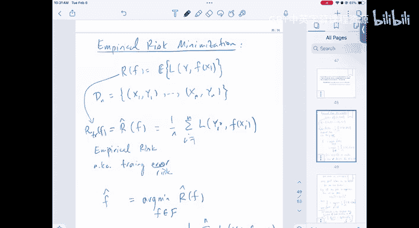

That's actually a whole problem in the book， but let's try。So this would be the risk this would be。

We1 over Ns an iPhone 1 to N。Indicator。Yhy not equal to F of x？Right， so do you remember how we？

Went about Ar。That the minimizer for this。Was that optimal rule。Forula。

Noone remembers how do we did that？So he said， let's condition， right on。

Y not equal to x given x is equal to x times the probability that x is equal to x。

these probabilities do not。And。Are not in our hands， so we can minimize that， but once I fix this。

 this is just going to be。U。F of little x， which I can decide， so I'm going to decide this。

F of x for every x to minimize this conditional probability， Okay， so that was the argument。

So what happened here is。You can actually write this as。Let's say he hat。If you want， why？

Let's call this why hat and why hat is bad， I don't know what should I call let's say why bar。

Not equal to f of x bar。Where X bar and Y bar is a generic point distributed lifeP had。

So this is another abstract。But this P hat。嗯。I this P hat is the distribution。That puts uniform for。

Mass on the trainingee data。So if I want to write it in the language of。

Measure theories like one over n somei from one to end Delta。X， I，Y， I。Delta I is a point this。

Ex right， sorry it's like a probability measure。

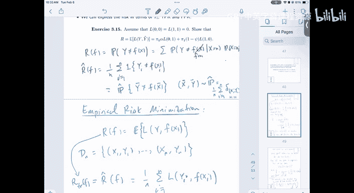

That's。

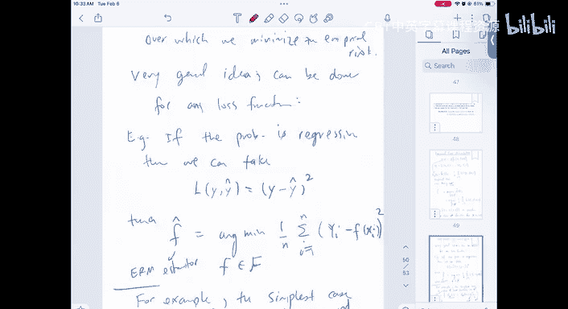

So let's say two dimensions。This is X I is and so this is x and y。

 say the x direction and y direction。I have these training data， so let's say x1， y1。

 there's this one point。And then x2 Y2 could be here， and then another one could be here。

So these are x1 so a probability a distribution that puts mass1 over and on each one of them is a discrete probability distribution。

And I can sample from this distribution。啊。By just trying like one of them around。Okay。

 drawing from this distribution says taking one of these points is right。

So that's valid for all the distribution， it's a discrete distribution。

 takes n values each other the eventss that he had and if I draw a hair from this he hat。

If you query enough just drawing none of these points and then you can see that this would be just the probabilityDP so then the thing that I wrote and one over and that's the probability under this distribution and because this is about probability all of that goes true and every we get this P hat instead of P。

And that he had is just these averages。Right。Yes。you mentioned the test error。

 but you did I this start with this error right so what was that？No， this is training。

 so what I'm trying to do is not approximate the risk。

Using my training it and use it to train because I'm trying to train。

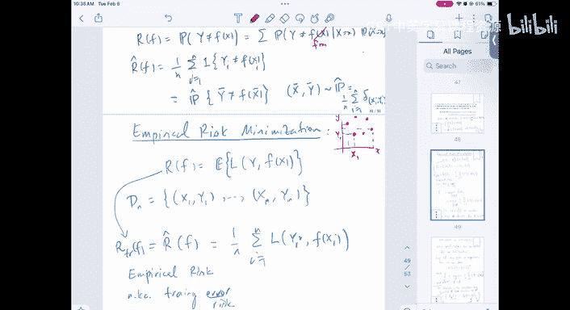

I's still going to call the training error if the and the end want to because at this point I don't have any plus I don't have to worry about dependence but once I do this。

 then my F hat at this point at the end would depend on。

Pro traininging data not if I want to rally it I needed it like a separate time。

The idea of using the empirical average is to actually be。😊。

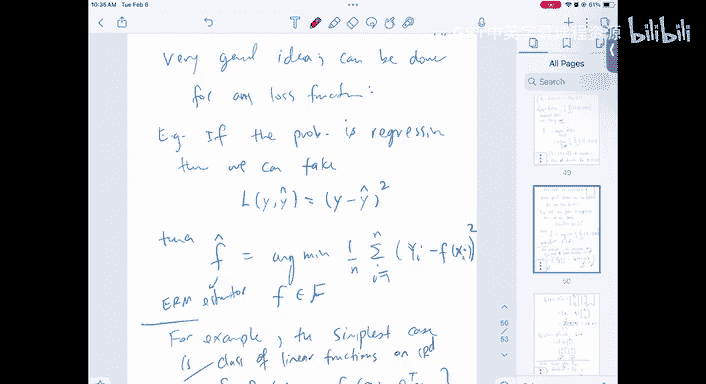

Consstruct the estimate at the point that we want to use this our estimate of the risk to actually construct the estimator。

 so that would be the training risk or like whatever we want to call it the pay color this and we use it to。

Minimize find F。

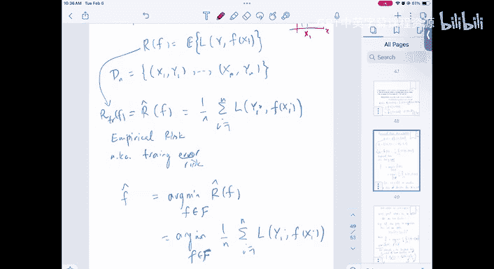

Any other questions？诶。So by day， this thing that I mentioned is P hat。😊。

The thing that businesses is called the all the certification， it's a very important outfit。

Let's at this leak， so it captures the information about the data except。

The ordering of the data Okay， so if I give you this picture I you remove the labels。

 you know what your training data was。But you don't know in which order came in or if it's discrete I might lose some of the distinction so some of the points might lie on top of each other so I do for example two of the points right here I get two over as in the screen case you lose more but they can all the information in the data。

So it's sort of， in a sense， sufficient， it's a sufficient statistic。

Okay， so going back with this， how do we solve this？😊，Are you seeing solution？Regular solution。Sorry。

 let's start， first with condition， which is。Just take a derivativeius equal to zero of the solve the first or。

 if there is an optimalimole in thegen， there is the gradient in this state。

 it's a multious the gradient has to be0。Okay， if the gradient is zero。

 let's call the first order condition， you get the stationary point。

 but because in this case things are convex and you know there is a global minimum。

 you know it's unique， there should be one stationary point that that should be the minimum。

so the idea is dictated there if we call this。

我 should你 call的谁的农命。L Kta。Eta gradient of theta so equal to zero。And。The solution。

 there's a unique solution。You you want first order conditions。Are there optimality conditions？

Or the involve optimization problem。So that would give you like data hat。

So let's maybe write it in a more compact form if you have seen it。

If I introduce this notation， the design matrix for you this。Collecting the data points as it rows。

 X1 transpose。With the first row to transfer the second row up to the X transfers。

 this is going to be an n by D matrix。And then I'm going to collect the wires into a vectoror as well。

And so this is in our N。Then I can write the loss。This last function is really。Nothing but。

One over end。Anyone knows what the last function would look like？In this notation。

 if I have design matrix， and by me。唔我系水 friend。So all be x times theta。

Each row of x that multiplied by theta， so we can think of this as。

Because this is scalar， it's equal to its transpose， which is also X transpose datata。

 so these are the same thing。

And you can see that these this is going to be x1 transpose theta up to x and transpose theta。

 so the rows of x theta repeat。

The values of this regression function at those training data and then I'm going to compare it with y so basically。

诶。It's just going to be summation i1 to n， this vector y minus x theta。The Id coordinate square。

This is。If you know the notation of the norm， this is like y minus x theta。This is the El Tuor。

Square， okay so。Theeltonum is the sum of the squares of theels。

But that's the simple way of writing this。And actually to minimize this one over end doesn't matter。

 like I could have dropped that as well。

嗯。But really， you want to take the gradient。And if you have done this enough of time you'd see that the gradient of this。

We need one over end。X transpose x theta minus y so I can quited ready for this sums up but it's an interesting in the direction。

有。啊。If say're equal to0， I get x transpose。X theta minus y is equal to 0。

Which is equal to a multiply。I get。Well， this way the other side， this is the equation。And to song。

 this is the。These are called the normal equations。S。

And it's a linear system of where that expresss the external node。

This data can in an expensive way I know。And this is solvable。In general。

 and if it transization have inmerable， there's a unique solution for data。

I should like back up a little bit the uniqueness。

Is true on the taxes So this cons function， but not strictly cons on the substantial taxes。

Invertible or like full rank。assume。X transpose x's full rank。Inslationational and singular。嗯。

Then， I guess。So data should satisfy this。

So the data solves this equation。

看。Right， so the get data ahead is。

X transpose x inverse x transpose y。Does that look familiar？Hopefully it looks familiar here to be。

So in 100 C you spend like one entire quarter looking at this formula。嗯。

So that's our estimate of theta h， so what is the estimate of the regression function？😊，But I've had。

peta。Or that that Fhad is really Ehad of theda。嗯。F of basic theta hat x。

 which is just theta hat transpose times x Okay， so once I have this try theta hat and looks like had function that I don't apply many x I want。

Okay， so that's my estimate。Which I'm going to call also Ada hat。嗯。

Because it's a regression function and SS the rejection function is similar to the datahead that we looked at it's an approximation of the expectation of Y givenx。

😊，Remember because we the quadratic loss。

The optimal thing to do。So if I do this。

Not the empirical origin， the population the origin。The auto solution would be very best。

Before before I get a win together， but no as such。

So the actual like F star without any restrict bunch of class is expectations。

So they have some more rules。Compar to the optimal rule。It can be optimal rule。

Under the quadratic loss。AKA， the corresponding MSA。嗯。Risk。Sk for risk。Is like ADSR。

Which is the expectation of y I given an x。Okay。So we all know this。We assume that it is linear。

And then this is our estimate。呃。At this point we can't do much more， we can do a little more。

All you can do， any questions about this？我微前就是咱们来收啊。So analyzing。No， I think。Vaner。Regression。The笑容。

That Ada star is also linear。So if I actually know that HR is mean after some data2。

 then what I did is a very good estimator because I。I'm looking within the same paradigm。

 so with this assumption， so its a strong assumption， but with this assumption。

 then we can do a simple analysis okay。😊。

嗯。Next time。Me analyzeze。That quantity to be analyzed。For the partitioning estimator， similar。

 thank you。Yeah。肯定有咩 c。Conditional on the training access。 Are we going to look at this。

Let say this star。Or you can say Ada if you want。Yeahでさあ。So we're going to compare this to that。

I see people here' the。That was good。Nice sense。Okay， so that's the plan for next time out of time。

So thank you guys， See me next time。