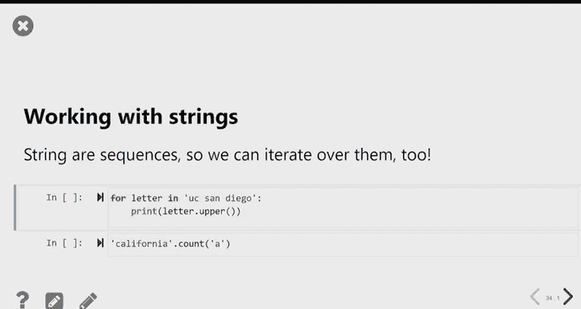

# UCSD《数据科学原理 (DSC 10 Principles of Data Science Fall 2024)》中英字幕（deepseek - P10：DSC 10 - Principles of Data Science - LE -A00- - Lecture 10.zh_en - GPT中英字幕课程资源 - BV1hmAneGEZh

Okay， good morning。These are upcoming assignment deadlines。

 hopefully you saw the midterm project was released so you'll be learning a lot about Taylor Swif's music through that that's due in a couple weeks but it's good to start now because it is more complicated than other assignments that you've seen it takes a while。

Okay， today we're going to talk about some sort of basic programming constructs not too specific to working with data or working in Python or baby pandas。

 these are just sort of general programming skills。

But we will be using them in the coming weeks to analyze data okay。

So we've already learned about Boolean data types and those are data types that are either true or false。

 and we typically get Booleanions and we do comparisons so we can do a comparison with equality with double equals。

 you can do a comparison with not equals， which is exclamation point equals。

 or you can do the regular math comparisons like greater than less than greater than or to less than or equal to。

 So I'm gonna define a couple of variables and I'll use these throughout the lecture。

 so I'll just write them on the board so we remember what they are。Department。Is the string DSC？

And course is 10。They in't。Okay， so you can do a comparison like this。 course is less than 20 right。

 and this is like asking a question， is the course number less than 20 and it comes out to true。

 and the data type of that is Boolean。Okay， you can also get Booles through doing certain operations。

 One of these operations is checking if something is an element of something else。

 So you can check if。A specific number， like course is in this list of， of course numbers。

So the in operator helps you check if a particular element is part of a sequence。

 like a list or an array。 It also helps you check whether a particular string is part of a longer string in Python。

 strings are stored as sequences。Stings are sequences， I'll just say。So if you have the string hello。

This is like position zero，1， two， three， four， and you can do many of the same things that you would do with a razor list。

 you can do those with strings。So the in。keyeyword for strings checks for what's called a substr。

 which has to be contiguous。Okay。DS is considered。To be in the string DS SC。

 because you see D S right after each other， But D S is not considered to be in the string data science。

 even though there is a D and there is an S， they're not contagiguous。

 They're not right next to each other。Does that make sense。Okay。

 there's also these Boolean operators that allow us to do kind of like arithmetic with the Booleans。

 the three operators are not and an ore these implement basic logic。Okay。

 so not is the simplest one when placed in front of a bullan。

 it changes its value from true to false or false to true。

 So if you want to compare department to DSSA， you're going to get true。

 But then when you put the word not in front of it， it's going to flip it to false。

 And if you put the word not in front of that， it's gonna to flip it back to true okay。

And is placed between two Booleions， and it comes out true if both of the things on either side of it evaluate to true。

So this one comes out false because the one on the left is false。

 even though the one on the right is true。The second one comes out to true because both parts are true。

 So， and you need both。Or you need at least one。Okay， so here's。In or。10 is in this list。

 The type of course is not a string， it's an int。It's still going to come out true because the first part of the war was true。

Here， both are true， it's still true， the only way an or comes out false is when both are false like this。

Just like we have PemDs for doing an order of operations for arithmetic。

 there's an order of operations for these Boolean operators。It's called a precedence order。

 like which one comes first in priority， and the order is not then and then or。So generally。

 try to use parentheses to make your intent clear。 But even if you don't have parentheses。

 you should be able to figure out like what it's doing。 So let's look at this example。

Here I'm using parentheses to do these two things first。And then here。

 I'm using parentheses to do these two things first。 Okay， so let's evaluate both of these。

 And then based on the order of precedence。How do you think this last one is going to come out？Right。

 I didn't put parentheses。 So it the and comes before or， right， which means it's going to do。

It's going to do this。 It's going to do these first， and then it's going to do the or。

 and that one comes out to true。 so this should come out to true as well。Does that make sense。

So let's just verify， department is DSE， that's true。Department is C， S C。 That's false。

 So we're ending a true and a false。 The result is a false。 Okay。

 so this whole highlighted part evaluates to false， But there's an or with a thing that's true。

 So it's true or false， which is why it evaluates to true。

Now we've already had some notion of an's and O's when we were doing querying of data frames with Boolean series。

 but there we didn't use the words and and ore， we use these symbols。

 ammp or sand for anN and bar for orR， and the difference is those symbol operators work between two series and they do likeand and oring element wise。

Whereas the key words and and or。Go between two individual booleans。

 So if something is true and something else is false， you can put the word and or or between them。

 whereas if you have two sequences of truths and falses。

 you put the symbols amberand and bar between them。Does that make sense。 This is a common question。

 When do you use which one， It's what， what are you talking about。

 Are talking about individual true falses， Are you talking about sequences of choose and false。Okay。

Okay so the real reason we're learning about Foions is so that we can make code that does different things in different scenarios we have some condition and if the condition ist met。

 we want our code to behave a certain way and if the condition is not met。

 we want our code to behave a different way， so if statements allow us to accomplish this。

 they're written like this， the word if then you put some condition。

 these angle brackets are not part of the syntax they're just here to say some condition goes here。

 if some condition is true， then you do something。Okay。

 so the example we'll use for this part is graduation requirements for data science majors。

 They have to complete a certain number of course credits。

 and they also have to do this capstone project。So let's say someone has finished the capstone project。

and we want to print an appropriate statement that says they're ready to graduate。

 but only if the capstone is finished。So the syntax for that would look like this。 if。

 and then what goes here is some condition。 So this is something that should evaluate to true or false。

 right， in this example， it evaluates to true。 But you could imagine someone else's capstone value would be set to unfinished。

 and then it would evaluate to false。 Okay， so here for this person， it's going to print。

 Look like you're ready to graduate。 If I change capstone to unfinished and run the same code。

 it doesn't print anything。So the idea of an F statement is like you can use your same code to do different things in different scenarios。

Does that make sense。I'll change it back。Often， if the condition is not met。

 you might want to do something else。 like in the example I just showed when the person didn't graduate。

 I just did nothing。 right， Maybe I want to do something else。

 print them a different message that says， you know， you need to do your capstone project。

So you can use the else keyword， else should always come after an if statement。

 it's like part of an if statement。Saying， what do you do in the case that that the condition is false。

 Okay， if specifies what you do when it's true and else specifies what you do when it's false。

 The else is optional， right， As you saw here， you can have just an if statement alone。

 but you can' have just an else statement alone because it's like， it doesn't really make sense。

 else else is specifically when an if condition fails。Does that make sense？Okay。

 you can also make the logic more complicated by instead of sort of having two options。

 like when something's true， you do this， when something's false， you do that。

 you can have sort of multiple options。 So the way that works is you have some condition。

 and if the condition is met， you do something。 Then if the condition is not met。

 you might check a second condition， And if that conditions met， then you might do another thing。

And then if those first two conditions failed and you could check a third condition。

 and if that one's true， you'll do other thing， so you could sort of divide like the outcomes into into many different options and just have checks that check do you fall into each of those categories。

So the code for this is called L if， it stands for。If you know what it means，'。

 it's much easier to understand it。 It stands for else if。Right， so you could say， like， you know。

 if you finish your capstone and you've。Done whatever else you need to do， you graduate。 Otherwise。

 if you've done the other things， but you haven't finished your capstone。

 then you better finish the capstone。 And then you can have many different cases。

 And then at the end， you often have an else。Which kind of is like a catch all。

So anything that didn't。Me one me any of the prior conditions would fall into the else category。

 One way that I like to visualize this is by thinking of like a bunch of strainers。

Like nested inside each other。The the first strainer is like the if condition。

 and it catches certain things。 Certain things will come up true。

 So think of the if strainer as having like big holes in it， right。

 Certain things are so big that they just won't pass through the if strainer and they'll be caught by that strainer and they'll do whatever the if condition is。

The， the next level is the L if。 So the only way that something gets into the L if strainer is if it sort of passed through the if strainer。

 if it wasn't caught by the if strain。So think of LF as having slightly smaller holes， right。

 Some things are will pass through the big holes of the first one。

 but not be able to pass through the smaller holes of the next one。 And each level that you go down。

 the holes of your strainer are getting a little smaller。And you can have many es。In a row。

And then the very last one is else。 And maybe it's better to think of else as just like the ground。

 right， Whatever falls through all the strainers， the finest little particles， right。

 Then you do something to those。Does that make sense？An important consequence of this is like。

Let's say you're。You're evaluating some condition that may be this second Lli condition。

 If you're in this scenario， you already know that this one came false and this one came false as well。

 Like the only way you even get to consider that third condition is if the prior ones were false。

 because if the prior ones were true， you wouldn even you wouldn't have even gone any further。

Does that make sense？Let's look at the example here。This is a bit complicated。First condition。

Second condition， third condition， and then the L catches everything else。

so this person didn't finish their capstone， it's in progress and they don't quite have enough units。

 so what happened was I checked are both of these conditions true， in fact， no， neither one is true。

 so then I went on to this one。Is the capstone not equal to finish。 That's true。

 Is the units less than 1，80。 That's also true。 So I did this。

 And I don't wind up checking any further conditions， right， because L if stands for else if。

 like so you only check the next condition when the prior ones falls。 So that was all that I checked。

Let's try to change。Can you think of how you would change the inputs to get。

This print statement to print。わかし。Yes， if they did 190， right， then this would fail。

Because of the capstone not being finished， this would fail because the units' being too high。

 but this would be true， and they would print that state。Okay。

 so a good way to make sure you understand the structure of if statements really well is to try to see if you can find cases that make it fall into each of the outputs。

 each of the outcomes。Now I changed it back to capstone in progress and units is 123。

 and I want to see what would happen。If I used all ifs instead of L ifs。 Okay。

 so it's the same code except before I had L if there。 now， I'm just having if。

And same here before I had L if there。 and now I just have if。Okay。And， basically。

What happens is you can print multiple things now。Because。

I'll add some spacing to indicate what's really going on。

This code is actually just doing three completely unrelated things。 It's checking some condition。

 If the conditions met， it'll print something。 Then separately。

 regardless of the outcome of that first check， it's gonna check this condition。

 because this is just if if are always evaluated， not just when the prior one is false。

 And then finally， these ones actually go together。

 Only one of those last two things will be printed based on whether that if condition is met or not。

Okay， so。Changing the keywords you use if LFL is going to change the structure of how your program works and what it does。

Okay， any questions on this？All right， let's try having you。

Use if statements to complete a function that converts a percentage grade into a corresponding letter grade。

 Okay， so here's the table。 A's are are in the 90s or 100。 B's are in the 80s， C's are in the 70s。

 etc ce。Here's an example of how the function should work right If you input 84。

 it should give out B， if you input 60， it should give out D。 Okay。

 so it's written as a function where it takes as input a grade representing like a number like 84。

 and your job is to write some if statements or L if or whatever logic you need to make it。嗯。Return。

The appropriate letter， so it should return AB，C， D or F。Okay，I'll give you a little time to try it。

Then we'll talk about solutions。All right， can anyone tell me their first if statement？

What condition are you checking？く。Right。If you got at least a 90， you get an A， okay？So。If。🤢。

Grade is greater than or equal to 90。What do you want to do in that case。

 It asked me to return the value I got， so I'll return it。Okay。Now， what's your next condition？Right。

 L if grade is greater than equal to 80。 return B。 Okay。

 you don't have to worry about someone with a 99 getting a B because even though their grade is at least 80。

 you're not even going to be checking that condition on someone who。

 who had a grade of 99 because they would have already passed here。

 That's kind of the point of the L if。All right， so let's continue with this logic。At least 70。

Gives a C。At least。60。Gives a D。And everybody else。Returnn half。Okay。

 so this pretty much works as expected。 I really like this question， though。

 because there's many ways you can go about it。 and it' it's useful to highlight some things about both how functions work and how if statements work。

 So our strategy here was like start with the high grades， identify the A's， then identify the B's。

 you can also do it the other way。 you could have also had something that was like and won't write it out in code。

 but it could have been， if your grade is less than 60， you get an F Otherwise。

 if your grade is less than 70， you get a D and and go up the chain that way。

 and the last part would have been return A like anybody else gets in it。😊。

Another thing that's useful to know。Is that。You can also do this， remove the else condition。

And just have a return F here。And what this is saying is like。😊。

The only way that you would actually get to this line of code is if all the prior things hadn't returned。

Becauseuse remember， return stops the execution of a function。 So like， if you get an A。

 the function is gonna to be done and you're not going to do anything beyond this part。 right。

 If you get a B， these are the things that's going to get considered and nothing else after that will even happen。

Right，So if you get an A，B，C or D， you won't even get to the part that says return F。

 only when you actually do have an F is when you would get to that part。

 So the actual else word is not really needed here。I'll put it back。

To leave it how we had it originally。And。I want to look at what happens what if we change。

All the Ls to ifs。So before we talked about how changing L lift to ifFs actually changes what it does because you can like you could satisfy multiple conditions and in the capstone example。

 multiple things were printed， but here， however， this seems to act exactly the same。

 it gives the right answers on these examples， even though I changed Lif to if。

And the reason that happens is because of the fact that return stops the execution of the function。

So。Like， if you get a B。It's going to check if your grade is at least 90 and it's also going to check if your grade is at least 80 and it would go on to check if your grade was at least 70 except return is like stop。

 It already gave the answer， so it doesn't really matter what comes after that。Now。

 if you were instead of return， if you were to print these things。

Then this would actually not work anymore。think about what's going to happen when I try to use this function to convert the grade of 84。

Well， it looks like 84 got a B， a C， and a D。Because it checks all the conditions。Right。

 because I'm using ifs， not LFs。But if I change these backs to Ls。And print。

Then it would just print the correct grade。Okay， so this is useful for illustrating some differences between print and return。

 as well as some differences between if and LF。Does that make sense， Any questions。

There's many correct solutions to this， so yours might have looked a little different。

 I talked about checking the letters from A's down to F's or F's down to A's。

 but you can start by looking for C's， right you can kind of do it in whatever order you want。😊，Okay。

 there's an extra practice here for you guys to try on your own。But for now。

 I want to talk about our next topic， which is iteration。So the word iteration。

 this is the dictionary definition， is the repetition of a process or utterance。

 and it has specific meanings in mathematics or computer science。

 It's just repeatedly doing something。So here's an example of iteration。

I am printing a little blast off message。About my rocket， and it says launching in t minus 5，4，3，2，1。

 and then it says blast off at the end。Okay， now I'm using a special package to have like a slight delay。

 This time package has a a function called sleep， which allows my。😊。

My output to have a little lag in there。But basically。I'm just printing T minus something。Well。

 first， I'm printing， launching in， right， then I'm printing t minus something。

 then I'm printing blast off。But notice that there's only three print statements in my code one。2，3。

 except my output has more than three lines of code。

That's because the middle print statement is executing many times over。 It's executing。

Once where x is 5。Once where x is 4， once where x is 3， once where x is 2， and once where x is1。

 So this is called a four loop。And what a for loop does is it tells Python to like repeat some chunk of code over and over for different values of some variable。

 So here， the variable that I'm using is X。 And I want X to take on each of these values in this list。

 So I want x to be 5， then 4 then 3 then 2 then 1。 And every time X takes on a new value。

 This is what I want it to do。 I want it to print。 and then I want it to sleep for half a second。

 so that's exactly what's happening。 It does this once。

 but then it does these two lines of code five times because they're inside a four loop。

And the four loop runs。Once for each value in this sequence。So it's called a for loop。

 I think that's a very good terminology， because the way you should think about it is for each X。

In the sequence that's given， the sequence is5，4，3，2，1。

 That means x is going to take on each of those values。Okay。

 so this is a very sort of typical for loop and then how a for loop would be used。

 for loops are generally to like repeat code that's the same or similar。

The way four loops work is you name like a value like I called it X for each x in some sequence。

 you give the sequence that you want it to use the values from and then you do something some body of your four loop explains like what's supposed to happen with each value in our case X okay So read it like this for each element of the sequence。

 repeat this code and as I mentioned before， strings are also considered sequences right typically when you think of sequence。

 you should think of like a list or an array， like a comma separated sequence of values。

 but strings are also considered sequences。 so we'll see an example later of how you can loop through a string and what that means is like you take on each letter in the string。

Okay， so four loops are used to sort of collapse code。 that's very similar。 So， for example。

 let's say you wanted to illustrate your， your knowledge of square numbers and you wanted to print these four things about。

Different square numbers， right， You wanted to say four squared is 16，8 squared is 64。

1 squared is 1 and 100 squared is 10，000 right， I'm doing them sort of separately here with four separate print statements。

 each one I'm setting numb to be a certain number。 And then I'm using a print statement that says that number and it square together。

 Okay this is the exactly the candidate for using a four loop。

And here would be that equivalent code in a for loop。So I'm first creating a sequence。

 I'm calling it list of numbers。And then， I'm having a loop。With a variable called nu。

That takes on each of the values in that list。Okay， and the code here。This code， it's only one line。

Gets executed。For。Numb equals four， nu equals8， nu equals1， and finally nu equals 100。Okay。

 so the output。Is exactly the same。But notice I've condensed the code instead of being like eight separate lines of code where I defined numb and then printed。

 defined numb and then printed， defined numb， and then printed。

 I can condense it to here it's only three lines of code。In fact。

 I don't even need to name this variable list of numbers。

You'd most often see a for loop done like this。For each number in this sequence， do this thing。Okay。

 so from eight lines of code down to two lines of code。Four loops are never necessary。

 like you can always do things without a for loop by repeating your code many times。

 but they're really nice to not have to repeat your code many times。Okay。

 something to notice about what's happening is that I'm not actually setting the variable numb when I use a for loop。

 right， I never have anything that says numb equals something。 That happens automatically。

 Like that's what the for loop does。 It changes the value of numb to be each of these things。

 I never have to set numb at all。 I just tell it what values I want it to take on and it'll take them on one at a time in the order I specify。

Okay， any questions？Here's one for you to try。Here's an array of colleges。

And I want you to write a for loop that prints this， Ravel College， John Meir College。

 Thurgood Marshall College， based on looping through the values in the college's array。

So try that out。Okay。Before I do the for loop， let me just make sure I understand what I need to do。

 I'm going to have a loop that goes through。The values in this sequence， right？

And takes on each of these values。 So like at the beginning， my。My variable。

 whatever I decide to call it， is going to be set to rev。And I want to somehow。

 from that print Ravel College。 Okay， so I could just say print Revel。

But that doesn't have the wordcol at the end of it， how do I get the wordcol at the end of it？

There's a couple things I could do。I think I can do this。

I can give print both things and it'll just space them one after the other。 Another thing I can do。

Is use string concatenation with a plus sign to like add the wordcol to the end of it。

 here I do need a space。Okay， so either way it works。

And the idea is this part is going to change every time， right one time it will be Revel。

 the next time it'll be John Muir。Right， but the。嗯。The structure would be the same every time。

Let me write them both。Okay， so I could， like in theory， make8 different print statements to。

 to create this。 But the idea is to do it without doing eight different print statements。

 So I'm gonna have my loop that goes for。College in colleges。

So college is what I'm calling the name of a single college。

And then what do I want to do for each college， I want to have this print statement。

Except it's not going to be revvel， specifically， it's going to be whatever college I'm currently working on。

I have to define this array first。Okay。Does that make sense？

And some things are arbitrary with the fact that I called it college， I could have called it。X。Okay。

 and it does， it does the same thing。Any questions on this one？

Another useful thing to know about working your way through sequences，あのせ媒か。一的。新座好。

So that's exactly what。This four loop does。 It sets x to be each of the values in this sequence。

 So like it makes x be revel， and then it runs this code where x is Re。 Then it makes X be John Mirr。

 and it runs the code again， where x is John Miir。So that's basically what a for loop doesnt look back at this this nu example。

 It's the same thing。 like how it sets each， it sets your variable to be each of the things in the sequence。

 and then it does the code for each variable。Yep。Other questions？Okay， another useful thing for。

 for working your way through sequences is being able to work through based on what position number you're at。

OkaySo here's two arrays， actions and feelings。And each of these has the same length。

 the length of actions is three， the length of feelings is three。Okay。Now。If you do NP。

a range of three。I'll go back to actions because that's what I have。That gives you a sequence。 Okay。

 and this sequence is exactly the sequence of position numbers。😊，Of the elements of your array。

So you can make a loop that goes through this sequence。 This is just a fancy way of saying。Z，1，2。

So this loop is going to print its I is each of these values，0，1 and 2， and it's going to print I。

 So this loop is just going to print 0，1，2。ok。But I can do something nicer。Which is。

Instead of just working directly with the positions 0，1 and 2。

 I can work with the array elements at those positions。Okay so。

This is the important for a loop to understand。The sequence that I'm looping through。

Is the sequence 0，1，2。And I is my variable， so the first time through I is0。Then I is1， then I is 2。

And each time I'm printing a statement that says I something and I felt something。Okay。

 and I'm grabbing those， those actions and feelings from the array based on what position they are in。

 So when I is 0， it's saying I ate and I felt content。When I is one。These guys go together。Saying。

 I slept and I felt energized。 And when I is two。I ran and I felt exhausted。Okay。

 so this looping through the position numbers gives you like another way。

 to loop through the elements of a sequence。 And it's especially useful when you're trying to loop through two sequences at the same time。

Another useful thing to know about four loops is that this loop variable。

Doesn't have to be used within the body of the loop。So here's Goldilocks in the three bears。

OkayAll this is doing is I is taking on values。NP dot A range 3。 So same as before。 I is 0。

 then I is 1， then I is 2， right， But for each value of I， I'm printing this bare emoji。

Which doesn't involve I， right？I'm not even really looking at the value of I。

 I'm just using it as a tool to say， repeat this three times。Okay。

 so this is another way that four loops are used to just do the same thing over and over and over。

 and in fact， this is one way that we're going to use it a lot。

 we're going to use a for loop to like do some simulation and just repeat the simulation many times and see how the results come out。

Another thing to notice is that only what's indented。Gets repeated as part of the loop。

 This printing of the Goldilocks symbol。There might as well be like separate in separate cells or separate things here because。

The Goldilocks is only getting printed once because she's not in the loop。If you wanted to。

Print Goldilocks three times。 you would put her inside the loop。And what that would do is。

 it would print。For each value of I， both a bear and a girl。 So you'd see bear girl， Bear girl。

 Bear girl， right， What if you wanted to print the bear three times， And then the girl three times。

 you would use two different four loops， right， and each one would。

 would look kind of like the original bear one。あ。Questions on this one。Okay。

 so the real like use case that we're going to have for four loops is learning how to simulate random events like flipping a coin is a very simple random event。

 we'll also look at more interesting ones， but a coin flip is a good place to start because it's so simple right so what we'll want to do is we'll want to do some experiment and keep track of how our experiment comes out。

So for coin flipping， a natural way to sort of keep track of how our experiment comes out is to record how many heads we got you could also record how many tails you got right this number is called a statistic。

 It's a single value that you calculate based on the outcome of some experiment。

And if you wanted to really understand like how coin flipping is likely to come out。

 you would want to do the experiment many times over to see how it typically comes up。

 So that's where a for loop will come in to like， do the procedure repeatedly。

Here's another dictionary definition， the word append means to add something on as an attachment or a supplement。

So we're going to be creating a sequence of results of how many coin flips。

 how many heads we got in our coin flips， and we're going to keep sort of appending to that sequence of results。

 so you can think of this as like if you were to flip coins on paper。

Like you flip flip coins and record your results on paper。 You would flip your coins。

 count how many heads you got and write it down， right， Then you would do the process again。

 flip your coins again， count how many heads you got and write it down。

 the process of like adding on that list on paper that's appending。

And there is a nuI function called NP doend， which does exactly this。

 It takes an array as input and an element to add on to the end of the array like the back。

 and that's what it does。 It gives you a new array with a new value added on at the end。

A tricky thing about this is you have to remember to store the result。

Back in the name of your array so that the array actually gets extended。

It doesn't modify the array kind of like sorting a data frame， right。

 you have to save the result if you want it to persist。So， here's how this。

N P dot append function works。 I'm making an empty array。And then。I'm saying append to that array。

 the word hello。 So this just like adds an additional thing into my array。 My array had nothing。

 Now it has one thing， which is the word hello。But if I don't save it anywhere。

 notice I didn't try to save this in some variable name。Then my array is exactly as it was before。

If you want to really sort of add something and keep it there。This is the way we're going to use it。

We're going to take the empty array， add the word hello。

 and then store the resulting longer array with the word hello in the same variable。Okay。

 so now some array has the word hello。And then if I do a similar thing。

 take the contents of that array， add the word there。And save it in the same variable name。 Now。

 my array has two words in it。So we're going to sort of build up our results gradually by generating them one at a time and adding them on to the end of the array。

So for now， don't worry about the code that actually does the coin flipping。

 This involves randomness。 and we'll see how this works later in the course。

 But just like you've done with other functions， right， someone has provided a function。

 and you can just trust that it works。 Okay， so this is a function that flips a given number of coins and tells you how many heads you got。

 So I flipped 10 coins and I got two heads That actually kind of surprising。

 try it again this time I got7 heads。😊，So I'm like。Under by doing this many times。

 imagine I just run this cell over and over。 I build an understanding of like how many heads is typical when you flip 10 coins。

 right， But I am just like。Seeing how many heads I got and discarding that information when I rerun the cell。

 that's the point of append。 is I want to like keep track of the results in a variable。So。

 here's the。The act of flipping 10 coins many times。 What is this 10000 times。Here's the process。

I am going to have an empty array。Which I initialize before I begin。

 this is like where I'm going to put my results。Okay， and then I have a four loop。

That goes 10000 times。 This is like the Goldilocks example。

 I'm not using the value I inside the body at all。 So what's really happening is I is getting set to 0。

Then I is getting set to one， then I is getting set to two， et cetera。 I is going to get set to 10。

000 different values。But I don't even care like what I is。

 I'm just going do the exact same thing every one of those 10000 times。Okay。

 so this is a for loop as a way to say， do the following 10，000 times。

And what do I want to do 10000 times， I want to flip my 10 coins。Using the function that I wrote。

I'll save the number of heads that I got in a variable。

And then I'll append the number of heads that I got onto the end of my array。

So my array started out empty， right。But then after the first time of， of executing this code。

 it'll have one thing in it。And then the next time it'll have two things in。

 and the next time it'll have three things in it。 So eventually。

 by the time this whole four loop is done， and it has gone 10000 times， I'll have 10000 results。Okay。

 oh， I didn't comment that out。Okay， notice how fastt did that， it's almost instant。

Here's heads arrayray。It tells me like on my first 10 coin flips， I got six heads。

 Then I did it again， and I got five heads。 Then I did it again。 and I got five heads。

 The last time I got 7 heads。This thing has 10，000 numbers in it。And here is a histogram。

Showing how frequent each of those values is。Okay， so if you look at this picture and you can pretty quickly like see that when you flip 10 coins。

 right， getting like four or five， six heads， that's kind of typical getting like one or two heads or nine or 10 heads。

 that's kind of rare。OkaySo that's the point of doing a simulation and recording our results is to give us an understanding of like how some random process works。

 you probably already knew that when you flip 10 coins 5 is like what you're expecting right but well eventually use the same process for more complicated procedures where you maybe didn't know how it was going to turn out and this is like kind of the philosophy of the classes we'll understand data by trying stuff out。

 like do an experiment many times over， simulate the process and just see like how does it tend to come out this isn't a theoretical understanding of like why why it comes out this way。

 but it is like developing your intuition for how how random processes turn out。Does that make sense？

So the， the strategy that we're using here is we're accumulating our results， sort of one at a time。

The word accumulate another dictionary definition， gather together or acquire an increasing number or quantity of。

So you can say that we were using our array。It started out empty。Right。

 and then we were using this NP dotend。To accumulate our results in that array。

 and our array gradually got built up until it had all the results that we wanted。

This is analogous to like writing our results on a piece of paper。

Another way of accumulating your results is to keep some sort of tally or counter of how often something happens。

Okay， so maybe you're like playing a lottery game and you want to know like how often do you win the lottery。

 right you can simulate the process like many， many times because winning the lottery is really rare right。

 and you'd have to keep account of like how many times did you win。

And you could use an integer variable for that。 you'd set it to zero at the beginning。

 and if you win， you increase that value by one， and if you don't win， you leave its value alone。

 and at the end， the integer tells you how many times you won。

 you could divide that by how many times you tried to get like a fraction of times that you win。Okay。

 so this strategy is called the accumulator pattern。

And this is typically how we're going to use four loops in this class。

 We're not going to use four loops specifically to like loop through data frames or sequences of values。

Specifically data frames， like arrays or series or data frames。

We we have like specific methods for that， like grouping and querying and things like that。

 like you could， in theory， query by making a for loop to go through every element and check if it's equal to the thing you're looking for。

 but it's just very inefficient。 So we're not gonna to use for loops that way。

 All the four loops that we'll use will be in this accumulator pattern described where you're like trying something out and keeping track of your results and building up gradually。

There's a helpful video that I recommend watching about like when to use four loops in this class and when we won't use four loops in this class。

 you may have noticed in some of the assignments it says like don't use four loops because it just makes your code slower。

Okay， we'll stop there。 Next time， we'll do an example with strings to illustrate that strings are sequences as well。

 Allright， thank you。

