# UCSD《数据科学原理 (DSC 10 Principles of Data Science Fall 2024)》中英字幕（deepseek - P11：DSC 10 - Principles of Data Science - LE -A00- - Lecture 11.zh_en - GPT中英字幕课程资源 - BV1hmAneGEZh

Okay， good morning。Here's what we have going on， there's discussion today。

 there's a couple new policies to streamline the attendance process for the first few weeks they've been keeping track of like people who didn't have their IDs and being very lenient if you forget to upload your stuff。

 but starting after the midterm。We're going to make it just be that you have to upload your own picture and we'll extend the deadline a little bit till midnight that night。

 but if you forget then you won't get credit， so make sure to do that。Quz2 is coming up on Wednesday。

 it's the same time as when you took quiz one but we'll have new assigned seats for randomization。

 you'll get an email probably tomorrow with that info and the quiz covers lectures5 through 10 so today is 11 it's not on the quiz but Friday's lecture with the four loops and iteration will be on the loop we'll be on the quiz and other upcoming assignments are our lab and homework and again like with the last quiz they're do after the quiz but they cover the same content so if you can do it before you'll get more practice and be better prepared。

😊，Okay啊。Today is a math lesson you may notice this does not look like a Jupiter notebook and that's because it's not。

 there's no code link from the website， there's just a link to this PDF and you can take notes on it。

 I will also take notes on my version and post it afterwards so you can see my annotated version after class。

These are a few extra resources about probability， you can take entire courses or even entire majors in probability right and we're literally doing it for one day。

 so we're going to cover the basics， but there's a lot more to learn and we'll go quickly through the basics so it's good to have extra practice。

Okay， so probability comes into play for things that seem random。

Like flipping a coin or rolling a die， like we know that the probability of getting heads when you flip a coin is one half and one way of interpreting what that means is like if you were to do this process forever。

 then like over over time， about half of the outcomes would be heads。

So these are some terms we'll use when talking about probability。

 the experiment is like the process that you're doing to create the random results like rolling a dive。

 flipping a coin， the experiment can be。Like one experiment can involve multiple steps。

 like flipping a coin twice。The outcome is what happens。For example， rolling a dye。

 there's six possible outcomes， flipping a coin twice， there's four possible outcomes。

And an event is a set of outcomes。So like you don't always think of an event in this way。

 but this is like formally how what an event means， so for example。

 rolling a die you could ask what's the probability you roll an even number and what that's really asking is about the event 24。

6 okay this is sum but not all of the possible outcomes。Getting a five， that's the set of five。嗯。

At least one head and two flips is the set， heads， heads， heads， tails and tails， heads okay。

 so often the probability question is stated in plain English like what's the probability of getting at least one head in two flips。

 but then you have to translate that into what outcomes is that talking about and think of it as a set。

And a probability is just a number between0 and1， you can also do with percentages。

 but we'll just do as proportion0 to1 that says how likely the event is to happen probability zero never probability1 always okay。

 and we'll use P of a for the probability of event。

Okay the simplest case of probability is when all of the outcomes are equally likely and this simple case happens often like with rolling a die right you're equally likely to get any of the six things flipping two coins。

 there's four outcomes and you're equally likely to get any of them right so many many random processes fit this assumption that all the outcomes are equally likely。

😊，But it's important to know that this formula won't work if some outcomes are more likely than others。

 okay so you can only use this sort of basic probability definition in the case that all the things are equally likely。

 so it's important to make sure that assumption is true。

And the probability of an event is just how many outcomes。

Like are included in that event or satisfy that event out of how many total outcomes。

So like the example here was。At least one head and two flips， right？

That event has three outcomes in it， but the total number of possibilities。

For flipping a coin twice is four。So the way you learn this in elementary school is like the number of good outcomes。

 three good。That does not look like the word good。嗯。Out of the total number of outcomes。

Three out of four are good， Does that make sense？Okay， try this one。

 suppose we flip a fair coin three times what's the probability we see exactly two heads。

Think of what are the outcomes and how many of them satisfy having exactly two heads。

I'm going to write them all out。Okay， and which one there's eight total。

 what's the probability you see exactly two heads this one？This one。And this one。Yeah。

 so three out of eight。Good。Now we can do this because each of these eight outcomes is equally likely。

A wrong way to solve this problem。Is to say this， there are four outcomes。

One outcome is you get no heads， another outcome is you get one head。

 another outcome is you get two heads， another outcome is you get three heads。

That's true that these are possible outcomes， right？But you can't conclude from this that。Two heads。

Is just one of the four。Possible outcomes。Like one fourth is the wrong answer because these things are not equally likely right。

 getting two heads happens three out of eight times。

 getting zero heads happens only one out of eight times okay so you have to make sure that what you're considering an outcome is equally likely with other things you're considering an outcome。

Okay， here's a concept check question for you guys to try。

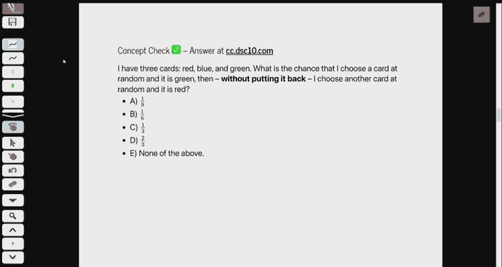

Yeah。Okay， make sure to vote online' a check。

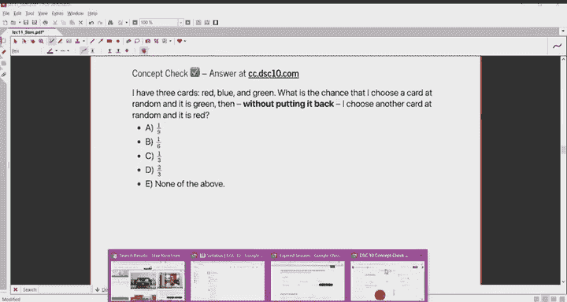

Okay， most votes are for B。

Yeah， it is 16， can anyone tell me how they got that？Okay， so there's three things， red， blue。

 and green。I'll write it like this you're trying to get。Green first， so that's。

Like a one in three chance of that happening and then assuming that happens， right。

 you're left with red and blue and you're trying to get red and that happens half the time。

And you multiply them to get a sixth。🤧。Okay， so this is。Why it's a sixth。

 but we haven't learned yet about like why you multiply and when you multiply。

 So there's a way to do this without doing any multiplication。

 Can Did anyone do it that way or can anyone see how to do it that way。Write them all out。

 right all we learned so far was。What are the how many outcomes are there and how many good outcomes。

 Okay， so let me clear the poll。

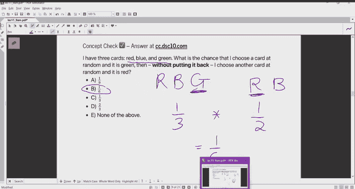

For the next time。

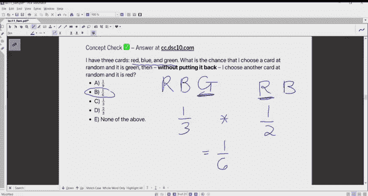

And then。I'll show you the more sort of elementary way。Okay。

The outcomes are the pairs of cards you can get your process is pick a card。

 then pick another one without putting it back so you're going to have to have two different color cards because you can't get red and then red again you could get red and then blue。

 you could get red and then green。You could get green and then blue。

 you could get green and then red， you can get blue and then red， you can get blue and then green。

 Okay so these are the six outcomes and how many of them are the good outcomes。

You wanted green first， then red， just one。Makes sense。

So this is encouraging that this multiplication way coincides with the more basic way。

 and we'll see later in the class when the multiplication way works and what exactly it's doing。😊。

Okay， any questions so far？All right， now we're going to talk about what's called conditional probability。

 conditional probability is like you have two events。

And you know that one of the events has happened， but you don't know if the other one has。And again。

 we're focusing on the case that all the outcomes are equally likely。

 and we're going to define what's called a conditional probability。

 which means like the probability of one event happening。

When you have some extra information that the other event did。

OkaySo it's written like this probability of B given A， sometimes you'll see it like this， B given A。

But we'll try to write it out。It's the number of outcomes satisfying both A and B。

 divided by the total number of outcomes satisfying A。

So basically the way to think about this is to think about。嗯。

Like you're set of all possible outcomes。Imagine whether you're flipping coins or rolling guy or picking things at random。

 whatever， like you listed them all out here， within this box。And then some of them。

Correspond to the event A。Right。And others of them correspond to the event B。

 and there may be some overlap between those A and B。 Okay。

 And the question we're asking is probability of B given A。

 So that means I know that I fall within this little red square。

Knowing that you fall within the red square， what's the chance that you also fall within the blue rectangle？

Let me jot these a little nicer so that。Pretend they line up exactly。

And what it says is basically limit your view to just a。Imagine like blacking out。All the stuff。

That's not in A。Like none of this is relevant anymore。The only part you're looking is。Is in A。

And that's because you were told that A happens so the other outcomes don't really matter because they didn't happen。

Right， within a， right， now you're asking， what's the chance of a happening。

 What's the chance of B happening， right， And it's basically like how much of a is taken up by B。

So the problem reduces to。How much of a is taken up by B and the way you calculate that is your denominator。

 like all the possible outcomes， well， since you know a happened。

 right all the possible outcomes are just the ones in A。

 like the things outside of A are not possible anymore。And the good outcomes。Are the ones here？

The ones in both A and B。Does that make sense？So it's very similar to the definition of like。

 the probability of B。Except instead of probability of B out of the whole total。

 it's like probability of B out of just a。So it's like the probability of B。

Except it's out of just a。Does that make sense， questions？Okay。

 so let's try this concept check question that uses this formula。

You roll a six eye to die and don't see what the result is， but we tell you that it's three or less。

 what's the chance you got an even number？Try to use the formula and vote on the website。

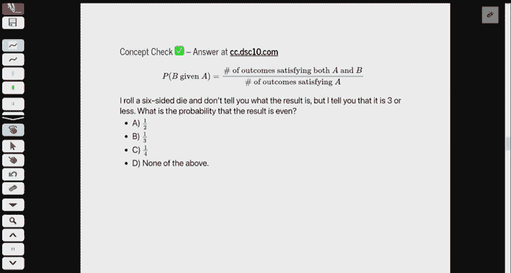

Okay， put in your vote so I can check。

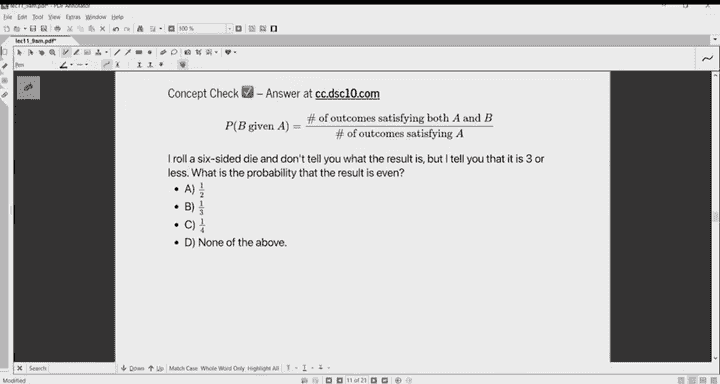

Okay， a lot of votes for B。A fewew votes for A， let's do it。

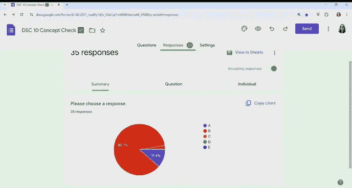

Okay so。There's few enough outcomes that we can list them all out， right， the full set of outcomes。

Is one， two， three。Four， five， six， okay， I'll write them out like that。嗯。

You're told that it's three or less， so is this the event of being three or less。

 is that the role of A or the role of B？That's the A， that's what you're given。

 That's what you know Okay， and the thing you want to find out is being even。 So that's the B。

 So the question is what's the chance of being even。Given。That you're less than or equal to3。 Okay。

 so even is the B。 Le than or equal to3 is the A。 So in the picture。Less than or equal to 3。

 this would be A。Okay，And what's B well b b is this。Okay。

So the right way to think about it is you ignore everything outside of a。Because that didn't happen。

 you know for sure， you got a number less than or equal to three。And then within that A。

 what fraction of the outcomes are in B？There's three outcomes within A，1， two， and3。

 and only one of them， the number two is also within B。

 so that's what this says how many outcomes are in both of them。

 just the one out of how many outcomes are in A3。Makes sense。Okay， questions。

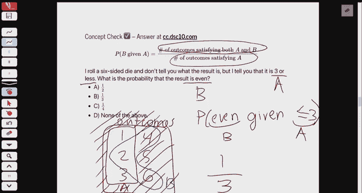

Okay， let me clear the poll for the next question。

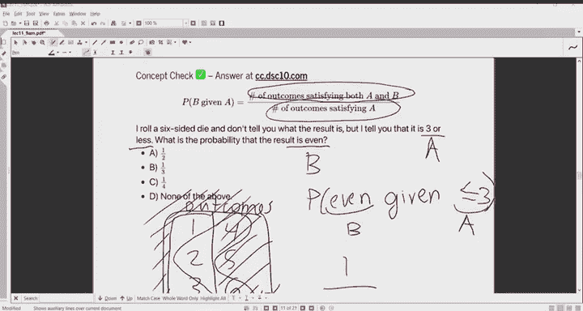

Okay， now this is。Another sort of basic probability rule。

 probability of two events happening simultaneously A and B are two events and again the same assumption all outcomes are equally likely。

 then the probability that two events both occur is well how many outcomes make both events occur out of how many total outcomes Okay so for example。

 you roll a fair six side die。This is the same outcomes as I had before。

 let me write them in the same way， one， two， three， four， five， six。

What's the probability that the role is three or less？And even。Okay so a is three or less。

And B is even。And what the formula says is I just count how many outcomes satisfy both of these out of the total number。

 so again， there's only one outcome that satisfies both of them。But it's out of six possible。

So do you see the difference of how it's one6 when you're just saying what's the chance that both of these things happen versus it's one thirdd when you know that one of them happened and you just need the other one to happen。

 this one like you're halfway there already right you know you got a small number but maybe it's even maybe it's not here you don't know anything and you need to satisfy two conditions right think of like an extension of this if you had more and more and more conditions it would be like harder to satisfy all of them so the probability would go down。

The multiplication rule， which was what some people used before for that card drawing question。

 kind of connects the probability of an and with a conditional probability。😊，Okay。

 so it says that the probability of。A and B is the probability of a times the probability of B given A。

 The way I like to think about this is。The requirement is that both things should happen。Right。

And what I do instead is make one happen， like make a happen。And then。I make B happen。

Given that A already happened。That's kind of what the formula is saying。

It's kind of saying like if you want both things to happen， you can focus on them one at a time。

 like first think about the first condition of being met， then if that condition is met。

 you additionally need a second condition to be met。Does that make sense？Okay， so let's connect。

This to the other examples that we've been doing with the three or less even。

This is the same question right we want it to be three or less and we want it to be even。

 we already answered that question here， right three or less， and even we saw it was 16。

 but this gives me another way to get that。Okay， so the other way to get it。

Is probability of less than or equal to three and even？Is first。

 what's the probability of being less than or equal to three？Times。What's the probability of being？

Even given that you're less than or equal to three。Make a small。Probability of being even。Given。

That you're less than or equal to three Okay， so what's the probability of being less than or equal to three？

Think of the outcomes。That's three out of six。What's the probability of being even if you know that you're less than or equal to three。

 that's a conditional probability， we already calculated that to be one third。Okay。So three。

6 times one third。If you multiply these， the threes cancel。

16 is the same as what I got when I just solved it directly。

 how many outcomes satisfy both properties。So this multiplication rule gives you sort of another way to。

To connect conditional probability to and probabilities and the nice thing about this one is that it works all the time。

This works even if the outcomes aren't equally likely。

 whereas the other formulas we've done work in the equally likely case okay in this class we're just going to really focus on the equally likely case because that's the simplest。

 but in future classes you'll have more complicated scenarios。Now， what if A isn't affected by B。

 so part of this multiplication rule involves a conditional probability here。

But there are some events where knowing one thing happened tells you nothing about the other thing happening。

Like， for example， you flip a coin three times。The chance of getting heads on your second flip has nothing to do with whether or not you got heads on your first flip。

Because they're separate flips and knowledge of one flip doesn't inform anything about the other flip。

 The word for that is independent in that case， what is the probability of A and B？Well。

 let's focus on this part， right， probability of B given A。If you're given irrelevant information。

 right， it doesn't matter。 it's just this would be the same。As probability of B。

 when a is irrelevant to B。Right。And then just copy the rest of this down。So this is a。Formula。

 that's not true all the time。It's only true when A is irrelevant to B。

 but when A and B are independent。That's the formal word for irrelevant。

This is saying that you can calculate ands by just multiplying things separately。

 think of each event separately and just multiply them together。And that's exactly。

What most people did。When solving this card problem， right， they sell。

I get like a green on my first poll。There's a one third chance of that happening。And then， well。

 I guess this isn't independent。So， this would be like。The probability。That your first card is green。

So he actually did the more advanced one。And you multiplied it by this。

 which was the probability that your second card is red。Given that your first one is green。

Because you use the fact that the green was not an option here。

You took out the green and you did it out of the other two。

Okay so this is using the multiplication rule in general， actually， not just the independent version。

Here's one that uses the independent version。Suppose we have a coin that's biased。

 meaning it flips heads a different amount than 50% here， we're saying it flips heads 70%。

And each flip is independent of all other flips， they're saying that explicitly in this problem。

 but often they won't like coin flips or like rolling the dime multiple times。

 like doing separate things that is independent because what you get on one isn't going to impact what you get on another。

You flip your bias coin five times。What's the probability we see five heads in a row？Okay， so。

One possibility that you might try like using how we did it earlier is like list out all the outcomes right like you could get all heads。

 you could get heads tails， heads like different sequences of heads and tails。

 but I don't recommend doing that for this one first of all because there's many sequences。

 there's since there's five flips， there's two to the power five， 32 different outcomes。

 but even if you list them all out， it's not going to help you because they're not all equally likely。

They are coin flip sequences are equally likely when it's a fair coin but with a bias coin each flip is more likely to be head。

 so getting five heads is more common than getting five tails so you can't just count how many outcomes have five heads lets say one out of how many outcomes are there total 32 that doesn't work because they're not all equally likely。

😊，Okay。So。It's not。One out of 32 because。Some outcomes are more likely than others。But。

The flips are independent， right， So let's try to use this multiplication rule that says the probability of two things both happening comes from just separately multiplying them。

 Okay， here， I want more than two things to happen。 I want five things to happen。

 I can think of this as。I want my first flip to be heads。And I want my second flip to be heads。

And I want my third flip to be heads。And so on， and finally I want my fifth flip to be heads。

And what you do for independent events is basically you can replace an and with a multiplication。

So what I need is the probability that my first flip is heads。

Times the probability that my second flip is aheads。Times。

 eventually I'll have probability that my fifth flip is ahead。But for any one flip， right。

 the probability of getting heads is 0。7， so this is just 0。7 times 0。7。How many。7s will I have？

Five because I'm flipping it five times， how do you write this in a nice notation？

Like the final answer。Yeah， to the fifth power， it's very easy to make the mistake of multiplying and just say。

 oh， there's five of them so it's 0。7 times5 but times5 is when you're adding something to itself five times exponent is when you're multiplying by itself five times so yeah this succinct way to say this。

😊，Is 0。7 to the fifth power。Okay， the simplest and most useful probability rule is the probability of something not happening Okay the total probability of all the different outcomes is always one。

 so the probability of something not happening is one minus the probability of it happening right。

 we use this all the time Like if someone tells you it's going to be sunny tomorrow with 85% chance you know that that means that there's a 15% chance it won't be。

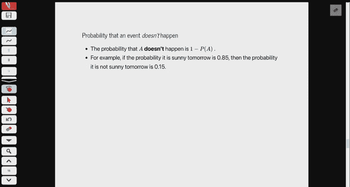

Okay， let me make sure I cleared the pole。

I'm going to give you a few minutes。

To work on this question。Every time I call my grandma。

 the probability that she answers her phone is one third independently for each call。

 so that means like， you know if she didn't answer the first time。

 it doesn't mean she's like more or less likely to answer the second time if you call your grandma three times today。

 what's the chance that you'll talk to her at least once？Take a few minutes to try this。

 and I want you to talk about it with people around you too because there's lots of different strategies to solve this problem。

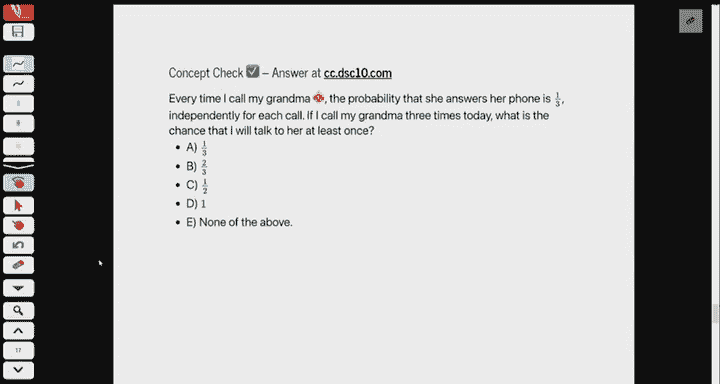

All right， put your vote in。And I want to check how people answered。

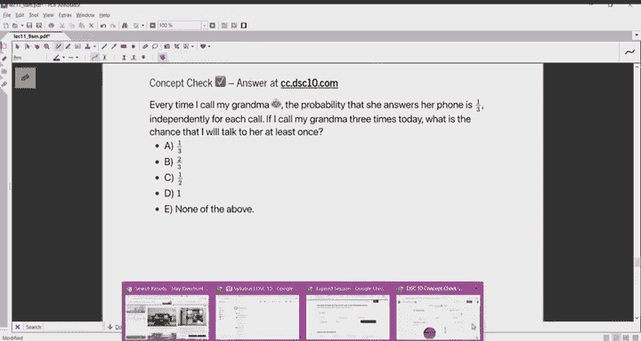

Okay。This is our distribution here。A lot of E's， but also a lot of A's and a few B's and D's。

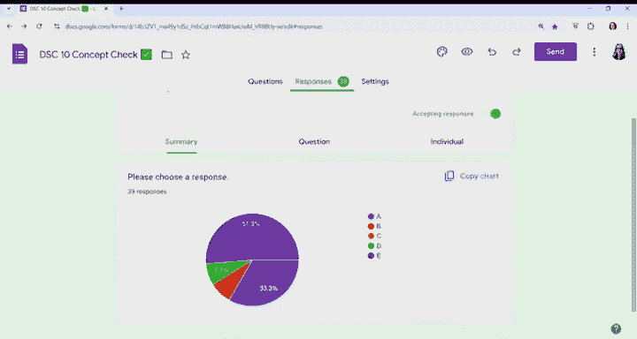

Okay。

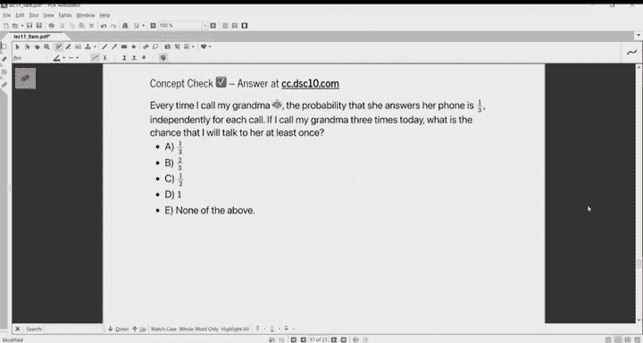

So I want to do a little process of elimination。It's not D。How can you quickly argue that it's not D？

You're never guaranteed， right， each time it's a randomness， right。

 you can call a million times and just get very unlucky and you never get to talk to her。 Okay。

 Why is it not one third。Yeah。Yeah， like it's a one third chance your first try right。

 but if you're persistent and you keep trying like your probability of getting through is going to approach one right eventually you have a chance of like a pretty high chance of finding her at some point right now these other ones。

 none of the above we have to actually calculate it to figure it out。

So let's try like the strategy where you list out all the outcomes。

 right if you were to list out all the outcomes。Right， let's think of it as like。

Why is she answers and and is she doesn't， So like why and N would be she answers your first call。

 but not the other two。How many outcomes would there be？you were to list them all out。Yes。

You can think of this like the heads and tails with three coins or something right each one has two options and there's three spots right so there's going to be eight outcomes。

 are they all equally likely？😊，Are these eight outcomes all equally likely？Yes or no， no。Right。

So like listing them out and counting how many good outcomes there are isn't sufficient。

I do want to list them out。She answers all of them。She answers the first one only。呃。

Each of these outcomes like has a certain probability associated with it right like if I picked one particular outcome。

 like let's say this one Y andN， what's the chance of that specific thing happening like she she answers the first call。

 not the second and not the third， how would you do that probability？Yeah。

 so this one's probability is。Probability of Y and N this is an and right。

 I'm saying she answers the first call and she doesn't answer the second call and she doesn't answer the third call right so it's just。

The probability of why。Time is a probability of n。Times the probability of n。

 this is because they're independent。Like each of the three calls knowing whether she answers one doesn't impact whether she answers the other right so the probability of a yes answer was a third。

And the probability of a no answer was two3。So you can do something like this and calculate the probability of any one of these outcomes。

Which outcomes are considered my good outcomes， talking to her at least once？Yeah。

 almost all of them are good outcomes right so one way to solve this problem is like separately calculate the probability of all the good outcomes and like add them all up。

But a much easier way is calculate the probability of the bad outcome and do one minus that。

 So what's the probability of the bad outcome。Probability of all knows。

It's whatever the probability of no is times itself， times itself， so cubed。So it's two/ third cubed。

Which if you simplify this， two cubed is eight，3 cubed is 27。So it's eight out of 27。

So the probability of anything else， like probability of her answering at least once is 1 minus8 over 26。

Which is like 19 out of 27。So it's none of the above。And this is the final answer。

Does that make sense？There's a lot of good things to learn from this example。Any questions？Okay。

 so we saw how to deal with like the probability of multiple events happening with an and。

 there's a multiplication rule， there's also what if you're talking about at least one event happening for an or。

 right？So again， like kind of think of a picture of like you have some set of outcomes。Right。

 some of them。Are part of A。Other ones are part of B。What's the probability of A or B。

 well what's considered a good outcome in that case， all of these are good。These are all good。

So if again， all the outcomes are equally likely， then you can just count up how many good ones out of how many total and the good ones come from however many outcomes satisfy either one of them。

 or possibly both， right？So try this example。One， two， three， four， five， six。

These are the outcomes we want to know what's the chance that the role is even。That's these。Okay。

 call it even A and at least five， we'll call that B。

And the answer to the question is how many outcomes are in some circle somewhere， right。

 four of the outcomes are in a circle， right， two， four。

 five and six are included in at least one of the events。Out of six options。So two3s。

Does that make sense？There's four good things that would make me say， yeah。

 at least one of these happened and there's six things that could happen。

Now something that's easy to do。To do and doesn't quite work。Is。Me go to a different color。

You cannot say。Well， what's the chance of getting even。3 out of the six are even。

 What's the chance of getting at least five，2 out of the six are at least five。

 You cannot just add them up。 Youll get the wrong answer。Do you see why you get the wrong answer？

What's the issue？The the number six right is being counted towards being even and towards being at least five。

 right， but it's still only one outcome， it's not like two separate outcomes。

 you can't count it twice。So or is not just replaceable by a plus sign。😡，You have to do it this way。

 like how many outcomes satisfy at least one of them out of how many total outcomes。

But you may have have seen sometimes replacing or by a plus sign this is kind of like the independent。

嗯。One for multiplication where you can just replace the and by at times it works sometimes right in the multiplication rule。

 it's when they're independent here， when does replacing or with plus sign work。

 it works when there's no overlap between the events right like if I drew the outcomes like this。

And A was over here。And B was over here。Well， if I did the strategy of how many outcomes satisfy。

At least one of the events， I would just basically be adding how many outcomes are in A plus how many outcomes are in B。

 because there is no overlap。 Okay， so the addition fails when there's something like that6。

 which was in both regions。 But the addition is fine when there's no nothing in both regions。 Okay。

 so the term for this is。Mutually exclusive， they don't overlap， and in that special case， right。

 then you can replace an ore。With a plus sign， when there's no overlap。So this is a special case。

Let me go back and make sure to highlight that on the multiplication one。As well is that。

This one is a special case for independence。All right， try this example， I have two bias coins。

 coin A and Co B。Coin A flips heads probability 06， and Co B flips heads probability 03。

I flip both coins once What the probability I see two different faces。

I'll give you a minute to try it。Okay， so the mutually exclusive comes in handy when you can make a problem like divide a problem into cases okay。

 so the application of this formula is for cases。And the cases need to not overlap。

So the question is stated of seeing two different faces。

 can you think of cases like how that might happen？What are the cases？Right。

 coin A gives you heads and coin B gives you tails or coin vice versa， okay so the cases are。

Case one is coin A gives heads。Coin B gives tails。In case two is coin A gives tails。

And Co B gives heads。Okay， and the question is， what's the probability of being in case one or case two？

Okay， so it's an orR question。And the idea of having the cases not overlapping is that you can just separately calculate the probability of each case and then add them up。

Okay， so what's the probability of being in case1 case one is getting a heads on coin A and ittails on coin B。

But here we're going to use the independence right A and B are separate coins。

 so of course what you get on one coin doesn't impact what you get on the other coin right so I'll do probability of case1 over here。

It's so hard to write on this probability of case1 is probability of that A is heads。And be as tails。

Okay， and because they're independent。We can。Multiply them。So what is that product， A is heads， 0。6。

 B is tails 1 minus 0。3， 0。6 times 0。7。OkaySo similarly， probability of case2。Is going to be。I need。

The A to B tails that happens 0。4。And the B2B heads， that happens 0。3。

So the final answer is the sum of these。Pot42。Plus 0。12。054。上根。Okay。

There's a quick proof of the fact that this edition works， but really it comes down to this picture。

 right， it's just saying how many things are in both， well if there's no overlap。

 count the ones in one and count the ones in the other。Okay， so that's it for probability。

 I'll see you guys next time。Yeah。やぱし。原来说的没错这。いしな。

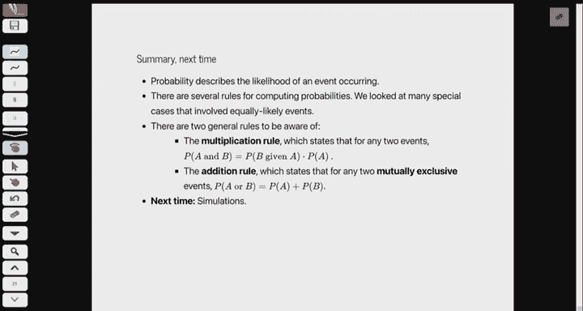

