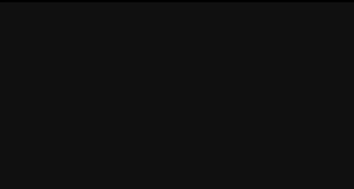
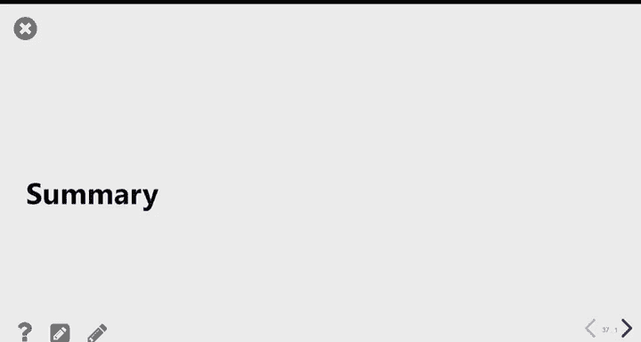

# UCSD《数据科学原理 (DSC 10 Principles of Data Science Fall 2024)》中英字幕（deepseek - P12：DSC 10 - Principles of Data Science - LE -A00- - Lecture 12.zh_en - GPT中英字幕课程资源 - BV1hmAneGEZh

All right， good morning everyone。Here's what we have going on， there's a quiz today。

 it's similar in structure and format to the last quiz 20 minutes。

 no calculators or notes just on paper， bring a pencil， bring your student ID。

 the quiz covers lectures 5 through 10， so it doesn't include the probability that we did last time that was lecture 11。

😊，And then upcoming assignments are lab， homework， midterm projects， not do for a little while。

 but it's good to start on it。We also have a midterm exam coming up in one week。

 so I'll be sending out more information about that shortly。

 but I wanted to point out that that midterm falls on a Wednesday。

 normally on Wednesdays I only do the morning lectures but that Wednesday we'll have midterms at all three times so you come at your regularly enrolled lecture。

😊，Okay， today we're going to go back to programming and we're going to incorporate like our knowledge that we've built of how to program in Python with the introduction of probability that we had last time。

 so today's class is kind of about seeing the connection between coding and probability and we're going to start with a reminder of some concepts from iteration because we're going to use a lot of iteration in the coming lectures and specifically we're going to use iteration to run simulations so simulations help us approximate probabilities that might be hard to find using the formulas that we learned last time so we'll do two examples of that。

Okay， so we learned about four loops in Friday's lecture and what four loops do is they do some chunk of code repeatedly okay you can do the exact same code repeatedly or you can do code that's slightly different like the rocket blaster it was like t minus5 than t minus4 than t minus3。

Four loops basically。Execute some code for every element of a sequence。 and the sequence can be。

A list an array or a string。 Those are all examples of sequences。 Okay。

 so here's an example of a for loop。 it says for x in。 and then after that is a list。 Okay。

 these are in the spirit of our midterm project， some lyrics from Taylor Swift's karma。Okay。

 and then。What I'm doing every time I go through the loop is print karma is with a different value of x。

 so basically x is like getting reset to each value in the sequence。

 and then I'm just doing the print statement once for each value of x。Does that make sense？

So right now when I'm printing it， like I can't。Do anything with this output when you print it。

 it just kind of shows it to you， but it's not saved If I wanted to save the lyrics in a variable so I could do something with them。

 I would have to use a slightly different strategy。

 I would have to sort of add my lyrics onto some existing variable So notice when you do a four loop you kind of like gradually build up the lyrics right each time you go through the loop you're getting another line of the lyrics and when I print it I just print one line than another than another than another。

 The strategy here is like the result is going to be a string because it has a bunch of text I start by making an empty string and then every time I generate a new line of the lyrics I add that on to the existing string。

 The way you add to a string is the plus symbol which does concatenation right so。

Lyric starts out with nothing。Then X is going to get set to the first thing here， my boyfriend。

 and I'm going to change lyrics to be what it used to be。

 which is nothing plus karma is plus my boyfriend plus a new line character。Okay。

It's going to do that once for each value of x。 And in the end， lyrics is going to be this string。

So this has all the lyrics of the string， but notice string variables like you might remember this from when we did the little women example。

 the way that the string variable is stored in the computer is different than how you might want to read it so it's stored in a computer with the slash end symbol。

😊，But if you actually wanted it to be like human readable， you would want to print it。

 and that's going to replace the slash end with actually a new line。

just to make sure you understand how this works， like if I change the。The sequence。

Let's say instead of having four elements， it was a sequence with two elements。

 how would the lyrics change？It would only have those ones， so like that's what the x is doing。

 it's going through each of these values and doing this process for each value。Does that make sense？

Okay， any questions？This is a good example to refer back to。

And this is an example of what we call the accumulator pattern and the accumulator pattern is saying like the way we store our results is we start out with some variable that's somehow like blank or empty or sort of basic。

 and then we add on it every time we go through the loop。😊，So if we're using an int。

To accumulate our results， we would probably set that in to zero before we do the loop and then inside the loop。

 maybe if some condition is met， we add on to that variable so at the end the result of the variable tells you how many times the condition was met so there was an example like this in the lab where it was like counting how many even numbers were in some array and it goes through the array and if the number is even then it adds on to some count and at the end you have a count of how many even numbers so that's like a tally。

😊，系呀。Another way to store your results is to just literally keep all of them in a giant sequence and that's what we use NP doendned for。

 so you start with an empty array and then every time you go through the loop and generate another value you just tack that value onto the end of the array so the array starts empty then it has one thing then it has two things and so on。

That's like writing down all your results on a piece of paper。

And the example we just saw was accumulating our results in a strain。

So we'd have to have a string variable that we're going to store our results in。

 and we started it with equaling the empty string， which is just quotes with nothing in it。

And then we add it onto it using the plus symbol， okay because that's how you make a string kind of long。

That's think of that like writing a word， the way you write a word is one letter at a time。

 right you have like a portion of the word and then you add on to it and then you add on it and so on。

So all of these examples like follow a similar pattern where you start with some sort of empty nothing thing right。

 and then you repeatedly add onto it that's called the accumulator pattern。

And this is how pretty much all the four loops that we're going to write in this class are going to be used。

 we're not going to use four loops to do things like work our way through data frames or series because we usually have better like tactics to do that。

 like all the data frame manipulations we learn sorting and grouping and all of that stuff。😊。

Okay so there's a video here specifically for this class about when you generally do want to use for loops and when not to use for loops。

 so that's helpful to watch。Something that was mentioned earlier was that when you have a for loop。

 you loop over a sequence， so typically that sequence is a list or an array。

 but that sequence can also be a string because in Python。Strings are sequences。

 They're sequences of individual letters。 Okay， so the first element of the sequence you see San Diego is the letter U。

 That's the thing at position 0。 The second element is a C。 That's the thing at position 1。

The third element is a space that's the thing at position2 Okay。

 so basically you can think of UC San Diego as like a sequence U followed by C followed by space and so on。

 and so it makes sense to。Iterate through that sequence so the example is。For letter in UCS Diego。

 print letter。U。OkaySo letter is going to get set first to U the first thing in the sequence。

 and I'm going to print an uppercase U okay then letter is going to get set to C the second thing in the sequence and I'm going to print uppercase C。

 so try to envision like what this output is going to look like and something to know about print statements is that each each print statement comes out on a new line。

So it's going to look vertical like this because I'm printing them one letter at a time and notice that the space counts as a part of the string right so there are some of those print statements where just like print an uppercase space which is just a space。

 so that's why I have blank lines in there。😊，Okay， another thing that you're going to need to know for working with strings and the exercise I'm about to give you is there's a string method called count。

 so we learned about string methods， upper lower title， replace split。

 like those are some common string methods that we've used， we haven't used this one yet。

 but you might guess what it does， it counts， how many instances of that letter。😊。

Are in the string right so there's two A's in California。There's two eyes in California。

 but there's only one C in California。O。So you're going to need to use both of these strategies looping through a string。

And counting how many letters appear in a string。To try this example。

 so I'll give you a little time to work on it， the goal is make a function。

That takes in a string and tells you how many vowels it has。 So I'll right， what vowel is A E， I O。

 U。 We won't count why that's complicated。 Okay， How many vowels does King Triton have。I see three。

 one， two， three， how many vowels does this have， it should have eight？Okay。

We've provided a sort of like some comments。In the code。Kind of describing the strategy。

So try to follow what the comment suggests you do and see if you can write the function yourself。

Okay， so let's read the provided sort of outline we need to keep track of the number of vowel scenes so far before we start we've seen zero vowel。

 so that suggests I'm going to accumulate my results in some counter like an integer that I'm going to set to zero and then I'm going to update that number。

 probably increase it by one when something happens。嗯。

And then the strategy is for each of the five vowels， so A EIO U。

 I'm going to process them one at a time， so I'm going to start with a say I'm going to count how many times this vowel appears in my input string S。

 so how many A's are there in the word。And then I'm going to add that on to the running total。

 So I'm not necessarily going to up it by one。 I'm going to up it by however many A's I see。

And then I'm going to move on to the next vowel， how many e's did I see and add that to my running total and so on。

 so if the input was king Triton， I would start by setting the variable to zero。

After the first time through the loop， I would be checking for A's。I don't see any A's in there。

 so I'm not going to update to anything， it's going to still be zero。Then I'm going to check for E's。

 there's no ease's in there， so it's still going to be zero， then I'm going to check for I's。

 and I'm going to find two I's so this variable is going to be now two okay。

 and then I'm going to check for O's and I'm going to find one of those so it's going to update to three。

And then I'm going to check for use and it's not going to find any。

 so it's going to stay at three and my final answer should be。Does a strategy make sense？Okay。

 so what does the code look like？Make a variable to keep track of how many vowels I've seen so far。

Fowels scene。Zero okay， for each of the five vowels。Okay， so for vowel in。

And then I need to give these five。Letters as a sequence Now I could do it like this。

 make a list and the first thing is a and the second thing is E， and the third thing is I。

 but it's actually more sort of efficient to write it if I just say this， AEIO U。It's the same thing。

 right a string is just a sequence of individual letters。And for each vowel， what do I want to do。

 I want to count how many times the vowel occurs in the string。

 I introduced this string method dot count for that。 So remember before it was。California dot count。

 so the thing you want to count it in comes before the dot， I want to count it in the string S。

 whatever is passed in as the input to the function。

and I want to count how many times an A or an E or an I or an O or U occurs right。

 so what do I put inside count？What's my input here？I called it vowel。

Vel is like a placeholder variable， sometimes it's going to be a， sometimes it's going to be I。

 sometimes it's going to be O。I'm going to count how many times that vowel appears。

And then I'm going to add that onto the running total Okay。

 so this is the number that I want to add onto the running total。

 It's suggested it on two lines here， so I'll give it some name， I'll call it how many。

How many of that particular vowel I found and then I'm going to。

Update my vowel scene to be whatever its old value was。Plus， the new count that I've just done。

And once I've sort of。Gotten through all five vowels when this four loop is over。

 I've checked for A's， E's， I's， O's and U's， right then my function should be done so I can give the answer and the answer that I've been storing it in is vowels seen。

Okay， so let me define the function。And then run it。And it works as expected。

If you want to think of another way to do this function。

 there's another strategy that's different than the one outlined here， but it works just as well。

 I'll describe it in words and you can try to implement it and code if you like the strategy is instead of count all the A's count all the B's count or count all the A's E's Iss like count the vowels one by one you can iterate through the string itself and check each letter is it a vowel so if you're given king triton start with K is that a vowel no so I'm not going add on my count of vowels then move on to the I that's a vowel right so I add that onto the count of the vowel so you can go through the string the s that you're given as the input one letter at a time and check each letter is this a vowel and if so add it on that's another strategy and it'll give the same result so if you want extra practice with four loops that's a good thing to try to implement。

Okay， now we're going to see how to use four loops and the probability stuff that we learned yesterday kind of together。

 and the way that works is through simulation。😊，So let's say you want to find out the probability of getting 60 or more heads if you flip 100 coins。

Okay， this is a math question， right， and last class we learned math to calculate probabilities Pro is this is a hard math question。

😊，There's many different like cases and a lot to figure out that all the cases aren't all equally likely and stuff like that。

 so it's possible to calculate it by hand， but it's not fun and it's not easy。

So what we're going to do instead， when we encounter like a probability that we don't know or we don't want to calculate by hand。

 we're going to just estimate that probability and our strategy for estimating the probability is basically like do an experiment。

And see like how often the event occurs。 So the question is about getting lots of heads in 100 coins flip 60 or more heads right So imagine you just had infinite time and you could just flip coins all day you could like flip100 coins。

 C， did I get 60 or more heads in those hundred coins and write it down or write down how many heads you got and then flip 10 more coins and see how many heads you got and flip another hundred0 more coins right So if you had infinite time to like actually do this experiment。

 you would be able to collect data that told you like how many times you saw 60 or more heads and how many times you didn't and you could use those numbers to calculate roughly the probability of seeing 60 or more heads。

 it would just be like the proportion the number of times you saw 60 or more heads out of the number of times you try So if you've tried a million times and half a million you saw 60 or more heads and the probability would be about a half。

So that's like the strategy of what we're going to do。

 except we're not going to manually flip the coins， we're going to make the computer do。

So the strategy is like learn how to do the experiment once， then repeat the experiment many times。

And then find the proportion of experiments in which I got 60 or more heads in which the event occurred。

And the four loop is going to come in right here。Four loops are for repeating code over and over。

And today's lecture is very sort of important for the upcoming rest of the quarter because we're going to basically do this kind of procedure estimating probabilities through computation in lots of different applications in the weeks to come。

😊，Okay， so this is a dictionary definition of what the word simulation means。

 it means like imitation of some situation or process。😊。

There's a particular definition here for computers， the production of a computer model of something。

 especially for the purpose of study so the idea of a simulation is like I want to do the same thing as flipping 100 coins but I'm not really going to actually do it there's another definition the action of pretending like I'm just kind of going to pretend to do it by making the computer do it I'm imitating the process I'm not actually flipping the coins。

😊，In order to imitate the process of flipping 100 coins， I need to be able to imitate randomness。

Coin flips are random right and most of the computer programming stuff we've done is very non random like it gives a prescribed output every single time like a calculator but we want to be able to make random choices so there's a。

😊，Function that exists within the NPy package called NP。random。

choice and what it does is it takes a sequence of options and it tells you like one randomly chosen thing from that sequence of options。

OkaySo the sequence of options could be like a list， array， a series。

 and it just selects one of them at random， the default behavior is that they're all equally likely to be chosen。

 but you can change that by making some more likely than others by specifying the different probabilities that each one should have。

😊，Okay， so this is。How you might simulate flipping a coin。There's two options when you flip a coin。

 heads and tails， so the input to NP。random。choice has to be a sequence。

 so I'm giving it a list to choose from。It's not going to work if you just say。Choose one of these。

Okay。It doesn't know what you're talking about。You say chooseose among the options in this list。

 is how you have to say it。And you know if I ran this infinitely many times。

I would expect that half of the outcomes that I got would be heads and half of them would be tails because you know there's a 50% chance of getting each one。

Similarly the role of a die， your options that you're choosing from are 1，2，3，456。

 you could type them out manually in a list or something but NP。

 a range is very handy for that because die rolls are evenly spaced numbers be careful with using NP do a range though because the default is zero right so if you do NP。

 a range6 or something that's actually going to choose a number 0 through5 not one through six。

There's some additional arguments that you can give to NP。random。choice， one of them is a number。

That tells like how many choices you want to make。 So the default is it's just going to give you one of the things and the options。

 but you can change that number。 And basically this is saying give me 10 different or're not different。

 but give me 10 things。Okay， so it's like flipping 10 coins。And it would be equivalent to just doing。

A single choice。10 times over。So if you did a single choice and sort of like ran this cell 10 times and sort of kept track of your results。

This is basically what it's doing。 You'd have to do like a four loop if you wanted to really do this code 10 times。

 right， Your for loop would be like for I in。NP。 a range 10。

And what this is saying is I is going to be set to every value， 0，1，2，3，45。

6789 because that's what NP do a range 10 is， so I is going to be set to each value and every time you're just going to pick one of these values。

If I wanted to save those results， I would have to have some。Aray of results。Which I initialize。

To an empty array beforehand。And then。嗯。I would have to add on。The the result of my one coin flip。

 so I'll save that in a variable to add and I'll reset。My array of results。To be。

The result of a pending。My array of results， don't forget the tab is a very handy shortcut when you don't want to do a lot of typing。

 just start typing and hit tab， and then you can select the one you want。

Append to my array of results， the thing I wanted to add。Okay。

 so this code that I've just written is a four loop that flips 10 coins。

And I'll show you the results I got。It's an array of my 10 results， okay？

Idea of this additional argument to NP。random。choice is that you quite frequently want to make multiple random choices and you don't want to have to write a for loop every time。

So this is just a shortcut that kind of does it for you。Does that make sense？All right。

 now when you make a random choices question to always consider is if I'm making multiple random choices and I pick something。

 am I allowed to pick that thing again and sometimes this is obvious based on the context right like you're going to pick three people to win a prize。

 you're not going to pick the same person wins the prize three times like you're going to pick three different people。

😊，And you can specify this to NP。random。choice with another optional argument called replace。

So the default is that it selects with replacement and you can you can tell that that's the default because otherwise there'd be no way for me to pick 10 things from a set of two things without getting the repetition right if I had just had like a bucket and one thing said heads and one thing sets tails and I pulled out one I got heads maybe and then I pulled out the other one I get tails well there's nothing left for me to even make a third choice okay so。

The default behavior。Is with replacement？but it's also optional to say without replacement， right。

 so maybe you're going to pick three colleges to win some prize。

And you'd have to say replace equals false。 if you didn't say replace equals false。

It may work out that you get three distinct colleges。

But it may work out that you actually get the same college repeated okay so to force yourself to get three distinct colleges。

 you say replace equals false and what that's kind of doing is it's like picking one of them from the list so Earl Warren gets chosen right and then the next choice is among the remaining seven colleges sixth gets chosen and then the next choice among the remaining six colleges。

Okay。All right， so now let's use what we've learned to try to。

Estimate the probability of getting 60 or more heads if we flip 100 coins。Okay。

 so this is the same plan that I talked about before， figure out how to flip 100 coins。

 which now we know how to do， make a for loop to do that many times and keep track of how frequently did the desired result occur。

 how frequently did I get 60 or more heads。Okay， so this is how I would flip 100 coins。Yeah。

Make a random choice of 100 things each chosen from the sequence heads tails with replacement as the default right now the question is how many heads did I get？

And that's not like easy to answer when I just look at the output like this。

 I don't want to count how many heads I got。 One solution is write a for loop to loop through these things。

 And if you see the value heads or。Heads， yeah， you would like add one to your counter of how many heads。

 Okay， but again， there's an easier way。And the easier way comes from doing a comparison。

If you take the sequence of coins and you compare it to the word heads。

 remember what's going to happen， it's going to compare each individual word。

To the wordheads when you do like a whole sequence like an array or a series compared to a single element。

 it does the comparison to each element that's like broadcasting and we've seen this。

 do you remember where this kind of idea came up？😊，Like when did we use something like this before？

Quering right， you want to say like find the states in the West。

 you do states do get the name of the state right you get a whole column of state names or not the name the region。

 you get a whole column of regions and then you do double equals west and that tells you if they're in the west or not and you use that sequence of true and falses to shrink your data frame down to keep just the truth so this is like the part where you have a series or in this case it's an array and you're comparing each element to the word heads。

Now this is the part that's really cool is I can quickly count up how many heads there are by taking advantage of the fact that sort of under the hood in Python。

Zero and false kind of mean the same thing。And one and true kind of mean the same thing。

So even though this is a sequence of Booleans， you can also think of it as like a sequence of integers 0 and 1。

And if you were to sum up a sequence of vintagetegers that's 0 and1。

 that's just telling you how many ones do you have。

So basically this is telling me how many truths do I have？And which entries are true。

 they're the ones that were heads。So this is a clever way to count up how many heads do you have is turn all your heads into trues and then count up how many trues you have by summing the array。

So I got 45 heads this time。Another way to do it uses another NmpI function called NP。 count nonzero。

And as the name suggests， it counts how many of the entries in your sequence are not zero。

 But given the equivalence that I put on the left，0 is false and ones are true to be non-ze in this case means to be true。

 So it's just going to count how many truths do you have。 And it's going to give the same number。

 just a different strategy。 There's often like multiple solutions that give the same thing。

Count non zero works more generally， they don't have to be zeros and ones。

 but our typical application is going to be。Going to be for zeros and one。

So it's important to remember， trues are ones and falses our zeros。Make sense。Okay， so。Now。

I basically know what I need to do， I need to flip 100 coins doing this。And then。

I could either sum or count nonzero how many of those coins are heads。

 so these two lines of code together will flip 100 coins and tell me how many heads I got。

 And I'm going to put them in a function。 The function doesn't need to take any inputs。

 I'm just saying do the thing right When I run this function。

 it's going to flip 100 coins and tell me how many heads。Okay， so this time I got 51 heads。

Do it again。This time I got 45 heads， right， it's random， so the numbers I get will depend。

Any questions so far？Okay， now I know how to do the experiment once， I want to do it lots of times。

 and I want to keep track of my results。Okay， so I'll keep track of my results in an array。

And I'll add on that array using NP。taent。Okay so to remind you how NP doend works。

 I'm going to start by making an empty array， I'm calling it head counts because it's going to store for every chunk of 100 coin flips。

 account of how many heads I got okay so originally it'll be empty before I do any experiments。

 nothing imagine the first experiment you somehow got only 15 heads。

I would want to append that number onto head counts and then save the result in the head counts array。

 So now head counts is going to have the number 15。

 maybe my next time I get 25 heads right now it has 15 and 25 So I'm going to repeatedly have a line of code that looks like this except the number I'm going to be appending is not going to be a concrete number like 15 or 25 it's going to be whatever happened when I did the experiment the thing I'm going to append is going to be the result of doing the coin experiment。

Does that make sense？Okay， so this is the main。The main thing， right？

Actually repeating the experiment many times。So imagine like starting with a blank sheet of paper。

And the idea of the NP do pen is I'm just recording my count of how many heads on that sheet of paper。

 Okay， it starts off empty， but it gets the sheet fills up as I， as I run the experiment。

 So I'm gonna do 10000 repetitions。😊，And I've saved that in a variable called repetitions。

Then I'm going to make an empty array where I'm going to store my results。

And then I have my for loop the only point of the for loop is to like do the experiment lots of times。

 So I'm setting I to be every number in NP dot a range of 10000 So I is gonna be 0 then I is gonna to be1 then I is going to be2 up until I is 9999 It doesn't really matter what value I is I'm not going to use I within the code anywhere。

 I'm not doing something different on the first time versus the second time I'm doing the same thing every time so this should remind you of the Goldilocks example where you print the three bears I had I equals 0。

12。 It could have been the same as if I had I in the range like 4。

56 It doesn't really matter what the I is。 It just matter how many times it's happening。

So this is just shortcut for。Do the following 10，000 times。And what do I want to do each time。

 run the experiment？And put that result onto the array head counts。Okay。I'm doing it in two lines。

 I'm saving it in a variable。And then putting that variable here， you can also do it in one line。

 you don't have to have a variable called head count。But just for some structure。

 a good way to do it is use singular and plural。 So head count is like how many heads I have after one experiment。

It's an integer and head counts， the pluralural is an array that contains all those individual integers for each individual experiment。

Okay。So。It did it pretty quickly。At the end of this， how long is head counts going to be？10。

000 right because it started out empty each time I did the experiment， I added another thing。

 so at the end there's 10，000 things。What kind of things are they。

 there are numbers between zero and 100 that represent how many heads I got。Okay。

 so if I could somehow like look at all these numbers in this array。

 I would get a sense of like what values are typical when I flip 100 coins。

So I'm kind of asking about the distribution of the head counts array。

 and that's a question for a histogram。Do I have a histogram here， yeah， let me show you this first。

This is the distribution of the head counts array。So I took all the values in those that giant sequence I just generated of 10。

000 values right and this is how the histogram comes out Not it has a very nice kind of smooth shape。

 we'll study this shape later in the course， it's called a normal distribution。

But it kind of tells you like how many heads are to be expected， right， kind of。

 I would say like 40 to 60 is kind of typical Outside of that is kind of rare。

60 is kind of borderline。And the question I'm asking is like。

 how common is it or what's the probability of getting 60 or more heads in terms of the area of this histogram。

 remember， histograms have a total area of one。I always do density histograms。

Wwhich makes it have the property that the total area is one and like the area of a single bar represents like how frequent that value is right so the question that I'm kind of asking is like how much area is here at like 60 or more that fraction of area out of the total area of one that's the probability of seeing 60 or more heads so this actually explains why we like density histograms is because total probability is one so you just calculate the area in that right side and that tells you the probability of seeing 60 or more heads I should say the approximate probability because this is based on experimentation right not based on math。

😊，Does that make sense？Okay， let's see what that probability is。So remember head counts。

Had all these numbers？And now I want to say how many of these numbers are at least 60。

So I'm going to do that with another comparison。Compare each of those numbers to the number 60 with the greater than or equal to。

So anything true is like a success in my experiment right。

 And I want to know the proportion of successes。 So I'm gonna do NP count nonzero on this to tell me how many times among the 10000 that I tried。

 did I see 60 or more heads。 And I saw 283 times right， But as a proportion。That's 0。0283。

 which is about 2。8%， 2。8% of the time， you'll get 60 or more heads， so it's pretty rare。

A good thing to think about is that it also works to， instead of。

Count up how many truths in this array and then divide by 10，000。 It's equivalent to take the mean。

And that's because the mean of a bunch of trues and falses is like a mean of a bunch of zeros and ones。

 mean as you add them all up， So the numerator of the mean is how many ones there are and the denominator of the mean is how many values there are。

 So it's the same thing。 It's like number of trues out of 10000。This is the mathematical answer。

 you don't have to worry about why this is the mathematical answer， but it comes from combinations。

Bomial coefficients， if you know what that means and yeah this is like the actual answer right and our approximation to the answer was quite close right why was it so close was because we did the experiment like 10000 times right you're not going to get it necessarily a great approximation if you only do it a few times but the more you do it。

 the better your approximation will be。😊，Okay， any questions so far？Okay。

 now we're going to do my favorite example， which is called the Monti Hall problem。

So this is a problem from a game show。You're on a game show。

And the way the game show works is there are three doors。So。

Has anyone heard this problem before okay if you have don't tell the answer because I don't want you to ruin it the way the show works is there's three doors door one door。

 two door three and there's a prize behind one of the doors and you don't know which door the prize is behind okay but you know it's behind one of the doors So in the show the prize was a car and the other two doors have like a bad prize in the show it was a goat here I actually have a prize behind one of these three doors which is some candy and I have a bad prize which is some rocks that I found on the ground so I'm gonna ask for a volunteer to like play the game and I want it to be someone who's never played this game before doesn't know how it works。

😊，You want to try it。 Okay， so the， the way it works is you're gonna pick one of these doors， pick 1。

2 or three。Two okay， you picked two and now I know where the prize is。

 so I'm going to like reveal some information to you。

I'm going to open one of the doors you didn't choose。So I'm going to open door three。

And show you what's behind door 3。 Do3 has this lovely rock。 So now you know that。

And now I'm going to give you an opportunity。 Would you like to stay with the door you originally chose or would you like to switch to this other door。

 door number three。😊，Or sorry， door number one， I opened door three and saw there was a rock。

 one and two， we don't know， right？What do you want to do。Stay or switch。It's gambling， yeah。😀。😊。

You want to switch， okay， so you're going to switch to door number one and I'm going to give you whatever is behind door number one。

Okay。Sadly， you've earned this rock。Thank you for participating。😊，う。So the question is， right。

 do you want to switch or do you want to stay with what you had？Well， we'll see。 Okay。

 there's many simulators online。 You can play， but we， we just played ourselves。

 I want to take a quick sort of initial gut reaction。 What do you think is better to do。

 What would you have done if you were playing the game， Would you stay like， it doesn't matter。

Or would you switch because you think it's better。Yes。Just a quick kind of gut reaction。

 put your vote in and I want to see。All right， it's pretty clearly split pretty well。😀Yeah。呃。

The way we can really sort of figure out what's better is to do a simulation， right。

 Play the game many times with each strategy and see how often you win with each strategy。 Okay。

 so I'll go through the code for this pretty quickly。

 but it's all based on the same ideas that we just did with the coin flipping example。😊。

Okay what we'll do is estimate the probability of winning if you switch and if that number is more than 50%。

 then switching is a better strategy， otherwise the staying would be a better strategy。

 so it's the same like threestep plan， learn how to play the game once and determine whether you win or lose and then play the game many times and see how often you win。

Okay， so here's a single game。When you pick a door at the beginning。

 you're making a random choice between one of the three prizes。 right。

 you have no information at the beginning。 So there's like a one and three chance you got it right。

 The three prizes are， in this case， car goat 1 and goat 2。

Now here's a little if else logic to decide what the host is going to reveal。So basically。

 if the door that you pick has the bad prize， the goat。

 then the host is always going reveal the other goat。 Okay， that's what the first two。

Parts of this say， and if you originally picked the car or the good prize。

 then the host can show you either of the other two goats， it doesn't matter， so just make it random。

Okay。And then。The prize that you wind up winning if you switch。Is， is neither of the two。

 It's neither the one that you picked originally nor the one that was revealed。 Okay。

 so this is the logic to implement that。 You don't have to worry about the details， but it's。

 it's saying you want the one that wasn't picked and the one that wasn't revealed， okay。

In this case would be a car。So this is all of that code in a single function。And the function。

 basically。Tells you the prize you would get if you played the game by switching。 Okay。

 so it's called simulate Sw strategy。So you play the game， you decide to switch， hey， you won。

 you got the car。You play the game again， you got a car。 Wow， this is working out well。

 but I've only done it a few times， right， sometimes it doesn't work out well。

So the idea is run the game many times， and how often do you get the car？Okay。

This is extremely similar code to the thing with the head counts。 right。

 I even use similar convention and naming my variables。

 Your prize is what you get when you do the game once， your prize is。

Is the array that contains all your prizes if you play the game 10，000 times？Okay。

So like the first two games you won， the third game you lost， et cetera。

 the real interesting question is how often did you win？Okay， here's all your prizes。

Count up how many of those equal car。6685 times you won out of 10，000 times you played。

That's about two third， right， So your chance of winning if you switch。

Is about two thirds the actual mathematical probability of winning is two thirds so actually when we played this game with our volunteer she did the right thing she switched which was the strategy that usually wins right she just got unlucky that she lost like why did she get unlucky was because her first guess was actually good。

😊，Right。I wna。I have， yeah， this part。My favorite explanation of why the probability of winning when you switch is two-ts is this it's like if you do the switching strategy。

 when do you win you win when you originally guessed a goat。

 then the host revealed the other goat and you switch to the car so like winning the car happens when you switch from a goat to a car but there's two goats to begin with so there's two out of three chances lead to that scenario whereas if you were originally to pick the car and then you switch well then you' be switching away from the prize that's unfortunate。

 but that only happens one- thirdd of the time so basically the prize you wind up with is the opposite of the prize you started with。

When you do the switching strategy and because there's twice as many goats as cars， right。

 it's better to do the switching strategy。Okay， we'll stop there。

There's a little interesting history note if you want to read that， and I'll see you guys next time。

还是。二。原收。They。还多 just。我不道。基本参与。没。这问。所以所。这个。小说。あし。然 not。It's very important。他说下。光取。好对。すいです。

