# UCSD《数据科学原理 (DSC 10 Principles of Data Science Fall 2024)》中英字幕（deepseek - P13：DSC 10 - Principles of Data Science - LE -A00- - Lecture 13.zh_en - GPT中英字幕课程资源 - BV1hmAneGEZh

从右。然后才个。

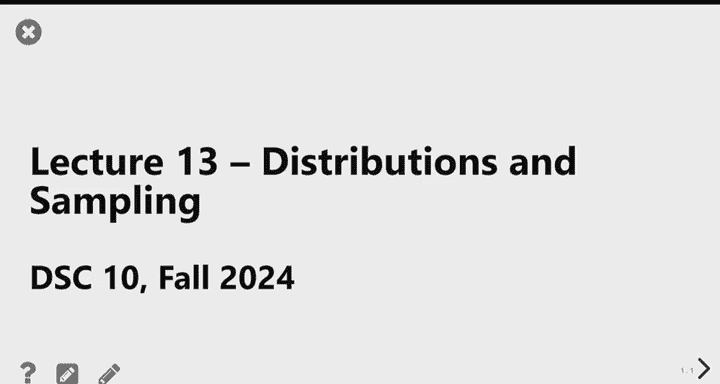

Okay， good morning。

Okay， here's our announcements， you submitted a lab last night hopefully if not there's still slip days。

 our next thing is homework do Sunday， midterm product is do the Sunday after that so the midterm takes the place of a homework。

 the next homework will be in two weeks。oops。Quz scores are released。

 so make an appointment if you want to go over how you did with a tutor。

 this time we're saying first scores less than a certain amount。

 make an appointment for scores over that amount， just come to office hours and you can ask because it just takes less time。

😊，I also made a post on Ed yesterday explaining the two questions that a lot of people got wrong。

 which were question one and question three， so if you got those wrong check it out。

 there's a pretty thorough explanation there。And then our midterm exam is coming up Wednesday of next week。

 so today I'm covering material that's not on the exam。

 the exam goes up through last class which was simulation so you have kind of like a week between your last thing covered on the exam and the exam itself today we'll cover new material but it is kind of still helpful and on Monday we'll do review so on Monday I'm going to go over some problems from a recent midterm exam which was winter 2024 so before you come try to read the data description so you're familiar with the context。

 try to work on some problems if you have a chance just to make the most out of the session。

All the exam details are in this Ed post， so I won't talk about it here。

 but everything's there that you need to know。Any questions？Okay。

 today we're kind of diving into the second half of the class。

 which is more about probability and statistics than the first half of the class。

 which is more about programming， and we've seen a little bit of how probability connects with programming in our simulation lecture last time today we're going to talk about different kinds of distributions。

 probability and empirical distributions and how that relates to sampling。😊。

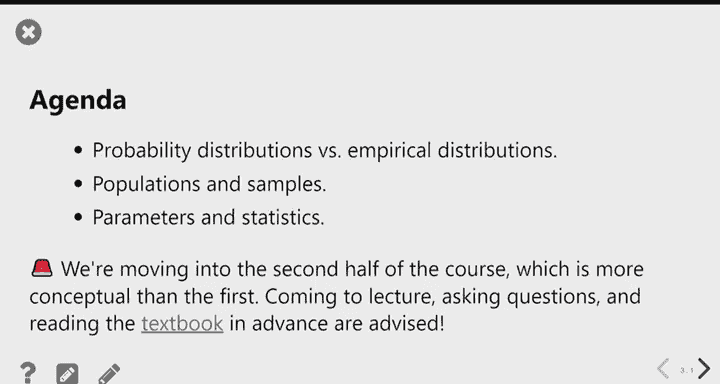

Okay， so。Probability distributions come up when you're working with some sort of random quantity that has various possible values and each of those values has some associated probability so this is a super general definition you could be talking about like rolling a die right the values are one through six and the probabilities of each of those is one6 right you could be talking about flipping the coin probability the values our heads and tails and the probability of each of them is one half right。

😊，The random quantity can also be like something like the number of heads you get in five coin flips。

Right， that's a number that's either zero，1，2，3，4 or5。

 but there's different probabilities associated with with different values Okay。

 so probability distribution。

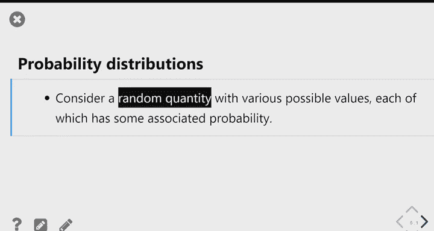

Is basically just a description of how can the value， like how can this value come out。

 what are the possibilities and how likely is each possibility Okay so for like flipping a single coin。

 the random quantity could be the number of heads you get that's either zero or one and probability of each is a half so if the all anar on the slide。

If the random quantity is。Number of heads in one coin flip。Then the distribution。

Probability distribution。Is you can just sort of express it in a little table like sorry。

 it wouldn't be heads， tails It would be。The different possible values of the quantity and the quantity is how many heads so the options would be0 or1 and the associated probability with each would be a half。

Makes sense。嗯。So probability distributions are based on sort of theory。

 like how many heads you're supposed to get like what's the probability of getting a head versus a tail。

 whereas like in practice if you actually flip the coin。

One time you would either get a hit like you would either get0 or one。

 It wouldn't be like a probability。 It would just be what you actually got。 Does that make sense。

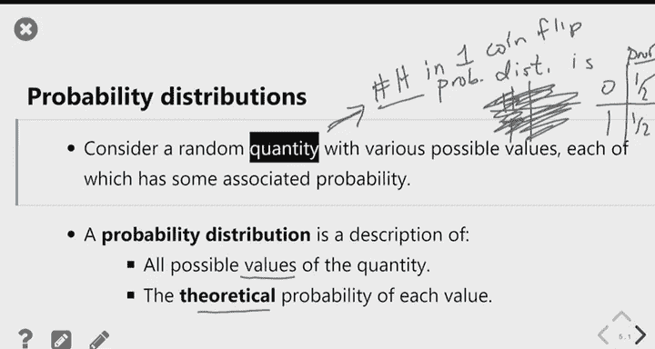

Okay， so let's go to the die example。

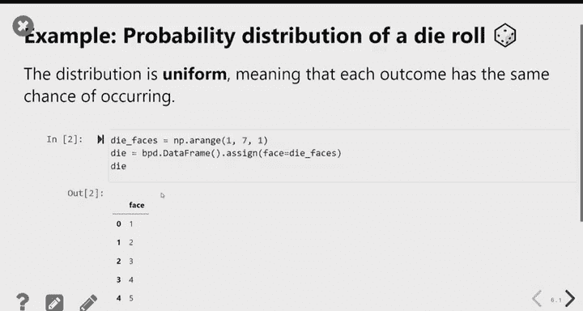

I'm having some code to record the different faces on a die are the numbers one through six notice I have to use NP。

A range， start at one， go until you get to seven， jump by one and that's optional and I'm just putting these values in a data frame。

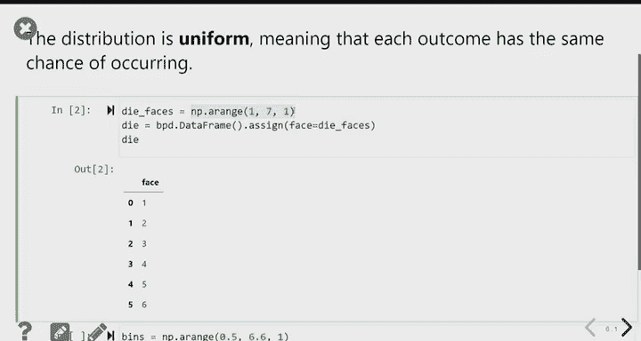

And。

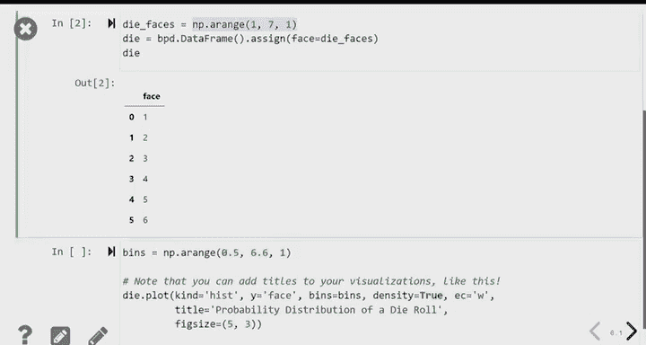

This picture shows what the probability distribution of a die roll looks like and what it's saying is that all these bars are equally wide and equally tall。

 They are all equal area So the probability of getting a one is the same as a probability of getting a two。

 which is the same as probability of getting a three right So if you were to make a little table for the probability distribution of a die roll。

It would look like this。You could get one， two， three， four， five， six， and each of them would。

Have a 16 chance。So this is like the value of the variable and this is the probability associated。

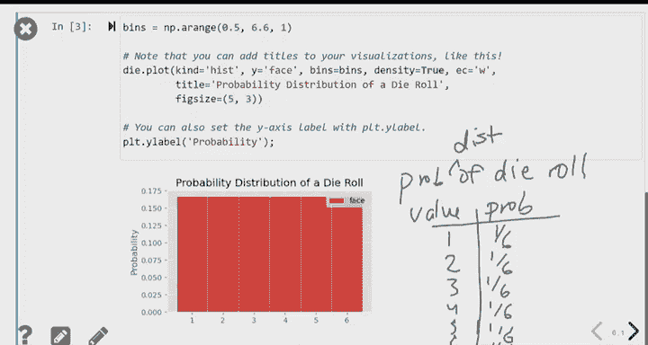

So the probability distribution of a di roll is called uniform。

 uniform means that all the outcomes have the same chance of occurring。

 the distribution looks like this。

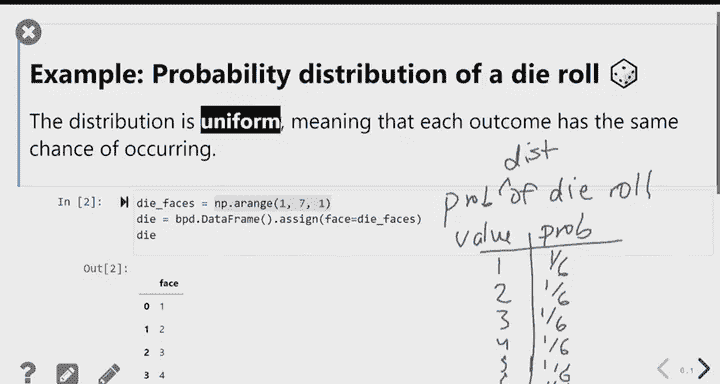

RightThere's some sort of possible values and there's a certain probability and anywhere in the possible values。

 it's the same probability and anywhere outside of there， the probability is0。 Okay。

 so I'm not writing those in the table， but it's true that the probability of getting a7 when you roll a die is zero。

 but since it's not a possible value I'm not going to include it in the distribution。

Does that make sense？

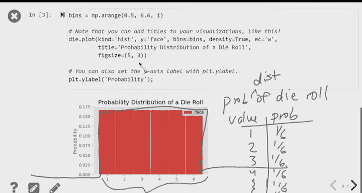

Okay so we understand what a probability distribution is。

 it's like what can happen and how likely it happens。

 There's a similar notion called an empirical distribution which the difference is empirical distributions are based on observations whereas probability distributions are based on theory okay the observations typically come from doing some experiment many times so maybe you for the coin flipping example maybe you flip your coin many times and you keep track of how many times you got ahead versus how many times you didn't get ahead and then the probability of each might not be exactly a half but it probably pretty close to a half。

😊。

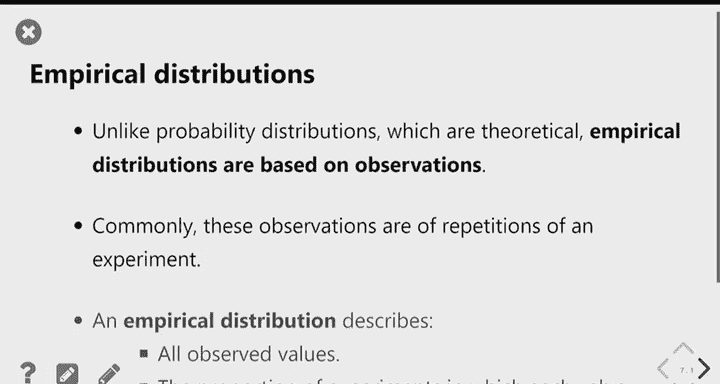

An empirical distribution describes all the observed values and the proportion of experiments in which you observed that value Okay。

 so for heads and tails， it might be like， you know。490 out of 1000 and 510 out of 10。

And that would be an empirical distribution empirical distributions are going to be a little different based on who does the experiment。

 and if you do it again， you'll get different values right。

 but the probability distribution is always the same because that's just based on math。😊。

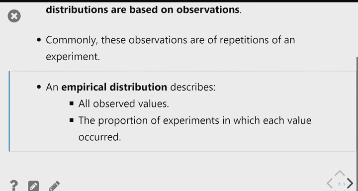

So probability distribution is like theory， empirical is like imprac。

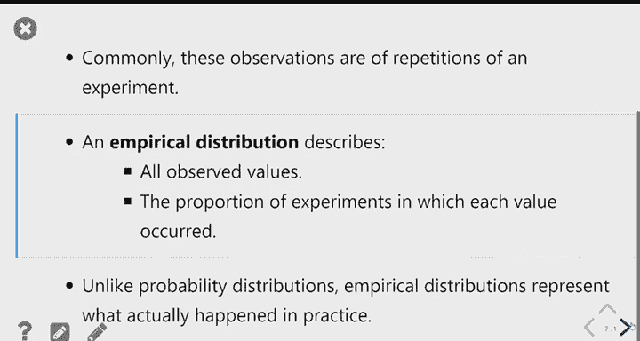

Okay， so let's do it for the di roll。

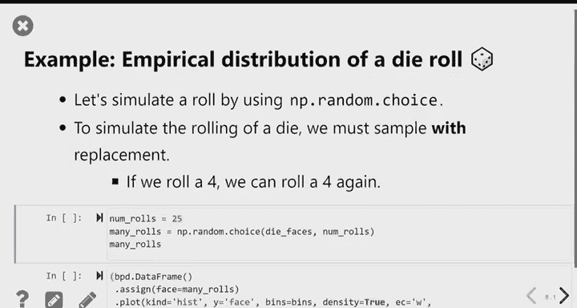

Simulate rolling a die。With NP。random。choice， okay， I'm going to do 25 rolls。

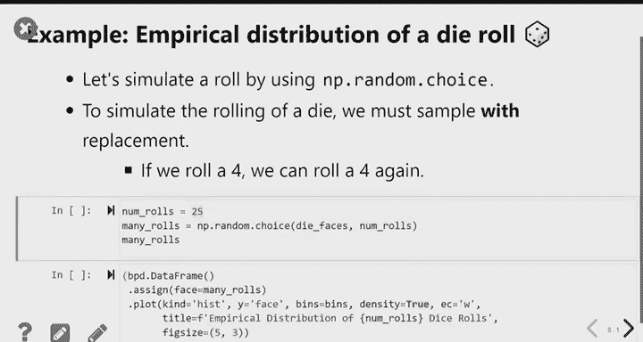

And every time I make a random choice I need to think about whether I want to do with replacement or without replacement。

 like based on what the problem represents， okay so here I'm talking about rolling a die。

 if you get a four， you can get a four again the next time right it's not like a situation where you're pulling out of a bag and once it's gone。

 it's gone。

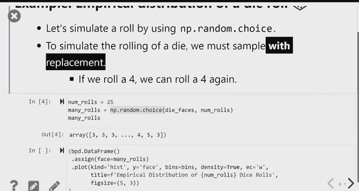

Okay， so that's why I'm not specifying anything about replace。

Because replace equals true is the default， but if I wanted to not replace， I would have to say that。

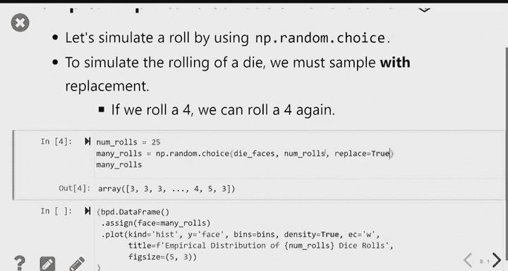

Okay， so you can tell from the output， I certainly get repetitions in here。

And let's look at the distribution。

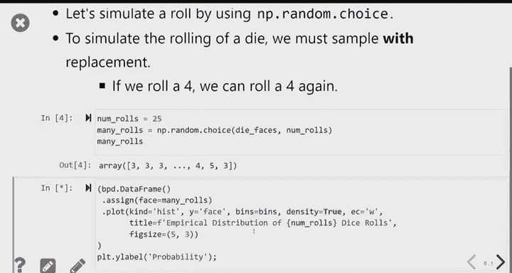

Of how many times I got each number。Wow， this might surprise you， it surprises me。

I never got any sixes and 25 roles， and I got a lot of fours。

So this really doesn't look very uniform。😊。

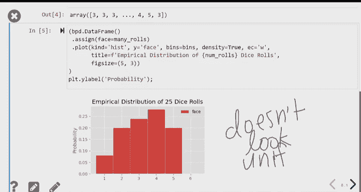

But what would happen if we increase the number of roles right intuitively you'd expect that if you did instead of 25 roles。

 100 roles or 1000 roles， right， you would expect that some really rare thing like never seeing any sixes would get like even harder to achieve like it's harder to get no sixes in 25 roles。

 but it's even harder to get no sixes in 100 roles right so。

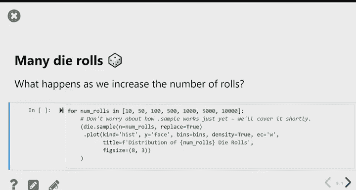

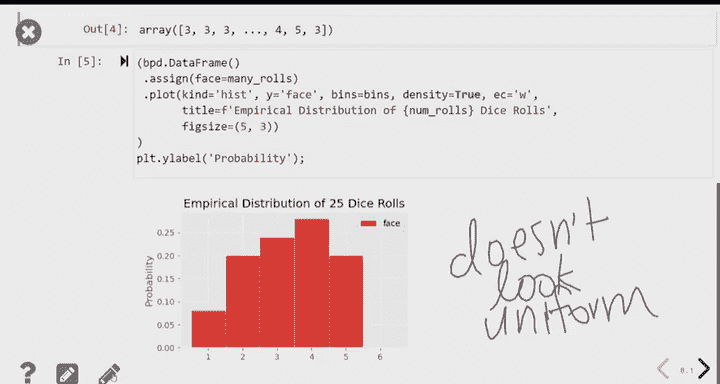

Make a prediction for what you think is going to happen。And I'll walk you through the code。

So the code says don't worry about what dot sample does。

 but basically it's basically rolling the die for you The part that I want to focus on is the for loop。

I'm rolling a specific number of dice， And this four loop tells me how many to roll。 So first。

 I'm rolling 10。And then I'm going to plot a histogram of those 10 rolls then I'm going to roll 50 and then plot another histogram of those 50 rolls and so on。

 so whatever is inside the for loop you can tell by indenting right whatever inside the for loop is going to get repeated for every value in this sequence here。

Okay， so I'm going to make one， two， three， four， five， six， seven。

 this cell is going to make seven histograms。

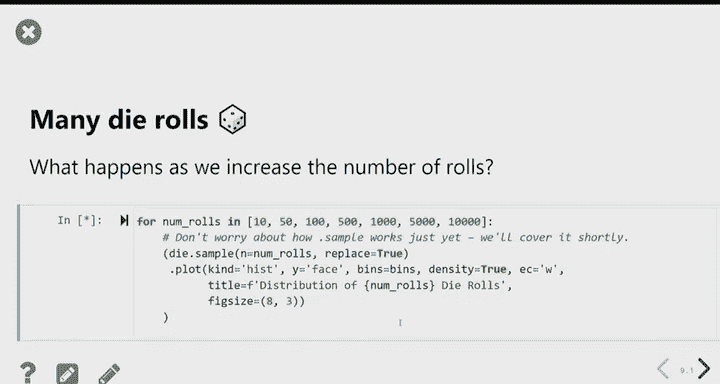

Here's the first one， 10 rolls。Some weird things happen， right， you can get no threes， for example。

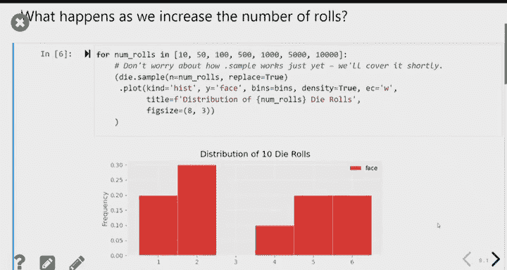

50 roles， I definitely have like less sixes than the others，s like significantly less。

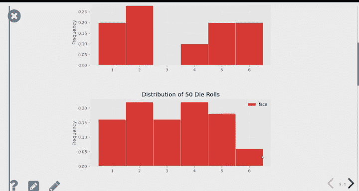

100 rolls。500 rolls。

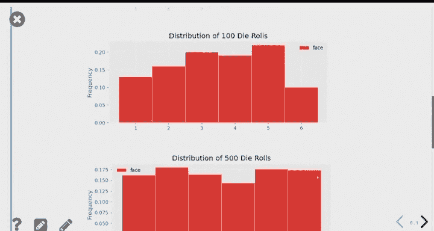

1000，5000，10000。 What do you generally notice as the number of roles increases。

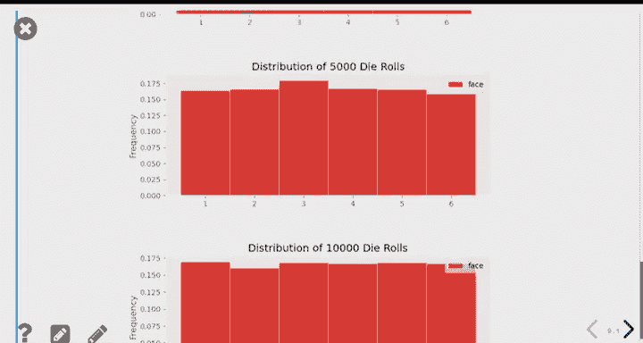

It's like more level， it's more flat， which makes sense right because of what I said like it's really hard to you know get a very small a very large number of something over many tries so the idea is that this is approaching the fully flat distribution。

😊，And the more roles you do， the closer you get to that uniform distribution。

 which is the probability distribution。

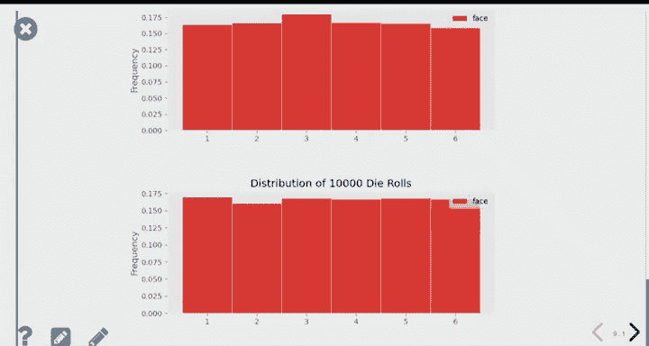

This is called the law of large numbers。And it has a very fancy name， and it's very formally stated。

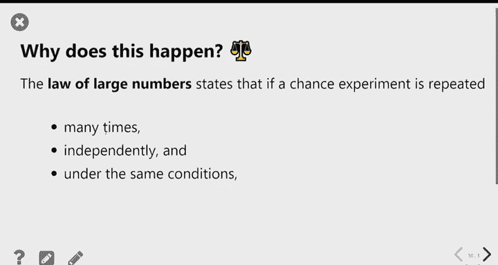

But it basically just says when you do some process over and over。

 the proportion of time something happens like approaches the probability that it happens。

 so like the experimental proportion gets closer and closer to the actual theoretical probability。

You have to do the process many times independently like what you get on this diol shouldn't affect what you get on the next one or whatever and under the same conditions。

 it's just the same you're doing the same thing over and over， it's all that's thing。

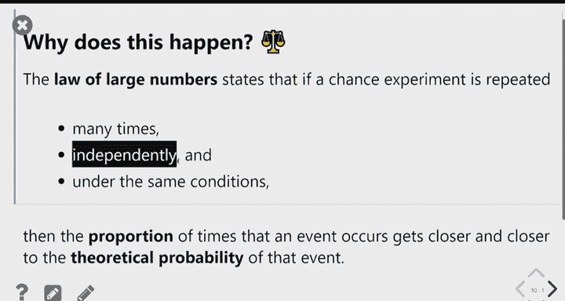

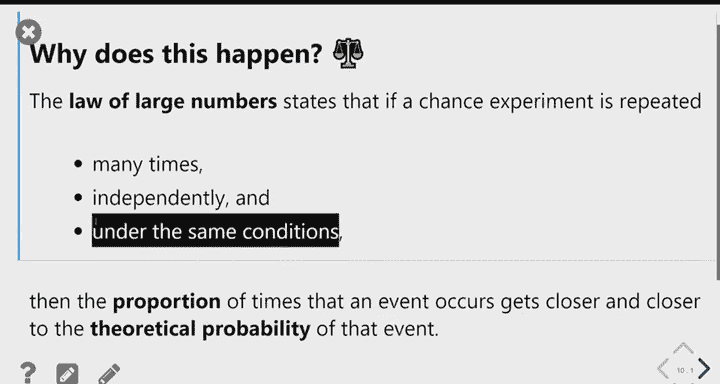

Okay， so for example， if you look at one particular bar in that histogram。

 the bar corresponding to five。

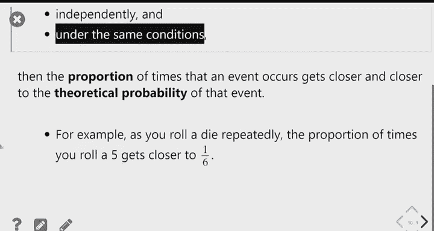

And you look at sort of the proportion of fives that you get。

 that proportion of fives is going to get closer and closer to16 with the more roles you do。

Does that make sense？And we've already been using this law of large numbers this is kind of the underpinning behind the simulation lecture of last time our whole philosophy with the simulation was like I don't want to actually calculate this probability I just want to do a bunch of trials and see how often does something occur and I'm going to say that that's close to the probability and this law of large numbers says that it's okay to do that because when you do do an experiment a lot of times。

 the proportion of something happening does approach the probability so it's like a reasonable way to make an estimate。

😊，Okay， any questions？

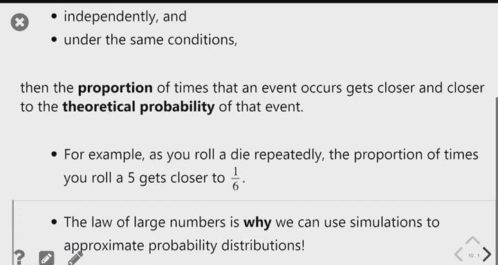

Okay， now we're going to see how this relates to something that we do a lot in data science。

 which is take samples。So when we talk about a population。

 we talk about like all the things that you would want to know about right a population could be a population of people could be a population of objects or events or dates or states or whatever think of some examples you've given in earlier lectures。

 we had like something about a data when we did categorical versus numerical variables right we had。

An example where each row represented a date and we were keeping track of like how many flu shots were administered on that date okay so the full population would be like every date every day that there ever was and will be and how many flu shots were given or will be given on those days right？

😊，Whereas， like。A complete group of people could be something for like voting。

 there's a lot of projections of like how is the election going to come out right。

 the population there is like all the voters and the idea is people try to make predictions of how like how the full population is going to vote based on doing surveys and sampling a smaller group of people。

It's nice if you can have access to the population， but typically you can， right。

 it's not feasible to like survey every American voter and ask them who they're going to vote for。

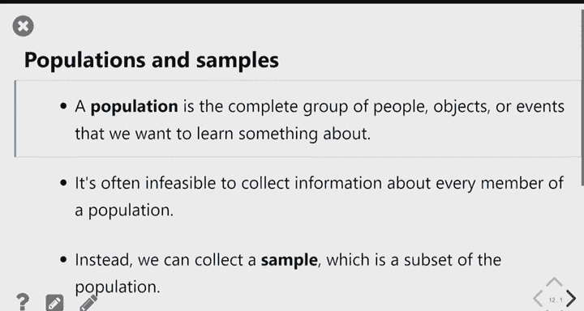

So the strategy when you don't have access to the whole population is you just access a sample。

 which is a subset of the population， and then you learn something about that sample。

 and you hope that what you learned about the sample also sort of generalizes to the bigger population。

😊。

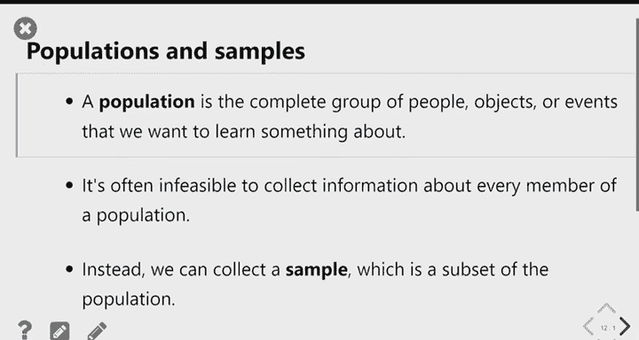

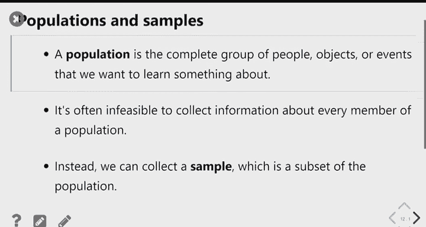

So our goal is to sort of understand something about the population based on a sample。

 so we'll focus on estimating a distribution of a numerical variable in the population based on a sample。

 So an example of a numerical variable is like height。

So maybe we want to know the height of every single UCSD student。

But it's too hard to actually like go measure or ask every student how tall they are that's the population distribution is what we'd like to know。

 but instead you can like randomly you know ask 100 students or whatever how tall they are and then you have some sense of the distribution of heights of students it's just not everyone so you have a sample distribution which would come from the heights of the people in your sample so the goal is use the sample distribution to understand the population distribution。

😊，Sample distribution is sort of the known one。And population distribution is the unknown one。

And our goal is for the sample distribution。To closely resemble the population distribution。

For example， if you you know take your sample of people's heights by going to a men's basketball practice and asking all the players how tall they are。

 right， you're not going to get like a good sense of how tall UCSD students are because men's basketball players are generally very tall okay whereas if you like。

 I don't know， go to like a gen ed course and just like ask everyone in that course how tall they are that's like a better way to get a sample。

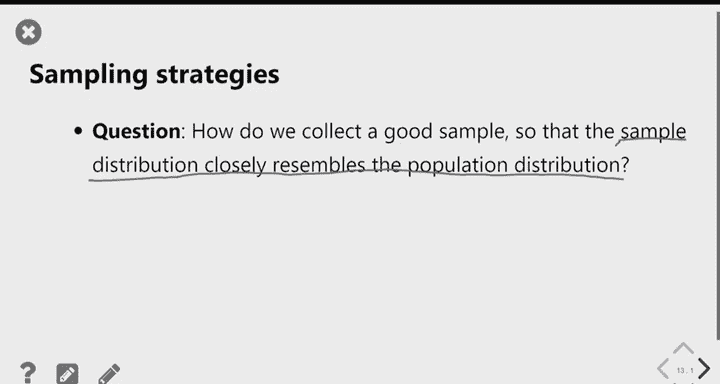

So the strategy of how you sample really matters in terms of like how good your results are and how well they generalize a bad strategy is just like sampling whoever is easy to sample right like maybe you're on the basketball team so those are your friends so it's easy to sample。

You see a lot of bad sampling all the time really because it's easy to do like people who like stand on library walk and try to like collect information from you and stuff like they're not necessarily。

Getting a representative sample， they're just getting the people who are willing to talk to them。

 right， These are called convenient samples because they're convenient。

 but they're not the best kind of sample because they often have some sort of bias like I was saying with the basketball players right in general。

 anything where it's like。嗯。Like you send like an email campaign， for example。

 a lot of people just are going to ignore it and like the only responses you're going to get are from like the people who care right and that's a very hard obstacle to overcome because get how do you get data from people who don't care so it's not easy to get a good sample。

The ideal way to do it is to select people at random， but that's hard because as I said。

 they still have to be willing participants。

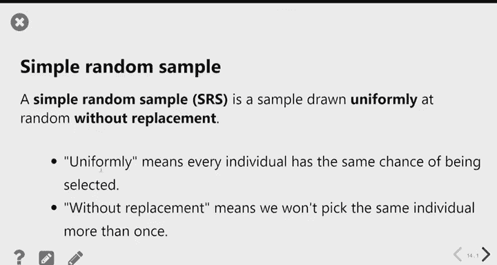

So sort of the gold standard of sampling is called a simple random sample and it's when you draw the people uniformly at random without replacement from the population okay so that's a very like sort of formal way of saying it。

 but what it's saying is that you just randomly pick people such that everybody is equally likely right for example you I don't know。

 get a list of everybody's PID and you mix it all up when you take the first0 people in your random ordering right that's one way to do it。

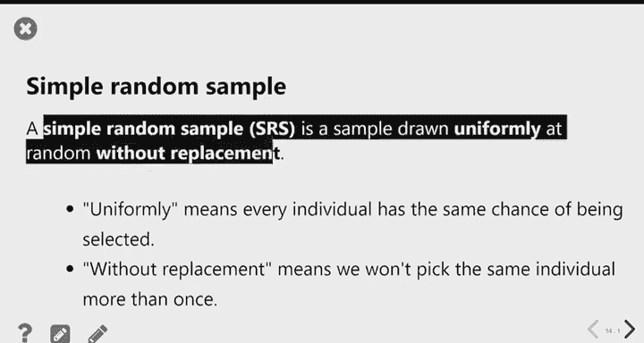

The， the practical considerations of that is like， well。

 what if those people don't want to do it or what if they never respond to you， right。

 then you're not really getting a random cross section。

 So the the goal is to get like a random cross section of the population And the way you would do that would be randomly selecting from the population。

 Okay， some words here。

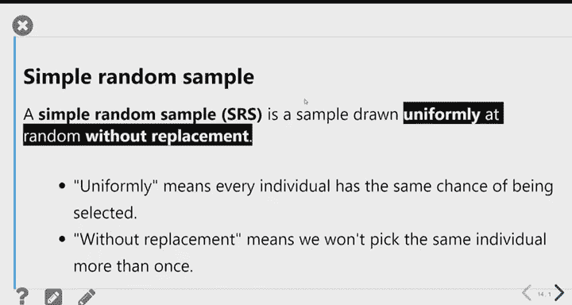

Uniformly。Means everyone in the population is equally likely to be chosen。

It's like a fully fair drawing。And without replacement。

Means if you're going to survey 100 people and ask how tall they are。

 you're not going to ask the same person twice。

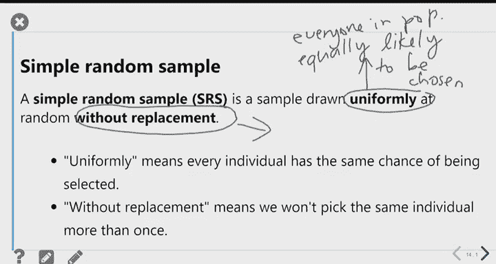

You want 100 different people。Okay， so there's a way to do this in code。

 And we already know this using N dot random dot choice。 Okay。

 so say you wanted a random sample of three colleges。 Okay， a simple random sample the。

The term SRS specifically means these two things， uniform and without replacement， Okay。

 so if they ask you for a simple random sample， that's enough information to know whether I should do replacement or not。

 it means you shouldn't。嗯。So this is just saying pick three of the colleges at random without replacement。

 that's a simple random sample。

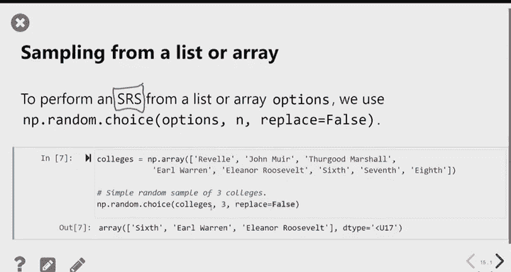

If you were to use replace equals true。Sample uniformly at random so everyone's still equally likely to be chosen each time。

 but you allow yourself to get the same thing again。

 there's not like an abbreviation for that simple random sample is the abbreviation for uniformly without replacement。

 but uniformly with replacement doesn't really have a name。So notice I'm allowing replacement。

 but I'm still happening to get distinct values。嗯。But it's just not guaranteed that they'll be distinct when I say with replacement。

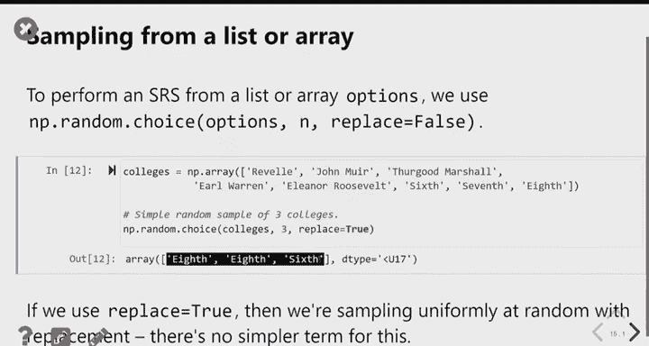

Okay， let's look at this data set and。Learn a little more about populations and samples from it。

So this is a data set that got all the information about flights leaving a specific airport。

 San Francisco Air。On a specific airline United Airlines between two specific dates。

 this was basically summer of 2015。 Okay， so we have like one summer's worth of data。

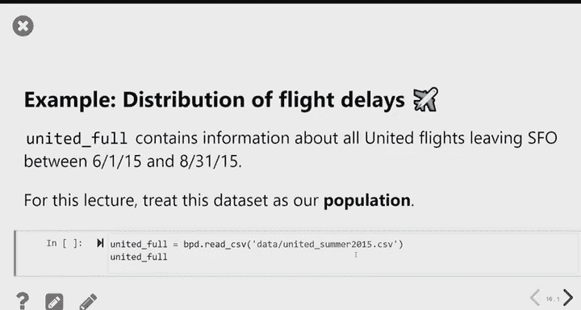

And we'll treat it as a population because it is every single flight that meets the criteria of this airline at this airport between these dates。

I was flabbergasted by the number of such flights right there's like 13，000 flights， almost 14。

000 flights just from one airline in one airport， like if you think of how many flights there are going out every day。

 that's a huge number。But this data set tells me the date of the flight， the number of the flight。

 where the flight was going， they all had the same。They all had the same starting origin。

 San Francisco。And the delay time， so this is the interesting column。

 how late was this flight in minutes？So this first light in the data set。60 minutes in an hour。

 so this was like four hours and changed late。Very late， this was 28 minutes late。

 notice it can be negative。So it can be three minutes early， they sometimes let planes leave early。

 but only a little bit like you can be four hours late， but they won't let you be four hours early。

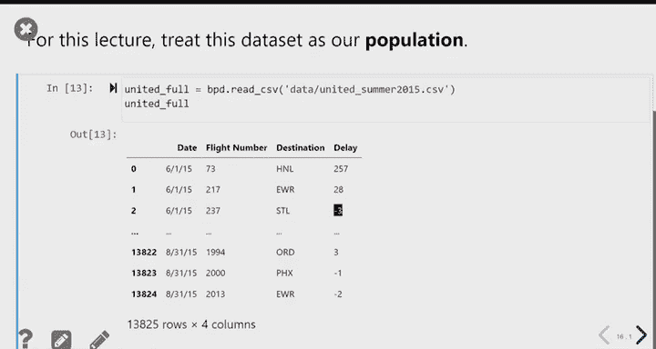

So an interesting question is like how delayed our flights typically。

 like what's the distribution of the delay column？

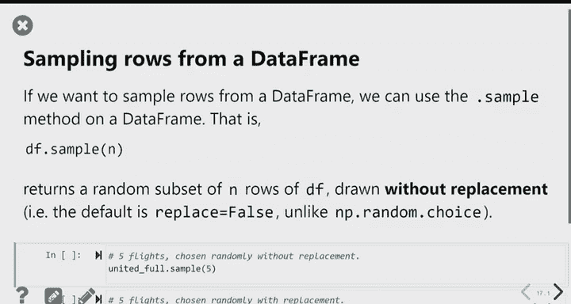

Now， for now， we have like all the delays of all the flights。

But in practice， you might not have all the information in your population。

 so what we're going to do is sort of look at samples from this population and try to learn about the population just from looking at a sample because that's more like a real life scenario。

Okay， so how do you sample rows from a data frame？There's a method for that。

So the data frame method that does this is dot sample， it's very straightforward。

 you just give it a number， and it gives you that many rows。

And the default behavior is to give a simple random sample。

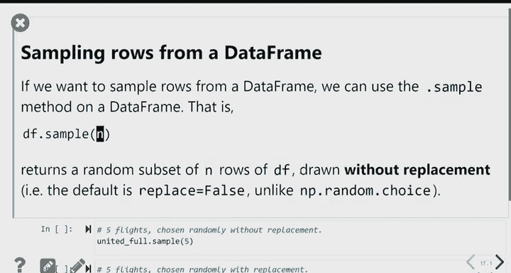

It's giving it without replacement。

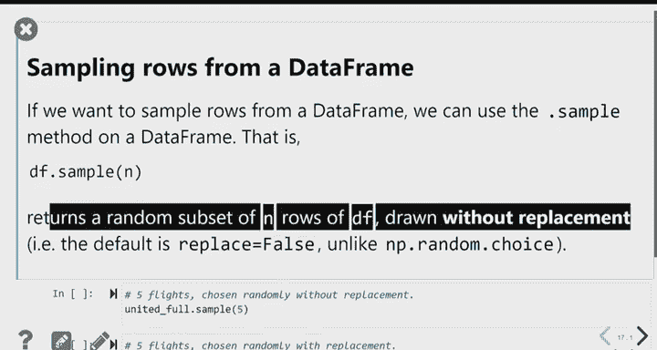

Okay， so this is just like， give me five flights only。 that's all it says。 just want five flights。

 a sample of five flights。And they won't be the same flights。If I wanted them to be the same。

 possibly to allow that option， there's the same sort of optional parameter replace。

 you can set it to true or false。

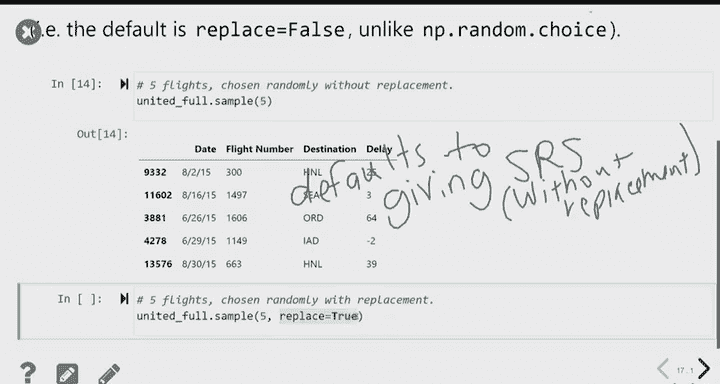

And I can set it replace equals true notice I'm still not going to have a repeat most likely because there's like 13。

000 slights and I'm only picking five right so even if I allow myself to like put something back in the pool before I choose my second choice。

 most likely I'm not going to pick the same thing I picked the first time。

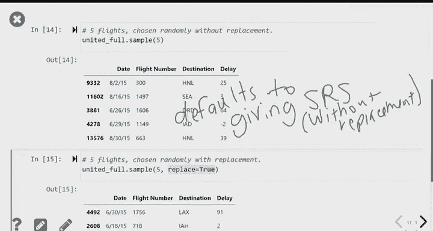

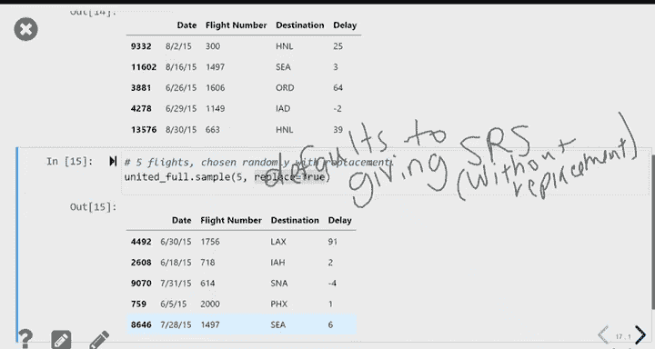

Okay， something that is a little。Tricky about this。

Is that。The default behavior is opposite。Of NP。random。choice so NP。random。

choice was the function we use to choose one thing from a sequence like heads or tails。

 pick one thing or pick 10 things the default behavior there is it replaces like so you can easily like flip 10 coins at once the default behavior here is it doesn't replace because for a sample you typically want a simple random sample which doesn't have replacement。

Okay， but you can get both of them， to do the opposite by changing the defaults。

But the defaults just don't align。Okay， how does the sample size come into play。

 So we learned from the law of large numbers that when you do something over and over。

Your empirical distribution is going to look more like a probability distribution。

And there's an analog between sampling like distributions of samples versus distributions of populations。

And the idea is that if you take a large， simple random sample。

Then the sample distribution is likely to be a good approximation of the actual population distribution。

Okay， so we talked about how。You have an empirical distribution。

And it sort of approaches the true probability distribution。As you do more experiments， right？

And what we're saying here is that if you have a sample distribution。Right。

 like think of the heights， how tall are you know， these 00 UCSD students that's going to start looking more like the actual。

嗯。Population distribution。Of how tall are all UCSD students。

 that's going to look more and more like the full population distribution。 if you。

 if you take bigger and bigger samples， like instead of 100 students， if you've got 1000 students。

 that would be even more accurate， right，10000 students will be even better。

 right So the sample distribution approaches the population distribution。As the sample size grows。

Okay。And this is all four。Simple random samples。It's not necessarily the case that if you take bigger samples of sort of。

Of bad practice， that they're going to approximate the population distribution。 For example。

 you start with a men's basketball team， right。Then you need more people and you go to the woman's basketball team or the volleyball team or something like that。

 like even though those samples are bigger， they're still not going to necessarily be any better right so bigger is only better when you're taking the samples in a good way。

Does that make sense？Okay， let's try to apply this to the flight delays。

I'm not really going to look at the details of like where the flight was going or what day it was。

 I just really care about these numbers， the delay column。

 so I'm using get with a list to keep only that column that makes sure the result is a data frame。

And I'm plotting a histogram of these numbers。

And you should be familiar with most of the code here。

 Sometimes we'll add like a little fancy fancyiness to the plots to make them sort of display nicer like this puts。

Puts a label on the Y axis as we move towards the second half of the class。

 the code itself is not really the important part。 right how to make a histogram。

 you already know the details of like what I put on the labels and whatever。

 That's not like what you're supposed to be getting out of the lecture。

 right the goal of the lecture is to understand the pictures generated and the theory of it。 Okay。

 so I'm not gonna spend as much time on the code like moving forward as we have in the past because the code isn't the point anymore。

 the point is like the。The theorems and the and the results。 Okay， so in this case。

What do we learn from looking at this picture， right。

 We learned that many flights leave just around when they're supposed to。

 slightly early would be this tallest bar。 You know， how wide are these bins， They're 10 wide。

 So this。Been here represents。Being zero up to 10 minutes late。That's also very common。

 I would say like these two bars together， these first two bars definitely take up more than half the data。

 maybe three quarters of the data， three quarters of flights leave roughly on time。

But then there's this very， like。Long drawn out tail， we call it。On the right side。

Which is saying that like although it's rare， there are flights that are very delayed。I don't know。

 exactly， it's hard to see you can't really see any redness here。

 but you remember the first flight in our data set。

Was like four hours late。 So there is something。

At least something over here， that's like 257 minutes late， it's just so small。

 why can't I see any redness there， whereas in other histograms？I have been able to see redness。

When there's something there。Yeah， so it has to do with the total number of things represented。

 right This is I'm representing like almost 14000 flights。 So one out of 14000。

Is like the tiniest little amount of area。 That's why I can't see it。 If I only had。

 you know 10 flights and I was plotting 10 flights and one of them was four hours late。

 I would see a significant redness there okay。

That's basically why。Okay， so when we look at this population distribution。

 this is a fixed distribution， fixed means it's not random， nothing's changing。

 it's always this right because I have the full population。

 this is just how long flights took to get on their way that summer。

Now we're going to look at what if you only had a sample right in this example we had the population。

 but in real life you generally don't have the population and so you look at a sample there's no purpose in sampling when you have a population the only purpose in sampling is I want to learn about a population that I don't have right if you already have the population there's no need to sample and just look at half of it just look at all of it because you have it right so the real world scenario is you don't have access to the population and you just have a sample。

So what I'm doing here is I'm going to。Take a sample of a given size and then show you the flight delays in the sample themselves。

Okay， so here's 100 flights。And this illustrates what I was saying about the redness。

 right There's 100 flights and kind of like we saw in the population。

 right most of them leave around on time。but I have a couple here， like 170， 180 minutes。嗯。

And there's like a little bit of ups and downs and like gaps and stuff in here。

So it looks similar to the population distribution， but not exactly the same。

 and that's because it's only 100 flights and the population was almost 14，000。

the main point of this lecture is that as we take bigger and bigger samples。

 this is going to look more and more like this distribution， okay， just like the dye rolling。

 when I roll the dye more and more， the empirical distribution starts to flatten out and look like the probability distribution。

😊。

So there's like for empirical versus probability， it's like there's some sort of underlying like right answer and you get there。

 you get closer to it by doing more experiments Similarlyly here for sample and population。

 the underlying like right answer is the actual population distribution。😊。

And our approximation of that comes from samples， bigger samples。Get us closer to that right answer。

Okay， so change the sample size and see what happens， let me make it small。

Only 10 looks pretty different than our population distribution。

I had 100 before， this is another 10， let me make it 1000。

That looks pretty close， right？To this。It's pretty good。 How about like 10，000。

That's nearly indistinguishable from the population distribution。

Right。So kind of the more data you get in a sample， the better off you are， this is very natural。

 right， like you want to learn about something， you collect as much information as you can and like the more information you have。

 the better your sense about that thing。😊。

Does that make sense。Okay， so let me introduce a little terminology。

What we're doing here is called statistical inference。

 It's like making conclusions about a population based on data in a random sample。

 the process of making the conclusions is inferring。

We're often going to look at values called parameters。

 which are some number that you associate with the population we've used the word parameter before when we talked about functions。

 this is a different notion of a parameter， parameter like some number that's associated with the population。

 a standard one is the mean of the population。

Right， so if I looked at。All the flight delays in the whole population。

 and I took the mean of like this entire column of 14，000 numbers， that would be a parameter。

And just like the population and just like this histogram。

 it's fixed right Pers are just just a number， right There's nothing random about it。

 if I give you these 14000 flights and I ask you each to calculate the mean you're all going to get the same answer whereas if you calculate something based on a sample。

 then you're all going to get different answers。 if I give you the same 14000 flights and say randomly pick 10 of them。

 calculate the mean of the0， well then you're going to get a little different based on what ones you happen to get in your sample。

But the idea of this law of large numbers is as you take bigger samples。

 your sample starts looking more like the population and the things you calculate from your sample look more like the corresponding things you would calculate from the population。

😊，So what we're going to be doing is using， say， the mean of a sample as an estimate for the mean of a population。

think of the UCSD student Heights example， right you want to know what's the average height of students on campus。

 you survey 100 people， you find their average height。

 and that's a decent guess for the average height of everyone overall。

A little mnemonic is parameter in population， start with the same letter， statistic and sample。

Something else to point out about statistic， there's no S on the end。

 like statistics is like the study of this stuff， a single statistic is a number that you calculate。

Alright， let's try it with the flight delays。So our question is a question about the population。

 what was the average delay of all the flights that summer？Okay。

 if we had access to the whole population， you could just answer this question。

 and you could kind of think of what we've been doing in the first half of this class was kind of like we just gave you all the data and we ask you a question about it right like the content would be like here's here's all the flights find the mean of the delays and you would have to like get out the appropriate column and do dot mean right But now we're saying I'm not giving you all the flights。

 I'm only giving you some of the flights So the question is like how does the mean delay in your sample。

 the statistic that you calculate compared to the mean delay in the population right。

 the best you can do if you have a sample is to get a statistic and hopefully with a big enough sample it'll be close to to the parameter that you're trying to get So in this case。

 the statistic based on the sample is the average delay in our sample。

 the parameter based on the population is the average delay in the population。

Okay， now this is cheating what I'm about to do， I'm going to calculate the parameter。

This is cheating because in real life， you won't have this。All right。

 I'm only showing it to you here because this is a teaching demonstration and I want to kind of convince you that the sample statistic is going to be close to this。

Okay， so what this says is that the average delay in the population was about。

 we'll call that 17 minutes。

But。

This is the real life scenario。 You wouldn't have all all the flights。 You'd only have， say。

 a sample of 100 flights。

And if you took the average。Delay time of those1 hundred0 flights， you wouldn't get。

 you know the same exact 17 minute amount。 you would get a different amount based on which hundred flights you got right So because the statistic is calculated based on a sample and a sample is random。

 This number， the statistic that I'm calculating is random right， sometimes it comes out 10。

 sometimes it comes out 20 right， there's a variety of possibilities。

So every time I run the cell， I'm picking a new hundred flights。

 computing the mean of those hundred flights and displaying it right and so I'm seeing different answers。

 some of them come out close to the actual true answer of 17 minutes。

But sometimes they're far， like I saw something that was only 10 minutes。

Okay。Now， what if I was to choose a larger sample size。

 What do you think is going to happen if instead of looking at 100 flights。

 I look at thousands flights。 What's intuitively， what do you expect。

It's probably going to be closer to the 17 minute right answer， exactly。Oh wow， that's pretty close。

Let me try it again。16，14，15，16，14。 Okay， so they're all kind of in the the mid teens。

 like I'm not seeing any1s， I'm not seeing any 21s。

Right。The results are still random and they're still going to be different every time you run it。

 but the results are generally better as in generally closer to the thing you're trying to estimate。

 and that's because a sample of size 1000 is generally more representative of your population than a sample of a size 100。

 the more information you have， the better。嗯。Statistics that you compute on larger samples are just better estimates of parameters than statistics you compute on smaller samples。

 So this is a visualization of that。In this picture。

 think of the parameter as like the red bull'seye。And think of the sample statistics as the x's。

 right When you have a small sample， sometimes you get very close to the parameter with your estimate。

But sometimes you don't you can be sort of too big， too small， really。

 it's like a one dimensional thing。 you're thinking of like a number line。

 This is shown in like a 3D or 2D， I guess， version。

But for small samples， right， you can be close， but you can be far。

For big samples， you're generally close is what this is saying。 Okay you can be far as well。

 but you're typically closer than for small samples。Does that make sense？

Okay， so something we'll look at next is how the sample mean changes。

So I just had a cell。Where was it like this that I was like running multiple times？

And like looking at the values I got。Instead of just running it multiple times and discarding the answer。

 what do you think I'm going to do to sort of keep track of all of these。What。Put on more。

A data frame， not really a data frame because they're just one set of numbers， an array or something。

 right， typically like this is when we use a for loop and like a pen to it or something to keep track of all our results。

Okay。And we're going to look like do that many times and sort of keep track of how this sample statistic came out and then I'm going to look at like it's a distribution and I'm going to see like when I take say 100 flights and average their delay times does it typically come out as 15 does it typically come out as 12。

 like how likely is it to be each of those values？Right， this is the。The probability distribution。

Of that statistic， of the sample mean， I'm interested in like learning how often it takes on different values。

Probability distributions， though， are very hard to calculate because they depend on theory and math when we don't have probability distributions instead。

We use simulation when we do an empirical distribution。

And that's what I would do if I were to run that cell many times， right。

 I would just be computing lots of sample means and seeing how they come out。

 Okay so the empirical distribution of a statistic is based on doing lots of simulations to generate many values of that statistic storing all those values in an array right and then keeping track of how did this number come out and how frequently in terms of proportion。

 how frequently did this happen right if you take， you know。😊。

Let's say 500。Different samples of of 1000 flights。U。You'll have 500 values of the statistic。

 500 different sample means， and you can calculate a proportion out of 500 for each of those values。

And as we saw with the law of large numbers， as long as you do lots of simulations， right。

 then this empirical distribution will look like the probability distribution。

Okay so we're going to actually do it now， we're going to draw many samples。

 record the mean of each one， and draw a histogram。

Okay。

Okay so this is a little like sort of video what this is saying is that I just drew one sample。

 forget how big my sample was a thousand flights， okay I just drew 1 thousand flights and calculated the average of those thousand flights and it turned out to be like 16 point something so I put a little mark in the 16 bin。

哎。Then I did other samples of  a thousand0 flights and calculated their average delay。

 and every time I got a new number， I added it to this histogram。Okay， so this histogram is like。

Gradually。Building itself up as I do more and more experiments。

And the final result is like the thing I'm interested in。 The final result tells me。

 how often does the sample mean come out a certain way。

 So like when I run that cell of sampling 1000 flights and calculating the mean。

 I could have gotten an answer， like 20。But it's very， very rare， right。

 I almost all the time get an answer like 16 or 17 or 15。

Okay。So the purpose of doing this is that in practice。

 you're only going to ever have one sample and that one sample leads you to one statistic。

And sometimes that's going to be like good that your sample was good and it represents your population。

 so your statistic represents your parameter， other times you won't be so lucky。

 you won't have a great sample， your statistic won't be so close to what you were trying to estimate。

😊，The looking at the empirical distribution of the sample mean helps you understand like what would this have。

 how could this have come out differently if I had had a different sample？

So。Here is the main chunk of code。嗯。Let me show you what I'm doing。

I have a loop that goes repetitions many times， 2，000 times。Okay， what am I doing each time？

I'm picking a sample of sample size many flights， a thousand0 flights。

Calculating the average delay and appending it to my array。Okay。

 so I'm basically doing the process that I showed you in that video where I just take a thousand flights。

 average their time and record it。

And then I'm going to draw the histogram that you get。Okay。And here's that histogram。

There's a few things you might notice about it。 One is it's very symmetric and nicely shaped。

Another one is it's symmetric around the population mean。

That actually makes perfect sense because if youre to get 1 thousand0 flights。

 like sometimes it's going to be an average that's too high。

 sometimes it's going to be an average that's too low。

But it's not like more likely to be high or more likely to be low。

 it's kind of centered symmetric around that the right answer。

Let's look at。How the sample size changes things。I'm going to change this。

 Try to predict how the picture is going to change。I'm still doing my experiment 2000 times。

 but the experiment now is instead of choosing 100 flights， I'm only going to choose 100 flights。

This is the concept check question。

Yes。How is the histogram going to change。I used to have  a00 flights， now I'm doing 100 flights。

Okay， here I've changed it to 100， I'm going to run the code again。

And we'll see the answer。Super wide。Why does this happen？Sort of intuitive explanation。Yeah。

 you want to try no。Yeah。I would say because。If you only have 100 flights， you might get weird。

 fluy things like they're all very delayed or they're all or they're all very early， right。

 like a lot more craziness can happen， and it can be misrepresentative of the population when you have a small sample。

Okay，So think about this as the same as like the bullseye picture。 It is the same。

 It's just a different representation of it。Okay， we'll stop there， see you guys next time。

