# UCSD《数据科学原理 (DSC 10 Principles of Data Science Fall 2024)》中英字幕（deepseek - P14：DSC 10 - Principles of Data Science - LE -A00- - Lecture 14.zh_en - GPT中英字幕课程资源 - BV1hmAneGEZh

All right， good morning everyone。All right let's get started。

 here's our announcements today's Monday so there's discussion the big thing is the midterm exam on Wednesday check out the Ed post to see everything you need to know and ask any questions there but it's all three lecture time so come to the one year officially enrolled in you'll get a seating assignment tomorrow and then finally the midterm project is due on Sunday so I've seen from Ed that people are working on it which is good keep working on it around your midterm studying and that's due Sunday。

😊，Okay， so today we're going to focus on one particular recent midterm exam。 We're doing winter 2024。

 We are going to kind of try to take the exam as if you would during during the exam itself。

 So I'm not going to run code。 I'm just going sort of。

problemblem solve like more like a math class or something。

 So I'll do the same thing I did for the probability lecture。 I'll annotate the slides。

 and I'll post them afterwards。Okay， so。The exam is up on the practice site。

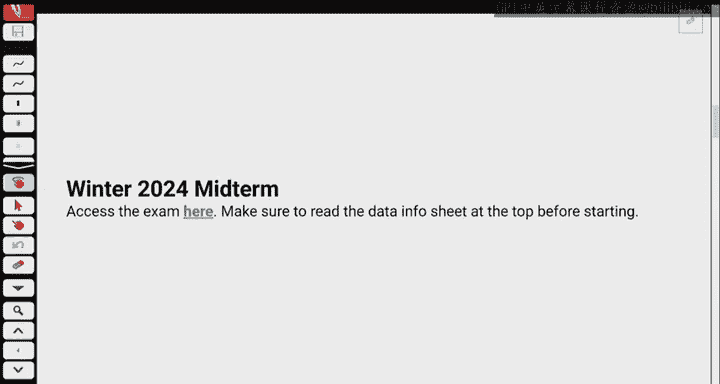

The first thing to look at is the data info sheet。

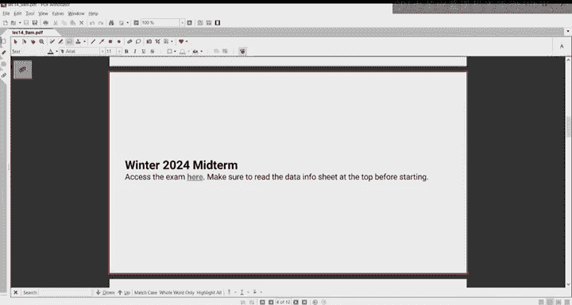

Which describes sort of what the exam is about。This is about the board game clue。

 has anyone played that game？😊，Let me try to。て。Okay。

 so here's the information that you need to know and general advice is read the data info sheet very carefully because that has like all the details that you need to know for the exam。

 Okay so clue is a murder mystery game it's a board game where the players use process of elimination to figure out details of a crime The premise is that a murder was committed inside a large home by one of six suspects with one of seven weapons in one of nine rooms and your job is to kind of figure out which suspect did it with what weapon and in what room so there's 22 cards because6 plus7 plus9 is 22 So there's a card for each of those things and the way you determine who did it is you pull one randomly from each category。

 So one suspect card one weapon card and one room card to get sort of away in an envelope and whatevers in the envelope represents the details of the murder who did it with what weapon and in what room Okay so three cards are put。

😊，way that means there's 19 cards left those cards are shuffled and dealt out to the players and then players look at their hand of cards and they see that the cards in their hand could not be the cards in the envelope right so the cards in the envelope is who did the murder and the weapon and all that and the cards they have is who didn't okay so it's a process of elimination game and gradually they sort of get to see other players cards and learn who didn't do it until they have enough information to conclude who did do it okay they get opportunities to see the other players' hands and further eliminate suspects weapons in rooms the first player to narrow it down to one suspect with one weapon in one room they make the accusation and win the game。

Okay， so。That's the setup of the game and now the actual data that we have is about a particular instance of this game so Janine。

 Henry and Page are the players in this game was inspired by a real clue game that I actually played Janine and Page are each Dt six cards and Henry is Dt 7 This adds up to 19 because there's 19 cards to get distributed among the players Something that's interesting is that 19 is prime right so it's never fair really like not everyone gets the same information Henrys my son so we gave him the benefit of being younger than us。

😊，The data frame clue has 22 rows， one for each card in the game。

 and it represents my knowledge of who's holding each card， okay。A lot of things at the beginning。

 I don't know。Like who's holding the card if anyone or if it's in the envelope。

 so one of the options for cardholderer is unknown。And。

The other options are the the names of the players in the game。 Okay， category contains suspect。

 weapon or room。And cardholderer contains Janine and Henry Page are unknown。

 and they also tell you it's indexed by card okay the cards are unique。

 there' some of them are people's name， some of them are room。

 some of them are weapons and since my knowledge is changing throughout the game。

 the card holder column needs to be updated frequently right like at the beginning of the game all I know is the cards in my own hand I'm going have some Janines in the last column and everything else is unknown to me and kind of as I play the game。

 I gradually replace unknowns with other things。 so we'll assume throughout the exam that clue contains my current knowledge at an arbitrary point in time。

 not necessarily the beginning of the game So it may look like this that may look like is important because I can't answer any questions assuming that this is the exact data frame okay。

A lot of times on the exams they show you like the first few rows or something right like in that case。

 you know those rows actually exist in the data here this is even more hypothetical。

 it's like it may look something like this。😊，And then throughout the exam we've already run import baby pandas as BPPD and import N as NP。

 so you don't have to worry about importing things that's already done for you okay。

 and the practice site has all the problems and solutions。

 but today I'm just going to go over ones that I thought were good practice。

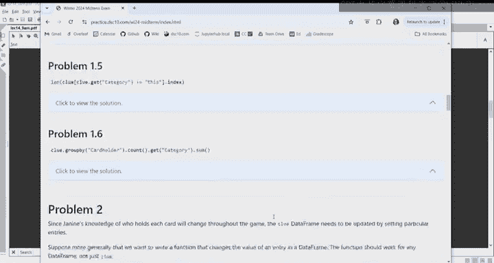

Any questions on the setup？

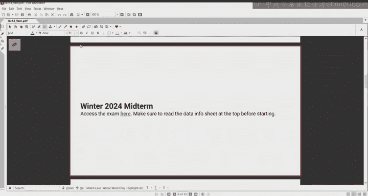

Okay。So 22 cards in three categories， envelope has one card of each category and they're dealt out so that me and Pageig have six and Henry has seven。

Okay。Each of the following expressions evaluates to an integer。

 determine the value of that integer if possible or circle not enough information。Okay。

 so try to interpret like what each thing is saying， I'm looking in the card holder column。

For the exact string， Janine。What is this part that I've circled evaluate to？Like。

 what data type is it。It's a series of Booleance， right， It's a bunch of truths and falses， right。

 And what happens when you sum a bunch of truths and falses。You get the number of truths。Right。

Which is the number of rows in which cardholderer equals Janine， basically。Now。

 going back to sort of。Understanding what the data frame represents and using this information。

 how many times does the name Janine appear in the cardholderer column？6。

 because I'm dealt six cards。 and I'm gonna know that I have those six cards。 And yeah， it'll be。

 it'll be 6。 Does that make sense。Okay。It you can't read it off from the data frame。

 but the knowledge of the fact that I'm dealt six cards is what matters。Okay， let's try B。Okay。

 so there's a lot of parentheses， what's happening inside， so it's NP。 count non zero of this okay。

 so this is I'm getting the category column。And I'm doing string contains P。So what does that mean？

The category column contains three specific values。It's either suspect， weapon or room。

And which of those contains P。Suspect and weapon， right， not room。

 So anything with a suspect or a weapon。That's what 6+ 713 rose corresponding to a suspect or a weapon。

And this is， again， a bunch of true falses。It's a series of true and falses。

 And count non0 is another way of saying how many truths， right？ So the answer is。6 plus 7，13。

Does that make sense。All right， let's try C。Okay， so this has the square brackets， this is a query。

And dot shape 0 is the number of rows after I query。 So it's basically just saying how many。

Things satisfy this， this condition， right， Not all the ones we've done so far are like just the same question and asked in a different way。

 They're like how many of these are there， How many of those are there， right， you can。

 you can do it by summing， You can do it by count non zeroing。

 You can do it by querying and taking the number of rows。

 like they're all different variance of just saying like how many of times does something happen。

 Okay， so here what I'm looking for is category is suspect and cardholderer is geneine。😊。

Can you say in English like what that represents？我去看紧。And held by me。 Yeah。

 like how many suspect cards are in my hand， That's what it's saying。 right。

 And what's the answer to that。We don't know right like we know I'm dealt six cards。

 they could be you know all suspect well not quite because one of these gets put away but they could be mostly suspects。

 they could be no suspects right we have no clue really how many suspect cards I have so there's not enough information to determine that from what we've been told。

Does that make sense。Okay。Like the next one。Okay， so this is something with NP。 A range。

 and then I'm taking specific those specific rows and asking for the length of the index。

 Okay so let's start with NP。 A range。 Can you write out the sequence that this produces。5，23。

Start at five， jump by three， eight。11，14，17 does 20 count No okay。

 you don't ever include this point So when you say dot take。

 remember what that does is it keeps rows at specific indexes right like specific positions counting not specific indexes。

 specific positions counting from the top。Okay， so I want the。rowow and number five。

 which is like the sixth row， row number eight， which is like the ninth row Okay。

 so basically this is going to have。A five row data frame。Do you agree。

 after I take those specific spots， I'm going to have five rows。Okay。

 now I'm asking for the index of that data frame， that's going to be like a sequence with five values and the length of that sequence is5。

Makes sense。It's like how many values are in the index is just how many rows there are right？

All right， E was one of the hard ones。Take a minute see if you can make sense of it。

So it's saying it's a query。And the condition is the category is greater than or equal to this。Okay。

C。Is either suspect weapon or room， right， What happens if you say。

Suspect greater than or equal to this， what is Python doing when it's seasoned？Yeah。

 it's like alphabetically comparing， right， that the order of strings is alphabetical order。

 so greater means later alphabetically QS T UV， so this is false。Because S comes before T。

What about weapon greater than or equal to this？That would be true because W comes after T。

So let me get rid of this。So suspect comes before T， weapons come after T， R rooms。

 QRST that comes before as well， so the answer should just be seven。Okay。

So what it's doing is it's keeping only these seven rows so that after you query。

 this is a seven row data frame。And then it's doing the same thing as before， how long is the index。

 basically， there's seven things in the index if it's a seven row data frame。😊，All right。

 how about this last one？Group by cardholderer。And count， okay， let's see what that's going to do。

Group by cardholderer。And count， so that's going to tell me there's four values in the cardholderer column。

Right， Jeanine， Henry Page and unknown， so if I group by cardholderer。

 I'm going to get a data frame with four rows， one for each person， including unknown。

 and then count is going to tell me how many cards。I know each person to have， right， So I'm gonna。

 I know all my six cards， right，'s Janine's gonna say6。Page has six cards。

 but I remember this data frame is my knowledge right so I might have only ever seen like one or two of her cards。

 so the number that goes with page is how many of her cards I've seen basically and the number that goes with Henry is how many of his cards that I've seen and then the number that goes with unknown is just however many other cards I don't know about yet okay。

😊，So I can't tell you the specific details of what this data frame looks like。

But I can tell you what happens when I pull out a column from that data frame and sum it up。

What am I going to get。22。OkayBecause all the cards are accounted for somewhere， basically。You know。

 if I have six and I've seen two of pages and I've seen two of Henry's， that's 6，8，10。

 then the unknown is 12 for me， Okay， but there has to be 22 because all the 22 cards are are owned by someone basically。

U。Now， why am I getting the category column？I'm not counting up categories， I'm counting up cards。

Yeah， after I count。When you group by account， remember all the columns have the same thing in them。

 which is just a number， so it doesn't really matter what column I get， it's not important。

 they all just represent how many。Does that make sense。Okay， any questions on these？This one。

For this one with the A range one。If you had 16 rows wear。In the data frame。Oh yeah。

 well actually I think that would error something because you'd be asking for row 17 and that's not a thing。

 so it would probably error， but yeah， you have to I guess it's a good thing to make sure that when you say take these rows that they actually exist in the data frame in the first place yeah。

Good point。Anything else？Okay。This next question is about knowing when you've narrowed it down to just one suspect。

With one weapon in one room。 that's what it means to。

To basically be able to make the accusation and win the game， right。

 there's only one unknown person one unknown suspect， so they were the murderer。

 there's only one unknown weapon， so that's the weapon in the envelope and there's only one unknown room。

 so that's the room in the envelope。Okay。Now this is defining some other data frames called grouped and filtered by messing with the clue data frame in some specified ways。

 and then the questions are about filling in the blank so that ready to accuse is printed when I have enough information to make an accusation and win the game。

Okay， so this question is really about like being able to visualize what happens when you do an operation to a data frame。

So remember what clue looked like if I were to reset the index。

All that does is make card instead of being an index。

 it makes it a column and it introduces like this。Default index 012 Okay so now my data frame would have three columns。

 card category card holder。And what I'm doing。Is grouping by category and cardholder。Okay。

 when you group by multiple columns you get one row for every combination of values in those columns。

 so like what's an example of what a row is going to represent， the category might be suspect。

And the cardholderer might be page。Another possibility is like the category might be weapon。

And the cardholderer might be unknown。Right。Each of those like combinations represents a row of the data frame。

And what count does， it tells me sort of what data is going in the columns of that data frame。

I'm just counting up how many cards， like how many suspect cards。

Do I know Page to have how many weapon cards are still unknown to me？

And then I'm resetting the index so that is just。Kind of easier to work with again。

But do you get what group represents， it has a row for every combination of category and person。

 and then then it has columns。And the columns tell me how many cards of that category does that person。

 not does that person have， do I know that that person has， right？And then， filtered is。

Taking that same data frame， but getting rid of certain rows and keeping only other。

 only keeping certain rows。 Okay， so the only rows I'm going to keep is the ones where the card holder is unknown。

 Okay， so how many rows does my resulting data frame have。Three， right， it's weapon unknown。

 it's suspect unknown。And what's the other one， room unknown？Okay。And then the columns。

 however many there are， are all going to say the same thing。

 which is a number that represents how many。How many。Weapons are unknown to me。

 how many suspects are unknown to me and how many rooms are unknown to me， right。

 And what's the like， what's the condition that you need， Like。

 what do you need all these numbers to be in order to be ready to accuse。喂。No one。Okay。

 why is it one not zero， There will always be something unknown to me because the cards that are in the envelope。

 I'm never gonna to like know that someone else is holding them because no one else is holding them。

 Okay， so when I get it down to one， that means like by process of elimination。

 that's the one in the envelope， that's the murderer， That's the weapon， That's the room。 Okay。

 so when I get these all down to one， it means like I figured out who did it。Or who did it。

 what the weapon was and what the room was is basically what that's saying。That's what。

That's what this sentence is about， does that make sense？Okay。

 so these questions are basically just different ways of checking for that。 Okay。

 so I'm looking at this data frame， which I'm calling filtered。Right。

And I'm grabbing out a column called card。 So let's say this is the card column。Any as before。

 any column I want to get is fine because they all have the same number and then。

I need to do something with that column， and if it equals three， then I'm ready to accuse。

 otherwise I'm not ready to accuse。Okay， so what does it make sense to do。

With with those numbers in that column to get three。3。Okay， clearly it's not max because here。

 like the max is one and I'm still ready to accuse similarly with men。Why is it not count？Yeah。

 count is for group by。 Okay， count is an aggregation method that comes after group by here。 I'm。

 I'm just looking for a series method right， like in operation。

 you apply to a column right And count is not a series method。

 So it doesn't even really make sense to do that。 the way you would say like how many things are in this series。

嗯。Well。You would do the length of it Shape 0 is attempting to do something similar， right。

 Shape 0 that really works for a data frame。 it's not going to work after get。

 So that's one way you can eliminate it。 But even if I just had filter dot shape0 equals 3。

 that would still be wrong， why。Like why is it not sufficient to check that there's three row？

The like。Yeah， the shape is always going to have three rows。

 what matters is the values in the card column like at the beginning of the game when I don't know anything right these unknown numbers are going to be a lot bigger。

 but they're still going to be three rows So having three rows is not the thing that matters。

 it's having111 as the entries is the thing that matters。Does that make sense。喂。

So like knowing that there's three rows in the data frame。

Is isn't helpful in like knowing whether I can accuse the person or not。

 because I'm always going to have three rows because there's if you look at all the different combinations of sorry。

 suspect or different combinations of category and cardholderer。

How many different categories were there three categories and four cardholderers because the three players plus unknown。

 so there's going to be always 12 rows when you group them。

But then when I query to just get the unknown ones， I'm only going to get the three。

 these three rows， so I'll always have these three rows， it's not a question of like how many rows。

 it's a question of what numbers appear in this column。Does that make sense。Oops。Okay。

 here's a little picture。Of what it might look like。嗯。Here I took the data frame。

 I grouped it by a category and cardholderer。And I counted。Right。

This has I guess it has up to 12 rows because some of them might not exist in my data frame。

And then I reset the index and filtering is after I keep just the unknown rows。 Okay。

 so like this is an example where it has。Dot shape0 is three。But I'm still not ready to accuse。

Because the entries here are not all one。so I have to look at the actual numbers there and not just the number of rows。

Okay， part B is like a slight variant of this。Instead of checking that the sum is equal to3。

 you can check that something else equals1。What's the right way to do that？Men。

Well what if it was one， two， three， then the min is one。

 but I haven't narrowed it down in every category， right？The max， the max being one。

Means that they're all one because it can't get， It can't get below one because there is always an unknown thing。

 That's the thing in the envelope。 right？ So if the largest thing is one， that means they're all one。

Does that logic make sense？It's the largest being one。Means that they're all one， okay。

 so this is kind of like two different ways of checking whether you have all ones， essentially。Okay。

This is a for loop question when someone's ready to make an accusation。

 they make a statement such as it was Miss Scarlet with the dagger in the study。 Okay。

 that's what you say when you're going to accuse the person。

And using a certain weapon in a certain room。 Okay， the suspect weapon in room might be different。

 but it's always going to have that form。 It was blank with the blank and the blank。 Okay。

 so they're defining an array called words。That has these words， that it was。

 let me use some colors here。It was。

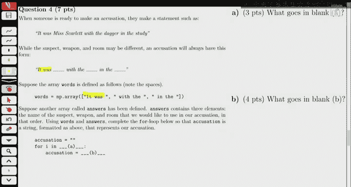

With the。

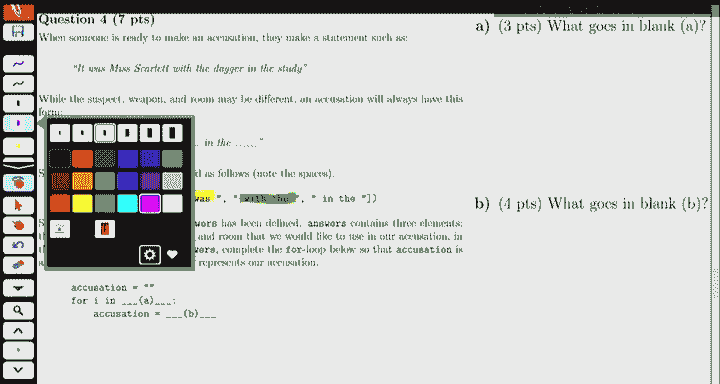

And。In the。Okay， and then they're going to。Also， talk about another array called answers that has the three answers。

 like the suspect， the weapon in the room。 right， So answers may look like。嗯。Miss Scarlet。

Followed by。Daager， followed by study。

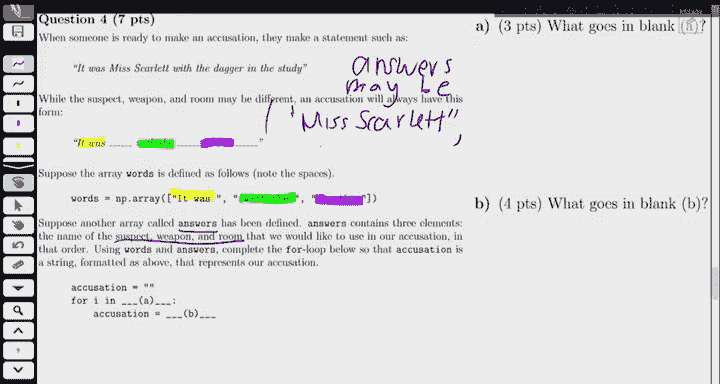

Okay， so it says suspect weapon room in that order。Using the two arrays， so answers。Has。Mis。 Scarlet。

Then dagger。Then study， right？How do I fill in the for loop so that the result is a string like this。

 right， this is my goal。And the basic idea is you want the yellow thing from words。

 it was followed by the yellow thing from answers， Miss Scarlet。

 right then you want the green thing from words with the followed by the green thing from answers。

 dagger then you want the purple thing from words in the and then the purple thing from answers study does that make sense？

Okay， so how do you write a for loop to do that？You have to iterate using the index so sometimes for four loops。

 you can go directly through like the sequence itself right like we did this for the array of colleges where we had to print out like Ravel College。

 John Muir College right This one is like one that we saw in lecture with the actions and feelings like I ran and I was exhausted I didn't sleep and I was tired like stuff like that。

😊，This is。This is more like that。 You have to iterate through the indices， so basically。

This is position0 and this array goes with position0 in that array。

 position 1 here goes with position 1 here and position 2 here goes with position 2 here。G。Yeah。

 so the easiest way to say what goes in blank a is 0，1，2， right， I is going to take on each value。

0 then one then two。 So this is specifying like concretely what the values are。

 Another way to say that is。The lens。Of either either words or answers。

 They're both the same the same length。 Let's say the length of words， length of words is 3， right。

 So you could do。NP do a range of three， and that's going to give you the same thing。Yeah。

 so range is another way to do this， but we didn't learn this in this class。We've only done NP。

A range。But it does the same thing。So yeah， just some。

 or you could just do NP dot A range  three or NP dot A range length of answers。

's there's many ways to do it。Does that make sense。And then what goes in in B， blank B。Not quite。

 you're missing something。 Yeah， yeah， yeah。Yeah， but this is given as an equal。

 so you have to remember to add。It onto the existing thing， right？Accusation。

Plus that so this is the accumulator pattern， Ac starts empty and each time you're adding this onto the current status of accusation right so accusation starts empty。

 then it becomes it was Miss Scarlet， then it becomes it was Miss Scarlet with the dagger。

 then it becomes it was Miss Scarlet with the dagger in the study。Does that make sense。

 so this is testing the fundamentals of four loops basically？Okay， here's the probability question。

Most exams have one。Recall that the game clue comes with 22 cards， one for each of the six suspects。

 seven weapons and nine rooms。But one of each gets put away randomly in an envelope。

 and then there's 19 cards remaining。Yeah。Okay。5 suspects， six weapons， eight rooms。

So these 19 cards are shuffled and dealt out randomly。And I am going get six of the cards。

Six random cards， right？嗯。Answer the probability questions that follow。

 leave your answers unsimplified。Okay， cards are dealt out one at a time。

 what's the probability that the first card I get is a weapon card？Okay， well。

This uses just standard definition of probability， like how many possible outcomes are there and how many good outcomes are there right the random process here is like the card that I get。

So that what are the options for the outcomes of the card I could get， Well。

 only 19 cards are being deal being dealt out， right， So the denominator is 19。

 There's 19 options that I could get。Right， how many of those are good options， What does good mean。

 A weapon card， right，6 of them。Our weapon cards。Okay so this is a straightforward one。

 six out of 19。Something that is really important to know is that。

It doesn't really matter like the dealing process， right。

 if you give me six cards and then give the next person six cards and then give Henry7 cards。

 like that's equivalent in terms of probability as like you give us each one and then you give us each a second one and give us each a third one。

 like because I just wind up with six random cards。

 so I don't have to worry about like what is happening with other people。

 I can just think of my cards as being like six cards randomly pulled from this set of 90 Okay。

 if it helps think of shuffling them and the first six are mine or if it helps think of them going one at a time。

 but it doesn't really matter okay。Does that make sense？全部はれ。事要な。も負けちゃがる。何にやるて。Yeah。

 so they're dependent on each other。But。I'm only asking about me， basically。 So like， if I knew that。

 you know， Henry had five weapons， then my chance of getting a weapon is very low， right。

 If I knew that Henry had no weapons and my chance of getting a weapon is very high， right。

 But with no information about the other people's weapons are not， like it's not relevant。So。

You're kind of thinking more of like conditional probability， right， Like if。

 if you knew something about someone else， that would impact the probability of what I get。

 But think of like slipping a coin like。Or like the dice rolling example。

 like when I tell you that you got a high number for， five or6。

 your chance of getting an even number was two thirds right When I tell you you got a low number。

 your chance of getting an even number was one third， one，2 or three， only one of them。

 But when I tell you nothing your chance is one half。

 So we're like in the I tell you nothing scenario like you don't have any extra information。Okay。

 any other questions？Okay， let's do。Part B， what's the probability that all six of my cards are weapon cards？

So just think of I get the first six cards， I think that's the easiest conceptual way to think about it。

 okay。We already know the chance that my first card is a weapon card， it's six out of 19。

Okay for all six of my cards to be weapon cards， this is like a giant ant。

 I need my first card to be a weapon card and I need my second card to be a weapon card and my third card to be a weapon card and so on。

This is represents like。The probability that the first card is a weapon。Right。

And then I have to multiply that by the probability that my second card is a weapon。

Given that my first card was a weapon。Right so now I already know I got a weapon card as my first card。

 What's the chance my next card is also a weapon card。What am I going to multiply this by？

Five out of 18， right？I've already been Delta card， so there's 18 cards left。

 right based on the knowledge that it was a weapon card， right。

 that means there's only five weapon cards remaining。Does that make sense？And so on and so on。

 so let me shrink this up a little bit。So what's the final answer going to be six over 19？

Times five over 18。Times4 over 17。Times three over 16。Times two over 15 times 1 over 14。

Notice if I was dealt seven cards， what's the probability that all seven of my cards are weapon cards。

 the next number would be zero out of 13 the total probability would be zero because it's impossible for me to get seven weapon cards because there's only six that exist。

我しし。Yes， so they'll usually come with instructions， but yeah。

 like the point isn't for you to like do multiplication division of crazy numbers。

 just leave it unsimplified and we can just easily identify whether you have the right idea。每三次。Okay。

Let's do the last one。Determine the probability that exactly one of the first two cards I'm det is a weapon card。

The probability can be expressed in this form where K and M are integers。

 what are the values of K and M Okay， this hint was。Explicitly written on the test。

 but this is always the hint， right you never need to do any sort of crazy calculation like long division or multiplication。

 like if you find yourself doing something like that。

 you' you're doing it either either the wrong way or you're making it unnecessarily complicated There's always an easy way that doesn't involve this。

嗯。Okay， so what's the strategy for this problem？Exactly one of my first two cards is a weapon card。

 how do you go about that？We actually had a very similar example when we did the probability。

Let's find it。

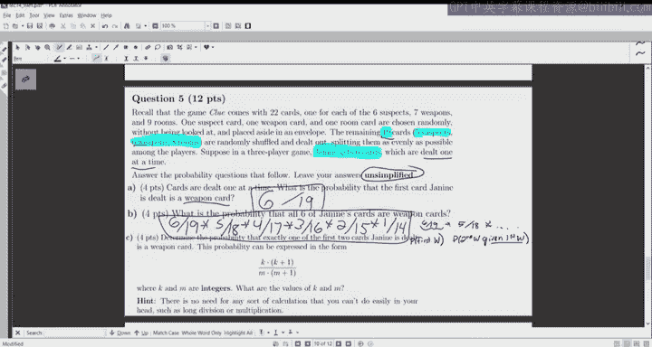

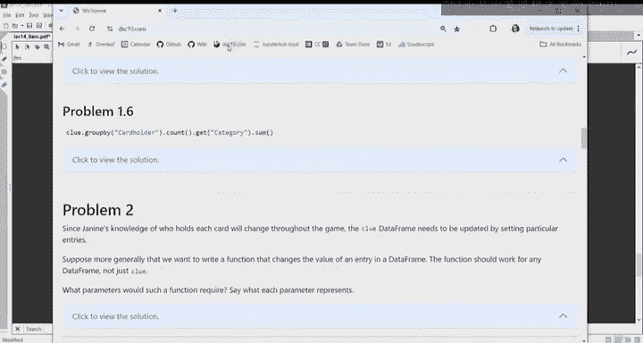

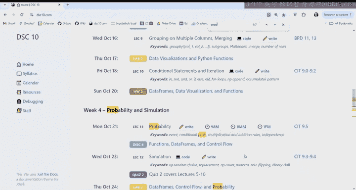

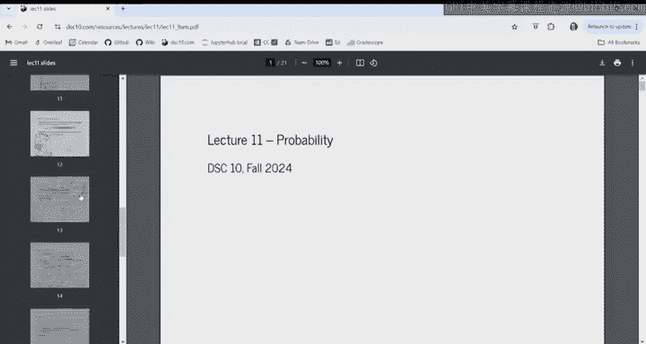

It was towards the end。It was this one。Suppose you have two bias coins， coin A and Co B。

 Co A flips heads with a certain probability， coin B flips head with another probability。

You flip both coins once。 What's the problem that you see two different faces。 Okay。

 The way we did this was we broke it into cases。 What does it mean to see two different faces。

 It means you see heads on A， tails on B or vice versa。 Okay， Can you break up。

This problem into cases。Exactly one of the first two cards is a weapon card。

 what are the cases there？Right， weapon followed by non weapon or non weapon followed by weapon。

 Those are the two ways to get exactly one of them being a weapon， right，s Which one is the weapon。

 The first or the second。Okay。The cases are weapon followed by， I'll say NW for non weapon。

Or non weapon followed by a weapon。Okay， what's the probability that my first card is a weapon and my second card is not a weapon？

Six out of 19 for my first card being a weapon， right， we already did that。

 what's the chance of my second card being a non weapon？Something out of 18， what's the numerator？

13 or 14。There's 19 cards， I've already gotten a weapon。So。There's 13 non weapon cards remaining。

 right？Now how about the other one， what's the chance that I start off with a non weapon card？Yeah。

 flip this around six out of 19， was I had a weapon。So this is 13 out of 19。Right。

And then on my second card， what's the chance of my second card being a weapon， it's out of 18。

My first card wasn't a weapon， so all six weapons are still there。Okay。

So these are two separate cases they don't overlap， right。

 I can't be in weapon nonweap case and the other one， right， They're mutually exclusive。

 So that means my final answer comes from adding these。Okay。

 so if the question just was like the format of part B， what's the probability。

 you would just leave this as your answer， Okay， but it asks you to put your answer in a certain form。

Something times something plus one over something else times that other else plus1 Okay。

 so how can you express this in that format， what do you have to notice？

They both have the same denominator， which is 19 times 18。They also both have the same numerator。

 which is6 times 13。So this is just two copies of the same thing。Six times 13， over 18 times 19。

So the bottom is clearly of the right format， right 18 times 19 is a number times the next number。

 how does the top become that format？6 in the two，6 times 2 makes 12， right。

 So you can express this as 12 times 13 over 18 times 9。Okay。

 sometimes when they tell you like the format， it can be a hint， right， And sometimes it's it's not。

 In this case， it was， it was a half hint。 I would say the bottom was kind of a hint。

 Like the fact that it's a number times the next number that suggests that like。

These like the reason that happens was because you had 19 cards and then you had 18 cards right so you can kind of see like you can kind of see that happening by the number of cards you're drawing from reduces the numerator working out that way was just kind of coincidence by the fact that six times two is 12 right so if you tried to like fit this format of your answer it would be very hard to like see where the numerator came from。

So like if you can't like see how to fit the format of the answer。

 just solve the problem and then try to get it in that answer like that's basically what we did。

 we basically just ignored the format until we had our answer and then we tried to make our answer look like the format。

Does that make sense？Okay。Any questions on this one？Okay。

 the last question I have on the slides is a histogram question also a common type of question to appear on exams。

Distribution of game times in minutes for both two player and three player games of clue with each distribution representing a thousand games played okay。

 so like how long does it take to play this board game？嗯。And theres this is an overlay histogram。

 there's a stripy one for two players and a dotted one for three players Okay。

 this question is how many more three player games than two player games？

Took at least 50 minutes to play。Okay， give your answer as an integer rounded to the nearest multiple of 10。

 There's two ways you can do this。 One is the sort of more naive way。

 and the other one is the more like sophisticated way。

 The sophisticated way will save you a little time。 So the naive way is。Well。

How many three player games？Took at least 50 minutes to play， that's。Calculate the area of this。

Region。Right。The area would be a proportion， and it the proportion is out of 1000。

 so you'd multiply that proportion by 1000 and you'd figure out how many games is represented by this blue。

 Okay， so that's the three player games。You can also separately。Calculate how many two player games。

Took at least 50 minutes to play。 And then you can subtract them。 Okay。

 that's the straightforward way。The more sophisticated way that will save you a little time。

Is look directly at the difference。How many more three player than two player， that's this area？

So you can just directly calculate how many games are represented by that area and the way you do it is there's little tick marks on the side to kind of help you line things up。

The the height of that region is。08 and the width of that region is 10。So the area， 0。08 times 10。

Or sorry， 。008。008。Okay， so that's saying like 8% of the total。 what's 8% of 1000， It's 80。

so you can get this by subtraction or you can just get it directly in this way。

And then the last histogram one also has a naive way and a more clever way。

 A area of overlap of the two histograms。 Okay， so the naive way is really annoying。

 What's this area plus this area。 Just look for all the overlaps。And you'd have to add up five areas。

You can do it and you'll get the right answer， but it takes you more time。

 okay and on an exam you don't want to be wasting your time。😊，So what's the smarter way？Well。

 remember， each histogram represents an area of one。Okay。

 so take like the shaded histogram or sorry the stripy histogram。

All this stuff together represents one。Okay， we're asking for the area of overlap。

 the area of overlap。Is1 minus。The area of。Non overlap。Right。

 so you basically can just calculate the blue area and subtract it from one。

 And that gives you the yellow area。That's that's in both of them。Does that make sense？

So if you do it， well let's do it quickly， this is 0。06 to 0。22， so this is 0。16。And this is 0。

18 to 0。28。 So this is 0。1。 right， The total height there， if you imagine stacking them together。

 would be 0。26， and the total width would be 10。02 I'm missing a zero。Right。So 26%。

The rest would be 74%。But there's often like a way that involves doing less calculations。

 So look out for that。Okay， that's it。 See you guys for the exam， good luck。

