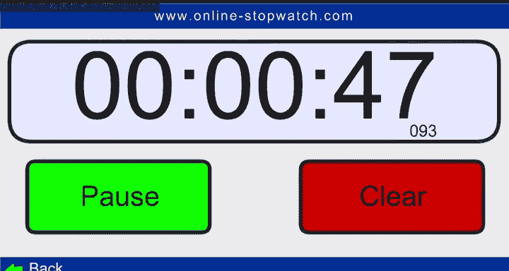
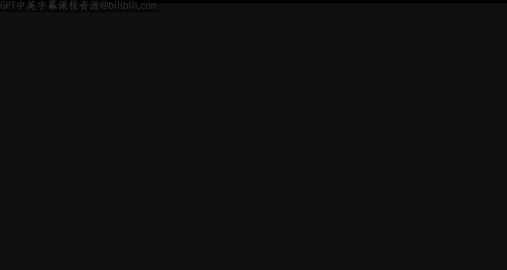

# UCSD《数据科学原理 (DSC 10 Principles of Data Science Fall 2024)》中英字幕（deepseek - P15：DSC 10 - Principles of Data Science - LE -A00- - Lecture 15.zh_en - GPT中英字幕课程资源 - BV1hmAneGEZh

Too chaotic with a lot of people leaving， so we'll just have you stay seated for the last 10 minutes。

Anyone still need an exam？Okay。Yes。Good reminder， turn off your phones or silence them。All right。

It's nine o'clock， so what you should do to start is open your exam now。Rip off this last page。And。

Just detach it from your exam。Start by reading that page。And then you can begin。

