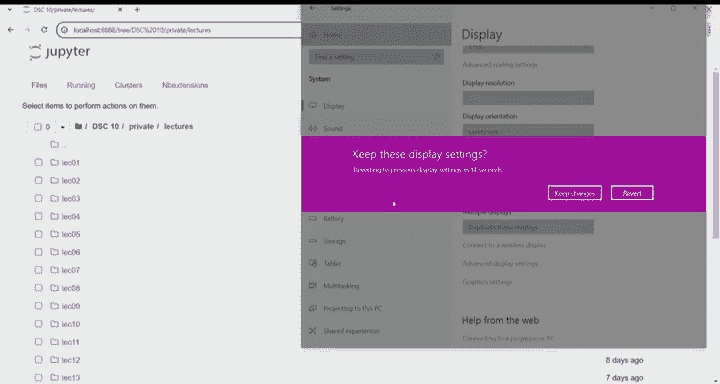
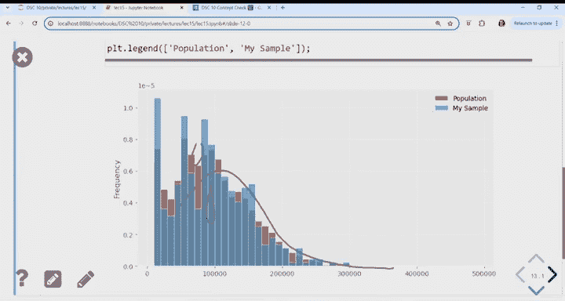

# UCSD《数据科学原理 (DSC 10 Principles of Data Science Fall 2024)》中英字幕（deepseek - P16：DSC 10 - Principles of Data Science - LE -A00- - Lecture 16.zh_en - GPT中英字幕课程资源 - BV1hmAneGEZh

All right， welcome guys。You have your midterm project coming up that's due Sunday just to let you know if you need a little more time you can use slip days on the project。

 but if you're working with a partner it detracts from both of your allocations so keep that in mind we only need one of the pair to submit and they can add the other person on gradecope and then we just released a lab yesterday that's due on Thursday of next week okay you may see all these papers up here at the end of class if you want to find your reference sheet here to keep it for the final exam you can。

Okay today we're going to review a little bit of what we talked about last time with statistical inference and then we'll talk about a concept called bootstrapping and how that relates to percentiles and confidence intervals okay so I mentioned this before but like the first half of the class is mostly focused on programming and learning how to code right and the second half of the class is like using those programming skills to help us understand concepts in data science so the second half of the class is like more conceptual it's extra important to come sadly it's not too crowded today but encourage your friends to come if you're watching the podcast come in person。

😊，Okay， we're going to work with a new data today， which is City of San Diego employee salaries。

 so this is publicly available data they post this every year。

And it is a full population of data because I have data on every single person that works for the city of San Diego。

 Okay， so this is the 2023 data， which is the most recent。And if you look at the data frame preview。

 it tells you that there's like almost 14，000 employees。

And 29 columns worth of data okay now I can't see all the columns。

 you see that how there's a dot dot dot in the columns。

 just like you're used to seeing the dot dot dot in the rows。

 this just has so many columns that it can't display them all。

 so it displays the first view and the last view， but the column I'm actually interested in is in the middle。

So a useful thing to do when you have a big data frame is to look at the columns available。 Okay。

 so dot columns tells you the names of all the columns in the data frame。

 It's very similar to like dot shape。 It's not a method。 there's no parentheses。

 It's an attribute that tells you something about the data frame Okay so this is like all the information I have。

 There's tons of stuff。 you know， their health dental vision insurance。

 like I don't care about every detail。 I'm just actually going to care about one thing。 total wages。

 Okay so I'm just gonna。Make a smaller data frame that has just that those numbers。

 people's individual wages。Now the data is sorted in descending order。

 so this says like the top earner in San Diego makes $433，000 or made $433。

000 in the year 2023 you'll notice there's also some really small numbers this happens like every year I don't know why or how these obviously aren't like full-time employees。

 I don't know what they did to earn $2 dollars from the city but somehow they did。And。

You can kind of look at what's。A typical salary by looking at the distribution of total wages Okay。

 so this first bar is like really tall like these first few bars are kind of like the people who probably don't really work there and made $5 somehow。

And then the rest of the data sort of follows this shape that's kind of like。

peeeeking around like I don't know， a little less than 100，000 and then very。

 very gradually declining okay， so this has a what we call a long right tail。

And this is very common in income distributions in general， because what it's saying is that like。

You can make sort of an arbitrarily large salary， but it becomes increasingly rare to do so， right。

 whereas the left side doesn't have that long thing because you're stuck at zero。

 you can't make less than  zero。Does that make sense？Okay， so we're going to look at。

The median salary， which is like some representation of a typical salary of employees right it would also be acceptable to look at the mean salary。

 there are just two different ways of saying like what's typical okay so if we take the median of the total wages column。

grabrab out the column， do dot median which is a series method。

 this gives us a number and it's a fixed non-random number because this is just all the people and this is the amount that the middle earner made if you were to like sort the earners okay。

This is what we call the population parameter because it describes something about the full population and a single number about the full population。

😊，Okay， so let's try to remember this number， 80，492。

Is like kind of like the answer how a typical salary for city employee right but realistically you wouldn't have that answer because you wouldn't have this whole data set right it would be costly in time consuming to survey all these employees right and in general like you often can't get the full data set of the population you care about right like we talked about the UCSD height example we talked about the flight delays right so this is kind of similar to the flight delay where it's like I do have the full population for the sake of showing you but the point is to illustrate like what we're going to do when we don't have the full population because that's like the real scenario you're going to find yourself in it。

Okay， what would you do if you didn't have the full set of data right is you would take a sample and use that as like a proxy for your population and try to learn from the sample and see if it can generalize to the population。

 So we'll take say a sample of 500 people。And we'll use that。 So some important words。

 the full data frame of salaries is the population。When we take 500 salaries only。

 that's looking at a sample， the thing we're interested in is a parameter of population median。

 but since we don't have access to the whole population and we won't be able to directly compute it。

 we'll just use the median of our sample， instead， that's a statistic。

 a statistic as a single number you get from the sample and hopefully our samples median is similar to the populations median。

Okay， so let's see how our sample median comes out。Okay， so this code down here。

Is actually doing the sampling。 Remember the dot sample method。

 it just picks however many rows from the data frame randomly。

They're all equally likely to appear they appear without replacement which is a simple random sample that was some terminology from last time this cell this line up here just makes it so that you and I when I run it up here and when you run it in your notebook get the same answer meaning it's kind of like not really random we like telling the randomizer like start at these settings right and then give me a random sample if you really wanted a truly random sample you wouldn't set any settings you just whatever you get you get okay。

So that's all this is doing。 it's just make sure that we always get the same results every time。

 no matter who runs it or if I run it again。Sometimes you'll see that like in the assignments that's there for grading to make sure that your random results are matching what we expect。

Okay， so here's my 500 random people。And their salaries。Okay。

 I'm calling them my sample and I'm not going to change that variable my sample。

 So when I ever say my sample I'm talking about these 500 people， okay。

 these are like the actual people we have and among these 500 people。

 the median salary is 82508 Okay， so compare that to what we had a few slides ago。

The population median was 80，80 and a half thousand0， right？

And ours is about 82 and a half thousand00。 Okay， so we're about 2000 higher， right。

 And that's just because of who we happened to get， right， Maybe we didn't get anyone who earned 2。

 Maybe we got one of the 400000 people。So our question is like we have an estimate now。

 but our estimate depended on the random sample that we got。

 right if we had got a different random sample， we would have had a different estimate。

And how different might that estimate have be right how how we feel about our single guess。

 our single estimate depends on the answer to this question。

 right if you knew somehow that like different groups of 500 people。

 they could have median salaries that were like wildly different right。

 then your group of 500 people， you're not going to be able to put much faith in it because you don't know like you know。

 that you would have gotten similar results with a different set of 500 people。

Whereas like if all the groups of 500 people have very close or similar medians， right。

 then any group you get is like pretty good because they're all coming out around the same。😊。

Does that concept make sense， that's like the big underlying。Theme。Okay。

So we're going to try to answer this question， like how different could our sample median have been if we had a different sample？

The sample median itself is a random number because it comes from a sample which is random。

 so different samples give different sample medians and like all random things。

 it has a distribution right like it's possible that the sample median comes out like $1000。

Presumably that's very rare， right It's also possible that the sample median comes out like $85，000。

 and that's probably pretty common right So the distribution describes what are the values this can be and how commonly do they happen。

Okay。If we were able to sort of understand the distribution of the sample median and know what it looked like。

 that would answer this question about how different can different sample medians be because if the distribution came out like narrow in a histogram that means all the area of that histogram is very close to each other。

 like different sample medians all come out roughly the same。

 that means you feel good about your estimate because a different sample estimate would have been not that different。

But if the histogram comes out really wide and spread out， that means like any one estimate。

 you don't really know if it's good or not because other estimates could have been wildly different。

Okay so how do you understand the distribution of the sample meat and how do you understand what the sample median could have looked like if you had a different sample the first approach。

 this is basically what we did last time with the flight delays is just look at other samples right how would other samples medians come out this answers our question of how would other samples medians come out。

 but it's not practical because this requires us to like draw lots of samples and collecting samples as hard。

In real life。But I'll do it anyway because it'll show you。You know。

 the distribution of the sample media， okay so let's look at this code a little bit。

I'm making an empty array to hold my results， I'm calling it sample medians because I'm going to put in there a bunch of numbers and each one's going to represent the median of a given sample。

And then I have a four loop that just says， do the following a thousand times。

What do I want to do a thousand times sample from my population take 500 city employees randomly？

And calculate their average wages。And I'll store that in a variable called median notice singular。

 it's just one number， and then I'm going to append onto my array of sample medians， this median。

 the median of this sample。So I'm basically taking 100 samples， all of 500 people。

 and each of those samples I'm looking at what's the median salary。

 and I'm storing them all in this array。Okay， so。These 500 people's average salary was or median salary was 82 and a half。

 you know， this set of 500 peoples median salary was 77 and a half。

Let's look at the distribution of these values to see how often the sample media came out a different way。

Okay， so。It came out， you know like。From 70，000 to 75，000 sometimes but not often。

 from 75 to 80 it was like pretty common， from 80 to 85 was pretty common。

 85 to 90 it was like less common。That's what this is telling us。Okay。

So this is an empirical distribution of the sample median。 Why is it empirical？

What does that part mean？Yeah， we got it from just taking lots of samples， right。

 We didn't consider every theoretical way a sample might have turned out。

 There's like way too many ways to actually do that for every sample。 So we just did a thousand of。系。

If we had truly looked at every possible way it could have come out。

 that would have been a probability distribution， that would have just been a lot more math and challenge for us to figure out。

OkaySo this basically answers our question。As I was saying， let me look at it closely。

 it's saying like when you take a single sample of 500 people and use the salary that you get to like estimate the overall population salary。

 median salary， you could be off by like maybe $10，000。And I'm saying maybe $10。

000 based on like the width and the scale of this histogram。

 if all the redness was concentrated you know between， say 80 and 85。

 then I'd be saying you could be off by a couple thousand。

So this picture like helps me understand how different my different samples median might have been。

 right， but the problem is I can't actually do this process in real life because drawing samples from the population is impractical。

If you're able to just go to the population and get all the data you want。

 then why are you even sampling it all， just get the population and calculate your answer and this is a much easier question okay。

So we need like a more practical solution that allows us to get a similar distribution as we just did。

 but without having to actually go back to the population and take new samples。

And the key insight in our clever solution。Is looking at the sample we got？

Versus the original population。Okay， so the red histogram here is all 14，000 employees。

And how their salaries are distributed， right， it's got a pretty tall first bar because lots of people for whatever reason make $5 and then it has this shape that I was talking about before。

哎。So the red is all 14，000 employees。😊，But the blue is just the 500 that I got in my sample。

So imagine you go out and have the resources to collect this information by interviewing or talking to or looking up the data for 500 people。

 and then you just plot those 500 people's salaries。And you do that in the blue。

There's some differences between the blue and the red， right。

 like places where one bar is taller than the other。

 but the blue pretty much generally has the same shape as the red。Do you see that？

So what we were doing before was we wanted to see how other samples， medians would have come out。

 we got new samples by sampling from the population。

What we're going to do here is instead of sample from the population。Right。

 instead of using the red distribution， use the blue distribution sample from the sample。

it's confusing when you say that， but when you think about replace the red with the blue。

 that's more natural because yeah， the red and the blue are pretty similar。😊，Okay。

 so this is the big idea。Behind bootstrapping。Okay。

 so bootstrapping is basically a shortcut that allows us to understand how some statistic like the sample median looks for lots of different samples but it gives us a practical way to understand that without having to go back to the population to draw more samples and the shortcut is use the sample itself in place of the population so the idea is like you get one sample you get your 500 people I called it my sample right and then I want to see how other samples medians would come out so I can't just go to the population and get other samples。

 but I do have my first sample my my sample I go to that first sample and I sample from it that process is called resample sample from the sample。

So I sample from my original first sample and then I get like other samples and then I can do the same thing。

 plot how the medians of the other samples came out the other samples aren't quite as genuine as if I went to the population to get them。

😊，Because I'm getting them from my first sample， but they're a pretty good approximation because my first sample looks pretty much like the population。

Does that concept make sense， Any questions。Okay。We call this bootstrapping。

 this process of resampling from a sample that comes from like an old- fashioned expression of pulling yourself up by your bootstraps。

 which is like kind of like using all your resources very， very carefully。So in our case， right。

 we have a sample of 500 salaries， our first sample， we want another sample of 500 salaries。

 but you can't go to the population， so you go to the original sample。

Here's a picture that kind of illustrates this process。Right。I wish I had access to the population。

 right？But I don't， because I don't have all that data。All I have instead is a sample。Okay。

And the sample looks like the population。And what I'm going to do is generate lots of other samples from this one sample by just pretending it's the population。

 So from this data， I'm just going to draw samples。And plot those samples。

So each of these represents like a different set of 500 people。

And they'll all have maybe slightly different medians。And I can see how those medians come out。

 are they typically around 80，000 or what， that's the idea。Okay， questions。Yeah。

 basically we'll see that like different resamples like are going to have different medians， right。

 but like a typical median for any resample is the median of the thing that was drawn from。

Did that make sense？然肯你是。我 is really。Right， so in order for us to say like we can sample from the sample。

 our first sample has to be big enough to look like the population right if you only have data on like 10 people and you reuse those 10 people in place of like the 14000 that's not going to give you good results there's not a concrete number。

 but the idea is it should be big enough to look like the population So we'll talk like more later in the class about like how you know how big of samples you need to take to have certain results so that's a like I'm not going answer it fully right now。

 but that's a good question to keep in mind is like a lot of this like ability to make these substitutions and like do these tricks depends on how good of a sample we get and we know that like bigger samples are better So basically the answer is take the big a sample you can afford to get like in real life if you have the resources to get 1000 people's salaries do that because you'll get better results。

And we'll come up with like some formulas and things that explain the relationship between the size of the sample we take and the conclusions we can draw from it。

Good questions。Anything else。Okay， now every time we take a sample， right。

 we have to ask ourselves this question， are we going to replace or not replace？

And we're talking about figuring out how different our sample median would have been right if we had had a different group of 500 people so we're always talking about groups of 500 people we're always talking about samples of a given size because it's not really fair to compare like the median salary of these 10 people versus the median salary of these00 people right because they're different numbers of people。

 so we always talk about like the same sample size So what I'm saying is all these resamples should have the same size and they should be the same size as your original sample。

 so 500 in our case。Okay， and let's just， you know， pretend instead of 500， it was just3。

And see what happens if you resample with replacement versus without replacement to see what kind of difference that makes okay so imagine you had I don't know。

 just three people's salaries and they were $7，9 and $4 and that was your original sample。

And then you want it to resample from that original sample without replacement。Okay。

 since I have three numbers to start， I want three numbers in every resample。

And if I choose from a pool that has 7，9 and 4 without replacement。

 that means I pick something out randomly。 Maybe I get 9， right， Then there's only 7 and 4 left。

 So maybe my next pool， maybe I get 7。 And then my last pull， I have to get4。

So what this code is doing。Is showing some examples。Of different reamples I can get if I。

 if I choose without replacement and notice that all the re samplesles I get are just going to have the same three numbers in a different order。

Because you're pulling three things from a set of three things and you're not allowed to get the same thing twice。

 so you're going to get all three things in some different order， perhaps。When you do that， right。

 how does the median of your resample come out Well。

 every resample includes these three numbers and the median is just the middle number when sorted。

 so the medians always set。Okay， this is kind of a problem because it's saying like the resample。

Are all kind of coming out the same。But really， the resample is supposed to represent like different groups of people from the population。

 Where is that slidehow， All of these are supposed to represent like different sets of 500 people and what their salaries would be。

 and they wouldn't all all have the same media。They're supposed to be different groups of people。

So it's not right， therefore。To do our resamples without replacement。

 because essentially what that does is it takes your original sample and just gives you the same original sample。

 perhaps in a different order。But any statistic you calculate like the mean or the median from the original sample would be the same in the resample。

 so you're not actually really learning anything by resampling if you resample without replacement。

Does that make sense？Okay， therefore。啊。Whennt all the way to the end。Okay。I am。Therefore。

 we have to sample with replacement。Okay， so we have my original sample，7，9， and 4。

 And I'm just saying pick one of the numbers。 maybe I pick 7。 Then pick another one of the numbers。

 maybe I pick 7 again。 then pick another one of the numbers。 Maybe I pick 4， so I could get 7，7，4。

Or I could get。9，4，9。Some of these samples resamples are going to have a median of seven like the original。

 right， but some of them aren't。Okay， and that's kind of the point。

 There's some variety in what you get， because these are really like more like different samples。

 Whereas when you do without replacement， they're all kind of like the same sample。

Does that make sense？Okay。So when we resample without replacement。

 the resamples look just like the original， but when we resample with replacement。

 the resamples can vary a bit from the original sample。

So we're going to be doing it with replacement。Okay。嗯。

Let's look at the full code that does this Okay， so we're simulating the act of collecting new samples by just going to our original sample。

 which was called my sample and sampling from there with replacement。

So this is the little magic that makes sure our we're always getting the same results。

I am taking 5000 resamp。 so that is basically the part here。 That's like。

 how many times do I do the loop okay？Before I do the loop。

 I make an array to store the medians of each res sampleble， I call it boot medians。好久。It was 500。

 500 people。That's the。With and without replacement， if I do without replacement， then it's the same。

 but I'm going to do with replacement。 So the 500 from the 500。

 what effectively it means is that some of those 500 people get duplicated。

And other of those 500 people get omitted。When you sample 500 from 500 with replacement。

 you don't get the exact same thing because some get repeated and some get omitted。Makes sense。Yes。

 okay。This is where I'm going to store my results， right。 And then this just says， do the following。

5，000 times。And this is， this is the only part that's different。 Okay。

 generate my new 500 people by taking my old 500 people。And selecting 500 of them with replacement。

What I did before the impractical way。I'll compare here。What was the impractical way？我是。😔。

The impractical way was I would have taken instead of。My sample dot sample。

 I would have taken the population。Dot sample。500。It would have just taken 500 from the population。

 and here I'm taking 500 from the sample with replacement。Okay。

But the rest of the code is exactly the same。You know， what do you do with those 500 people you got。

 you take the median salary and then what do you do with that median salary。

 you append it onto your array of median salaries okay so at the end of this， I get as before。

 like a big array of numbers that are in the you know 80，000 ish range。

Telling me for different groups of 500 people how the median salary might have been。

 but the key thing here is that I got all these numbers just from one set of 500 people。

 whereas before I got all those numbers from access to the whole population。

Okay so this is very like resourceful， this is why it has that name of pulling yourself up by your bootstraps。

 it's like churning on the 500 people that you have and like using that data over and over in new slightly different ways to like squeak as much information as you can out of it essentially。

😊，All right， let's look at this distribution。Of how the sample median。Could come out。Okay。

So it looks like this。It's not exactly the same as the one I got from the population。

This one has a pretty light amount of area up to a point and then a lot of area right on there。

But it still gives me sort of a sense of like the scale of how sample medians might have come out for other samples right I can kind of conclude a similar thing that like somewhere like 70 to 90 would be like a reasonable sample。

Sample media， okay？Now， this blue dot that I'm putting here is the population median。

 This is like the right answer。 right， What's the median salary of all the employees。

 The whole point of bootstrapping is to like estimate this value。So you have one sample。

 its median came out to like what was a 82000 or something right and you want to know like well。

 maybe a different sample would have been different。

 how different would it have been and you see it might have been I don't know anywhere from 70 to 90 so that makes you feel like anything from like 70 to 90 is like a pretty good guess for the population media。

So the point of bootstrapping is to go from your original samples median。

Right which if you just use this one sample， you just get a guess for the population median right from based on this。

 I can say， I think the population median is roughly 82 and a half right。

 but you can't say anything about like how close you think you are。But when you bootstrap。

 you get a whole distribution， and that shows you how close you think you are。

 you realize like you're not that close， you could be off by $10，000， right。

So you can say things like， well， I think the population median is probably between say 70 k and 88 k。

 and I'm saying that because most of the data appears there。You could also say。

 I think the population median is between。80 k and 87 k or 88 k，85 K， whatever you you decide， right。

 what， what range should you say， right。This is a question that we're going to address。

 giving a wider range。You're more likely to be right。

 Like if you say I think the answer is between 70 k and 90 k， you're you're almost certainly right。

 However， that that statement is not that useful right much it's imprecise because it's such a wide range right making a statement that says I think the medians between 80 k and 85 k。

 that's much more precise and therefore much more useful。

 but it's also more likely to be wrong because it's a narrower interval。😊。

So there's like a trade off between how wide of a guess you're giving and how likely that you are to be right。

 as well as how useful that information is。Okay， so our question of。

You know how do we determine the range to give， we're going to present one way to answer that question using percentiles。

So you might have heard of the word percentile before， it's used a lot in common language。

This is sort of an informal definition of percentile， so p should be some number between 0 and 100。

 and the P percentile talks about for a numerical data set。

 some number that's greater than or equal to p percent of the data。You hear this in a few settings。

Often for academic things like standardized tests and stuff。

If you say you gotten the 80th percentile for your standardized test。

 that means basically your score was greater than or equal to 80% of other scores。

This is an example about SAT scores， the 75th percentile score was 1400。

 means like 75% of students scored below that and the other 25% scored above that。

You also see this a lot at the doctor's office， especially if you're a pediatrician for kids。

 they're always measuring your height and weight and head circumference and all these things。

You know， 80th percentile for height means you're about 80%。This picture is helpful。

 it's like you're sort of 80% of the way through if you were to sort people by height。

 like you would be like 80% of the way through that line。Does that make sense？Okay， so。

There's a numpI function。That will calculate percentiles for us and it's called NP dot percentile。

 you give it some sequence of values and some P percentile that you want。

 which should be some number from I guess0 to 100。We're not going to worry about like behind the scenes what Numpy is doing to calculate this。

 and it's actually pretty complicated。 I looked into it。 There's like a whole。

A whole thing behind it， so we're just going to take what it gives us and accept that。😊。

This is the 50th percentile of this data set。 So 50th percentile should be about halfway through when you sort the data from small to big。

 right That's kind of like the median。Here's the same data in sorted order。

And you can see that the number that's kind of half of it's bigger。

 half of it's smaller is the number six。😊，Does that make sense what percentile is doing。

 find the number that's sort of a given percent of the way through the data if the data were sorted？

Okay， so how does this relate to what we were doing with the salaries？

So what we had done was use bootstrapping。To create this distribution of sample medians。 Okay。

 this tells me how different samples medians might have come out。

And how can I use what I just learned about percentiles to do something with this distribution okay？

So what we know so far is like our first sample has a median of 82 and a half k。Therefore。

 we think the population median is close to that value， right but we're not quite sure how close。

So to capture sort of our uncertainty， we want to give an interval。

 like a range of values where we think the parameter falls the whole point of looking at sample medians is to estimate the population median。

 which is a parameter， so what we're going to do is we're going to give a range that captures most of that distribution that I created。

Because all the things in this distribution are like different ways that the sample median came out。

And if I get a range that captures most of it， then that means like most samples medians fall here。

 which means the population median also probably falls here。

So we're going to find a range that captures most of the data。

 most of those sample mediumns that I generated， this range is called a confidence interval。

 it's like an interval of values where I feel pretty confident or pretty good as giving as a guess for the population value。

So we'll do what we call a 95% confidence interval。

 a 95% confidence interval captures 95% of the area of that bootstrappped histogram。

We can change 95 to something else， 95 is just a nice number so it's commonly used for this our goal is find two points x and y such that the area to the left of x in that histogram is about two and a half percent and the area to the right of y is the other two and half percent so the idea here is you want 95%。

😊，Right， but you want the middle 95%， like the things that happen on the edges are kind of like the extreme rare events。

 right， so you put the remaining 5%。You do2。 a half percent on each side。So in terms of percentiles。

 this is what we're calling X， this has about2 and a half percent of the data to the left of it。

2 and half% of the data is smaller than it， so that's the two a half percentile。

Where this other endpoint I'm calling it why， that has2 and a half% of the data to the right of it。

 what percentile is that？97。 a5 percentile。Because the percentile is like talking about how much is before you。

So if you're you， like a SAT score or something， if you only2 and a half percent of people are scoring higher than you。

 then you're in the 97 and a half percentile， that's what that's say。Okay。

And the resulting interval is going to contain 95% of the data okay so the way we calculate these endpoints is we use percentiles。

😊，And we have a Python， a nuPy function to do that。

Okay so here's the data that I used to generate this histogram。

 this data was the data that came from bootstrapping so it represents lots of different resamples and how their medians came out。

And then by saying take the two and a half percentile of this data。

 it's basically going to like put all these numbers in order right and go just a little bit of the way through that sorted list right basically cut off the extreme endpoints。

 the things that were really small are going to be gone and similarly here I'm going to go 97 and a half percent of the way through that list right and the endpoints is going to represent like the middle 95% of the data。

Okay。So this is our interval。It says only a little bit of the data that we got was less than 70k and only a little bit was more than 86K 95% of the data。

Was in this range。 Okay， So this is my guess。 This is my estimate of。

 of where I think the population median should be。 And I'm basing that guess on the fact that I saw so many sample medians fall in this range。

 So it's probably a pretty good guess。Does that make sense？Okay。

 this code is useful to know every time you need to calculate a 95% confidence interval you're going to be doing this right chopping off this essentially chops off2 and half% from the left and2 and a half% from the right。

😊，Okay， so we just came up with some interval， let's see what that interval looks like。

On the bootstrappped histogram。 Okay， so the gold interval is the the interval that I get by basically taking this red histogram。

And kind of。Chopping off2 and a half% of the area。On either side。And what it says is that。

Therefore 95%。Of that red area falls between these bounds。

And it's always basically going to look like this， it's going to be sort of in the middle of your distribution。

Now the blue dot。Is kind of the answer。The whole purpose of a confidence interval is guess of value or range of values for some unknown value in the population so in this case we were interested in the median salary of all the city employees right and what we go away with is we say。

 oh， I think it falls between roughly 70k and 87 k or whatever those numbers were here these numbers right we think it falls in there。

😊，And does it？RightWell， here I have I have the answer because I have the population and I can see that like I was right。

 right the answer does fall within the range that I thought it would fall。 right In reality。

 you never actually know if you get it right。 This is very unsatisfying。

 right What we're giving is like a process for estimating something。

But you never know if your estimate is actually going to be good or bad because no one swoops in with the right answer and what we'll see is that like in the coming classes we'll talk about how we know this estimation process works in general。

 but for any given given estimate， like it could work or it could not work。

And the reason it doesn't always work is because your original sample could be bad。

 So this kind of gets back to what you were asking about before。

 he asked a question about like the size of the sample and things like that and we like taking bigger samples because they're more likely to be representative of the population but even a really big sample could by random chance not be representative of the population maybe by chance you happen to get like all people who earn in the 40000 in your sample and that's just not what the full population looks like and so any estimates you make based on that original sample is not going to reflect the population it's just going to reflect that sample So bootstrapping is kind of especially prone to this problem because bootstrapping takes that first sample and just like reuses it and reuses it and reuses it So any issues with that first sample are very problematic。

Does that make sense？Okay， let's do this concept check question。嗯。Got to clear this from last time。

 been a while since we use this。Okay， so the concept check question is。

I made this 95% confidence interval。It went from like 70 k to 86 k， so it was about 16，000 wide。

What if instead I had done an 80% confidence interval。

 Think about how you would change the process of computing these endpoints and what it would mean。

And then vote on the website， please。B。Narrower， yes， okay。

So I want to show you what we did and what we would have to do differently。Okay。

This is what we did for a 95% confidence interval was。We wanted the middle 95% of the data。

 so we chopped off 2 and a half percent from either side。For an 80% confidence interval。

 you want only the middle 80% of the data。Right， which means you're chopping off more from each side。

 you're chopping off the remaining 20 we'll do evenly on each side， 10 and 10。

So how would your code change？Your left endpoint would be the10th percentile。

And what would your right endpoint be？90th percentile because percentile is how much is less than you。

Okay， so instead of being what it used to be 70 to 86。 now it's 75 to 85。 Okay， so it's narrower。

 And I love the the word confidence for this。 because confidence is like。

 how good do I feel about this， right， when you give a narrower interval。

 There's more of a chance you get it wrong。 You're less confident in that more precise guess， right。

 a wider interval。 I can just go from it's from 0 to 200 K。 like you're， you're very sure of that。😊。

But as I was saying before， it's less meaningful。我快。I'll stop there。

You can pick up your reference sheet if you want， and I'll see you guys next time。

