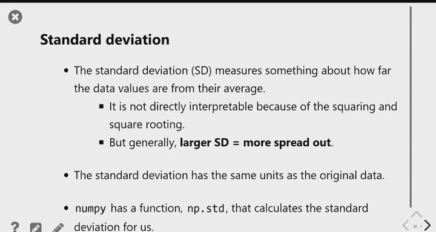

# UCSD《数据科学原理 (DSC 10 Principles of Data Science Fall 2024)》中英字幕（deepseek - P17：DSC 10 - Principles of Data Science - LE -A00- - Lecture 17.zh_en - GPT中英字幕课程资源 - BV1hmAneGEZh

All right， good morning everyone， Nice to see you guys。The midterm project was due yesterday。

 but if you need more time， you can still submit that late using slip days and then we're back to like our regular schedule of labs do Thursday and homeworks due Sunday。

Okay so last time we talked about creating confidence intervals to estimate some value。

 we were looking at the San Diego City employees and trying to estimate or their median salary and so today we're going to learn sort of how to interpret those intervals that we create and understand when this bootstrapping strategy is a good idea and a bad idea。

And then towards the end， we'll talk about center and spread。

 We've already talked about mean and median。 We'll also talk about standard deviation。嗯。Okay。

 so this was the data we were working with， it was all the city employees。

 but we were just working with a sample of 500 people to represent what would happen in real life if you didn't have access to the full data set of everybody's salaries。

Okay。So from the population of everyone's salaries， I。Can tell you sort of the the population median。

 That's the a middle number salary for everybody in the whole population， all 14000 people。 Okay。

 the important thing is you can't see this in real life。

What we're going to do instead is take a sample of 500 people and look at their median salary。

And that sample's medium is about 82 and a half thousand。

So different samples would have had different medians。

 so the idea is understand how other samples medians would have come out。

 but it's too costly to go back to the population and collect other samples。

 so the clever idea we talked about last time was you treat the first sample as a proxy for the population and you go back to that first sample to get subsequent samples。

So this is the bootstrapping， I'm going to get 5，000 additional samples。Those are called resamples。

 So I'm just going to have a loop that goes 5000 times。 And each time I'm going to get that sample。

From the original sample， okay， and the subsequent samples have to be the same size as the original so that you're comparing like things。

And you have to do the resamples with replacement， otherwise you'll get the same thing in a different order。

 like we talked about last time。Okay， so this probably takes a minute。Every time I get a resample。

 I'm calculating its median and storing it in this bigger array of medians。Okay， so in the end。

I have a huge sequence of medians right these represent like how different samples medians might have come out and the idea is I take the middle chunk of how these medians turned out because the middle is like kind of what typically happens that the edges are kind of the extremes and therefore less likely to happen so I want to keep the middle certain amount and that gives me like a range of values for where I think the population median would fall so I'm keeping the middle 95%。

So if you want 95% in the middle。That means the remaining 5% should be split evenly on both sides。

And we calculate this with percentiles and percentile is how far do you have to go from left to right to get to this certain point so for the left endpoint you have to go two and a half percent of the way through the data。

 but for this right endpoint you have to go 97 and a half percent of the way through the data okay this two and a half plus this 95 So these are the percentiles that I have to calculate。

And I'll get my answer that。This point。That's about 2 and half% of the way through the data is 70。

000， and this point that's 97 and a half% of the way through the data is about 86，000。

So let's look at the picture。This picture shows。The red is all the。

 the resample medians that I got through bootstrapping。

 So this red histogram represents 5000 possible ways the the median of a sample might have turned out。

 And then the gold is。How most of those 5000 ways turned out， right。

 the goal is how the middle 95% of those 5000 ways turned out。

And then the purpose of the goal is to estimate some unknown value in the population。

 so in this case it's the median salary of the whole population and you wouldn't normally know where this falls。

 but since I happen to have the whole population I can show you the actual population median was around 80。

000， so our interval is good in the sense that if we use the gold to estimate where the blue fell。

 we would be correct right the blue does fall within the gold。Questions on any of that so far。

That's basically what we did last time。Okay， so now we have a confidence interval。

 and we're going to basically use it to give a guess。For some value of an unknown parameter。 Okay。

 so in this case， the unknown parameter is the population median。

And the purpose of a confidence interval is allows us to go from saying a single number for a guest to like a range of numbers for a guest and a range of numbers for a guest is more informative because it gives you a sense of like how off you might be if you say。

 I think the population median is this number Well it's like yeah。

 but are you off by like$5 or are you off by $50，000 whereas when you give a range of values。

The width of this range sort of tells you something about how off you think you can be。

 right you're kind of saying I might be $10 or $15，000 off， but I'm not going to be $100，000。

So we talk about these ranges， we call them 95% confidence interval。

 the 95 comes from the fact that we use the middle 95% of the bootstrap medians to get it。

And today we're going to talk about like what does 95% confidence mean。

 like what exactly are we confident about and is this technique always a good technique if this is an estimation strategy。

 so is it a good strategy in general。All right， any questions？This point。O。

So we've created this confidence interval， by definition， it contains 95%。

Of our bootstrap sample medians， right， that's how we got it。

 it was the middle 95% of those bootstrap sample medians。

 And because it contains so many of the sample medians right。

 and sample medians should look like the population median。

 then we're pretty sure that the actual population median should fall in that in that interval， too。

So when we talk about interpreting confidence intervals。

 we're going to think about this three step process。

 The first step of the process is get a sample from the population。Okay。

 every time you collect a sample from a population， you can use that one sample to bootstrap。

 generate lots of resamples right And from all those resamples get a 95% confidence interval So like every sample that you get from the population gives rise to its own interval right And if you were somehow able to get different samples from the population。

 you would be able to get many different intervals。 Okay， that's not feasible。

 usually you only get one sample from the population， but if you could right。

 the point is every new original sample leads to a new 95% confidence interval。

OkayAnd what does 95% confidence means， This is what it actually means。

It means if you were to do this three step process many times， get lots of new samples。

 each sample gives rise to an interval， then about 95% of the intervals that you make through this three step process will actually contain the parameter you're trying to estimate。

So like the blue dot， you know how it fell in our interval。

 this is saying like that's kind of typical when you go to the population and get a sample and use that sample to generate an interval。

 95% of those intervals will contain the blue dot and that's how we know that this process is good is like it usually works is what this is saying。

Does that make sense？Okay， so when we talk about confidence intervals。

 it's really important to distinguish sure we're not talking about a particular sort of interval being good。

Right。Any one interval is is a guess。 could， you could always be wrong。 You could be right。

 but you're talking about the process of generating these intervals is a good process because its get it tends to get the answer right。

that make sense。So the confidence is in the process。

 here's a little picture illustration thing that explains this。😊。

Confidence intervals are like ring toss。The true value is fixed and the interval moves。

Except we can't see the truth。Okay， so the true value is like the post and the ring toss。

And in our situation， that's the population parameter you're trying to estimate。

 And every time you collect a sample。From the population， that's like throwing a ring。Right。

And you except you're doing it blindfolded。 right， You can't see if your ring actually gets on the post or not。

 But when you say you have 95% of confidence intervals， what。

 what that means is that 95% of the rings you throw land on the post。

Does that mean like every ring you throw land on the post no， right？

 So sometimes like an estimate that you make or a ring that you throw will be a bad one。

 But your confidence is that that happens rarely， right Any single estimate can be good or bad。

 but the bad ones happen infrequently。Okay， here's another little explanation going back to an example we gave a few lectures ago about finding the average height of all UCSD students。

 so here we'll say all UCSD undergrads。😊，So she's asking， what's the average of all UCSD？Undergrads。

 and he's like， I don't know， I can't ask everyone right， how are you going to figure this out。

 but wait， I just took a large random sample of 100 students。

And the sample average was 67 and a half inches。 so let's just guess based on the100 students that I sampled。

 that the average in the population is also 67 and/ half inches like that's a reasonable guess because that's the best I can do based on the00 people that I have。

 right。And that's kind of where we had stopped until the last class。 But now we're saying like wait。

 you just got one random sample of 100 students right。

  clearly if you had talked to a different hundred students。

 you would have had a different answer right， How different might your answer have been would you have been 10 inches off Probably not because you understand the scale of heights。

 right。But how off might you have been。Right， and he's like， good point。So what does he do？

He can't go get more samples right， because that's too hard。

 He already interviewed 100 people for this。 He's done so he bootstraps the data that he has。

 say creates 5000 bootstap resamples。 And each time he gets a resample。

 he's computing the average of that。 So now he has 5000 averages。

And he takes the middle 95% of those 5，000 averages， just like we did。

And now he has like a range of values Okay， so he comes back and says， I ran some simulations。

 and I'm pretty sure that the true average height is between 66。8 and 69。4。Okay。

 so that's that's helpful because it gives us a sense of like how off we might be。

 right we might be3 inches off， but we're probably not more often than that。Okay， but she's picky。

 she's like， well， what do you mean you think the average height you're pretty sure like is is it between those two numbers or is it not？

And what's the right way for him to answer this question？Yeah， like the answer is he doesn't。

 He can't say for guarantee like the average height is between these two numbers， right。

 but it's his best guess， right， and it's his best guess。In the following sense。

 right I have no way of knowing if this guess you know is a good one or a bad one。

 but I am good at making such guesses right like he instills confidence by saying that the process that he used to come up with this range of numbers usually works right。

 It comes up with good intervals roughly 95% of the time。

So there's no guarantee that any one interval is good， but 95% of intervals created will be good。

Any questions on this convo？Now I've said that most of the intervals that you create through this method will be good。

 but I haven't really convinced you of that， so this is a little like argument to show you that what I'm saying is actually true okay so we talked about this three step process the three step process is get a sample bootstrap it and create an interval right and the important part is you have to get a new sample each time to create a new interval okay I did this process 200 times。

Which gives me 200 confidence intervals。And I just stored all these confidence intervals like in some file that I'm now going to read in okay so this is back to the median salary situation。

 so these are different sets of 500 people using that sample to bootstrap and come up with an interval okay so like the interval we gave before was just one interval but now I have 200 intervals。

And since I also have the full population， I can tell you whether each of these intervals is good or not。

 right， whether the gold interval contains the blue dot。Okay， so this is the key picture。

The blue line。Represents the population parameter， the actual median salary of all 14000 people before I was showing it as a blue dot because it's just a number right。

 but here I'm showing many confidence intervals kind of stacked on top of each other。

 So I just dragged that dot down to be a vertical line。

Each gold line is a separate confidence interval， right that was created through that three step process。

😊，And the key thing。Is like almost all of these yellow horizontal lines seem to cross this blue vertical line。

And it's very rare to find something that doesn't。 I see a little bit of whiteness right there。

You see that it's hard to see probably on the projector， but it happens infrequently。

Let's find the ones where that happened， where the confidence intervals don't contain the parameter。

Here they are。 often I was very close。 Like， look right there。 I was so close to containing it。

Some of them are I'm a little further off。How often did this happen， though， only six times。Right。

So six out of our 200 attempts right，t， didn't succeed， which means 97% of the time we did succeed。

I got 97 because it's just looked at a random 200 confidence intervals， if you did this。

 even more times the percentage of success would approach 95%。Okay。I got a little extra lucky。Okay。

 so this visualization is for your own assurance that like the confidence interval process works well。

 Okay， in actuality， when you use the confidence interval process， you won't get like a whole。

You know， a whole stack of confidence intervals。 You're not gonna to get all of this。

 You're just gonna get one gold interval， and it may be like like 194 of these good ones。

 or it may be like one of these six bad ones and you'll never know is so unsatisfying。

 you never know like if the one you got is good or bad。 Okay。

 because you you never get to know the the actual value of the parameter you're estimating。

But you have to be assured that you're doing the best you can because your process is good。Okay。

WhatWhat causes？These kind of like errors， like why does stuff like this happen sometimes？Any sense。

Yeah， if it it all depends on the original sample that you get， right？

 So if your first set of 500 people from which you generated this interval is like somehow misrepresentative of the of the full population。

 right， then you're going to have an interval like this。 and basically what this is saying is that。

The people in， in this set of 500 people that generated this interval were like。

Especially high earners， right， This interval is centered around like 90 K。

 where the interval really should be centered around like 80 K。And similarly。

 this set of 500 people somehow by random chance， got especially low earners and they were centered around 70K。

嗯。And and that can happen， right， because it's random。 There's no way to， like avoid that。

 There's no way to get like a perfect process。 that's always gonna， going to work。はいどした。

Will we like assume that our？So you don't assume that the sample。 The question was。

 like most of the time， do we assume that the original sample we got was good， right。

 you don't assume anything about your sample， but you can say that most of the time it was good。

 right The idea is like 95% of the time。 you got a good enough sample such that your interval will will contain the parameter and only 5% of the time。

 do you fail， And you never know for one interval is this a good one or a bad one。

 So you don't just assume it's good， but you you say like's most there's a high chance that it would be good。

Does that make sense？Yeah， so this is when things go wrong。

 is when you get somehow an unlucky sample。And we've been talking about 95% confidence。

 but you can change the confidence level as we had in that concept check question at the end of last class。

If you go with a higher confidence level。Right， then fewer of your samples are， are unlucky。 right。

 You're more likely to capture the parameter。 But the trade off is。With a higher confidence level。

 the interval that you get is wider。 you get the middle 99% of data instead of the middle 95% of data。

 and a wider interval is just not that useful for estimating。Vice versa。

 if you choose say like a smaller confidence level。

 the number can be anything right like it doesn't have to be 80。

 it could be 73 right any smaller confidence level right means that more often you're going to miss miss the blue line or the blue dot right more samples will be unlucky。

 but your intervals themselves will be more precise and more informative。O。

So can you get the best of both worlds， How do you have like a narrow confidence interval。

At at a fixed level of confidence， say you want to be 99% confident。

 but you want that interval to be narrower。The， the trick is you take a bigger sample。

And we'll see in in the coming lectures how sample size is related to this in general。

 like if you have a bigger sample， you have more information about the population so you you' sort of like can make a more precise narrow guess。

 Okay， so right now we're not looking at how the sample size comes into play but but it will just kind of a preview。

Okay， interpreting confidence intervals， so I've taught you now like the correct interpretation of confidence intervals。

 it's that if you were to do that three step process many times to generate many intervals。

 95% of the intervals would contain the parameter。It's also very easy to misinterpret confidence intervals。

Here's a common misinterpretation， so here's one confidence interval that I got from my sample of 500 people。

 70，000 to 86，000。Does this interval contain 95% of all people's salaries？And the answer is no。

This was people's salaries， right people's salaries were like very spread out。

 A lot of people earned very little， some people earned like 400， something thousand。

 The range that we're talking about 70 to 86， that's just a very。

 very small little range compared to all people's salaries。

So the the reason this is a misinterpretation is that。

This interval is telling you something about where the median falls。 right。

 This is like our guess for the middle number。 It's not saying that almost everybody's salaries fall in here。

Does that make sense？A correct interpretation is that the interval that we got does contain 95% of the bootstap median salaries。

 Okay， that's， in fact， exactly where those numbers came from By definition。

 they contain the middle 95% of those bootstrap median salaries。

 the difference is these are median salaries and these are just salaries。

 right it's not talking about individual people's salaries。 It's talking about the medianaries。

Does that make sense， any questions？Okay。Here's another。Common misinterpretation。

Let's say you talk about one particular interval。Like I got this interval from my sample of 500 people。

 Is there a 95% chance that this interval contains the population parameter？This one's very。

 very subtle and tricky。 What we said was that 95% of intervals you create will contain the parameter。

But here it's talking about if you fix an interval。

Does this particular interval have a 95% chance of containing the parameter， and the answer is no。

 because when you fix the interval right， and you talk about does this interval contain the parameter or not。

 that's like asking a question of like is this fixed gold line going to include the blue dot And that makes it sound like the blue dot is like a random quantity that may or may not fall within the gold bar。

But in actuality， the blue dot is the fixed thing。Right and what's changing is the yellow or the gold bars right So think of the picture with the blue line going up and down and I had like a bunch of different intervals and the idea is that most intervals will cross the line but here I'm just talking about one interval which is fixed and one dot which is also fixed。

So this is kind of a trick because。It's not a probability question at all。Because nothing。

 nothing's moving， nothing's random。Once I fix the interval。Right。The parameters is always fixed。

That's just like saying， this， is this interval good and that you don't know if it's good。

So any one interval you don't really know。YouIf you want to say something like 95% chance。

 you have to say that in the context of like。Of many intervals created，95% of them would capture。

 Okay， but any one interval， you have to be careful of like， is anything random here。

 And the way this is， is stated， it's not。Does that make sense？This one's very， very tricky。Right。

The interval is not random， the parameters is not random。

 so the question of probability isn't really like appropriate question to ask when nothing's random。

嗯。😊，If you fix the interval。Right， then there's no randomness involved。 The。

 the correct way to say this is that 95% of intervals you create through this process will be successful。

So just when you're answering questions like that， just ask yourself like。

 am I talking about one specific fixed interval or am I talking about the process of creating many intervals。

 that's kind of the distinction between whether it's true or false。All right。

 now let's talk a little bit more about bootstrapping and when it's useful and when it's not。

bootsottrapping is extremely powerful and practical because it comes from a single sample and it gives you like a whole distribution of how some statistic came out。

 like in our case， the sample media。But it has some limitations。😊，Limitations are。

 it's not good for what we call sensitive statistics。

 So sensitive statistics are things that might change a lot if we had a different sample。

So if you wanted to estimate like the height of the tallest UCSD student。

RightAnd you just took like I don't know 100 people， right。

 your tallest in that sample is probably not the tallest of everyone on campus， right。

And if you took a different sample， your tallest in that sample might be very different from the tallest in your first sample。

Basically， sensitive statistics can change a lot based on different samples。

 and max and min are like perfect examples of that because Max and min depend on a single person。

Right， like it doesn't matter what other people's heights are in your sample if you're just looking for the tallest。

 whereas things like like mean and median， they depend on everybody in your sample。

 Those are things that are going to be more consistent from one sample to another because like any variations like you've got a tall person and you've got a shore person。

 they kind of like balance each other out。Okay。嗯。So in general， when we do bootstrapping。

 we want to be careful not to do things like Max and min。嗯。And instead。

 do things like mean and media that depend on everybody。

And another limitation of bootstrapping is that。Bottstrapping only makes sense when the first sample you get is a good approximation of of your population right And if you're doing random sampling like large random samples。

 then most of the samples that you get will be good and occasionally they'll be bad。

 That's unavoidable because that's randomness but if you're collecting your samples in like a biased way。

 like convenient samples then bootstrapping will be very bad because any bias that you have from your original sample is just gonna to get like compounded because every time you resample from it。

 you like reinforce that bias And so your interval that you get will reflect the bias in your original sample So that's true all the time like any bad sample that you have is going to lead to a bad interval So that just means do your best to make sure you don't have bad samples。

 Ba samples are not entirely unavoidable because even if you have a good sampling process。

 you can get a bad sample by random。ness， But if you have a bad sampling process， then。

 then you're in trouble。 Okay， so avoid a bad sampling process。 that's the best you can do。Alright。

 I'm going to show you like， what goes wrong if you try to use bootstrapping for the max。

 So this is an example of a sensitive statistic。Suppose you want to estimate the maximum salary of all the city employees given just a single sample。

And our estimate is going to be the max and the sample。 that's a statistic。Okay， so。

Here's what would happen if you bootstrap for the maximum。

 I'm taking 5000 res samplesamples from my original sample each each time I generate a resample that's exactly the same as before。

 500 people from the original with replacement。Except instead of calculating the median。

 this time I'm calculating the largest in my resample。

And then I'm putting all those largest values into this array， boot Max。

And these are the values in the boot Max array。And let me show you。What it looks like， okay。

 so since we have access to the full population， I can actually tell you like the answer right this is the value we'd be trying to estimate through bootstrapping is the single highest earner in the whole city made 433。

000。Let's look at our bootstrap distribution。Our bootstrap distribution is the red。Okay。

The actual value that we're trying to estimate is way over here。

 So if you like made a confidence interval by taking like the middle 95% of values。

 it would go for something like 200 something to yeah high 200 something they would all be in the 200s。

But that would be like way， way， way off。From the actual value。Can you see why this happens？

With a max that didn't happen with the median。上次。难说。Yeah， exactly。

 the max of your sample will be the max of all the resamples， right？In my sample of 500 people。

The highest。The highest earner。嗯。Got like 300，000。See this。

And that's like the absolute max that any resample from that original sample could have right because resamples just take the same 500 people and maybe get duplicates of some of them and maybe omit some of them。

 but they don't reintroduce like other people that weren't originally there So if the highest I got in my first 500 made 299 then any resample from that。

 It's either going to include that highest earner and gonna to be also 299 That's why this bar is so high or it's going to omit that highest earner。

And then the highest earner that remains would be like the second highest earner。

 that's probably this one。嗯。Or the third highest earner or the fourth highest earn。

 So that's kind of like why it has this shape， but it's way off from the actual highest earner in the population。

Does that make sense？Okay， so the the takeaway is that bootstrapping works better。

For measures of central tendency like mean and median。Or variation。

 We're about to learn what standard deviation is， right It works better for these things because it incorporates like all of the values and it's not so dependent on just like one particular person。

 And it doesn't work well for extremes Max and min。 I showed you the max。

 but you should think about like it's a good conceptual exercise of like how this picture would be different if I had changed it to the min。

 And you can try it out in the code。 all you have to change。All you have to change is this right。

 from max to min， and you'll see how it happens。Okay， any questions on this example？Okay。

 so now we know bootstrapping， when to use it， right？

How to interpret the confidence intervals that we get and generally what it's used for is estimating some unknown thing。

Okay， now we're going to switch gears a little bit and talk about center and spread。Okay。

 so some questions that we we'll want to answer are things like this。 If you。

 if you know the mean and standard deviation of a distribution， but you don't know anything else。

 what can you say about it shape。What's the normal distribution and how does it relate to some distributions we've seen you may have heard normal distribution from like a stats class these are the types of questions we're going to start addressing over the next few lectures but in order to do that we have to first need a way to talk about the center and spread of a distribution so we've already talked a bit about measures of center we've talked about mean and media these are called measures of central tendency because it's like kind of like what's a typical value of the data set。

Okay， here's a quick concept check question， I'm showing you two distributions in terms of their histograms。

And the question is， are the means the same or different， are the medians the same or different？Okay。

 so answer this at the concept check website。Okay， brought a toy to show you。All right。

 let's see how you answered。Most people voted B， means are different， but the medians are the same。

Yep。U。You could， how can you tell that the， the medians are the same。

 Just think of like a small set of numbers that has this histogram， right。

 This would be like the data set 1，2，2。3，3，3。4，4，5。 And this one would just change the 5 to a 10。

 Basically， so the middle number。Is three either way。

 How do you like visualize that just from the histogram without thinking about the actual numbers。

 What are you looking for in the， in the histogram when， when I ask you for the media。

What do you mean。怎。So the highest bar in this case it is right， but what if you know。

 what if the picture was like this， the median wouldn't be the highest bar。

 so like what's a general way that you can sort of visually find the media。Yeah。

 where half the data is and what's the data in a histogram represented by？The area， half the area。

 right。The idea is half the areas on。Each side of that line that I drew in both pictures。

 and it doesn't matter at all like where this bar falls， right， whether it's at five or 10。

 it's still on the right side of that line。Okay， so that's how you interpret。The media。Now。

 for the mean。You can see by the fact that I changed this five to a 10。

 that that would increase the total。Of all the values。But it keeps the number of values the same。

 so when you increase the total， it basically increases the mean。

And a way of interpreting the mean on a histogram in a similar way is where the data set balances。

Okay so this is symmetric it would balance right in the middle， but this is not symmetric。

 so it wouldn't balance in the middle you would have to like move the center of balance over a little bit and that's why I brought this toy because this is like a balancing toy right and when it's symmetric right it balances nicely in the middle。

But if I， I don't know。Like have some。Let me do this。Okay， so this is kind of like。

 now I'll do like the one on the right。Something like this。Right。

 it's not going to balance anymore how it's going to do this。

 right if I wanted it to balance and this toy doesn't do that， but if I wanted it to balance。

 I'd have to take this base and like move it more this way。RightBecause this side's too heavy。

Does that make sense， ever？That's not what I'm saying， I'd have to move it that way。Okay， so let's。

Look at this data set of flight delays。The flight delay data was more skewed， right。

Based on this picture and what we just talked about of how。How to interpret the mean and the median。

Which do you think is larger here？The mean or the median。The mean， okay。

 and the the way I like to do it is basically do what happened here。 right。

 Think of a symmetric distribution。Symetric distributions are very nice because the mean and the median are the same。

And think of how you go from a symmetric distribution to a non symmetric distribution。

 So the process that I'm thinking of。Is like。Like you start with a symmetric distribution right and then you take some things and you move them far over right and what that does。

 it's mild， but what it does is it makes it tilt a little bit that way okay。

So imagine if you took all this area。RightAnd you just kind of piled it all right here。

That wouldn't change the median。So the median of like roughly this triangle distribution。嗯。Oops。

So I'm going to take all these big guys and sort of move them somewhere into the main bulk of the history right and you'd have a roughly triangle shaped distribution and the median would be like in the middle and it doesn't matter like whether that data is way spread out on the right or whether it's clumped up more towards the middle。

 the median wouldn't change but by having this data way spread out。

 it adds like a lot of a value to the sum the sum of all the data， you're adding like hundreds here。

 whereas here you're just adding small numbers。 So it's the same thing here where we change from5 to 10。

 it increases the total which increases the mean， So all these big numbers。

 it is going to make it have a pretty big mean。Even though the median would be pretty small。Okay。

 here's a picture。Or here's the the calculations。 The mean comes out to about 17 minutes。

 and the median is about two minutes。Okay， so that purple line is the halfway point of the area。

 the redness on either side is about equal in area。And the。

 the green is where the balance point would be。 So you see how you draw a little triangle underneath。

 This is common notation for the mean because the mean represents the balance point。

So the mean is bigger than the median， because of all those big outliers， they increase the total。

 which makes the average bigger。So when you try to find the mean from looking at a histogram。

 the intuitive way to do it is look for the balance point。And for median。

 you look for the halfway point of the area for symmetric distributions， that's the same。

 And then this is important for skewed distributions， the mean goes with the tail。

So that's what I saw。Here。Right， the tail。like all these outliers。

And because I have some really big values， right， that increases the value of the mean。

If the data was shaped the other way。If the data was shaped like this。then the balance point。

Would be further left than the median， The mean would be less than the median here。

So the idea is that the tail really affects the mean。

And it pulls the mean away from the median in whatever direction the tail is。Does that make sense？

Okay。So what that's saying is like the median is less sensitive to the fact that there's outliers。

 right， The median doesn't care Boing back to this picture。

 The median doesn't care if this is at 5 or at 10， It's all the same to the median。

 but the mean cares， right， it affects the mean。Okay。

 so those are some things about center that are good to know now I'm going to introduce you to standard deviation。

 which is a measure of how wide is a distribution Okay， so like in my little toy。Right。

This symmetric distribution。Has its mean and median right here， right？Whereas。

This symmetric distribution also has its mean and median right here。

 But how are they different is this one's more spread out Okay。

 so standard deviation is a way you measure how spread out something is。

 and this one would have a bigger standard deviation than how I had it originally。Okay。

This one would have a smaller standard deviation because it's less spread。Okay。

 so there's multiple ways to measure like the width of a distribution。

 and one of them is just how far apart are the biggest thing and the smallest thing。

Right like in that toy， like there's certain number of units apart from the max to the min when it's really wide and a different number of units apart when it's an  hourer and that does give us some sense of the width of the distribution。

 but a problem with this is it doesn't tell us much about the shape of the distribution。

And what I mean is that。Imagine a distribution like this。Right。Versus。A distribution like this。

The gap between the smallest and largest is the same。Right， but in the top one。

 the data is very extreme， right whereasas in the bottom one， the data is mostly central。

 right extremetre is kind of rare。So we want to capture something like we would want to call the first one more spread out because of the fact that the data tends to be at those extremes and wed want to call the second one less spread out because even though those extremes exist。

 they're less common。So the， the idea behind standard deviation is to kind of fix that issue。

And tell us roughly how far the data points typically are from the center。

So there's multiple ways of measuring center， we'll think of the mean as the center。

 and standard deviation tells you something about how far the data points are from the mean。

So here's a small data set， 2339。Think of that as like four people and one has $2， one has $3。

 $3 and9， right the average number of dollars they have is $4。25。Their deviations。

Come from how much above or below the mean does each person have。 Okay， so the person with $2 was $2。

25 below the mean。That's why it came out negative here。

 The person with $9 was was $475 above the mean and that's why that came out positive。 Okay。

 so deviations are you just take the original data and then you subtract off the mean。

So each entry in this deviations array tells me how far the corresponding element is from the mean of4 and a quarter。

And we said we wanted standard deviations to say something about how far you are from the mean。

So one idea you might have is like combine all four of these numbers into a single number by averaging them。

Except that doesn't quite work。Because the fact that some wind up negative and some wound up positive。

 when you average them， they're going to cancel each other out。

What we saw that it came out to zero happens all the time actually。

 if you average the deviations from the mean， you'll always get zero。

So the deviations tell you something， but the signs are problematic。

Okay so there's two things that you typically do and signs are problematic in math。

 one is you take the absolute value that just removes them or you can square them。

 which also removes the negatives， making them positive。

 but also changes the numbers Okay so there's two like approaches we could take here。

We'll do the squaring approach because it's standard。You square all these numbers。

And then you take the mean of them。Okay， so this gives you a number that says something about how far is the data from its center。

 typically。If this number comes out bigger， it means the data is more spread out。

 If the number comes out smaller， it means the data is more clustered together。 Okay。

 so this number has a name， It's called variance。And then if you take the square root of this variance。

That number also has a name and it's called standard deviation。So the square rootuting is done。

To account for the fact that I squared earlier to undo the negatives。

So the square rootuting here essentially fixes the units。

 but it doesn't just cancel the operation that I did before because there was an averaging involved。

Okay， so standard deviation is a way of saying like how spread out something is。

 we'll stop there and we'll talk more next time。あくて。Decusession for the meeting。Okay。对。

