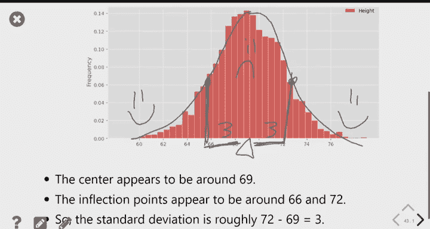

# UCSD《数据科学原理 (DSC 10 Principles of Data Science Fall 2024)》中英字幕（deepseek - P18：DSC 10 - Principles of Data Science - LE -A00- - Lecture 18.zh_en - GPT中英字幕课程资源 - BV1hmAneGEZh

All right， good morning everyone， welcome。😊，Just the usual assignments going on， lab and homework。

 Monday is Veterans Day holiday， so there's nothing going on for the class， there's no lab。

 no discussion， no office hours。😊，Okay， today we're going to talk about an inequality called Chevy Cheve's inequality。

 and we'll also learn about the normal distribution。Okay， so this is where we left off last class。

With。Our definitions of variance in standard deviation。 Okay。

 I showed it to you on an example data set， and we didn't see probably this formula in generality。

 but this is what we did for the example data set。 We took each each data sets value and we subtract it off the mean that gave us the deviations we call them and those deviations have a sign。

 but the signs would cancel each other if we average them out。

 So what we did was we squared all of those deviations first， and then we averaged them。

 so that's what the sum of squares divided by n is saying it's averaging the squares。😊。

And that gave us a number called variance， which measures how spread out a data set is。

 and then we took the square root of that variance to come up with a number that we call standard deviation。

 which also tells us how spread out the data set is because a number with a bigger value has a bigger square root essentially。

嗯。The， the exact interpretation of standard deviation is is challenging because of the fact that involves squarearing and square rooting。

 right， It's something about how far the data values are from the mean， right。

 But it's not like a directly interpretable statement about that。 Okay。

 the important thing to know is that larger standard deviation means more spread out。

 So remember the toy I had last time I was like moving the blocks further out from the middle。

 That's a bigger standard deviation。And because of the fact that we took the square root at the end。

 standard deviation has the same units as the original data。

 that's why we sometimes use standard deviation in place of variance。

 even though they're directly comparable like one is just the square of the other。

 but the square rooting is useful because it puts the value you get in the same units as the original data。

And there's a way that we can ask Python to calculate the standard deviation for us。

 N P has a standard deviation function， N dot STD。 and it takes as input some sequence of values like a list array series。

 and it'll tell you the standard deviation of those values Okay。

 so this was the number we computed last time， but it's good to like play around with changing the data set like right now it's 2。

3，3，9。 What if I change this3 to also a 9。 I the standard deviation going go up。

 We're going to go down or stay the same。Intuitively up， yeah。

 how come like the mean before was we saw it last time it was like 4 and a quarter。

So the nine is kind of like significantly higher than the mean and that's contributing a lot to the variance in standard deviation。

So by making this also a nine， I'm going to increase the mean a it。

 but I'm going to have two values that are pretty big。

 so the standard deviation is going to increase。Okay， so we go through this know， calculation。

To define this number called standard deviation， right。

 But what's the point of having such a number right？

 And the point is that it gives you some sense of how spread out the data is right and another。

 another thing we can do with it， is we can use the standard deviation to sort of tell us something about how far we have to go from the center or the mean of the data in order to pick up or collect most of the data。

 Okay， so what this is saying is is that no matter like what your distribution looks like。

 if you plot a histogram， some crazy shape。The mean is like the balance point。

 so maybe here and here。And what it's saying is a standard deviation is like a reasonable jump。

Such that you only have to go out a few jumps。To collect most of the data。Okay。

And this basically gives you a sense of like what， what scale your data is on。 For example。

 if you were comparing people's like midterm scores， right。

 like when when professors announce scores， they tell you like the mean medians and standard deviation。

 right， and the exam was out of like 100 points right。

 a reasonable standard deviation might be like 5 or 10， Like most people got you know。

 within five multiple values of multiple jumps of 5 or 10 away from the mean。

 But if you're talking about people's salaries， right。

 then a reasonable standard deviation might be like 10000， right， because people get。Paid within。

 you know， a few multiples of 10000 of each other。 So that's because the data is on like a very different scale。

But this is an important statement that says like no matter what the shape of your distribution。

 you only need to go out a few standard deviations away from the mean on the left or right in order to collect most of the data。

Okay， this isn't， this isn't like formally stated， but we can make it more precise。

And this is the precise statement of what I just said。It's called Cheby Sheev's inequality。

 Shebi Sheev was a mathematician， you'll see maybe his name spelled a few different ways because there's like different Russian transliterations。

But it says in any numerical distribution， the proportion of values that fall within the range。

Mean plus or minus z standard deviations。Is at least this amount？Okay。

 so this is actually giving us like a whole bunch of different results。Z can be any number。

For example， if z is 2。What is that saying， It's saying。

If you start at the mean and go left or right to standard deviations from that mean。

You're going to get at least， well， when you plug in 2 for Z here。

 you're going to get at least one minus a quarter or three quarters of the data。So again。

 regardless of the shape。Whatever the mean may be。A standard deviation is such that。

When you go out two of them。You're guaranteed。To get at least 75% of the data。

In the picture on the left， maybe I got around 75， maybe a little more。 and the picture on the right。

 I seem to have gotten like all the data。Okay， so it's very important this， at least， right。

 You may always get more than that， but you're never gonna get less。 Okay。

 that's why it's called the Cheby Che's inequality。 right， It's not an exact amount。

 It's at least this amount。And you can try different values of Z and you'll get different results right if you were to step out three standard deviations。

Right。Then you'd be guaranteed to get even more of the data。 right。

 If you step out four standard deviations， you get even more 5， you get even more， right。And。

This aligns with。What we said informally that you only need to go out a few standard deviations to get most of the data。

Okay，5 standard deviations will pick up 96% of the data That means like it's pretty rare for someone to be like I scored 10 standard deviations above average on my midterm。

 like very few people can say that similarly， very few people can say。

 you know I my salary is eight standard deviations below average right usually when you talk about how many standard deviations above or below average。

 it's a small number because most of the data is close to the average。Okay， does that make sense。

Okay， so let's look at this inequality and how it relates to the flight delay distribution。

So here's the histogram of flight delays that we've seen several times。

 the average flight delay is about 16 minutes。 we talked last time about how this would balance around here。

Now we're going to calculate the standard deviation of flight delay。

So notice to find the standard deviation， I'm grabbing out the delay column。

 a series and feeding that in to the NPI standard deviation function okay there's no standard deviation method。

 you can't just dot get delay dot standard deviation that doesn't work so we feed in the full series as an input to the standard deviation function。

Okay， and the answer is about 40 minutes。 Okay， so that number 40 minutes is saying something about like how spread out our data is。

 It's saying the mean is 17 minutes。 What's 17 plus 40，57。Plus another 40 is 97。Okay。

 so it's saying like you take jumps about this big and you only need a few such jumps to collect most of the data。

Does that make sense？Okay， so here's some specific things that we learned about the flight data set。

 at least 75% of delays are in the interval， mean minus two standard deviations up to mean plus two standard deviations。

And when Z is3， at least 88。88% fall in this wider range， but here's what they look like。Okay。

The green is the mean。The red bars， which are the ones you know right outside the green。

 those talk about being two standard deviations away。

 and I'm guaranteed to get at least 75% of the data。 Do I get 75% of the data within the red bars。

It's actually much more like， yeah， I'm only missing this little bit。

 I probably get like 90 something percent of the data， right， But the 75 is a lower bound， right。

 And then when I go out three standard deviations， which is between the blue bars。

 I'm guaranteed to get even more like 88%。Okay， so this is the lower bound。

The lower bound was 75% delay of delays or more will fall in this interval， right。

 the actual amount of delays that fall in that interval we can calculate through querying。😊，Right。

Take all the delays。Figure out if they're greater than or equal to the left end point of the interval。

 the mean minus two standard deviations and。They have to be less than or equal to the right end point of the interval。

 That's going tell this is going to be a smaller data frame of just the delays that fell within the certain colored bars right。

 What color did we have， I forget already。Between the red bars， okay。

And then dot shape here is going to tell me how many there were out of the total number of flights。

So yeah， I got actually like 95。6% of the data within those red bars。Okay。

 if you know more about how the distribution is shaped， right。

 you might be able to make more precise statements。 Chevy Cheev's inequality is extremely general。

 It says for any distribution， regardless of what it shaped like。

But if you knew your data was shaped a certain way。

 then you might be able to say more precisely like how much data you'll get when you go out two standard deviations or three standard deviations。

 and we're going to see that later today for a special type of data。All right。

Any questions on the Cheevvy Che's inequality。Try out this activity。It's like a practice problem。好。

Okay。So this says at least eight/ ninths of the data falling between a certain range。

 right where does at least eight/ ninths come from well Shevy Cheve stated like at least one minus1 over z squared。

RightAnd the idea is that this is going to equal 89th for some value of Z。And the Z is3。

So you can solve that， or you can just kind of try a few Z's until you get it。 So Z is3。

 It's saying at least this amount of the data。Falls between these bounds。

 and these bounds are three Ss away from the mean。Okay， so whatever the histogram looks like。

 there's some balance point， that's the mean。And when I do three。

Jumps each jump is a standard deviations worth， right three Ss to the left and three Ss to the right。

I wind up at negative 20 over here。And 40 over here。Okay， so based on that， what's the mean？

Whatever halfway between， which is what？10 right that's a distance of 60 right half of 60 is 30。

 so 10 is 30 away from each of those endpoints Okay so you can find the mean based on this alone。

 you can also find the standard deviation based on this alone because this interval is six standard deviations wide right and it's a 60 units so six Ss equals 60。

So an SD equals 10。Makes sense。Okay， any questions。

One thing I didn't mention that I like to talk about when I introduce。Shebby Cheev's inequality is。

Does anyone see why this table does not include z equals 1， I started at2，3，4，5。Yeah。

 so the statement is true when z equals one， but it's kind of useless。 When z is1。

 what does this say，1-1 over 1 squared。 That's， that's 0。

 So it's it's guarantees that you get at least nothing when you go one standard deviation away。

 So like that's not really a guarantee。 right， So it's the statement is true because you always do get at least nothing。

 but it's kind of pointless。 Also， it's good to know that Z doesn't have to be an integer。 You know。

 you can use Z equals。😊，1。7， right and get some statement about how much data you get within 1。

7 units of the center， okay。But these are the sort of commonly used ones。

 So I just put those in the table， but any Z works and any shape， oh god。

 any shape distribution works。Okay， now let's go on。To our next topic。Of standardization。

 And to introduce this topic， we're going to work with a new data set。

 So this is the data set of heights and weights of 5000 adult males。 Pretty big sample。And yeahep， 5。

000 rows， two columns。And let's look at the distribution of each of those columns to see like what are these men's heights and what are these men's weights。

Okay， so here's the distribution of people's heights。It's saying like， I don't know。

Men typically are like， I don't know， in the high 60s or low 70 number of inches tall。

And also like the shape of it is saying like having a moderate height is way more common than having an extreme height It's just got this one big peak。

 and then it really like has not much area in the extremes that reflects what you know about people like it could be the case。

 but it's not that there's like two types of heights you could have right like half the people have a short height and half the people have a tall height and then the distribution might look something like this。

 but that's not you know how height behaves And that's just like a function of like biology or you know how people turn out to be no one like did anything to make this data this way。

 that's just how the data was when we collect。And the crazy thing is that if you look at a histogram of the weights。

It also like has the same shape。 Okay， and this is just sort of coincidence。 Like in nature。

 like this is how people's heights and weights are distributed。嗯。This distribution is different。

 though， even though it looks pretty similar in the picture。

 it's different because it's centered at a different spot， right。

 People's weights and pounds are generally significantly higher of a number than their heights in inches。

 right。And also， the spread is different， right， Most people's heights are within like， I don't know。

5 or 10 inches of of average， and most people's weights are within like maybe 100 pounds of average okay。

So you can really tell the differences between these two histograms when you plot them on shared axes。

 Okay， remember that the total area of each histogram has to be one。

So the fact that the blue weight distribution is spread out so much more than the height means that for the height to have the same area as the weight。

 it has to be much taller。So these distributions basically are the same shape。

 that shape is called the bell curve， but they're centered at different places。

 you could think of that as like you shifted one to the other or away from the other。

 and they're also stretched differently。啊。🤢，Distributions that have the shape are called normal distributions and the shape itself is called a bell curve Okay so we're going to study this distribution in part because it just comes up in nature right there are certain things that just follow this shape sort of that's just the way it is but also we've seen the shape before when we've like done simulations of things So this is a shape that also tends to occur when we generate data。

Okay， so there's many different normal distributions when you say a normal distribution you're not talking about a single distribution because both height and weight are normally distributed。

 they have differences， though， they have different means in different standard deviations So the center and spread are different but if you talk about a normal curve with a given mean and a given standard deviation that uniquely defines the curve right there's only one normal distribution centered at five with a standard deviation of three that's describing like the shape is normal。

 it's bell curved， where to put it on the axes and how stretched out to make it that's tells you everything about it。

Okay， so here's a bunch of。Different normal distributions centered at different places。

 you can see the means and having different amounts of spread。😊，And the， the。

The reason that this green one is taller is because it's narrower。

 so it has to like its area just goes taller。 so it has the same property of histograms that the area under the curve is one。

And you can make any normal distribution into another by shifting and stretching。 right。

 So if you wanted this red to line up with the， with the blue， what would you have to do， right？

 This is centered at negative 15， and the blue is centered at 10。 So you would have to like add。

ItWas at 25 to all the values in red， and then you'd have to like shrink it up somehow。

 like divide by something to make it less stretched out。Does that make sense。Okay so。

There's basically a procedure that allows us to change one normal distribution into another。

 and this procedure is called standardizing， it's like putting all the normal distributions on the same scale。

So if you have some numerical variable， say x could represent heights or weights or whatever。

 and Xi is one particular value of that variable， like one person's height or one person's weight。

 you can standardize that variable by taking the original value and subtracting the mean。

And then dividing by the standard deviation。Okay， so this numerator represents something like let's say。

I think I have an example here， yeah。Okay， let's say someone weighs 225 pounds。The average。

Did I not define it？Though， now here。Okay， the average weight。Of an adult male iss 187 pounds。And。

The standard deviation of weights is about 20。 Okay， so when you do this calculation of taking。

Their weight 225 and subtracting the mean weight， 187。

 the numerator represents something it's telling you number of pounds above average。Okay。

 so what's 225 minus 187？25 plus 13，38。Makes sense。 So this person is 38 above the average。

 What does dividing by the standard deviation do。Sorry， what。Yeah， this is like changing units。

 So think of like， I don't know。 you measure something in inches and you want to measure it in feet instead。

 right， What do you do， You divide by 12 because there's 12 inches in a foot， right？

 So think of the unit originally is pounds， right，38 pounds above average。

 But when I divide by a standard deviation， I'm changing the units from not pounds。

 but to how many standard deviations。Okay， so a standard deviation in， in my example， was like 19。

 I think。I think that works out perfectly。And standard deviations are also measured in pounds， right。

 so 38 pounds over 19 pounds is two。Okay， so standard units is like a unit less unit， right。

 it's not pounds， it's not dollars， it's not inches， right， it's just a number。

 and it represents how many standard deviations your value is above the mean。

So this person who weighed 225 pounds was about two standard deviations above the meat。

 So you think of weights， the average weight was 187。

Add 19 to that because 19 is a standard deviation。 what's that 206。 add another 19。225。

 the person is is there， So there are two standard deviations above the mean。

 and that's what the standard units tells you。Does that calculation make sense why we do it that way？

It's not exactly two because I was approximating these numbers， but pretty close。Okay。

 so this process of putting a variable into standard units is called standardization， the results。

 the values are called standardized。And you can do it to an entire set of values at once。

 like I just did it for this one person who weighed 225 pounds。

 but if I had everybody's weights in a column right， I would just subtract the mean of that column。

 this gives me everybody's number of pounds above average。

 notice it can come out negative right if your weight is below average。

 then when you take your weight and divide and subtract the mean it's going to be negative。

So that's why we say how many pounds above average， because if it's negative。

 a negative amount above average means below F。And then we divide by the standard deviation of the call。

 so I can do it for the heights。And for the weights。

And it's kind of cool to like compare these because the first person here right。

 is the first person there。 This came from a data frame where like the the first row was a person and the second row was a person。

 So you can kind of like see what people's body types are like by。

 by looking at their standardized height and standardized weight。

 Like so this first person was like a pretty big guy right， his height was。😊。

One and a half or two standard deviations above average， meaning he's pretty tall， right。

 and his weight is also significantly above average。The next person。

Its pretty close to average in height， slightly short， just slightly。

But they're significantly underweight。Does that make sense。

So that's kind of what these numbers tell you right without looking at their actual pounds or inches。

 it's kind of like a relative measure of how they compare to others in the data set。

So after we standardize a standardized variable is going to have a mean of zero okay why does this happen is because we took our data set of numbers。

 whatever they were and we subtracted the mean from all of them so like a data set that was centered at 187 say for pounds right now we've subtracted 187 from everything that just shifts it。

And so now it's centered at zero。Similarly。After a variable is standardized。

 it has a standard deviation of1 because whatever the standard deviation used to be like 19 in our example。

 well we've just divided it by all the values by 19。

 so now the values are less spread out right they're a factor of 19， less spread out。

So we can use the series describe method to verify that this is the case。The standardized heights。

This number tells me how many there are there were 5。

000 people in my data the mean is the average height after being standardized and it's supposed to be zero right it basically is this is some number times 10 to the negative 15 okay so it's just a small rounding error。

And the standard deviation is one。Similarly， when we do it to the weights。There's 5，000 people。

 the mean is basically zero， and the standard deviation is basically what。

So let's look at what this standardization process does to the graph。Okay， this is people's heights。

Originally， the average height was。I don't know。Play it again。

69 inches or so was the average height when you subtract the mean from each value。

 what it does is move it over， centers the distribution， so the mean is zero。

And then when you divide by the spread or the standard deviation。

 it just shrinks up the data so that it has a standard deviation of one。Does that make sense？

So this comes out looking this way， in the end， the mean is  zero and the standard deviation is one。

And now let's look what happens if we do it to the weights。

The weights are originally very low and spread。So they have more distance to move right the original average weight was like 187。

 so it you got to subtract 187 from everything， and then you're dividing by like 20。

 so it really shrinks it significantly。But if you do this sort of on the same axes。

After the data has been standardized， you plot the heights and weights。

 they look almost identical right and this is reflecting the fact that the original histograms of data of heights and weights had the same shape right The only differences about them was where they were centered and how scaled。

 how stretched they were， but we just addressed that by standardizing we made them have the same center and we made them have the same stretch。

 so now they like line up very well。Okay， so this distribution that we got from standardizing has a name it's called the standard normal distribution standard means having a mean of zero and having a standard deviation of one。

So this standard normal distribution is defined by its mean and standard deviation。 right。

 There's many normal distributions， but there's only one standard normal distribution。

And there's a mathematical like formula that describes the shape of the curve。

 it's given as a function of Z， you might call it X on the horizontal axis。

 you don't need to know this formula， but we are going to use the formula today to like graph the shape of the curve if you're interested in math。

 I think it's kind of interesting to think about how like the square of the Z is what makes it be symmetrical and things like that。

嗯。Okay， so this is just a function that plots the standard normal curve。

 you don't have to worry about the details of the code。

But this is what the standard normal curve looks like notice it's like a perfectly smooth bell curve whereas our histograms were from actual data。

 so it wasn't as perfectly smooth， but it basically has the same shape。It's centered at zero。

 the standard deviation of1 says you only need a few jumps of size1。

To pick up most of the area under this histogram。Okay， so。

When you you hear the word like normal being thrown around。

 they're talking about data having a certain shape， so people say heights are normally distributed。

 weights are normally distributed， other things like how much time you sleep at night is normally distributed。

 like certain biological things have this shape。Okay。

So here's height and weight come from actual collection of data and here's this normal curve that comes from some math equation。

 and I think it's pretty cool and crazy like how well some math equation describes like real life phenomena that nobody altered or had any you any hand in。

 okay， it just turns out this way。😊，So when we talk about the standard normal distribution。

 we'll think of it as like a continuous version of the histogram， right。

 just like the histograms have area one， this standard normal distribution also has area  one underneath。

The normal curve is symmetric， so its mean and median are the same at zero。

We're going to talk later about inflection points and what that means。

The key thing is like a histogram， the area between two points represents the proportion of values that fall there。

Because the total area is one。So this is a little thing that you can play with， right？

You can change like the endpoints to talk about the area between certain endpoints and like the shaded area。

 you can think of that as like a fraction of the total shaded area and that represents how much data falls there。

Okay， so how do you actually figure out how much area is under this curve with a histogram。

 you know how to do it because histograms are made up of little rectangles and you can calculate the area of those rectangles right。

 But this thing is like some smooth shape。 and how do you find the area of like some some smooth shape。

The way you typically find area under curves is through calculus。

 but we're not going to use calculus in this class because it's not a prerequisite for the class and also calculus isn't that specifically helpful for this function because there's no close form antideriv that you can use to find the area okay so what people do instead。

😊，Is they like have these reference tables。 You might have seen this like in the back of a stats book or something。

 This was the old fashioned way to do it that had like approximations to this area。

 and you would just look it up。But what we're going to do is there's a Python function that calculates the area under this curve for us。

 so that's what we're going to use。Okay so。The， the name for what we're doing is we're looking at a cumulative density function。

 What is a cumulative density function， It's a function。That is specific for a certain distribution。

 So we're looking at the cumulative density function of the normal distribution。 right。

 You could have a different shape distribution， and it would have its own cumulative density function。

 And what the cumulative density function does is it takes in a certain value Z。

And it says how much of the area or how much of the data。Is less than or equal to that value of Z。

Which geometrically is like the area under the curve to the left of that point。

 so when you see CDF or cumulative density function。

 think area under the curve to the left of this point。

 so when the curve that we're working with is the standard normal curve。

The function that we use to calculate area under the curve to the left of Z。Has this crazy name， spi。

tts。orm。cdf it's like from a package within a package within a package is why it's called this okay。

But the， you know。You can just copy， paste that when you need it or look it up the CDF as a thing to remember。

 CDF means area under the curve to the left of blank。Okay， so for example。

If you were to do the CDF function evaluated at0。It would be calculating。

Area under the curve to the left of0。And what's the answer to that。What's the answer to this。

 how much area is yellow here？Po5 or a half， because the total area is one， and it's symmetric。

 right so。That's what it tells you， right？Now， the CF function is kind of limiting because it only tells you area to the left。

 right， What if you wanted area to the right， What if you wanted this area from two all the way to the end。

Well， there's a few ways you could do it。You could say， well， how much area is to the left of two？

Like 97。7% of the area is to the left of two。And then you could subtract it from one。

And that will tell you how much area is to the right of two。

 So knowing area to the left and the fact that the total area is one is enough to tell you area to the right。

There's actually another way to。To do this without doing any subtraction。

Do you see how you might find the size of this area without subtracting？就。Right， by symmetry。

 you can also say area to the left of negative 2 is the same as area to the right of positive 2。

So if you just do negative2。That's going to give you the answer sort of directly。So。

It's you can sort of use this area to the left of function in clever ways。

 Here's another thing you can do。You can find the area between two points if you want to know the area between negative 1 and zero。

 and all you have is a thing that tells you area to the left of blank。

 how do you use that to do this？What's your strategy？Yeah， you can use subtraction。Yeah， see how。

Oppossite less than zero， how much areas left to the left of zero that will tell you like， well。

 we already know it's a half， right？And then from that half。

 figure out this area left of negative  one and take it away。

 And then you're left with the yellow only。So area left of0 minus area left of negative1。

It's the same。Right， so you can also do it with symmetry if you want to use positive numbers， yeah。

So there's often like multiple ways to。To answer a question like this。

 using a combination of subtraction， subtracting from one， using symmetry， okay。

 so I showed you like the basic ways， a general strategy for area between A and B is area to the left of B。

 minus area to the left of it。Okay so how do we use this？

Let's go back to our data set of heights and weights。Both variables are roughly normal。

 how does that help you？Okay。The， the key idea is that when you put。

When you make a plot of the standard normal distribution。The X axis represents standard units。

It's all like it's already been standardized。 So the x axis is standard units。

 So if you're asking like for the area between negative one and positive one。

 that tells you the proportion of values within one standard deviation of the me。Okay。

 so if you have a distribution that's roughly normal like heights or weights right and you wanted to know what proportion of values fell between two certain points。

 like what percent of men are between 65 and 70 inches tall。

 the way you answer a question like that is you convert。Those inches， 65 to 70。

 convert them each to standard units。And then。You can use the area between those points on the standard normal curve。

Okay， so let's try it。You want to know what proportion of men weigh between 200 and 225 pounds？Okay。

 you can do this based on just knowing。The average height or the average weight。

The standard deviation of weights and the fact that it's normally distributed。

so what is 200 pounds in standard units if the average weight is 187 and the standard deviation is 19？

So I have to convert 200 pounds to standard units by subtracting off the mean。

And dividing by the standard deviation。Okay， so it comes out 0。65。

 it means like it's just a little bit above average。And if I do it for the 225 number。

 I already did this before， I got a number that was close to two。Okay， so basically。

 what I'm saying is。How much area is there under the standard normal curve between 065 and 1。92？

This is the picture。 It's like basically saying if you took the weight histogram。

And like plotted it here。It looks something like this， I'm not drawing it great。

 but right here would correspond to 200 pounds。And right here would correspond to 225 pounds。

So what fraction of people are in between there is basically the same as this question of what fraction of area is between 0。

66 and 1。92。Does that make sense？So。I can calculate it using the CDF thing。

 how much area is to the left of this right endpoint， 1。92， minus。

 how much area is to the left of this left endpoint of 0。66， and I get like 23% or so。Okay。

This is an approximation because it comes from。From using this perfectly smooth bell curve， right。

 and the the actual weights were not exactly perfectly smooth。 That was real data。

 But you can see how well you did by looking at the real data。So if I have access to all the data。

 I can just say how many of these people weigh between 200 and 225。

Divide that by how many people there were。Right， and it's awfully close。 Okay。

 The reason it's so close is because the data really does follow that bell curve shape so nicely。

Questions on this？Something to be careful of is that standardizing a distribution doesn't make it normal。

 Okay， What standardizing does is subtracts a value from everything。Which moves it left to right。

And then it divides by a value which compresses it right So standardization is like this trick that we did for weights would only work for things like weights or heights that are normally distributed。

 right You can't just use that CDF function for the standard normal curve unless you start with things that are normally distributed。

Let's go back to a point that we made earlier in the lecture about how Cheby Cheev's inequality gave us a lower bounds for how much data you're going to get when you step out a few standard deviations and we said if you knew something about the shape of the data。

 you might be able to say even more Sheevby Cheev works for anything。

 but when your distribution is normal like this is not all the time this is a special case like heights or weights。

 then you can say even more precise things about how much of the data you're going to get when you go out a certain amount。

 because you just know what shape you're talking about。Okay。

 so when you go out one standard deviation， we talked about this before。

 Chebi Cheev gives you like the pointless guarantee that you'll get at least nothing。

But for a normal distribution， if you know your data has this bell curve shape to it。

 then when you go out one standard deviation， you will get actually about 68% of your data。

Notice this last column is not a lower bound， it's an actual like close number approximation。

Similarly， when you go out two standard deviations， you're guaranteed to get at least 75%。

 but when it's a normal distribution， you actually get around 95%。So the numbers in the last column。

Are all greater than or equal to the numbers in this column？

RightBecause it has to be the Cheevy Che numbers were lower bound， so it can't be any less than that。

 And what we're saying is for a normal distribution， it's actually higher。

 And that makes sense because normal distributions like the data is crunched towards the middle。

 So you're going to get a lot of data when you go out a little bit。This one。

 this was the thing when you plug in z equals1 here， right， it doesn't tell you anything useful。Okay。

 other questions。So where do these numbers come from？In that last。Column of the table。

It just comes from doing the CDF thing。 How much area is there within one standard deviation of the mean。

 right， That's like saying how much area is there between negative one and positive one。

 And I can do that by subtracting。Area to the left of one。Would include。All of this。

 then I take away the area to the left of negative 1， get rid of that。 it leaves just the yellow。

Okay， and that number comes out to around 68%。which says that anytime a variable is normal。

 like height or weight， you're going to get 68% of the data within one standard deviation of the mean。

Similarly， if you do it with negative 2 to positive 2。You're going to get about 95% of the data。

 okay。Notice that since the bell curve is symmetric。

The remaining 5% is sort of split evenly on both sides。

 this should remind you a lot of what we did with confidence intervals of like getting the middle 95% and leaving two and a half on each side and what we'll see in the coming lectures is that there's actually a connection between what we're doing here and what we did with confidence intervals and it works out really nicely that this 95% happens in both places。

Okay， so that's kind of like where these numbers come from。

 it's just from the CDF function area between two values。嗯。

And they apply to all normal distributions， heights， weights， standardized， unstandardized。

 because everything is just shifted or stretched from that basic standard normal distribution。Okay。

 the last thing。Is telling you what an inflection point is。Okay。

 so an inflection point is defined as the point where a curve goes from like changing its curvature and the way I think about it is。

It goes from smiling to frowning or vice versa。So right up until there。

 the curve follows like the shape of a smiley face， but then after it。Follows the shape of a frown。

 And after that follows the shape of a smile again。

 So these two points I drew are called inflection points。

And the standard normal curve has its inflection points at plus or minus1。

Which means the inflection points are always one standard deviation away from the mean。

And that fact can help you sort of eyeball the standard deviation of a distribution because a standard deviation's worth is like how much gap there is between the center and the inflection port。

Okay， so I'll show you this as my last example。Right。This is people's heights。The center is about 69。

And if you kind of eyeball。Where is the curve changing from smiling to frowning and vice versa？

It happens at around 66 and 72。And those are three away from the center。

 So this gives you like a quick sort of a way to judge by eye。

 what's the standard deviation of a normal distribution。Okay， we will stop there。

 I'll see you guys next time， thank you。

