# UCSD《数据科学原理 (DSC 10 Principles of Data Science Fall 2024)》中英字幕（deepseek - P19：DSC 10 - Principles of Data Science - LE -A00- - Lecture 19.zh_en - GPT中英字幕课程资源 - BV1hmAneGEZh

Okay， good morning， everyone。

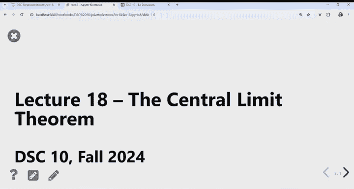

We have upcoming homeworks and labs do Sundays and Thursdays。

 there's also a quiz this coming Wednesday， so the quiz covers lectures 13 and 15 through 18。

 14 is not included because that was the day we did the midterm review。

 so this is all stuff that wasn't tested on the midterm。And Mondays a holiday。

 so there's no anything。I also wanted to point out a couple things from the opportunities thread I posted these last night。

 but if you didn't see them the data science undergrad student advising is having an event Wednesday to just kind of hang out and you can ask advising questions it's like partial social event。

 partial advising event so that link is on our ed page and there's also another thing here that doesn't have a picture but this is a beginner programming competition so students who are like taking lower division CSC or DSC classes can sign up for this and it's just a short time commitment it's try to solve 10 problems in three hours and it's good experience and it might be fun so feel free to sign up for that if you're interested。

Okay。So we're going to remember what we did last time with standard units。

 and then we're going to learn a big theorem called the central limit theorem。

And see how it relates to what we've done with finding confidence intervals。

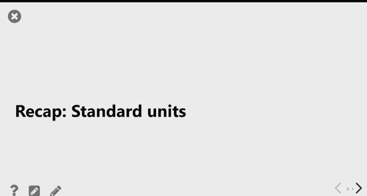

Okay， so this was our definition that we gave last time of standard units。

We were working with heights and weights， but you can do this for any data set that's numerical。

 standard units basically calculates。How many standard deviations of value is above the mean？

OkaySo I like to visualize that with pictures that look like this， here's the mean。

 this point is one standard unit。This point is two standard units。

 This point is three standard units right and and anywhere along the way is possible as well。

 you could be one and a half standard units， right， The jumps that I'm taking are each in S D big。

And standard units can also be negative。Because if you're negative one standard deviations above the mean。

 that means you're one standard deviation below the mean。Okay。

 so this is the picture to think of when you think of standard units， and this is the interpretation。

Okay， take a minute to try this problem based on that interpretation of standard units and see what you can conclude。

I'm going to draw a picture just like I did on the last slide。SAT scores have a mean of 950。

And a standard deviation of 300。 So that means when I'm talking about these jumps。

 they're jumps of size 300。So this would be 1250， this would be 1550， this would be 1850。Right。

 and your friend claims that their SAT score in standard units is two and a half right。

 This is one standard units。 This is two standard units。 This is three standard units。

 So two and a half is like here。 right， That's half of 300 is 150。

 So I'm going to add another 150 to 1550 and get 1700 Okay， SAT scores only go up to 1600。

 So basically this this can't be right you conclude。I'll just say nicely that this can't be。

 but you could say something ruder about your friend。Okay。

Does that make sense？I didn't use the formula， right， but if you wanted， you could use the formula。

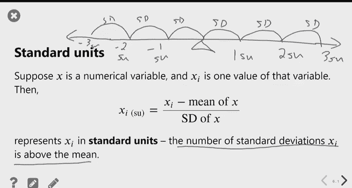

The X， I。

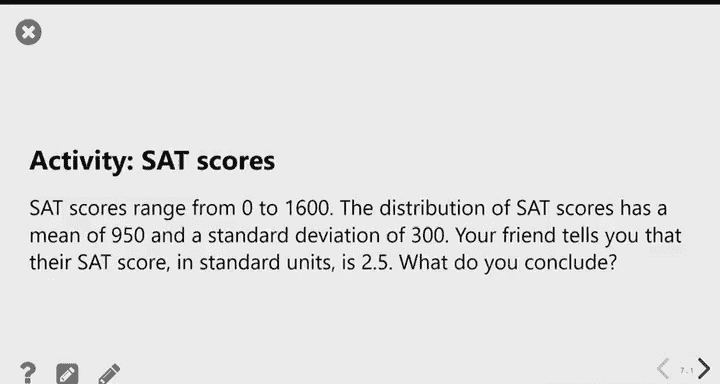

Would be， just do it here。 the score that they said they got， which you're trying to figure out。

 The mean score was， what did I say。9，50。 Thank you。 And the S D was 300。

And this gives their standard units， which they claimed was two and a half。

 and you could just solve this for X I and you'll get the same thing。Which was 1700。

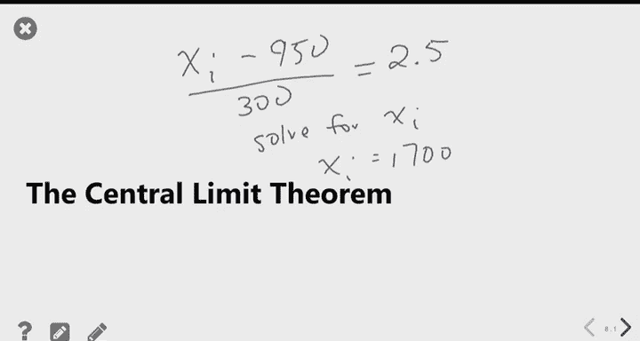

我就。Right， so negative 2。5 standard units would mean。In the picture。

 like over here between the negative2 and negative3。 So in this case。

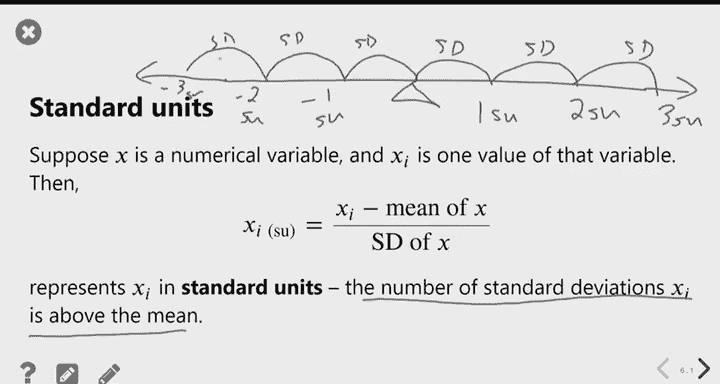

Would that be possible， that would be 300， 600， 750 below average would be possible。

 that would mean they got a 200。

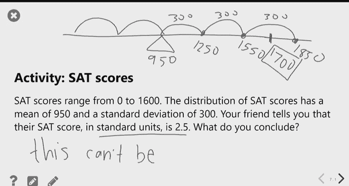

Does that make sense？Okay。Alright， now we're going to learn about this theorem called the central limit theorem。

 and to do that， we'll use the flight delay distribution that we've been looking at。

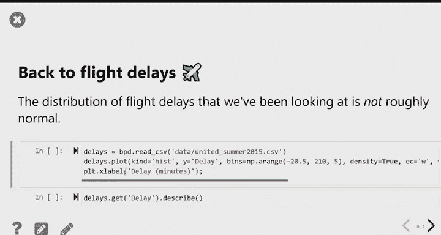

And notice when you look at this distribution of flight delays， it's not normally distributed， right。

 we've talked last time about heights and weights and certain other phenomena being normally distributed。

 but this is certainly not。And there's a reason for that is because they can make flights leave late。

 but they can't really make them leave early。

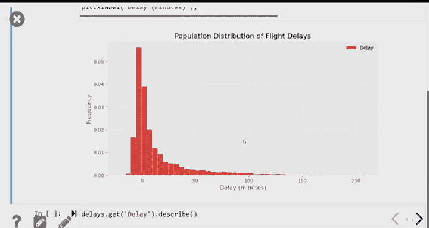

So some important information about this distribution， there's about 14，000 values。

 so this is a data set of 14，000 flights。The mean flight delay is about 16 or 17 minutes。

 so the histogram would balance like around there。And the standard deviation is around 40 minutes。

 okay so you have to do multiple jumps of 40 minutes to collect most of the data。

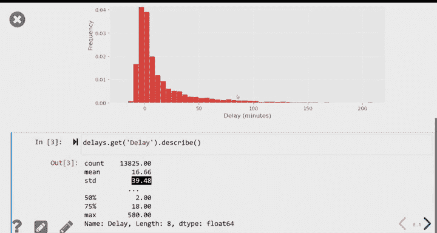

So before we started talking about normal distributions and center and spread。

 we were talking about bootstrapping right and the purpose of bootstrapping is to give you a sense of how some sample statistic would have turned out for other samples。

 but it's a way to do that based on having only one sample。

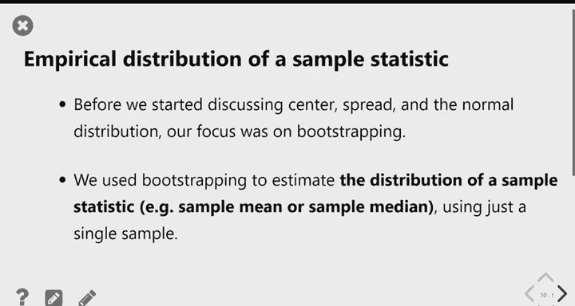

OkayAnd the purpose of understanding the distribution of your sample statistic is so you can make a confidence interval for some population parameter。

 right， the goal in seeing how the statistic would have come out in other samples is because you want to use that information to make a better estimate for your parameter。

 Okay， so bootsshopping is all about estimating some unknown parameter。

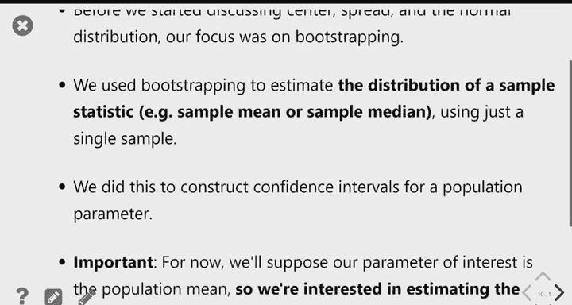

And what we're going to focus on today is the special case where the parameter that you're interested in is the mean。

 so the population mean is your parameter， and therefore。

 the statistic that you're looking at is the sample mean。

 sample mean is an estimate for the population mean。

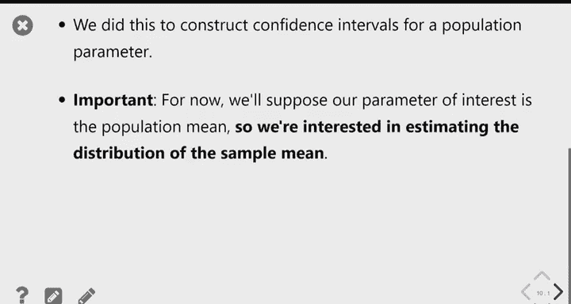

And we could do the process that we've done with bootstrapping to come up with a confidence interval where we think our population meanfalls。

 but what we're going to learn today is another strategy that also gives us a way of estimating the distribution of the sample mean and coming up with a confidence interval。

 but it's sort of a shortcut to bootstrapping。 You don't even need to bootstrap。

Bottrap is like a shortcut to the impractical situation of going back to the population。

 and it's based on a single sample， but it still does require a lot of computation right you have to bootstrap like 500。

10，000 times， so this way is a shortcut even to bootstrapping where it's also based on a single sample。

 but it doesn't require you to do such a big simulation。Okay。

 so that's kind of where we're going today。 We're going to look at the distribution of the sample mean。

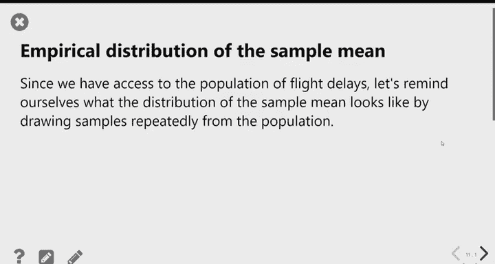

And we're going to start by doing the most impractical thing。

 going directly to the population to look at many samples and see how their means turn out。

 just repeatedly draw samples from the population。So let's look at the code to do that。

I have 2000 times， what am I doing just going directly to the population and getting 500 flights。

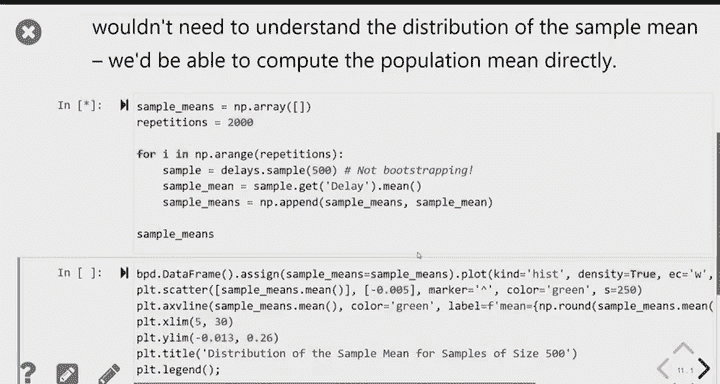

Taking the mean delay of each flight and adding it onto my array， Okay。

 so this accumulator pattern should be very familiar at this point and we use it all the time and you're getting practice with it in the assignments too okay。

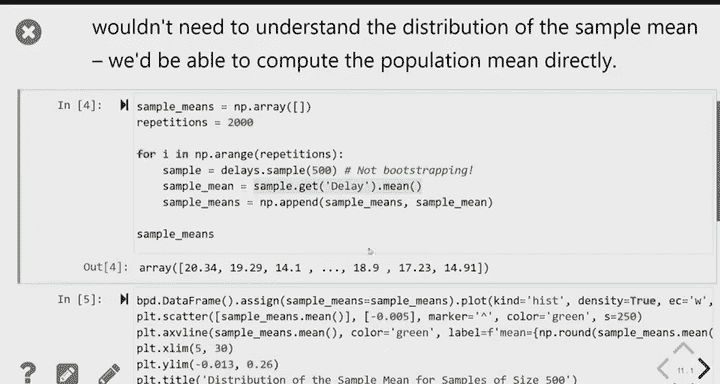

Now this histogram shows the distribution of the sample mean for all the different samples that I collected right so the redness of this histogram represents the 2000 times that I took a different sample and what the mean of that sample was so the mean typically came out like between maybe 12 and 22 like those were like typical values。

嗯。Most of the time， right， it came out really close to the actual population meat。

The actual population mean was like 16 point something。

 and the mean of this distribution is very close to that， 16 point something。

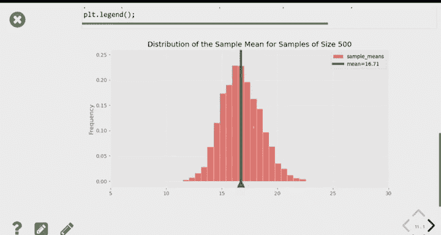

and we've been studying normal distributions。 you might notice that this distribution is normally shaped。

 right， it's shaped like a bell curve。

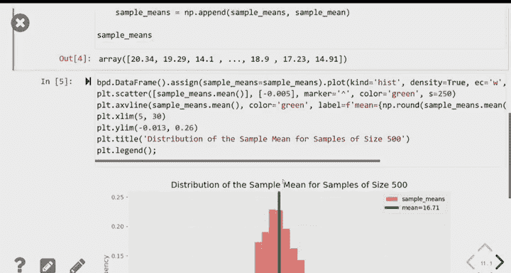

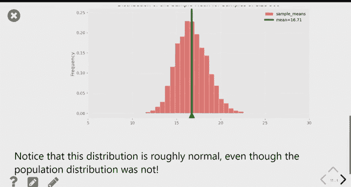

U。

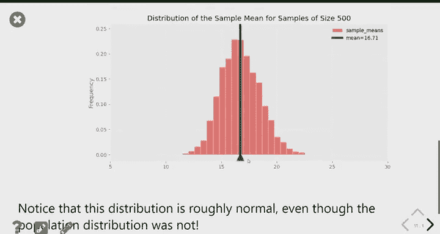

Which is interesting because the flight delays themselves were not bell shaped。

 but when you look at different samples from that population and their means。

 then the distribution of the sample means becomes bell shaped。

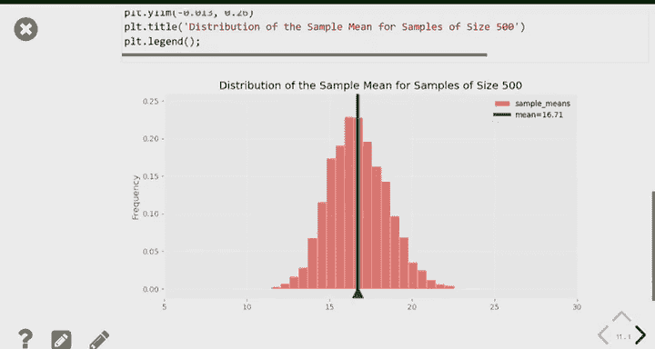

Okay。Now we talked about the center of this distribution， it's centered at the population mean。

Can you estimate the spread or the standard deviation of this distribution。

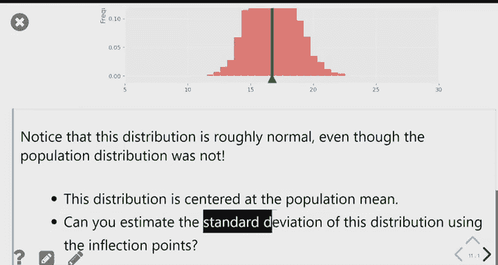

Using the inflection points， okay so this is a little trick。

That's useful to kind of eyeball the standard deviation of a bell curve。

 it doesn't work for other types of distributions， but for bell curves。

Bell curves always have the same shape。Right， and there's like a point。Roughly there。

 two points where they change curvature， so smiling before this。

 frowning between this and smiling after this。And。I'm going to guess that， I don't know。

You have to the question is how far away is each of these points from the center， okay。

 I'm going to say maybe two。Two units away。That distance is about two units。 I'm just eyeballing it。

 So my guess is that the standard deviation is approximately 2。

And I see that the mean is approximately the 16 or 17。She needs a slash。

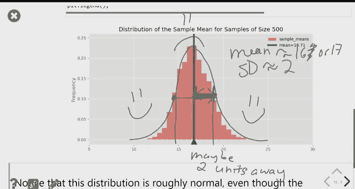

Makes sense。Okay， so the fact that this distribution came out normal。

 came out bell shaped is is what we call the central limit theorem Okay。

 the central limit theorem says that when you look at the distribution，Of the sum or mean。 Okay。

 so we really just looked at the mean。But it turns out the statement is also true for sums。

 so we'll focus on the mean case when you look at the distribution of the mean of a large random sample drawn with replacement。

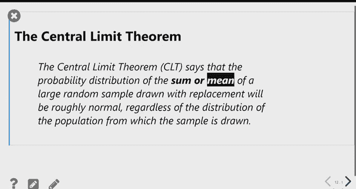

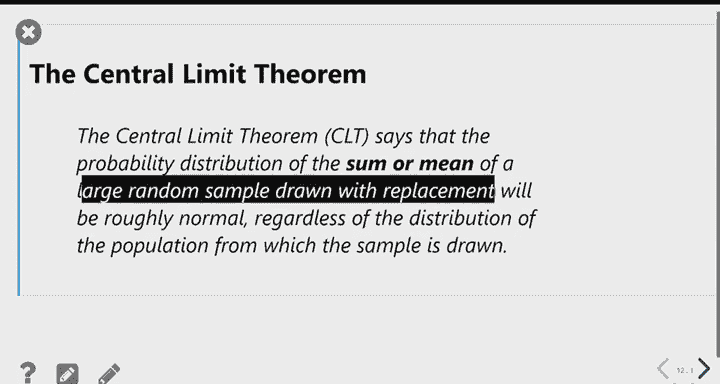

That distribution is going to be normal。And it doesn't matter what the population looked like that you were drawing the samples from。

So the population in this case was like that very right skewed flight delay distribution where some flights took hours to take off so the population was very abnormal and despite that。

 the distribution of the sample means comes out very normal。

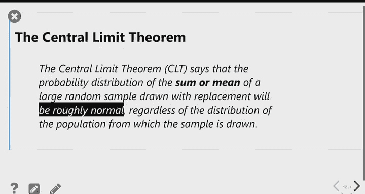

Okay。So the statement holds for sums and means， we're going to focus specifically on the case of means because that's more commonly what you would want to estimate。

Yes， exactly。 So the reason this comes out， bell shaped is because of the central limit there。

But in this like。

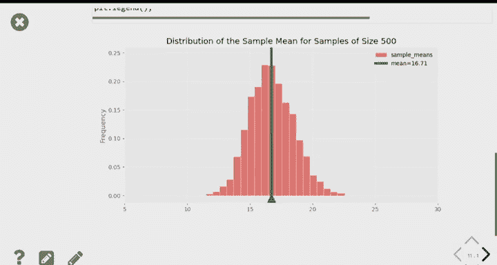

Yeah so。It's talking about this is talking about the distribution of the sample mean when you take samples。

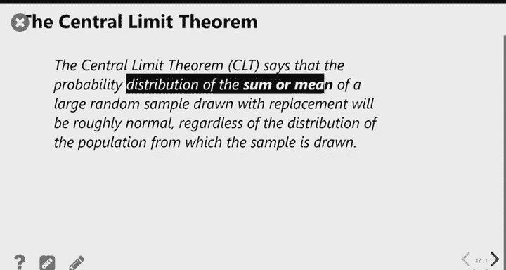

From the population。 So ignore the replacement for a minute。

 the replacement will hold put a hold on replacement。 Okay。

 this is this is just saying the distribution of the of the means of your sample。

 So this is talking about the process。Of taking random samples from the population。

Which is what we're doing。

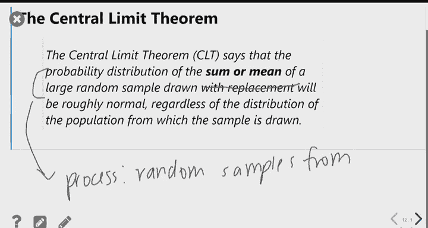

We'll see that it sort of does because because using a sample as a population is like an approximation。

 so the same thing will be true for that， but the statement is about like the theorem the way it's stated is about the process we just taking samples from the population and that's a good question is like is it also going to apply。

 I'll write that。Does it also apply to the process？Of reampling。

because we said resampling was like similar to taking new samples from the population。

 and we'll see that it does apply in that case because it's so similar。Yeah。

 so I use there's a thing that says the standard deviation is the distance between the mean。

 the center and the inflection points。 So that's what I was doing to say it was two。

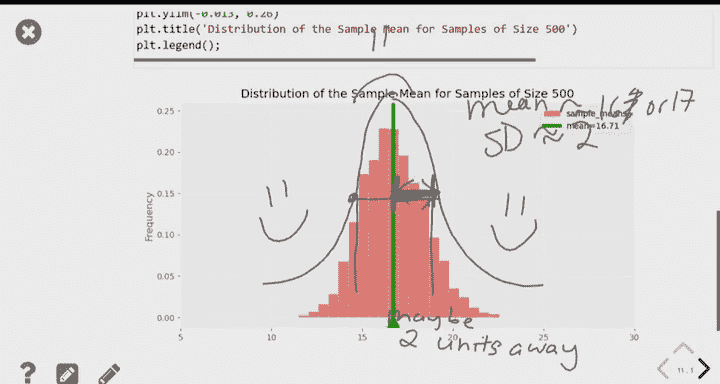

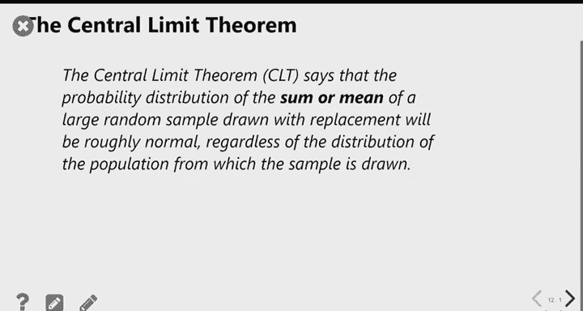

Yeah。Anything else？

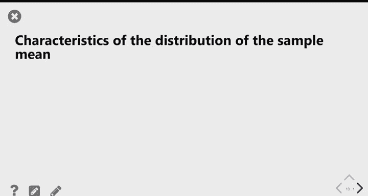

Okay。So good questions。

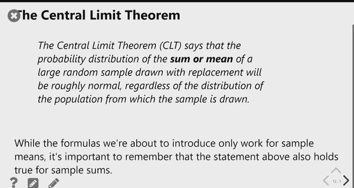

Let's look more at this distribution of the sample mean and and see what we learn about it。 Okay。

 so the central limit theorem says it's going to be roughly normal。 So we know it's shaped。

 basically。Also， this distribution is going to be centered at the population。

Why does that make sense？

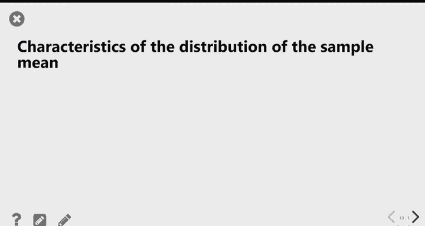

Look back at our picture， right， it's basically saying。

Why is this red histogram basically centered where the population is centered？

 And it's because when you take a sample from a population， right。

 sometimes your sample ss a little high， you get big numbers， you know， by random chance。

 sometimes you get small numbers by random chance。 but like in general。

 it's supposed to be approximately correct， right， So it's the process of random sampling is like unbiased。

 right， You're not generally going to get big values or generally going to get small values。

 You're half the time going to be too big and half the time going to be too small。

Does that make sense？

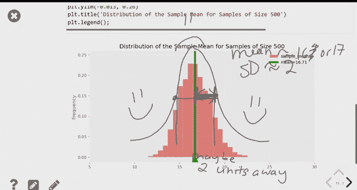

Okay， and then。The the only remaining thing， a normal distribution is defined by its center and spread。

 So the only remaining thing is it's spread。 So how spread out is the distribution of the sample mean。

And how is it impacted by the sample size？So we've already talked about this question。

How like how does the distribution of the sample mean change when you take samples of bigger sizes？

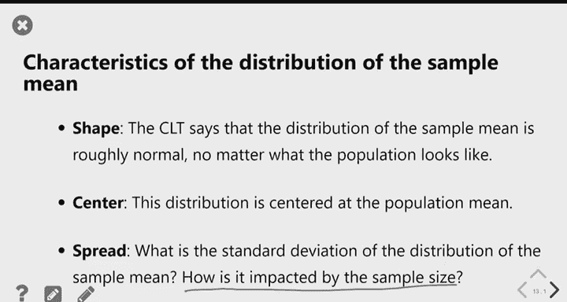

This picture I showed you came from。Samples of size 500。What if instead I took samples of size 1000。

 How would you expect this picture to change。There will be look less， especially。

itself is not long issue。上不时。的这个。So samples of size 1000。So I'm taking bigger samples。

 you're saying going to become less normal。D是。So it actually doesn't depend on what the distribution of the full data set looks like。

 because the， the central limit theorem tells us that。

 like no matter what the full population looks like， distributions of sample means， where do I。

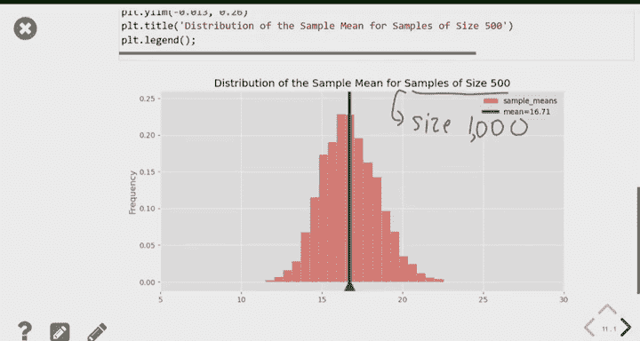

My writing is gone here。 The process of taking random samples from the population right will give you a bell curve。

 right， as long as that is a large random sample and10 even better than than 500， right。

 So it's actually going to be like more normal。

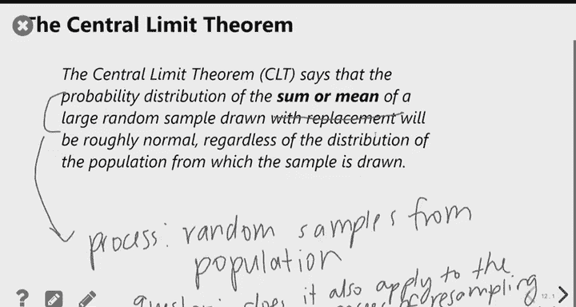

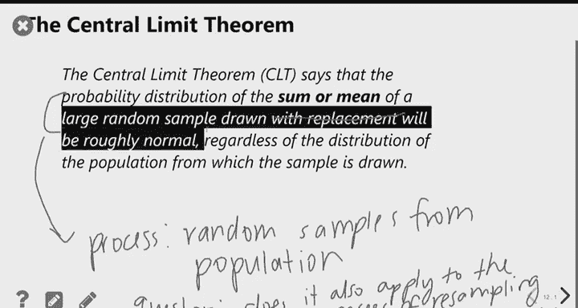

Because taking samples of size 100 is better than taking samples of size 100。

But this is already pretty normal。 So you're not going to notice like much of a difference in。

 in how， how bell shaped it is， because it's already pretty bell shaped。

 What difference would you notice。Narrower， that's the big。

That's the big difference I can't write anymore。嗯。If I did size  a000 instead。

It would be significantly narrower。Why does that make sense that it should be narrower if I take bigger samples？

Outliers will be。Yeah， basically， like bigger samples are more accurate representations of the population right。

 the center， that green line is like where the population mean is， right。

 So when I take bigger samples， the means of those are likely to be very close to the actual population mean。

 and it's going to be like harder or rarer to see things。On the edges。

 like those won't happen as often when I take a bigger sample。The opposite question is。

 what if I took a small sample， just go extremely small size 10？only 10 flights。

 sometimes they're going to all be on time and you're going to have area over at zero and sometimes they're going to be all leaving like hours late and you're going to have area at 60 minutes or something。

So as the sample size grows， the distribution narrows。Does that make sense。

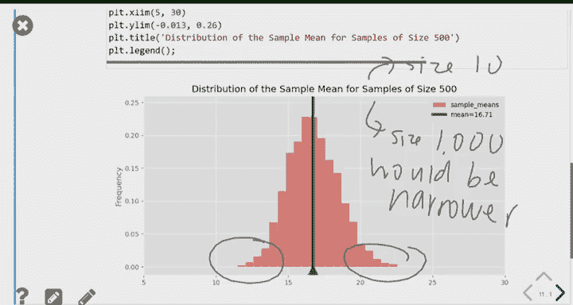

And here we're gonna sort of see that in action。

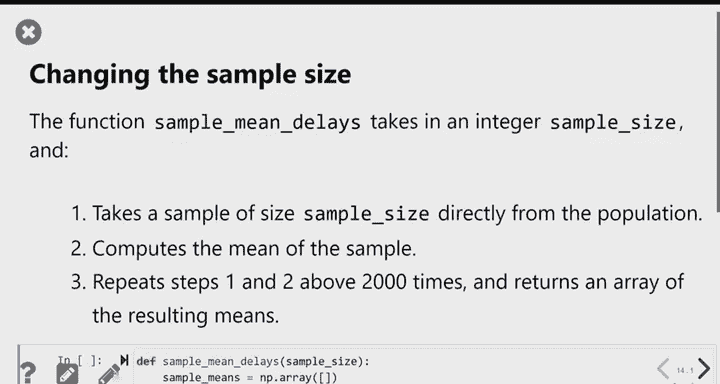

So this is a function。That takes in a sample size right and does what we just did for samples of the given size。

 takes samples from that population， calculates the mean of each sample and gives you an array of 2000 means of samples of that size okay so this is the exact same code I had before literally the only thing I'm changing is instead of having a 500 there。

 I'm having an arbitrary sample size。

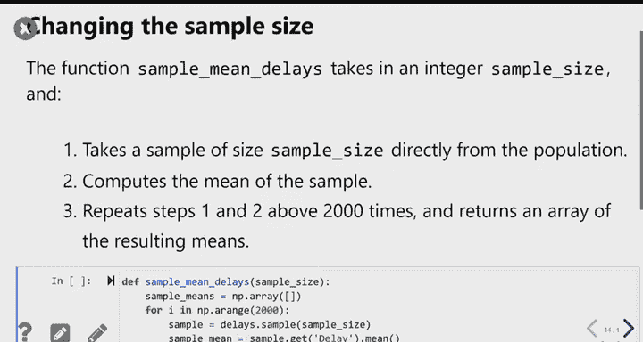

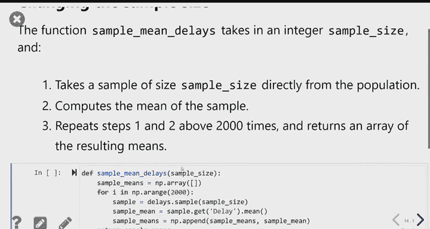

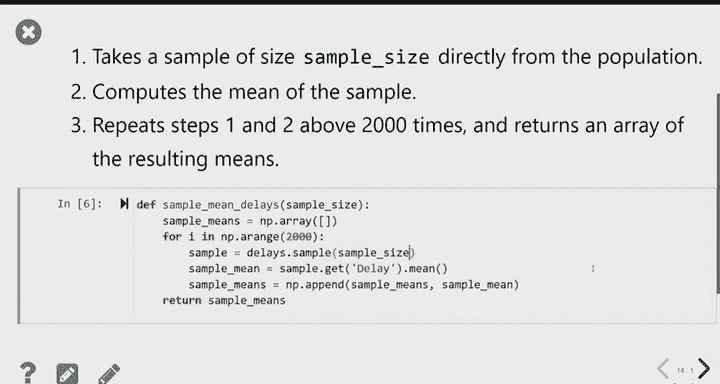

Okay， now I'm going to have a four loop。This takes a while。 so let me start it。

 I'm going to have a four loop that tries various different sample sizes。And。

Does the whole thing like makes the distribution of sample means for samples of that size。

And then I can look。At all of those distributions。Okay， so this is going to play like a video。

 the sample size is growing。And you can see that as the size grows， it becomes like more bell shaped。

TheThe smaller values， I'll play it again。 The smaller values were not too bell shaped。系。

The smaller values looked more like the population。But then as you take bigger and bigger samples。

 it starts looking more and more bell shaped。And also the， the width， let's focus on that。哎。

The width is narrowing right， it's way wide for small samples and as you take bigger samples it narrow。

But the mean isn't changing right if I balance this， notice the horizontal axis isn't changing。

 they would all balance here。So the sample size seems to affect the spread。

 but not the mean of this distribution。 And this is a distribution of the sample mean for different samples。

All right， questions。stand。え口さ。これ最初。我，先部分。So。Yes， but when you're talking about sample like the distribution of the sample meat。

 like the means of big samples are more precise at estimating the mean of a population， right。

 a small sample is less precise at estimating the mean of the population。

 So there's there's a distinction between this distribution that I'm looking at here。

 which is the means of many samples and what you're saying is true for this。

 but that's not the same as like the sample itself。

 right If you take a set of five flights and a set of。1000 flights。

 probably the five flights are going to have less variety than the thousand flights。

 So it's not about variety in a single sample。 It's about variety in the means of those samples。

Does that make sense？Great question。Anything else。

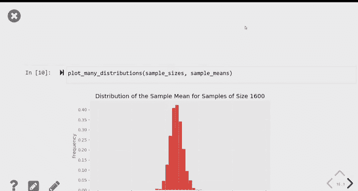

Okay。So we're seeing that right the distribution narrows。

I'm just going to calculate the standard deviation of each distribution。And see what the numbers are。

So I forget what the sample sizes were。

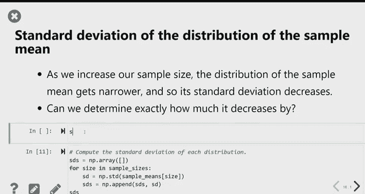

Sample sizes they were called。So when I was taking samples of only five flights and calculating their means。

 that distribution of sample means had a spread of 17 spread I'm measuring by standard deviation。

When I took flights that were samples that were twice as big， the spread went down。

 but it didn't have。When I timesd five on the sample size。

 now I havealved or so about more than halfd。So there's some relationship between the sample size and the spread of that distribution of sample means。

 but it's not linear， right？

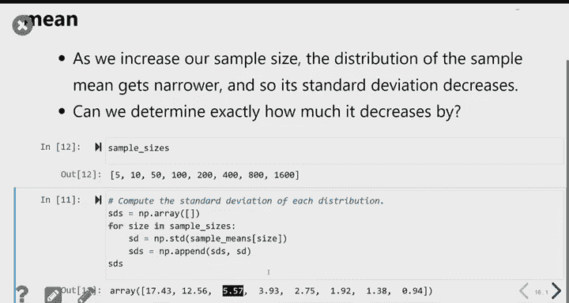

This is a scatter plot。

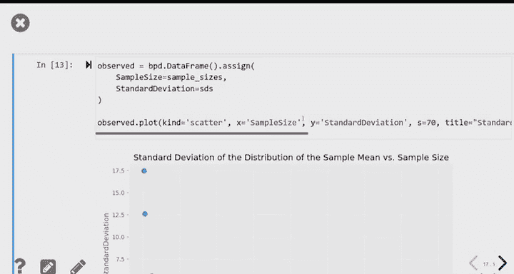

Here we go。 A scatter plot of。

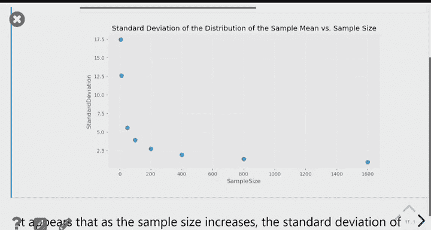

Of how the standard deviation of that bell curve is changing as I increase the sample size。

 So first thing is， it's decreasing。 That's what we saw gets the that bell curve gets narrower as we take bigger samples。

 So that's why it's decreasing， but。

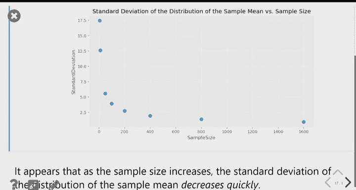

It's， it's like a curvy shape， right， It's not a line。 What it's saying is that， like。

 you notice the biggest gains like the。The standard deviation shrinks the most when you go from like a small sample size to a slightly bigger sample size。

 like going from 5 to 10 makes like much more of a difference than going from like 800 to 1600。

 And that's kind of interesting It' saying like the initial like data that you have is like very important。

 Like the having five is like just really not enough and like having 10 is like way better right and having 20 is is also better。

 but not quite as good as the difference between having 5 and 10 right So the initial observations like make the biggest impact。

Does that make sense， each additional observation kind of loses some steam because you already have so many。

Okay， so this is what we saw， sample size gets bigger。

 distribution of the sample mean gets an narrower， standard deviation decreases。

And it decreases by some nonlinear amount， and it turns out that there's a mathematical relationship describing how the standard deviation changes。

And this is sometimes called the square root law because it has a square root involved。

 We're not going to prove it。 we're just going to take it as a fact and we'll like verify through computation that it seems to line up with with what we observed So the relationship says that the standard deviation of the distribution of possible sample means。

 So that's a mouthful。 but this is talking about。

That bell curve。

Of sample means。Different samples and how their means turned out。

 that's the one that's guaranteed to be a bell curve， and it says that bell curve。

It's it's standard deviation。Is determined by taking the standard deviation of the population。Which。

 by the way， is a fixed number。In our example， for flight delays， it was like around 40。

You have to take multiple jumps of 40 to collect most of the data。 So in our case。

 the way you calculate the spread of that bell curve is you do 40 divided by the square root of the sample size。

So。The sample size is a factor and bigger samples make this denominator bigger。Well。

 the numerator stays the same。Which means the overall fraction is smaller。

 So that's why the standard deviation gets smaller as the。As the sample size grows。好。

So it's saying like for bigger samples， right， the distribution of the sample mean is narrower。

 so the sample means generally close to the population mean。

And and that's saying bigger samples give better estimates of the population mean。

 And this is the important statement that you brought up with your question that this this is about the distribution of sample means for various possible samples。

 right， It's not saying anything about。Our individual sample and how spread out it is。 right。

 In fact， the opposite is true for an individual sample， right， a sample。Of five flights。Is likely。

Less spread out。Then a sample of a thousand flights。Because when you take。More flights， right。

 you're likely to include some crazy outliers in that sample。So the samples。

 the standard deviation of the sample itself。Is we're not talking about that， right。

 We're just talking about how that bell curve of sample means is spread out。Does that make sense。

This is probably the number one way that people mess up questions like this is they confuse the two standard deviations and it is confusing because they're both standard deviations。

 but they're standard deviations of different distributions。

 one is the distribution of sample means and one is like the sample itself。Okay。

 so what weve figured out now is that if you were to go take lots of samples of the same size from your population。

 take the mean of each sample， the distribution of the sample mean is going to look like this。

 It's going to be roughly normal。 It's going to be centered at the population mean。

And its spread is going to be given by this formula。

Okay。Now we'll get to the question that was brought up before is that like this is great。

 except none of this was practical because this was about going to the population to get new samples。

 right？😊。

We're saying like this distribution is centered at the population mean and its spread is determined by the spread of the population。

 but in real life， like how would you use that because you wouldn't know the population mean and you wouldn't know the spread of the population how can these formulas like help you in any way if you don't have access to some of the information that it' included in those formulas？

And this is where sort of bootstrapping comes in。 So with bootstrapping remember。

 we are trying to estimate the distribution of some sample statistic based on a single sample。

And the C， L T tells us like how the sample mean is going to be distributed based on information about the population。

But the whole idea behind bootstping was like。A big sample should be similar to a population。

RightAnd these formulas involve information about the population。

 So let's just replace them or substitute them with the analogous information from our sample。

So if your sample has a mean of 17 minutes then we're just going to use that in place of the population mean if your sample has a standard deviation of 42 minutes。

 then you'll use 42 minutes where the population mean should be okay it's not exactly right because samples are a little different from the population but it's pretty close because samples are generally generally like the population okay。

So this is kind of the same shortcut。as what inspired bootstrapping。

 that samples are like populations。

And using this basically says that you can understand the distribution of the sample mean using the central limit theorem based on just one single sample that you get through bootstrapping。

So this makes the CLT like a shortcut to bootstrapping， you collect your sample。

 and then instead of bootstrapping it， you just use its mean and standard deviation in these formulas。

And then you know what the shape is going to look like。

Okay， so let's try this。Take a single sample of 500 flights。 So this is my sample。

 I'm not going to change that。 This is like what I observed， and this is all I know， right。

 I'm not going to use the full flights data frame or delays data frame。

And what we have done before today， if we want to know what the distribution of the sample mean looks like。

 we would have bootstrapped， And this takes a little while。

I only did it 2，000 times， but it would take longer if I did it more times。

And it would， it would come out like this。 Okay， but the idea is the central limit theorem gives me a way to like。

 predict how this histogram is going to look without actually doing the simulation to produce it。

 I can just tell you， based on that theorem， it's going to be bell shaped。

 It's going to be centered here and it's going to be this wide。

So if all you have access to is your single sample， right。

 if you were to take lots of resamples from that sample， that's bootstrapping。

 the distribution of the resample mean would be roughly normal by the central limit theorem。

Even if the original sample wasn't， notice I'm just substituting original sample where I had population before。

 and the distribution is going to be centered at the original sample mean。

Thathich should be close to the population mean。 So that's why this makes sense。 right。

 And the spread is going to be。Approximately。

The the spread of the sample divided by the square root of the sample size。 Okay。

 so this is the same trick as before， substitute a sample for a population。

So let's try this out and see how good we get。这就发张。这你。Right。

 so this has the same problem that any random sampling has is that you can always be wrong right so like just like with bootstrapping。

 the intervals we created were never guaranteed to be perfect same thing here like if you get a bad first sample right then you're kind of in trouble and there's nothing anyone can do about that because you can't identify if your sample is good or bad So this is going to have the same you know sort of potential for error as bootstrapping had。

 but it's not any it's not any worse it's the same。DP。So you taking different sample of。Well。

 the statement of the C LT was for like the impractical case of going to the population， right。

 But the way I'm using it， I'm using it based on the single sample that I had。It's not like， yeah。

 it's not any better or worse in terms of the outcomes that it gives。

 It is better than bootstrapping in terms of like the computation required。Good questions。

 anything else？

Okay， so now let's try the strategy I've talked about， you got your one sample， right。

 it was called My sample， I'll show it to you here。

It's just these 500 flights， okay。Based on that sample。What would be your samples mean？Okay。

Your sample mean is about 13 minutes。And notice I'm saving it in a variable called sample mean mean。

 Okay， that's kind of confusing。 but I'm doing that for a reason。 right。

 We're looking at the distribution of the sample mean。 We're going to look at the bell curve。

 and we're saying that the bell curve is going to be centered around 13。

And what else can you say about that bell curve， Its standard deviation is going to come from the standard deviation of my sample。

 whatever that may be。And then I have to divide that by the square root of 500。

And so what we're saying is we're going to get a bell curve centered at 13 with a spread of one and a quarter。

 Okay， you should be able to like draw this by hand。

Using the inflection point idea。It's centered at 13。It has a spread。Of one and a quarter。

 So is a distance between the inflection points。So maybe that's 14， that's 15， that's 16。This is 14。

25。So that's basically what it's going to look like。

Here we have code to draw this。And。This picture should be very convincing。

RightThis picture should convince you that the central limit theorem approach to estimating the distribution of the sample mean actually works because I just put it on top of the bootstrap distribution。

 So the central limit theorem is a way to like predict how the bootstrap distribution is going to look without actually doing the bootstrapping and it's like。

 look， they coincide the thing you got through bootstrapping and the thing you got through the theorem。

' it's the same distribution essentially。Okay。Questions。

So now we have a method that based on our one sample。

 we can just say what this distribution is going to look like， the distribution of the sample mean。

We can say what it's going to look like without doing any computation， right。

 No big simulation that runs 10000 times。 All you have to do is just calculate a mean and calculate a standard deviation and divide by some square root of something。

It's like a formula， it's much simpler。

So， kind of the。Summary of the central limit theorem is conveyed in this little slidehow。

 We have some population。 We'll call that a。We take a sample from that population。

So maybe it was 500 flights。The idea is that samples should be similar to populations。

These distributions should be similar， This sample has a mean of 13。01。Okay。

 if you were to take another sample， right， it might have a slightly different mean，18。45。

 right If you were to take lots of different samples， you'd get a whole distribution of sample means。

 You get a whole set of values here， and you can plot。What those sample means came out to be。

And the central limit theorem says this plot is going to be a bell curve shape。

And it also says stuff about where these three distributions are centered and how these three distributions are spread up。

 Okay， so the center is the same for all three pictures， right approximately not exactly， right。

The spread of the first two pictures are approximately the same。

 So both of these statements about A and B are just saying samples are like the populations they come from。

Large random samples really？

And then the square root law is here。It says how the spread of C relates to the spread of the other two distributions。

 Okay， the actual central limit theorem does it with the spread of a。

 the spread of the population as the numerator， but we replace that with the spread of the sample because they're similar。

Any questions on this picture， this is your summary to think of and what I was saying before is how it's easy to get mixed up of like。

 am I talking about the sample or am I talking about the distribution of sample means。

 I always like refer to this picture and try to like envision in my head。

 what's distribution A in this scenario， what's distribution B， what's distribution C。Okay。

 so the purpose of all this is making confident or is like learning how how to get the bootstrap distribution without bootstrap。

 but what was the point of what we did with the bootstrap distribution was to make confidence interval。

So really， the point of this is to make confidence intervals without having to bootstrap Okay。

 so let's see how this relates to what we know about confidence intervals。Our strategy before。

 right was based on one sample， resample a bunch of times， get this distribution。

 and then look at the middle 95% of that distribution。

Okay and what we're going to do now。If we're working with the mean。

 okay this is a limitation of central limit theorem its for sample means。

 not for medians or other things， right so bootstrapping is a little more general。

 but when you're working with means， this way is better because there's no computation involved。

 and both cases are equally practical and equally valid。So let's do the。

 the bootstping way of making a confidence interval。 So I think I already did a lot of this before。

 right， based on your first sample。

My sample has a mean of 13 and a standard deviation of 28。

I'm going to take a bunch of resamples from that。And make a。A distribution of those resamples means。

And then take the middle 95% of this distribution by using percentile to like chop off the extremes。

So then I get this confidence interval that covers。

The majority of my bootstrap distribution。 Okay， so I would say that my guess is that the population mean falls between 10。

6 and 15。6。

But we didn't have to bootstrap to learn what that distribution was going to look like， right。

 We could have used the C LT， which told us that， you know， without bootstrapping， let me just。

 you know， cut to the chase。 You're going to get a bell curve centered at 13 with a spread of 1。25。

 So it's going to look like this。

Okay， the question now is like， how do you get the middle 95% of this， right。

 You can't use NP dot percentile because NP dot percentile needs like the full data set to chop off。

 You're not， You don't have a full data。 You just know like what it's going to look like。

But we learned something last class that's going to be extremely valuable here。

Which is this middle row。For a normal distribution。

You get about 95% of the data when you go two standard deviations away from the mean in both directions right so from the mean minus two SDs up to the mean plus  two SDs。

 you're going to get 95% and we already know what the mean is and we already know how much an SD is worth。

 so that's all we need。

Right， visually。

I'm talking about this area。Of my normal distribution。 And it's 95% of the area。

This is where the， the square root law comes in and where it can get a little confusing。

 The distribution that I'm talking about is the bell curve。

 and I'm talking about its spread coming from this formula。

So our interval is actually take the center of the bell curve， the sample mean。

And add or subtract two copies of the spread of the bell curve。

So in our example， the sample mean was 13 and this highlighted part was one and a quarter so you're going to go 13 minus two copies of one and a quarter。

 so 13 minus two and a2。Would be 10 and a half to 13 plus two and a half would be 15 and a half。

 so it's going to be roughly 10 and a half to 15 half。

系。

And here's what it looks like。

And basically it looks right， it captures 95% of this area。

So we got two confidence intervals， one came from bootstrapping， one came from the CLT。

And they both came from just the information in the single original sample of 500 values right so they're both very practical。

 They're slightly different， right， That's because one of them came from you know doing a big simulation。

 So every time you do that simulation， you're going to get slightly different values。

And。The C LT is based on using information about the sample instead of the population。

 and it's also based on saying 95% of the data falls within two Ss of mean and that itself was an approximation。

 right So they're not going to come out exactly the same， but they're going to come out similar。

Does that make sense， questions。

One thing I like to point out is that if I gave everyone the same original sample and asked you all to make a bootstpped confidence interval from it。

 you would all have slightly different answers because the bootstrappped interval depends on what resamples you happen to get。

 but if I gave you the same original sample and ask you all to make a CLT based confidence interval。

 you'll all get the same exact answer because you're all just plugging those numbers into the same form。

Okay， so this is like the formula for how you find the confidence interval。

 the 95% confidence interval。 And I mentioned this briefly before。

 but C LT is better than than the bootstrapping method when we're working with sample means。

 but bootstrapping still has a practical use because bootstrapping is more general。

 Boottrapping works for other things besides means like medians and standard deviations。

So I generally advise like use the CLT when you're working with Amine。

 use bootstrapping if you're working with something else。

 although we learned last time that bootstrapping is not for everything。

 like it's not for maxes or mints。

Okay， so take a minute to think about this。We just saw that when I have Z equals2， right。

 when I put twos here， this is how you get a 95% confidence interval。

What if instead of wanting a 95% confidence interval， I wanted a different level of confidence。

 What if I said make an 80% confidence interval。

RightYou would have to adjust the value of Z。 So the first question is。

 would you need a bigger or smaller value of Z if you wanted an 80% confidence interval。

Smaller right Z is like how many steps out do you have to go to pick up a certain amount of the data if you want to pick up 95% of the data。

 you got to go two steps out， but if you want less of the data， you can go less out。

Okay， so this is a little tool to play around with。

That you can see， like。How far do you need to go to get a certain amount of data， right。

 Like if you go 1。7 S Ds away， you're gonna get 91% of the data， you'd make a 91% confidence in。Okay。

 so you can use this to like approximate。How far do you need to go like around 1。

3 standard deviation？Okay。

Okay， I want to end with this concept check question， let me make sure I cleared the poll first。

No， I didn't。Okay， so the question is。Which of these histograms？

Corresponds to the distribution of the sample mean for samples of size 100 drawn from a population with mean 50 and S D 20。

Give me your guesses。Okay， I got the most votes for A。

 but I have a good number of votes for B as well。

So let's try it。Okay， A is not right。This is a one that everybody guesses， but it's wrong。 Okay。

 why did you guess A， probably。Because you see something centered at 50。

And you see inflection points about 20 away。Okay， and you know， S D representsflection points。

 But this is making the mistake I pointed out earlier of like there's different distributions。

 The S D of 20 is talking about the population。And you have to use that square root law to say that the S D of this distribution of sample means the bell curve。

Comes from taking that population SD and dividing by the square root of the sample size。

So you're actually looking for a bell curve with a spread of two。Which is this one？

Does that make sense？Feel free to ask afterwards if you have more questions。

 I'll see you guys next time。