# UCSD《数据科学原理 (DSC 10 Principles of Data Science Fall 2024)》中英字幕（deepseek - P1：DSC 10 - Principles of Data Science - LE -A00- - Lecture 1.zh_en - GPT中英字幕课程资源 - BV1hmAneGEZh

Yeah。Okay， good morning， everyone。Welcome。I hopepe you got to beat some classmates。

 take advantage of the opportunity to like be part of this community and get to know other people to that effect。

 there's some events going on that'll help you meet your classmates， so that's always good to do。😊。

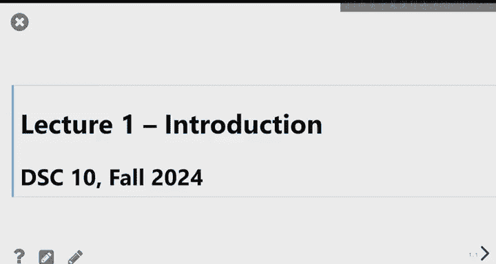

Welcome to DSC 10， this is our Intro data science class at UCSD。

 the course was originally developed by UC Berkeley。

 but we've adapted it here and I've been teaching this class since its first incarnation in 2017。

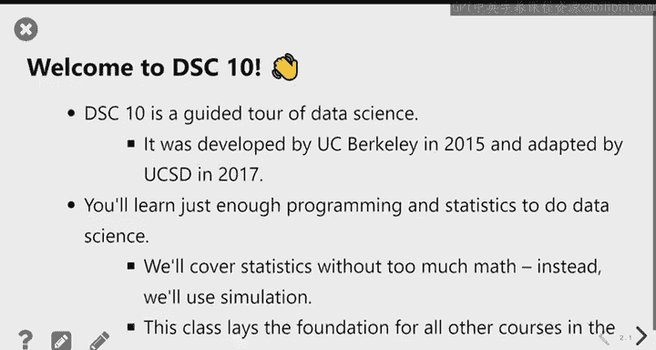

So the philosophy of the class is basically teach you just enough of what you need to know to actually get started on doing data science projects Okay。

 so you can take entire classes or almost entire majors studying like programming or statistics。

 but we're just going to teach you a little bit of each so that you can basically get your hands dirty as quickly as possible。

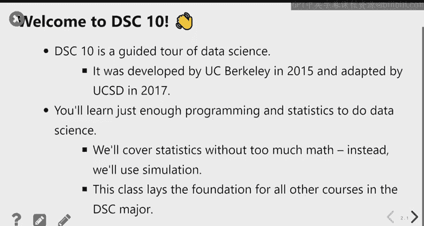

Okay， so today we're going to talk about some sort of first day of school basic stuff。

 and then we'll get into some initial programming ideas。

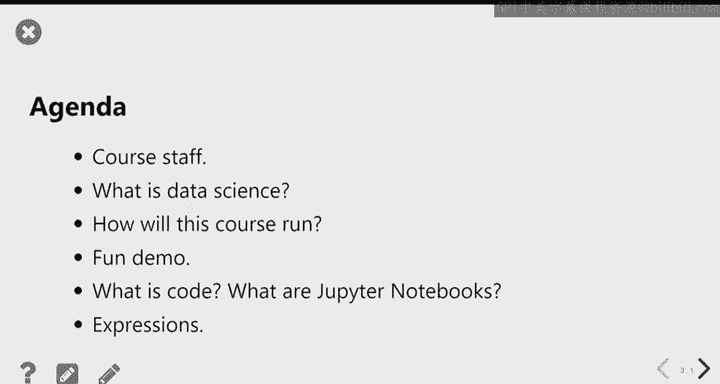

Okay allow me to introduce myself， my name's Janine feel free to call me by my first name I went to a small liberal arts college in Maryland called Loyola and I studied math and computer science there and then I came to grad school here at UCSAD and I studied math。

 so I got my PhD in the maths department here studying combinatorics if you know what that is。😊。

And then after I graduated I started teaching so I taught a bunch in the math department as a grad student and then after grad school。

 I started teaching in the computer science department and then the data science department was formed in 2017 so I switched over to that So I've taught a lot of DSC 10 this is my 13th time doing it I taught it all last school year and I'm teaching it all this school year so I am very well acquainted with this class and also that means like with the struggles that new students have when when they take this class so I'm hoping that I can use that experience to help you I also teach DSC 40A。

 which is sort of like a math for data science class so that uses my math background a little more if you take that class hopefully I can teach you one of these quarters when I'm not teaching DSC 10 I listed a few things I like to do and I put some pictures the first one is from a camping trip that I went on in San Diego I thought that was a really nice view。

 The second one is some。😊。

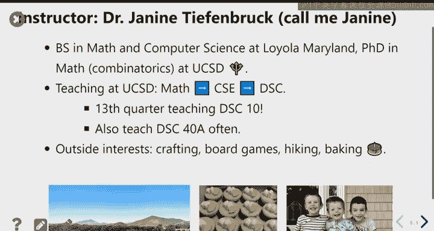

E lime pies I made for a fancy event and then the last three boys。

 that's my son and my two nephews who were together over a holiday in their pajamas。

So as the course progresses， I hope to get to know you and what you're interested in。

 I asked a little bit of that on the welcome survey but try to get to know me and each other personally。

 I think that makes a big difference in your experience in such a big class there's not only this section of the class but there's two others so there's 450 students taking this class right now and we're going to run at all like one giant course where you can work with people from other sections in that sort of thing。

😊，Okay so since there's so many students， there's also a large staff behind this class we have one graduate TA named Ashley who recently graduated from UCSD and she served as a tutor for this class when she was an undergrad so now she's stepping up to the TA role she'll lead the discussion sections with you and then there's a whole bunch of undergrad tutors I know Siro is right here in the front he'll help me answer questions towards the end of class if you have any questions stop by one of us but these are mostly people who've taken the class and done well in it and expressed an interest and helping sort of the next generation of students go through the class a lot of students use office hours and these tutors provide help in office hours and then after finishing the class they want to pay it forwards okay so we're really grateful to have such a big support of staff and then you may have noticed I put a little panda mascot in the front of the classroom on the desk there that's our stuffed panda mascot and we。

Have because we use a package in this class called Baby pandas。

 So we'll learn more about that in the coming weeks。Okay， so try to get to know us。

 visit us in office hours， everyone's very friendly， just say hi。All right。

 so this is your first data science class， and many of you are incoming data science majors。

 so we're going to start with the very basic like what is data science？😊，Okay， and the answer is。

 well there's a lot of different answers when you Google what is data science。

 everyone seems to have their own definition right but you'll notice that a lot of these pictures show Venn diagrams or overlapping of different subject areas right and data science does involve lots of different subject areas right one way of defining it。

😊，Is this one here it says programming is one of the spheres math and algorithms is another sphere and then domain knowledge is the third sphere okay there's lots of other versions of this diagram but the idea like you need to know programming you need to know some math and statistics and algorithms but you also have to apply it to a specific domain right so you might be working with biological data or financial data or political data and that's your domain so without the domain knowledge data science isn't really practical and that's one thing I really like about this major is that you can use the skills you learn in so many different ways and I love seeing sort of at the end of the fouryear major what students do in their capstone projects because it's so diverse and so varied and it's like pretty cool that I taught them all like the same very basic thing in the intro class but then over the course of four years they specialized in one domain or another they learned certain skills。

😊，gott really good at math or they got really good at programming。

 and then that enabled them to do a wide variety of projects。

So our philosophy to this whole major really is we start sort of at the middle of these Venn diagrams we're not going to teach you a whole class in programming then a whole class in statistics then a whole class in domain knowledge and then call you a data scientist this intro class touches on a bit of many of those things a little light on the domain knowledge because we're using sort of general data that's pretty easy to understand but the general philosophy is sort of start at the intersection do actual data science right and admittedly like what you know coming into this class maybe very little because there's no prerequisites you may have never studied data science before that's fine so you won't be able to do everything in data science after one course but you'll sort of be you know have a small intersection and as you take other classes and get a little better at statistics or a little better at programming your ability of what you can do with data science will grow so I like to think of that as like a visual。

😊，how you learn in data science in this school。So one definition of data science is drawing useful conclusions from data using computation。

 okay so I talked about how the domain knowledge makes your conclusions useful。

 we also need computation to do data science， data has been there for a long time but data science is a relatively new field and that's because we're just learning how to like harness the power of computation to actually answer some of these big questions。

😊。

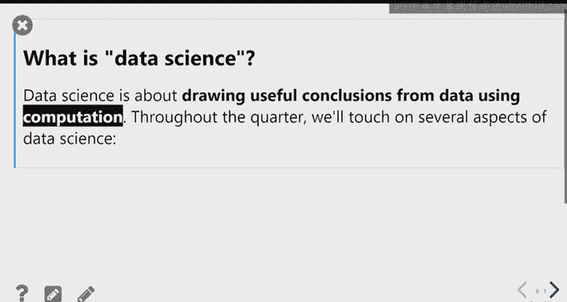

So our course is kind of set up like this in the first four weeks we learned Python programming if you're an experienced programmer。

 a lot of this will be review for you， but we'll still learn new stuff and the second part of the course will be very different from the first。

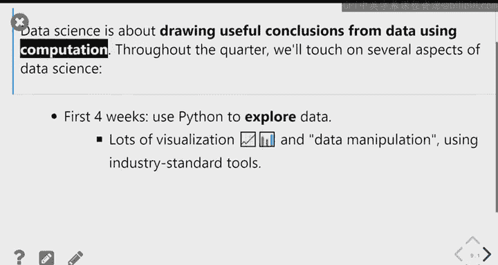

In this first four weeks， we'll use Python to explore data and that means like we'll take data sets。

 maybe like a table of data that you might read into a spreadsheet and figure out how to answer questions about it using code。

OkayThe next four weeks is about inferencing so you have data from a small sample and you want to learn something about a larger population what can you learn。

 what kind of inferences can you make based on just the small sample here we're going to rely on simulation as opposed to formulas there are formulas that govern how you can inference right but we want to actually sort of see it with our own eyes and simulation is a lot more tangible so you'll use the code skills that you developed in the first four weeks to actually sort of try experiments and see how things come out and it develops more of an intuition for why the formulas make sense so when you see them later on it'll be a little clear。

And then the last two weeks we're going to be working on prediction problems。

 which is a small subset of the area of machine learning。

 so you'll take hopefully many machine learning classes here。

 that's a really hot field and there's a lot going on like exciting advances in machine learning so the very basics that we'll do are regression which is a type of prediction。

😊。

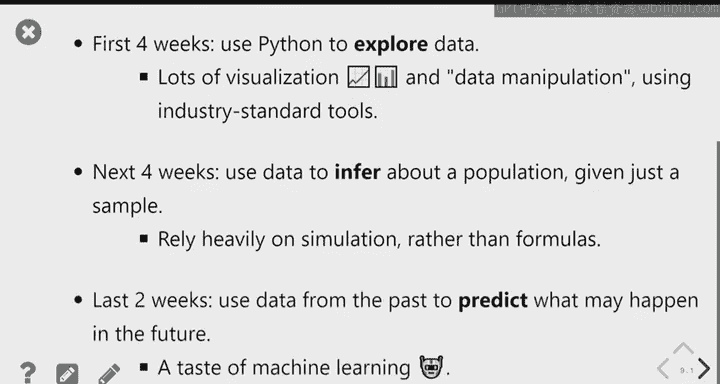

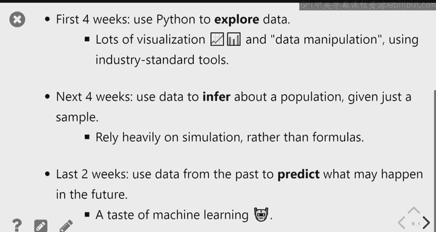

Okay so if you're in this class， I probably don't need to convince you that data science is relevant right。

 you all lived through COVID and spent lots of years looking at graphs like this to make decisions。

 right you use data to decide should I take that flight， should I meet up with my friends， etc。啊。

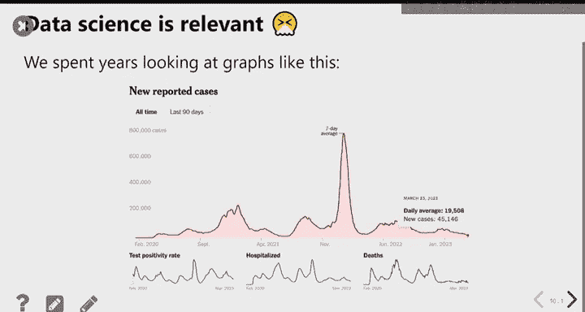

So the usefulness of data sciences is pretty clear。

 but it's also a lot of fun I found this really cool website that has lots of these data driven articles let's try to go directly to the website of course。

😊。

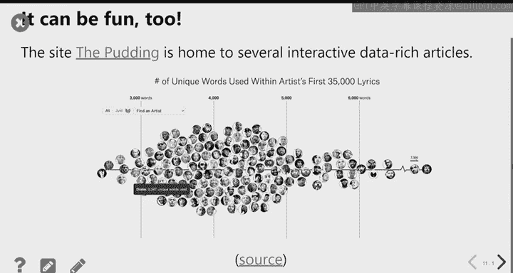

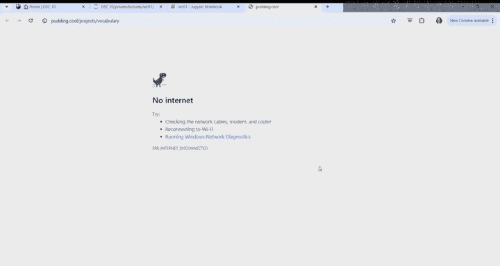

Okay。Well， well that's going I'll just show you the picture then This picture was taken from the article if you click the link。

 you'll actually be able to interact with the picture。

 this is just a screenshot but what they did in this article was they compared different rappers by how big of a vocabulary they have and the way they did this was they took a fixed sort of sample size of how many lyrics or how many words of the artist songs so they had 35。

000 words from everybody and they saw how many distinct words or unique words were there among those 3500 right because some words get repeated all the time like the and the more creative or the artists with the bigger vocabulary are the ones down here。

 they use like 7，300 words。😊。

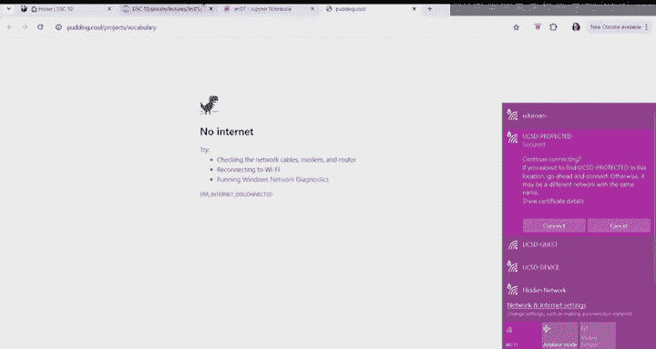

And the ones on the left use less than 3000 words。 Okay。

 so we highlighted here Drake used about 3300 words in his first set of 35000lyrics。

 So relative to the others， right， he's actually not that creative in terms of his vocabulary Okay now。

😊，As you can， as I saw， a lot of laughs。Data doesn't say everything right like creativity is more than just vocabulary right。

 but this measures one aspect of creativity and you can measure other aspects as well and the more sort of attributes you look at the better picture you get of like how these artists are different and you could even use this with enough other you know attributes of how the artists are different to do something like make recommendations of if you like this artist。

 well here's a similar one and that's where I think a lot of interesting applications lie。😊。

See if I got connected to the internet， no。

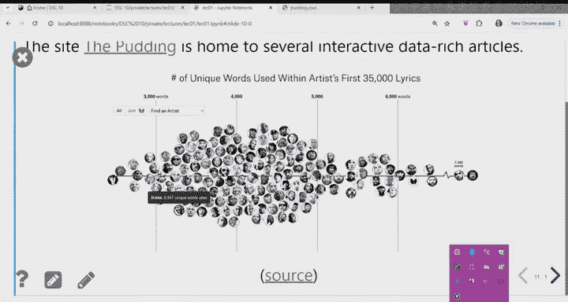

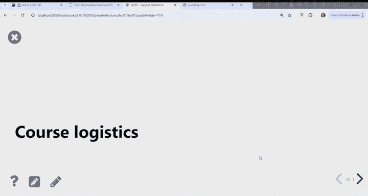

All right， so now I'm going to talk a little bit about how the course is run。

 does anyone have any questions about anything I've talked about so far？

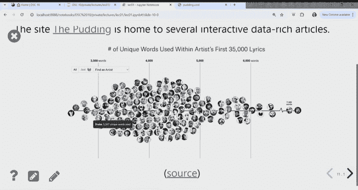

Okay。Yeah。Okay， course logistics。So the first thing is the course website。

 we're using the course website for everything， we're not using Canva or any other sort of main home base。

 everything's on the class website， it's at DSc10。com so it's really easy to remember。

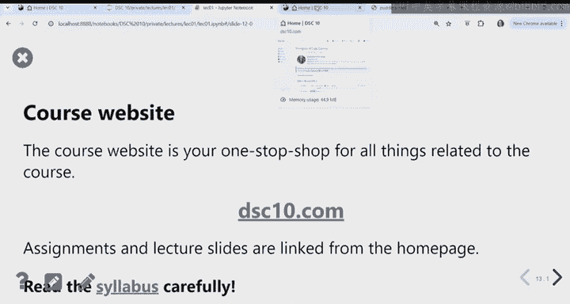

I think it's so funny that it's docom， like our commercial business should be dotedu。

 but we had to like buy this domain from a。Like a domain manager， so we got DSc10。

com easy to remember on the homeage is all of the stuff， lectures， assignments， discussions。😊。

And things that are blue are links， so you can click those to access the assignments。

 Labs zero down here is the first sort of real assignment that's due next week。Lab zero。

 but there's a few welcome things that are due the end of this weekend。

On the left side there's a few other pages， the syllabus。

 there's a table of contents at the top it's quite long， but it's important to read it。

 the calendar will show office hours and course meetings and deadlines。

The resources page has lots of sort of extra。Resources that will help you study and learn。

The debugging page is like an FAQ for tech issues， so if anything goes wrong， technology wise。

 search this debugging page， the questions are all listed here and then you can click any of the questions that seem relevant to you and then you'll link to the answers。

And then our staff page is where you can get to know the people who are going to be helping you through this class。

There's also some important links at the top here， so you can access those things quickly。

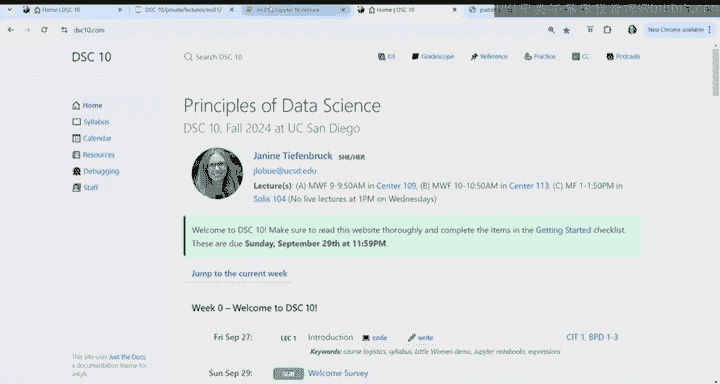

The rough weekly schedule is that we'll have。

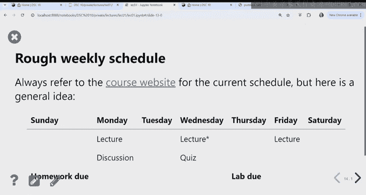

Lecture on Monday， Wednesday， Friday， on Monday in the late afternoon or early evening。

 there will be discussion， and on Wednesday， some Wednesdays there will be quizzes。

Then there's two assignments due a week， a lab is like a lower stakes assignment that you're meant to do shortly after you learn the material。

 the labs are very instructive， they teach you what you need to know as you do it。

 and then the homeworks are more challenging than labs。

 they sort of combine ideas from the past few lectures or the past couple weeks together。

And then periodically throughout the quarter， there's two projects。

 so projects will replace homeworks the weeks that they're due。

An important note if you're in the 1 pm class， which this is not the 1 pm class。

 but just in case I'm not able to host a live lecture on Wednesdays at one。

 which is how my schedule turned out this quarter so if you're in that class you'd have to come to the 9 a or 10 a lecture on Wednesday or all the lectures are recorded and posted so you can watch it at one if that works better for you。

 I just won't be here in person。

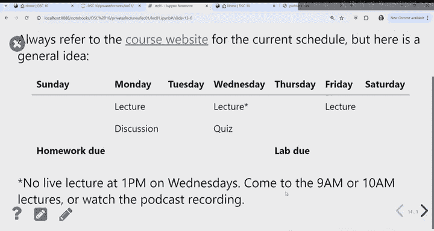

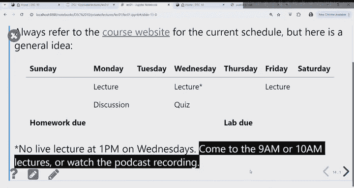

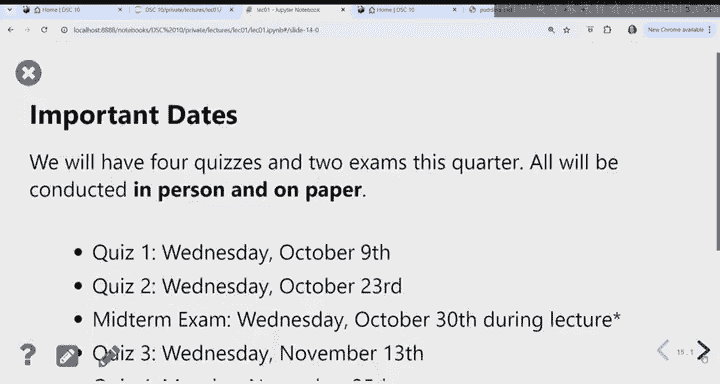

So these are some important dates， this is all listed on the class website so don't feel like you have to write this down。

 but you should know that these are the important dates。😊。

And as I just mentioned the 1 PMm Wednesday class， but we will have a 1 PMm Wednesday class for the midterm。

 okay， we won't normally， but on that midterm day we will。

The quizzes are mostly on Wednesday but there's one that's on a Monday that's because of its Thanksgiving week。

 and you're going to be able to pick a time slot for when you take the quizzes on the welcome survey。

 so make sure to take that welcome survey and you'll be able to tell us your time constraints。Okay。

 so the very first tasks are this checklist of things to do to basically get set up okay the first one is join Ed which is our course discussion forum that's where you'll ask questions。

 don't send emails， use Ed instead to talk to us。

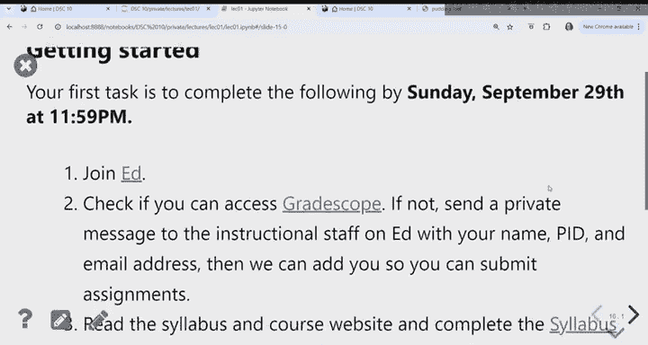

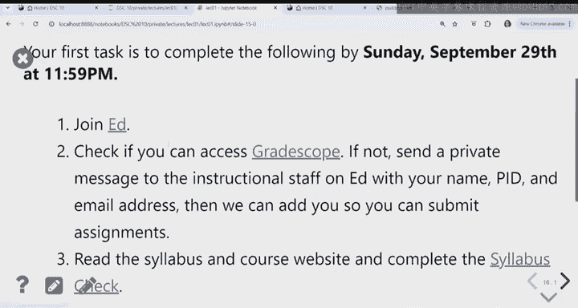

So sign up for that， make sure you can access grade scopepe。

 which is where you'll turn in assignments and where you'll be able to see your grades if you don't have access it tells you what to do。

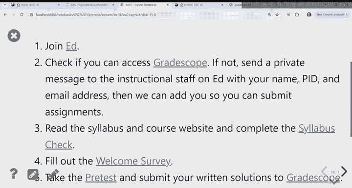

Read the syllabus and course website and do a syllabus check which is like a short quiz to make sure you've actually a read the website and B know how to look up information when you need it。

 right the point of being familiar with the syllabus is so when you have a question you know where to find the answer right many things are answered on the syllabus so always check there first。

The welcomee survey is my way of collecting information about you。

 including scheduling stuff like for the quizzes and if you have any conflicts with exams and also just like to get to know your background and who I'm teaching this quarter。

😊，And then the last step of this first assignment is a pretest。

 so I mentioned earlier that this class doesn't have any prerequisites。

 so people's backgrounds are very varied right some people have taken AP stats and AP computer science and maybe even a data science class at their high school right and other people have done none of those things right and that's okay if you're anywhere on that spectrum but there are some sort of。

Preres like hidden prerequisites like things you should know from high school like like algebra and reasoning and things like that。

 so the pretest kind of checks those hidden prerequisites to make sure that you're comfortable doing sort of the level of math and logic required for this class okay。

YouYeah iPads okay， anything written yeah basically so yeah。

 you can do the pretest on actual physical paper or on your iPad or tablet thank you。

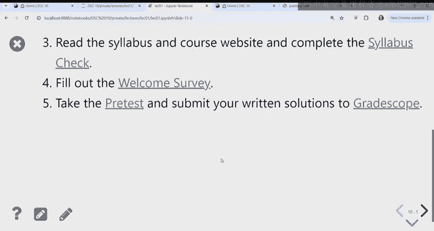

Okay， so these things are things to do right away， they're due Sunday， like this Sunday。

 so do them this weekend。

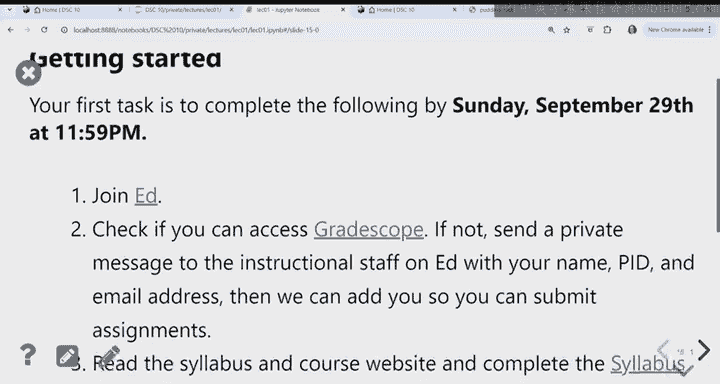

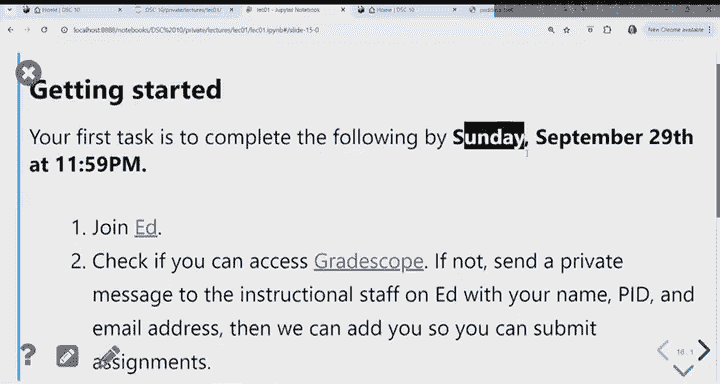

Okay and then after that， you can start working on the first what I'm calling the first real assignment like。

That covers class material is lab zero， which is due Thursday， October 3rd， this coming Thursday。

 everything's always due at 11，59 pm。 so if we don't say the time it's 11， 59 pm。Okay。

 let me show you how to access assignments and how to access lectures。😊。

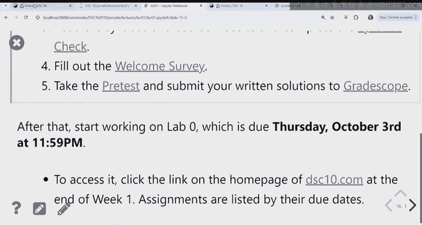

So on the homepage of the website。Right let's do the lecture first today's lecture one。

 the word introductiontro is the title of the lecture， but it's not blue， so it's not a link。

 There's two blue little buttons next to it， one is code and one is right so if you click the code link。

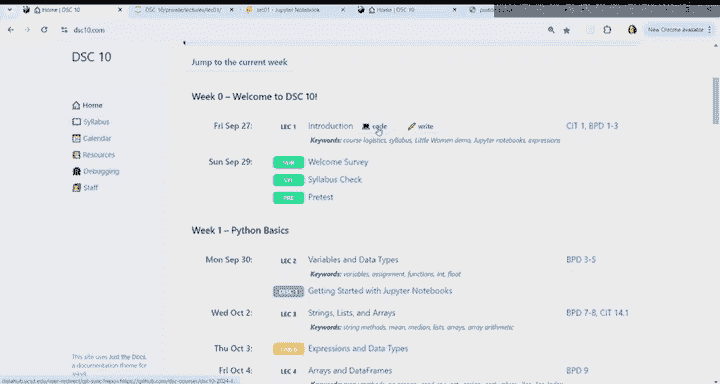

Okay， you'll be taken to this platform called Datahub DataHub is like a server that UCSD manages to allow students to do programming assignments basically。

You may have to log in， I've already logged in， but once you log in。

 you'll have this screen that says select your notebook environment and you want to look for the one that says our course number。

 DSC 10 and our course quarter， fall 24， I have many others like all some of my old data science classes are here。

 some other random stuff is here， you may have others。

 especially if you're enrolled in other classes that do programming。

 so just make sure to select the right one that's important otherwise your assignment won't work。

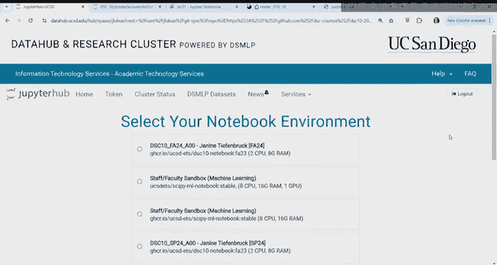

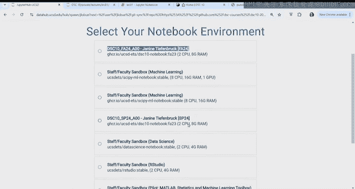

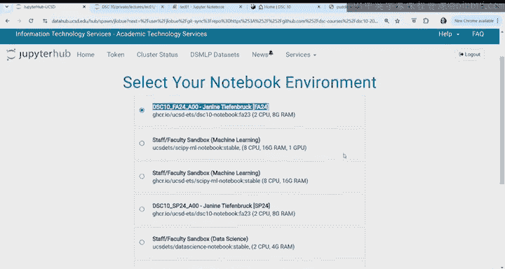

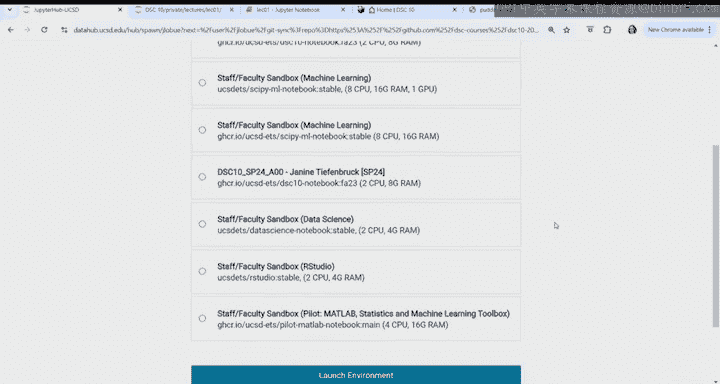

Okay。And then hit launch。And it takes。A minute， hopefully not too long。

And it's basically pulling like a copy of the assignment for me okay。

 so I like release the assignment once to all of you。

 you all click the link and you all get a copy of the assignment where you can do your work and submit。

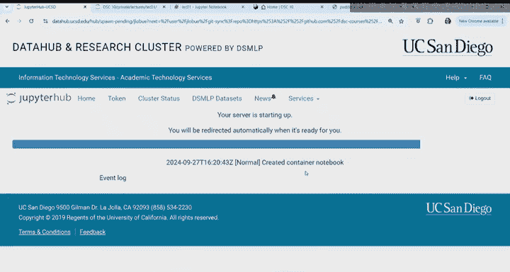

And when this loads。It's going to look。Like this Okay so this is called the Jupiter notebook and it's how we'll be working all quarter。

 It's got these little chunks when you move and click along the left side the little blue bits are highlighted these chunks are called cells and within each cell you can write text like I did here。

 you can make lists like I did here。You can include pictures like I did here。嗯。And as we'll see。

 I mean， I guess I'll go back to the beginning， you can also include code okay。

 so we're going to do all of these things。In these Jupiter notebooks。

If you want to follow along with with the lecture， you can click the code link and just kind of scroll through。

 and this is actually like changeable by you。 So if you want to you know， change。The slide you can。

 basically， not that you would want to probably， but maybe you want to take notes by typing。

 maybe you would want to right and when we learn coding you can also actually code things and like try it out in your own notebook and no one will see what you're doing that's your own local copy。

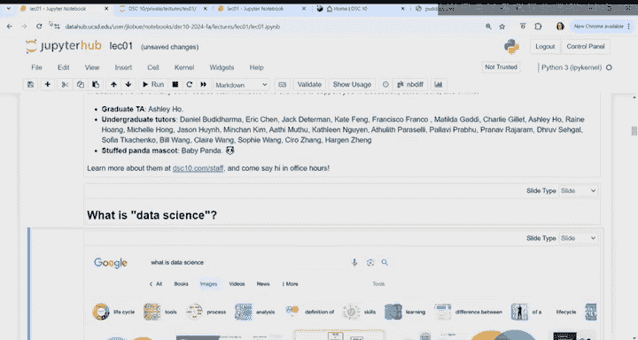

So that's one way of following along。

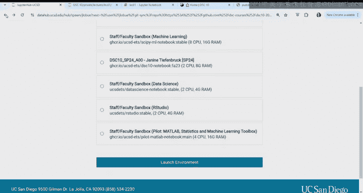

Another way of following along is if you click the right button。This leads you to an HTML page。Which。

You might be able to right click it and print it or save it so that you can annotate it and if you have an iPad or a tablet。

 a lot of students like to take notes this way by hand by just sort of writing over。

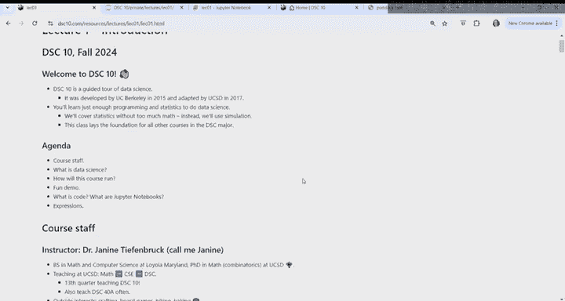

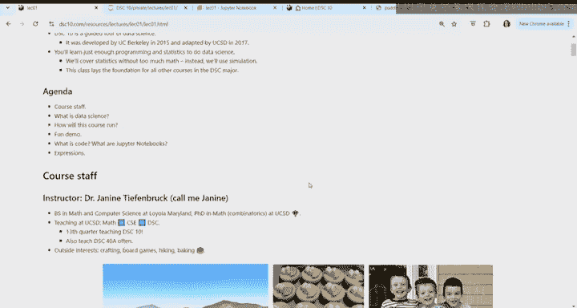

All the slide material that's here。Something to note is that if you're doing it the writing way。

 you can't interact with it right like you can't change the text that's on the slide and you can't run code you can only handwr over it so depending your preference of how you like to take notes and what you like to do。

 you can choose either one。Okay， so that's how you access lectures and follow along。

 I'll post the lectures usually the night before the class so you can have it ready to go and you get here in the morning。

And for the labs or the other assignments， you just click the name of the assignment。

 which is a link and it takes you directly to this assignment。

 this Jupyter notebook with instructions on what to do and you kind of just work your way through here。

 it'll tell you it'll tell you what to do， change this cell above to print out this right and you'll do it and then you'll submit it at the end。

 there submission instructions included in here。Okay， so that's a basic access information。

 a couple other things to point out about the website。Too big。😔，At the bottom of each lecture。

 there are some keywords。These are meant to help you find things later on right So later in the class。

 maybe you're like I forget what an expression is， I need to go look that up right You can just control F expressions。

and find all the places on the website where expressions are listed and then maybe click into the appropriate lecture and find the content that you need。

On the right is readings， so there's two textbooks。One is Berkeley's book。

And another one is this set of course notes that was made for this class specifically by a different instructor。

 so those are both useful some students like to read before they get to lecture。

 some students like to read after lecture， but the textbooks do have like good。

Other perspectives from what we're doing in class， like some new examples and some new ways of explaining things。

 so it's good to check out the readings。

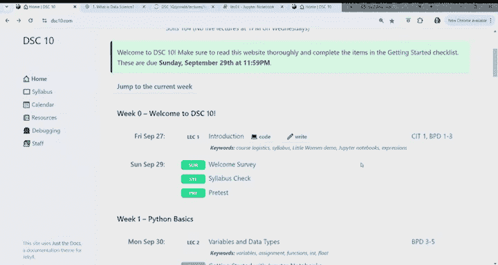

Okay。Okay， any questions so far？

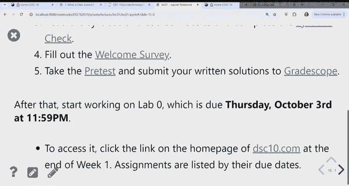

So I want to talk briefly about academic integrity policies this is important to make sure you're following all the rules and behaving with integrity so our collaboration policy is that you can talk about questions with each other except of course like during a quiz or an exam right but you can tell your friend like here's how I solve this homework problem and try this do that this way work for me。

 this way didn't work for me right verbal communication is okay the last bullet point don't give someone else your code or look at someone else's code okay so you can't be like oh here's what I did now you type it on your computer right that's more copying as opposed to like helping someone learn。

😊。

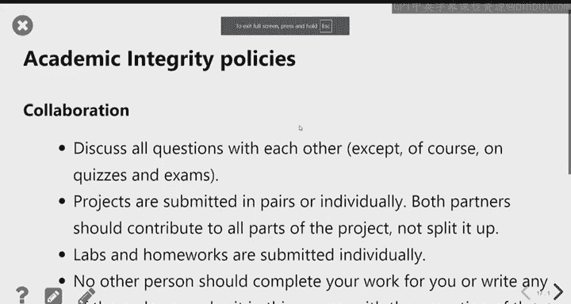

嗯。Most things are submitted individually， but projects can be submitted in pairs。

 but working with a partner in pairs doesn't mean you split up the assignment and you each do half of it right working with a partner means you work together through all parts of the project。

And then this bullet point。No other person should complete your work for you is pretty important right that means like you shouldn't be looking up your homework question online and finding someone who solved the same problem or a similar problem and then copying their code and changing it right that's someone else doing your homework for you right you shouldn't show your friend who's already taken this class or who's an expert programmer and have them write some of your code for you okay so basically it's it's your work。

 it should be your own work。

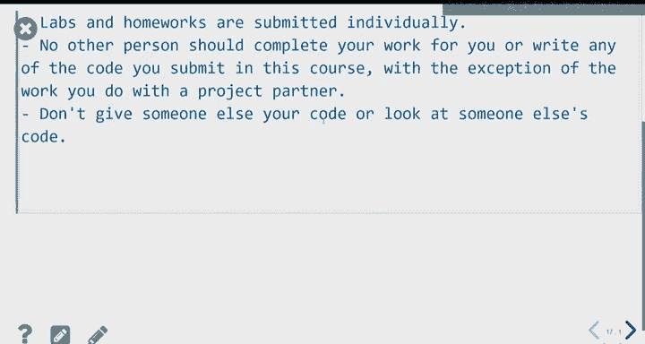

Any questions on any of that？Okay one thing that's newer is all these artificial intelligence tools like chat GPT right can you use them our syllabus has a discussion of what's allowed and what's not allowed。

 the short answer is you can use them on assignments but you should be cautious to not overuse them because you can't use them on quizzes and exams right so overuse can hinder your learning and your understanding。

😊，So proceed with care okay and also the syllabus blurb about this talks about how some of the answers that it gives are not right。

 but they're kind of close to right， so it can be tricky and misleading if you're using these tools to learn information right we have a lot of resources that weve created for the class so try to use the resources we give you primarily to learn new things。

Resources like J G。Max my。I think chatyBT and things like that are best for like small syntax errors。

 which means， yeah， which means like you have the idea of what your code's supposed to do right but it's not quite working for some reason right so you can input that and say like can you help me find my error or something like that？

Right， like debugging yeah as opposed to like please solve this homework question for me right like that's not going to help you learn so if you have sort of the idea and a start it can help you complete it but it shouldn't do the whole thing for you。

 I would say。😊，Good question。Other questions？

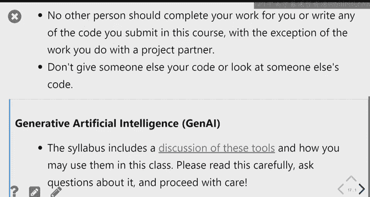

Okay so this classes is a pretty challenging fast paceacd class it's the first class in the major so a lot of students aren't expecting it to be too hard。

 many majors have like a sort of easy gentle introduction this major does not this major is like in 10 weeks you're gonna to be doing data science projects like go so we have to get you ready for that we cover a lot quickly and we have a lot of assignments as you saw from the schedule but there's also a lot of help we have that big team of tutors and NTAs and me we all hold office hours。

 office hours are in like a common study space so you don't need to have a specific question don't feel intimidated to stop by like people just hang out there and do their work。

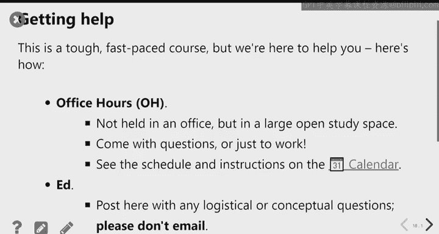

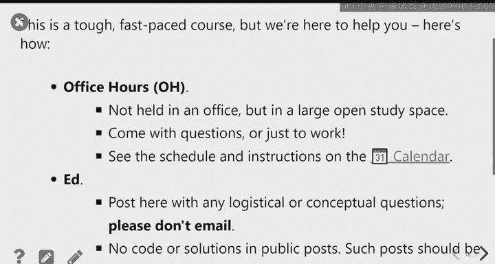

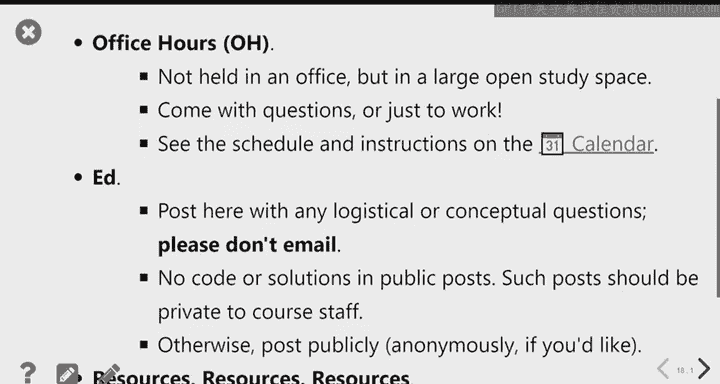

There's a schedule is coming soon on the calendar we're gonna get that set up and office hours will start next week okay there's also Ed so like we were just talking about if you're stuck on on a question and you have like a partial idea but you need help or it's not working the way you think it should be working right you can make a post on  Ed and one of our tutors or I will get back to you be careful not to post any code or solutions publicly where other students can see it。

😊，Because that could be collaboration that's not authorized。

 but you can post privately if it contains like a code or a partial solution。

 but if it doesn't do try to post publicly because that way other people can learn from the answers right so if you have a general question about how does this thing work can you explain it right then other people would want to see that but if you have a question of like here's my code and it doesn't quite work help me fix there error that's like mostly not relevant to other people and also maybe your code is 99% correct and then people could copy you。

And finally there's like lots of resources developed to help you succeed in this class there's course notes。

 there's a reference sheet tutors for the past few years have been making videos and slideshows to help explain tricky concepts。

 there's diagrams there's a whole database of practice exams and solutions and more so take advantage of all the resources。

 not every class is going to have all of these things to help you so use them。

Here's some advice from previous students， we always ask this on an end of quarter survey and here's things that last quarter students said。

Many of them are pretty standard advice things that work pretty well。

 starting your assignments early， right， not procrastinating。Being prepared to spend a lot of time。

 I try to tell you on the first day of class that it is a significant time commitment so make sure you have the bandwidth to dedicate to that。

嗯。Go to office hours。Prepare for quizzes the day before。

 so you have better retention of the material。Make friends。Practice together and ask for help。

Okay something about the procrastination and starting assignments early。

 this is something I feel like is human nature to struggle with like everybody at every level of every job everything in the world just like it's our nature to put things off until you absolutely have to do it there's there's a research study being run this quarter about like teaching students tools to avoid procrastination I'm going send a message out on ed if you want to sign up for the research study it's run by another professor in the data science department so it'll be specifically relevant to you as data science students but I think like it's a skill that everybody can always improve on like not procrastinating so make that one of your goals for the quarter。

😊，Okay so just to reiterate one more time， the course is challenging but there's lots to help you succeed。

 we won't assume any background in programming or statistics。

 but we will move fast okay and there's a TED talk here about how anybody can be a data scientist and I think it's pretty inspirational if you want to check it out also in order to succeed you have to sort of have a good baseline health so there's some resources here for if you're experiencing food insecurity or you need mental health care there's also a new app that was created here at UCSD specifically like for UCSD community a self-care app that helps you get in connection with other resources to support your wellness so check those out if any of them are useful。

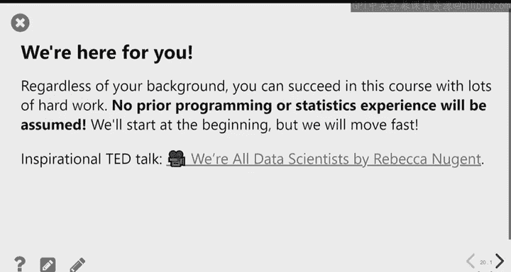

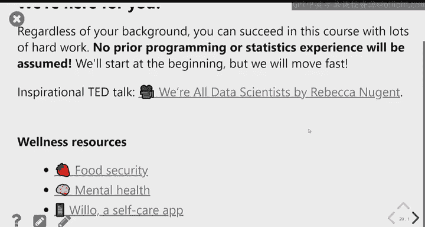

Okay， now I'm going to do a little demo。😊，Kind of to give you a taste of what we'll cover in the class。

 Okay， so the demo I'm going to do today is about a book has anyone read this little woman。

Has anyone seen the movie？There we go。So we're going to learn a little bit about the book just from using skills that we'll learn in this class。

 right？And today， don't worry about the code that does any of this。

 you'll learn the pieces in the weeks to come， so just sort of relax and listen to the story。

So what I'm going to do first is sort of open a text file。That contains the contents of the book。

 so I got this text file from a website where they post like the full text of books whose copyright has expired。

 the website's called Project Gutenberg if you're interested， you can explore other books。Okay。

 and I've just read it in to Python。 So now I'm able to like access it and work with that data。

 For example， I can ask， show me the first 3000 characters。😊，Okay， what's a character Well。

 character in Python is like an individual letter or symbol， so it includes spaces。

 it includes numbers， it includes punctuation。 you may notice there's like a lot of weird stuff here that makes this hard to read right。

 you wouldn't want to read a book in this format。 One thing I notice is slash n。

 that's a special symbol that stands for new line。 So like when you hit enter return on your keyboard and it goes to a new line。

 this is how the computer sort of represents that。😊，Okay。If you wanted to actually read the book。

 you would want to read it in a more human readable format。 right。

 So the way the computer stores the book。Is like this。

 but the way I want to read the book as a human。Is like this。

Okay so I ask the computer to print the book and print is a command that shows you something in a human readable format。

 and notice there's no more slash ends。But there are actually line breaks， right？In particular。

 like there's this table of contents。Then chapter one begins the title of chapter one and then the actual content。

 so you could read the book this way。Okay， what I want to do is I want to analyze how many times each character's name appears。

Throughout the book， so now when I say character， I mean like actual main characters in the book。

 right， not letters and what I'm going to do to do that is I'm going to split up this entire piece of text by the word chapter space。

Okay， so anytime I see chapter space， that's kind of an indication that a new chapter is starting。

Remember， chapter1 started with chapter space and then the word1。

 similarly chapter 2 is going to start with chapter space and then the word two and so on。

 so those are like special sort of separating points that divide chapters。

And then I'm going to make sort of a table， we call it a data frame。That just separates each chapter。

 So the first instance of the word chapter was followed by one。

And this is all of the stuff before the next instance of the word chapter。

 The stuff up here is like the intro material before the first instance of the word chapter。Okay。

 so this has the text sort of separated by chapter。

And what I'm going to do now is I'm going to take the main characters。

 the four sisters that this book is about， and Lori， who's a man who marries one of these sisters。

And I'm going to count how many times does their name appear in each chapter？Okay。

 and you can see that like in the first chapter。The names appear quite a lot compared to like the later chapters。

Right and that's because at the beginning of a book。

 you're trying to meet the characters and they want you to get to know who they are and who's who。

 especially with like four sisters， that's probably confusing， so they use their names a lot。

And you can also see specific chapters are about specific people。

 like chapter 44 is something about Amy and Joe， right。46 is almost entirely about Joe。

So that data frame or table like conveys the information that I'm interested in is something about how often characters are mentioned。

 but it's hard for me to see patterns in a table， it's much easier if I can visualize it。So。

 this is a。Visualization。Here it is。Of the total number of times。

 each name appears throughout the entire book。Right。This number here， Joe in chapter 15。

 her name has been mentioned 516 times so far that's like in all of the first 15 chapters combined。

 that's why these graphs are only ever increasing right you can't take away a mention of someone's name right so they're increasing or staying flat。

 I guess they're not decreasing。And then based on this visualization。

 you can answer questions about the book。Okay， so my first question for you。Is who's the book about？

Who's a main character？Okay， that's easy， right， Joe's name gets mentioned way more than everybody elses by the end。

She's at like 1，500 and they're at like five four or 500， so she's almost three times as much。

As the other characters， right， Joe is the main character。 That's an easy one。 Okay。

 here's a little harder one。In chapter 32。Joe moves to New York alone。

Her relationship with which sister suffers the most from this far away move。Which one？Mgabeth。

So meg is the blue one。Beth is the。What do you you call that mustard one？Which one do we think？

It's meg because of the slope， okay so what does the slope of any one of these graphs represent？Yeah。

 the rate of growth。The mention of these names and。Yeah， so it's something about a rate。

 I'll call it mentions per chapter。So it's pretty hard to estimate， but let's say。

I'll say go from here。To hear。I've been mentioned or Joe has been mentioned 600 times。In 20 chapters。

Right。So she's mentioned about 30 times per chapter on average right。

 and that's more than other people are mentioned because her slope is steeper than all the other lines right most of the other ones like pretty closely follow lines。

But this one here。Right， looks like it's on a trajectory of some number of mentions per chapter。

 and you would expect it to。Sort of keep going like that， but it doesn't， right。

 it pretty much plateaus after around chapter 30。

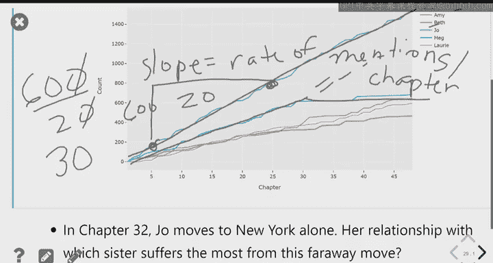

So that's basically what happens in the book is like one sister moves away and then she's less of a main character in the book because the book is primarily about Joe。

Does that make sense？Okay， now that I've written all over this。

Lori is a man who marries one of the sisters at the end， who do you think he marries？

Let me scroll up again。Loauri is the purple。Amy， Lori Maryries Amy， how can you tell？Yeah， yeah。

Right here you can really tell they go like up in a pair down in a pair it's like when you're drawing with two crayons in your hand at the same time right it looks like that and that's because when people are like in a couple or married。

 especially you talk about them together like I'm going to Lori and Amy's house or Lori and Amy did this Lori and Amy did that right so that's why you can you can see that Does that makes sense。

😊，Some people choose Amy and Lourri because they're。Their lines wind up close together right。

 but that's not really sufficient information right that could just be a coincidence that their lines wind up together。

 the fact that their lines move together is actually what's most important and you can kind of tell like probably when they became a couples like right around here would be my guess。

SoWhen we are supposed to answer the question。Since the slopes are similar。Yeah。

 throughout changing at sort of the same rates throughout。妈买。Yeah。

Okay so that's the end of the little demo right and that kind of shows sort of how you can use data to draw conclusions right like we just learned something about little woman without actually reading the book。

 granted this is not like a substitute for reading but we still learned some plot points right without actually reading every single word and we just did that by counting how many times each name appeared and looking at a visualization that helped us to process all of that information quickly right。

So in order to do that， I used code and we're going to start by just talking about what is code and what are Jupiter notebook。

Okay， code is basically instructions for a computer。

And you can think of a computer program as just like a recipe， it says to the computer。

 here's what you're going to do， and it's going to do exactly that and nothing more computers aren't smart。

 they can't like infer what you mean， so you have to be very precise in how you give your instructions。

We're giving instructions in Python。Because it's very popular okay it's one of the most in demand programming languages。

 this is based on job postings right so it's a thing that jobs look for。 Why is it so popular though。

 It's popular because it's good at a lot of different things。 It's good at web development。

 It's good at data science and machine learning， which is what we're gonna to be using It's good for scripting to do things automatically and importantly。

 it's relatively easy to start and that's kind of the philosophy of this class is we want you to actually do things substantial by the end of the course。

 So we don't want to spend too long like explaining a lot of basics。Okay。

Jupiter notebooks I mentioned before is the platform that we're using a lot of times code is written in sort of a two interface environment where you like write the code in one place and then you execute the code or run the code in another place。

But in Jupipyter notebooks you're doing everything in the same spot。

 so you can like write a little bit of code and then run it to see how what it does， what it outputs。

And data Hub is UCSD's provided tool to allow us to run Jupiter notebooks。 Okay。

 the nice thing about data hubub is you don't have to install anything or everything's just done online through an Internet connection。

I mentioned。That you can view the I don't know if I mentioned this yet。

 you can view the notebook like as it opens， it'll be like this， but if you click this button here。

It turns it into a slideshow。So this is how I present it in class。

 you can follow along this way if you prefer。And what can you do in a Jupiter notebook Well。

 you can do lots of things， but I'm going to start with like the most basic。

 the most basic thing you can do is use Python like a calculator。

 just like you would maybe type a math expression into Google or Wolfra Al or your graphing calculator or whatever right Python can do that stuff too。

So you can type in expressions。And these expressions will evaluate to a particular value。Okay。

 so Python basically calculates things for you。This is the most basic use of Python。Right。

Here's an expression。 It's just a number。 When I hold down the shift key and hit enter。

It it outputs the value of my input， right， I just input 23， So the output is 23。 that nothing。

 it doesn't really have to do anything。 right here。

 it's going to actually have to add these two numbers。Here， what is that symbol。

 this is not a symbol you normally see in math， this is Python syntax for exponiation。

So it's going to do four to the third power。I can use parentheses to specify order of operations。

 so it's going to add these first， what's that？9ine divided by three。And the answer is three。

Here I have several different expressions right 9 plus 10。

 13 divided by 4 and 21 if I put them all in the same cell。

 Python only shows me the value of the last expression so cells are really meant for just one expression。

 I could separate these into other cells if I wanted to see the other outputs。

 but interestingly if you do have multiple expressions in a cell。

 it is actually calculating all of the values it just doesn't show you right so it is computing three numbers you just only get to see the last one。

Most of the arithmetic that you do with Python uses the standard notation plus minus times divide remainderder is an operation that tells you when you divide how much is left over right so seven divided by three that fits in twice but then there's one left over。

 so the output of that would be one and then the double star is used for exponentiation so this right here2 to the 0。

5 is how you would say square root of two in Python。Okay， there's a standard order of operations。

I learned it as pemDOS， but in some other places they learn it as bed moss。

 because they say B for brackets instead of P for parentheses in Canada they do that。

Sro's from Canada。So if you just type it with no parentheses。

 it's going to do the exponentiation first， this is eight times 5。

 but if you want it to do the other way， you just use parenthesesis。All right。

 in our last couple minutes。Try to use what we've just learned。To write out an expression。

That's equivalent to this value。Okay。Equivalent to what I've shown here。

 a hint is that if you do it right， it'll come out to a nice number。Okay。

So I'll give you a few minutes to work on that。And then we'll part ways。对有没有这你个。Basically。

 just change it to Python syntax， right， like you can't， how do you write four squared， right？

If anyone knows what it evaluates to， raise your hand and tell me。可厉害。88。Is it idiot？I think it。

Can't remember。过年。Okay， at the end of the slides I just have a little bit of summary what we'll do next time and some reminders okay。

 so make sure to check that out I'm going to let you guys go if you have additional questions just come on up and ask okay。

