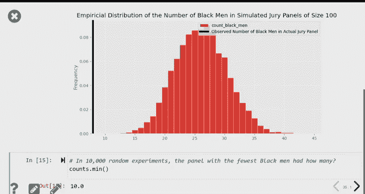

# UCSD《数据科学原理 (DSC 10 Principles of Data Science Fall 2024)》中英字幕（deepseek - P20：DSC 10 - Principles of Data Science - LE -A00- - Lecture 20.zh_en - GPT中英字幕课程资源 - BV1hmAneGEZh

Yeah。😊，All right， good morning everyone。Here's what we have going on。

Uual homework and lab assignments today is quiz3 so hopefully you're ready for that there's some practice problems that I posted that should help you prepare and then the seating assignments are out we put them in the spreadsheet so you can just look yourself up in the spreadsheet and then also wanted to put on your radar it's like week seven as it now so we're we're approaching the end of the quarter the final project will be coming out soon so think about your plan for if you want to work with a partner and who that might be we recommend working with a partner but you can also work alone if you prefer。

😊，So something to keep in mind。Okay， any questions on logistics？All right。

 today we're going to review what we learned about the central limit theorem and see how that relates to choosing sample sizes so far we've been working with you know you have a sample of a certain size。

 but what if you get to decide how big your sample should be to satisfy certain constraints that how big should you make your sample and then in the second part of the course we're going to talk about something else called models？

Okay， so I introduced this little。Slidehow last time。

That kind of gives a big picture overview of what the central limit theorem says。

 The central limit theorem talks about having some population。

And drawing a sample from that population。And looking at the mean of that sample。

And the central limit theorem is about if you were to look at many samples and there are many means that they might have。

 you'd have a whole collection of sample means from various different samples。

And we're talking about the distribution that you get when you put all of these sample means together and kind of show how do they turn out and that distribution comes out bell shape。

Okay， so there's a pretty big difference between like the population and the sample versus the distribution of the sample mean like the population in the sample both look like each other。

 they're both very skewed to the right， they have the same shape and like look at the numbers on the axes right we're talking about minutes anywhere from like negative a few to positive 100 or 200 right that's the case for both the population and sample but for the distribution of the sample mean。

 it's like way narrower right it's only around like 12 to 22。So it's a much smaller sort of spread。

And that's because the mean isn't going to vary that much from one sample to another。系。

So what do we know about these three distributions， Well。

 the first thing is they're all centered at around the same place okay。

 the fact that the mean of a and the mean of B are similar。

 that's just because samples look like the populations that they came from and mean of C is also centered around that same value because sometimes your sample is going to have a slightly too big mean and sometimes it's going to have a slightly too small mean。

 but on average it tends to be about right？The spread of A and B are similar again because samples look like the populations that they came from。

 so I think the spread was about like 40 minutes when we measured the standard deviation。

But the spread of distribution C is much smaller， right， It's not on the order of 40 minutes。

 It's on the order of like two or three minutes。And the spread of distribution C comes from taking the spread of distribution A and dividing by the square root of the sample size。

 and the idea there was that if we had bigger sample sizes， you'd be dividing by more。

 so your overall spread would be smaller， which means a narrower distribution because bigger samples give you like a better sense of the true population meat。

Okay， so the central limit theorem says the spread of distribution C is equal to the spread of distribution A divided by the square root of the sample size but in practice the way we actually use it is we don't know the numerator。

 we don't know the spread of distribution A so instead we use the spread of distribution B because of the fact that they're similar。

Make sense。Then you're going to have then you're gonna have an unlucky sort of understanding right you can only do your understanding based on a sample is only as good as a sample you have right so it's possible that you get a bad sample and that leads to a misunderstanding of the population that's the same thing that happened in like in bootstrapping remember this picture with like all the different confidence intervals right most of the time they work and they capture the parameter but occasionally you get one like this that doesn't and that's just because you had a bad sample。

😊，男生は。这审判。Yeah， so if you used this third distribution to like make a confidence interval， right。

 there would still be like 95 out of100 of every such confidence intervals that you make would would capture the parameter in the same way。

 So it has the same sort of limitations as bootstrapping in terms of it's only as good as a sample you have。

 And that kind of makes sense like it would be unreasonable for us to expect like a perfect estimation strategy。

Even if we had a really bad sample， right， like if you have a bad sample。

 that's all the data you have， that's like your best understanding of the population。

 so you're going to base your estimate on whatever sample you have。Good question。Okay。

 so this is the statement of the central limit theorem。

 it talks about the probability distribution of the sum or mean in actuality， right。

 we're not looking at probability distributions。We're looking at empirical distributions。

Right the way I。The way I made that distribution C was by taking lots of samples and plotting their means。

 but empirical distributions are like the probability distributions。

 right they are approximations of the probability distribution。

 so they're also going to have that normal shape。😊。

It also says that this is true for large random samples drawn with replacement。But in fact。

 in practice。This also tends to hold。For samples drawn without replacement。

Because the mean of a sample drawn with replacement and the mean of a sample drawn without replacement isn't gonna to be that different。

 especially when your population is way bigger than the sample right if you're like sampling 100 UCSD students or 500 UCSD students like the chance of you getting a repetition getting the same student twice even if you allow that to happen is pretty slim because you're choosing from such a large pool so repetitions actually happening is like rare enough that that the distribution of the sample mean comes out looking basically the same whether you do the sample with or without replacement so this is like the formal statement of the central limit theorem but basically in practice it's like a little more applicable。

 a little more broad than the theorem says because probability distributions look like empirical distributions and because samples drawn with replacement look like samples drawn without replacement when you have a big population。

Does that make sense？And the key thing here is it doesn't matter what the population looked like and we saw that with the flight delays。

 the flight delay population was very skewed， not at all normal。

 but still distribution C came out normal。So what else do we know about that third distribution。

 distribution C， right， Not only is it normal， but we know where it's centered， right。

 and we know what its spread is by this form。And the way we actually use this is we don't know the population mean or SD。

 but we use the sample mean and SD as approximation。OkaySo the takeaway is that by using the CLT。

 you can kind of understand what the distribution of the sample mean is going to look like based on a sample that you have。

 it's like you get the distribution as if you were to bootstrap that sample many times and see how all the resample means were to come out。

 you get that same understanding of that distribution without having to actually do the computation of the bootstrap so it's like a shortcut to bootstrapping。

Okay， any questions on central limit theorem？This is a question that we did at the end of last lecture。

 I went over it then， but I want to go over it again because it's really important。

 which of these histograms corresponds to the distribution of the sample mean？😊。

So that means in my little slideshow， I'm talking about distribution C。

showing many samples and how their means come out， and we're talking about samples of size 100 coming from a population with a mean of 50 and an SD of 20。

Okay so the thing that everyone gets wrong on this problem is they see SD of 20 and they look for a bell curve with an SD of 20 right。

 but there's multiple different SDs at play here， There's the SD of the population。

There's the SD of the sample。And then there's the SD of。The distribution of sample means。Okay。

 so what are they telling you here， they're talking about the SD of the population。

Right but they're asking you know something about the distribution of sample means。

 so the idea is that the SD of distribution C comes from the SD of distribution A divided by the square root of the sample size which was 100 so you're looking for something with an SD of 2 the mean of all three distributions is the same。

 so you're looking for something with a mean of 50 and a spread of2 and the way to do that is to look for。

Not very good， but look for the gap between。The center line and the inflection point。

 that's what tells you the standard deviation okay so this has a gap of about two。

 so that's why we picked that one。Make sense。Questions。Okay。

The real benefit to like using the central limit theorem is that it gives you like a shortcut to bootstrapping right but what did we use bootstrapping for was to generate confidence intervals to estimate some parameter right so if you know sort of like how the bootstrap distribution is going to turn out that's kind of what the central limit theorem tells you it's like if you were to bootstrap you would have gotten a normal distribution with a certain mean and a certain standard deviation right the way you would construct a 95% confidence interval is using a fact about normal curve。

 95% of the area of a normal curve falls within two standard deviations of the mean。

Okay so where is this bell curve centered， it's centered at the sample knee。Right。

 and then you need to go sort of two jumps on either side to pick up 95% of the data。

 How big is a jump， Well， one S D of。Of distribution C of the bell curve。Is given by this formula。

 so you go two of those to the left and you go two of those to the right。

 and that's the endpoints of your 95% confidence interval。Okay。

 so this is a really nice formula because it doesn't involve any like computation or hard calculations。

 it just depends on three numbers， right， the sample mean that appears here。

 the sample standard deviation that appears here， and the sample size appears here。

 you just plug in those three quantities and then it's just a formula and you have your endpoints。O。

Now CLT we've talked about as like a replacement to bootstrapping。

 but it doesn't fully replace bootstrapping CLT is only for the distribution of the sample mean or the distribution of the sample sum。

 but bootstrapping is more general in terms of what statistics it works for in particular the median is something that we tend to like for bootstrapping but it doesn't work for the CLT because the CLT doesn't say that the distribution of the sample median is going to be bell shaped。

 the sample median might have some other crazy shape。Okay。

 so generally bootstrapping is better when you're doing some statistic besides the mean。

 and generally CLT is better when you're doing the mean because it's less computational。All right。

 any questions on any of that so far？Okay， now we're going to see sort of how to use the central limit theorem to help us pick sample sizes。

So the scenario that we'll look at today is you want to estimate the proportion of UCSD students that use Duoingo。

 which is the world's most popular language learning app。

 A lot of people use it to learn a second language。And you're interested in this proportion。

 which is like a population parameter。It's something about the full population of UCSD students。

And to estimate this parameter， you plan to ask a random sample of students whether or not they use this app。

And what youd like is to estimate the parameter to a certain amount of closeness right so you want a 95% confidence interval whose's width is at most 0。

06 okay this 0。06 is like something you get to decide based on how wrong you're willing to be okay so we chose 0。

06， that means if you come back and say I think between 21 and 25% of students use this app。

 you're going to be satisfied with that as an estimate， it's like precise enough。

But if you were to take your sample and based on that sample。

 make a confidence interval and the interval said 21% to 28%。Well， that's 0。07 wide。

And that's like not informative enough。We've talked about how narrower intervals give you better information。

 right？It's not that helpful to be like， I think between 10 and 80% of students use this。

 that's just too wide to be helpful Okay， so you get to control what width you want。

 like how precise you want your information to be。And you also get to control。

What confidence level you want， confidence level is like how willing you are to be raw right with a 95% confidence level。

 there's a small chance that your estimate is incorrect right with a 80% confidence level。

 there's a bigger chance that your estimate is incorrect。

OkaySo those are like the things you get to control， the confidence level and the width。

 and then based on that， the question is how big of a sample do you need？Okay。

 so the first thing to know about this situation is that the parameter we're interested in is a proportion。

 like what proportion of UCSD students use this app？And the central limit theorem is about means。

 but proportions actually are means。Okay， there's only two unique values sort of in our sample that we're going to collect。

 we're just going to ask people a yes or no question so you can record one if they do use Duolingo and zero if they don't。

And the proportion of people that do use it is just the proportion of ones。

But that's the same thing as the mean。So this is a small example that I hope illustrates the idea right。

 let's say you were to ask five people do you use this app， The first person says no， yes， yes， no。

 yes， the proportion of yeses is three fifthths right three out of the five people said yes。

 but that's also the mean right if you add up all these numbers the sum is three because three people said yes right and when you divide by how many there are right there was five people So you get three fifths either way。

Does that make sense how the proportion is just the mean of these zeros and ones corresponding to yes or no？

And that's super powerful because we have a theorem that works for means。

 and now we're saying like it works for proportions， basically。

So if you look at the distribution of the proportion of ones in a sample。

 that's going to be roughly normal。Okay， so here's what we'， what we plan to do。 right。

 We need to figure out how big of a sample we're going to take。 But once we。

 once we figure out that size， we're going to collect a random sample of that size。 Okay。

 Then we're going compute the sample mean， which is just the proportion of people who say yes。

 within our sample。 That's one of the quantities that we need for， for making a。

confidence interval right then we're going to compute the standard deviation of our sample。

 That's another one of the values we need。 We already know the size of our sample if we've taken the sample already right and then we'll be able to get this 95% confidence interval once we have a sample okay。

So。How wide is our confidence interval going to be， Well， it depends on these parameters。

 right in particular， it depends on this stuff。The way I think about this is that the confidence interval that we get is going to start at the sample mean。

And go two jumps of size this to the left and two jumps of size this to the right。 Okay， so how。

 how wide is it， It's four jumps of size this。Does that make sense？So。We want this with， right。

 to be at most 0。06。And our width depends on two things。

 the spread of our sample and the size of our sample。So we basically need to solve this inequality。

 right The left side represents the width of the interval that I'm going to get when I take a sample of a given size and the right side represents the maximum width that I'm willing to accept because of how precise I want my answer to be okay。

 so we need to solve this inequality the problem is。Right。There's two unknowns。

The sample size and the spread of the sample and you don't know either of those things until you actually take the sample right we're asking a question of like how big of a sample do I need to take So we're going to solve it for sample size but our answer depends on how spread out is the sample going to be and that's like a catch 22 because how are you supposed to you know。

Solve for the sample size until you know how spread out your sample is going to be so this is a dilemma that will have to resolve but first make sure we understand the algebra here。

 what am I doing I'm multiplying both sides by square root of sample size and dividing both sides by 0。

06。And then I'm undoing the square root by squaring both sides。So far， so good。Okay。

 so our issue is before we actually do the poll or collect the sample， we don't know。

What to put here。We don't have a sample。And you might say， well。

 we've used this trick before where when we wanted something about the population。

 we replaced it with a sample， maybe here we want something about the sample。

 so we replaced it with the population。😊，But that doesn't help either because you also don't know about the population。

 okay， so you can't do that。What we're going to do is instead think about。

How this number could come out， like all the possible ways that the spread of our sample might turn out。

And then we'll just use the largest possible value here。

Like imagine this could come out in like a bunch of different ways if you put the biggest number here。

The biggest possible value here， that's going to make this whole fraction like as big as possible。

 which means like you're being conservative and that the sample size that you say you need will certainly be large enough right perhaps you could have even gotten away with a smaller sample size。

 but the the one you're saying is like definitely going to be sufficiently big。

OkaySo we're basically going to give a bound an upper bound on how big this could possibly be。

And then plug that number in and that then we'll be able to say that a sample of that size will certainly be sufficient。

Okay， so now the question is， how spread out might our sample be？In general。

 if you don't know anything about the values in a sample。

 you can't say anything about how spread out it's going to be。

 like if you want to ask about something like how much income do people make or something like。

People's income can be arbitrarily high， right， So the spread of people's incomes really has no limit to like how high that can be。

But here the data is not incomes in thousands， the data is do use Duolingo or not right so the data is zero or1 like each individual person is a zero or a1 So we're talking really about a data set of zeros and ones and how spread out that can be and we already kind of know like it can't be that spread out right because if you think of like a histogram。

 a data set of zeros and ones is going to be confined to the interval between zero and1 right it can't be like arbitrarily infinitely spread right there's sort of a limit to like how spread out can you be when you're forced to be either zero or one。

Okay。U。There's a formula for the standard deviation。Of a collection of zeros and ones。Okay。

 you can sort of derive this from the definition of standard deviation。

 but we'll just give it to you as a fact， you'll see it in the homework。

 a formula for the standard deviation of a collection of zeros and ones is it's the square root of the proportion of zeros times the proportion of ones。

😊，So。This plot。Shows you this formula。And I really like this plot。U。What it's saying is that。

The horizontal axis。Think of it as the proportion of ones。And the vertical axis。

Think of it as the SD of a sample。With this proportion of ones。Okay， so what do we have here？

When the proportion of ones is zero， what does your data set look like？

Nothing is one and everything is zero， that's what your data looks like。

And what's the spread of that data set， Every single person says the same thing。

 There's no spread there， Okay， so。The vertical coordinate there is zero。On the other hand。

 p equals 1。That means everybody says yes， I use Duolingo。

 the data set is also not at all spread out， the spread of when everyone says the same thing。

 there's no spread。So what's kind of the natural sort of in between of that。

 would it be p equals a half？Half the people use the app and half of them don't。

 this sort of maximizes the spread。Because no it's not like you have one really tall bar and the other bar has nothing。

 it's like both bars are equally tall and。That leads to the standard deviation being as big as it possibly can。

And that standard deviation is a half。Okay， you can look at other values of P just to make sure we understand it like。

P equals 0。8， this says。hi means 80% of people say yes and only 20% of people say no。

 that's more spread out than like zero or one， but it's not as spread out as a half as this picture。

Does that make sense？So it kind of makes like， it's kind of intuitive that like you have a bunch of data that's gonna be zeros and ones。

 How do you like spread it as much as possible， you can only put things at the two extremes， right。

 So you just divide it in half and like make both extremes equal。

 and that's as spread as you're gonna be right， If you do 60，40 or 80，20 or anything else。

 that's less spread out。Okay， any questions on that？So the conclusion right。

 is that the largest possible SD is 0。5。The peak right there。

 and it happens when you have half zeros and half ones。Okay， so now I just plug that， plug that in。

The spread of my sample， well， it depends exactly what sample I get， how spread out it's going to be。

 but I know for sure number that the number that's going to go here can't be any more than 0。5。

 maybe it's 04， maybe it's 0。3， but it's never going to be more than 0。5。可。

So the bigger the value that I put here， the larger the sample size that I meet。

 so I'm going to put the biggest possible value to make sure that the sample size that I'm saying we need is sufficiently large。

So this is， I think of it as like being conservative。 I want to make sure that the。

 the sample size that I say I need is going to be big enough。

 and if you just assume that the sample S D is going to be 0。5 as big as it possibly can。

 then it will be enough。Okay， so we just replace the sample SD with 0。5。

And then we can solve for what we've already solved for the sample size that we need。

So here I'm plugging in。These numbers into Python。To find the smallest sample size that satisfies this。

Okay， so this quantity evaluates to 1111。1111， which means I need 1，112 people。

To make sure that my 95% confidence interval that I get is going to be at most 0。06 wide。

 You notice how I have to round it up because I need， well。

 the number of people I survey has to be an integer， right， and I need it to be at least this big。

1111 is not at least this big， 1112 is at least this big。Does that make sense？

So you can see where all the numbers in this formula came from。Where did the four come from？

This came from the idea that I wanted a 95% confidence interval right so I have it's four jumps wide to get 95% of the area if you wanted a different amount of confidence right that wouldn't be a four anymore that might be something else。

Where did the 0。5 come from？This was my。The biggest possible SD。Think of this picture。

Where did the 0。06 come from？That was the width that I said I wanted。Okay。

Where did the square come from？The CLT has a square root in it。

 so the squared came from undoing the square root。Get因为。这个。What the one。W。Right。

 so what if this gives you a number what if you see the number and you're like I can't do that right then that means you're asking for too much you're not going to be able to get a 95% confidence interval that's sufficiently wide。

 you have to relax one of two things you have to relax the 95 to maybe like 80 and be willing to be wrong more often or you have to to widen your width to get a less precise interval so maybe you can't you can't get it within 0。

06 but maybe you get it to 0。08 or yeah so all these three numbers are like related and you get to basically pick two of them and the other one you can solve for。

Does that make sense？All right， I'll give you a minute to try this， this is the same question。

But instead of being point。0，6 wide。 Now I want it to be 003 wide。

 What's the smallest sample size I could collect there。

The simple way to do this is use the same formula， the only thing that's changes is the width， right。

 so I just change the 0。06 to 0。03。And if you have Python， you can recalculate it。Right。

And you see it's going to be four times as big。So since I rounded up， I'm going to round up again。

 I'm going to get four， four， four， five。But this like shows you an important property that like when you have the width of the interval that you want。

 you actually have to times four on the amount of data that you collect。

So that says like it's very hard to be very precise， right。

 because the amount of data that you need like grows with the square。

And that's because of the square root in the formula， so you can kind of see that algebraically。

Like can I not right？Okay。The equation that I solved before was I was doing。Four times。Po5。Over 。06。

Squared。But when you。Replace the 0。06 with a 。03。03。Is like half of 0。06。And。

A half in the denominator。Is like a2 in the numerator。And because it's inside a square。

It comes out with a square on it。So it's。The previous answer。Times4。Okay。And similarly。

 if you were to like。If you were to like。What if I change this to 0。02？

This would be a third as much as you wanted before。

 you would need nine times as much data to make that happen。So it's pretty hard to be like really。

 really precise， you pay a big cost in terms of how much data you need。Does that make sense？

Okay now let's move on to our next topic we're done with the CLT from here we're going to talk about something called statistical models。

 so what we've been focusing on so far was this problem of parameter estimation right there's some unknown parameter in the population that you want to estimate we saw bootstrapping in CLT both gives us ways to create confidence intervals and confidence intervals are how we estimate things。

😊，Okay so that's what we've been doing and what we're going to be doing now is answering yes or no questions about the relationships between samples and populations so these are two examples that we're going to do in the coming lectures。

Does it look like this jury panel was drawn randomly from this population of eligible jurors okay。

 so we're going to look at some court cases in court cases you're supposed to get a jury that's representative of the place where you live and in actuality were jury panels that were drawn actually representative of the population？

And then a more sort of standard one， you generate a sequence of coin tosses。

 does it look like this sequence of coin tosses was generated by a fair coin？

Both of these problems are still statistical inference， like the parameter estimation。

 as well as these yes no questions， they're all under the bigger umbrella of statistical inference because they're using a sample to learn about the population。

😊，Okay， so to answer the yes， no questions， we're going to be basically assessing a model。

 a model is a set of assumptions about where your data came。So for the coin example。

 right if you just like find a coin on the ground， you'd probably assume it was a fair coin。

 that's like your model， your operating assumptions。

There's a famous quote that says essentially all models are wrong， but some are useful。

 meaning like it's very hard to sort of get all the details exactly right。

 but still a good approximate understanding of some process is still useful。😊。

So when we think about models， we're thinking about data generation。This is a。

A famous example of of a model and how how Galileo sort of challenged an existing model。

 So people used to think back in the day that。Acceleration due to gravity was not constant。

 they used to think that heavier objects fell faster because gravity had like a stronger pull on them okay。

 so they thought that if you were to do an experiment where you drop two balls of different masses from the leaning tower of Pisa。

 they expected that the heavier one would fall faster。

And Galileo challenged this idea by doing this experiment and he dropped the two spheres and he found that they fell at about the same time。

So the model is like the。The old idea are the assumptions。

And what Galileo did was he challenged the model。With data。

And you can think of the coin flipping example that I mentioned before as like another version of this like if you find a coin on the ground。

 you're going to assume it's a fair coin right but then you flip the coin 100 times and 90 of them come out heads。

 you're going to question your assumption right like oh maybe this is not actually a fair coin maybe I found a rare a rare biased coin。

😊，The data that you have makes you sort of either believe or disbelieve your prior assumptions because when you make assumptions they're just assumptions。

 they're not based on anything factual， but the data is that's real facts。

 so do the real facts kind of corroborate your old idea or do they contradict your old idea。

So that's what we're going to be doing。Right， you can think of that as。

Assessing the quality of a model， right， we have some assumptions， but are those assumptions right？

And we're going to use data to tell us whether we think our assumptions are right or not。

Does the data that we have sort of explain？Or does the model that we have sort of explain the patterns and the data that we have Great another way to say that is does the data that we have like seem like it could have come from the assumptions that that we believe or does the data seem like too different for those assumptions to be true right that's like the Galileo thing the data he collected was like not in line with the assumptions that people had and if the data and the assumptions disagree you know which is right。

 well the data is right， like that's real life that's what actually happened。

 So the assumptions must be wrong。All right， we'll try this out for a real jury case that happened in Alabama in 1965 okay so this was the case called Robert Swain versus Alabama。

 Robert Swain was a black man convicted of a crime。In the south in 1965。

 and basically he had an appeal of the jury's decision。

 and this appeal went all the way to the Supreme Court。

 he was appealing the decision on the grounds that his county systematically excluded black people from juries。

 which is the problem he felt like he wasn't being fairly accurately sort of represented on the jury panel。

So when we talk about jury cases， this is sort of the process by which juries are drawn。

 there's some eligible population of people who can serve on a jury now it's like you know men and woman can be on a jury。

 you have to be a US citizen like things like this， in the day only men and you have to be 21 and up。

嗯。And they're supposed to take a representative sample from this eligible population to create what we call a jury panel。

 so a jury panel think of that as the people who get summoned to appear on a jury。

 like people who get a jury duty summons in the mail。Okay， then。

Some of those people actually get picked to be on the jury and they form the jury。 Okay。

 so the second phase of this process is not supposed to be random。

 That's like the lawyers and and judges can like ask you questions and things like that。

 But the first part is supposed to be random。 Like nowadays， it's mostly based on like DMV。

records and voter records and things like that， like they have a big database of people and they're supposed to pull randomly from that database and call you to jury duty when you get your call。

So we're focusing on the first part of this， like the people who were potentially able to be called for jury duty versus the people who were。

Okay， and。26% of the eligible population was black。So you would expect then， right。

 like around 26% of the jury panel should also be black。If it's drawn randomly， right？

But he had 100 men on his jury panel and only eight of them were black。

 so he had only 8% when he was expecting 26%。Okay， so I said it went all the way to the Supreme Court。

 Supreme the Supreme Court said the overall percentage disparity has been small， like in other words。

 26% and 8% are close enough that that's just a slight difference that happens sometimes。

And they denied his appeal。But what we're going to show today is that the Supreme Court was wrong。

This overall percentage disparity is not small， most likely this is racism at play in the 1960s。

 the jury panels tended to be made up of people that like the high ups in the court knew personally and that wasn't an inac racial cross section。

And I mentioned。The fact that from the jury panel， an actual jury gets picked， right。

 that process is not meant to be random， but that process also eliminated all eight of the hundred black men。

 so he was convicted by like a probably fully white jury。Okay， so here's our model。Right。

Our model is like sort of the assumptions that we think should be true。

 We think that the jury panels are randomly chosen from a population that's 26% black。Okay。

But the data that we have， we're asking， does it contradict that model or does our data could have come from that model。

 Okay， so the data we observe is that we only have eight out of 100 black men。And we're going to ask。

 does the model explain the observation， Is it possible for both of these to be true？

And our approach is going to be simulation。So we'll assume that the model is true。

And will generate many jury panels using this assumption。

And will'll count how many black men we got in each simulated jury panel right like if you were to select people randomly in the way that you're supposed to by law。

 how many black men do you usually get do you usually get eight is that a typical thing or is that a rare thing that's basically what we want to address is like is the thing that happened to Robert Swain like just a typical case that happened sometimes due to randomness or is it too different than what would have happened from randomness to be explained by this model like because you expect some amount of difference between the population than the sample if you're drawing from a population that's 26% black you might get 27% black or 24% black in your sample and that's like okay because some amount of randomness is expected but how off is too off that's essentially the question that we want to ask。

Okay。So。We're going to learn just like we did for other simulations。

 like learn how to do the experiment once。And then do the experiment repeatedly。

 so each time we do the experiment， we're going to sample 100 people at random from a population that's 26% black。

And count how many black men we saw， that's the thing we're going to keep track of。

 and we'll store all those statistics in array and then we'll plot them to see。

So here's how we actually do the experiment。I'm going explain the details of this next time。

 because I want to get to the。I want to get to the conclusion。But。Basically， there's a new function。

It's called NP。random。mtenomial and you use it to pick 100 people。

Demographics is saying what are the options for those people and what I'm saying is there's a 26% chance that they're black and a 74% chance that they're not。

Okay， and then item zero is just extracting the number of black men。 Okay。

 so this is basically saying choose 100 people randomly from a population that's 26% black and tell me how many black men I got。

 So if you， if Robert Swwain had 21 black men，And he went to the Supreme Court and said that's not fair。

 I should have had more， the Supreme Court would have been right。

 probably to say that 21 is reasonable like that happens sometimes in randomness。

What we're going to do is essentially do this many times。

And keep track of all the results and see how often we see a number like eight。

OkaySo here's that for loop that just does this process many times in app pen。

And here's the visualization。So I just did like I don't know。

 thousands of times of selecting 100 men from a population that was 26% black， and I saw， you know。

 sometimes I got 20 or 25 or 30 or 35 black men， did I ever get eight black men？

The line that I drew there is like what happened in Robert Swain's case， right， no， like never。

 and I forget how many times I did this。I did it 10，000 times， never in 10000 times。

Did I see as few as8 black men， That's like extremely strong evidence that what happened to Robert Swwain was。

 was not a random jury selection， right， because if you did have a random jury selection。

 you would have seen like at least probably 15 or so black men。 And he only had 8。 Okay。

 the smallest one that we got in 10000 tries was 10。Okay。

 so this is a really really powerful technique， as I hope you can see from this example。

 right it allows you to challenge existing assumptions and see whether they're accurate or not Okay。

 so we'll stop there more next time。😊。

。

