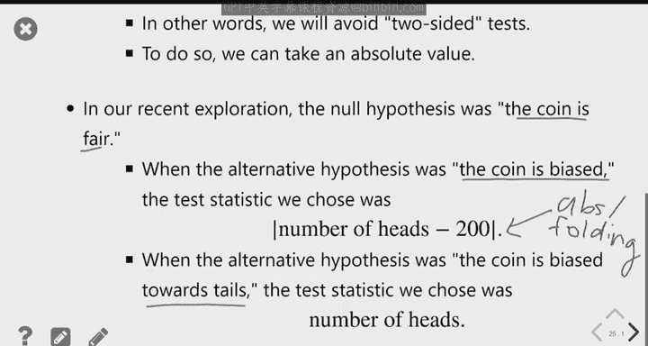
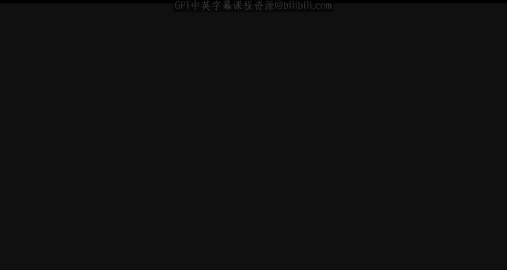

# UCSD《数据科学原理 (DSC 10 Principles of Data Science Fall 2024)》中英字幕（deepseek - P21：DSC 10 - Principles of Data Science - LE -A00- - Lecture 21.zh_en - GPT中英字幕课程资源 - BV1hmAneGEZh

All right， good morning everyone。Upcoming assignments are homework do Sunday lab do Thursday。

 the quiz scores are out so check how you did and if you've scored below a certain amount you can make an appointment with a tutor to go over how you did otherwise everyone's welcome to just ask questions in office hours and then the final project is out it's due Tuesday of week 10 so you have a little time but it's good to think about getting started on it soon and who you want to work with you don't have to work with the same person as you did for the midterm project is a completely independent decision but we do have the same partner guidelines for working together and the project is about the TV show friends so it should be pretty fun。

Okay， last time we started talking about statistical models and how we can sort of use data to corroborate or refute the assumptions in a model。

 so we're going to continue along with that topic， we'll revisit our Robert Swain jury case from last time and then we'll look at another example about coin slipping。

Okay， so just some review， a model is our assumptions about how our data was generated。

 like in the Robert Swwain example， we were assuming that the data was generated。

 how it's supposed to be according to the law， which is that it's a random sample from this eligible population that was 26% black。

 and we're trying to figure out if we think this is an accurate model that describes the data that we actually collected。

So the data we actually collected was that there was a jury panel of 100 men and only eight of them were black right so is eight out of 100 sort of consistent with with the assumption that we're drawing from a population that's 26% black。

And the approach was simulate， so if the model was true。

 like if we were actually randomly drawing from a population that was 26% black。

 how many black men would we expect to see out of 100 men？So it's not always going to be 26。

 that's the key thing right even though the population is 26% black because you're taking a random sample you might only get 20 out of 100 black men and that might be fine if that happens a lot in simulation right but the point of the simulation is to tell you like what typically happens based on randomness and then you compare that to the data you have in real life and does that seem like it's the kind of thing that just typically happens or does it seem like something else。

Right so what we did was we simulated drawing like thousands of jury panels and counted how many black men we had and we saw that that eight was like very。

 very rare， in fact it never happened in all the 10。

000 trials we did so since our data and our assumptions sort of don't coexist together right they don't say the same thing only one of them can be true right and our data is true so our model must not be our model must be wrong。

So I want to talk to you a little bit about the logistics of how I actually did the simulation of getting a single jury panel。

 so I went over this quickly in the last class， but I used a new function。

callled NP doran do multinomial And what it does is it helps you sample that random from a known categorical distribution right so there's different categories that happen with different likelihoods and it's going to tell you like how many of each category you get this is useful in cases where you don't know how large the population is right Like I don't know how many people lived in this Alabama County right all I know is that their makeup was 26% black and 74% not black。

嗯。So I just need to know how likely I am to draw from each category without knowing like the full population size。

And the way I use it is like this， it takes two arguments， the sample size I want to collect。

 and then the distribution of the population， so the distribution of the population is going to be some sort of array or sequence that has the probability of each category and should add up to one。

And what it does is it just samples individuals at random with replacement。

From this population distribution right so think of it as like for the jury example。

 like it just randomly like creates a person and that person is a 26% chance of being black and 74% chance of not right So it just like randomly like generates people in this way。

 And it's a with replacement because。Well， each person has that same probability of being。

Each of the racial groups。So in our case， like the demographics or the population distribution would be 26%。

 74%， it has to sum to one， so you represent them as decimals。And every time you run this cell。

 the output is。In array of two values and the first one represents the number of items in your sample that were coming from the first category。

 And then the next one represents the number of items in your sample that came from the second category。

So notice since I asked it to pick 100， the sum of the values in this array is always going to be 100。

But how many fall into each category that's going to depend on random。So here I did it again。

 I got 24，76。So what we're really interested in is the first number here because that represents like the number of black men in the sample。

 and we want to see if that first number tends to be a number like 8 so the way you extract the first number is with bracket zero just because this is an array right just like any array。

So you'll often see something like this， and this is just saying generate 100 people。

 make it so that they have certain probabilities of falling into different categories and then。😊。

Tell me how many fell into the first category。Okay。

I'll point out that I could have defined demographics the other way and put 0。74 and 。26， right。

 And then I would have gotten sort of like the big number first and the small number second。

 and I would have extracted the one I wanted with brackets one Okay so there's multiple ways to do this because a categorical distribution doesn't really have an order。

 doesn't need to have an order to the categories。Any questions on this function or how it's used？

Here's a little example。Going trick or treating like our midterm， you trick or treat at 35 houses。

 each house has an identical candy box consisting of 30% starburst， 30% sour patch kids。

 40% twigx at each house you select one candy blindly from the candy box。

Okay so to simulate going to all 35 houses and selecting candies， NP。ran。mnoial。

 think of the three categories， this is Starburst， this is sour patch and this is Twx。

 or they add up to one。So it's saying like one thing that might have happened is you got eight starburst and 10 sour patch kids in 17 toys。

Why does it make sense to use NP。 random dot multinomial in this setting？Well。

 it's it's sampling with replacement right so like whatever you get at the first house。

 say you happen to get a sour patch kids， you might get that again at the second house like each time is like a completely new random process And each time you have 30% chance of this。

 30% chance of that and 40% chance of that right so I sort of think of this as like you generate a candy with these probabilities of being each of those categories。

So the outcome is likely to have like a smaller number of starburst and sour patch kids than it does of Twx。

But that won't necessarily always be true and similarly。

 like the expected probabilities of starburst and sour patchch are like the same probability。

 but the actual amount that you get can vary with randomness right like I wasn't sort of expecting to get more sour patch than I did starburst。

 but in this case I did right， the next time I do it， I might not。

so here's one that's kind of atypical result。 I got lots of starburst and not as many of the others。

So because of randomness， right some amount of variation in these numbers is to be expected and then other amounts would be like really。

 really surprising， like it would be really shocked if we came home with 35 starbs and nothing else。

OkaySo that's kind of what the testing that we're doing is helping you to determine like assessing a model。

 is this model accurate？Okay， so here's what we did for the jury panel。This is the code I had before。

 counting how many black men you got in a random sample of 100 from the population with the given demographics。

 and then I'm just putting that inside a for loop and appending all of those numbers into an array called counts。

And this was the thing I plotted the histogram of to show you that eight was actually very。

 very unusually crazy low。 the lowest we ever gotten， 10，000 times was 11。

So our conclusion of this is basically， our simulation shows it's not really likely at all that a random sample of 100 men drawn from this population would have come out in the way that Robert Swain's jury panel did。

But since this jury panel actually was this only8 out of 100 black men。

 we think our assumption of where the data came from is wrong。

 because the real life data doesn't sort of coincide with the data that we generated based on these assumptions。

So there was something else going on factors other than chance。

 that explained why there were only eight black men on the jury panel。

 we talked about this a little bit last time， like the fact that jury panels tended to be made up of like people who the important court officials knew personally and those weren't going to be a representative cross section because the people in the powers of position were more white than black。

Does that make sense？Okay， so now we're going to sort of use the same framework to do another example。

 and we'll introduce some terminology along the way。

So this example is you find a coin on the ground and you're not sure if it's a fair coin。

 so the way you try to determine whether it's a fair coin is you flip it a bunch of times， right。

Here's the data。Of your 400 flips okay， your first flip， you got tails， second flip you got tails。

 etc cetera。 It's got 400 rows。 If I group this data by the outcome， whether heads or tails。

 there's going to be a data frame with two rows， right one for heads。

 one for tails count is going to tell me how many times I saw each thing。Okay。

 so I saw 212 heads and 188 tails。Now the question is。

 do we think the coin is fair or not based on that and you can come up with a guess right now。

 but your guess isn't based on any data right your guess is just based on。

 you know it's supposed to be close to 200 of each and how close is close enough like is we're kind of like 12 away from what we'd sort of think is a perfectly fair situation of 200 of each。

Is that being 12 away， is that kind of like acceptable， reasonable。

 the kind of thing that happens just from randomness。

 or is that like too far away like the eight in the 26 and the Robert Swain example？

So it's kind of a question of like how weird is it or how atypical is it that we would flip a fair coin and see this。

and notice the similarity to the question like were the jury panel selected at random like here's some data。

 does it look like this data came from this this process of generating data okay so the data was Robert swain's jury panel our data is this table of heads and tails。

 the proposed data generation process was we drew it randomly from the population of people in that county or in our case。

It came from being a fair coin there was a 50% chance of each。

So both of these examples are called hypothesis tests because our goal is choosing between two different views of the world based on the data we have in a sample。

 and these views of the world are called hypotheses。

So the two views for the jury panel where it was selected randomly or it wasn't。

 and here it's the coin is fair or the coin is not fair。

Hypothesis testing is like a framework or a strategy by which you can pick which of the two hypotheses is better supported by the data。

Okay， importantly， it doesn't guarantee that either hypothesis is correct right。

 you're just proposing two options， Maybe there's some third crazy option that's actually correct。

 right， It's just saying of these two sort of。Possible possibilities。

 which one do we think is better supported by the data we have？

The two hypotheses are called the null and alternative hypotheses。

 one of the hypotheses has to be what we call a well definedfin probability model that says how the data was generated and the well defined means it has to have concrete numbers associated with it。

And it has to be well defined because we need to use it for simulation。

OkaySo in in the Robert Swain example， like saying that the jury was randomly selected from a population that was 26% black and 74% not black that was the null hypothesis because I was able to use it in simulation because I had concrete numbers the alternative hypothesis was like there was some other way that these people got selected that wasn't random and that's not very precise right I'm not saying what is the other way I'm just saying it wasn't this so the precise one is the null hypothesis and the other one or the imprecise one usually is the alternative hypothesis so in our example。

 the two hypotheses are coin is fair。And the coin is not fair。

 Which one is going to be the null and which one is going to be the alternative。

Poin is fair has to be null because being fair is very precise。 It means 50% heads。

 50% tails right being unfair。That could be a whole bunch of things。

 What's your chance of getting heads， There's many different answers to that question。

 so it's not precise enough to say this came from an unfair coin it's like what unfair coin。Okay。So。

The way we're going to simulate flipping a fair coin is with NP do random dot multinoial。

 We're going to say take however many flips and flips。With this from this categorical distribution。

 right，50% heads of being this，5050% chance of being this，50% chance of being that。

 this mimics the structure of the。Of the Robert Swain jury example。

 but we could also flip coins in other ways， like you've seen how to use NP。random。choice。

 like can there's multiple different functions that can be used to implement this。

 so that's just a good thing to know。Once we've decided like what are the two viewpoints that we're trying to choose between。

 we're going to start by assuming that our null hypothesis is true Okay so this is what we did for the Robert Swwaan example。

 we said well， if the jury panels were randomly drawn。

 what would they look like and here it's going be like if we had a fair coin and flipped it 400 times right。

 how many heads and tails would it have produced and we're going to compare that to the actual numbers we have？

Okay， so we're going to repeatedly sort of generate samples。In this case， coin flips。

 in the previous case， it was jury panels right that that represent what would have happened if the null hypothesis was true Okay。

 we call this sometimes under the null hypothesis means like under the assumptions of the null hypothesis。

And every time we generate a new sample， we're going to calculate some number that number is a statistic right because it's based on a sample and it's supposed to tell us kind of like kind of summarize the results that we got right like in the jury panel example we chose number of black men because that was like the important quantity that we can use to say。

 are we getting enough right here you might choose how many heads do you get right？

And it's a statistic， but since we're using it in the context of testing two hypotheses。

 we call it a test statistic。And。The eventual goal is like compare the values of the test statistic that you generate through your simulation。

To the actual value of the test statistic that you observed in real life。

So the actual value of the test statistic that you observe in real life is called the observed statistic。

 Okay， so in the jury example， the test statistic was number of black men。

 the observed statistic was 8。😊，The simulated values of the statistic ranged from like 11 to 30 something。

In the coin flipping example， right， the observed statistic is 188， that was how many heads I got。😊。

And what I'm going to do is I'm going to simulate many other flips of  400 flips of a fair coin and see how many heads do I get for those。

 and do I tend to see a number like 180？Okay， so the hypothesis test basically boils down to checking whether the number you observed is sort of typical。

When compared to the numbers you generate through simulation。

 is this the typical value that the test statistic would come out if the assumptions were true and the way you answer that is assume you assume the assumptions are true。

 see how the test statistic does come out and just ask if what you observed is just like those or if it's too different。

Does that framework make sense？Any questions？Okay， so now let's do the simulation for the coin。

What we're going to do is flip a fair coin 400 times and count how many heads we got。

 and we're going to do that lots of times。So in general。

 whenever you're doing any simulation that involves doing something lots of times。

 make sure you know how to do it once you don't want to write like a for loop that know has some error in it and runs forever。

 So make sure you understand the process one time This is how we're going to calculate a single simulated value of the test statistic。

 So we're going to say if you had a fair coin whose probabilities were 50。

50 right and you were to flip that 400 times。NP do random。

 multiommial is going to give me a sequence， the first thing represents， let's say how many heads。

 the second thing represents say how many tails since it's 5050 you could interpret it the other way and that would also be correct so I'm just going to pull out the first number and think of that as a number of heads。

So this time I got 201 heads， this time I got 211 heads。And I'm going to do it lots of times。

So this is the code that calculates the statistic， but other than that。

 the rest of this for loop and the append and everything is exactly the same structure as the one we had before with the jury panel。

And these are the types of numbers I get。And a plot kind of helps you really quickly visualize that set of numbers that you got。

So what you're going to do now is you're going to look at this distribution that you generated。

 this tells you how many heads you would see in 400 flips of a fair coinin and generally you're going to see a number close to 200。

 how close to 200 well it could be maybe 30 away， but being 30 away is pretty rare being more like 10 away is more common。

So if you observe close to 200 heads on the coin you found on the ground。

 if it flips close to 200 heads， you would think that your coin you found was fair and there's two cases in which you'd think your coin was unfair right if you had too many heads。

 like maybe 225 heads or something， you'd be like that happens so rarely from a fair coin that probably my coin that I found isn't actually fair。

Notice like I'm not saying it's impossible that a fairco would have gotten 225 heads。

 it's actually possible that a fairco would get 400 heads， that's possible。

 but it's sufficiently rare that I don't think it's very likely， basically。

And say aim on the other side， right， If you observed a very small number of heads， right。

 and what do I like， what's small， what's big， It's like relative to where this histogram falls。

 right， So a value that like had only a little bit of area around there。

Then I would also think the coin was unfair。So what I'm saying is that the histogram is kind of divided into three regions。

 Look at this picture on the left。 a moderate value of number of heads would make you think that you found a fair coin right。

 a very high value of number of heads would make you found would make you think you probably found an unfair coin and on the opposite side a very small value would make you think you found an unfair coin so the way we've set up sort of our hypothesis test is that we're going to interpret our observed statistic and sort of put it in one of these three sections It's going to be the far left。

 the coins not fair。 far the middle， the coin is fair and the far right。

 the coins unfair so I'm sort of dividing my histogram into three regions。

But what we're actually going to prefer is a simpler scenario where my histogram was only divided into two regions。

 it's just easier to make a decision if there's just two regions and then there's just one boundary point between the regions and you just have to say。

 are you below or above that boundary point？Okay， so geometrically。

 how can I make like a picture like the one on the left into a picture like the one on the right。

Think of having that on a piece of paper and how you make it look like that。

 The way I think about this is you fold it at the middle。

 if you take that histogram on the left and fold it over this middle line。Right。

It's going to wind up looking like this， the purple spots will align with each other and the red spots will align with each other and you'll get a shape like that。

K。So what does this mean？Well， what we're saying is we want the test statistic that we use to be such that big values mean one thing and small values mean the other。

 That's like the picture on the right， big values would mean the coin was unfair。

 Small values would mean the coin was fair。嗯。So in this case。

 what we're saying is our statistics should capture something like not just how many heads did we get。

 but how far away was that number of heads from what we expected， how far from 200。

And this idea of folding is kind of like saying take an absolute value， right。

 negatives becomes positives， positive becomes negative， except I'm not folding around 0。

m folding around 200。So what this is saying is like。

Instead of plotting the number of heads that you see and you'd get that sort of bell curve。

That I showed you here。If instead of plotting number of heads。

 we plotted how far was our number of heads from 200。

 we would get a picture like the like the one on the right。 Okay。

 so the picture on the left represents number of heads。

 The picture on the right represents distance between the number of heads and 200。

So if we use this as our test statistic， our observed value is no longer 188， right。

 it's how far is 188 from 200， which is 12。And the question is is being 12 away from what you expect is that reasonable from a fair coin or is that unreasonable right you can see like a very big number being like 100 away from what you expect。

 what does that mean that means you either got 300 heads or 100 heads right that's probably the coin is unfair in those cases right but if you got a small number for this absolute difference like two what does that mean means you either got 202 heads or 198 heads and those are probably like close enough that the coin was probably fair。

Okay， so I'm going to change the way I calculate the test statistic instead of just。

Just sort of extracting the first value from a sequence。 I'm gonna。

Calculate the absolute difference between that number and 200。Okay。

 so on my observed 188 heads and 212 tails， the number of heads away from 200 is 12。

But the way I'm really going to use it。Is like this。I'll call it simulated。

So what I'm doing is I'm flipping a fair coin 400 times。

 and I'm getting this many heads and this many tails。And what I want to do is。

Calculate how many heads away from 200 that is。And I want to store this number。 Okay。

 so I'm gonna make up a plot of， of these kinds of numbers。

As opposed to making a plot of these kinds of numbers。 Okay。

 so what I did before was just plot how many heads。 Now I'm plotting how many heads away from 200。

 So before I had like a bell curve centered at 200。 Now I'm gonna to have like a very skewed。

 right skewed shape with a lot of area close to 0 and the numbers are going be 0 up to。Okay。

 so here's what happens when I do the simulation， but calculate the test statistic in this way。

 how far away from 200 heads were you？And this is the picture。How far away from 200 heads can you be。

 you can be 10 away or 20 away or even 30 away from a fair coin。

So the black line shows the observed value， what we saw in the coin that we found on the ground was 12 away。

Does that seem like reasonable that it could have come from a fair coin or does it seem unreasonable。

 What does a picture say？Reasonable， yeah， like it happens not that rarely。

 Like there's a lot of red area here， right。So our conclusion right。

 is that it's not uncommon to see the test statistic come out like 12 or even higher。

When we flip a fair coin 400 times。 So what we saw in real life， it could have been from a fair coin。

We're not saying the coin is definitely fair， We're just saying that it's like plausible。So the。

 the general version of what we're saying is that if you look at this empirical distribution of the test statistic。

This is the histogram that we generate through our simulation， and if you see lots of values。

That are。As are more extreme than what we observed。That means that the assumptions are plausible。

Okay， so let me show you what this is saying on the picture。

OkaySo the black line is what we observed。What does it mean to be？As are more extreme。

As what we observed， is that talking about the left of this line or the right of this line？

Talking about to the right of the line， right， extreme is like， you know， you saw tons of heads。U。

Extreme means what would make you think that the assumptions were false。

 right a small number of heads。 that's like evidence that the assumptions were true。

That the coin was likely fair， a huge number of heads or not heads。

 a huge number of difference between heads and 200 is likely to to make you sort of think that your assumptions were wrong right Like if I had drawn this black line at 30 or 40。

 I'd be like， whoa， that was pretty unlikely to have come from a fair coin。So。

That this is the case that we're in。 There's a decent amount of values that are as are more extreme than what we observed。

 Like in other words， there's a good amount of redness to the right of that black line in the picture And what that's saying is that our our null hypothesis is plausible right this is a thing that could happen because this happens all the time and things even crazier than this happen sometimes too basically So we think our null hypothesis could be right。

 So what we say is we fail to reject it。Notice we're not saying。We're not accepting it。

We're not embracing it。We're not guaranteeing it。We're just saying it could be。

It's fail to reject means it's not like obviously wrong。嗯。

What if the black line had been over at 30 or 40， then we'd be in this case。That would be like。

 you rarely see things as extreme as what we observed。 Like， if we observed 30 heads。Or 30。

30 more or 30 less than we should have， right if our black line was here at 30。

 that's like super on the edge of the distribution， it's very rare to see anything like 30 or higher。

Okay， so that would be evidence that our assumptions were incorrect。

 that our our null or the model under which we generated this was wrong。

 and we would want to reject it。 We think it's bad， basically。

So this is the terminology we use we either reject when we basically when the data says that the assumptions were probably wrong。

 or we fail to reject when the data is consistent enough with the assumptions that the assumptions could still be true。

Does that make sense？Okay， now the question that we should still have is like， well。

 where exactly is this， is this cut off line right between rejecting and failing to reject， right。

 we said。Just to use concrete numbers， right， we said if you had a value of 12。

 we weren't going to reject that seemed like it could be fine if we had a value of 30。

 we were going to reject what if you have， you know 20。

 what if you have 25 like where exactly is the cutoff。Before we get to that。

I want to talk about how our choice of test statistic。Depends on our alternative hypothesis。Okay。

 so now we're going to consider a different hypothesis test with a different pair of hypotheses。

 the null is the same that the coin is fair。The alternative is that the coin is biased towards tails。

The test statistic that we had just been using。Isn't going to work anymore。 Can anyone say like。

 why it doesn't make sense to to use this value to identify whether a coin is biased towards tails。

Yeah。wonder。Yeah， what do you mean by that？This one。I don' remember。Yeah。

 so the thing we're trying to identify is whether we have a coin that gives too many tails， right？

But the absolute value here right just tells you like how different it is from 200 and it doesn't say whether it's different because it has a lot of tails or because it has few tails。

嗯。So like imagine you， you flip， I don't know。Oh， let's say it like this。

 imagine this comes out to 100。What does that mean。It means either the number of heads was 300。

In which case， your coin is not biased towards tails， it's probably biased towards heads， right or。

It means that the number of heads you saw was 100。In which case， the coin is biased towards tails。

 So basically， the problem is like this number。Can't help you identify whether a coin is biased towards tails。

 right？This number worked for our previous pair of hypotheses because our previous pair of hypotheses was。

Was fair and unfair。And this number can help me distinguish between whether a coin is fair or unfair。

 right， if the number comes out big。Then I'd say it's unfair， if the number comes out small。

 I'd say it's fair。That was what we， that was what we just did。 right。

 But I can't use the same number to help me distinguish between these two cases， fair。

And bias towards tales。Because the value of the number doesn't indicate bias in a specific direction。

 it just indicates bias。Does that make sense？So which test statistic you use right depends on what alternative hypothesis you have right alternative hypothesis is kind of like what you're trying to identify。

 like originally you were just trying to identify any amount of unfairness and now you're trying to identify bias towards tails and this number is not sufficient to identify that。

Does that make sense， any questions？Okay， so basically， we need another test statistic。So if you're。

Hypotheses are。That the null is the coin is fair。And the alternative is that the coin is biased towards tails。

You need some number。Right， when you're choosing a test statistic， it has to be a。A single number。

That's going to be able to tell you whether the coin is fair or biased towards tails， right。

 And one idea for a single number is how many heads did you get。

Another idea for a single number is how many tails did you get？Either of those would work。

You can also do something odd like how many more tails than 200 did you get right number of tails minus 200 Like there's various numbers that you could compute。

 But the point is whatever test statistic you choose。

 whatever number you choose has to be something that allows you to distinguish between fair and bias towards tales So you'll see a lot of questions on the homeworks and assignments and stuff on like past exams like is this a valid test statistic and it's like can you use this to distinguish between the two sets of assumptions。

Does that make sense？Okay， so if we did number of heads， let's say this would work， right。

 because if you saw a small number of heads。That would make you think alternative。

Whereas if you saw a big number of heads。It would not make you think alternative。

 it would make you think no。Notice that there's I'm not giving a third option。

 I'm not giving the option that the coin is biased towards heads。

So I'm either going to say the coin is fair or I'm going to say the coin is bias towards tails。

 And basically， fair is like the default。Unless I happen to see lots of tails or very few heads。

 in which case， I'll reject that and null in favor of the alternative。

So if I happen to like have a coin that's super biased towards heads and I do a hypothesis test with these hypotheses。

 I expect it and I want it to say fair because fair is like better than than saying it's bias towards tails so you can think of this as kind of like the alternative is like what you're trying to identify or pick up right here the alternative is bias towards tails so I'm going to reject the null and identify coins that are bias towards tails right but I'm not gonna identify coins that are bias towards heads。

 I have no mechanism to do that those coins are just going be with the default assumption of a fair。

Does that make sense？Okay， questions。Okay， so now let's simulate。Under the null。

 one more time for this other pair of hypotheses。And I'm going to use。This。Horriblem to use。

How many heads， right， This is just a number of heads。

So this is actually the same code that I had before， before I did the folding to do absolute value。

And I get a bunch of numbers that tell me like how many heads you're likely to see when you flip 400 coins。

And here are those numbers。And here's what I observed。I saw 188。Heads。It doesn't seem that rare。

 right， Like， it's kind of。You know， in the， in the heart of the distribution。

Which is saying our null hypothesis is plausible， right。

 It's not that we saw so few heads that we think the coin is likely to be biased towards tails。

 right， If we had observed something like。172 heads。What would we say， We'd think。

That it was pretty extreme， right？Because it would be so rare。For a fair coin。

To give 172 heads or fewer。So something important is the or fewer， right。

When you decide whether to reject or fail to reject the null。

 you're thinking about how common or how rare is it for me to see a value like the one I saw like 172 in this example or even more extreme right。

 what's more extreme in this case， more extreme as having even fewer heads？Okay， so in this case。

 I'm talking about the observed and to the left， the example I did before。Let me find it。

How's it here？Yeah， this one。When I said as are more extreme。

 I was talking about what I saw or further to the right。

So the more extreme is going to depend on the setting。Which one is like。

 think of more extreme as like further evidence of the alternative right here。

 the alternative was being unfair and having a large difference from 200 was evidence of that here。

The alternative was being biased towards tails and having a small number of heads is evidence of that。

So our conclusion is we're not going to reject the null because what we actually saw was this black。

 right if we had seen 172 we probably would have rejected the null。😊。

So today we talked a lot about like choosing a test statistic and the test statistic that you choose depends on the pair of viewpoints that you want to decide between。

 We always try to set it up so that high values mean one thing and low values mean the other hypothesis。

And when we have situations where like the middle means something and the two extremes means something else。

 we have a solution for turning that into a two sided situation。

 which is like folding or using an absolute value。Okay。

So the examples we did today were both of them had the same null that the coin is fair when the alternative was that the coin is biased。

 we had to do this absolute value or folding。In order to make it such that there were two regions。

 right， a small number means one hypothesis and a big number means the other hypothesis。U。

Whereas when the alternative was the coin is bias towards tails。

 we had to specifically not use an absolute value because we wanted to detect bias in a certain direction。

 and absolute value kind of kills the direction。 It kind of doesn't tell you whether you had too many heads or too few heads。

Does that make sense？Okay， I finished early for like the first time ever。

 does anyone have any last questions before we go？😊，All right， have a great weekend。

