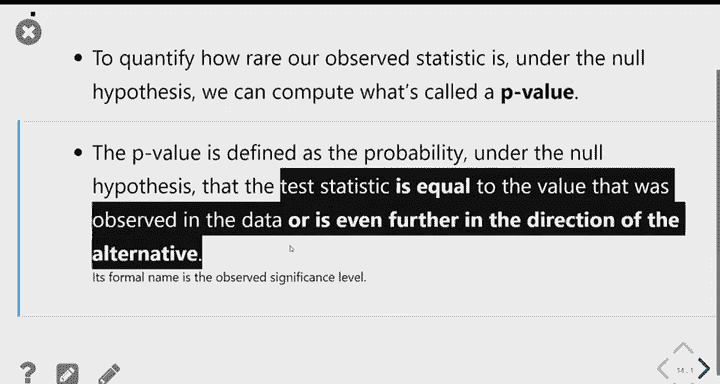
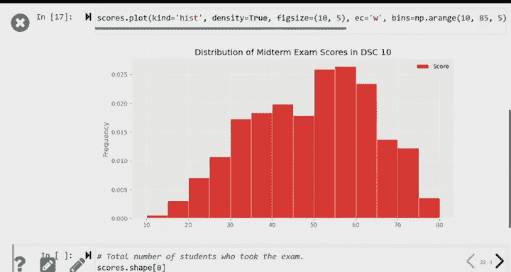
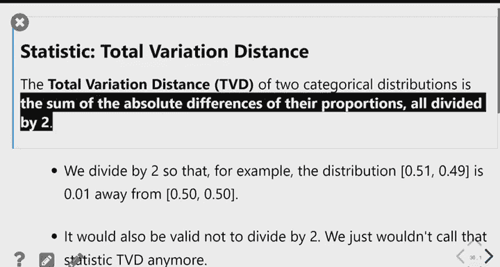

# UCSD《数据科学原理 (DSC 10 Principles of Data Science Fall 2024)》中英字幕（deepseek - P22：DSC 10 - Principles of Data Science - LE -A00- - Lecture 22.zh_en - GPT中英字幕课程资源 - BV1hmAneGEZh

All right， good morning everyone。Today is Monday， so there's a discussion today。😊。

Lab  six is due Thursday。And then homework  six is due Tuesday of next week。

 the deadlines change a little bit because we had Veterans Day and we have Thanksgiving。

 so this end of the quarter is somewhat a little different than usual。

 so that homework is due Tuesday， but I would recommend doing as much as you can by Sunday because you have the quiz next quizzes on a Monday instead of a Wednesday because of Thanksgiving so it'll help you to do those problems because it covers the same topics。

And then our final project is out， so try to start on that when you have a moment。All right。

 last time we did the coin flipping example is our coin faire， right。

 we're going to look at that again， then we're going to do another example with midterm scores from a previous quarter of DSC 10。

😊，And then we'll look at another jury selection example。Okay。

 so this was where we left off last time， the scenario is you find a coin on the ground and you don't know if it's a fair coin or not。

 so you flip it a bunch of times to collect data and you keep track of how many times you got heads versus how many times you got tails and you're trying to figure out if this is the kind of outcome you would get from a coin that was fair。

Okay so the hypotheses are our two views of where our data comes from。

 remember they're not symmetric， the null hypothesis has to be the one that has concrete values and specific numbers because you need to be able to use it for simulation。

😊，Okay， so our hypotheses， the null is that the coin is fair and the alternative is that the coin is unfair and it has to be this way it can't be swapped。

We could have also tested these hypotheses， the coin is fair or the coin is bias towards tails I like to think of the alternative as like what you're trying to identify and if you fail to identify that。

 you'll just continue on with your previous assumptions。

 which were the null so like in the first case， any amount of unfairness。

 any amount of bias will make you reject the null hypothesis， but in the second one。

 only a bias towards tails will make you reject the null hypothesis。

So the alternative is like what you're trying to identify。And otherwise you'll just go with the null。

Okay， so in order to try to identify which of the two hypotheses is correct。

 you have to to choose a test statistic， which is something you're going to keep track of as you do your simulation。

 Okay， so our simulation is going to be sort of repeating。 the idea of the simulation is like repeat。

Where your original data came from right under the assumptions of the null hypothesis so my original data was came from flipping a coin 400 times so I also want to flip a coin 400 times for an equal comparison 400 and 400 but I want to flip a fair coin because my null assumptions are that the coin is fair right and then I need some number to keep track of every time I flip those coins that's somehow like represents the difference between the hypotheses right something that can help me distinguish the coin being fair or unfair。

😊，And we talked a lot about this last time you want to pick your test statistics such that high observed values make you lean towards one hypothesis and low observed values make you lean towards the other。

 because the point of the test statistic is to distinguish between the two。Okay。

 so if you're just doing fair versus unfair， your test to testing might be the absolute difference between the number of heads and 200。

 So thing of this picture is like a number line right， really。Goes on forever， but the。

The possible values of this statistic。When you flip 400 coins， well， the smallest it can be is zero。

 that happens when you get exactly 200 heads。Right， this is sort of the minimum value in 400 flips。

 and the the highest it can be is 200。 This happens when you get。

Either all heads are all tails right 400 heads or 400 tails so your your observed value。

 like what actually happened on the coin you found on the ground is going to be somewhere in the range of 0 to 200 right and if you're very far on the left。

 that's indication that the coin is likely fair if you're very far on the right that's indication that the coin is likely biased and there's some sort of transition point。

It may not be exactly in the middle at 100。And the question we're asking today is like。

 where is that transition point， what's considered a small value and what's considered a high value。

 and that depends on the simulation。Essentially。If you were doing the other pair of hypotheses fair versus bias towards tails。

 we don't want an absolute value in that case because an absolute value doesn't tell you whether you have too many heads or too many tails。

 it just says you're unfair， so we're going to look specifically at number of heads。

And if you get a high number of heads or a moderate number of heads， right。

 that's indication that the coin is likely fair。 if you get a very low number of heads。

 that's indication that the coin is biased towards tails right really if you get a super high value like 400 heads。

 that really probably means that the coin is biased towards heads right So like the middle number is around 200。

😊，Are gonna。Like the red box probably goes more this way anything in the middle is going to be considered a fair coin。

 but because of the way the hypothesis test is set up。

 you're either like identifying a bias towards tails or you're just saying we'll go on with the null for coins that have really high number of heads。

 like 400 heads， you're still going to say that coin is fair there's no option to say the coin is bias towards heads because I'm choosing between two views of the world and that's not one of the views。

Okay， so you can't do like a three hypothesis test， right， You only have two hypotheses。

 Does that make sense？Okay， so we talked about this last time。

 but this is sort of written out on the slides in a way that kind of summarizes sometimes your alternative hypothesis is trying to identify like if one thing is bigger than or less less than the other。

 That's kind of like the coin is biased towards tails like that there's a direction to it。

 I have too many tails or I have too many heads right those are the kinds of things where you don't want an absolute value because you care about which one's bigger then there's other alternative hypotheses that are stated like these things are different and this is like the fair coin the unfair coin right like the number of heads and tails that I get is different right they're not both around 200 They're substantially different from each other。

嗯。😊，And if you want to test whether things are different。

 then you can just measure distance with absolute value。Okay so once we've stated our hypotheses。

 chosen our test statistic， now we do our simulation。

 the assumptions that we make is that the null hypothesis is true and we draw samples under that assumption。

 record the value of the statistic in each sample so for this case it's like flipping a fair coin 400 times。

😊，没。Let's look at the second pair of hypotheses， fair versus bias towards tails。

This is how you calculate a simulated value of the test statistic with NP。random。

mnomial notice this 05。5 is the assumption is that I'm drawing from that I'm flipping a fair coin。

hich is like drawing from the distribution 0。5 。5。And then you do it 10，000 times。

 and you see that the number of heads you're likely to see。

When you flip a fair coin 400 times is this okay so the purpose of like doing all these simulations is to show you like what normally happens or what typically happens when you flip a fair coin 400 times and then you're going to compare that to the data you collected from that coin you found on the ground and see if that data from the coin on the ground looks like the data from all these fair coins is our data like typical of a fair coin。

😊，So we have to check whether the observed statistic。

 what happened with the one we found is typical here。And we talked about this last time。

 if you see a very small number of heads。My god。Somewhere over here like very small。

 like smaller than would typically happen for a fairco。

 right then we're going to say that's too few heads， this is biased towards tails。And otherwise。

 you're just going to say the coin is probably fair。So the question is sort of like。

 where is that transition point？All right questions right now。OkaySo how do we determine this cutoff？

Well， it's kind of a hard question because like the number of heads， oh yeah。Yep。The picture。

Can you do the animation again。That。O。you say that180 is。Byス。

Then I believe too many should also be biased。Yes。So how can we say that to my？

Okay so this is what I was talking about before the hypothesis test only lets you choose between two things right your two options here。

 you have to say it's bias towards tails or it's fair like you don't have the option to say it's bias towards heads it probably is bias towards heads if you're getting a huge amount of heads but the hypothesis test is only going conclude that the coin is fair so you can think of this as like I'm trying to identify coins that are bias towards tails and this is a method to identify such coins and all other coins are assumed to be fair because I'm not identifying any other types of biases。

是在个管。For example。I think so， but I don't know all those kinds of tests too well。

 so I'd have to look at more detail yeah。Okay。Any other questions？呃，所我就窗户把它点记下。Right， and。

We're only looking at sort of only ever one side will indicate no。

 and the other side will indicate alternative we set up our statistic with the absolute value this way on purpose。

 to avoid what's called a two sided test。All right， other questions。

Instead of just using the number of heads， why can' I use this do let's say like the number of heads minus the number of tails？

Yeah， there's other things you can do， right， There's other statistics that would work。 number of。

 if you did number of heads， minus number of tails。 And that came out very positive。

That would mean you got a lot of heads。 And if it came out very negative。

 it would mean you got a lot of tails。 So it to be。

A similar distribution where small values indicated alternative and big values indicated null， right。

 or you could do it with instead of number of heads， you could do it number of tails， right。

 And then these would flip， right， a small value of number of tails doesn't mean anything special。

 A big value of number of tails indicates the bias towards tails。

 So there's lots of different test statistics that you can choose for。

 for testing any given pair of hypotheses。 General like。

They'll either all use the absolute value or they all won't because either like the sign isn't the direction is important or it's not so there's a bunch of questions like this you'll see from past exams and in the homeworks and stuff like which of the following test statistics could work to test this pair ofhypotheses because there's often multiple。

That work。Great， other questions。Okay。All right。We're going to draw different conclusions right based on how many heads we actually or how many heads we actually see。

 like if we saw a number like 170， we'd pretty clearly say we're going to reject the null。

If this was our observed。RightWe don't think the coin is fair， right。

 we think it's biased towards tails， whereas if you see a number like here。If this was your observed。

We fail to reject the null。And the difference is something that has to do with like how rare is it to see a value like this。

 right， like let's say this is 195。The question is like， how rare is it？

For a fair coin to have something like 195 heads。I'll say only。195 heads。Or even less。

Even less would be like even rare， right？嗯。So。Sort of the expected amount of heads when you flip for a coin 400 times is 200 right so having 195 is like not enough。

嗯。Having 180 or 170， that's like very clearly not enough。

 right So what we talked about last time was measuring。

Sort of how rare this is by how commonly or how frequently you saw a value like the one you observed or even more extreme。

 so here more extreme would be a smaller number because further to the left indicates the alternative。

Does that make sense。And you can quantify that with like the area of the histogram。

In the part that I circled right at the line or to the left。

So we basically just need a cutoff of like， how rare are we willing to accept？And。If you。

 if you do what I was saying about calculating the area， right， if you get a big amount of area。

 like the picture that I drew here with the 1，95， the area might be like， I don't know，40%。

Right and that's indication that the coin could very well be fair。But if the。

 the observed value is over at 1，70， the area is like incredibly small。

 I can barely see it less than 1%， then that's pretty strong indication that the coin wasn't fair。So。

How low can we go like to say that the coin wasn't fair versus the coin was fair And。

 and the answer is it's kind of arbitrary， right， like because how much area is to one side of you。

 that's like a continuous thing。 As you move the observed value right。

 the area is gonna grow gradually and that reflects the the truth of the situation。

 which is that like it's not always a straightforward conclusion， like。

Having 170 heads is like stronger evidence that the coin is biased towards tails than having 180 heads。

 but we still have to make a decision， right， So you have to sort of translate this continuous thing into like a concrete。

 yes or no。 So， so people pick。A cutoff spot。And the spot that they usually pick as the cutoff spot is like。

The fifth percentile。So if you're in the smallest， sort of 5%。

Then we're going to say like that's rare， that probably didn't happen organically。

 and if it's not in the smallest 5%， then we'll say that's not too crazy。

 that could have happened essentially。So this is the picture。

If you're in the lowest 5% of this picture， like in terms of the area。

 so I basically colored it such that 5% of the area is blue and 95% of the area is red， right？

And if you're in the lowest 5% of the area。We're going to say that that's like rare enough that I don't think the coin was fair。

 and if you're anywhere else， you're going to say that's not so crazy that it could have been that the coin was fair。

Remember， we're just saying like， is it plausible that the coin was there？

So the clear cutoff is whatever that。NP dot percentile evaluated to is 184。From a bath。Okay。

 so 184 is sort of like your boundary。So if you were to see less than 184 heads。

 we're just going to say the coin is bias towards tails， otherwise you'll say the coin is fair。😊。

If time。Did we what？你楚。No， so there's some。Some things in the code that are just here for your you know understanding。

 like I wanted to make this picture for you， but you don't need to see like all the code that changes the colors and plots the histogram right so at the very first cell there's like an import and this is something we imported。

Yeah， it's in the。If you want to see the code。It's from this file。

Whi is in the same directory as the notebook so you can look at it， but yeah。

 the idea is like we're just hiding the things that are distracting right and not relevant to the theory。

Yeah。Okay。Let me get back to this。We chose our cut off as like the lowest 5%。

But we didn't have to choose 5%， right， It's kind of arbitrary。The five。

 like we could have chosen 6% like or 10%。 like it's just five is like a nice multiple five。

 like a nice number。 and it's pretty small So you might have different， you know。

 opinions on what you think is rare。 like we're saying the lowest 5%。

 that's like too rare and otherwise it's not too rare。 So this is just a convention right。

 someone at some point in time in history decided that we'll use 5% for this。

 but they could have chosen another number and you can choose another number two。Um。There's a。

A concept called a P value， which just tells you basically the area of the histogram outside of what you observed。

And the way it's defined is the probability if the null hypothesis is true。

 like which is the assumptions under which the histogram was generated。

 so it's the probability that you would have a test statistic equal to what you observed in the data or even further in the direction of the alternative。

啊。I skipped way ahead。how I did that。So yeah， this is the picture that shows。Okay。

So let's say you you saw 170 heads right， you found a coin， and you flipped it 400 times。

 it came up 170 heads。 The idea is that's super rare。

That something like that would have happened from a fair coin so we can quantify how rare。

By calculating。The area here， right， just a teeny bit。So like， I don't know。

 this is less than 1% of the area， right， for sure。

And that number that we're calculating says like because it's so small。

 it says that the outcome is really rare。Right。What if you found a coin and you flipped it 400 times and there was 195 heads that's not rare at all right that happens quite often and so what we're saying here is how many times did you see in your simulated results。

 a number less than or equal to 195 out of how many times did we do this experiment and about 32% of the time？

We saw that， so we're calculating here the area。To the left。Of 195。So the larger the P value right。

 that means the less outrageous this result is， this is not surprising。

 this is the type of thing that would have happened from the null hypothesis。

 so we're not going to reject the null when we see a big P value。

 only when we see very small P values less than 5%， meaning we're in the furthest left。

 5% of the area we're in that blue region， only then will we reject the null。

I talked about this last time rejecting or failing to reject when you fail to reject。

 you're saying the data could have come from the null hypothesis， not that it necessarily did。

 there could be other possible explanations。U。And if the P value is very small。

 we say we reject the null hypothesis because we think the data isn't consistent with the data in our simulation。

 which came from the null hypothesis。So some terms that you'll hear in statistics are statistically significant。

 this is like a catch phrase that people use to mean that the P value is less than 0。

05 meaning like it's rare enough that it's substantial basically and there's another one highly statistically significant they say this if the P value is less than 0。

01 that means like it happens in the most extreme 1% of the time okay so I drew the histogram with the left 5% blue if I drew only the left 1% blue and you fell there that would be highly statistically significant and remember these are all based on on the convention of like 0。

05 or 5% is a nice number similarly someone decided 1% was like an even smaller nice number so these are historical and arbitrary conventions and they're also kind of controversial because。

😊，Um。What we're doing when we use P values to decide whether something is significant or not is we're taking like。

呃。We're taking like a number。which is like can be any number between0 and1 and we're just putting it into one of two categories like you're a small number。

 you're a big number， but numbers themselves have scale to them like if if I just tell you like the 170 heads led to a small number and the 195 heads led to a big number like I'm hiding the fact that like this is way bigger then that number So what some people prefer to do is don't don't even draw a conclusion。

 don't even say like it's significant or it's not or I reject or I fail to reject。

 just give the P value。And like let the user， the person interested in the information interpret it for themselves。

 right You can say I did the hypothesis test and the P value came out to 0。06。

That's like a lot more informative than saying I did the P value and the result wasn't statistically significant。

Because if you're at 0。06， think about that。 You're so close to being in the left 5%。

 you're like basically like。You know， it's you're saying the coin is fair。

 but you're not saying it with a lot of confidence right so the the size of the P value holds a lot of information。

 So the controversy is should we even be making binary decisions based on something that's actually kind of continuous。

Does that make sense？So this was our real life scenario， our coin had 188 heads。

And the P value there。Was 0。125。So what we're saying is it's not so rare at the standard 。

05 significance level， we would say that it's still plausible at our coinless fair。

 this P value cutoff is sometimes called significance level。Was the coin we found really fair。

 you can never really know the answer to that question。😊。

But you can be assured that if you're using a cutoff of 0。05。

 and you happen to have actually found a fair coin。Right。You'll only say that it's unfair。

 like 5% of the time。And that makes sense if you think of that distribution。

 the whole histogram came from simulating a fair coin right and yet 5% of that histogram fell into the blue region on the left。

 so sometimes it does happen that like fair coins give 170 heads， In fact。

 sometimes it happens fair coins give no heads right it's just super rare。

So we feel pretty good that we got it right， but we。

 probably going to get it wrong like 5% of the time。Now， in this example that we did。

 we were doing P value as area in the left tail of the histogram。

 but other times when we calculate the P value， we do it in the area。

 we do it as the area in the right tail and the difference is which one。😊。

Corresponds to the alternative hypothesis， because the whole point of the P value is like。

 how rare is it to see something like this。 So you want to know like。

 how often do you see something like what you observed or more extreme。

 and more extreme means in the direction of the alternative hypothesis。 right。

 what which way would be stronger evidence of the alternative。 So here it was， it was to the left。

 like small values。 But if we had done like what we were talking about before。

 And instead did like number of tails。Then big values of that would have indicated the alternative。

 so we would have calculated the P value as the area to the right。

So this is something you have to consider every time in those pictures that I had towards the beginning。

These like I draw a number line and I decide which way means small which way means alternative and which way means null。

 I like to do this sort of on the side of the page as I'm thinking about a hypothesis problem because it's useful to first of all make sure you're choosing a good test statistic that there's only two regions and not three but then you also need it later when you're calculating the P value because it helps you know which way to go right whichever way is alternative that's the way you go in calculating the P value so P value calculations are always gonna either use less than or equal to if you're in a situation like this one on the bottom or greater than or equal to if you're using a situation like the one on the top。

Okay。Any more questions on the coin example？Okay， our next example is using midterm scores from fall 2022 DSC10。

 there are four sections。And I taught two of them， another instructor named Sue Rudge。

 taught one of them and someone else taught the fourth one。

And Sururadi's section had a much lower average than the other three sections。

 even though it was the same exam and like the same graders and the same rubrics。

 there's no sort of obvious reason why his section should have done worse here is the actual data。😊。

I forget what it was out of， but it doesn't really matter。The histogram of people' scores， okay。

 pretty nice and spread out。

How many people took the exam， 393？And how many students were in each section？Okay， so sections A。

 B and C were like pretty big。 Section D was like a tiny little section that was added later。

And here's how people did by section。Okay， so。I taught A and B， I got 51， 49。

 pretty like right in the middle， the other instructor taught D， he got 50， 51。

And then Sewards taught Section C。 So he got 46。 So he was really sad about this and surprised。

But then we started thinking about it and we were like well。

 basically one of the sections is going to do worse than the others like this is unavoidable right in any set of four numbers like something is the lowest or maybe there's a tie right so like one of the instructors is going to be like oh I failed my students I didn't teach them well like it's just you this time。

But。It's not really a problem to you know be the lowest if you're all really close right it's a problem to be the lowest by a substantial amount right and we were like around 50 and his was like 46 and that that just kind of feels like a lot I that is that a lot right I how section C did lower than you would have expected just from chance。

So this is his defense， right， The null hypothesis is like what he hopes to be true。

 that Section C scores come randomly from， from the set of of overall course scores。

 like his students are just a random。Sample of the students in the class and just by chance， right。

 the students in his class happen to do worse than the students in the other class。

The alternative is like they did worse than they would have done if it was just random chance。

 Their score is too low。So it's a question of does this sample look like it was drawn from this population right。

 the sample is the ones in his class， the population is everybody。

 and does his class look like a representative crosssection of the full population This is a lot like the Robert Swwain example right the sample was the hundred men on his dirty panel。

 the population was all the people who live there and it's a question of does the sample look like it was coming from this population。

Even the coin example can be posed this way， if you think of the population as like the uniform distribution that's equally likely to give heads and tails。

 flipping a coin is like sampling with replacement from that distribution。😊。

So let's look at what happened in section C because we're going to need to simulate drawing sample sections of the same size and same you know as close as we can to section C so what really happened in section C。

 this is you know based on the actual data， they had 108 students。

 and this was their average midterm score。So in our our null hypothesis is that there's no difference between the exam scores and the different sections and that students in section C are just like students from the whole class Okay so that's what I'm going to do to simulate。

 I'm going to sample 108 students because section C had 108 students。😊，U。

Uniformly at random means every student's equally likely to be chosen without replacement。

 why am I doing a sample without replacement？It is a simple random sample。

 but like simple random sample is just a term that we give to a sample without replacement。

ation of what section C was。Yes， exactly like because you're supposed to sort of replicate what happened in real life and in real life。

 you don't have like the same student duplicated in your section right you have 108 different people so that's what we want to do like pull 108 different people。

And the thing we're going to keep track of is the average midterm score in a section。

And our observed statistic was the actual average midterm score from that section。😊。

So let's see what pulling one sample from the class and calculating their average score looks like。

 Okay， here's the code of how I'm going to do it。 I'm going to use the dot sample data frame method because I have a data frame of all the student scores right so when I dot sample I'm just gonna select a random subset of the rows right how many rows do I want 108。

 I have to make sure it's an integer。And I want it without replacement。

 and then this is just going to be a smaller data frame with 108 rows。And I want the average score。

Okay， so like this is saying， you know， if section C was just randomly determined。

 they might have gotten an average score of 48。6。 and the you know。

 overall class average was more like 50 so。You know， if Suura's class had had an average of 48。6。

 he shouldn't be too upset， like that's just the kind of thing that happens from randomness。

So our question is does a number like 46。17 happen just from randomness。

 like if I run this cell a bunch of times， am I going to see numbers as low as 46。

17 I ran it a few times by hand， but that's the point of the simulation。

Do it a bunch and see how does it usually come out？Okay， so here's the picture。Oh， boy。This is bad。

 right， This is like the Robert Swain。 What happened in real life is not like what should have happened if it was random。

 Okay， his students like did worse than we we， you know。

 we think that they would have done if they were just a random sample of students in the whole class and we can quantify like how bad is it with the P value。

The P value is。Calculating the area in the left tail here。And it's， it's pretty bad， right。

 of all the averages that I calculated， which are the ones that come from this histogram。

 How many of them were less than or equal to that 40。6。17 number right。

 so the numerator counts how many， and then I divide by the number of times I did this experiment to get the the proportion Okay。

 so this is less than 1%。This is the highly statistically significant， right？Um。

We're going to reject the null。And we favor the alternative。

 which says that we think his students did worse than they would have done if they were just like a random。

Subset of the class Okay， so my question for you is like。

 what are some plausible explanations of like how this happened？

The obvious one is he's a horrible teacher， he's actually not， he got like a teaching award。

 he's a really good teacher。What's another， yeah。Time of day。 Yeah， I think when you guys scheduled。

 did they assign you to a time， Yeah， that should have been random， you would think。By。

Like what if you had a conflict with the time you were assigned？Do they let you change？Anyone。

No one had a conflict with the time they were assigned。 Yeah。

 I do think like it has something to do with the time of day。

 even though like it may have been assigned， not all the students were were incoming data science majors。

 so not everybody was assigned。 Some people had freedom to choose。😊。

I think it has to do with the time of day like my two sections were in the morning and his section was in the afternoon so maybe students who you know come to class in the morning are different types of people than students who come to class in the afternoon。

 I also think it could have something to do with other classes that are held at the same time right。

This isn't the case but imagine there is like some really advanced data science class that some students in DSC10 were also taking right and that advanced data science class was at the same time as section C right so all the students in the advanced data science class can't take section C so they have to take one of the other sections so like basically the reason is people the way that people sign up for classes is not random like there's all these factors like when are other classes you know what one did you know they tell me to sign up for which one has the most space。

Et cetera， that influence who gets into what class and it's not really a random sample。

I've taught this class for a while and occasionally taught it at 8 a and 8 AM classes do excellent。

 and it's just the people who you know want to take the class badly enough to take it at 8 a are you know pretty strong students usually。

So there's always a few reasons and interestingly and importantly。

 the hypothesis test doesn't tell you why right， like it doesn't tell you is he just a bad teacher like or you know why is it like this。

 you don't really know you just know that it's not random。Okay， any questions， comments。All right。

 our last example of the day is another jury example。This is much more recent than the Robert Swain。

 this was from 2010 and it took place in California。

 so this was a report by the American Civil Liberties Union。

 they were tipped off to something which was reported as an infringement of civil liberties and they looked into the racial and ethnic breakdown of people who were。

On the jury panel or in a jury pool for a specific county， Alameda County in Northern California。

 anyone from Alameda County。Just a reminder of how jury panels are selected。

 there's some eligible population and they're supposed to take sort of a representative sample from a representative crossse of the population and the way they typically do that is like DMV records or voter records。

😊，And this comprises what we call a jury panel， which you can think of as like the people who come for jury duty and not all people who come for jury duty are going to wind up on the actual jury。

 there's a nonran component that happens after。So the American Civil Liberties Union studied this and they weren't just studying like a single trial like we did with Robert Swwain。

 They were studying。The jury panels across many trials over a period of two years。

And so they saw lots of people coming for jury duty for those 11 cases， 1，453 people。

And they kept track of all of those people， which category they fell into okay so people can only fall into one category。

 the categories are Asian black， Latino， white and other and this little table shows two columns。

 the eligible column is the breakdown of people who lived in that county who you know we were drawing we' were drawing our sample from and the panels is the people who actually came for jury duty。

And basically， you look at these numbers and you see some differences， right。

 Like there's more Asians at jury duty than there are sort of proportionally in that county right。

 there's not enough blacks in in jury duty as there as there are living in that county Okay。

 so why is this the case right， and I mean， hypothesis testing can't tell you why。

 but it can identify that there's an issue right， So like， the question is like。

 is the difference in these numbers like substantial enough。Kind of like the Robert Sw case。

 like he was expecting， you know，26%。 he got 8， you know， some amount of difference is okay。

 but as a big difference is that's not okay， right， So are these big differences and。In some cases。

 like white， exactly on track， right， but in other cases， this feels like a pretty big difference。

 right， like this is less than half。嗯。So intuitively， you know。

 I kind of feel like there's there's a difference here， but it's kind of hard to quantify， you know。

 how different is this set of numbers from that set of numbers because it's not just like， you know。

8 versus 26。 How do you quantify that， You subtract them right that tells you how different they are。

 but how do you compare like a whole set of numbers to another whole set of numbers。

 You have to be a little more creative Okay， so that's the new thing。

 And this example is our our way of comparing to distributions。

So we're going to do a hypothesis test。To decide if these differences in representation that we see are meaningful。

 right there are differences right， but are those differences small enough that they could have been explained by the fact that panelists were selected randomly and there's just some noise and random chance involved。

Or do we think that this data suggests that the panelists weren't selected randomly from the eligible population？

And the observed data that we have is the data that the ACLU collected， 1。

453 panelists and their distribution of ethnicities so the thing that's different here is like what test statistic are we going to use that sort of captures how different are these two distributions？

Okay， so this is the same data that I showed in that table before。

But I'm showing it visually as a bar chart。Okay， so the white category we saw exactly the same。

In the eligible population， as in the sample of panelists。

But Asians were overre on jury panels and blacks were underrepresented on jury panels。

 so the red is like the population and the blue is like the sample。Does that make sense？Okay。

 so the question is， how different are these two bar charts。

 that's essentially what I'm asking like can you。Quantify how different are these two bar charts。

 And remember， a test statistic has to be。A single number， So I can。

 I can quantify like the difference between the Asian 15% and 26%。

 And I can say that's 11% different。 But how do you come up with a single number。

 That's like the overall difference between all the bar charts。 Do you have any ideas。

There's actually like a lot of things you couldn't do。Yeah。Okay， what is that。你。And啲。Okay。

Something about subtracting the difference between these and then squaring it right what would squaring it do。

 well one thing it would do is it would get rid of the signs。

 so it's just going to tell you something about like how different they are like a bigger number has a bigger square so you can do something like that where you look at the differences in all the categories and you square them。

But you're still going to have like a bunch of numbers from all the categories。

 so how do you combine all those numbers？You could summon them， that's one thing you could do。

 what else could you do to combine a bunch of numbers into a single number。

Mean them right So there's like various approaches。 you can look at the differences。

 Basically it's going to involve something with the differences in each category that's natural。

 but then you could square them or you could absolute value them that also fixes the sign problem once you have done that for each category。

 you can add them up or you can mean them， take the meaning right so there there's a few options。啊啊。

And let's look at sort of one approach。 Okay， so one approach。Is just look at the differences。Okay。

 like there was 11% extra。In the Asian category and a shortage of 10% in the black category。

 these have signs。 So we've got a set of five differences。Importantly。

 you have to square them or absolute value them because you can't just like sum or mean them right now because the signs are going to cancel。

So what we're going to do。Is。Here I'll take the absolute value。And then。

Let's say I sum up all these numbers。I'll show you here and then I'll talk about what it says on this slide。

 I sum up all these numbers。And I get an answer 0。28 so if the data is like more different。

 like if there was more of a disparity between the eligible and the panels。

 this number would have come out bigger and if the two columns of eligible and panels were more similar that number would have come out smaller so this number tells you something about how different or how similar the two different distributions are。

Also， if I divide by two。This number still says like you can still compare it to another number that came from summing and dividing by two and a bigger would still say that there's more difference and a smaller would say there's less difference。

Okay， so this is one possible test statistic。It's called the total variation distance。

And what it is is you do the strategy that we talked about。

 you take the absolute differences of the proportions in each category。 you add them all up。

And then for some weird reason， you divide by two。Okay。

 what's the weird reason to divide by two Well， you don't have to， right。

 it would also be valid not to。 and you'd still get like a meaningful measure of how different are these two distributions。

 But the reason this statistic chooses to divide by two is to think about like。U。

Like say you had like a fair coin that was 50-50 heads and tails versus an unfair coin that was like 51% heads and 49% tails we're going to say that's only1% away from the 5050 distribution because it's sort of like you have one extra here and one shortage there right so if you summed up the absolute differences in each category the difference would be 0。

1 in each category so you sum them you get 0。2 but then you divide by two to sort of fix that。

So the dividing by two is optional as a way of measuring difference between distributions。

 but if you're using this statistic， which has a special name， total variation distance。

 then it's defined as this， so you do have to divide by two if it says total variation distance。😊。

Does that make sense。Okay， we'll stop there， we'll continue talking about this next time。

Oh I brought your midterm reference sheets if anyone still needs them， come get them。

