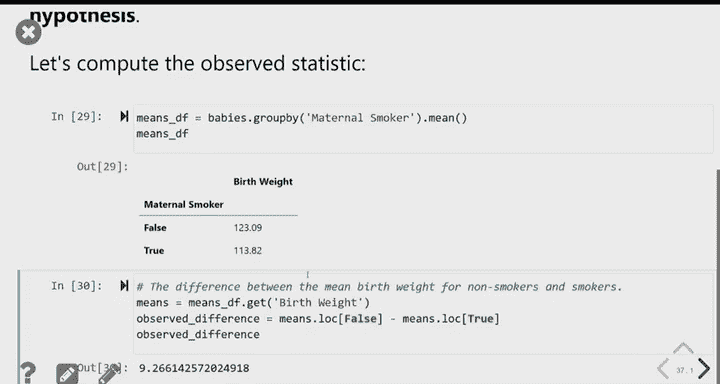

# UCSD《数据科学原理 (DSC 10 Principles of Data Science Fall 2024)》中英字幕（deepseek - P23：DSC 10 - Principles of Data Science - LE -A00- - Lecture 23.zh_en - GPT中英字幕课程资源 - BV1hmAneGEZh

Hey， good morning。We have a lab due tomorrow， we have a homework due Tuesday。

 but next week is Thanksgiving week so our schedule is a little different。

 our quiz and discussion are interchange so the quiz is on Monday and the discussion is on Wednesday that means you should try to do as much of the homework as you can before the quiz because it'll help you prepare。

The quiz covers lectures 19 through 23， today's 22， so up through this week。

 and then corresponding assignments。And then we have the final project coming up okay？

Any questions on logistics？Okay today we're going to talk about a few things。

 we mentioned this at the end of last lecture， this concept called total variation distance。

 which helps you compare two categorical distributions to see if basically like things are distributed in the same way。

 then we're going to look at a connection between confidence intervals which we did earlier and hypothesis testing which we're doing now。

 and then towards the end we'll start looking at a special type of hypothesis testing called permutation testing。

啊。It went to the very end， okay。So the jury example that we were doing was talking about the process of how you select a jury panel from the eligible population。

 and it's supposed to be random。But the American Civil Liberties Union studied the composition of jury panels across many cases。

 and they found that out of a large number of panelists， people who came to jury duty。

 there was a noticeable difference in their ethnic breakdown versus the ethnic breakdown of people in the population。

Okay， so everybody's categorized into exactly one of these groups。

 and there's certain groups like Asian that are overrepresented on juries and other groups like black that are underrepresented on juries。

 and there's other groups like white that are sort of perfectly represented on juries。😊，Okay。

So the question is theres some differences in representation。

 but are these differences in representation meaningful， right。

 that's the same kind of question we've asked before with like the Robert Suwain example。

 like you know，8 and 26 are not the same， but is that different substantial and like the midterm scores last time right like this section did worse than the others。

 but is that a big difference like does is that the kind of thing that can be explained by randomness or is it more than that。

Okay， so the null hypothesis is basically like the noise that we see。

 the difference that we see is just randomness。 Panists were selected at random from the eligible population。

 Any differences that we observe are just due to chance。

And the alternative is that panelists were not selected at random from the eligible population。

OkaySo we have our observed data was the 1453 panelists and their distribution of ethnicities。

And in order to do our hypothesis test， we need to come up with a test statistic right。

 this is like the process of the hypothesis test is we're going to simulate under the null。

 we're going to simulate drawing a bunch of people at random from the eligible population and we're going to look at their ethnic breakdown and see like how close it is to what we expect it to be right what we expect it to be is the population。

 so we need some way of measuring like how close is a distribution to this population distribution。

And if you show the two distributions in bar charts。

 we talked about one idea last time was like in each bar in each category， look at the。

The absolute difference。That's just saying how much more is there of one thing than the other？

The absolute means like it can't be negative， right。

 It's just how far are they distance wise for each each category， right， this one would be zero。

And you have a bunch of absolute differences。 And then you can sort of combine them in some natural way。

 So two natural ways are to add them up or to take the mean of them。

 We also mentioned how instead of absolute difference you could have used。Squared difference。

There's many sort of paths you can take to turn like this set。

 these two sets of numbers or these two distributions into like a single summary value that says something these are similar or these are dissimilar。

 That's kind of the idea。嗯。So the problem we're looking at is about。Categorical variables， right。

 We're looking at the distance between two distributions。

 and these are distributions into categories。And the reason this problem is different than ones we've done before is just that there's more than two categories。

 We've actually sort of dealt with categorical distributions like heads and tails。

 You can think of that as categorical， right， But since there's only two values。

 you can just use one of the values and that kind of tells you the other。 Like。

 if you know the proportion of heads， you also know the proportion of tails， right。

 But it's not enough here to just be like， did they get enough white people。Right。

 because they could have enough white people， but not enough of some other race。

 And that still means they're different， right， So you can't just look at any one category。

 You have to do something that combines all the categories together。So we。

Had this idea of using absolute difference。 So right now。

 I'm just subtracting these two columns and getting a difference with a sign。

 Some of them are positive， meaning like there's an extra representation of this group or some of them are negative。

 meaning there's an under representationpresent of this group。

And it doesn't make sense to just add or average these individual differences because they're going to come out to zero。

So what we do is instead take the absolute differences。

And then you get this set of numbers and you can either add them or average them or like do something else to combine them in a reasonable way。

 And one method that people have come up with of combining these numbers is add them up and then divide by two。

The reason to divide by two is to make it so that a distribution like 51%。

 49% is only considered 1% away from the distribution 50。

50 right it kind of is saying that like if you have an extra 1% here。Well。

 then like you'll necessarily have to have。A 1% shortage here。Because they're both distributions。

 they have to add up to one。So， this is like。Sort of the smallest distance you could have between two distributions if you're just looking in terms of two decimal places。

Does that make sense the motivation to divide by two？It's not necessary， right。

 you could just not divide by 2 and just calculate the differences in proportions and say this has a difference of 0。

01， absolute difference of 0。01。Right， and and add them up。 You can sum them。

 And then you could just stop there。 And you can say the answer is 002。

 That's a valid way to like measure how different the distributions are。

 It just doesn't earn the name。 Total variation distance。 Okay。

 total variation distance is this specific calculation。

 But I want to emphasize there's many calculations you could do。

 that would give you some reasonable number that says these distributions are similar。

 These distributions are different。 Okay， this is just one way to do it。你看。So。

Here's that table with the absolute differences， if I wanted to calculate the TVD from it。

 I would just add up that last column and divide by two。And in this case， it comes out to 0。14。

And this picture shows you something really cool。About how to interpret that 0。14。

So wheres the individual numbers？ let's look at the other category。

 The other category had 001 for eligible and  point04 for the panelists。 Okay。

 so there is sort of an extra。03 on the panelists like the other category was overrepresented。 Okay。

 so that extra 003。Shows up here as like the blue bar。

 the panelists sticking out further than the red bar。 right， That's the extra 。03。 The red goes out。

01， and the， the blue goes out 。04。 So that's an extra 。03 right， in the white category。

 there's no extra。In the Latino and black categories， the panelists are underrepresented， right。

 so there's no extra there。If you think of how much the blue sticks out over the red。

 but in this last category， there's significant extra。And that came from Asia。

 let's look back at the numbers。Asian was 15% versus 26%， so there's an extra 11%。

 there's an extra 0。11 here。And notice 0。03 plus 0。11。Addds up to 0。14。

Which is the TVD or total variation distance， so this number that we're calculating has an interpretation as how much extra does one thing stick out over the other？

And so what we're saying is like there's sort of a 14% like overage or extra across all the categories。

 that comes from 3% extra in the other category and 11% extra in the Asian category。Okay， but also。

 because there's extra in some categories， there has to be less in other categories。 right。

 You can't just have extra of everything Then you'd have more than 100%。 So where's the shortages。

Okay， the black category。Had a shortage。Of 0。10。And the Latino category。Had a shortage。Of 0。04。

 right？So， also。This adds up to 0。14 because when you have extra 14%， it has to come from somewhere。

 right So the amount by which the blue exceeds the red is the same as the amount by which the red exceeds the blue。

 which is also the same as what you get when you take the absolute differences。

 add them up and divide by2。Okay， so there's like three， I think of this as three definitions of TVD。

Total over representation， total under representationpresent。

 and then add up the absolute differences in divide by two。

 And this is very useful to have multiple different interpretations for problem solving because sometimes one of them is easier to do than the other。

😊，Here's an example problem， try to use multiple interpretations and see if you can get the same answer in several ways。

You can answer this on the concept check website， what's the TVD between these two distributions？

It's kind of hard to see。So the definition way is what are the absolute differences in each category？

But the difference between 0。45 and 0。15 is 0。3。Difference between 35 and 35 is 0， 15 and 35 is 20。

 so 0。2， 5 and 15 is 10， so 0。1 okay， so you add these all up。Which is 0。6。

And then you divide by two。To get 03。Okay， so that's one approach the second way。Is。

You look for sort of total overage。I don't know if that's a real word。 let's say compare 40 a to 10。

 Where does 40 a have extra than 10？Here it has 0。2 extra， and here it has 0。1 extra。

So the total extra comes from 02 plus 0。1 from junior and senior。Which adds up to 03。

The third interpretation is the total underage。It's like underage， but total underage。

 where are we lacking， right， where are we short and 48 versus 10。

 only in the first spot right we're short by 0。3 from freshmen。

So I kind of like the second and third interpretations better because it's like you don't have to calculate all the numbers。

 you just look in certain categories， which ones are going to contribute。

 so it's a little easier I think。But they all work， does that make sense？Okay。So let's use。

What we learned to。Do our simulation with the jury panels。

So our model is that the panels are drawn randomly from the eligible。

 the statistic we're going to use is how different is the random panel's ethnicity distribution versus the eligible populations ethnicity distribution okay so think of the eligible populations ethnicity distribution as like what you're supposed to get。

I mean you're not exactly going to get that， but this is like the expected right and then what happens when we draw randomly and the idea is like how what amount of difference is reasonable same idea like with a fair coin like you're not always going to get 200 heads。

 like what amount of heads is reasonable that's the point of the simulation。

And you're going to do this many times and see what's a reasonable TVD。

 like how far away can you be from what you expected， and you're going to see the actual TVD。

 how far away was this Northern California data collection from what it was supposed to be。All right。

 so this is the process。The eligible population was that set of of numbers。

 Let me maybe show it in a new cell so you can see。Okay。

 these numbers representing the different groups。And then we're going to draw a sample。Of 1。

453 people。Right such that each person sort of like has a 15% chance of being in this category and 18% chance of being in that category and so on。

 so this is what NP dot random dot multinomial is used for right you have probabilities of each category and what it's going to tell you。

Is you know， what's the breakdown of those 1453 people right。

 222 of them fell in this first ethnic group， the 256 of them fell in the next group， etc cea。

 but I don't want to know how many of each I got。 I want to know the proportion of each that I got。

 So I divide by the total number。And these now are are proportions， right。

 So this shows you like what amount of difference is reasonable。

 I was supposed to get 15% in this group， but I actually got 14。 Okay。

 supposed to get 18% in that group。 But I actually got 19。 I was supposed to get 12， but I got 11。

 Like you can see like the differences are pretty small。

 and we're gonna measure how small those differences are by total variation distance。 Okay。

 so that's comparing this eligible set of numbers to the。

My random samples set of numbers and say how similar are they right。

 so the smaller the number comes out， the more similar they are。

 that's like stronger evidence of the null， right。A small number indicates that。

What you observed was just like what could have happened from randomness。A slight note， random NP。

ran。mtenommial。Create samples drawn with replacement。

 that's what it does you think of it as like randomly generate a person with different probabilities of being in different groups and in real life the way you would draw a jury panel would be without replacement right like you don't say you're appearing on this jury twice like you get different people。

But we're going to ignore that difference because the sample size 1453 is small relative to the number of people living in the county。

 So when you have a small sample versus a big population。

 there's not like much of of a difference because you don't tend to get repetitions in practice。

 right， Like if I pick 100 UCSD students。Even if I allow myself to like choose the same one twice。

 I probably won't get the same one twice because I'm choosing from such a big pool。

 So the differences are slight。So that's why we're going to use that anyway， does that make sense？

Okay， here's the part where we repeat the experiment。

This is what I showed you right you make your random sample by NP dot random not multinomial and then you say how far away is the random samples distribution from the eligible distribution and you append that to your sequence of TDs。

And you can plot them。And this is the picture that shows everything。

This is like the crazy outcome in the Robert swingwa case， right。

 like the black line is way off the edge。And which edge that matters， right？

Big values of the observed statistic means that there was a big difference between the people who were on those jury panels in Alameda County versus what they should have been。

 right a small observed value means that they're similar to what they should have been。

 right So if this black line had been at zero， for example。

Even though it's on the edge of the distribution。That actually would have been great。

 That would have been like， oh， we're， we're getting like the perfect sample。 So it matters which。

 which tail you're in， right， And here， large values。😊，Of the observed。Indicate the alternative。

Right， where small values would indicate the null。 Okay， so this is saying basically like。You。

 you tend to only have like over representation of like2 or3。

 maybe 4% when you sample a set of people randomly from the population。

 We had over representationation of 14%。 That like never happens from randomness， basically。

So kind of the same conclusion as。As the Robert sin case right the P value quantifies how crazy of an outcome this is。

 the P value is 0， like it never happened that we saw 14% is what that's saying randomandom samples from the eligible population are much more similar to the eligible population than what we saw。

 This is a little picture that shows。😊，Just one random sample， right。

 The one random sample is in in purple。 And look how similar the purple。Comes out to the red。

 So the red is the eligible。 The purple and red are， you know， they're slight differences。

 but they're small， right in all the categories。 And the blue is what happened in real life。

 And the blue difference from the red is， is substantial。

 And you kind of can like maybe before you did the simulation。

 you didn't know like how how much sticking out is too much， right。

 But now that you've done the simulation。 you can see that that's sticking out a lot。

 That's kind of the purpose of the simulation。Any questions？So yeah。

 our conclusion is jury panels are not representative but it doesn't say why right we talked about this last time with with the midterm example right like the other instructor section did worse but we don't know why you know there's lots of reasons why we talked about at the time if Robert Swain's case like the way the jury panels were selected was based on friends of friends and things like that now they do better than that they draw from like voter registration and DMV but even so that's not exactly a perfect cross-se of the eligible population and also a very important thing is that they're looking at the people who came to jury duty right and that's not exactly the same as the people who were called to jury duty right certain groups are less likely to show up for various historical reasons。

So this is the ACLU's report if you're interested to see what they said and why。

So the example that we just did， really the whole framework of testing a hypothesis through simulation and stating the null and alternative。

 like all of that is the same as what we saw in the last lecture。

 the new thing about that example was the test statistic right and the reason we needed a new test statistic because we were comparing like a whole distribution。

 a whole set of numbers to another whole set of numbers so TVD is useful for categorical distributions。

😊，All right， now we're going to do our next example。

 which is about connecting confidence intervals with hypothesis testing。

And there's a there's a connection between confidence intervals and hypothesis testing when our hypotheses take a certain form。

 Okay， so not every hypothesis test has this connection with confidence intervals。

 but there is one when the hypotheses look like this。

 So if you can state your hypothesises like this， the population parameter is equal to some value。

 x x is like some specific number or the population parameter is not equal to that specific value。

That's the setting where there's a connection with confidence intention terms。

And the connection is as follows。Well， the question is about like some parameters value， right， Like。

 is the parameter equal to this number， Is it not， right？

 And we have a strategy for estimating an unknown population parameter， right。

 That's construct a confidence interval。So。We can say like you have a certain P value cutoff that you're going use。

 The standard would be。5%。Right， so P is the percent here。 And so 5。

 what you would do is you would make 100 minus P。 So in this case。95。It's not a coincidence that。

We do 95% confidence intervals and 5% P value cut off。

100 minus P percent confidence interval for the population parameter， and then。Basically。

 whether or not。Whether or not。That specific value， x。Falls in the confidence interval。

That tells you whether to reject or not reject the no， tells you which hypothesis to with。

So doing the hypothesis test， instead of like doing a simulation where you like come up with some test statistic and。

 and you know， pull many samples and generate the test statistic many times。

 instead of doing all that， right， the other approach it only works for this setting。

 but the other approach is。Just generate a confidence interval for the parameter and ask。

 is this special value in the confidence interval or not？And let's look at the two different options。

If it's not in the confidence interval， what does that mean， It means like a confidence intervals。

 Here's a bunch of values that I think are likely for this parameter。 If it's not in there。

 then I don't think it's likely， right， which means。The null said it was equal to that。

 and I think no， it's not equal to that because it didn't fall in the interval of my estimates。

And the other way would be。If that number does fall in the confidence interval， well。

 then it's plausible that that could actually be the value， right。

 So then you don't reject because this null hypothesis is plausible。

 This is important with the plausible versus certain。 We're not saying like， yeah。

 it's definitely this x。 You'， you're right。 You got it。 We're just saying， yeah， it could be that X。

 Like that X is one of of many numbers in a reasonable range for the parameter。Okay。

 so let's try out an example of this， this is human body temperature。

 so when you're sick and you take your temperature， you usually look for like 98。

6 degrees to tell you that you're healthy or 37 degrees in Celsius。😊，So。

We have a data set of body temperatures。Someone just collected a bunch of people's healthy body temperatures。

And we want to see if our data is consistent with the belief that the average human body temperature is 98。

6 So remember series have a described method that tell you some summary information about it。

So we got 130 temperatures。The average temperature was 98。25。

And the standard deviation of temperatures was 0。73。Okay， so the interesting one is this，98。25。 Well。

 we usually use the number 98。6， but this set of people， their average body temperature was 98。25。

 That seems pretty close， but it's not exactly the same， right。

 How is it surprisingly different or just not surprisingly different， right。

 is this difference meaningful。So this is what we're going to test with our hypothesis test。

 and I'm going to state the hypotheses in a very certain way to mimic what I had on the last slide。

 the parameter equals x or the parameter is not equal to x so the parameter here is the mean body temperature of all people。

I'm trying to use the data in my sample， which is not everybody， just some people。

 130 people to infer about the larger population's average temperature Okay。

 so the question is about that parameter of the average temperature of everyone。

And then the null hypothesis says that it's equal to this value of x， this is x， and it is x。

 so it's equal to x。 and the alternative is that the same parameter is not equal to x。

Does that make sense how I set it up？And we'll use the usual sort of cutoff for our P value 0。

05 or 5%。hich means we need to make a 95% confidence interval for the mean body temperature of all people。

 and then just decide if 98。6 is a reasonable value for that parameter。Okay。

So there's two ways we could make this confidence interval， right， making a confidence interval。

 We have multiple paths to that。 You can bootstrap it or you can use the C， LT。 Remember。

 CLT doesn't always work for every parameter， but it works for means， and this is a mean， right。

 It's a mean body temperature。 So either way is valid here。I will show you both ways。😊。

The bootstrap way。Comes from。Taking your set of 130 temperatures， reampling with replacement。

130 the same size， right， and。Using percentile to cut off2 and a half percent from each side。

And this is your confidence interval that you would get through Boottrap。Okay。

Let me do the CLT way using this formula。I center my interval at the sample mean and I jump to。

Standard deviations of a bell curve in either direction and the standard deviation of the bell curve representing the distribution of sample means comes from this formula。

So， notice that。I don't know anything about the distribution of body temperatures。

Like it may not be the case that people's body temperatures are normally distributed。

 Like it may be the case that like half the people run hot and half the people run cold。

 Like we have no idea like what people's body temperatures are like in the population。

 but you don't need to know that in order to use the central limit theorem， right。

 the central limit theorem doesn't say people's body temperatures need to be normally distributed。

 It says the distribution of mean body temperatures when you look at many different samples。

 that's going to be normally distributed。 So it's valid to use this formula。

 even without the population being。Being bell shaped。So where am I going to center my distribution？

It's going to be centered at whatever the average body temperature in my sample was。

 how spread out is my bell curve going to be， it's going to come from how spread out is my sample divided by the square root of the sample size。

So I'm looking at a bell curve centered at 98。2。With a step size or a jump size of  point06。

 So you should be able to like draw that or visualize that in your head。

It's going to be centered at 98。2， let's say， and it's going to jump by 0。06。

 so let' I didn't do that great， but let's say the inflection point is there， this would be 98。

26 and what's this would be 98。14。and then another 0。06 and another 0。06 would tell you the interval。

 basically。So it comes out like this。98。12 to 98。37。Okay， so here's the picture。

That shows the boots strapped。Distribution that I got from doing all the resample means that's shown in red。

The bell curve that I visualized by knowing the central limit theorem formula is shown in the dashed line and then the yellow。

 the brighter yellow one was the confidence interval I got from the red histogram and the darker gold brown one is the one that I got from the perfectly smooth bell curve okay they come out similar and not exactly the same but our question is is 98。

6 a reasonable value for the average human body temperature。

 and in both cases we're saying like a reasonable value for the average human body temperature。

 something like 98。1 to 98。4 98。6， this is like way out there。

This is actually a crazy average body temperature like we should not be using。98。

6 as the average body temperature。So we reject the null。 We're pretty sure that 98。

6 is not the right average temperature。 We used a 5% significance level， but if we had used a。

A 1% significance level， like what would that mean。

 and that would mean we had wider confidence intervals。That got 99% of the data， but even so。

 we'd still be out there， so we're even highly statistically significant result here。

It's like we're very sure that this 98。6 is not a good number。

 So this is kind of an interesting historical thing that like the number 98。

6 comes from an early physician who。Basically， his whole life's work was like taking people's temperatures。

 I think I read it took like 20 minutes or something to take a temperature。

 So he just like spent all day for years like taking temperatures。 Sound was so boring。

 But that was his that was his contribution in life。 and sadly， his thermometer was miscaibrated。

 So like all of that was kind of not that great。There's also evidence that the average body temperature has changed over time and has actually declined by a significant amount。

 and it's also just like a much more nuanced thing than people originally realize it depends on all these factors。

 so we're basically using an outdated number in our modern society。

 even though like medical journals have recognized that this is a bad number， like we still use it。

That's how progress goes， right？Okay， any questions。Okay。

So so far in all the hypothesis tests we've done and we've seen a few different examples。

 we've been answering questions of the form like here's a population or that I think my sample may have been drawn from。

 right I have one sample， does it look like my sample came from this population？😊。

And what we're going to do now is consider questions of a different form。The question is。

 I have two samples， and I don't know anything about any population source of these samples。

 but does it look like both of these samples came from a common source， right。

 I like to think of this as， are these things like those things like you imagine you get a bunch of coin flip。

 Someone flip the coin 400 times Someone else flip the coin 400 times。

 and you just see their results， The question would be like， did these come from the same coin。

Or did they have different coins with different biases？And the hypothesis testing。

 as we've developed it， is not very amenable to solving problems like this because all of our hypothesis tests relied on like generating samples from this proposed population distribution。

And if you don't have that proposed population distribution。

 how are you supposed to draw samples from it to compare？

So we're going to need a more creative strategy。Example that we're going to。

To use to highlight this method is， is the， the distribution of weight of babies born to smoking mothers the same as the distribution of weight of babies born to non smoking mothers。

 Okay， so basically， it's getting at the question of like， if your mom smokes。while you're in utero。

 right， is that going to affect your， your weight as a baby。Importantly。

 we'll see that the result of our test can't really say whether smoking causes a difference in weight because there can be like other factors that might cause the same result。

 but we are going to be able to say， is there like a difference in weight。

 like do babies born to smoking moms weigh a different amount in general than babies born to non-smoking mom？

But we won't be able to attribute a cause。We'll also do this other example next time。

 I love this example it's one of my favorite in the class。

 it's this deflatelate gate scandal from football where one team was accused of deflating their footballs to make them easier to catch and we're going to compare how much the pressure of the footballs from each team dropped throughout the game to see if one team like it was letting out air and the other team wasn't basically。

So both of these questions are answered through what we call AB testing。

 the terminology comes from having two samples， sample A and sample B。

 do they come from the same source？And there's multiple different ways you can solve AB testing questions。

 the one we're going to focus on in this class is called permutation testing。

 so we're going to solve all both of these problems and others like it with a strategy called permutation test。

So I'll tell you another example， this was from the 2008 Obama campaign。😊。

He had a campaign website that had like some picture of him or it might have been a video of him。

And then the goal was to get people to sign up and donate money。

 So there's a spot where you can join the movement。

 enter your email address and zip code and hit this button that says sign up。

His sort of campaign managers were trying to figure out what's the best way to set up this website so that we get a lot of donations right。

 they were considering multiple different pictures of him， some。

 you know or him at the political rallies， some were him with his family。

 like various different portrayals of him， some were videos。

 and they also were considering different things to write on this button。And they wanted to see like。

 what's the best combination of media and button that will get the most people to donate。

So they kind of did an experiment， which was when people visited the website。

 they saw a random version of the site。 Some people saw this， some people saw a different picture。

 some people saw a different text， right， there were various different versions of the website that that people would see。

And for each version， they recorded how many people signed up and how much money they gave。

And then they use that to pick the best version to。To use from then on。

 So they did like this trial period， and then they picked the best version。

 and that was the one they stuck with permanent。Right。

And A B testing comes into this because if you just give out a bunch of versions。

 it's kind of like the midterm。 if you have the midterm in many sections。

 one section is gonna have the lowest score。 right， If you give out many versions of the website。

 one version is gonna have the most donations， right， But the question is。

 are they getting like just slightly more donations that could have just been explained by random chance or are they getting way more donations。

 that was actually probably caused by the the change in in。Media and button text。 Okay。

 so they they use A B testing to， to confirm that like this。

 this version is actually better than another version。

 And so I found this example from from a blog post about the the A B testing strategies that they used。

These were the button choices that they were considering。

Think about if you were going to sign up or donate to Obama's campaign or any campaign。

 which which button would you want to click on the most come up with a guess for what do you think is going to lead to the most sign ups。

This was the winner， the nice family shot。And learn more。

I like that because all the other ones are very sort of concrete。

 like you're committing to something， you're joining， you're signing up and Lere just learning。

 like it feels like different than committing and I think that's probably why it wound up being the popular one。

And the crazy thing is how much of a difference this made right， using their A B testing， they。

 they concluded that this combination of image and button brought in an extra $60 million versus the。

 the version they would have used before。 So A B testing is very powerful。

 and it's used a lot in marketing。😊，Because it helps you identify like this is like a better advertisement than that advertisement。

 so there's a lot of applications of this technique。Does that make sense？Any questions？Okay。

 now we'll go on to our。Example of smoking and birth weight。So the question is。

 is there a significant difference in weights of babies born to mothers who smoked versus babies born to mothers who didn't smoke。

 So we we're going to need data right， in order to answer this question。

 Our data comes from a research study where they。I'll show you what it looks like before I keep the columns。

 they kept track of a bunch of different babies and all this information about their moms and themselves。

 I guess how much the babies weighed， gestational days， maternal age， maternal height。

 maternal pregnancy， weight， maternal smoker。The ones that we're interested in。

Our maternal smoker and birth weight。So it's how much did the baby weigh this is in ounces。

 so just for context， like 10 ounces is about six and a quarter pounds。

And then whether or not the mother smoked， we have a lot of data， 1，174 rows。So。

I'm going to show you two histograms on the same axes。

This corresponds to the weights of babies born to smoking moms and the weights of babies born to non smoking moms。

 so the blue。Is smoking moms， maternal smoker equals true。 And the red is non smoking moms。 And like。

 when you look at this， what do you see， right， You see smoking moms， babies。

Tend to weigh a little less than non smoking moms babies， right？

Like the blue is like a little bit further left shifted than the red， basically。

But it's not like drastic， right， It's not like they're totally like you know， pounds different。

 It just a little bit different。 but is that different substantial。

 So the same question keeps coming up。So in our sample， right。

 the smoker babies have lower birth weights than the non smoker babies。

But is that difference we see like a real difference in the population。

 If you' thought of all the babies born to smoking moms and all the babies born to non smokingmoking moms。

 would we also see like a difference in their weights。

 or is this just like something that we happen to have in our random sample due to random chance。

Right。So that's what the hypothesis test is for。So these are the two hypotheses。

 The null is that there's basically no difference between how babies born to smoking moms。

 how their weights turn out versus how the weights of babies born to forget what I said smokers are not smokers the population is it's the same right the same distribution regardless of whether your mom smokes or not and any observed differences that you see are just due to random chance。

The alternative is basically saying what we see in our sample is reflective of something bigger in the population Okay。

 so in our sample， smoker babies had lower birth weight than non smoker babies。

So the alternative is that that's also true in the population。And that basically。

 we're seeing these differences， not just because of random chance。

 but because there's actually a difference in the population。So it's like。

 I see a difference in the sample。 iss that reflective of something in the population or is it just chance。

Okay， so now that we have our hypotheses， right， we need to devise a test statistic so that we can simulate under the null hypothesis。

Something I'm going to give you guys a minute to talk to each other about it。

 we recently had TVD as a possible test statistic for a different hypothesis test。

 would TVD be appropriate to use here， well it says no， well we can't use TV why not？

Take a minute to。Talk to someone and see if you agree on why not？O。

Can anyone tell me what they think？Okay， so it's true that we don't have the population。

 but we could still maybe like measure something about。How different are these two distributions。

 Like can can you quantify。How different is the red versus the blue with TVD。

 That's basically what I'm asking。Is TVD like a reasonable way to say。

 how different is this red versus blue？It's not， why not？Yeah， exactly， not categorical。

TVD is only for categorical distributions， and these were histograms， right。

 not bar charts right we use TV when you have two bar charts。

 how similar are these bar charts right you measure across each category but here these are numerical variables right how different is this set of numbers from that set of numbers。

What we'll use instead is while we already know how to summarize a set of numbers。

 you can summarize a set of numbers with its mean。Right， so you can just。

Look at the difference in the means of the two groups。In terms of the histogram。That's like saying。

Where does the blue histogram balance， maybe here， where does the red histogram balance maybe here？

How far apart are these？Right， so this is one way of saying， like。

 is this set of numbers like that set of numbers， It's not perfect， right。

 Like you can still have distributions that have differences and have the same mean。

 So this is kind of a。Cude measurement of how similar two distributions are。

 but there are other more， you know advanced statistics you can use like something like quantifying this area of non overlap or area of overlap stuff like that。

 but for our purposes， we're just going to use differences of means。Okay。

And you have to specify which order you want that difference to be。

 because you need to be able to interpret whether big values make you favor the alternative or small values make you favor the alternative。

 so you can do the difference in either order， but it's going to change how you interpret the results。

哎。So like in our data。It turns out that the non smoking moms babies weighed like 123 ounces and the smoking mom's babies weighed like 114 ounces。

 so there's about a nine ounce difference。And the question we're gonna ask is。

 is a 9 ounz difference a big deal， If you know anything about how much babies weigh。

 like9 ounces is actually kind of a big deal， you know。

 babies' only weigh like 120 ounces or something。 So 9 ounces is kind of a big deal。

 But that's what the hypothesis test will show us that， that this difference is actually substantial。

Okay， we'll stop there， I'll see you guys next time。

