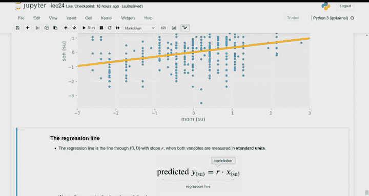

# UCSD《数据科学原理 (DSC 10 Principles of Data Science Fall 2024)》中英字幕（deepseek - P25：DSC 10 - Principles of Data Science - LE -A00- - Lecture 25.zh_en - GPT中英字幕课程资源 - BV1hmAneGEZh

All right， good morning。Most important announcement is that the quizz is today。

 we change it up because of Thanksgiving。Do as much as you can of the homework before then because that'll help you。

 but the homework's not due till tomorrow。And again。

 because of the holiday we swap discussion and quiz so you'll have discussion on Wednesday if you're traveling or whatever like there's some flexibility built into the syllabus that you don't have to attend every discussion to get full points so you just have to decide what you want to do that day Thursday and Friday our holidays so there's nothing going on we don't have class we don't have office hours we don't have anything。

And then for the final project， that's due Tuesday of week 10 when you get back。

We are having some like different submission instructions for this project compared to other things we've had。

 you'll submit the notebook as usual， but we also want you to submit a PDF。

 this is going to make it easier for us to grade the plots basically so there's going to be instructions posted on Ed about exactly how you do that but there'll be two separate grade scopepe assignment so the idea is upload the notebook as usual than upload a PDF separately。

Okay， any questions？Okay。So today we're kind of moving into a new topic。

 so we'll kind of recap what we've done in the second half of the class and where we're going The second half of the class has been about statistical inference you have something you have some sample and you're trying to learn about a population。

We used standard hypothesis testing when we had a sense of what that population might be。

 and we were asking basically does this sample look like？Look like it comes from this population。

Permutation testing was for you have two samples and you're asking do they come from the same unknown population distribution。

 do they have a common source？And then bootstrapping or the central limit theorem or both methods of estimating parameters。

 right both the bootstrapping and central limit theorem give you a way to make a confidence interval and a confidence interval is your guess for some unknown value in the population。

 which is a parameter。We also saw how the bootstrapping and CLT intersect with the hypothesis testing。

 this was the human body temperature example that we did。Recently。

 this was to test whether a population parameter is equal to a certain value。

You can set up a hypothesis test where the hypothesistheses are like it is that value or it isn't that value and then instead of doing the regular way of testing a hypothesis where you come up with a test statistic and simulate。

 you could instead generate a confidence interval for that parameter and ask whether that that value is in the interval or not in the interval so this is what we did for the human body temperature。

The population parameter。Was the， I guess， all right， the mean human body temperature。

 that was our parameter， and then the x that we were considering was 98。6。Degrees Fahrenheit。Okay。

 so that was a hypothesis test， but our strategy to test the hypotheses was using confidence intervals。

So those are kind of the big picture like statistical techniques we learned for the rest of the quarter。

 the last three days of lecture are going to be about a new topic of prediction。😊，Given a sample。

 what can I predict about data not in that sample？And we're going to focus on linear regression。

 which is one of the most straightforward prediction techniques。

 and even though it is pretty straightforward， it's like the basis of a lot of much fancier things。

 so linear regression is super important not because like everyone's you know using linear regression itself all the time。

 but because it's like the basis of so many important machine learning algorithms。

And the idea of linear regression is it tries to find the best linear relationship or line that describes the relationship between two numerical values。

And we'll learn about correlation。Today， and this， as I said。

 is like the basis of lots of other ideas， so you'll see it keep coming up in the data science major。

😊，Okay， so today's topic is pretty disjointed from like the things we have done is like a fresh start from the hypothesis testing and the bootstrapping and all that。

Okay so here's the problem of prediction supposeupp we have a data set with at least two numerical variables and you want to predict one variable based on the value of the other okay so here's some examples given someone's education level。

 can you predict their income it makes sense to do this if you quantify education level as like a number you could think of that as a categorical like what's your highest degree earned or you could think of it as how many years of school have you had right so if you think of it as numerical and someone tells you how many years of school they had。

 you should be able to make a prediction of their income based on that alone now obviously like there's a lot of variability in people with the same years of education might have very different incomes but you'd want to pick as a prediction like something kind of in the middle of the possibilities。

Okay given my height， how tall will my kid be as an adult， given my age。

 how many countries have I visited， these all make sense to predict because we expect there to be like a relationship between the variables right。

 like we think that people with people who are taller have taller kids right。

 probably people who are older have visited more countries because they've had more opportunities in their life to do so。

Okay， so in order to do any sort of prediction， like it only makes sense if there's a pattern or a relationship between the variables。

Like， if I said。Given my height， how many countries have I visited。

There's probably not like a real noticeable connection between how tall you are and how many countries you visit so it doesn't really make sense to predict on variables that aren't related。

So the first thing we're going to do when we're hoping to do prediction is check for a pattern by looking at a scatter plot。

Okay， so when we draw a scatter plot， we're looking for any sort of relationship between the variables。

 that's called an association。A positive association where it means where one variable is increasing so is the other。

 and the negative association is the opposite as one is increasing the other's decrease。

I think all the ones on the prior slide were。Would be like something where I expect a positive association right like higher education usually means higher income。

 taller means taller kids， older in age means more countries。

 can you think of something that's a negative association？The more of this， the less of that。我。Sure。

 okay， the higher your income， the less you spend on used goods， probably。 Okay。

 so there's lots of things that can have a negative association， too。

 the ones you tend to think of most usually are positive association。

And the point is like any association， it can be。Linear or nonlinear it can be positive。

 it can be negative， any association， any pattern is useful in helping you make predictions of one variable based on the other。

So we're going to work with a data set of older hybrid cars。

So these are like early hybrids from 97 through 2013。First generation Prius is the first one here。

What information do we have， the vehicle， the year price？

Is like the manufacturer suggested retail price acceleration is some measure of like how quickly it gets up to speed on the highway。

 a higher number here means it has more like oof to it can accelerate more quickly MPG is miles per gallon which is fuel economy so a higher number here means it's like better for the environment you can go further on a single gallon of gas。

And then the class is some categorical variable。Okay。

So let's look there's several numerical variables here right we've got year could be considered numerical or you could think of it as categories price is definitely numerical acceleration in miles per gallon。

 So we're going to look at some of those in combination right to draw scatter plot you need two numerical variables。

😊，So we're going to look at price versus acceleration when you say versus。In a scatterpl。

 whatever comes before the verses is the y， whatever comes after the verses is the x so if I want price versus acceleration I want y to be the price and I want x to be acceleration the way to think of that is like how is the price changing as a function of the acceleration？

Okay， so what does this tell you about hybrid cars from looking at this picture like broad。

Lesson learned from the scatter plot。Here's a positive relationship， a positive association。

 What does that mean about cars， though。Cars that accelerate faster are more expensive， like the。

The cars that get up to speed quickly on the highway are the ones that people are paying more for。系。

That makes sense。How about this， price versus miles per gallon？

So now we're going to see how price changes based on the fuel economy。

When I saw this picture for the first time， I was very surprised。

This is saying there is a negative association。Wwhichch is saying。

 remember these cars out here on the far right are really good for the environment。

 they don't use much gas 70 miles per gallon right and these cars over here pretty bad in terms of fuel economy。

 they burn up a lot of energy and people are paying like so much for these cars where they also have to buy a lot of gas and like these cheap cars are really good like I would buy the ones on the far right without thinking。

没有。W do you think this pattern exists in the data？Okay， so that's kind of you're on the right track。

 it's something to do with the fness of the cars like features could mean like do you have a sunro and things like that which don't have to do with the energy of the car。

 but there's one particular feature that does have to do with the energy of the car that like fancier cars have and is like more valued。

And that's acceleration。Basically， cars that accelerate quickly like burn a lot of gas in the process of doing that。

 Okay， so the hybrid cars that。嗯。A over here， these are the like slow accelerators and they're also cheap。

The cars over here， these are the fast accelerators and they're also expensive。In this picture。The。

 the cheap ones。Remember， the cheap ones were the slow accelerators， right。

 The slow accelerators have really good fuel economy。嗯。High accelerators， the quick ones。

Those would be the ones at the top， camera draw， the ones at the top here。Okay。

In this top left corner are of bad fuel economy right but they're expensive because they go quickly basically so this shows you like what people value the most in terms of like early hybrid cars like nowadays I feel like hybrid cars have gotten much more sort of comparable in performance compared to like gasoline cars so there's not like such a big value placed on being able to accelerate quickly because most hybrid cars can but maybe at that time like only like they're really expensive fancy hybrid cars could accelerate quickly and that's what people cared about。

Okay， does that make sense？So yeah， sometimes looking at the scatterpots observed a。

unearths an interesting observation that you weren't expecting。

Another thing to notice about this plot is it looks more curved than linear。

The last one looked like a straight line pretty much。I mean。

 obviously it's not perfectly straight lined because the dots are all over the place。

 but if you had to describe the pattern that you see， it would be something like this。

Whereas this one， if you were to describe the pattern， you see it would be something more like that。

 like a curve。But either way， it's still enough to sort of make predictions， right？

This is a more fun version of。Of the previous scatter plot。

 this is plotted using a different plotting library。

 we've been using sort of basic plotting commands just to learn how to do it。

 but there's all sorts of other Python packages that allow you to do fancier things。

So this is a plotting package that allows you to have scatter plots where you can hover over and show details about it。

 so like these top left ones are like BMW active hybrid， Lexus。

 right like the fancier cars as you said and the ones over here are like the Prius。😊。

Toyota is like a more common， less luxury brand， but they prioritize。Fuel economy。Okay。

 so we can basically look at a scatter plot and tell by I whether there's an association between the variables and whether that association is positive or negative。

😊，So whenever we're given two variables， that's kind of the first thing we're going to do is look at the scatter plot and see doesn't make sense to try to predict one of these variables based on the other。

 but we're also going to want some way of measuring sort of more concretely how associated two variables are because you don't want to just rely on yeah that looks good because different people might have different opinions of well looks good。

So there's some measurement called correlation。It's called the correlation coefficient and it has a letter that's usually associated with it R for the variable。

 and it's a number that measures how strong the linear association is between two variables， okay。

 which another way of saying that is like how clustered are the points in this scatter plot around a straight line。

It's not it's not measuring like how associated are the variables。

 like how much of a pattern is there because you could have some crazy zigzagging pattern and that's not very linear so it would have a low correlation coefficient but if。

If the points were like pretty much close to a straight line。

 that's what would have a higher correlation coefficient。 Okay， so correlation coefficient is like。

 how strong are these variables linearly associated。And the way you calculate it。Is as follows。

 it's the average value of the product of the two variables when both variables are measured in standard units。

Okay， so this is a。A bit of a mouthful and we're going to explore today like why this definition is what it is and what it's actually saying。

Some things to know is that the correlation coefficient always comes out between negative one and positive one。

 so that gives you like a scale on which to interpret it。😊，Okay。

 so we're going to look at some examples first， and then we're going to understand this formula and how to interpret its value between negative one and positive one。

Okay。These are some examples of different data sets with different correlation coefficients。Okay。

 so r equals negative one， remember the r can go between。And。Negative one and positive one。

Z would be in the middle of that interval。 right， R equals negative one is the picture on the top left。

 That's like all the points fall exactly on a line。And that line is downward sloping。

 So that's a negative association。And it's also like incredibly linear as linear as you can be as all the points actually fall along。

R is negative two thirds would be like here on the number line。

 it's not as tightly clustered around a line， it's more spread out around a line。

But it still follows like a negative slope。So notice all the ones with a negative。

cororrespond to like downward patterns， negative association。

 that's why we call it negative association， and all the ones with a positive R correspond to a positive association。

😊，Okay， so。This is a negative association。This is a positive association。Okay。

What about the actual number， so like look at negative  one third， which is here。Negative two third。

 which is here and negative one。 can you say in words like what's happening to the points as you read across these three pictures from right to left。

Yeah， they're kind of like converging like around the line right so at negative a third。

 they're more spread out at negative two thirds， they're closer together at negative one they're like all together on that line。

 Okay so that's saying the number itself， in addition to the sign tells you something about how tightly clustered the points are on a line。

Let's look at the positive ones， R equals1 is a perfectly straight upward sloping line。

Two thirds and13s are also upward sloping lines， but they sort of get more spread out。R equals 0。

Let me erase my drawing so you can see r equals0 is this one。

Would you say these points cluster around a positive sloping line or a negative sloping line？

I could say positive I could see it or I could say negative and I could see it just as well。

 basically right these clouds are sort of these points kind of form a cloud and that cloud doesn't really have a direction of it's moving up or it's moving down it's just like a blob。

Okay， so R equals0 is sometimes we call this uncorrelated。Like， there doesn't seem to be any。

Noticeable linear pattern in either direction。唔系啊。Any questions on the pictures？

This is a good thing to remember。Sort of what it means。

This is an interactive version if you want to play around with it。

 where you can drag the slider and see the points sort of gradually become more linear as the R approaches either direction。

 either extreme right here there。Well。Here they're positive， here they're negative。

I didn't know you can do this。Right。Okay so R is like some number that you can calculate that quantifies the linear relationship between the variables。

 so you can do it for any pair of variables that you want。

 we'll try it for the pairs of variables that we looked at before in the scatter plot。

 price versus acceleration and price versus miles per gallon。So this was its definition。

 the average value of the product of the X and Y when both are measured in standard units。

So we have to remember what standard units means。Standard units is like a relative measurement of how some variable compares to the other ones in its data set。

So to convert something to standard units， you subtract the mean。Of the entire data set。

 and you divide by the standard deviation of the entire data。Okay。

 so this is a function that converts an entire columns worth of data from a data frame into standard units。

And I'm going to make a function that calculates the correlation between two columns in a data frame。

So。Let's look at this function closely， you're given a data frame， you're given a column called X。

 and you're given another column called Y。You're going to grab out the x column with theta frame。

t get x， and then you're going to convert all the values in that column into standard units。

Using the function above。Similarly， you're going to grab out the Y column and convert all of the values in the Y column into standard units。

Okay， so X standard units and Y standard units are both series。This。I'll just say series and series。

 these are both series right， like sequences of many values。And what's the definition？

I need the average of the products。In standard units so I got them in standard units now I need to multiply both series together。

 remember that does the element wise the first with the first， the second with the second Okay。

 so this part I've highlighted is itself a series， and then I take the mean of that series。

And that's exactly what the definition says。Okay， so。Let me show you the plot I showed you before。

 acceleration and price。And what's the R？It's 0。69， like around 07。 let's just say。

Does that kind of make sense with how you interpret R you should expect it to be a positive number because it's an upward positive association And you know。

 it's pretty， pretty clearly linear here。 It's not like all on a straight line。

 So it's not like as high as one， but it's definitely not like a patternless cloud right So's I would say like higher than a half you would have expected。

 how to you know， is's very hard to eyeball with any precision this number。

 but you should kind of be able to say like is it between negative one and negative half negative half and0。

0 and a half half and one like that's just asking like is it positive or negative sloping。

And is it like strongly linear or not strongly linear basically？Okay， how about this pair？

Predict in your head what the R is going to be， Is it going to be positive or negative。

 Is it going to be closer to 0 or closer to1 or negative one。I'm thinking it well， it's negative。

 So it's definitely negative。 I'm thinking it's not as strongly linear as the other。 It's more curvy。

 So I'm going to put it between。Negative a half and zero。OhThat was wrong。

 but I was close is around negative a half。So the sign is important， the magnitude is also important。

 right the fact that this was ignoring the sign 0。5 and that was 0。

7 isch right means that this is less linear than that。Okay。

 so we're going to now try to make sense of what this standard units or what this correlation formula is saying。

And we're going to think about。How standard units changes things。

So standard units are used in the calculation of R。

 a standard unit calculation is an example of a linear transformation。

 you might note this term from math。😊，A linear transformation is just you're allowed to add。

 subtract and multiply or divide each value by a constant So an example is converting from Celsius to Fahrenheit is a linear transformation because you have to multiply all the Celsius numbers by  nine/5s and add the constant 32。

Notice that。When you do a linear transformation to variables in a scatter plot。

 all you're doing is like sort of changing the units they're measured in。

 but it doesn't change the shape of a plot。 Think about that。 Like what's a linear transformation。

 if you add or subtract。How like from either the x variable or the y variable in a data set。

 that's just going to move the plot like left or right or up or down， right。

 but the points themselves would have kind of the same pattern if you if like you add 32 to everything。

 then everything's going to move over by 32。 It's not going to change like the shape。Oh。

If you multiply or divide， right， that kind of crunches or stretches。

 you can crunch or stretch vertically， you could crunch or stretch horizontally， but again。

 something curvy doesn't become straight when you stretch it or compress it。

Similarly with something straight， it doesn't become curvy when you stretch it or compress。

So one way， you know， one consequence of this is like。

 if you measured the variables in different units。The plot would look the same。Okay， so。

Here's price in dollars versus miles per gallon。 I'm going to convert to Japanese yen and kilometers。

Let's just multiply by some exchange rate。It still looks the same。 like in the picture。

 the scale is way different， though。 This is something times 10 to the 7。

 right So if you actually drew them on the same axes， the yen one would be like incredibly taller。😊。

So we use linear transformations when we calculate standard units right because the mean of x。

 it's a constant like whatever the average of that column was。

 that's a single number right so this is like I'm just subtracting all the data by a single number。

 we saw this earlier when we studied standard units that just like moved all of the data left or right and then when you divide by the standard deviation that's also a constant so it just stretches or compresses it。

And so what that means is that when we convert our variables to standard units to calculate correlation。

It's sort of like we're calculating how linear the relationship is between these two like scaled and shifted variables。

 but that's the same as like how linear the relationship is between like the unscaled and unshifted versions。

 because scaling and shifting doesn't change how much the plot resembles a straight line。So。

 why convert to standard units if it kind of doesn't change the shape。

 like what's the point of that part of the calculation？

The point of that part of the calculation is to sort of make sure that both the x and the y variables are measured on the same scale and so that you don't get different results based on what units you happen to use。

If you just did， like， you multiply all the X and Y values， and then you average them。

If you are multiplying dollars and miles per gallon。

 you're going to have different numbers than if you multipied yen and kilometers per gallon and then you're going to have a different average so then the correlation coefficient will come out different。

 The point of standard units is to sort of like it doesn't really matter how these variables were measured。

 we just sort of care about like their shape and what they look like on a scatter plot。

Does that make sense。Okay， so。嗯。We're going to write a little function。That takes a data frame。

And converts every single column into standard units。Okay。

 so this uses some syntax that we haven't seen yet and you don't need to know the details。

 but I'll explain what it's doing。 It's making an empty data frame。

 This is like the accumulator pattern with data frames， okay。For each column in the set of columns。

I am assigning a new column to the empty data frame。

 just the same way you would like append a value to an array I'm doing one column at a time。

And the part that you don't know how to do is like how to name the new columns with like a pattern。

 I want the pattern to be like the old column name plus S in parentheses after it， Okay。

 so that don't worry about that part， but basically this is what I'm putting in each column。

The standard units version of whatever was in that call。Okay so。

If you just take the original columns， acceleration miles per gallon in price。

And you standardize all of them。 This is what they look like。 Okay， this comes out kind of。

Weird scientific notation， but the other ones look pretty reasonable。

 they're all generally kind of smallish numbers right with when you convert to standard units。

 most things fall within a few standard deviations of the mean so you're not seeing like you know numbers that are really big here。

So let's look at price versus acceleration in standard units。Okay， so。Before。

 when I showed you price versus acceleration， I was showing price in dollars and acceleration in whatever unit I was measured in。

 Okay， and the price was， I don't know， centered around。😊。

50000 or whatever the price of a car was and the acceleration was centered around whatever reasonable acceleration for a car was here。

 this scatter pot is kind of centered around the origin 0，0。

 The origin in standard units is very important is this what does this point represent。

What does it mean like。When something comes out to zero in standard units。It means it is the mean。

 Okay， so this represents the point。Average x comma average Y。

To wind up at 00 means your average in both。Sirectionions。And basically。

 this is kind of centered around there because0 is the mean of。

 of a distribution that's been standardized， So if you just took all the X coordinates。

And like made a histogram of them。 That histogram would be centered as 0。

 If you made all all the prices and made a histogram of them， that histogram would be centered as 0。

Okay。What else死。Okay， so I want to talk about。The signs。Okay。

 notice that when you have something with a positive association。

And you've put it in standard units like we've done here。

 the origin kind of becomes the center of the histogram。Like a center of like where the dots are。

 not histogram， center of the scatter plot。And because the data has a positive association。

 it kind of has a shape like this， right？And that means there's lots of data。

Falling in certain quadrants， that origin splits the plane into four quadrants， right。

 these quadrants， the upper right and the bottom left have lots of data。And the。

Other two have less data。You know the exact number is going to vary from you know example to example。

 but generally like the fact that there's a positive association means the data goes from the bottom left to the top right。

 so it sort of follows that that trend and you some are going to wind up in the other corners。

 but generally most of the data is going to be in that bottom left and top right。

 do you agree with that。😊，Okay， and what's special about the bottom left and top right？

Remember the formula for R involved the product of the variables in standard units。Okay。

 so if you take like any point here and from the top right section and you multiply its x value times its y value。

You're going to have a positive product， right， because you're multiplying a positive number times a positive number。

The bottom left corner。Has a negative X value and a negative Y value。

 These are the cars that are sort of below average in acceleration and below average in price。

 They're cheap and not good at accelerating。 Okay but these also。

 any point over here is going to have a positive product。Make sense。

 What about the other two quadrants。They're going to have negative products。Because。

One of their coordinates is is positive， and the other one's negative。

And the product of a positive times a negative is a negative。

So what this is saying is that when there's a positive association。

 most of the data points fall somewhere where their product comes out positive。

And not that many data points fall somewhere where the product comes out negative。So each data point。

 like you multiply its X and Y， you get a product。So you have lots of products。

 and then we're just going to summarize all of those products in a single number by averaging them。

That average is going to come out positive in this case because most of the data points had a positive product。

 only a few negatives are bringing them down， the average is still going to be positive。

So that this picture should kind of explain like why the correlation coefficient is what it is。

 it's because positive association， like this calculation makes it such that like the data following a certain shape makes the average of the product come out to be a positive number。

Okay， and similarly other in the other direction， what would happen if you had a negative association？

Right here。Right。This is our special spot， the origin。嗯。If you have something that's really。

Negatively associated， right， then there's going to be lots here。Lots here。Few here。Few here。

And these are the ones where it's going to be positive products。

And these are the ones where it's going to be negative products。

 So most of the products are going to be negative， and the average of all of those product numbers is going to come out negative。

Now notice in our case， right， since the data kind of wasn't that linear， it curved a lot。

 I would say we also got a good amount here。That's going to kind of counteract。The all the negatives。

 like there is a lot of negatives， but there's also a good amount of positives， too。 That's why。

 like， it comes out closer to 0 when the， when the data doesn't follow linear your shape as well。

 Think of the uncorrelated case。Just a completely random smattering of points in here。Right。

If these points are just truly like randomly placed。

Then you're going to have a similar amount of positives and negative products。

 and they're going to basically cancel each other out and you're going to get something close to zero when you average it。

Okay。So this is a cool like calculation， I think that I think someone really clever like came up with this idea of like I can use like the quadrants。

 the products mean certain things and like interpret it and come up with this definition of like a way to get a single number that sort of conveys so much information。

All right， any questions。Okay。So our value that we get。

 we interpret it as how strongly linearly associated are the variables。

You always get a number between negative one and positive one， right， negative one is that perfect。

Downward sloping line。Zero is there like all over the place。Where's zero here？

And positive one is a perfectly upward sloping line。

Some things to know R is computed based on standard units right。

 that means like because it's in standard units， it doesn't matter if we originally measured the variables in yen or dollars。

 it also means it's symmetric。嗯。While the standard units doesn't mean it'ssymmetric。

 The fact that it's based on a product means it's symmetric right X times y is the same as y times x。

 So if you look at the correlation between price and fuel economy。

 it's the same as a correlation between fuel economy and price and I really like that because it's saying like this number represents like the relationship between this pair it's like per pair。

 there's a single number and it's not an ordered pair it's just like a set of two variables。

And the whole idea of R is like how well can you predict one variable from the other using a line if the r is strong。

 like meaning close to positive one or negative one， like there's a strong linear association。

 then you can make really good predictions right， knowing the x will give you a very good sense of what the Y is。

If r is0， knowing that x doesn't tell you much about the Y。All right。

 try this concept check question。Here's a scatter plot。Do you see？

Association or correlation or which combination？Okay， let's see。Lots of bees。Association。

 but not correlation。Okay， yeah， I think that's the best answer。嗯。Do they have。Okay。

 I thought the calculation might be there， but it's not， I'll leave that to you guys to try。

 but you can actually， you know， we're making a data frame here。With。The two columns X。

 which has like a bunch of regularly spaced numbers and y， which has the square of those numbers。

 so this is literally a graph of y equals x square a parabola。And the。

The way you would calculate the correlation is you would sort of rescale。

The the scatter plot so that it was in standard units and that would essentially put the origin like roughly where I drew it。

嗯。If you sort of redid the plot。In standard units。What I mean by that is like convert both variables to standard units and then draw。

A scatter plot of them， It would kind of look like this。嗯。😊，And the four quadrants would be。

Like this and see how the data is kind of distributed pretty evenly across all the quadrants。

That means like when you average their products， it's going to come out close to zero。 In fact。

 in this case， I think it comes out exactly zero。So correlation itself。

 the word correlation means linear。 So we said B。So， there's。There's an association。

 association is just is there a pattern。 Yes， there's clearly like the points are predictable。

 they're doing a thing， but there's no correlation。

 So there's not there's no such thing as linear correlation or nonlinear correlation。

 Like the word correlation means linear right And because of that association that we see is not linear。

 there's no correlation。😊，这咋没3次。Yes， thiss the terminology。Okay。

So now let's see how correlation connects to our prediction problem。

We're going to use this data that's really old， it comes from the 1800s it was collected by Francis Galton。

 he was a eugenicist and proponent of scientific racism， which is why he collected this data。

 that's not why we still use it， we still use it because he was credited with discovering regression on this data。

 so this is kind of like a historical artifact of his discovery。

But he definitely had some some questionable reasons for collecting this data。

 so we're not endorsing his。thinkinging by， by using his data。Okay。Yeah。

 he was basically interested in like trying to breed people with specific characteristics that he wanted and he collected a lot of data on like people's physical characteristics to kind of experiment and see if you combine parents with certain desirable characteristics that he wanted with their children come out desirable and you'll see that he wound up being like disappointed in his findings。

So he studied for one people's heightights and he had a lot of data like this is 934 people that he got information on。

 it was 204 families。And each family， see how like several rows have the same family number。

 each family， he got how tall was the father， how tall was the mother。

Mid parent height is some number that he devised， which was basically a weighted average of both parent heights。

How many children were in the family， child number like birth order。

 gender of the child and height of the child so important note is when we say child。

 these are adult children so this is their final height。And yeah。

 he was basically looking for a relationship between the parents height and the kid's height。

We're going to focus on one specific subset of his data collection， which was mothers and sons。

Quering to just get the male children。And I'm making a data frame with better column names。

 mom and son。Okay， so there are 481 mother son relationship pairs described in his data set。

 and this was how tall each mom was and how tall their grown son was So the scatter plot's going to show you。

Do you see an association here？And you look at this and you see there's somewhat of a positive association。

 right like if you had to describe this， I'd probably describe it like that。

Like it's going up generally moms that are really tall。

 there's a range of how tall their sons will be， but they they're on the tall side， right。

 and moms that are really short， there's also a range of how tall their sons will be。

 but they're on the shorter side。Okay。So it's generally sort of going up。

 it's not super strongly tightly clustered around that line though， so I'd say like it's pretty weak。

 it's going to be like closer to zero than it is to one。

Our goal in predictions is like some sort of simple strategy or rule that tells me how tall the sun should be based on the height of the moth。

Okay。I've converted everything to standard units。And the simplest kind of prediction you could make。

 you might say is like we're just gonna to say that all the suns are like a specific height。

 I'm just gonna say that like any adult son that like comes into my office of making predictions。

 I'm just gonna tell their mom， like I think your son will be 70 inches taller。

 I think your son will be 50 inches tall。 I'm just gonna say the same thing to everyone。

What things should you say， basically？Should you say。

 I think your son is going to be extremely short， three standard deviations below average， right。

 Should you say， I think your son is going to be extremely tall。

 Like the most natural thing to say is I think your son will be average right with no additional information like if you're kind of ignoring how tall the mother is。

 You just want to like give the same blanket prediction to everyone you should predict average Does that make sense。

So that's zero in standard units。Okay。But you can make better predictions if you incorporate the fact that there is a linear association between the Sun's site and the mother's site。

It's better if your prediction will vary according to the mother's height。

So a prediction that' gives a bigger number for taller moms and gives a shorter height for shorter moms。

 that's going to be better。Okay， so I'm going to take that same prediction that I had before。

And it was the flat line at0。 And I'm going to kind of tilt it to give it a slope。Okay。

 notice that any slope that I give it， it still goes through the origin。

The origin is an important point for this line to go through because it's saying an average height mom should have an average height kit and that makes sense。

But how steeply should I tilt this？Right。You kind of want to tilt it so that it kind of cuts through the middle of the cloud。

Right。I don't know， maybe like this。Which of these lines is best again。

 it depends on what you mean by best， but what it turns out is that a good line is a line that goes through the origin。

And has a slope that is the same as the correlation coefficient that we found。

So this is kind of crazy， like the correlation coefficient measures like how associated are these variables。

 but what we're saying is that same number also functions as like a good slope for making predictions。

So here's that line。No I was supposed to run something that I didn't。And。Yeah others this。

The R here was about a third。So this is a line that goes through the origin 00。

 average height mom will have an average height kid， and it has a slope about a third。

And it seems like a pretty good line for making predictions。This is the line that Galton found。

It was a line that went through the origin， so it's intercept was zero。

 that's why there's no plus anything， and its slope was R。

So what this is saying is to predict a y based on an x， you just multiply it by R。

 Y equals r times x plus 0。 That's the equation of this line。Okay。

 so we'll see next time like how to interpret this line and why it's so important。

 we'll stop there and I'll see you guys Wednesday。

