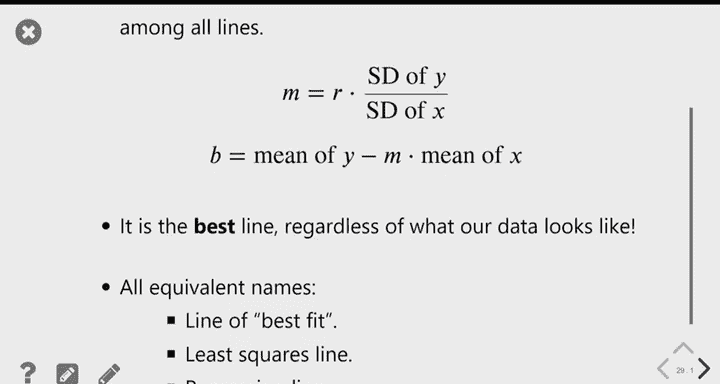

# UCSD《数据科学原理 (DSC 10 Principles of Data Science Fall 2024)》中英字幕（deepseek - P26：DSC 10 - Principles of Data Science - LE -A00- - Lecture 26.zh_en - GPT中英字幕课程资源 - BV1hmAneGEZh

All right， good morning everyone， thank you for being here。😊。

Today we're going to learn more about regression， our announcements are that we do have discussion today this evening。

 but remember you don't have to be there for everyone so if you want to go home or something like you have that option。

😊，Because of Thanksgiving， which is tomorrow， there's no course meetings or office hours。

 so enjoy your holiday。And then the final project is due Tuesday after we get back and there's some submission instructions you just have to remember to submit twice basically once your Jupiter notebook and once a PDF of your Jupiter notebook。

Yeah， same thing， like whoevers on your notebook submission should also be on your PDF submission。

Only one of you submits it。 samee。 Yeah， yeah。Okay， anything else？Okay。

So last time we were talking about ways of making predictions using a line。

 and we learned about a line called the regression line at the very end。 Okay， so this was the。

The data we were working with from Galton， who is using this to try to breed humans with certain characteristics that he wanted。

This was our data set of moms and sons， adult sons， and their heights。And this was our scatter plot。

Showing how the mother's height and the sun's height is related。 Okay。

 so this has like a bit of an upward tilt to it as you go from left to right。

 which means taller moms have taller sons， basically。😊。

And so there's some sort of relationship between the mother's height and the son's height。

 and we can quantify like how strong of a linear relationship that is by the correlation coefficient。

 So we talked a lot last time about where this formula comes from and how it uses like the fact that the data falls into certain quadrants to quantify the shape of the data。

So this was our definition of the correlation coefficient。

 the average of the product of the two variables when both are measured in standard units。😊。

So these are some functions that we wrote to do that。

 the this function just converts a column to standard units。And the calculate R function。

Converts both columns X and Y to standard units， multiplies them together。 elementement Y。

 and then takes the average of the products。 Okay， so that's the definition of R。

 So if we do that for the。The mother and son data set， it comes out to about a third， okay。

 meaning like there is a linear relationship between these variables and it's upward trending。

 but it's not super strong， like it's not like the data very much follows a line。Okay。

 and then we talked about different ways of making predictions last time and we said， you know。

 if you weren't going to incorporate the mother's height at all and you just wanted to。

To predict a single number， the same number for all the suns。

 you would probably want to put it in the middle， an average sunhe would be your guess for how every kid would come out。

But if you are allowed to include the mother's height as like a factor in your prediction。

 then you'd want to not just have a perfectly straight flat line here， but you'd want to angle a bit。

Okay。And the question we asked was like， how much do we angle it？

And we saw that one good way of angling it was such that the slope。

Of this line was equal to the correlation coefficient R。Right， and we also saw that。The。

 the line went through the point。0，0， which we call the origin。

And why does the regression line go through there and why does that make sense？Well。

 it's because the origin represents the point with average x average y。So in this case。

 the x is the mom's height。So what this is saying is that if an average height mom comes in。

 you're going to predict an average height son。And since the line tilts if an above average height mom comes in。

 you're going to predict an above average height sun。Okay。So。This is our formula。

For this regression line， it's defined by the point that it goes through the origin and the slope that it has。

 right， you might remember from math， a point。And a slope are sufficient。To uniquely define a line。

 right there's only one line that goes through a given point and has a given slope。

So when we talk about going through the origin and having a slope of R。

 we're talking about when the variables are in standard units。

 okay so the formula here is saying when you have an X variable in standard units。

If you multiply it by R and add0 times the slope plus the intercept， that gives you。

Your predicted Y value in standard unit。So the idea is you use the regression line to make predictions and what the formula says is it's super simple。

 all you have to do to get your predicted y in standard units is take your x and standard units and multiply it by R the plugging it into a line is just multiplying by R because the intercept is0。

Okay， so what does this mean？For example， if a mother's height is half an SD above average。

 just a little bit taller than average。And the correlation coefficient was 0。32， like we saw。

What this is saying is we predict that her son's height is going to be 0。

5 for the x and standard units times 0。32， which is 0。16。

 so we think her son will be ever so slightly above average， 0。16 standard deviations above average。

This actually talks about。Galton's issue with with the regression line。

 Galalton discovered the regression line and was unhappy with his outcome or with his discovery and the reason he was unhappy was basically because of what happened here。

The mom was， like。A certain amount above average 05 of an S D。 And then the kid。

Was less above average， right or the prediction for the kid is less above average than the mom。

 And this always happens because the R that you're multiplying by is always like a fractional number。

 It's between negative one and positive one。 So it's never the case that like you have a tall mom。

 Maybe she's two standard deviations above average。

 You're never going to predict that her son is three standard deviations above average。

 You're always going to predict that the sun is closer to average than the mom。

 And this is actually why he called it。😊，Regression， the word regress。

It means like you're going backwards and you're not making progress towards your goal and like his goal was as a eugenicist for each you know next generation to have more and more of like the trait that he wanted so he wanted to be able to like combine two tall parents and have an even taller kid and then the next generation to be even taller like he wanted that and what the Russian line is saying is like that's not really what happened。

Okay， something to know about。The regression line predictions is that。

We're saying we predict that the sun will be more average than the mom right but it's not saying that every son is necessarily more average than the mom right some kids are exceptionally tall。

 but the idea is like you don't expect anyone to be exceptional right you kind of expect people to be average So the way like to think about this is however extreme the mom is that like influences the prediction for the son away from the average。

 like because this mom is above average， we're gonna to predict her son to be above average。

 but we're balancing the fact that like he has a tall mom with the fact that he's just a person and people are generally average。

So even if the mother's height was extreme，10 standard deviations above average， right。

 was just pretend。Right。So if， if the。Mom's height was extreme， 10 standard deviations above average。

 you'd still be multiplying this by 0。32。And this would come out to like， yeah， like tall。

 but not like insanely tall like the mother was。And that's basically balancing the fact that like while you do have a very tall mother and that sort of predisposes you to being tall。

 you also like in general， it's just really rare to be 10 standard deviations above average and height。

 right， so you're not going make a prediction of 10 standard deviations even when the mother is 10 standard deviation。

Does that make sense？So this is the effect with a tall mom， what if you had a short mom？Right。

 imagine your're。Mom was， I don't know， let's say negative to standard deviations。

 so two standard deviations below average and the R would it be 0。3 to。So this would be negative 0。

64。Okay， so this is saying。Times。This is saying the mom is pretty short。

 like two standard deviations below average and the sun is just a little bit short is our prediction Okay so it works in both directions and generally it says that like the predicted value we predict to be closer to the mean than the original value what we're predicting on So like we think that tall moms will have not quite as tall kids and we think short moms will have not quite as short kids like more average than the mom Does that make sense。

Questions。是的。Great question， I was hoping someone would ask this。

 does this mean everyone's height is just converging towards some like optimal human height， right？😊。

It doesn't。Why not？Yeah， so I'm like just looking at the mother's height。

But even like and you're saying like there's other things that come into it like maybe like environmental factors or their father。

 for example， but I think even without that， this doesn't say that like everybody's just getting more average。

 What it's saying is that we predict people to be closer to average。

 right not necessarily that they will be average and I'll show you back the scatterplot。Yeah。Okay。

 so for example。Look at， I don't know， let's say。66" tall moms。

66" tall moms are a little bit above average。The regression line probably looks like that。

The kids of 66" tall moms vary greatly in the height， right？

But if you were going to predict a height， you would predict a number。That was， like。

Pretty close to the average this is the average sunhe。

And I'm pick predicting a number that's just a little bit taller than that。

 So your predictions are generally close to average， but individual people can be way above average。

 way below average。 So there's still like a lot of variety in the heights。

 It's just that the predictions have less variety。 Does that make sense， yeah。

So it's not the case that each generation is getting more average。O。

So one thing that's a little bit inconvenient about this statement of the regression line while we can use it to make predictions。

 it requires you to like。Start with a value in standard units and it gives you a value in standard units Like what you actually want to do and you predict someone's height is like they tell you。

 hey I'm 66 inches tall how tall is my son going to be。

 they want an answer in inches not in like standard units that they have to convert right and we're going to be able to fix that because we know how to convert between standard units and inches Okay so we're going shortly talk about another version of this regression line it's the same line right But instead of going from standard units of mom to standard units of sun。

 you're just going to go directly from inches of mom to inches of sun。Okay。

 let's try this concept check。A course has a midterm， tell you some information about that exam。

 it's mean and standard deviation and a really hard final， it's mean and standard deviation。

 and then you look at a scatter plot showing the midterm and final scores and that looks to be linearly associated and the correlation coefficient is 0。

75 because that's actually pretty strongly linearly associated。😊。

What final exam score are you going to predict for a student who got a 90 on the midterm？

Take a couple minutes to try to work this out。You're going to need to use that regression line formula。

 you're going to need to convert things to standard units。O。Let's try this out。

They told me the correlation coefficient， this is R。Right。

And I'm trying to predict the final exam score for a student who got a 90 on the midter means。

The final score is like the y。And the midterm score is like the x。

I'm predicting the final based on the midterm， you predict the y based on the x and this I don't know really what the data looks like。

 but something like this where it pretty clearly follows some line okay。And I want。

The final for a student who got a 90 on the midterm。 Okay， so basically the x， the midterm score。

Is 90。But my formula for how I make predictions doesn't involve the midterm score in points。

 it involves the midterm score in standard units。Okay， so my。My job。

 first job is to convert x to standard units okay so you take the 90 you subtract the mean of the x's。

 what's the mean of the x's in this case？80， right， This is all about X。

And this is all about y so the mean of the x's is 80。

When you subtract the mean and what it's saying is you got 10 points above average。

 and then you divide by the standard deviation of 15。

So the question is10 is how many chunks of 15 by dividing by 15。

 it tells you that 10 is two thirds of a 15， basically two third of a standard unit。

That's the motivation behind that。Standard unit calculation， Okay。

 so the person who got a 90 on the midterm was two/ third of a standard deviation above average。Okay。

 now I predicted why。In standard units comes from just taking the R and multiplying it by the x and standard units。

 That's what the regression line formula says。So the R is， I'll say three quarters。

And the x and standard units is23。Do some canceling， two fourths is a half。5 Okay。

 so what we're saying is we think that the they got half a standard deviation above average on the final。

 What's half a standard deviation above average well。Yhy in standard units is y minus the mean of y。

Divided by the standard deviation of the Y。Okay， so。You can set up a little equation， which says 0。5。

Equals y minus， the mean is 50。Divided by the standard deviation is 12。And solve this for y， 0。

5 times 12 is 6， and add 50， y is 56。No hi， does that make sense？This kind of highlights the issue。

I was talking about here。Like this regression line tells you like this formula for the regression line tells you what you need to know to make predictions。

 but it's just really annoying to use because you have to take your original X。

 convert it to standard units， then multiply that part straightforward。

 but then you have to undo like then you get an answer in standard units and you have to undo that back to original units。

Okay， so this is kind of a three step process。Every time you want to predict， right。

 you have to do these three steps。For the height of an adult son， given the height of the mother。

 this is what you would have to do。 Con the mother's height from inches to standard units。

Multiply by the correlation coefficient， which would give you the sun's height and standard units。

And then convert that predicted sun's height back into inches。

So our goal is to make a version of the regression line that just goes directly inches to inches or in the example of the exams。

 like from points to points。And how do you convert from standard units to original units right Well we know like the formulas for y in standard units and for x and standard units。

 so algebraically we could just like replace the y in standard units with y minus the mean of y's over the SD of y's and on the right side。

 replace the x and standard units with x minus the mean of x's over the SD of x's and then like rearrange things to solve for y in terms of x。

And that will give you the answer， I also want to show you like a visual way because I think this is good intuition。

😊，This picture kind of shows what happens when you translate from standard units。

 which is the picture on the left into original units， which is the picture on the right。

 so original units would mean like inches for the height example or points for the exam example。😊。

So let's start with the point， right， the regression line was defined by going through the point。

ugly。0， zero。What's the corresponding point？In original units， like we already talked about this。

 right， zero in the x direction。In standard units means like the X thing is average so it would be like average mother's height or average midterm score so the zero in the x coordinate means your average in the X。

And0 in the y coordinate means your' average in the Y。

So the regression line in standard units is going to go through the origin。

 the regression line in original units is going to go through the point average x comma average y。

 so if the average mother's height was 65 inches and the average sun's height was 69 inches。

 this is going to go through the point 6569。Makes sense。Okay， what about the slope？

In the standard units picture。The slope。Which we calculate as rise overrun。Was it just R。

 You could think of that as R over one。 Okay So that's saying like。

 if you go one unit in the x direction， you go R units up。

 That's what this little triangle here shows。What's the corresponding thing in the original units。

 right， what does it mean to change by one unit in the x direction when you're in standard units。

 the bottom of leg of that triangle is like one across。

 but one standard unit across is like one standard unit of x， how big is a standard unit of x。

 it's however big a standard deviation was。So one standard unit means like one standard deviation more than the average。

The slope over here。Which we're also going to calculate as rise overrun。

I'm focusing on the run first， right， instead of one across， it's going to be。An SD of x across。

And now。How about going up？Instead of R， just think of it as r times1。R fraction of1 up。

 well1 up would be an SD of y， so it's R fraction of an SD of y。R times SD of y。

So now we basically could write the equation of the line in original units because we know a point that it goes through and we know the slope that it has。

 and that's enough to define the line。系。So that was sort of the the visual why are there any questions on this picture or why any of these things equate。

There's also the algebraic way， replace the predicted y in standard units with the predicted y minus the mean of the y's over the SD of y。

 that's just what standard units is and same thing on the right and then basically solve for this predicted y in terms of x and notice that。

There are sort of 5。Consts here， I'll circle the constants。Those are the five constants。

And there's two variables， right the things that are going to change are the y that we're predicting and the x that we're predicting it for。

Okay， so these two are the variables。And all the other like this looks like a horribly messy thing and kind of is。

 but five of those seven things that you see there are just specific numbers so if someone gave you a data frame of like mom's heights and son's heights。

 you could just calculate all five of those values and then you would plug them in and then it would be something like you know predicted y minus7 over 3 equals 02 times the quantity x minus4 over three like they'd all be specific numbers and then you just have a y and an x basically。

😊，嗯。And this isn't super clear from the picture， but it's r times the x in standard unit。

 so this all gets multiplied by R， think of that in parentheses。Okay。

 and then the idea is you would just rearrange this equation into the form Y equals M X plus B。

 So this is your。Y and this is your X， what you would wind up doing， think about it。

Is you would multiply this SD of y to the top， and then there's already an R in the numerator and an SD of x in the bottom。

so you're going to have an r times SD of y over SD of x， that's going to be your coefficient of x。

 that's going to be your slope。And then you're going to have some extra stuff involving this for the intercept。

Okay， so you can try that out sort of on。On paper， if you want to。

Confirm that you get the same answer that we do， but。We wrote out the slope and the intercept here。

So the slope that you would get would be r times the SDd of y over the SDd of x。

 and the intercept that you would get is the mean of y minus this slope。Times the mean of x。

 So the regression line formulas are usually written this way。

 where like the slope formula just depends on three of the five constants。And then。

 the intercept formula。Depends on two of the five constants plus the M that you already calculated。

 So it's like you can't calculate B until you calculate M first。 So first you calculate the slope。

 then you use that slope as part of your calculation of the intercept。Okay。usess two constants。

Plus the slope， so calculate the slope first。Okay， so here we're using M for the slope and B for the intercept。

That means if you want to make a prediction， you plug a given x value into y equals M X plus B。

 where the M is this， and the B is that。So let's try this in code。The formula for S was the R。

Times the SD of y over the SD of x。 that's the exact implementation of the formula from the slide below。

The formula for the intercept。Remember it involves two of the constants which can come directly from the data frame of data。

 but then it also involves the slope so you would have to have the slope function first and then the intercept。

So let me define these functions。And then try it out for the moms and sons。Okay， so the slope。

 when we convert to original units is 0。36， it's actually kind of winds up pretty similar to what it was before。

 which was like 0。32， but it is different and in general it can be very different depending on how things are measured and what units and stuff。

And the intercept。 Well， here's a good example of how it's very different。

 the intercept before in original units used to be 0。 Now it's 45。不开。

So what this is saying is if you want to predict a sun's height in inches。This is cut off， but。

There we go。 You do 0。365 times the mother's height in inches， and then you add 45 pointing。

So this is a very straightforward way of making predictions now。

You just times this number plus that number。But it did take a little bit of work to like get these numbers So it's kind of a tradeoff with like the version in standard units is like every time you want to use that to make a prediction。

 you have to convert from from inches to standard units， then multiply。

 then convert back so it's like a lot of work every time this is kind of like upfront work to like find these numbers but then once you find them。

 you know you can ask 10 different mothers how tall they are and quickly find their sun'she So it's kind of like if you're doing the calculation a lot。

 you should just do this。😊，嗯。Okay， so this is a function that makes predictions。

 Notice that making predictions is just plugging into the line y equals M X plus B。

 This is the slope。This is the X， the mo's height， and this is the B， the intercept for the sun。Okay。

 so now we can just quickly like you know ask a mother her height and use that to predict your son's height。

 so if you're 62 inches tall， we say we think your son will be 68 inches tall。You know。

 if you if you're 55 inches tall， we think your sun will be 65 inches tall if you're 73 inches tall。

 we think your sun will be 72 inches tall。Okay。嗯。Basically， what we're saying。

Is we're predicting that your son's height is going to fall on this line。

This is the line with a slope of。I think the number was 0。36。Yeah。

 this is the line with a slope of 0。36 and an intercept of 45。Oh。Okay。

 so the predicted height for a sun is going to fall on this line。Does that make sense？

So notice like this line looks just like the line I showed you earlier for the original units。

 It's the same line。 It's just kind of been， you can think of it as like it's been shifted and stretched to like fit on the original axes as opposed to fitting on the standard unit。

Okay so as the data goes from standardized to unstandardized or vice versa。

 like the line changes with it basically。Okay， any questions？Okay。

 next we're going to talk about how outliers affect regression。

 so this is just a made up data set to illustrate this point。

 most of the data in this data set falls very clearly on a straight line。

You could imagine fitting a line like that would be very good for making predictions except for this guy。

 right， this guy is going to cause a lot of problems。

So the correlation coefficient currently with this data is actually very close to zero and slightly negative。

 It's saying like I don't see a linear association here。This data doesn't seem to follow a line。

And basically it's all because this one bottom right corner ruins it。

This is the best fitting line to that data， it's nearly flat， slightly downward sloping in。

That's pretty horrible。However， if you remove the outlier。And recalculate the R。 It's nearly perfect。

 right， You make excellent predictions。On the data set without the R。

so the important sort of takeaway here is that even just a single outlier can have a really big effect on how the regression line makes predictions。

 which means like you should look at your data beforehand to see if there's outliers and consider whether you want to include that in your regression line。

 sometimes you do because outliers are like indicative of a thing that can happen and does happen。

 sometimes outliers like a mistake in how the data was collected or something and you don't want it to ruin your results。

😊，Okay， so so far we've presented the regression line as like it has this formula right。

 and we've converted that formula into original units。😊。

And in the examples we've seen like the regression line seems like it fits our data。

 but how well okay， the question we're going address next is like why is this line a good line for our data。

 Galton said like that that looks good but like in what sense is it good and is it the best line or would another line be better？

O开。So。Here's the data without the outlier。The slope and intercept。Our the slope is about 097。

 and the intercept is about 3。Okay。And this picture。Shows sort of how off。

My predictions according to the line are from the original data。Okay。

 so basically we think this line is good， like this regression line is good because most of the data points fall pretty close to the regression line。

And one way of saying like how close do the points fall to the line is measuring like for each point how much above or below the line it is。

 that's called an error， so it's shown in like red dashed and you can barely see any red dashing here which means like the points are generally very close to the line because those little red dashes are short。

So we call this the error， how different the actual value is from the predicted value。

And error has assigned to it， there's no absolute value。Okay， so a good prediction line。

 like a regression line， is one where the errors tend to be small。😊。

And a bad prediction line would have big errors， right So errors are a bunch of individual oops。

Errors are a bunch of individual numbers， right， the way I showed you in this picture。

 like each data point would have its own error， is like how off it is from the line。😊。

But if you want to sort of say， how good is this line for this data。

 you would want to summarize all those errors into a single number。

Okay so we've had many instances in this class so far of times where we had to do stuff like this。

 square the errors so they don't cancel each other out。😊，Then average those squared errors。

 you can't just average the errors directly because there's going to be cancellation of like。

 I'll draw you picture。😊，Like， would's say。Here's two points and here's a proposed line this is a bad line because this one's way above the line and this one's way below the line。

 but if you were to average these errors because error is calculated，嗯。Actual minus predicted。

 it has a sign， I'll do it up here。嗯。Here the actual is higher than the predicted right so this is going to have a positive error and here the actual is below the predicted。

 so this is going to have a negative error。 And if those line segments are the same length and the the average of them is going to be zero Okay but if you looked at the sort of。

The length of this line or the square length of this line by taking an absolute value or a square。

 then just a bigger number means the point is further from the line， which is bad。Okay。

 so we're going to square the errors although again。

 you could take absolute value that you would just get a different measurement。

And then we're going to average them and that's going to give us like a number that a big number means these things are far。

 a small number means the points are close to the line As we did with standard deviation。

 we're going to take a square root at the end for the same reason we did for standard deviation。

 it changes the units back to the same units as the data。😊，Okay。

So this quantity is called root mean square error and it has a lot in common with how we computed the standard deviation。

And the root mean square error kind of tells you something about how good the prediction line is。

For the data。So here's our data without the outlier。

Let's look at their regression line predictions for that whole thing。Okay。

 whatever the slope and intercept were for this data set， including the that app。Or no。

 removing the outlier， yeah。We're making predictions。

And the way you would calculate the errors is you would say what's the actual value from the data minus the predicted values that came from the regression line。

And then square all of those。And then， average them。And then take the square root。

So this is just walking through the calculation。 you get some number right。

 but it's really hard to interpret this number unless you compare it to other such numbers。

 like this is saying the root mean square error is 2。2。 like does that mean this is a good line。

 does that mean this is a bad line， the idea is that the smaller this number is the better。

 but how low can it go。So we need to look at sort of how the root mean square error would come out if you just looked at an arbitrary line。

 we've been making predictions using the regression line。

 but you could use any line like you could say， just plug the X into the line y equals 10 x plus 7。

 and that's your prediction depending on the data that might be a good thing to do or that might be a horrible thing to do but given any slope and intercept right。

 you can make a prediction。For an x based on a line with that slope and intercept。Okay。

 so we're going to compare sort of how the root mean square error would come out if you use different lines。

 different lines with different slopes and intercepts are going to lead to different predictions and different root mean square errors。

Okay， so this is a function that does what I just did。

Calculates the root mean square error of a line with a given slope and intercept。For example。

If I'm talking about the line whose slope and intercept are the regression line。

 then the root mean square error is this 2。2 number that I saw before。

Don't worry about the code here。But do look at the picture。Okay。

 what this picture is showing you is three different lines。 The first line has a slope of 1。

2 and an intercept of negative 15 Okay， and it's pretty good on a lot of the data points there right。

 but towards the bottom left it's a little too low it would be better if it was higher up。

So you see some decently long red lines here。And here。Okay。

 but the root mean square error is still pretty good， right， it's 4。3。

 I'm saying that's pretty good because I'm looking ahead at the other pictures。

And seeing that these numbers are much higher。 Okay， So the。

 the size of this number is saying like how bad of a fit this line is for the data， right。

 Like the second picture is， is worse than the first picture。 That line is worse。

 It's pretty much systematically too low。there's a lot of like long red lines and they're all in the upward direction this line would have been better if instead of having an intercept of 11 and a half。

 we had an intercept of 12 and a half or something。😊，Or even higher， right？

Here I made the line purposely really bad。 I made it have a negative slope。

And a high intercept so that it kind of goes the wrong way through the data。

 and it leads to some tremendously large errors。Both too high and too low Okay。

 so the fact that like there's a lot of long red lines here is reflected in this number。

 That's the point of the root mean square error is it tells you like how good or how bad the line。

And this is kind of good for， for you guys to experiment with。You can change。One of these pairs。

 so these pairs are the slope and intercept。Of the of the line that I'm plotting。 right。

 So the first one had a slope of 1。2 and interceptive negative 15。

 let's mess with the second one because we noticed that this line was generally too low。

 If I just like change the intercept from 111/ half to 121 a half。

 let's see how the root mean square error changes。It was 8。2。Now it's 7。

3 so I basically brought the line up， which made all the red lines a little shorter。

 which lowered the root mean square error if I'm going bring it up again， 13 and a half。

That's even better， Let me just keep moving it up。15 and a half。Oh， that's really good。 Okay。

 but now you see like， maybe the。The errors are。I'm noticing like a trend in the errors right in the top right。

 I'm a little too low。 I should be higher。 so let me try tilting the line a little more。

 increase the slope instead of。075， maybe I'll make it 0。85。It's slightly better， but not really。

 maybe that's too much。8。Ooh， that's pretty good。I got the root mean square  error down to 3。

 So imagine playing this game and trying to like。Like adjust the line a little bit， move it up。

 move it down， tilt it up， tilt it down until like you got this number as low as you could go like that's the game that we're playing how low can you get this number？

And this is a question of minimizing the root mean square error。

 we want the root mean square error to be as small as possible。

 and that's going to give me my best line for making predictions。😊，Okay。

There's obviously like way too many lines to try them all right there's infinitely many lines because you can make the slope any real number。

 you can make the intercept any real number mathematicalmaticly you would have to like use calculus to minimize this function for now。

😊，There's a Python function that that we can use。 There's a Python function called minimize。

 which basically takes in a function as its argument and tells you as its output。

 what are the inputs to that function that would make it as small as possible。Okay。

 so here's an example。The parabola x minus5 squared plus 4。Okay。

 this is like the paraable x squared that's been shifted five units to the right and four units up。

 Okay， so its minimum occurs when x is 5， as you can see from this picture。Okay。

So the minimized function takes in the name of a function in Python。

 which I just uncreatively call this F， right？And it's going to tell me。

What's the right X to plug in。To make this function as small as possible。Okay。

 so the minimized function is basically what we want。

 but instead of minimizing this random parabola that we just gave as an example。

 we're going to try to minimize the root mean square error。Okay。

You don't really need to know like how it's working under the hood。

 But what it's doing is basically like trying a bunch of values and and noticing that like moving a certain direction makes things better。

 It's kind of doing the game we were doing in an intelligent way， intelligent trial and error。

So this is sort of the。The cell that's going to tell us the answer that we want， right？

What what are the right inputs to the root mean square error function？That。

That make the root mean square error as small as possible。

 let's go back and remind ourselves what the root mean square error function was。RMSE。

 I guess I want to do the part where I defined it。Here okay。

 so this was a function that took two inputs， a slope and intercept and told me the root mean square error of the line with that slope and intercept。

So when I ask Python to minimize this function， I'm going to get two answers。

 and the first thing is going to tell me the best slope I should have。

 and the second one is going to tell me the best intercept I should have to make the line be really close to the data。

Okay， so here we go。This says the best slope is around 0。98 and the best intercept is around 3。04。

 so the line we want to be using to make predictions is the line y equals 098 x plus 3。04。

Do those numbers look familiar？We've seen them before。We've seen them around 0。98 and 3。

04 when we were using the regression line formulas。To determine the slope and intercept。

So this is not a coincidence right this is saying the regression line is the best line like this is why we talk about the regression line is because it's the one that minimizes the root mean square error。

 it's the one that makes those red dashed lines as small as they can be when we measure when we summarize how long they are by this quantity called root mean square error。

😊，Okay， so the regression line is the best line in the sense that it's the one that makes the root mean square error as small as possible。

And。This is its slope and this is its intercept， so this is the line we want to be using to make predictions。

The regression line has many names， sometimes it's called the line of best fit that has to do with like the picture with the little red error dashes。

 it fits the line the best because it makes those red error dashes small。

 it's also called sometimes the least squares line because the root means square error is minimized the least of the root mean square error。

And we know it as the regression line， because that's how Galton discovered it and he was disappointed。

 so he sad that people were regressing。Important， the regression line is。

The best line that that could fit our data。 Okay， even if your data is non nonlinear。Like you。

 I don't know。Your data has some crazy， weird shape to it。Maybe this is your data。

 It's not a great idea to fit this data with a line。

 but if you did and if you needed to or wanted to， the regression line would still be better。

In terms of these lengths。Than any other line you could try to put there。 Okay。

 so the regression lines not saying this is the best way of making predictions because clearly。

 like this way of making predictions is better， right。

 But it's saying it's the best line for making predictions。

 So it's the best like simple way of making prediction。And in general， like simple is good， right。

 so it's the best you can do while restricting your predictions to be of the form y equals Mx plus B。

😊，Okay， we'll stop there and have a great long break， see you guys Monday。

