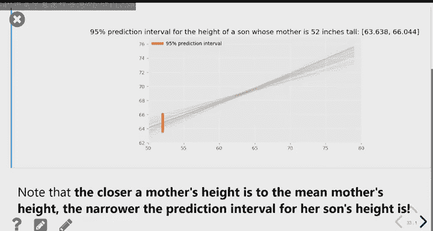

# UCSD《数据科学原理 (DSC 10 Principles of Data Science Fall 2024)》中英字幕（deepseek - P27：DSC 10 - Principles of Data Science - LE -A00- - Lecture 27.zh_en - GPT中英字幕课程资源 - BV1hmAneGEZh

あ。All right， good morning。Before I forget， come get your midterm sheet after class if you still need it。

 I have all the notes sheets up here。😊，Today's Monday， so there's our last discussion。

We have the final project due tomorrow， you can still use slip days if you need to。

There's a policy for what we do if you overuse your slip days。

 so basically like since the final project is at the end， but it's worth the most。

 it would be really tragic if you got a zero on that so we reallocate your slip day so that they help you the most on the most important things and then you would take some slip day credit away from like a lab or something so the syllabus describes exactly how that's done if you're considering doing that make sure it makes sense。

嗯。In addition to submitting the notebook， make sure you're also submitting the PDF file because we'll need that to grade some of the plots。

Okay and then our final assignment is labb7 which is due Thursday。

 this is our only assignment about regression， so even if you don't need the lab for your grade because maybe you got 100% on all the other labs。

 it's still a good idea to do that lab， you don't have to necessarily turn it in you don't have do it by Thursday。

 but it'll give you some practice on regression which is going to be tested on the final。Okay。

 any question about any of these things？We're also getting towards the end of the quarter。

 it's the last week our final exam is Saturday， so we have like the exam right after classes end。

 classes end Friday and the exam is Saturday， I posted an announcement yesterday with more details。

And it's also time for end of quarter surveys， so sets are like the campuswide evaluations of teaching which are important for things like hiring。

 but we also have an internal survey which asks more detailed questions about your experiences in this class so this is your chance to earn a participation point by filling those out even if you don't need the participation point we still want to get as many people as possible to fill those out so we can you know learn how to improve the class in the future so please fill it out。

😊，At some point， it's due 8 am Saturday because that's when final exams starts。

 so they want all the evaluations in before then。Do the project before you do the survey not only because you should prioritize the project。

 but because the survey will ask you about your experiences with the final project。

And today is our last day of learning new material， which is really exciting。

 the next two lectures we're going to do review。😊，So on Wednesday's class。

 we'll take up the midterm from spring quarter or the final exam from spring Qua。

 so I put a PDF of the exam here so you can actually like take it as if you were a student。

 I recommend trying to print it out and just do it for three hours in a quiet room。

And then we'll go over the solutions on Wednesday。Okay， any questions on any of this？All right。

 so we're going to continue talking about regression and we're going to learn about residuals and we're going to learn about how regression relates to statistical inference。

Okay， so what we learned last time basically， is that the regression line is the best line。

So the regression line was defined by these formulas for the slope and intercept。U。

And we saw that this particular line minimizes the root mean square error among all possible lines。

 So if you think of any which way of like putting a line on the plane。

The one that has the smallest root mean square error is this one。

 this line okay and root mean square error was a way of measuring like how well the line fit the data or actually how poorly the line fit the data because a bigger root mean square error would mean the line was very off from a lot of the data points and a smaller root mean square error meant the line was very close to the data Okay。

 so minimizing the root mean square error is good。This is saying this is the best line for our data。

 no matter what our data looks like， there's no better line。Okay。

 so the regression line has many names that all'll sort of talk about this same idea。

 it's the best fitting line， it's the least squares line。

 the least squares is about this minimizing the root mean square error。

 and we also know it has the regression line which was Galton's terminology。

So the regression line is really important and special。😊。

Because it describes the best line for any given data set。 Okay， and you can use the regression line。

 like you can plug。You can plug the numbers into this formula no matter what your data looks like。

 like you can calculate a regression line for any data set。Okay， however， the。

 the line that you get is only going to be meaningful for making predictions if the relationship between the variables is actually linear。

 Okay， so you can always find a regression line， but it doesn't always make sense to use the regression line for making predictions。

 Okay， so here's an example。This is a bunch of nonlinear data。Okay， and if you plug the。

The standard deviations and means of this and the correlation into the formulas for the slope and intercept。

 you'll find that the slope is 0。14 and the intercept is 13。1。Okay。

So this is saying the best fitting line for this data is the one shown here in orange。

 But you look at the picture and you're like， well， that's not a very good line to describe the data。

But the idea is， it's better than any other line， right。

 whatever other line you want to put is gonna be worse。 Okay。

 but all the lines are bad because the data is just not linear at all。

 Like you shouldn't be using a line to， to make predictions on this data that you should probably be using like a。

Pabboot or something。系。So being the best line doesn't。

ItDoesn't always mean that you're going to use it for prediction。

We mentioned last time when we were calculating the root mean square error， what error is。

 error is like how off your prediction is from the actual data value。

 error has a to it because we calculate subtraction in a specific order。

 so we do the actual y value minus the predicted y value。Okay。

 which only way like to think of this is。You have some wine。You have， maybe the line is meant to。

Describe some data， the error。Is the actual y value like however tall this point is minus the predicted y value for the same x would be however tall the y is at that same x Okay。

 so would this would come out to a positive error。This point right here would have a positive error。

 whereas like this point over here。Would have a negative error。

Because the actual y value is smaller than the predicted y value。

 okay the point falls below the line。And the idea of root mean square error was we were like trying to come up with like a number that sort of generally captures how big these errors are while avoiding cancellation。

Okay， so any set of prediction has errors， this line can be any line doesn't have to be the regression line。

But when the line is the regression line， we call those errors by a special name。

 we call them residuals。So residuals are just errors when the prediction comes from the regression line in particular。

And just like there's one error for each data point， there's one residual for each data point。

Okay so heres some of this in code。How do you make a prediction， right？

 So this takes in a data frame。And two columns of data， X and Y from that data frame。

 and first it calculates the slope of the regression line between those variables。

 then it calculates the intercept of the regression line so this uses formulas that we've defined previously。

Then what does this function do， it takes all the x values。😊。

An entire columns worth of x values multiplies them by M and adds B。

So what that's doing is for every data point， it's calculating the predicted y for a point with that x。

 so it's like where， what point on the line goes with that x value。And the residual is like， well。

 what's the actual y value for each data point minus where I predicted the y value to be。Okay。

So the residual function tells you the residual for every single data point in the， in the data。Okay。

So let's try exploring this on the mother son example。Well。

 our question was predicting a son's height from his mother's height。And the first question。

 like when you're doing any sort of prediction is like， is there an association。

 is that association linear， is it a strong linear association。

 and that's what the correlation coefficient tells us， right？😊。

But it doesn't tell us whether linear is the best description of the association between the variables right even things with like a relatively strong correlation coefficient still might have a slight curve to it and it might be better to use something else。

 okay， residuals are going to help us sort of answer the question of whether linear is like the best description。

😊，Okay， so。This is the regression line。Between moms heights and son's heights， the slope is 0。

37 and the intercept is 45。8， don't be fooled by these plots like it kind of looks like the intercept should be around like 65 or something but we're already like way shifted over to 58 like this is not the origin。

 basically okay。So this is our regression line and the residuals are shown in purple right so the ones that are above the line are positive residuals or positive errors and the ones that are below the line are negative residuals or negative errors。

😊，So there's an idea of a plot that kind of shows you just how the residuals come out called a residual plot and it's a scatter plot where you have the same X as you had before on the X axis。

 but instead of plotting like the y like the sun's height。

 we're just going to plot the residuals on the y axis so on the height is going to tell me basically how off was my prediction from the actual value。

So let's look。At the residual plot。And I'm using the color purple to highlight。

That this plot shows the same thing。As this plot， okay， see how there were purple lines。

Like this purple line， how long would you estimate this line to be， it's maybe 67 to 72。

Was that fiveish？Okay， so this blue point had a residual of five。In the residual plot。It's here。

There it is。 right， it's， its height And the Y axis is 5 because that's the residual。

 So it's not saying like what the actual sun's height is and how tall we predict we predicted him to be。

 It's just saying this child was 5 inches taller than we thought he would be。Basically。

Does that make sense？And this child was in shorter than we thought he would be。

And this child was very tall， 10 inches taller than we thought he would。Okay。

So the idea of looking at a residual plot is it helps you identify like how well the line fits the data。

 how well a regression line fits the data and the regression line we know is the best line。

 So if the regression line is not good， then no other line is good Okay and what are we looking for here。

We're looking for kind of nothing like a patternless situation。RightThat's kind of what I see here。

 There's a lot of positive residuals。 There's a lot of negative residuals， right。

 I'm sort of like that saying my prediction kind of falls right in the middle。

 of actual people's heights。What would it mean if all the residuals were positive？It I mean。

The actual value minus the predicted value was always a positive number。

 The actual value was always higher than what I predicted， right。

 That means mine line's not very good because I， if I had just moved it up a little。

 it would have been better， right， Or if the， if the residuals are always negative。

 that would mean I should have moved it down。 or what if like。What if over here I had？

A bunch of positive residuals， and over here I had a bunch of negative residuals what would that tell me about the original data and how well my line fits it？

Yeah， so like， how would this sort of thing happen if I had data where like。

My felt this is saying my line falls below it。Right。And this is saying my line falls above it。

Right so it probably should have been。More angled or more curved or something。So basically。

 if you see some pattern in the residual plot， it's like some systematic way in which your predictions are wrong。

 And that means there's a better way of making predictions。Does that make sense。

So that's kind of why you're looking for a patternless cloud。

 okay with about half the residuals being positive and about half the residuals being negative。

Let me show you one where we have a nonlinear association and see how the plot then starts to show a pattern。

 So this was the hybrid cars data。😊，And we're trying to predict。Price based on miles per gallon。Okay。

 so this is the regression line。It's not horrible， right？For a line， it's as good as you can get。

 but it would certainly be better。To do something like that， right？And how is this reflected？

In the residual plot。Okay。The idea is basically。The residuals are largely positive。For small numbers。

 at least。Largely negative for like moderate numbers and then largely positive for big numbers。

So that's saying it would have been better if my regression line was higher on the left and lower in the middle and higher on the right。

 basically。And that's exactly what we said it should do， right。

 It should have gone up more on the left。 It should have gone down more in the middle。

 and it should have gone up more on the right。 Okay， so the residual plot kind of shows you that。

The residual plot not like groundbreaking， I mean， it doesn't show you anything different than what the original plot showed you。

 right， but it's just showing you in a different way。Okay。

 so this is a pattern because the residuals go from being mostly large to mostly small to mostly large。

so when you see a pattern in the residual plot， that usually means that the relationship between the variables isn't linear。

 you can see it in the original scatter plot， but sometimes it's easier to identify in the residual plot。

 so it's good to look at both means a curve might be a better choice。😊，In this class。

 we learned about linear regression， fitting a line to data。

 if you take DSC 4DA and other data science classes， you'll learn that actually like the whole。

Like concept of linear regression can be extended pretty naturally to polynomial regression。

 like you can fit a quadratic or a cubic or other families of functions to your data without a lot of additional effort which is really nice。

 that's part of why linear regressionion is so important is because it's not really just for lines。

 you can use it for other kinds of curves as well。Okay， here's another pair of variables。

 miles per gallon， and acceleration。Okay。So this is the best fitting line for the data。

 this is the regression line。Let's see what the residual plot looks like。Okay。

 if you look at the residual plot， notice that like the residuals kind of。

Fall in like this cone or triangle shape。And what that's saying basically is that there's more variation in the y values of the original data than there was on the left than there is on the right。

 basically。Look at the miles per gallon for slow accelerating cars， right。

 they're all over the place， right， but miles per gallon for fast accelerating cars。

 they're all like very， very bad。So there's a lot of variety on the left of this picture。

 but there's not a lot of variety on the right of this picture and that's reflected in the regression plot。

😊，This issue is called uneven vertical spread or a fancy name for it is a heterocaasticity， hetero。

 meaning like different sastic means having to do with spread。

 so it's like differently spread on the left side and the right side and basically it doesn't mean that fitting a line is bad。

it's not necessarily better to do something like this or something like that。

Its it's not really that a line is bad it's just an issue with the data right like any prediction that you make like is's going to predict a single value。

 a single miles per gallon for an acceleration of nine right like you could predict way up here。

 you could predict here you could predict here like anywhere along that you can only pick one point right where's a good point to pick well I think the regression line picked a pretty good one it's kind of in the middle right so like at any point the regression line is kind of like in the middle of the values。

So the regression line is pretty good。It's just that。

By sort of any function has only one y for a single x， right。

 And there's just so much variety in the Y' for the same x。

 So like any function you fit is going to have this problem that there's just a ton of variety in the。

 in the small values of acceleration。And not as much variety in the large values of acceleration。

 Okay， so when you see this heterocaasticity or uneven spread， it doesn't mean that a line is bad。

 but it does mean something in terms of how you interpret your results。

 It means your predictions for like the miles per gallon of a slow accelerating car are likely to be more wrong。

 more off than your predictions for the miles per gallon of a fast accelerating car。 Like， if I。

 I tell you， I'm guessing that car with accelerating of 19。Has a miles per gallon of 25。Okay。

 then like， I might be off by 5。Miles per gallon， but probably not by much more than that。

 whereasas if I tell you that I think a car with acceleration of 9 has a miles per gallon of 40。

 Well， I could be off by like 30 in either direction。 Okay。

 so my prediction is sort of less reliable。Because there's so much variety in the data。

Does that make sense？Okay， so I want to emphasize this isn't anything you can fix or change， right。

 This is just a。How the data is and you're doing your best with data that has a lot of variety。

 right？Any questions on that？Okay。Check out。These four data sets。

They all look very different in terms of their shape， right？

But the blue line shown on each of the pictures is the regression line for each of the data sets。

 and the regression line is exactly the same。So this is a sort of famous set of four data sets。

 a quartet called Ancombe's quartet， and it's designed to illustrate how different looking data sets can have the same regression line。

And basically， the point， of this quartet is that。Yeah is that like the correlation coefficient and the means and the standard deviations like don't really tell you like no numerical thing really tells you like whether it's appropriate to fit a line to your data right like in the top left picture。

 this is like the ideal scenario where you would want to fit a line to your data and this regression line sort of make sense for that data set in the top right picture like this is clearly a bad idea to fit a line to your data right you should be fitting some some parabola。

 probably upside down parabola and in three and four the bottom two。

Well it's not horrible to fit a line to your data set。

 but there's this one outlier here that's like really sort of messing up your predictions。

 it might be better to omit it if you wanted to make solid predictions。

 and then this one on the right has an interesting issue where almost all of the x's are at 8 and there's1 x at 18。

And this one x at 18 like totally controls the data set Like if you had moved this x18 down to like y equals 4。

 like moved it down to here， the line would be totally different right so this one point has like a lot of pull。

Basically because it's an outlier kind of like here， outliers have a big impact on regression lines。

Okay， so all of these data sets， how do they wind up having the same regression line。

 It's because they had the same。5 quantities here， average x average y， SD D of x， Sd of y。

 the means and the SDs that's4， and the correlation that's5。

 those five things are the things you need in the formulas for slope and intercept。

 so any data sets with those same five things are going to have the same regression line and despite having all these same values。

 it doesn't mean that a line is equally appropriate for all of them。

 this is another picture that says the same thing。嗯。Here's a data set of X and Y values。

The correlation between them is very small， right， negative 0。06， like they're pretty uncorrelated。

The slope of the regression line is therefore also close to zero， it's like a pretty flat line。

The intercept is 53。This is what the data looks like。You can see why we called it Dno。哎。

This this data is not particularly well suited for linear regression because it doesn't follow like a line shape。

应该。And this comes from like a paper where they defined a data set called the dinoa what are they call dataaurus doesn't？

And it was like a dozen different data sets that all had the same。5 quantities。

 the same five values here as this dinosaur。 And the idea was basically like you can just like move the points using a certain procedure to follow like a certain shape in a way that preserves all five of these quantities。

 So they had some procedure by which like they gave it。

 say like a random smattering of points like the one on the left。

 and they gave it some underlying like shape of a star。

 And they said like move the points towards the star shape in a way that preserves the mean standard deviation and correlation coefficient。

 And they figured out a way to do that。 So like you can pretty clearly see like what underlying shapes they used right。

 This was an oval。 This was like a ring。 This was an X。

 was this was a grid right and and all of these have the same。😊。

F quantities so they have the same regression line。

 so this tells the same story as the ancombe's quartet that you can't just look at the numbers and decide based on the numbers。

 whether it's a good idea to do linear regression， you have to actually visualize so you have to look at a scatter plot and say does it look linear after you make a regression line。

 look at the residual plot， look for patterns。Okay， any questions on any of that？Okay。

 what we're going to do next is see how regression connects to all the statistical inference stuff that we did in the earlier part of the second half of the class。

Okay， so here's another way to think about regression。

 What we're really doing is collecting a sample of data from a population。

Right like we have a data set of hybrid cars that's not every hybrid car。

 We have a data set of mother and son Hes， that's not every mother and son pair that ever existed right so the data that we have is like a sample of data that you know comes from some larger population。

 we could have had different data， maybe。And when we fit a regression line。

 we use the data in our sample right to determine the slope and intercept of that regression line。

 and then we use the regression line from that was generated from the data in our sample to make predictions about data outside of our sample。

 right the whole point of like Galton collecting this data and generating his regression line was so that he could predict for other mothers how tall their adult son would be。

嗯。And this begs a question， right like anything that involves a sample of data。 Well。

 what if we had used a different sample， right， We talked about this a lot with like sample means。

 right one sample's mean is probably different than another sample mean right How different can they be。

 We ask these kind of questions。So we're going to ask the same question here， right， Like。

 what if you had had a different set of mother and son heights。You know。

 instead of measuring these families， he measured those families right and you had made a regression line from the other sample right how similar would your regression line be in terms of its slope and its intercept to the original regression line based on your first sample so how much do your results vary when you take different samples？

Okay， so here's a concept check question， this is a really good review for the final because it incorporates like a lot of different things we've done and big picture ideas。

What's the right strategy that helps us answer the question of like how your predictions would have been different if you'd used a different sample？

Okay， make sure to give your answer。I'm going to check。Okay， good， most people are saying bootstping。

Which is correct。嗯。How did we use bootstrapping before right we used bootstrapping in the situation where like you had a sample and you understood like how some statistic came out for that sample。

 maybe the sample mean or the sample median and you wanted to know like how would other sample means or other sample medians come out if I had had more samples。

 but you can't just like go get more samples so bootstrapping was a way of like pretending you had other samples from the population。

Okay， so bootstrapping is essentially about like， here's one sample。

 how would my results have been different if they had been based on a different sample。

 which is the same question we're asking here。嗯。Hypothesis testing and permutation testing don't really apply because these are about answering like yes。

 no questions。And this isn't really a yes， no question。 This is more of like a。A great question。

 like how different would our predictions have been。

 like what are other ways that predictions would have come out？

The central limit theorem also doesn't exactly apply because that's about a way for estimating sample means right so like bootstrapping and central limit theorem are connected in the situation where the statistic you're estimating is a sample mean right but here the thing I'm using my sample to estimate is the slope and the intercept of a regression line which isn't a sample mean。

Okay， any questions on why any of those are right or not right？Okay。

So basically what we want is we want to come up with instead of just like a single value for prediction right we want like a range of reasonable values。

 this is kind of like what we did with bootstrapping。

 the goal of bootstrapping was to get like a confidence interval or a range of estimates for some particular parameter。

😊，And instead of just like using our samples statistic as our single guess。

 now we're going to give a whole range of values。So we're going apply like the same logic here and the strategy is we have our sample。

 let's say of motherson heights， we're going to bootstrap that sample。

 What does that mean It means we're going like take all the mother son pairs in our data frame and like resample from that data frame with replacement so that we have as many mother son pairs as we started with okay so resampling with replacement that's how bootstrapping works and basically it's saying some mother son pairs are going to get duplicated and others are going to get omitted。

Then we're going to calculate the slope and intercept for this bootstpped sample。

 which maybe has duplications and maybe has omissions。

And we're going to do that lots of times to get lots of slopes and intercepts or lots of regression lines。

Okay and then if you want to see like how your predicted height for a son of a mother of height x would come out。

 okay instead of just plug what we used to do is basically plug in our given x into y equals MX plus B that we just got for our original sample right now we have like many Ms and many Bs。

 we're going to plug our x into y equals Mx plus B for all the different M pairs so we basically generate lots of predictions and take the middle 95% of those predictions。

When you do this process， the interval that you get is called the prediction interval。

 and it's basically like a confidence interval for the predicted Y that goes with a given X。😊，Okay。

 so let's try it out。Here's a resample。Mom's son was my data frame。It had 481 mother son pairs。

When I sample from this data frame。嗯。I'm sampling 481 rows of the data frame。With replacement。Okay。

 so my result still has 481 rows， it just that some of these rows may correspond to the same mother sun pairs and other original ones that were in my data set may not be there anymore。

Okay， and then。If I look at how。The the mothers son pairs look on a scatter plot。

 it might look like this。And then I'm fitting a regression line to this scatter plot。

I don't know if you're a remember before but the original data。Let me go back and find it。Yeah。

 this was the original mother sun pairs at a height of 58。When the mom was 58 in tall。

 I had like four son's heights， I had four different families that corresponded to a mom that was 58 inches tall。

 okay？But in my resample。I actually only have one family that corresponds to a mom that was 58 inches tall。

 so most of those other families just by chance happened to not be in my resamp。Okay。

 you see why some points are darker than others on this picture， can you explain why？Yeah。

 it's like some families I got multiple times， so the dot appears darker because it like multiple on top of each other right and other times I got just once。

 so the overlap is like the families that I got multiple times。Okay， let's go back to this view。

And I don't know if you remember the numbers from before， but our slope used to be like 0。37。

Now our slope is 055， okay， because it's a different set of people。So this like， makes you wonder。

 like， how different could the slopes have been。 If I did this for lots of res。

 what kind of numbers am I going to see here，  Similarlyly with the intercepts。

 I forget what the intercept was before， but it wasn't exactly this， right。

 How different can the intercepts be。And if you want to think about making predictions。

 let's say you're going to predict the， the height of a sun。Born to a mom who's 68 inches tall。

 right， This regression line for this data set puts me through the point 68， I don't know。

71 and a half or something。 But my other regression line might have put me through the point，6872。

So there's going to be different predictions based on different regression lines。

 even for the same x value。😊，So the point is do it many times and see like how these slopes and intercepts come out and how the predictions come out。

Okay。So here's the code to do that。This one takes a little while。

 but I want to talk you through what it's doing。So M original and B original。

 This has nothing to do with the bootstrapping。 This is what we used to do in the last few classes right based on the original data that Galton collected。

 what's the slope and intercept of the regression line Okay， so B original and and M origin。

 those are just constants okay and they're based on the real data that Galton collected。All right。

 what am I doing here， I'm making two empty arrays。One to store slopes and one to store intercepts。

 and then I'm going through a loop 5，000 times。And each time I'm basically doing what I showed you。

In this picture。Which is I'm resampling from the original data set of a sample as big as the original with replacement。

And then I'm figuring out the slope and intercept of the regression line for that resample okay so here I was plotting it。

 here I'm not plotting it， but I still am calculating what would the slope of the regression line for that data be。

 what would the intercept of the regression line for that dataset be。

 and then I'm going to store them all store the slopes in the slope array and store the intercepts in the intercepts array。

 does that make sense。Okay， any questions on the code？Okay。Let's see。

Now let's use this data to make predictions right if a mother is 68 inches tall。

 how tall we predict her son to be right what we would do before and before today's lecture with this bootstping stuff would just be。

 well， given Galton's data， we calculated the slope and the intercept of the regression line for that data so you would just plug in 68 into y equals MX plus B and that would give you a guess that the son of a 68 inch tall mother would be 70。

68 inches。Okay， now the whole point of the bootstrapping thing is like how different this interval how different might this number might this prediction have come out if we didn't start with with Galton's sample。

 but we had started with a different sample right， would you wind up predicting this kit to be 80 inches tall or would it always be like 70 point something like how much variety do you get in in your prediction when you have a different sample okay？

嗯。So。Oops。The original slope。Of our data based on Galton's collected data was about 0。37。

What we've just done was look at many different samples。

 many different resamples that kind of represent new samples from the population and let's look at how the slopes of those lines came out Okay。

 sometimes they were close to this number 0。37 like here I got 0。36 here I got 0。37。

 but sometimes they seem like a bit more 0。42。Sometimes they seem a bit less like 0。33。Okay。

 so I got a whole bunch of slopes from different lines。Similarly。

 my original intercept was 45 based on Galton's collected data。

But I just looked at lots of resamples and calculated the intercepts for all of those。

And those also sometimes came out lower than the original and sometimes came out higher than the original。

And something that's really important is that this first slope。Goes with this first intercept。

 the way I generated the slopes and intercepts array。Was one at a time， right， I took a resample。

I calculated a slope and intercept based on that resample。

And then I appended them one to the boots one to the M boot array and one to the B boot array。 Okay。

 so like the first thing， the first slope goes with the first intercept and that defines a line。

 Similarlyly， the second slope goes with the second intercept and that defines a line， right。

 So really， I've， I've generated。5，000 lines is a way to think about this。

I'm just storing the lines separately the slope from the intercept。Okay。

 so we're going to use the power of。Array broadcasting， array arithmetic。Basically。

 what I want to do to predict how tall a 68 inch mom's son would be is I want to plug 68 times one of these slopes。

Plus， the corresponding intercept。same for the next line。

68 times this slope plus the corresponding intercept right。

 And by like the power of array arithmetic， I can just multiply this entire。Aray of slopes by 68。

RightAnd then I can add the entire array of intercepts， and that's going to do exactly what we want。

 right， It's plugging 68 into each of the lines y equals M X plus B defined by these two arrays。

 Does that make sense。Okay， so now I'm going to get 5，000 predictions。Based on the first line。

The first resample， I would have guessed that the sun is going to be 70。

53 inches tall right based on the next line， I would have guessed that the sun is going to be 70。

98 inches tall and so on。 So I have 5000 predictions。

And what I'm going to do is similar to what we did for confidence intervals。

 like ignore the extremes and look at kind of how do these numbers typically turn out by taking the middle 95%。

 so I'll use NP dot percentile for that。😊，And what it's saying is that basically。

 if I had had a different sample， I would have expected my predicted sun's height to be anywhere in the range of 70。

2 to 71。2， so there's like a one inch kind of window that probably is where the prediction would fall。

This is a picture that shows this。This is all the different。

Ways that my predicted son's height came out。And the gold is the middle 95% of those。

Does that make sense。Okay， so we just answered the question of like how different would our prediction have been？

For an input of 68， if the mom was 68 inches tall， I've addressed the question of like how tall might her son be by various different predictions。

You could do the same thing for a different height。

 like if your mom's 58 and just all plug in 58 instead of 68， you'll get a different interval。

 probably be a lot smaller numbers。This is a picture that's really cool。And it shows you the variety。

Of your predictions。For various different x's， kind of all at the same time。Okay。

 so this picture shows several of the lines。Not all of them， because I got 5000 of them。

 but it shows you many of the lines that I got through bootstrapping。

 So these are all like different regression lines for slightly different data sets。 Okay。

 but what do you notice about this picture and how the lines look。Like。

 what stands out to you about this picture？Yeah， it's like tight or thin here。

I always think of this as like you're holding a fistful of spaghetti right in the center where your hand is right it's really tight and like then it just ss out in different directions。

Okay。What's special about this point in the middle。

 why the lines are all kind of going through there？Yes。

Remember a thing about the regression line is that it goes through the point average x average y。

 right？Now， all these lines don't exactly go through the same point。

 They're not exactly all crossing the same point， and that's because the resamples are going to have slightly different averages than the original。

Right。This is like a twodimenal version of like sample means right when you take resamples right there's going to be a little variety in the means。

 but it should be pretty similar right so they're all going to go through some point that corresponds to the average x for their resample and the average y for their resample and all of those points are pretty darn close to one to one another so all the lines are sort of constrained by going through not a single point but like a number of points very close to the average x average y。

😊，And then after that， any slight difference in the slope becomes more obvious。

As you get further away。Like this purple line on top and the green line at the bottom。

 you can't tell much of a difference in the middle between those lines， but as you go away。

 the slight difference in angle becomes more apparent。Does that make sense？

And what this is saying is that the predictions vary more。😊。

You'd use all of these lines to make a prediction your prediction would vary more for a really tall mom or a really short mom than it would for like an average mom so in terms of like the prediction interval。

 the range of guesses， the range of guesses will be wider when you're further away from the mean。

This is a really cool。Slider。That allows you to play。With this， so what we did。

And try to get this to 68。Not 69， 68。What we did in code was we plugged in the number 68 to all the regression lines y equals MX plus B。

 right and we got a range of predicted sunheights that went from like 70。2 to 71。2。Okay。

 that little orange block there is showing this。 It's showing that。When。When the x is 68。Right。

We came up with an interval for the predicted sun's height that went from 70。2 to 71。

2 that interval like represents sort of like the span of the regression lines and it's basically it's saying like we're not taking all of the regression lines。

 but we're cutting off like the tallest the top 5% of regression lines and the bottom 5% of regression lines right the middle 95% of regression lines had predictions between 7。

2 and 71。2 Does that make sense。But if you were to change。This number to an even bigger number。

Look at the range now。If I mean， this is kind of ridiculous， but 78 inches tall， right。

 the the range would be from 72。8 to 75。8 right， This is a 3 inch range。

Or a three inch prediction interval。Versus a one inch interval。

And this spaghetti picture kind of shows you why that's the case。

 right the closer you are to the mean。The less variety there is in different regression lines。

 so the predictions are all going to come out around the same。

 and the further you are from the mean in either direction， left or right， the more variety there is。

😊，Does that make sense？Okay， so the。The takeaway。Is the closer the mother's height is to the average of mother's height。

 the narrower her prediction interval is， and that kind of makes sense because like average height people are like people we understand very well because we have a lot of instances of them so we can make good predictions right and extreme ones not so much。

Okay， that's it， feel free to grab your reference sheet up here if you didn't get that yet。

