# UCSD《数据科学原理 (DSC 10 Principles of Data Science Fall 2024)》中英字幕（deepseek - P28：DSC 10 - Principles of Data Science - LE -A00- - Lecture 28.zh_en - GPT中英字幕课程资源 - BV1hmAneGEZh

嗯。All right， good morning everyone。We're gearing up for the final on Saturday which is Saturday 1130 we still don't know the room I got to look up that and let you guys know。

 but we're going to go over the final exam from spring Qua which was the last time I taught the class so I was curious like how many of you attempted the problems or at least some of the problems before today。

Okay， some have some haven't I was going to start with like if people had specific problems they wanted to go over。

 I'll go over those and otherwise I'll just pick ones that I want to go over so questions on specific problems let me know which question numbers。

😊，3。2。Okay。Other ones you want to go over。Take a minute to look through it。If you haven't。

 start by reading the data description here。I'll walk you through it if you haven't read it and if you have just take the time now to look for which questions were tricky the idea is it's a data set of apartments available for rent。

 the data frame is called APS for apartments and the index is some unique identifier called apartment ID so like each individual apartment has its own apartment ID and then the information we have is rent in dollars。

 how many bedrooms， how many bathrooms， Boolean whether or not it has laundry in in the apartment itself。

 square footage is an integer， neighborhood is a string， so some category。

 complex is which apartment complex， also categorical and then lease term is how long of a lease it is either one month。

 six months or a year。So they just show you as usual。

 they show you a few rows of the data set but they don't show you all of them。

 they do tell you that there are 800 total rows， some exams tell you the total。

 others just say there's a lot without specifying an exact number and so think of the data we have as a sample from the larger population of all apartments。

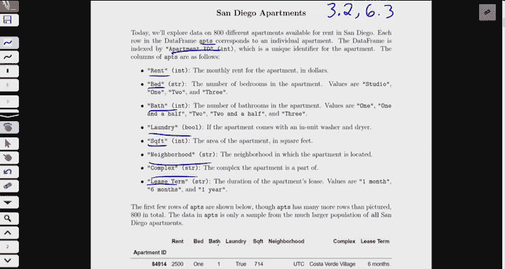

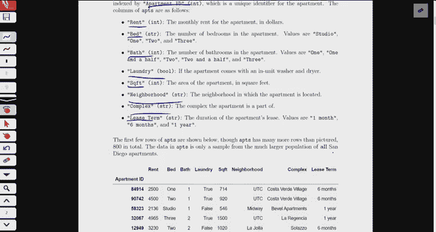

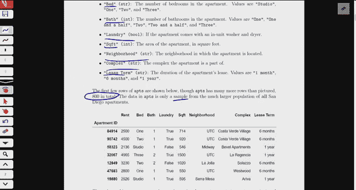

Okay。So this is an example of what it looks like。Okay。

 other particular questions people want to go over？

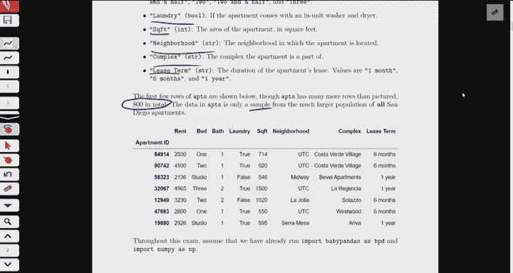

12。5。Anything else？

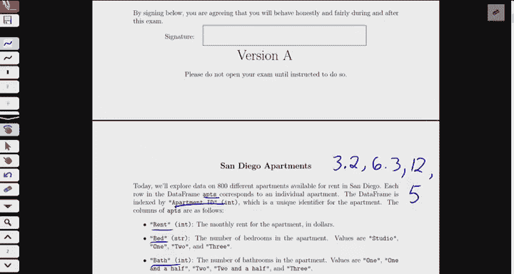

Okay， so three， five， six，12。

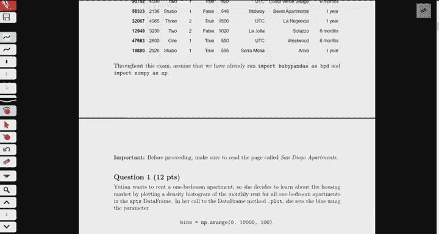

E5。

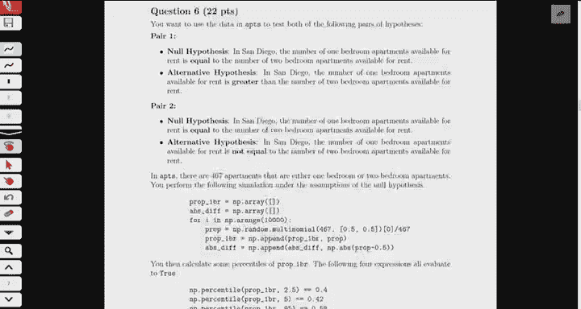

。I'm just taking look。错了。😔，Okay。

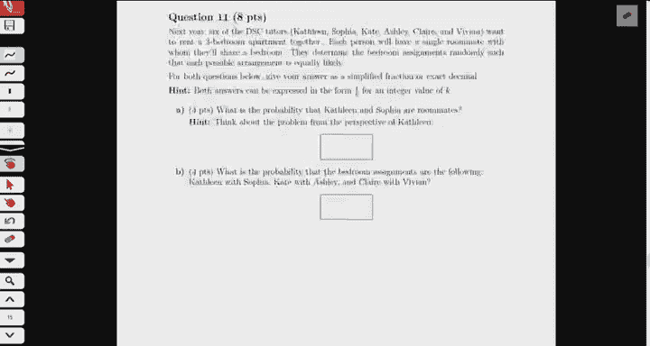

You guys did a pretty good job of identifying the hard ones。

All the solutions are posted on the practice site， so it's good to focus on like the harder ones here Let's start with question three。

😊。

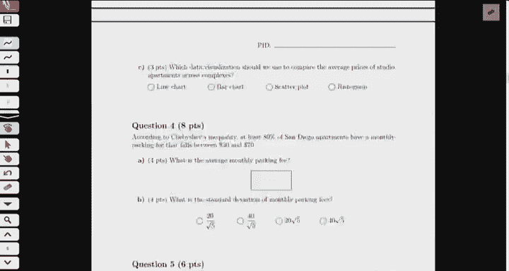

3。2 or 3B was the particularly hard one， but let's do them both because they're related。

So the question is comparing the average rent for studio apartments in different complexes。

 okay so like if you live in Renaissance versus if you live in So Laso what's the average price for a studio apartment？

Our goal is to create a data frame called Studio average where each complex with studio apartments appears once that already suggests right we're going to do some grouping right you're going to want like all the studio apartments for the same complex to go together。

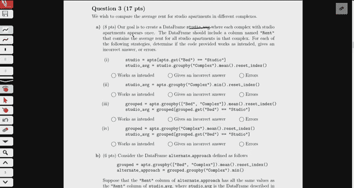

And。There should be a column called rent that has the average rent for all studio apartments in that complex okay so you can't just directly group by complex because then you're going to average like all the apartments of that complex。

 not just studio apartments so the code that they're giving you is first filter or query to just get the studio apartments and then once you have the studio apartments。

 organize those according to complex and take the mean。Re index just changes the index。

It's not super important。Okay。So they're giving you like a bunch of potential solutions and you have to decide whether the code works as intended。

 gives an incorrect answer or just doesn't work at all errors Okay。

 so the first one is kind of the the canonical solution like how most people would solve this problem keep just the。

Keep just the studio apartments， organize them by complex， and take the mean within each complex。

 like that's exactly what the question wanted。嗯。The second one is。

Grouping the apartments by complex and taking the smallest。Okay。

 so that's saying like all all the apartments at Co of Verde。

 what's what's the rent of the apartment with the smallest rent。

I what you would get next to Coa Verde and if that's not necessarily the same as the average rent for all apartments in the complex。

 it might be the case that a studio is the cheapest。

 but even so it's just that's just a single studio's rent。

 not the average of all the studios and we also can't assume that the studio is cheaper than others。

Okay， so this one would would give you like， it would give you a data frame like the code would run。

 but it wouldn't have the right numbers in it that we want。Does that make sense？What about。Three。

 okay here I'm grouping by two things grouping by bed and complex so whenever I see group by with like multiple arguments I try to think of like what does each row represent So each row is gonna to be a combination of bed and complex so something like so lots of studios is gonna to have its own row so lots of one bedrooms is gonna to have another row so lots of two bedrooms is gonna to have another row Cota verde studio is going have a row Coa verde one bedroom is going have another row right so each complex is going to be there multiple times once for each type of apartment in that complex。

嗯。And what we're doing after that。Is only keeping the ones corresponding to studios。 Okay。

 so that works It kind of。Gives you like more information than you asked for。

 It's not just the average studio rent at each complex。

 it's also the average one bedroom rent at each complex and the average two bedroom rent at each complex。

 But then we're keeping only the studio ones。 So we get the same result。 So that one works as well。

 Does that make sense。I should fill these in how I want you to fill them in on the test， which is。

Completely bubble them in。 Okay， that helps the auto grader for the。The auto grade， greater work。

Okay。How about the last one？Organize them by complex。And take the mean。Okay。

 so this is saying like this would tell you like among all the coast of Verde apartments。

 what's average right what's the average rent， among all the Soazzo apartments。

 what's the average rent。And then I would be querying for studio。

 but the problem is there is no column called bed after you group by complex and take the mean because remember dot mean only works for numerical columns and bed was something about with strings in it right so after you group by complex and take the mean。

 the bed column won't be there anymore because it didn't make sense to average a bunch of strings and so you can't even query for bed equal studio at that point So this one's gonna to error。

Does that make sense？Okay， any questions on those？Okay， the harder part here。

Was consider the data frame alternate approach defined as follows。

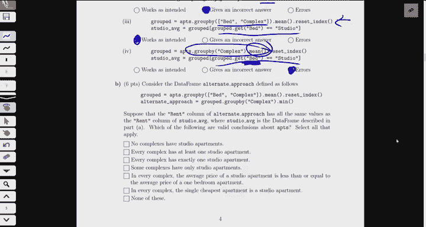

Grouped is the result of grouping by both bed and complex and taking the mean。

And resetting the index， that's like what I did before。Right。

 so this has a row for each combination of bed and complex like。Coasttavert a studio。

Coast a Verde one bedroom， coast a Verde two bedroom， etc。That's what the rows represent。

Then I'm going to take that data frame and organize them by complex and take them min。

 so after I have this data frame like all the coast of verde rows are going to go together right into a single coast of verde row and I'm just going to take the smallest。

Of， of these averages。That I already calculated， right。

 I already calculated the average rent for all Coasta verde studios。

 the average rent for all Coa verde1 bedrooms and so on。 Okay。

 so they're telling you that if you do it this way， like， suppose you do it this alternative way。

 and the rent column contains exactly the same stuff that you you did before。In the previous part。

 what is that telling you about the apartments？Okay。嗯。Look at the answer choices。The first four。

Answer choices say nothing about like the rents themselves。

 they say something about which complexes have studio apartments， basically Okay。

 so these kind of like go together。And the other two。Kind of go together in my mind。

 because theyre more about like the prices of the actual apartments。 Okay。

 and this answer choice is basically like exactly what it means for these things to be the same。

 Like what we did in the first way was。We。Well， let's look at option three here because this was one that we said worked。

 We organized by bed and complex and we took the mean that's exactly the same thing I'm doing here。

 right， But then I just directly took all the studio rows。 Okay。

 so whatever number went with the average rent for Coa verde studio， that was my answer。Here。

 what I'm doing is taking the smallest of these。So basically in order for these to be the same。

 what I'm saying is that the average price of a studio is the smallest。

 less than or equal to the average price of any other type of bedroom。Does that make sense？

So like the studios are the cheapest at that complex is what it means， cheaper than one bedrooms。

 cheaper than two bedrooms， cheaper than anything else。Okay， does that one make sense。

 why that one's true？Okay。Let's look at the one after it。In every complex。

 the single cheapest apartment is a studio apartment okay this doesn't have to be true because this is talking about averages across like all apartments of the same type。

 so it is true that like on average studios are cheaper than one bedrooms but it may be the case that there's like a really junky one bedroom that's just really cheap for some reason even though in general one bedrooms on average costs more than studios because it's averaging across all the apartments you can't say anything about the individual numbers that contributed to that out。

Okay， so that's not。Not one。Okay， what about the others， The others are about。

Which complexes have studio apartments， so the first one says none of them do。

 the second one says every complex has at least one studio apartment。

 every complex has exactly one studio apartment， and some complexes have only studio apartments。

Okay and the key thing here。Is that。In part A， they said we wanted to create a data framework。

Each complex with studio apartments appears once。 Okay， so like our strategy for， for part A。

Only includes complexes that even offer studio apartments。

 like if the complex doesn't offer a studio apartment。

 it's not going to be included in the data frame。And you can see that by like option one。

 right the first thing we do is only keep the ones that our studio apartments。

 So if your complex has none， then you're already eliminated。Okay。

So the data frame from part A has things that have studio apartments in them， and in part B。

We're taking a different approach。 We're like。Organizing by bed and complex。

 so imagine there was a complex that didn't offer studio apartments。

 what'ss another apartment complex， La Scala right？Let's say La Sca doesn't offer studio。Right。

Let's say Las sclog just offers one bedroom and two bedroom right so if you group by bed and complex。

 you're going to have these two rows。With some associated wrench。

 we're just going to make up numbers 5 and7。And。Then when I group by complex and take them in。Right。

That's the second line of code。 I would get something that says La sca 5。So basically。

 La scala would be。In this data frame from Part B。Even if it doesn't have studios， right。

 So like every complex appears here， whether or not it has studios。 Do you agree with that。

And whereas the first part， the only complexes that appear there are the ones that actually have studios。

 So if we're saying that， like these data frames are the same。

 then that saying every complex has to have some studios。

In order for these data frames to have the same set of rows。Oh yeah， I click the wrong one。

 thank you。Some， some studios， right， We don't know how many。 We can't say anything about that。

 but like， there has to be something to。To make it appear in both data frames right yeah。

 we can't say anything about how many so it's not that。The first one， I mean。

 if none of the complexes had studio apartments。This question would be very different and what about the last one。

 some complexes have only studio apartments， that's not necessary right to have only studios。😊。

Takes the mean of all view。Wait， which one？Part A。て。Obviously important to it back。

And the second one takes the minimal。But the teacher were soon。嗯。With a confused wide sl。I， because。

There's one that's say there's two studio parts。If they have the exact same right？

Like why you can't say there's exactly one。Like two different value friends。

So is' it saying that it's possible？But it is right。

 but it is possible that you have like say apart five studio apartments that all go for the same price。

 right， then the mean and the men are the same So because the mean and the men are the same doesn't imply that there had to just be one Yeah。

 yeah， that's exactly why。Okay。Does that answer that question， This was a tricky one。

 I feel like the hardest questions are always the ones where you have to like interpret what it means And this is a classic like interpretation question。

You really have to think about what the code is doing and how to interpret your results。😊，Okay。

 any other questions on this one， three？All right， let's see the other ones that people wanted to look at。

Five， six， and 12， okay。

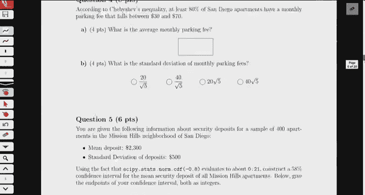

Okay。Five is saying you're given the following information about security deposits for a sample of 400 apartments in the Mission Hills neighborhood of San Diego。

This has nothing to do with the data frame that was given is just a standalone question if you haven't tried this one。

 it's like a short could be like a quiz question， so try it right now okay 400 apartments the mean deposit is 2300。

 the standard deviation of deposits is 500。And then they tell you some fact that the CDF。

The normal distribution CDF of negative 0。8。Evaluates to about 0。21。

And there I want you to use that information to make a 58% confidence interval for the mean security deposit of all such apartments。

Give the endpoints of your confidence interval。So one thing we saw was how to make a 95% confidence interval。

Is you take the sample mean？And you do plus or minus two SDs of the sample mean distribution。

Which is。Sample S。Over the square root of the sample size。Okay。

So an easier question would just be if I ask you for a 95% confidence interval。

 you would use this formula， but it asks you for a 58% confidence interval。😊。

And it gave you this extra information about the CDF， so how are you supposed to use that？😊，嗯哼。😊。

The actual because。一不。いな。Yeah， that's one way to think about it。

 I'm going to think about it a little differently， I think。The， the fact that。

That the CDF of negative 。8 is 21%。 that what you said was that this means 21% of the areas there right which correspondingly means by symmetry。

 right bell curves are symmetric。21% of the areas here right And we were asking for a 58% confidence interval。

 How does 58 relate to this。That's the middle right， so 21 and 21 is 42， 42 and 58 that's 100 Okay。

 so this middle region。Is。50 that's a horrible five。50。Eight%。

Okay so what that's saying is instead of using two in this formula。

 instead of going two standard deviations away to get 95% of the area， we only need to go 0。

8 standard deviations away。To get to get 58% of the area， does that make sense？

So I didn't have to convert from standard units to regular。 I'm just using the fact that within 0。8。

Of the mean， I get 58% of the area。Does that make sense？Basically， what I'm saying is now for a。

I'll just copy this and change this。Change this to be a 58% confidence interval。And instead of two。

I need a point8。Okay。So now you just plug stuff in， and it should be pretty straightforward。Okay。

 let's try plugging in。What's the sample mean 2300？Plus or minus， okay， 0。8。

 I'm going to write that as a fraction four， fifth。What's the sample standard deviation 500？

What's the sample size， 400？So this， I shouldn't box it because that looks like my final answer。

How do we simplify that？2300 plus or minus。嗯。The five and the five canceled， so this is 100。

On top and the square root of 400 is 20。So 100。Did I do this right？No， 400。

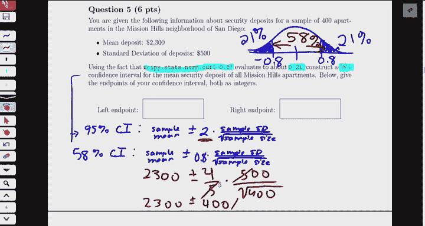

Over 20。2300 plus what's 400 over 20 40 over 2 is 20 so I start at 2300 and I have to go 20 on either side。

 so the right side is going to be  2300 plus 20 and the left side is going to be 2300 minus 20 so 2280。

Does that make sense？So I feel like this is a pretty straightforward question。

 but it is also a question that a lot of people get wrong。Six was the next one， okay。

 this was a pretty challenging question。This was saying you want to use the data in apartments to test both of the following pairs of hypotheses。

The null is that the number of one bedrooms available for rent is equal to the number of two bedrooms available for rent Okay so I'll write that as like。

The number of one bedrooms equals the number of two bedrooms that's the null。

 the alternative is that the number of one bedrooms is greater。

And then the second pair of hypotheses， the null is the same。

Number of one bedrooms equals a number of two bedrooms。But the alternative is the unequal。

So my first question is， what problem in class did we do that had a similar structure？嗯。Yeah。

 you said smoking， you said something with absolute difference， I'm thinking of something else。

The coin， yeah， the coin example we did， we saw like two different pairs of hypotheses。

 one was fair unfair， that's like the second pair， the other one was fair or biased towards heads。

 that's like the first pair okay。So it's getting at the fact that you have to use different test statistics based on whatever your alternative is。

Okay， so they're telling me that there's 467 apartments that are either one bedroom or two bedroom apartments。

 and you perform the following simulation under the assumptions of the null。So I'm making two arrays。

One is going to store the proportion of one bedroom apartments out of one and two bedroom apartments。

The other one is going to store the absolute difference， some sort of absolute difference。 Okay。

 and then some big number， this number doesn't really matter。 It's just a big number 10000 times。

 what am I going to do。I'm gonna。Do N dot random dot multinomial 467 from this distribution。 Okay。

 so this is saying under the assumptions of the null。

 the number of one bedrooms and two bedrooms were equal， right。

 So draw from a distribution that's 50，50 equally likely to be one bedroom or two bedroom。

And just take the first thing。 We'll interpret that as。As the one bedrooms。

 And we'll interpret the second thing as the two bedrooms。 Okay。

 so the first thing is going to be a number like maybe 250 or something going to tell you how many one bedrooms you got out of 4。

67。But if I want it as a proportion， then I have to divide by 467。So that's what that's doing。

 it's going to give you numbers like probably close to 0。

5 because they were drawn from a distribution that was 50% chance of getting a one bedroom。

 does that make sense？So proportion to one bedroom or prop I'm calling it is going to be a number close to 0。

5 and I'm storing that number in an array called Pro 1 BR proportion of one bedrooms okay so that's what what that's doing but also。

At the same time。I'm computing an absolute difference and I'm storing that in an array of absolute differences so what am I doing with the absolute differences I'm saying how far am I from 0。

5 right 0。5 was kind of the expected value of that proportion。

 how far am I a bigger value is going to mean that the proportion of bedrooms was not very close to 0。

5。Okay， you then calculate some percentiles of proportion one bedroom。

The following four expressions all evaluate to true。

 So this is just telling me some different percentiles of proportion1 bedroom。 Okay。

 my first question for you is if I plot proportion 1 bedroom。

 like make a histogram of the of the values that got stored here， would it be bell shaped。Yes。

How come？也去。The mean should be around 0。5。It's going to get like less as you go out right theoretically。

 though， you can say that this is going to be a bell shape because of the central limit theorem。

 right， because proportions are means。So you can think of the proportion of one bedrooms as like the mean of count a one if it was a one bedroom or a zero if it wasn't。

 okay so proportions are always mean， so the distribution of a proportion is going to follow a bell curve shape。

And then they're telling me some stuff about basically these four things are telling me like how spread out this bell curve is。

It's saying the two and a half percentile。Is at 0。4。Okay。

 so there's only two and a half percent of the data there。Similarly。

The 97 and a half percentile is at 0。6。It was actually kind of generous of them to tell me that because by symmetry。

 I could have basically figured it out， right？嗯。Okay， so this is two and a half percent。This is two。

 a half percent。Okay， what does that tell you about the standard deviation of this curve？放知。Right。

 it's 0。05 this is2。嗯。Well， we know 95% of the data is within two SDs of the meat， right。

 so the middle 95% cuts off2 and a half percent from each side。So this is centered at 0。5。

This is centered at 0。5。And two jumps takes me to 0。4 and another two jumps takes me to 0。

6 so how big is a jump well this gap is 0。1， so half of 0。1 or 0。10 is 0。05。Okay。

 what else are they telling me， I didn't use these two middle numbers， the fifth percentile。Is 0。42。

 so if I was like there， I would have about 5% of the data to my left and the 95th percentile is 0。

58 again， they're symmetric around 0。5， I would have 5% of the area to my right。

So let's start answering the questions I think we can answer many of them already。

 what is the mean of this set of one bedroom proportions？Yeah。

 that's where is this histogram centered at 0。5。What is the standard deviation of this distribution。

 we already answered that， that's the 0。05 Think about the four jumps。もし。What is。

The 95th percentile of the absolute differences。

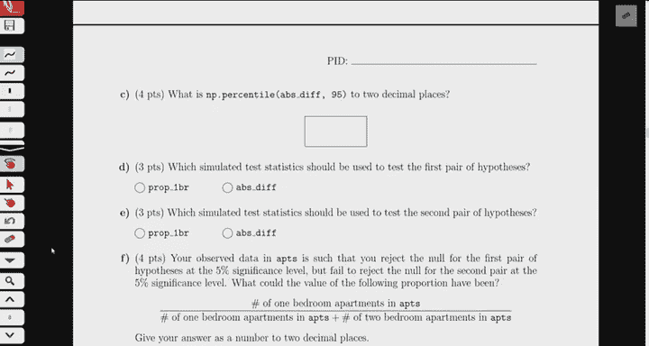

Okay， so so far， we've only drawn a picture of the one bedroom proportions。

 right We haven't looked at what the absolute differences would look like。

 but based on this information， we can tell what the absolute differences would look like。

So I'm going to shrink this up a little bit。

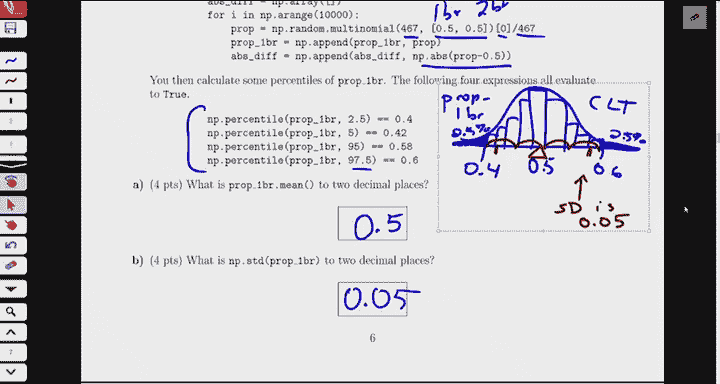

If this is what the proportion of one bedroom looks like。

 what does this data set of absolute differences look like？

The absolute difference is this is what we're storing， we're not storing the proportions。

 we're storing how far the proportions are from 0。5。So can you draw a picture， this is my task。

 draw a picture of what does the distribution of Ab's diff look like， what shape does it have。

 where is it located， what can you say about it？It's half of that， basically。It looks like this。

Something like that， okay？Basically， for each point here， like say it was 0。

53 right instead of recording it as 0。53， I'm recording it as 0。03。

I'm just saying how far from0 from 0。5 are you and that winds up as being like。

It's a distance from 0 on here。 Similarlyly， if I was at  point47， right。

 I would also record that as  point03。 So physically， visually， what you're doing is you're taking。

This picture and like folding it。Along the middle to get that。什么？Yes。

 so if you were to draw them on the same axes， it would be half of like the shape。

 but it would also be twice as tall， basically， it has to have the same amount of area。So if it's。

 you know， you would have to compensate for that somehow。 right， So yeah。

 I didn't really draw it like that， I should maybe change it。Something like that， yeah。

Does that make sense？Okay， now the question was。

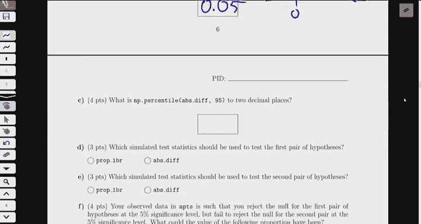

What's the 95th percentile？Of these absolute differences。 so basically I'm asking like。

 how far do I have to go so that I have 95% of the data on the left。And five， not 50。

5% of the data on the right。How do you get 5% of the data on the right when it came from folding。

 look at these dark blue regions。Each of them was two and a half percent。

 so when you fold them together， that makes you 5%， so the 0。4 and the 0。

6 when they fold how far away are they from zero？They're 0。1 away。

So basically what it's saying is that there's a 5% chance that you're more than 0。1。Away from 0。

5 in your proportion。Does that make sense？There's a 2 and a5% chance you're less than 0。4。

 there's also a 2 and5% chance that you're more than 0。6， so put that together。

 that's a 5% chance that you're more than 0。1 away。

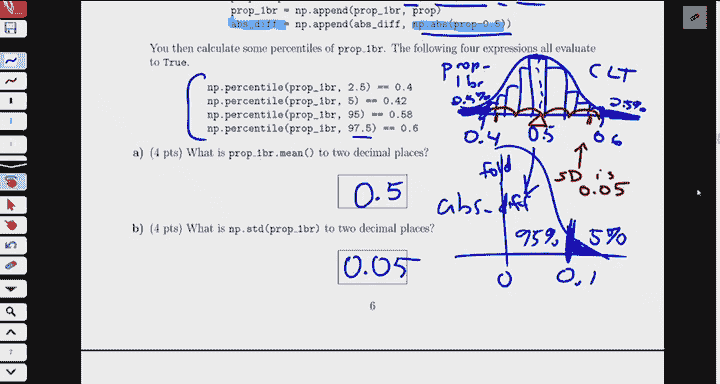

Okay， so that's the answer to this one。Point1 is like the 95th percentile。

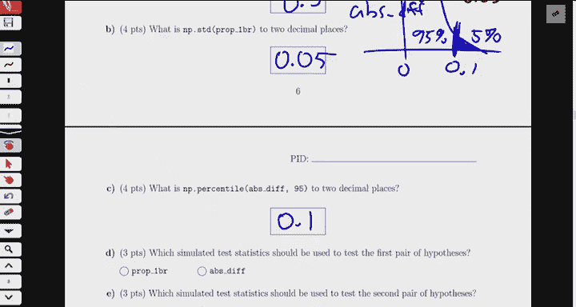

Yeah， yeah。Just say that。U。So just from looking at this distribution。No。

 because two standard deviations up， I'll draw it on the board。

If you have like a mean and you go to standard deviations this is not the 95th percentile。

 this is a 97 and a half percentile right so it's a different distribution In fact the 95th percentile of proportion one bedroom wouldn't be wouldn't be 0。

6。😊，It would be something a little less。

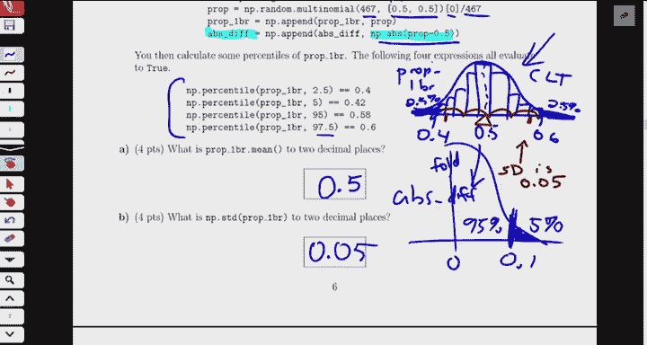

Okay， does that make sense， other questions？

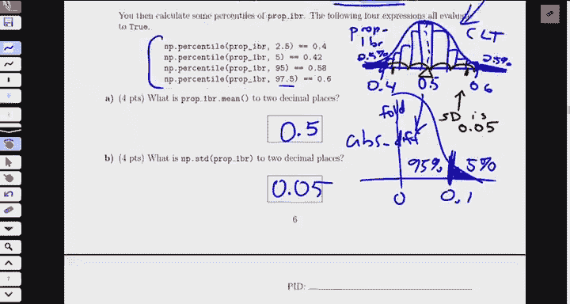

Okay， D and E are should not be too hard， which simulated test statistic should we use to test the first pair and which simulated test statistic should we use to test the second pair？

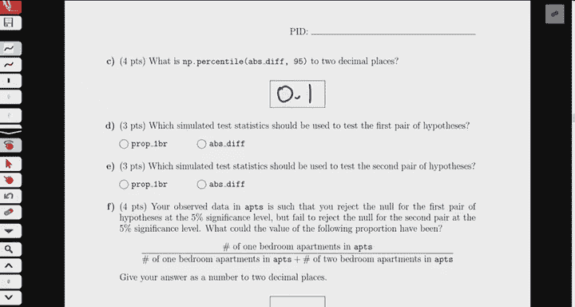

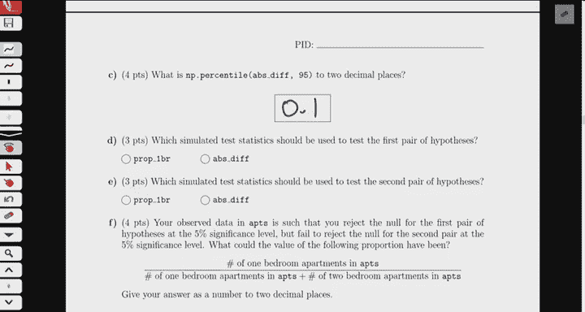

Okay， the first pair。Is saying they're equal or they're greater。

The next pair is saying they're equal or they're unequal right so because the first one has a greater。

 you can't have an absolute value because you can't tell which way is bigger so that one you're going to need the proportions themselves。

😊，For the second pair， you can use the absolute differences。

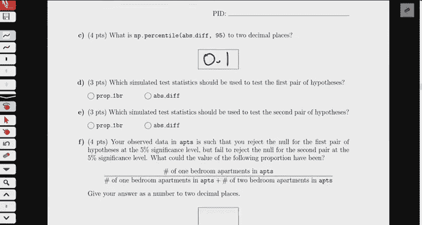

你看。All right。Now let's look at F。 your observed data is such that you reject the null for the first pair of hypotheses at the 5% significance level。

 but you fail to reject the null for the second pair at the5% significance level。

 what could the value of this proportion have been okay， this proportion looks really ugly。

 but it's just saying what fraction of the one in two bedrooms are one bedrooms so it's the number of one bedrooms。

Out of the number of one bedrooms and two bedrooms。

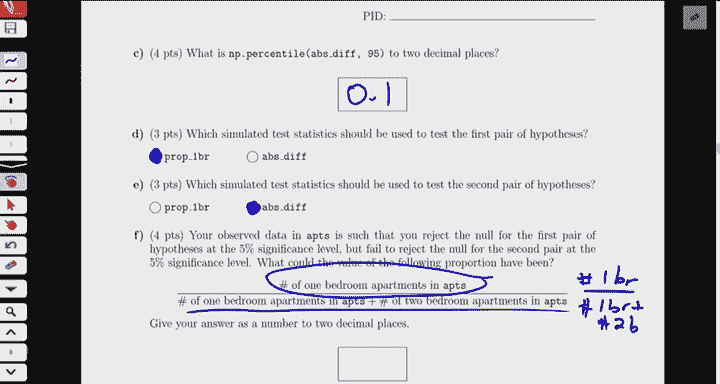

W which is basically the proportion。That we've been calculating。

Because we're calculating the proportion of just of the ones and twos。 like。

 you're not thinking about the three bedrooms or four bedrooms or whatever， right。

So it's like what fraction of these two things are one bedrooms。 So it's basically asking。

 how could like， what could my observed data have been。

To make it so that I reject the null in this case and I fail to reject the null in that case。 Okay。

 and to answer this， I'm going to look at the pictures again。This is my proportion of one bedrooms。

And this is my absolute differences。Okay， so I reject the null。

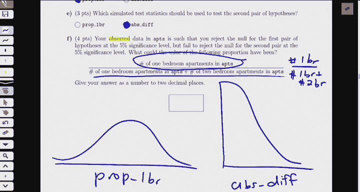

For the first pair， so the first pair was the one I was using this and the second pair was the one I was using that。

Okay。嗯。

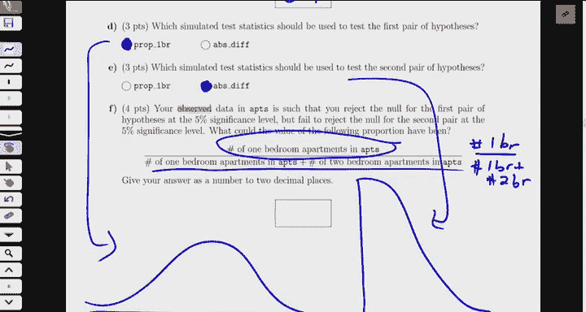

So I reject the null。 That means I'm on the edge。 Like I so I saw something extreme is when you reject the null。

 Okay， which edge of this distribution， the far left or the far right is going make me reject the null。

 Look back at what the alternative said。

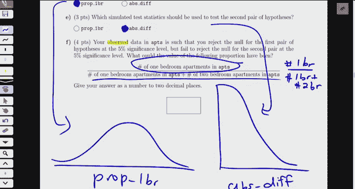

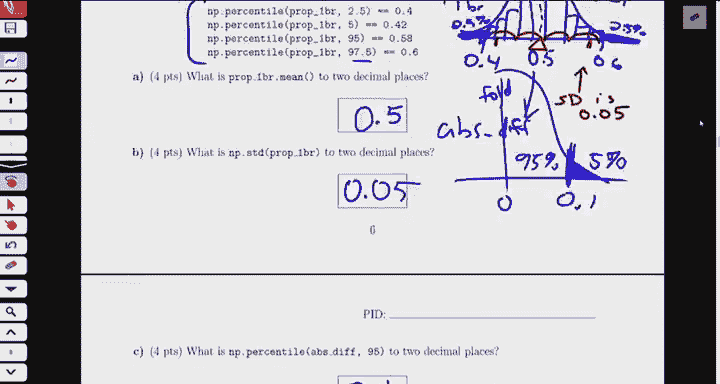

The alternative said。The number of one bedrooms is greater。Then the number of two bedrooms。

So I'm plotting the proportion of one bedrooms。 If that proportion is really high， right。

 that's evidence of the alternative。 So a high， like a big value is going to make me reject the null。

Okay， so I'm rejecting the null。Means I saw a big value somewhere over here。系。And how far over there。

 well I have said the 5% significance level means I'm in the furthest 5%。

 so where's the point at which there's 5% of the area to the right。

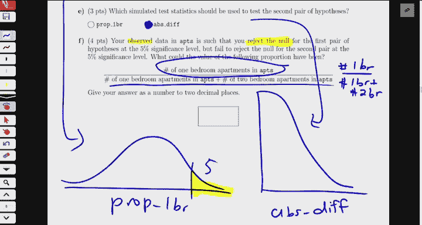

Look back at what they told me。哎。They told me there was 2。

 half percent of the area to the right of 0。6。But this one。There was 5% of the area to the rate of 0。

58。So in other words， 0。58 is the 95th percentile。So。Basically。

 what that's saying is my observed value。Is bigger than 0。50。

That would make sure that I'm in the rightmost 5%。Does that make sense。

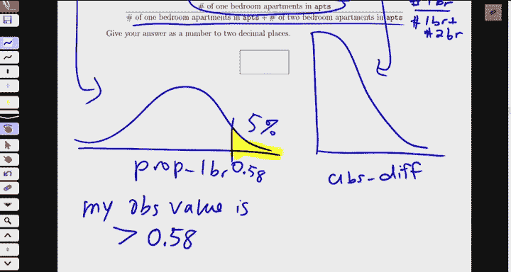

All right， but I also am told。That I fail to reject the null for the second pair at the 5% significance level。

 So what does that tell me about my observed value。

 fail to reject the null means I'm like just somewhere in the heart of the distribution right。

 I'm not in the extreme edge。 I'm somewhere over here。

What's the cutoff between the right most 5% and not being the right most 5% in this distribution？

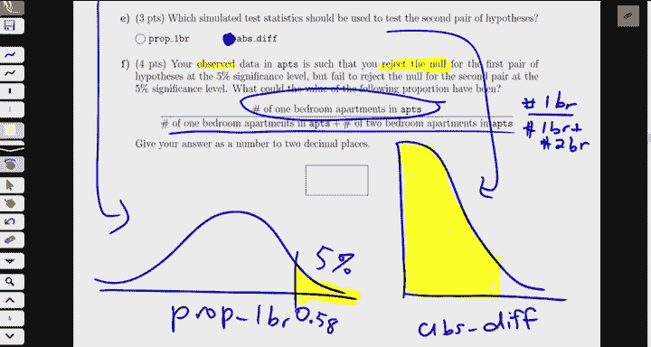

Close。

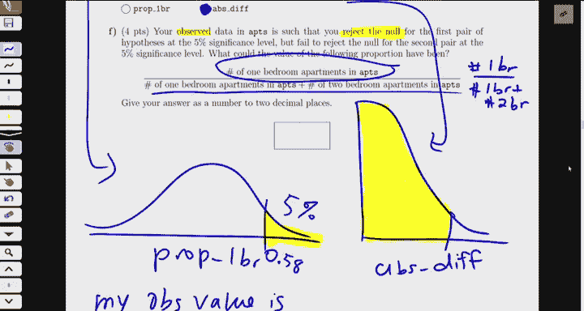

Look at this picture， 01。Point1 right， I can't it's saying I can't be more than 01 away。

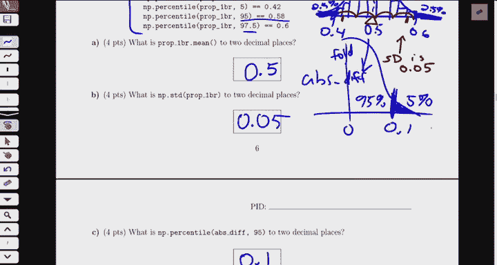

Basically。Here I've got 5% there and 95%。So what that's saying is。

Like if I was like way far to the right leg， the proportion was like 0。7 or something。

 right then I would have been in the extreme here。But I would have also been in the extreme here because of 07。

 the absolute difference from 0。5 would be 0。2。 That's like too far。

 So like something happened that I was further than 058， but I was not so far。

That I was more than 01 away， right， More than 0。1 away is like 0。6。

 So I got it saying my observed value is greater than 0。58。

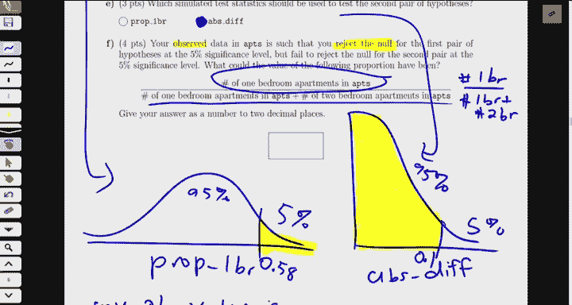

And here， it's saying。But actually， it's saying。But it's between。Point4 and 06。

So what's bigger than 0。58， but also between 0。4 and 0。6， 0。59， basically。

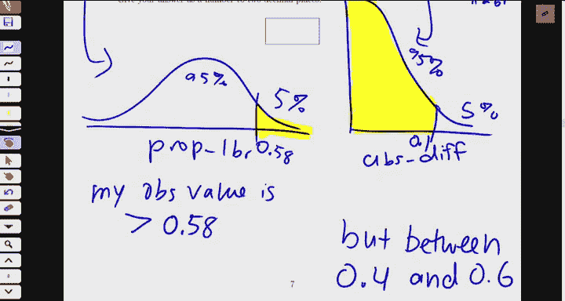

Does that make sense？So it's like there's only a little bit of range like between 0。58 and 0。

6 that would have been possible to have this outcome。Okay。Any questions on this one？

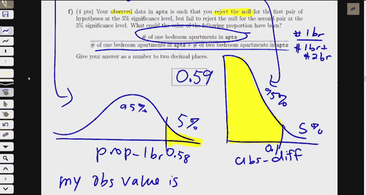

Yeah， yeah。Yeah， I mean， that's what I like to do， and you can probably see that I do that a lot。

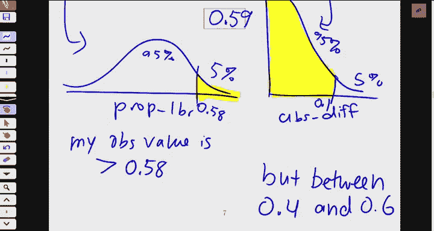

Even when like。Like you've seen me draw this picture like many times right like I just think that helps me think about it and it might help you。

If you find these pictures helpful， try to do the same thing on your exam。

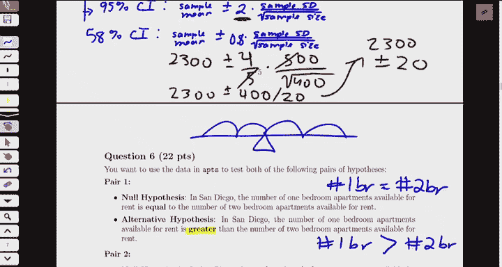

The last one that we wanted to look at was 12。

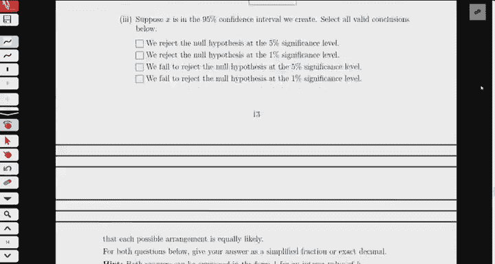

12l is a regression question mostly， but it throws in a little bit of extra stuff。

So the two variables are rent。And size and square feet。 Okay。

 so they're telling me the average rent and the standard deviation of rent。And they're telling me。

The average square feet and the standard deviation of square feet。

 so those are like four of the quantities that you need for regression。

 you need the means and standard deviations of both variables and you also need the correlation so that's the five things I need to like find a regression line between these two variables。

嗯。Suppose the rents are normally distributed， what is the rent below which 84% of apartments are priced？

This is not a regression question。The rest I think are。This is saying something about normal curve。

I need 84% to the left of this point。Which would mean 16% above this point。

 right since normal curves are symmetric。You can also think of 16% here。嗯。

I don't recognize the numbers like 16 or 84 as like things I should know right there's only a few things you should know for normal curves。

 which is 68， 95，99。7 Okay so how does this relate to one of those well 16 times 2 is 32 100 minus 32 is 68。

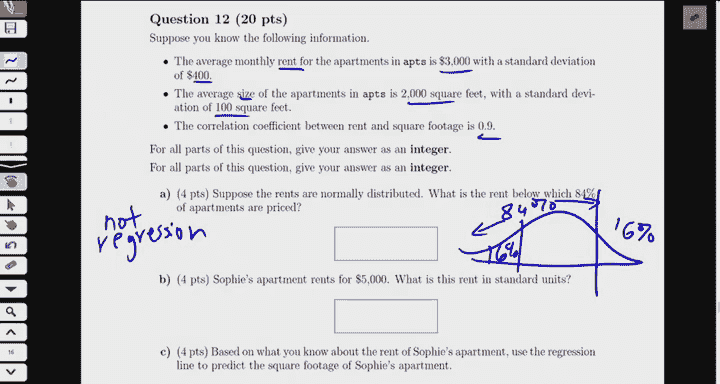

So basically what this is saying is if you start at the mean and jump up one standard deviation from there。

That's the point at which you'll get 84% of the data below。 Okay， so this is basically saying。

Mean plus1 SD。The rent was 3，1 SD is 400， so 3，400。

Part B is saying Sophie's apartment rents for 5000， what is this rent in standard units Okay。

 so you can do this algebraically using like the formula for standard units。

 but I like to do it visually as you were just suggesting， right？We're centered at 3000。

 I'm going to take jumps。Of size 400。3，400， 3800。4200。4600，5，000。

So the question is how many jumps did I need to take， five jumps？So Sophie lives in a very luxurious。

 fancy apartment。Based on what you know about the rent of her apartment。

 use the regression line to predict the square footage of Sophie's apartment so when there's a regression problem。

 you always have two options， you can use the formulas for slope and intercept in the original units or you can convert everything to standard units here I already did half the work of putting her rent into standard units。

 so I'm going to do the standard units formulation。

 which says the y in standard units equals R times the X and standard units。RightAnd here。

 since I'm trying to predict square footage， square footage is my y based on what I know about the rent。

 rent is my x。 so x in standard units is 5。R is 0。9。So that's saying the why in standard units is。4。

5，5 times 9 is 45， right？What we're saying is her square footage。

 we predict will be four and a half standard deviations above average。Okay。

 what's a standard deviation of square footage is 100， so we're going to start at 2000。

Plus four and a half copies of 100。Okay， so that's 2，450。Makes sense。

Sophie's apartment is actually 2300。 What is the residual of your prediction？

Residual is actual minus predicted。Actual。Minus predicted actual was 2，300。Predicted was 24， 50。

 so it's negative 150， a lot of people got this wrong by putting positive ones。Okay。

 residual has a sign， basically what this is saying is we predicted。嗯。We predicted。Two highs。

 like her actual was lower than what we predicted。 right， so the graph would have looked like this。

CC's apartment is 1800 square feet based on this information use the regression line to predict the rent of CC's apartment Okay so here the regression is asking us in the other order we we know the square footage so that's taking the role of X。

And it's asking me to predict the rent， so it's asking me the rent should be the why。So 1。

800 square feet。It's so easy to convert to standard units because a standard deviation is just 100。

 So I'm just going to do it how I did before。 convert to standard units。If you're 1800。

 you're 200 below average， so you're negative two standard units。Okay， so what this is saying is。

X in standard units is negative2。

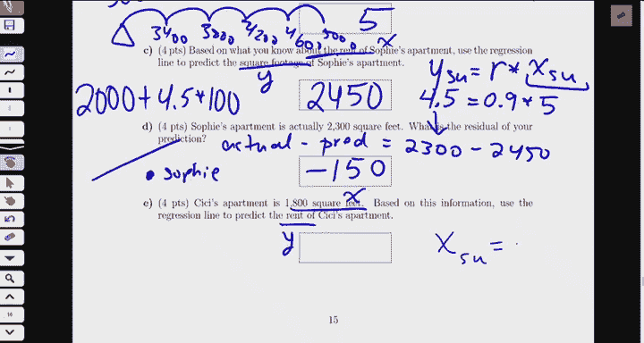

Multiply R times the x and standard units you get。t9。Times negative2 is negative 1。8。Okay。

 so the rent should be。Nate3000 minus 1。8 copies of 400。This is slightly annoying。1。8 is nine fifths。

I always like fractions better， you might not， but I do。400 divided by5。

Let me do four times 100 divided by5， 100 divided by 5 is 20。Okay， so four times 9 is 36。

Times 20 is 720。So 3 minus 720 would be。2，280。So this one involves a little bit of calculation。

 but it wasn't too crazy。Okay， any questions on that now you've seen it？All right， we'll stop there。

 thanks for coming， good luck， I'll see you guys Friday。

I didn't really think about what we'll do on Friday。

 I might just wing it and pick random problems from that I want to go over yeah。

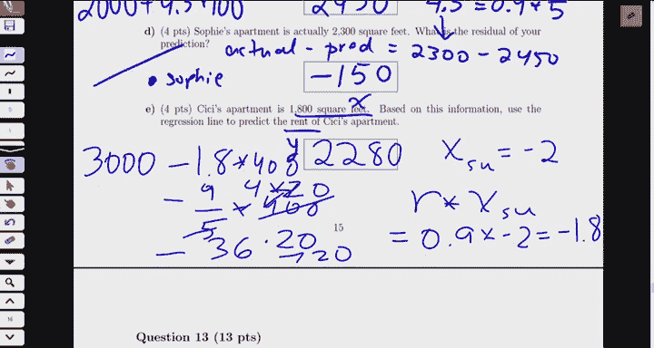