# UCSD《数据科学原理 (DSC 10 Principles of Data Science Fall 2024)》中英字幕（deepseek - P29：DSC 10 - Principles of Data Science - LE -A00- - Lecture 29.zh_en - GPT中英字幕课程资源 - BV1hmAneGEZh

All right， good morning everyone。Welcome to our last class， the finals Tomrow。

1130 to 230 were split across two rooms， one is Catat in6th college and one is HSS and MiR。

 so you should have an email from our tutor Eric last night if you're taking one of those exams。

 if you're in the alternate exam on Sunday， you don't need a seating assignment。

 just show up and check in the lobby and we'll tell you where to sit。

It's your last day also to fill out the sets and an end of quarter survey so please make sure to do that it's important because we want to like get everyone's opinions on how the course is going so we can improve it in the future you'll also earn a participation point by doing that before 8 a tomorrow so really just do it today。

😊，As far as grades， we always get a lot of questions about this so I figured I'd share some information。

 we're going to grade the final project final exam and calculate like your overall course grades and release that to you in the middle of next week and we'll also update your grade report at that time to include like a full you know the final grade report of everything you did in the class and all your dropped assignments and all your slip days and everything we're not expecting to have a curve so don't rely on a curve。

 don't plan on a curve try to focus on what you can control which at this point is the final exam so do your best to do well tomorrow。

😊，So the sets are anonymous， so I can't tell who's done them and who hasn't。

 so I'm using the internal survey as the participation point， basically。Anything else？

Okay today we'll spend like the first half of the class reviewing some old exam problems then I'll talk about some conclusion last day of school type things。

 what you might want to do after this class working on personal projects。

 do a little demo of some cool plotting that you can do with another fancier library and some concluding thoughts so for now we're gonna to start with working on past exam questions I don't have particular ones picked out so take some time to think about like what topics you want to cover。

 are there specific questions that you got stuck on and I'll just take questions and go from there。😊。

It doesn't have to be like do fall 24， you know， like fall 23 problem 7 A， you could just say like。

 I want help with hypothesis testing and I'll pick a problem。そがと。Yeah。

 so I said in the announcements， it's like covers everything。

 but it's about two third past the midterm and one third before the midterm because you've already been tested on the midterm stuff。

What particular topics？like， do you want to practice Mormouth？Yeah。Merge， okay。Other topics。

Interpreting histograms， okay？Other specifics， C， LT。OK。All right。

 we'll start with those that's probably good。All right， now I got to find some good merge questions。

Oh， this is a really good question。Did you do this in discussion， the break dancing one。No。Sure sure。

Yeah let's do this question this is problem nine from winter 24 it's about break dancing。

 raise your hand if you've already seen this or done this before。

 okay a few if not take some time now to read it on the practice site winter 24。Problem 9。

And I'll get it in my。My PDFf， so we can。Go over the solution。嗯。

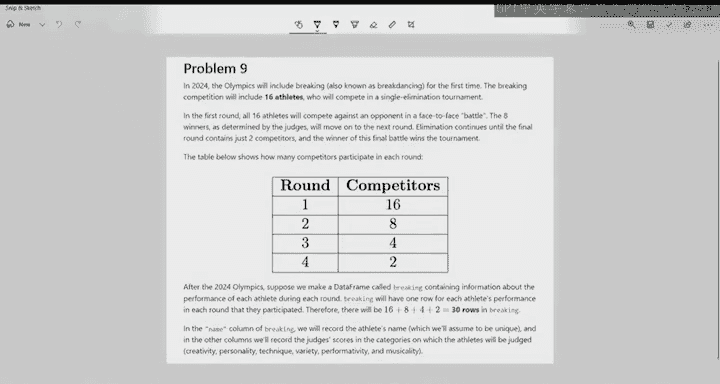

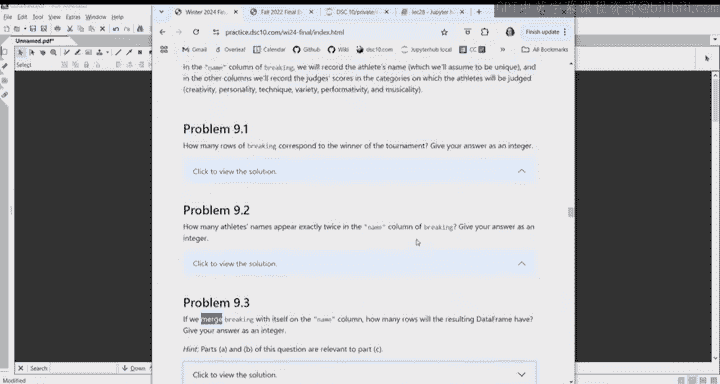

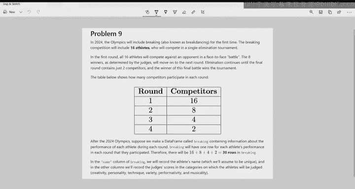

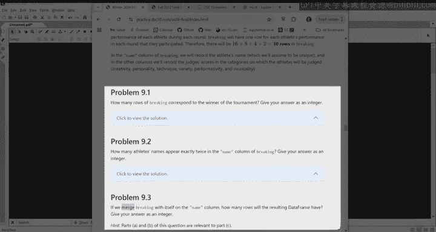

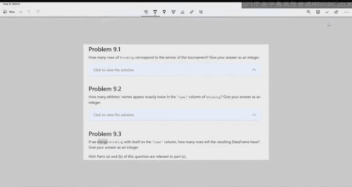

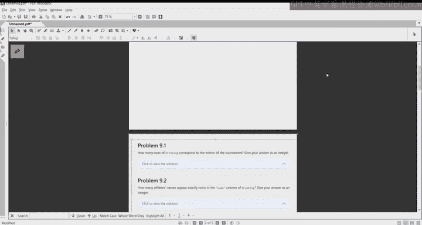

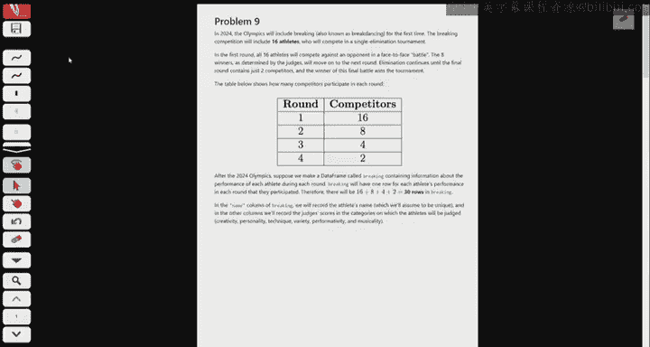

Okay。Let me tell you the setup of the problem this was about the 2024 Olympics which was the first time that break dancing was included or they call it breaking and it includes 16 athletes who compete in a single elimination tournament so single elimination means they pair you up and then whoever wins that goes on to the next round and they get paired up with someone else in the next round and they go on and they go on and so on so in the first round there's 16 people then eight then four then two。

😊，And they're just like face to face battles that are determined by judges。

And the judges record scores like in various categories and just give them a score so as a higher score is the winner。

 basically。So we're going to make a data frame called B that contains information about the performance of each athlete during each round Baking will have one row for each athlete's performance in each round that they participated okay so there's gonna to be 16 rows corresponding to the first round eight rows corresponding to the second round some all of those eight will also have been in the first 16 right so people's names like people who win will get in their names will be there multiple times does that make sense and then four and then two。

嗯。And so there will be 30 rows in the。In this data frame， okay。

 so try to sort of picture what it's going to look like。It's going to have the name column。Oops。

And it says， we'll assume the， the names to be unique。 So I and I could give people's names。

 but to keep it easy， I'll just say。Person P1， person P2， person P3。

Pson P16 are like the 16 unique people right and then so the first 16 rows are just going be you know 16 different names then the next eight rows are going to be some of these names Okay so like let's pretend person 1 and two were in a battle and then maybe person 21 so they would be in the next round and then person 3 and4 were in a battle so maybe person 3。

1。And they would be in the next round， and four and five， one， maybe person four， one。No， sorry，1，2。

3，4，5 and 6 would go together。 So maybe person 6。 Okay， so it's gonna be like。16。Then a， then 4。

 then two。That's kind of what the data frame looks like。So the first question is。

 how many rows of breaking correspond to the winner of the tournament。Okay， so one person wins。

How many times is that person in this data frame？Tell me。Four， how come？呃，份。Yeah。

 they started in round one， they did well there， they went to round two， they did well there。

 they went round three and they went round four so to be the winner means you're in all of these rounds。

嗯。There's someone else who's in all of the rounds， who else？

The second place is also in all of the rounds， right。

 because I don't like there's no round5 where I just put the competitor， right。

 So the first and second place are kind of like both appear。Four times。Does that make sense？

It's not needed right now， but I'm just going to make a note of it。Because we will need it later。

 second place also appears four times。How many athletes and names appear exactly twice？So oh yeah。

 yeah。16842 how many names appear exactly twice？Four names， how come？Yeah， okay。

 so think of like the 16 original people，8 of them got duplicated in this in the second chunk， right。

 they made it to the next round and eight of them got eliminated immediately。

 So basically what I'm saying is there's eight people。Whose name appears once， right？

These are the people who got immediately eliminated。嗯。And what does it mean to。

 for your name to appear twice。 Well， everyone's name is in the first round， right。

 So for your name to appear twice， it means you made it to the second round。

 but you didn't make it to the third round。 Okay， so like half of the people in the second round are not gonna make it any further。

 So there's four people。Whose name appears twice。How many people are there whose name appears three times？

嗯。去。Three times okay， and that would be they were in the first round and the second round and the third round。

 but then they lost in the third round， right the third round had four people。

 half of them lost Okay， so there's two such people。诶。This is。This is not adding up， right。Oh yeah。

 it is adding up。 It's supposed to add up to 16。 Yeah， so there's two。

 there's two people whose name appear four times， which are the first and second place， as we said。

 right。So for your name to appear four times you either won or you got second place。

 does that make sense？Okay， and this is really important for the question that's about to follow。

So the question we just did was how many athletes names appear twice， and it was four of them。

See above。The question that has to do with merging is you merge the breaking data frame with itself on the name column。

 how many rows will the resulting data frame have？Okay。

 and you don't know like exactly what it looks like because you don't know who won each competition。

 but you do know like how many， how many times each name appears。 basically。

 there's eight people whose name appears once。 There's four people whose name appears twice。

 There's two people whose name appears three times。

 and there's two more people whose name appears four times。

 So that actually gives you a pretty good sense of what the breaking data frame looks like。

And that's enough for you to figure out how many rows the merge will have。

 so try to use this information， take a minute now see if you can figure out how many rows the merge going to have if this is what the data frame looks like。

Okay， so think about these eight people whose name appear only once， right？

Let's give them actual names。这啊。The rest of the data frame is filled with other things that are not John。

Right。And we're merging it with itself。Eering breaking with itself on this on the name column so John from what like say let's call this the left data frame and the right data frame。

 that's how we usually think of merge even though in this case they're the same data frame right John is only going to pair with John right so each of those eight people is going to have。

Like lead to one row of the output。 Okay， What if John appeared twice。

What if John was like one of these four people whose name appeared twice， right。

 then this would lead to。Four rows in the output。Does that diagram how I'm drawinging it makes sense。

 each row on the left pairs with one of the rows on the right because they have a common value。

For the eight people whose name appears one time， they're each going to get one row in the result。

 for the four people whose name appear two times， they're each going to have two rows in the result。

Right， what about people whose name appear three times Like if John was here three times。

 what would my answer be then？Well， now there's more matches， right？This and this would be a match。

 This and this would be a match。And this would have three of its own matches。

 so each of the three on the left would pair with each of the three on the right。

 leading to nine matches。See the pattern。So there'd be nine rows coming from John if his name appears there three times。

 right， similarly if his name were to appear four times。

It would lead to 16 rows because each of the four on the left would pair with each of the four on the right。

Yeah。Oh， that's a mistake here。Thank you。Okay， so now we know like based on how many times their name appears。

 how many rows it's going to make in the output right so the final answer is for each of the eight people whose name appeared once。

 I was going to get one row。Plus， for each of the four people whose name appeared twice。

 I was going to get four rows。Plus， for each of the two people whose name appeared three times。

 I was going to get nine rows。And for each of the two people whose name appeared four times。

 I was going to get 16 runss。 Okay， so that's the final answer。Let's try to do this 32，18。

 that makes 50。16 and 8 is 24。So 74。Make sense。Okay。

 so this was like a pretty hard problem without any lead up， right， if I just said like。

The problem statement， we're gonna make this data frame called breaking how many rows are you're gonna have when you merge breaking with itself right it would have been a lot harder because like I'm just posing the question and like you have to figure out all the steps but the lead up to the question kind of got you on the right track of thinking about like how many times does each person's name appear and like how is that gonna help me solve the merge question in the end。

 So like a lot of the harder problems have like some like some kind of gradual lead up So this the kind of question where like I think I forget the difficulties but like a lot of people probably got the first couple parts right。

 but then。

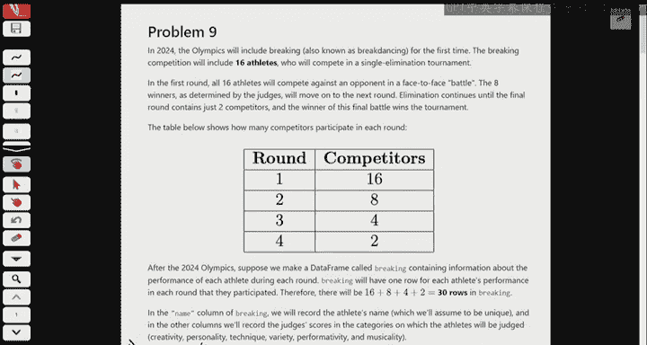

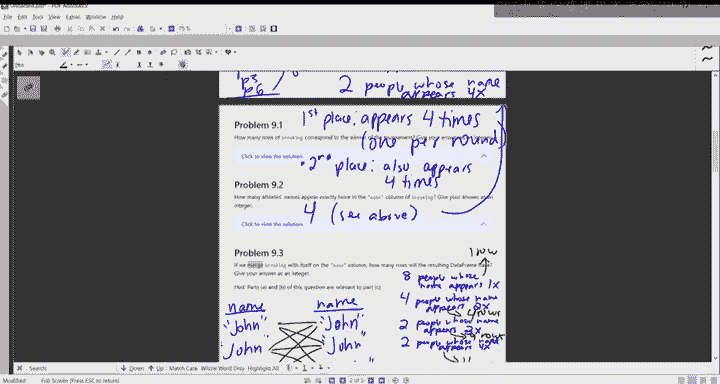

Part three was like。Yeah， this was a one star，94% got it right， You know， this was a two star。

82% got it right。And this was a four star， only 39% got it right。

Does that help that marriage question？Okay。嗯。Let's try to find a histogram question。

I probably won't do CLT in this class because it's going to take a while。

 but I'll do that in my next class and then you can watch the recording and I already picked out a couple of good CLT。

Related questions。So。So this one。Let me find it。Problem 11 and 12。From fall 23。

Are good questions related to like a lot of things they involve some hypothesis testing。

 some central limit theorem， some bootstrapping， and they're pretty challenging questions。

 So those are good ones to try。 I'll write that on the slides。Ti。😔，Fall 23。Numbers 11 and 12。

And I'll。I'll do this in the 10 am。You're welcome to come if you want。Okay。

 let's look at a histogram question and then a P value question。All right。

 we'll do this histogram question。This is also from fall 23。This was about credit card transactions。

And trying to figure out if they're fraudulent or not Problem 13。

 Ashley doesn't have access to the entire transactions data frame instead she has access to a simple random sample of 400 rows。

 she draws two histograms each of which depicts the distribution of the amount column in her sample using different bins。

Unfortunately， data Hub is being finicky and so two of the bars in histogram A are deleted after it's created。

 so there's two missing bars here。And the first question is。

 which of the following bins contains approximately 60 transactions？

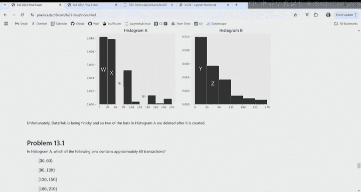

So。

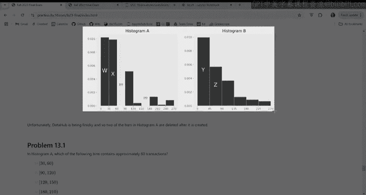

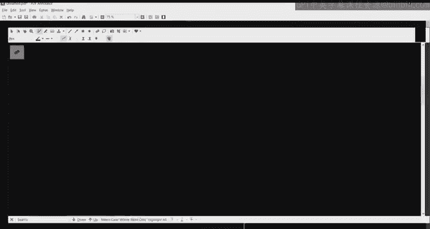

Okay， so remember。

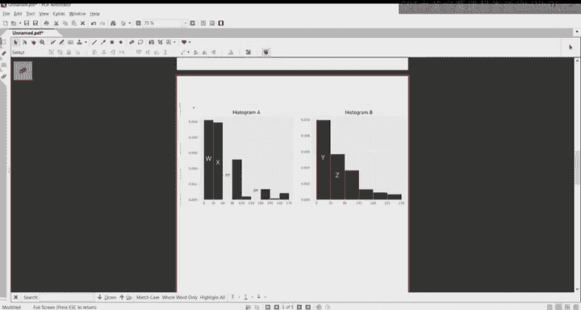

This came from 400 transactions in total。For each of them。And the question is about this histogram。

Which bin contains 60。Okay， so the， the thing to remember about histograms is the area is the proportion。

 right， So containing 60。I know how much area should have 60 out of 400， right， how much is that？

Six out of 40。Is three out of 20？Which is like one and a half out of 10。0。

15 is the one way to say that。So I'm looking for a bin with this area。And in histogram A。

 all the bins have the same width， right， The width is 30， right？ So the question is，30 is the width。

Times what height would I need to give me an area。Of 0。15。And then I just have to solve this。

The height should be 0。15。Over 30。015 over 3 is 0。05。Okay， 0。05 over 10 is 0。005 Okay。

 so it's basically saying which bin has a height of 0。005 right this is 0。004， this is 0。006。

 so which bin is this tall， this one。Make sense。Okay。

 that's a pretty straightforward histogram question right it's just using the relationship with times height as area。

 but there's often like harder histogram questions that like somehow combine this idea in an interesting way Okay。

 so I think the next question is the interesting one。Let me look back at the question。

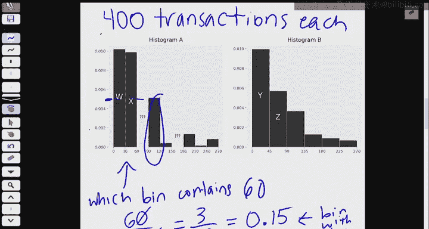

Let W X，YZ be the heights of bars W X Yz respectively， so for instance y is about 0。01。

 how do I find the height of the bar corresponding to the 6090 bin in histogram A？So。

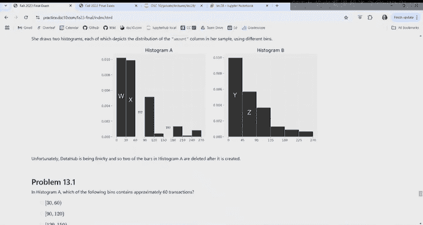

Let me put the histogram here again。

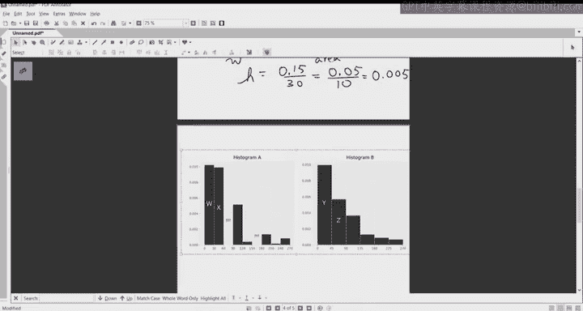

And this was a multiple choice question， but we should be able。

 to answer even without choice options。 Okay， so the idea is that these histograms represent the same data。

And there's a lot of questions you could ask based on that。And the idea is express。

 this is my unknown， express this bin。The height of this spin， it was the heights， right。

 The lower cases represented the heights。 Was that right。Yeah。Because I said， y is 0。01？

So I need to express my unknown in terms of the heights of each of these bins。

 which we're using lowercase。Lowercase letters4 okay。

 but the data on the left is the same as the data on the right Its just showing differently And the key thing is that on the left。

 we're splitting into bins of width 30。 and on the right， we're splitting into bins of width 45。

Right。So。What's that like least common multiple from elementary school， right， the。

 the number that both of them can go into is 90 right。

 So if you just look at this first chunk of the histogram up to 90。

And this first chunk of the histogram up to 90。 Like this represents the same data is the idea。 Okay。

 and therefore， like the total area of all of those bins has to be the same。

 Like the area of the first three bins on the left equals the area of the first two bins on the right。

And that's enough for you to， to find the。The height of the unknown bin。 Okay。

 what's the area of the first three bins on the left。 Well， the area of the leftmost bin。

 it's a width of 30 times a height of W。 So its areas 30 times W。

 The next bin is also a width of 30 and a height of x。

And then I'll call my unknown U for unknown and I'll be solving for U。

 This is an area of 30 times u for whatever its height is。

 and on the right that has to equal the total area of those first two bins。

 which is since they're 45 wide 45 times y plus 45 times z。

And then this is just an algebra question where you solve for you。

 which I won't do because you can do it， but it simplifies because 30 and 45 like a two to three ratio。

 you can pull out the 30， you can pull out the 45 actually I can probably do it because it's not that hard pull out the 30。

W plus x plus y or+ u。Right。Pull out the 45。W plus x plus u， I'm going to divide both sides by 30。

 but 45 over 30 is like three over two。And then minus W minus x。Okay。

 and then you may need to rearrange that a little bit to make it look like one of the answer choices。

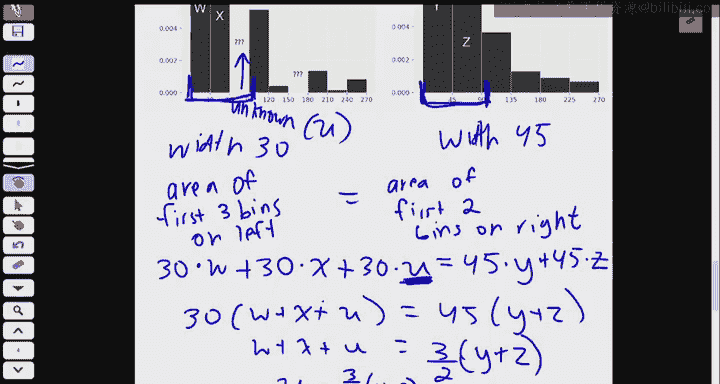

Does that question make sense？Okay。

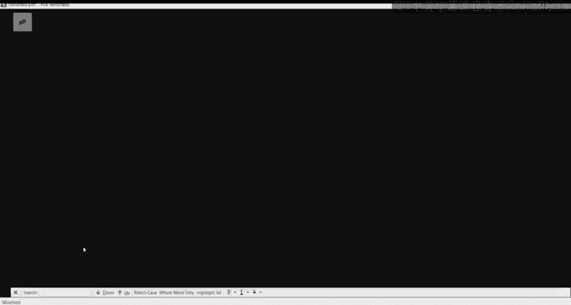

The last thing I'll talk about is knowing which way to。To go for the P value。

 do you want greater than or equal to or do you want less than or equal to， right。

 And this just depends on like the test statistic you're using and what it means。Okay， so。

Let me save this， somehow。

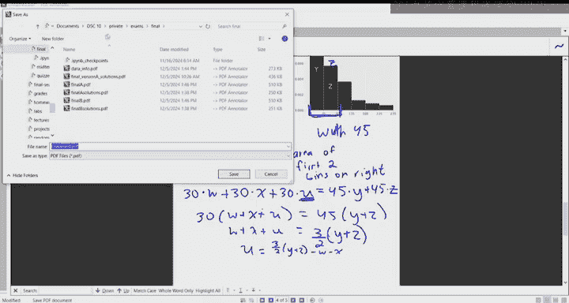

And I'll see you later。嗯。I'll refer back to the lecture slides for this。Okay。

 this picture is the picture I want。When we were testing。The coin is fair or the coin is not fair。

 right， We were using absolute difference between number of heads and 200 in our experiment。

 which was flipping a coin 400 times。 And if if the number we got came out big。

Like the highest it could be would be 200 if you got like all heads or no heads， right。

 that indicates that the coin was probably unfair。And a small number means the coin was probably fair。

 So when you're using the P value， the P value is in the direction of the alternative。Okay， so。

For this first example， you would use a greater than or equal to symbol because a big value means alternative And in the second example。

 if you're trying to side between fair and bias towards tails。

 you would pick a less than or equal to because alternative is on the left。

 So this picture is like the key to deciding。 And depending on what statistic you use。

 it might change it Like the the second one is a good example， I'm doing number of heads。

 But if I had instead chosen as my test statistic number of tails。

Right and I was still trying to choose between fair and being biased towards tails well then a high number of tails would indicate the alternative so then I would use a greater than or equal to in my P value okay so I always recommend trying to draw like a number line picture like this and deciding ahead of time which way means which hypothesis and it should just be the case that one way means one and the other way means the other if you're in some scenario where like the middle means something and both edges means something else。

 then you need to put an absolute value。And that also， like。

 it's good to do it up front because it tells you if you're doing like a bad test statistic。

 that's not going to help you distinguish between the two。Okay。So we did emerge。 We did a histogram。

 We talked about P value。 I pointed you to some good C， L T questions。啊。

Let's continue with the other things I wanted to talk about today。Okay。

 so now that the class is ending， this is just sort of some wrap up material。

After this class you might be interested in working on your own data science projects。

 the class was kind of designed to give you the skills to do that so you can pick up a data set that you're interested in you can find data sets in lots of places I'll talk about that in a minute。

And you can upload make blank notebooks， upload your own data sets as opposed to analyzing the ones that we provided you Datahub is like an educational resource provided by the university to support students in their classes so if you're not taking a class that uses datahub next quarter you may not have access to datahub so if you want to save all your notebooks and be able to you know use them or look at them again in the future you will have them on grade scope。

 but you can't really edit them or do anything with them there so if you want like all the data files and stuff there's a way to download your work from datahub it's posted on the debugging link of the course website。

And in this class， we used baby pandas， but all baby pandas code is regular pandas code too。

 Okay so if you just at the beginning of your notebook， instead of saying import baby pandas as B PD。

 You said import pandas as PDD and then change any B PD to PD like your code will still run。

 that just allows you sort of more options right So in pandas。

 there's even more functions or the functions we've introduced， don't don't just have two arguments。

 they have like 20 arguments。 So there's like a lot more customization you can do。😊。

There's a few links here of like where you might want to find data。

 some of these are like curated data sets of things that people have written articles about。

Cagle is like a place where people just find their own data and upload it。

 there's a thing you can do to extract any table from a Wikipedia article as a CSV file so pretty much anything you're interested in can you can find there's also more like serious data sets for specific applications sports government。

 global development transportation， music， COVID， we had a COVID project back when that was big。😊。

And you can also like make collect your own data by doing a Google Form survey and download that as a CSV。

In this class we。We did pretty basic data visualizations because we just use whatever baby pandas had。

 which was like one command dot plot and like it gave you a histogram or it gave you a line plot or whatever and like we focused on interpreting those things and when's the right time to use which of those plot types based on what your data is like but visualization is like a whole field in itself and we have a whole course here DSC 106 in data visualization and it's really cool seeing like the kinds of things that people make with more fancy data visualization skills and fancier libraries so this is one of those fancier libraries called plotly which I just want to show you some of the cool things you can do and you'll see that the code is like pretty similar to the code that we use so we're going to use this data which is called the gapminder data it's from a nonprofit in Sweden that promotes global development sustainability。

And it collects a bunch of data about like sort of the state of the world through， through history。

 So they started collecting this data in 1952。And they like every five years。

 collected this data on the level of each country。 Okay， so like Afghanistan is first alphabetically。

 and they have many rows corresponding to Afghanistan for different years。嗯。The years that we have。

It goes from 52 to 07。And the '07 is the most recent year in the data。

So this is a data frame that now has each country only appearing once。

And you can learn interesting things about like world progress just by looking at some plots of this data。

 so this is a scatter plot of GDP per capita， which is something about the economic status of the country basically how wealthy the country is versus life expectancy right and there's a pretty clear trend that like shows increasing that GDP per capita like the wealth of a country seems pretty important in determining the life expectancy right wealthier countries have have a bigger life expectancy。

 can you can look at individual countries here。 that's the cool thing about plotly like you'll see a lot of African countries。

In the bottom left right and a lot of European bigger Asian countries in the top right one thing I think is interesting about this is it's not linear。

 right it's curved。And it's pretty like pretty steep at the beginning。

 And what that's saying is like having just like a little bit of wealth makes like a huge difference in your health。

 right， And then there's a point at which， you know。

 you have enough wealth to get the care that you need and the food that you need and that sort of thing。

 And then the extra wealth doesn't really matter that much， right。

 There's like not a huge difference in people's life expectancy from like 10 to 50。

But there's like a huge difference from 0 to 10。Okay。In future classes。

 you'll learn about transforming the data， right， The data is not linear as I gave it to you。

 but now I've transformed it by putting the。The X on a log scale。

 which makes the data look more like a line， okay。Here's one step further。

This is the same scatter plot I showed you before， but now I have more like attributes being shown on the plot right I'm looking at the continents。

😊，As different colors。😊，And I'm looking at the size or the population of the country as the bigness。

 the radius of the dot okay so you can see like this was in 1952 in 1952。

 like all the Asian countries and the African countries were the ones with low life expectancy and low low economic wealth and the red ones。

 the European ones and the United States and Canada right。

 the Americas we say those were the ones in the top right。

 So this was the state of the world in 1952 but we've actually made this like a video。嗯。It's like a。

Different frames by year。That you can kind of play。

And watch how like the world changed over 50 years。Okay， let's watch it again。

Focus on some particular countries。 This is China， and this is India。 I like watching those。

China and India are like blowing up， that means population growth right。

 and they're moving fast to the more towards the middle。

Their wealth is increasing and as their wealth increases， their life expectancy is increasing too。

United States has stayed over here now we're seeing like a pretty big difference between Africa and the rest of the world。

 like Africa hasn't caught up in the way that Asia has。Okay， so this one like pretty simple data set。

 which only had a few columns kind of like tells a story of like what's happening in our in our world。

 which is pretty amazing。 There's a really cool video here， which is like。😊。

An even more animated version of this plot that shows you more if you're interested。

 I recommend watching it， it's pretty fun。Here's another cool thing you can do with plotly。

This is a histogram of life expectancy in 195 in 1952。In many countries in the world。

 the life expectancy was quite low， maybe not a mean， but a median of maybe 45 or something。嗯。

Nowadays， that's not the case in most places， the life expectancy is much higher。

 and this is also like an animated histogram， so it plays like a video and it shows like how the distribution of life expectancy is changing over time。

And you can see the whole histogram is like moving right， and in '07。

 it's like way different than it was before。Another cool kind of plot you can make is called a Coapl。

 you've seen these in news articles and stuff， right like a heat map。

 the darker the color means the greater the life expectancy and you can see like the pattern now we saw that Africa is struggling。

Okay， so that was just a cool little demo to show you some some stuff you can do now that you've taken this class right like I didn't teach you plotly in this class but you know enough from taking this class that you can look up documentation for plotly and you can make your own plots like that now basically okay that's kind of the idea of this class is like to get your feet wet and give you enough experience like learning new things that you feel comfortable going out there and adding onto your skill set so in this class this is what we said in lecture one right we would use Python to explore data that was what we did in the first four weeks。

😊，We would infer about a population， that's what we did in the next few weeks with the bootstrapping and hypothesis testing。

And then we would do some prediction， which is what we did with regression。

 which is one of the most basic machine learning algorithms。

Okay you'll kind of revisit these main topics in future data science classes。

 this class is very broad， some specific classes will go much more fully into one of these topics。😊。

And then to end， I want to thank all the people who helped run this class。

 this is a really like big machine this course， it has all these different components with like the projects and the quizzes and the office hours and the one on one sessions after quizzes and things like that。

 so all these people were really helpful in making that happen。😊。

Tuttoring is a paid job that students who've taken the class can apply for and if selected。

 they'll get to give back to the people the next generation of students。

 a lot of students who like appeared in office hours a lot want to become tutors because they found it really helpful if it's your first quarter at UCSD are not eligible yet。

 but you can do it as early as your third quarter at UCSD。😊。

We want to hear about like your life and your data science trajectory over the next few years。

 so keep in touch， we'll make a post on Ed where you can ask the tutors for advice and just general life questions about being a data science major。

 what their experiences have been。Okay， and good luck on your finals， See you tomorrow at 1130。

Thank you and my last thing is that that last line is very important Okay。

 three hour exams can be very grueling， especially if you're like hungry or tired or whatever。

 so get yourself in the best physical state to do well and see you then thank you。😊。

哎嗯。休议员的焦点。看不了。My grad degree was in combinators。I did math and computer science。

