# UCSD《数据科学原理 (DSC 10 Principles of Data Science Fall 2024)》中英字幕（deepseek - P2：DSC 10 - Principles of Data Science - LE -A00- - Lecture 2.zh_en - GPT中英字幕课程资源 - BV1hmAneGEZh

All right， good morning everyone in case you missed the first class I wanted to make sure you know where the class website is because that has everything you need to know I got a few questions about I don't see the class on canvas that's intentional we're not using Canva we're just using this class website so has everything you need the syllabus and office hours start today so there's a calendar with people's office hours。

 we have a big staff so there's a lot of support throughout the day。😊。

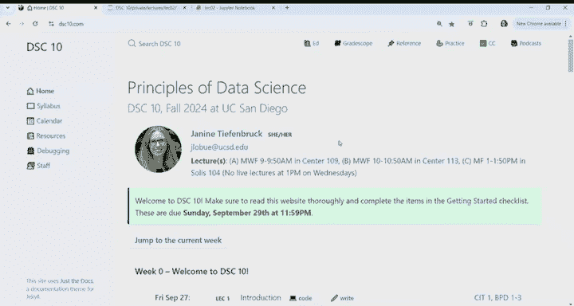

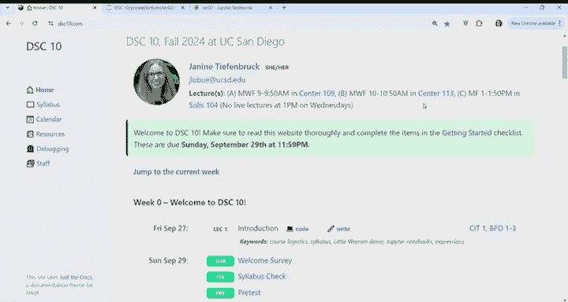

Today。You can find the lecture material。

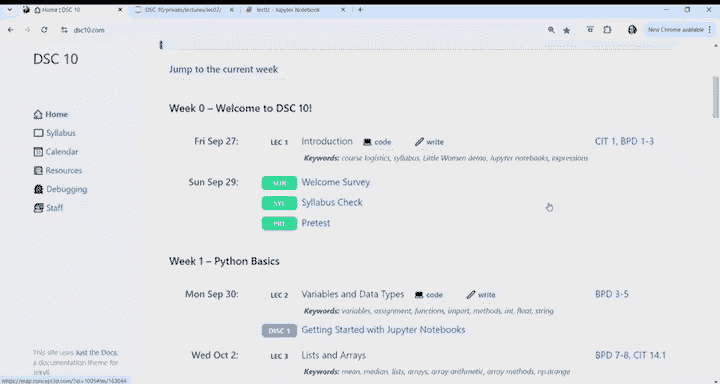

Either by clicking code or by clicking write， so code is if you want to actually try things out with me。

 you know experiment as I talk or write as if you want to take written notes on what I'm going to say using like a tablet or an iPad。

😊。

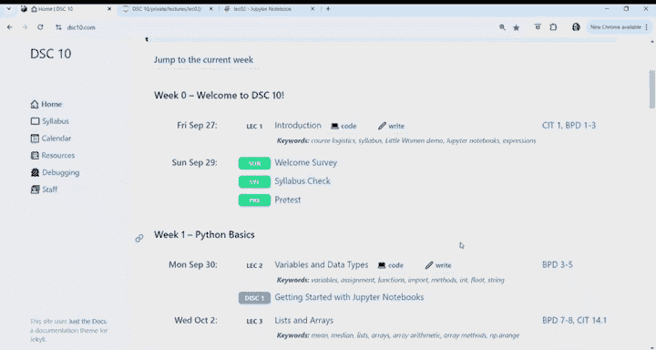

So I'll show you what happens when you click code。

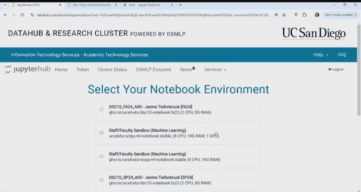

You'll probably have to log in。But then select the one that says DSC 10， fall 24。

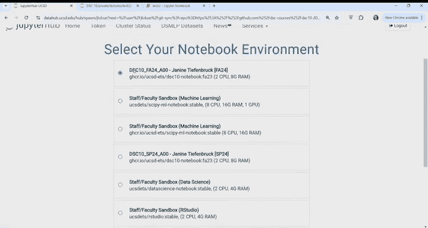

Launch。And it'll， okay， everyone's doing it right now。

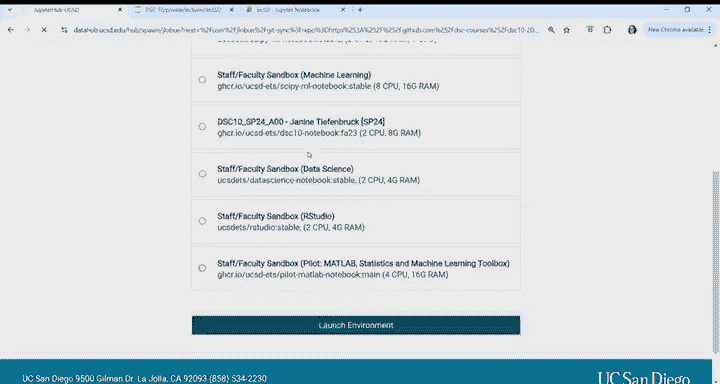

But space out your request a little and it'll take you to a place that looks like this okay。

 and then if you want to see it in slideshow mode， which is how I'm going to present it。

 you just click that button that looks like a bar graph。😊。

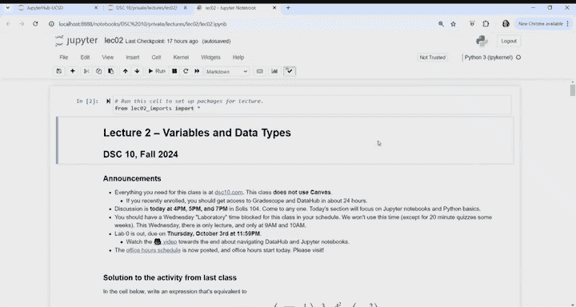

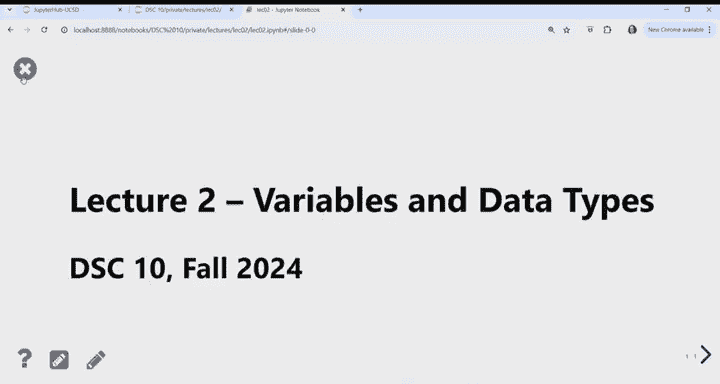

And that puts it in slideshow mode。 Okay， so I'll present from it like this。

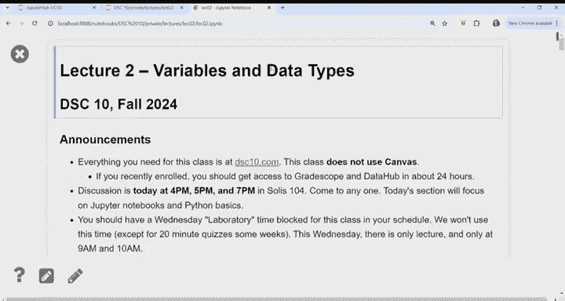

But follow along， however， works best for you。

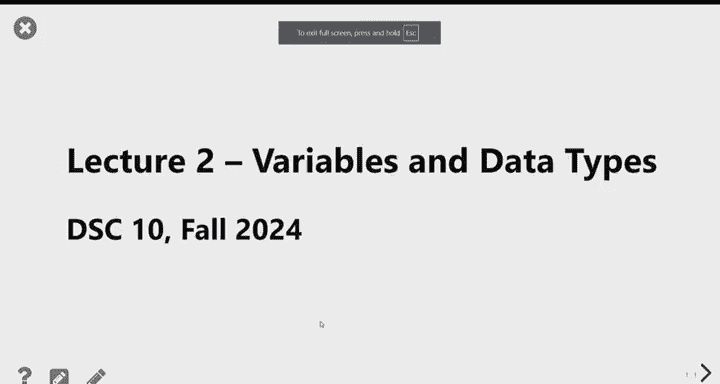

Okay， so I'll usually start each class with some announcements。

Today is Monday so there's discussion there's three discussions you can come to whichever one works best for you section today's discussion section is a little different than future discussion sections。

 future discussion sections will be almost all group work working through past exam questions for practice today since it's the classes just starting there's sort of like an intro lesson on working with Jupiter notebooks。

And some basic Python stuff though there will be a little bit of group work as well。

 I also wanted to clear up some confusion about this Wednesday laboratory time that appears in your schedule of classes this is sort of an hour that is blocked off for this class but we're not planning to use that hour except for occasional Wednesday quizzes so there's like four quizzes throughout the quarter there're like 20 minutes long mostly there're on a Wednesday with the exception of Thanksgiving week so if you have a laboratory in your in your schedule of classes and you have nothing else at that time you could you could put your quiz preference at one of those times and I did it that way so that everybody has at least one hour sort of free or dedicated to this class so that there aren't any conflicts for the quizzes but like this Wednesday there's no quiz so there's nothing to do on Wednesday afternoon there's just lecture in the morning and that's it。

And then for the Thanksgiving week， the quiz time will be the same as your usual quiz time but it'll fall on Monday instead of Wednesday and discussion that week will be on Wednesday instead of Monday so we just swapped them Does anyone have questions about that。

If you need to edit your preferences on the Wecome survey， you can still do that， so feel free。Okay。

 and then our first assignment aside from the getting started things that you submitted last night is Lab Ze。

 which is due on Thursday， there's a video towards the end which I recommend watching which will help you sort of work your way around data Hub and Jupiter notebooks。

Okay， and as I mentioned before， come visit an office hour starting today。All right。

 so we ended last class where I had you try to write a Python expression that matched up with this mathematical expression using parentheses only when necessary and this is the solution。

 so notice there's three pairs of parentheses but only the last one is actually required because the other ones are just you know adding two terms before other terms but terms can be added in any order。

 the middle one is like multiplying specific terms but again a product of things can be multiplied in any order so it doesn't really matter。

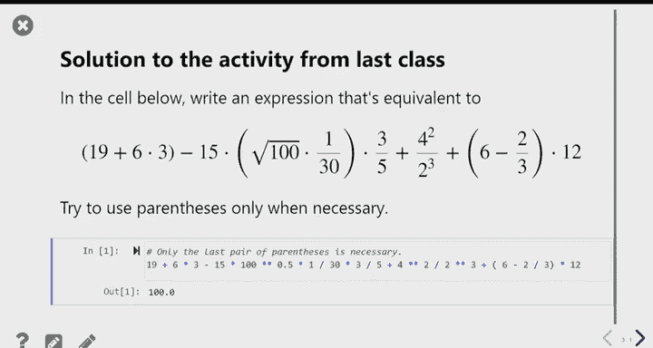

The answer comes out to the nice round number of 100。

The only thing that's a little sort of weird is exponentiation raising to a power。

 we do a double star in Python。And one thing that was a little tricky was the square root of 100。

 I mean， of course you know it's just 10 right so you could type 10 but if you're trying to mimic this expression right how do you actually do square root。

 I did it like this a00 to the power of 0。5 the one half power is the same as square root in math a common mistake is to type it like this。

😊。

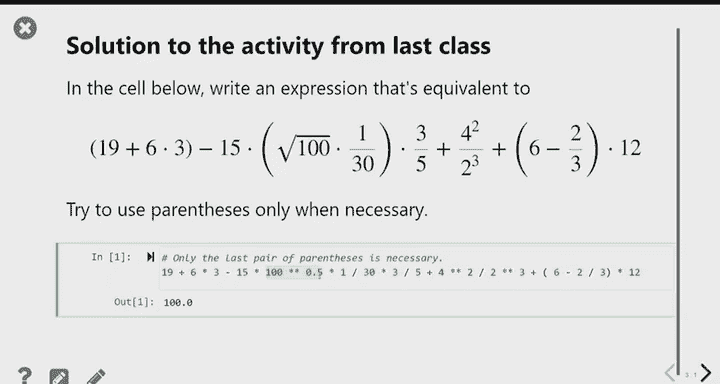

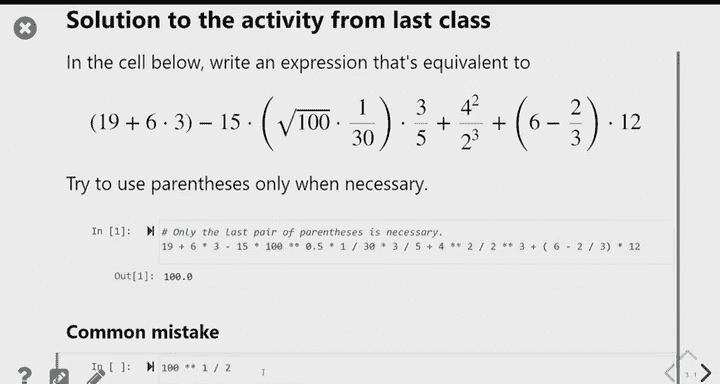

Why does this come out to 50？Right， 100 to the first power is 100 and then divides by two that's Pmdos order of operations right so if you want to do 100 to the half power。

 I use 0。5， but you can also do it like this and that gives a square root of 100。Make sense。Okay。

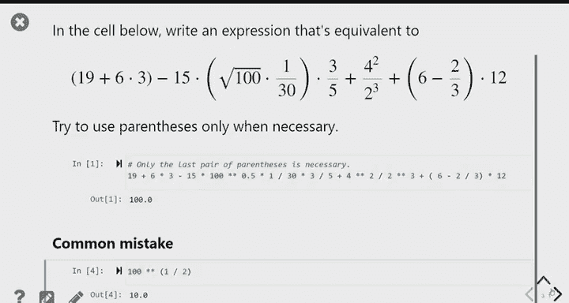

So today we're going to be doing some sort of basic Python stuff if you've coded in Python before。

 today will be pretty easy if you've never coded before today will be like a lot of information thrown at you all at once I'd say this first week like the first three classes including Friday is pretty sort of like introductory coding material so there's sort of this dichotomy based on like how much prior experience you come in with it may be very easy or it may be very hard starting on Friday we're going to dive into working with data sets so that even people who have experience with with Python or with coding we'll find you know the data analysis aspect new and interesting and that's the part that I think is the most fun but we have to just cover some basics before then。

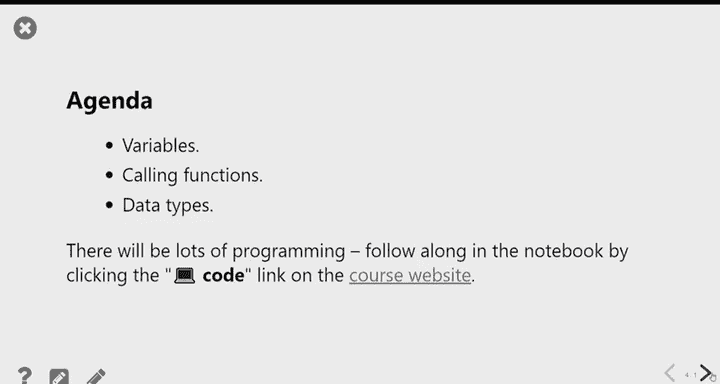

Okay， so we're going to start with。A problem that's similar to something you'll see on the lab computing the number of seconds in a year right so there's 60 seconds in a minute。

 60 minutes in an hour， 24 hours in a day for now I'll just say that suppose there was 365 days in the year right that's something that may require a little more care。

😊。

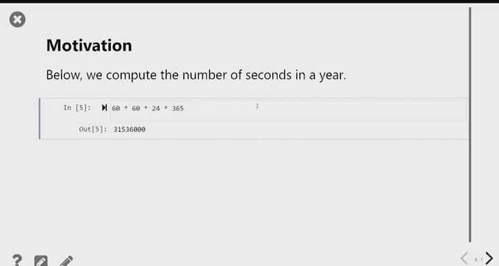

嗯。Let's say you wanted to use this number later to find how many seconds was in 12 years right you've already done this work so you could like either copy paste that or copy paste the answer and multiply it by 12。

 but copy pasting is first of all annoying， tough to find it in your notebook and second of all。

 it's prone to errors right like you may miss a digit or something when you're copy pasting。

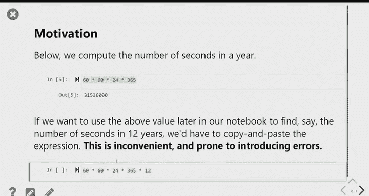

So what we want to do instead is basically if we have a value that we're going to need later on。

 store it somewhere so that you can access it later。

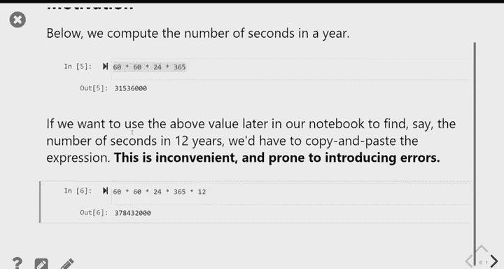

If you ever used a graphing calculator， like graphing calculators have this answer button that essentially does this like store my previous answer so that I can use it later。

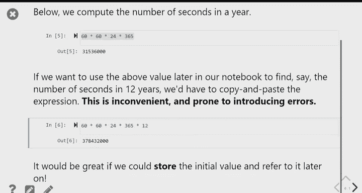

Okay， the way you do that in Python is through what's called an assignment statement。

 So an assignment statement looks something like this。 You have a name to the left of the equal sign。

 and then to the right of the equal sign， you have a value。

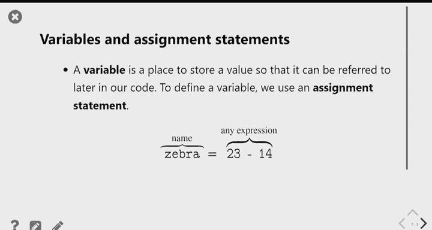

And this basically， like， gives meaning to the name。And it's， you can think of it as like。

Like like a name tag， like it gives the name zebra to the value of this expression。

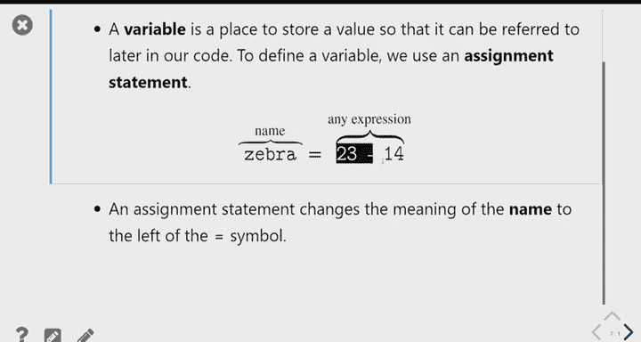

Okay， noticeice that it evaluates the expression on the right first and then sort of gives it that name tag。

 it doesn't give the name tag to the actual expression， so the name zebra goes with the number nine。

 but you won't be able to know later on in your code that that nine came from subtracting 23 minus 14 okay it's just9。

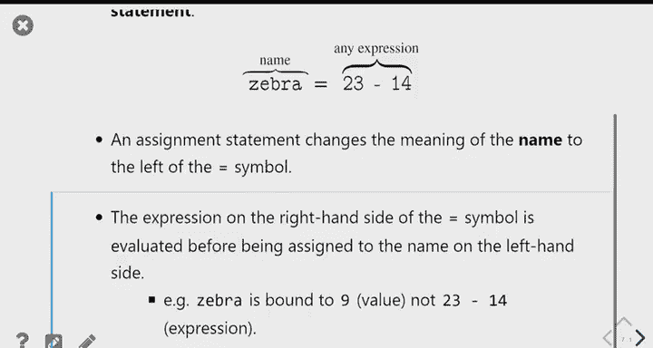

Okay， so the basic assignment statement， a equals1 is like putting a name tag that says a on the number one。

noticeice when I run this cell， there's going to be no output。

Nothing was sort of printed or displayed like when I was doing Python as a calculator because it's not actually calculating or computing anything。

 it's just actually changing like where it puts a name tag essentially。Now I assign a to two。

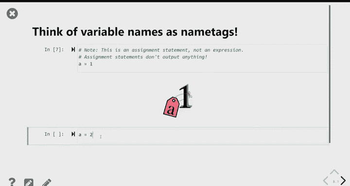

And you can think of that as moving the name tag A from the number one to the number two。

 so from here on out， a refers to two， not one anymore。 Okay。

 it doesn't keep like a history of prior values or anything like that。

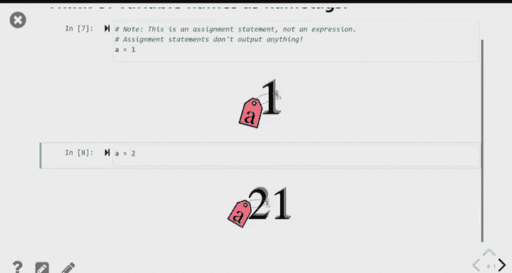

Okay， and now I'm making a new variable called B and setting that to two。

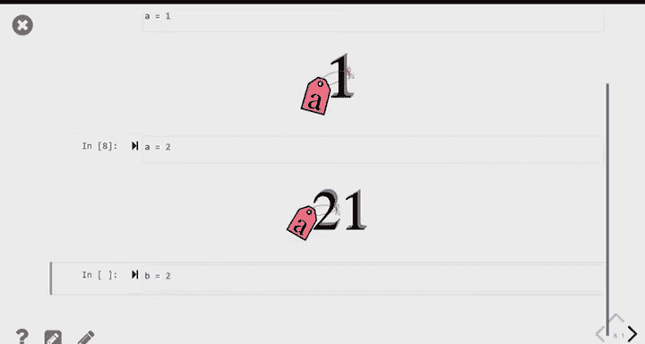

And that's like， I don't know， maybe like a nickname for this number。 This number goes by two names。

 You can call it by A or you can call it by B。And basically in the future。

 if I ever want to do something in my code involving the number two。

 I could equivalently write A or write B in its place。

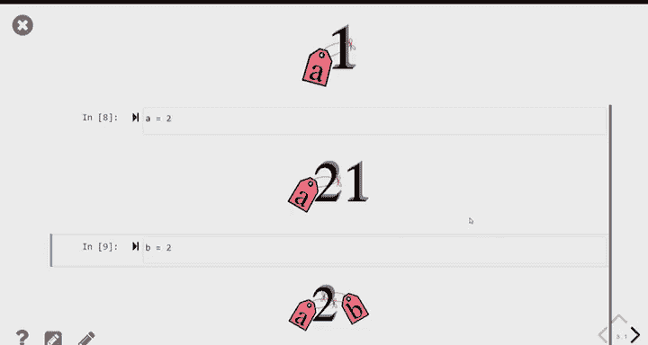

Okay so you can name your variables as you wish subject to a few constraints。

 but variables sort of get named when you use them in an assignment statement so here's potentially a variable name I could call my variable A or B or triton or basically whatever I want。

 but before you use it in an assignment statement， it doesn't know like what you're talking about right it's going to give you an error。

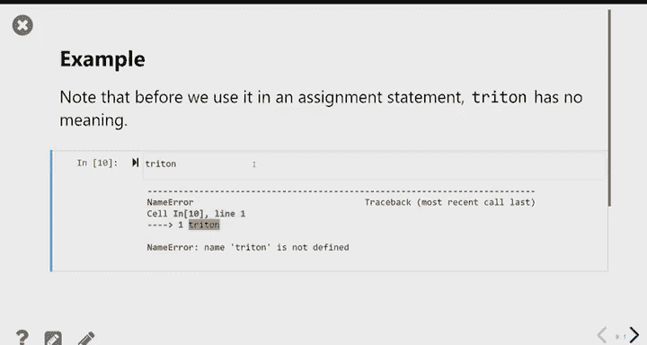

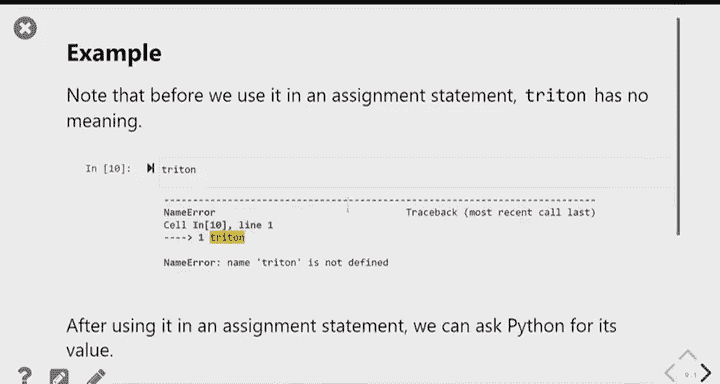

That the variable is not defined， the way you define a variable is you give it some value。

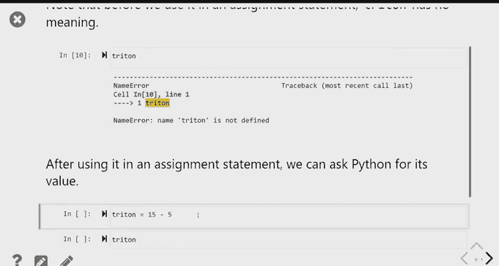

So here I'm going to set Triton to be the number 10。And now if I ask Python， what's triton。

 it tells me 10。

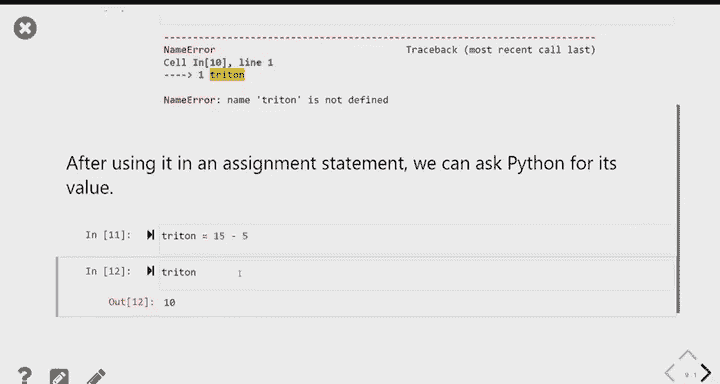

So notice when you just type the name of a variable。

 it outputs its value so in the first cell it had no value basically， and here it does have a value。

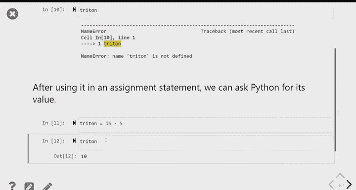

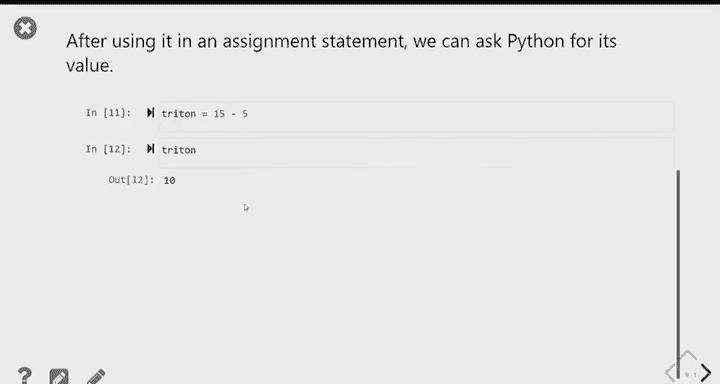

Does that make sense， any questions？

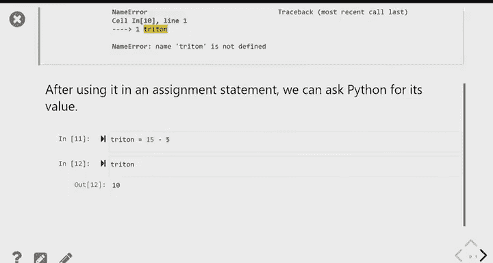

めちゃ？So when you use this variable in the future right it's just going to substitute its value for the name of the variable。

 so it's just computing 10 times negative4 here right notice that the value of Triton still stays at 10 Triton hasn't changed to negative 40 right the only way you can change the value of a variable is through an assignment statement。

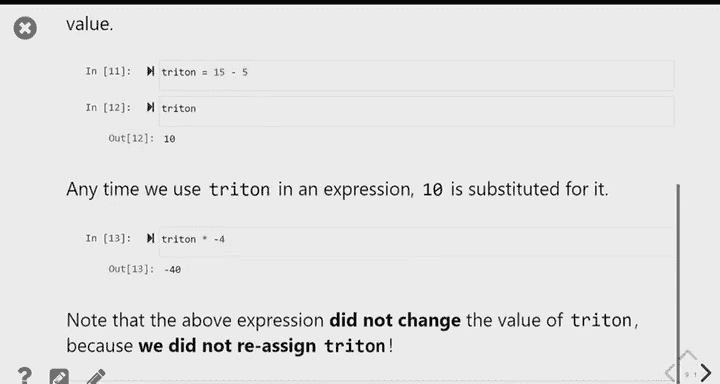

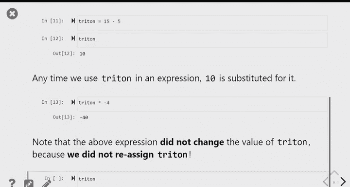

So if you wanted to change the value of Triton， you would have to create another assignment statement。

 Triton equals something， and that's how you would change its value。

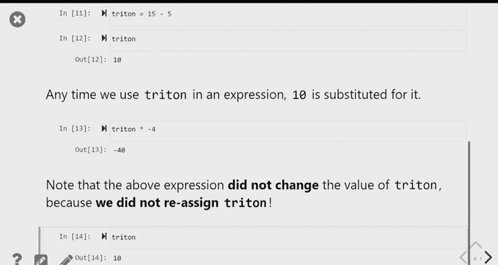

so these are some restrictions about naming variables， I won't go through this in too much detail。

 but basically there's some small constraints and as you're naming a variable。

 you want to make sure you satisfy the strict requirements because you have to。

 but you also want to make sure that you give your variables meaningful names。

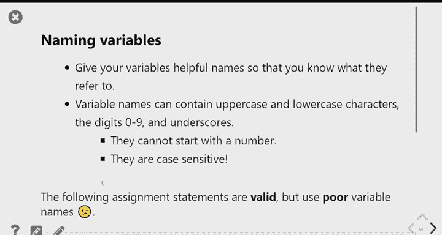

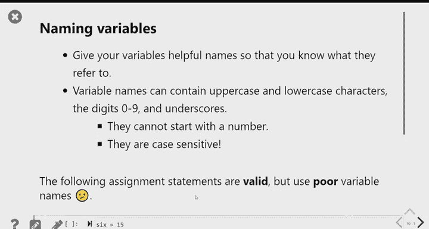

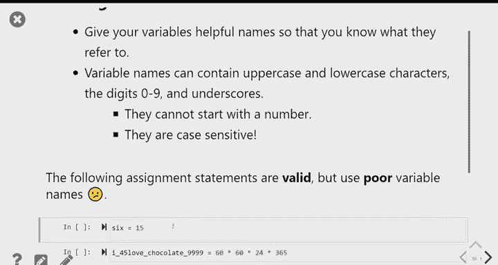

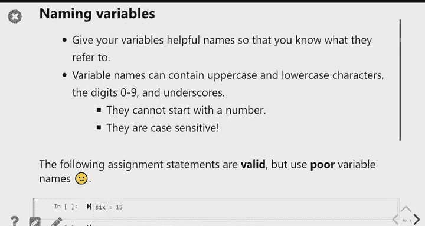

Like these are bad ideas， making a variable called6 and storing the number 15 in it。

 that's just confusing because when someone looks at your code if they think six should represent six。

 but it doesn't。嗯。This isn't the type of thing most people would do like intentionally。

 but this is the kind of thing you might do by accident where you have a variable called six and it's six originally and then you like change it somehow and it's not six consistently throughout your whole program。

And I mean， I love chocolate， but this isn't the greatest name for a variable because it doesn't say anything about what the variable represents。

 right？😊。

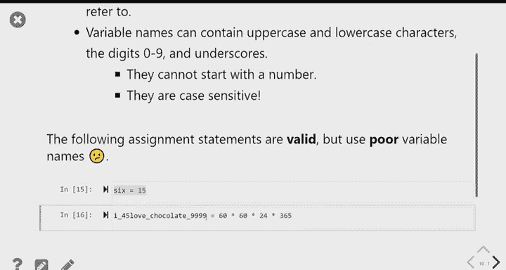

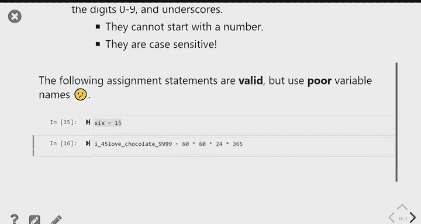

These are better examples， seconds per hour， hours per year， seconds per year。

 right they say what they are。

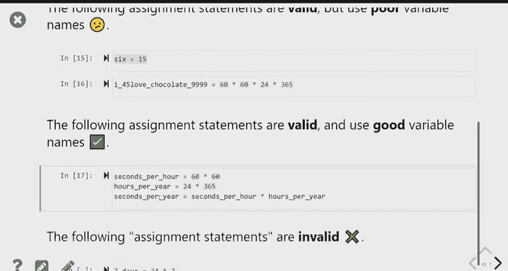

These are invalid， this one starts with a number which isn't allowed。

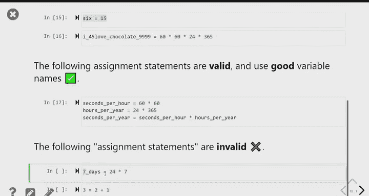

And this one。

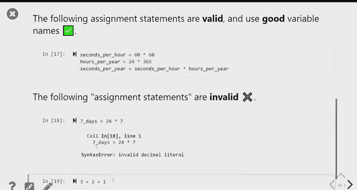

Basically， the variable name that you're trying to give it is three。

 but three is not a variable name， three is a number and the fact that this last cell errors。

 I think is really interesting if you think of the difference between programming and math right this highlights the difference in math。

 if you said three equals 2 plus one， thumbs up like that's great that's true， no problems right。

 but if you say three equals2 plus one in Python like that's a problem because the equal sign isn't really used to mean these two things are the same right the equal sign is used to mean make a variable and store this value in that variable So when I read these instead of saying equals。

 I prefer to say gets。😊。

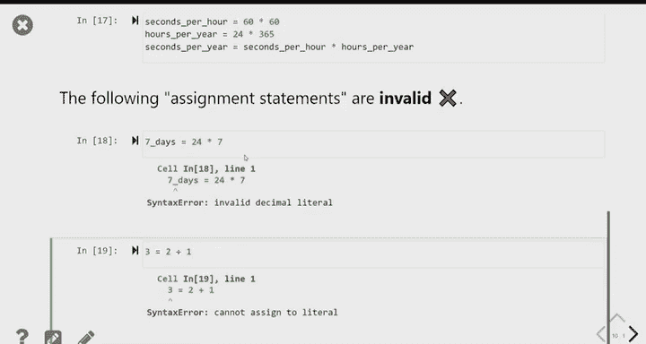

Like make a variable called seconds per hour and it gets the value 60 times 60 or assign sign at the value but equals isn't really the right word。

 even though we use the symbol equals Does that make sense？

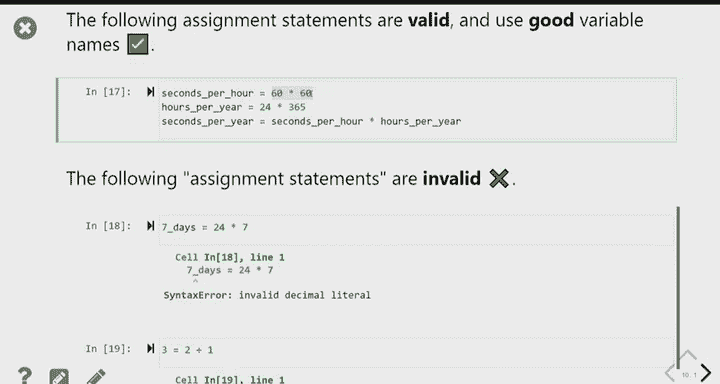

Okay， similarly。

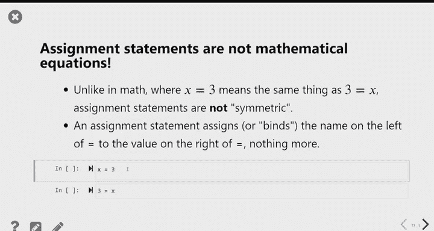

Right。You can do something that says assign the variable x， the value 3。

 but you can't say assign the variable 3， the value x。

So there's a difference between Python and math， and they're not symmetric。

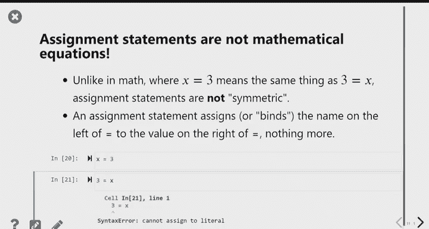

Okay， so here's another example in this one code cell I'm defining two variables okay you can do that it's especially kind of convenient to do that for assignment statements because you don't need to see any output right last class we talked about having multiple Python expressions in a single cell and you could only see the last one。

 but here I don't need to see any of them so I might as well put them together in the same cell。😊。

So what I'm basically doing is making a variable called UC， its value is 2。

And then I'm making another variable called S D。 Its value is3 plus whatever you see is， which is 2。

 So basically， I'm setting S D to 5， right。But assignment statements aren't promises， for example。

 if I change the value of UC。Right。This is this relationship is no longer upheld。

 right S D is still the same as before。 SD is still5。

 and it's no longer true that SD D is three more than you see。

Right， in math， if you have like two variables and you say like y is one more than x。

 then if x changes， y is expected to sort of automatically change accordingly， right。

 but that's not the case here。 Things are executed one thing at a time and variables only change their values when you use them in an assignment statement。

 So I've never used SD in an assignment statement。Aside from right here。

 at which point I was setting it to five。So it's still five。If I wanted to actually change it。Right。

 what would I have to do， I would have to do something like this。 set S D。Again， to be。

Three more than you see。

And now SD would actually be 10。Okay。So what I did in this last cell was I did an assignment statement。

And then I asked to display the value of the variable after the assignment。

 this is a very common thing to see both of these together in one cell。

 it's like do something and then show me to confirm what I did right The second line is there for you as the programmer to like make sure things are being stored as you expect right to confirm that everything's going according to plan the first line is there for the computer to tell it what to do。

Does that make sense？Okay， questions。

Okay there's one extra practice question here， I'll let you guys try this on your own。

 either now or after class， and you'll be able to check whether you got it right by copying and pasting the lines of code。

好。So the question is try to answer it without running the code。

 and then you can run the code to how to see if you got it wrong basically。

Something useful to know is when you're working with variables。

 if you give your variables meaningful names， they might be kind of long names。

 like seconds in a year or something and you don't want to type that out every time because that's kind of cumbersome if you start typing。

😊，And then hit the tab key。It'll give you a little menu of variables you've named that start with that value。

So SECO， I have seconds per hour， I have seconds per year。

 I can click one and that auto completes it for me， okay so that's very handy to know。Okay。

 so so far， we've basically used Python as a calculator to calculate things and to store some of those calculations in variables。

 okay， but still this is nothing really new that your graphing calculator can't do。

What more can Python do Next we'll talk about how we can use Python to call on functions。

So you probably know about functions from math， right， functions take inputs and return an output。

Up top I have a function of two variables， it takes some number x and some number y and calculates x over y plus blah。

 blah， blah， like it does stuff to the X and y， and in the end it gives you a single number right functions can only output one number。

 they can take any number of inputs。And you can calculate。The output of a function。

 even if the inputs themselves are more complicated， right。

 you would first sort of evaluate the first input sub that in for x。

 evaluate the second input sub that in for y The same thing works in Python with functions。

The inputs to functions in Python are called arguments。

And we say that we call a function when we want to ask it to operate upon certain inputs。

So there's some built in functions within Python that are pretty basic and they do kind of standard obvious things that you would want。

 such as absolute value。Right， and then the names of these functions are pretty。Predictable， right。

 abs for absolute value。 And just like in math when you。

When you use function notation， you say f of x right And the of is like you put the x inside parentheses。

 It's the same thing here。 This is like saying f of negative 23， except the functions not called F。

 It's called abs right So this means find me the absolute value of negative 23。 and as expected。

 it gives you 23。

So we'd say that we're calling the function abs on the argument of negative 23 and calling a function means do your thing on this input and different functions do different things。

 abs basically remove the negative sign if there is one。

Okay， so here's another sort of standard built in Python function that you might find yourself using the max okay or the maximum of a bunch of numbers。

 so the max of four and negative8 is4。

The max of this set of numbers is 10， the largest one there。

These two cells illustrate something special about Max is that Max takes a variable number of arguments。

 a variable number of inputs， right when you say abs are absolute value。

 you can't ask for the absolute value of like five numbers at once absolute value is a thing you do to a single number So I was able to give abs and put in a single number inside these parentheses right。

 but max is actually the opposite。😊。

You don't do max of a single number， you do max of multiple numbers。

 so you can do the max of two numbers or five numbers， but you can't do the max of one number。

Does that make sense？

The error kind of。Tries to tell you what's wrong， but error messages can be really hard to decode。

 especially when you're just starting out， it says int object is not iterable and what that means is that we're giving as an input and integer。

 right？And that's not iterable。 Iterable is like a sequence of things that you can iterate through one at a time。

 right， And there's only one thing here。 So it's basically like what's next。

 like what am I comparing this to。 I can't find the max because you only gave me one thing。

Whenever you see errors， feel free to like Google them to see kind of what they mean in plain language。

 that's pretty helpful。Here's another call to the max function。

And this， again， has max with two arguments， it's just that the arguments themselves come from Python expressions。

So this is really asking for the max of 19 and negative one。

And it would first evaluate 9 plus 10 and 9 minus 10， and then feed those in as the inputs to max。

So this is called nested evaluation， doing like a function。

Doing like some expression or calculation， which may involve functions inside of a bigger function call。

 So this is an example of nested evaluation。😊。

And you it takes like some processing to figure out like what is this doing。

 but the way you figure it out is you kind of work from the inside out。

So here's a little slideshow that illustrates this。

Okay， like what's sort of the innermost parentheses？Well。

 one of the innermost things is computing this max， right， is there's nothing inside this to do。

 It's just the max of two numbers。 Okay， the larger of these two numbers is 100。of what's left。

 one of the innermost things is the min of these two numbers。

 so the min of these two numbers is negative2。Next， the innermost thing is the maximum of all these。

 which would be minus1。Okay， next would be the absolute value of minus1。Which is positive one。

And then finally， the minimum of these is positive one。

 So that's what's happening sort of behind the scenes when you。

Run the cell up here。 Python does all of that， right， And it just tells you the answer。

 It doesn't tell you the intermediate steps。 Okay， so one thing that you'll notice that out the class is what we try to do is we try to to teach you sort of how the computer is working and what it's doing。

 right， Anyone can like hit shift enter on a cell to see the output， right。

 But our goal is for you to understand what's happening behind the scenes， okay。

I mentioned this last class， but the way I'm running these cells is I'm holding the shift key。

 I'm clicking inside the cell， I'm holding the shift key。

 and then I'm tapping the Enter button and that runs that cell。

So I introduced a couple functions here， abs and Macs。

How do you know sort of what functions there are and what they're capable of。

 you kind of look it up through documentation。So there's a couple ways you can get help on a function。

Here's a round function。You might have a guess on what it's doing。

If you type the name of the function followed by a question mark and then run that cell。

 it brings up this little panel from the bottom。That describes sort of what the function does。

The signature shows how you're supposed to use the function， you're supposed to round。

 and then you can give a number to round。And it actually takes two arguments。

 the second argument is the number of digits and digits。But it's set to none。

 meaning that's optional。 and then there's a description of what it does。

 It rounds a number to a given precision in decimal digits。

And the return value or what it gives back is an integer if the number of digits is omitted or none。

 that's what I did in my first call to the function right。

 I didn't specify how many digits to round two， so it just gave me to the nearest integer。Right。

 otherwise。😊，It has the same type as the number， number of digits may be negative。Okay。

So。If I did a comma 3 and had a second argument of three， it would be rounding this to three digits。

If I did。To two it would be rounding it to two digits and so on It also said something that you can work with negative digits。

 that's something for you guys to explore if you want。

 play around and see if you can figure out what it means to round a number to a negative number of digits。

So there's some built in Python functions like abs Max Ro。

 but Python doesn't have everything you might ever want。

You can kind of use functions that other people have written and sort of made publicly available through these modules。

 which are just collections of Python functions and values。

 and you can import basically other publicly available modules into your program so that you can use these other functions。

So an example is the math module。Okay，The math module has a whole bunch of additional functions that are math specific。

 like sine and cosine and logarithm and powers and square roots and mathhy types of functions。

So to get all of those functions available to me， I need to import math as follows。

 notice the word import comes up in green， that means it's like a special keyword in Python。Okay。

 now after importing， I have access to all of these functions that the math package has。

 how do I use them？

So that's the last bullet point on this slide。

The notation is a little different if your function comes from a package before you type the name of the function and give the input and parentheses。

 you have to say what package or module is your function from okay so if I imported the math。Module。

 I would start with math dot， and then I would say the name of the function in the math package that I want。

 Okay， this is called dot notation because of this dot right here。

So I'll show you an example like the math package has a square root function， right。

 but I can't just say square root of 16。Because when you don't specify what module it's coming from。

 it thinks you're using just a built in Python function and Python doesn't have a square root function。

 Okay， so it gives me an error that there's no such thing as square root。

But when I do math。tqua root， that says look inside the math module for a function called square root and use that on the number 16。

Okay。Similarly。Powers， this does two to the power five。

The question mark is helpful for these functions as well to learn details of how they work like it's not obvious from the name log。

 what base the logarithm is， it turns out you can specify a base if you'd like or you can not specify a base and it'll use the natural log so the details of these functions are not important what's important is to know how to find the information about any given function using the question mark。

Another thing that's pretty handy to know is like what functions even are there for me to look at if you type math dot and then hit tabab。

 just like I showed you before when you were typing variable names and hit tabab。

 it'll show you like possible ways to complete that Ma dot tab will show you possible things that can go after Ma dot。

 in other words， possible things that are available from the math module。

So these are all these arc cosine functions and hyperbolic arc cosine crazy math functions， right。

 there's a lot of options， there's also constants。Like the number E。Or the number pi。Right。

In addition to functions Okay so constants notice are like variables， they variable named PI。

 right it's not a function， It's not doing an operation to an input right， it's just a number。

 so it doesn't have parentheses， I don't do this。Okay。

All right， I'm going to give you。

A couple minutes to try to answer this concept check question， so I use this website calledcc。dsc10。

com。And that's just kind of like a multiple choice Google form where you can tell me how you vote on this question just so I can see the results。

And the question is， assume you've run the following statements， x equals 3， y equals negative2。

 which of the following examples results in an error？

And if you don't think there's an error。Try to tell me what it evaluates to。

So。

Take a couple minutes to work on that， you can talk to people around you， work on it together。

 check your answers and vote on the website， okay。

The nice thing about doing this through the form is that I can quickly see how people are answering。

It looks like we're getting a lot of votes for。

What is it， A and C， and then the most votes for E， which is more than one。

Sounds like A and C。

Okay， so let's check it out。

I'm going to actually run the code。

This is a conceptual question， so you should try to answer it without actually running the code。

 but you can run the code to sort of verify if you got it right or not。😊。

Okay， so I'm assigning x to 3 and I'm assigning y to negative 2。 okay， yeah。

 a is going to be an issue， can someone tell me what's the issue here？What's that raise your hand？

Yes， you can only take the absolute value of one thing， right， not two things。

Okay， so it comes up as it calls a type error， it's expecting one argument， but you gave it two。

 that's a pretty helpful error that tells you what's wrong。

Okay， how about the next one？What is it going to evaluate to， that's my question。

ine， okay， so what are we doing， we're doing absolute value of y first， two。

 and then doing three to the power two。

should give you9。

Okay。C was one that we also thought there might be a problem， let's find out。

Yeah， there's a problem， can anyone say what the problem is？Yeah。

 the max function takes multiple arguments and the absolute value of something is just a number okay。

😊，嗯。wrong to say that Max takes multiple arguments because math technically takes a sequence right we can enter one argument which is a list and it will give the Yeah。

 so you can use Mac and give it a list or as we did it。

 we just gave it multiple thing or multiple arguments。

 but there's no such thing Max can also take one argument if it's a list right。

But we haven't done that yet， yeah， exactly。

嗯。Okay， so that was the problem with this one。 Let's see D。

Okay， that one works， and it's some crazy number because what is it doing， it's doing， let's see。

 three to the minus2， what is three to the minus2？One over nine， yeah。

 and then it's doing three to the one ninth power essentially， so yeah， nothing。

 nothing you want to be able to do by hand。Okay， any questions on any of those？

Great。😊，Okay， now we're going to talk about data types。

 which is sort of how Python stores the data that you give it。 So here's two basic math expressions。

4 divided by 2 and 5 minus-3。

And notice that they come out a little different。In terms of how the answer is shown， right 2。

0 versus 2。Those numbers like are the same to us， they represent the same number。

 but Python is treating them differently right what's going on This happens because every value in Python is stored in a certain way。

 right that's called its data type。

And we're going to look at sort of different ways of storing data and some of their differences and pros and cons。

There's a Python function called type that tells you how a value is being stored。

 so you can ask for the type of a number to learn more about it。

The two data types for numbers are int and float， int is for integers and floats are for numbers that have a decimal。

 so the number two is an int， but the number 2。0 is a float。

That's basically the difference between what we were seeing there。Okay， ints come up。

When you add， subtract， multiply or exponentiate two integers。

 right and that's because of mathematical rules， like the sum of two integers is always an integer。

And you can verify that by asking for the type， so this is the Python function type。

And just like all functions， I call it using that F of x notation。

 and the input is the thing I want to check the type of。 Okay。

 So this tells me that this answer is an int。

You can calculate really big numbers using ints and you'll get exact values， crazy numbers okay。

Flow， on the other hand。

Here's the sum of two floats leading to a float， which you verify by checking the type float。

 on the other hand， when you calculate big numbers。

 it gives it to you in scientific notation So this right here at the end E plus 90。

Means times 10 to the 90th power， okay， so you're not seeing like every single digit like you would for an integer。

Floats have one issue that you'll encounter a little bit。

 which is that they're not perfect at representing numbers and that just comes from like an inevitable fact that there's infinitely many decimal numbers right like between any two decimal numbers you can always find another one and there's just not enough like digits or numbers or space in a computer to represent all those possible real numbers so。

That means that floats aren't stored sort of exactly precisely。

 sometimes they're like rounded to a nearby float that's easier to store and that can lead to weird errors usually in the last few decimal places of a number so for example。

 if you do one plus02。

However， Python is actually storing these numbers behind the scenes， it all works out fine， right。

 but if you do one plus 01 plus 0。1。

You don't exactly get 1。2 as you should right you get some number that's really close to 1。2。

 but the last few digits are wrong。 This is sort of an inevitable problem of computing in general。

 it's not just a Python problem Other programming languages have this issue It's just a basically a problem of trying to represent an infinite number line in a finite amount of computer space So in this class we're not going to worry too much about this all the tests that we have in the assignments will still pass even if your last few decimal points are off by a little bit。

Another issue with floats is that they do have a limited size。

 although you're unlikely to encounter it with any of the calculations that we'll be doing okay。😊。

So just to sort of recap on the data types， there's two types of storing numbers int and float。

 right， and there's actually a way to go back and forth between them。

The way that you convert between them is using functions。

 so theres a function called int that takes in a number and produces that number as an int。

 and there's a function called float that takes in a number and produces that number as a float。

Okay， so let's look at these first few examples that show what happened when you combine ins floats in a single expression。

So basically the result is when you combine an in afloat， the answer is going to be a floatat。

And that's because the float may represent an integer like here， 2。

0 actually could have been said stored as 2， but it may not， it could have been two and a half right。

 so it kind of does the more general thing which float is more general because an int can always be represented as a float but not necessarily vice versa。

When you divide to integers， you also get a float because again。

 like sometimes it works out that the answer could be an integer， but not all the time。

 right if I did 12 divided by5， then it would have had to be a float。

Let's say you divide 12 by 2， but you know the answer is going to be 6 and you want that6 stored as an integer。

 You can use the function int， which think of that it as like a conversion function， convert to int。

So it's going to take that 6。0 and give it back to you as 6。

What about the opposite way if you take a float？And use the int function or sorry， yeah。

 take a float and use the int function on it， like a float that's not meant to be in itt。

Right。This just chops off whatever is after the decimal。

 So basically be cautious when you're using an int function。

 like the thing you're feeding in should actually be an integer。

 otherwise it doesn't necessarily make sense。

Maybe you wanted to do this， but like just be careful。There's also， I didn't put it on the slide。

 I guess， but there's also the float function。

Right， you can convert the number five into a float using the float function。

 so int and flow are both data types right you can ask。

What's the type？

Of 6。7。And it's also a function。That you can use to convert something into that data type。

So ins and floats are the data types that we use for numbers。

 but not all of our data is numerical right in the last class we looked at the little woman book。

 we didn't really have any numbers there， we just had a bunch of text。

So we also need to learn how to work with text data and the data type for text in Python is called a string。

 So a string is just a chunk or a snippet of text it of any length。

 It could be an empty string with literally nothing in it， or it could be like an entire book。

The way you specify that you're working with a piece of text is that you use quotes。

 you can use single quotes or you can use double quotes。

 it doesn't matter which one and Python treats it exactly the same， no matter which one you choose。

 so whatever your preferences。

So here's a stringwoof。

And if I ask for the data type。It's going to tell me ST TR。 That means it's a string。

 So it recognizes it as a piece of text， basically because of the quotes。 If I didn't put quotes。

It would be like it would think that Wof is a variable。

And I haven't defined a variable calledwoof。So I'm not talking about a variable called wolf。

 I'm talking about the actual letters， WOOF。

That's a string。

Stringings can also incorporate emojis or numbers or punctuation， basically anything on a keyboard。

そ。Numbers themselves can also be strings。Start with this， 1998。

If I try to add one to this。

It's gonna be confused。Because it's not treating 1998 as a number。

It's treating it as a piece of text without the quotes， 1998 plus one， that's easy。

Right。But if you think of the。The text 1998 on a keyboard， like just typing those numbers。

 it doesn't really make sense to add one to a piece of text， right？

There is some notion of what you can add to strings。

I'll show you。Here right here， I was trying to add a string and an int。

 but what if I try to do plus 17 with 17 being a string？

Look what it does。

It just smes them together。Okay， so this notion of adding two strings is called concatenation。

Usually the word addition makes you think of math， the word concatenation is this operation of smushing two strings together。

So here's a string， I'm going to put it in a variable called S1， the string is baby。

 and here's another string which is just the panda emoji， and that's in a variable called S2。

Okay so I'm going to define those variables， notice there's no output。

And then I'm going to ask for what happens when you concatenate these And the result is it makes a single string with both of the contents muush together。

One immediately follows the other。 There's no space。 right， If you want a space。

 you may have to actually add three things。 and one of them。

 the middle thing that I'm adding is just a string with just a space in it。

So that sort of forces you to have a space between I use this kind of structure a lot when I'm working with student names right if you have a column of first names and a column of last names。

 you don't just want to smush the first name against the last name you want a space in there so you have to sort of manually put a space like that。

This thing I think is kind of cool， multiplication。

 you can multiply a string by an integer and what that does is like the same way you learn multiplication in elementary school when you learn something times three you think of it as plus itself plus itself。

So S1 times3 is just the string S1 plus the string S1 plus the string S1。

Questions。

Okay， the real interesting things that you might want to do with strings。

Are available through special functions Okay， just like we saw Python had built in functions like absolute value and rounding and stuff。

 and the math package had functions。 there's also special functions that go with strings and these are called string methods。

And the way we access or use string methods is a little different than the way we access regular functions。

With regular functions， you just type the name of the function。

 and then you put an input in parentheses with string methods。

You use this sort of dot notation where you start with the string or a variable representing the string。

 and then you put a dot and then you put the name of the function that you want to apply to that string。

 Some functions take additional arguments in here and others don't。

Okay， so I'll show you a few。Here's a string calledFaAve string， it saysMy favorite class is DSE10。

And。There's a string method called dot title。And can you see what that does。

 It puts like the first letter of each word as a capitalization。

 just like you would for the title of a book or something。

 But notice the way that I'm getting it to do that。

 I I'm giving the string itself for the name of the string。 in this case， it's stored in a variable。

 So I'm giving the name of the string dot。 And then the name of the method。That I want to apply。

 So a method is just like a function that's available for strings。 Okay。

 and I don't need to put any inputs because all you need to know to convert something to a title is is what string am I doing it to。

There's no additional information that's needed， same with uppercase this converts everything to uppercase。

 you don't need to give it any extra information besides the string that you're trying to convert。

But this one， you do need extra information。The replace method， so replace method says。

What do you want to replace and what do you want to replace it with。

 So I'm going to replace the word favorite。

With three of these heart eye emojis。

So in these few examples， I was using string methods on my string that was stored in a variable。

 but you can use the string methods directly on the strings themselves， right。

 the string doesn't need to be stored anywhere。 you can just use a method directly。

Another thing that's really handy to know about strings is how they work with the Python function L。

 LEN stands for Li。And that's a built in Python function。

 So notice the way I'm using it is like the F of x notation。 I just type the name of the function。

 and then in parentheses， I pass my input。And what the length function does is it tells me how many individual characters are in my string。

 so it's counting letters and spaces and numbers and punctuation and there's 28 sort of key presses in my string。

And just like you can convert data types with int and float using int and float functions。

 there's a function called STR that converts something to a string。

 You can always convert numbers to strings。 You can't always convert strings to numbers， right。

 It depends what they represent。

So the number three can be converted to a string。

The string three can be converted to a float。

But the string4 can be converted to an int。 Okay， this is the one that doesn't work， right。

 the string baby panda。

Can't be converted to an int because that string just doesn't represent an int， basically。

Okay。

The empty string with nothing in it also can't be converted to in it。

 So these functions only sort of make sense in certain scenarios that make sense。

Okay， I'm going to stop there。嗯。And I'll see you guys next time。

Could you help me if I would like to add a new line。

