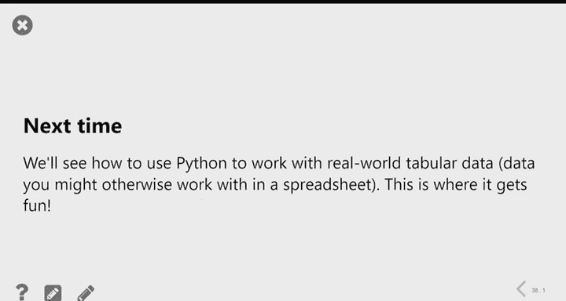

# UCSD《数据科学原理 (DSC 10 Principles of Data Science Fall 2024)》中英字幕（deepseek - P3：DSC 10 - Principles of Data Science - LE -A00- - Lecture 3.zh_en - GPT中英字幕课程资源 - BV1hmAneGEZh

。All right， good morning everyone。Okay， let me start with our announcements。

The lab is due tomorrow so hopefully you're making progress on that the goal of labs is everyone should get 100 because the testers there like tell you if you're right or wrong so if you're not passing a tester come to office hours。

 ask on Ed so in order to get 100 and have time to do that you have to start early enough that you have time to get help but the goal is everyone to get 100。

😊，嗯。There is a laboratory time that you have blocked for this afternoon in the schedule of classes so you'll see some hour that's dedicated to DSC10 and Webbridge but don't come today because there's nothing going on that time is only for quizzes we will assign you a quiz time based on what preferences you put in that welcome survey by this weekend so that you'll know when you have to come for future quizzes。

 there's a quiz next Wednesday but there's nothing today so don't show up。Questions。Okay。

 and then also I want to say office hours is happening。

 I got to meet some of you last night at like a new student mixer that was hosted by the data science department so that was nice。

 but if I didn't get to meet you and you want to say hi。

 I have office hours today from 11 to 12 and lots of tutors are hosting office hours throughout the week。

😊，Okay， so we're going to kind of plow through the basics of programming again today， oh yeah。

So check the calendar that on DSC 10， there's a calendar page that shows the room number for everybody。

 it's in the HDSI building。U。Yeah， we're kind of。Breezing through the basics of programming。

 so if you're familiar， this will be review， but if you're new to programming。

 it's all coming at you very quick， so make sure to take advantage of the resources and come to things to learn。

Okay， so today we're going to review a little bit about strings。

 and then we're going to start talking about means and mediums of data sets and then organizing values in a sequence。

 so we have lists and arrays and ranges are all types of sequences in Python。😊，All right。

 so string was the word we used for a piece of text。

 so when we worked with the little woman data that was a string and we tell Python that we're working with a string by putting our text within quotes。

 you can use single or double quotes， it doesn't matter， it's all the same to Python。

And we saw at the end of last class that strings have special functions available to them called methods。

 So methods are accessed in a different notation than regular functions， regular functions use。😊。

The F of x notation， so like there's a function called L that counts like how many individual letters or characters a word has。

😊，Okay， this is a function。So you use the F of x notation。

The input to the function goes within the parentheses。But strings also have methods。

And they use this thing called dot notation。Which is。In the case of strings。

 you put the string first， and then you put a dot and then you put the name of the method。

 and then in parentheses， you'd put any inputs that the method require。

This method doesn't require any inputs。so that's why there's nothing in parentheses。

What the upper method does is just changes it to uppercase。And we talked about different data types。

 how there were int and float for numbers and how there's string for text。

 and you can convert between different data types using functions that convert something Okay。

 so there's an int function that converts something to an int。

 there's a float function that convert something to a float。

 and there's an STR for string function that converts something to a string。Okay， so those words int。

 string and floatat are both data types， but they're also the names of functions in Python。😊。

And what can be converted， Basically， anything can become a string。

 Like you can treat any number as a piece of text， right， but not everything can become a number。

 right， Word like with letters and emojis and punctuation。 like those just aren't numbers。

 So Python will error。 if you try to try to do that。 Okay， so here's some example conversions。

This is converting an int to a string。What is this one converting？A string to a float。

This is converting a string to an int。Right。The thing I'm converting is the thing inside parentheses。

 and I can tell it's a string here because they're in quotes。

This is trying to convert a string to a float。So much like the second one。

 trying to convert a string to a float。Except this one doesn't work。

Because baby panda is not a valid decimal number， okay so it knows that and it's going to give you an error。

This one is trying to convert。A string to an int。Okay。And it also doesn't work because 4。

3 doesn't represent an integer。This one's a little more interesting because obviously baby panda doesn't represent a number。

 but 4。3 is a number， it's just not an integer If you remove the decimal point。

It would be able to convert that to an inch。But with the decimal point。

 it doesn't know how to behave because basically it just looks at each individual character and sees if it's a number from zero through9 and period or decimal point is not。

 and it doesn't know what to do。There is kind of a workaround here。Which is。

If you really wanted to make 4。3， the string into an integer。Well， it's unclear what that even means。

 but you could convert 4。3 the string to a float。Okay， because 4。3 does represent a decimal number。

 so that's going to work okay。So this is converting。String to float。 Okay。

 and then you can convert that to an inch。 So this would mean take the output。

Of the previous expression and pass it as the input to the int function。

 So this is basically saying convert 4。3 into an inch。 And do you remember what it does Yeah。

 it chops off whatever is after the decimal。 So it's just gonna give you the answer for Okay it's unclear why if you would want to do this in practice。

 but just to show you that this does work， but you can't do it directly。Okay， I'm gonna。

Have you tried this concept check question？So this is the same website that we use last class，cc。

dsc10。com well always use the same site and try to answer this question without actually running any code just using the knowledge that you have from this class and last class。

 which of these are going to be evaluated without an error， and if it's going to work。

 also try to think about what it would evaluate to。Okay。

 so I'll give you a couple minutes to work on that， you can talk to people around you if you like。

这个那。方式。自己先决。出钱。好。ございます。来就出这原。すな。没有。你们生活。こやでしま。ご一さ。セクタ？So。てラ美味しい。打包关。Yeah。s。Okay。Let's try them out。

What about x plus Y， give me thumbs up if that's going to work or thumbs down if you think that's not going to work？

Yeah this doesn't work because there are different data types， one's in int and one's a string。

 right， so let me copy this。And if you try to do x plus y。It's confused， because。

Like when you have an int and you use the plus sign， that means mathematical addition。

 like as you learned in grade school， but when you have a string and you use the plus sign。

 that means the smushshing or concatenation right so it's like confused about what operation is supposed to be doing。

I think there's another one that has a similar problem。

 can you find which of the answer choices like kind of fails for the same reason？C， right。

 this is trying to add a string to an inch。So that's just not going to work。Okay。

And the error something about concatenation。 Okay， so A and C have errors。 What about B。

 Give me thumbs up， work or not work。Okay， let's see what's wrong here。

The problem is the conversion to an int， okay， so one piece at a time。Y plus z。

Works because that's the concatenation of two strings。

 but just like we saw with the previous example， it can't directly convert this to an it。Okay，45。

6 doesn't represent an integer。 Okay， so let's check D， does D work or not work？Do you will work。

What does it come out to？So convert x to a string， that's three。And then add to that string。

 the string 5。6。35。6。Okay， any questions on those。All right， cool。

We're going to switch gears a little bit。We've done a lot of programming and talk about something that's just more data centric means and medias。

 right， So now we know how to store sort of individual numbers as ins， floats。

 pieces of text as strings。 But what we're going to move towards is working with data sets， right。

 which are collections of numbers。Okay， so a sequence is some ordered collection of values。

 sequences have a first thing and a second thing and a third thing。And for any set of numbers。

 right it's helpful to kind of summarize the data set。

 we often use the mean or the average or the median to summarize a set of numbers and mean and median are both measures in what we call central tendency。

 they tell us something about sort of where the data set kind of falls on the number line in a very rough sense where the center of the data falls。

😊，Okay so the mean， you know how to calculate the mean。

 you add up all the values and you divide by how many there are some properties of the mean is that it doesn't have to equal one of the data points。

 the example shows that。It doesn't have to be an integer， even if all the data points are integers。

 you can come up with a really quick example， like the mean of three and four is not an integer。

 even though the data is。😊，嗯。The mean is somewhere between the smallest and largest。

 but not necessarily halfway between。And then if you think of the data as having units like maybe these represent how many dollars people have in cash or something。

 right， then the average is how many dollars they would have if they pooled their money and separated it equally right so dollars to dollars。

 the units are the same。Okay， the median is a different way of summarizing a collection of numbers。😊。

The way we calculate the median is we put the data in order and we pick the number in the middle and if there's two middle numbers。

 the convention is to usually pick the number that's halfway between the mean of those two middle numbers okay so in the first example there's five numbers so the median is the middle number they have to be sorted for that to make sense which they are and in the second example there's kind of two middle numbers。

 so halfway between them is five and a half。😊，So for the same data right。

 the mean and median might come out different or they might come out the same。

 there are two different ways of measuring the center of a data。

 so there's no guarantee that they're going to come out。

So I want to give you a few minutes to try to come up with examples of small data sets that have each of these properties okay try to make your examples as simple and straightforward as possible。

 like don't come up with a set of 10 numbers， come up with a set of two numbers if you can so I'll give you some time to come up with such examples and then I'll ask for volunteers to share their results。

Okay， so try that out again， you feel free to talk to each other if you like。because they're清。没有。可意见。

Yeah。いてない。原告提。哪些去。大年です。いなり。是什么？Okay， raise your hand if you have an example for the first one that you want to share。

Or the same。One， three， five。One， three， five。And one，2， six。

 okay so to have the same mean since there's three numbers each they'd have to have the same sum。

 so this adds up to nine， this adds up to nine， okay， so they're going to have the same mean。

 but they're going to have different mediumns because they have different middle numbers Okay good so this was an example with three numbers can you do this with two numbers。

No， you can't。 Like if the two numbers have the same mean。

 they're also going to have the same medium。 Okay， so this was like the best example you could have found。

All right， can someone else tell me their answer for number two？Yeah。One， two， two， two， five。

 and what else？One，1， three， three，6。Okay， same median。Oh wait。1，1，2，3。Okay， yeah， yeah。

And change that two or two yeah， so the same medium there we go， but different means。

 probably because they have different totals。5，7，9，11，12。N， 11， 12， 13。Is that right Yeah， okay。

 so that one works， you might have been able to do this with a smaller data set than five numbers。

 but this is fine。😊，Find two different data sets that have the same median and the same mean。

Anyone got that one？Two， four， and 1，5， yes， so their middle number is three。

 like their median is three and the mean is also three， okay， nice。Okay。

 so basically this activity is just to show you that means and medians are kind of just summaries right。

 they don't tell you the whole story about a data if you know the mean。

 you know the median that gives you something useful。

 but it doesn't tell you everything about what the data looks like right you can have you know。

 same mean different medians， vice versa， etca。What we will start looking at in a couple weeks is about the distribution of a data。

 meaning like where the numbers actually fall as opposed to like some summary that tells you roughly where they fall the distribution shows you like fully where the numbers fall and you can visualize a distribution using a histogram so these are examples of two histograms and the only thing that that's really different about the data sets they correspond to is this last number right this might correspond to the data one22。

Three， three， three。Four， four， five， and the data set on the right。

 the five has just been changed to a ten0。Okay， so what that does in terms of mean and median well doesn't do anything to the median right because we didn't change the middle number。

 we just change the biggest number。 So these are going to have the same median。

But the mean is going to be different because the total is going to be different when I change a5 to a 10。

 so these are going to have the same median。But different means。

And we'll learn sort of how to look at the histogram and kind of visually understand why that happens。

Okay。So we talked about means and medians because we're going to start working with collections of data。

And the first example that we'll look at for a collection of data is average temperatures for a week。

So let's say you store temperatures for a week and your goal is to compute the average temperature in Python。

 like the best way we know to do that right now is make variables for each day of the week and store the temperatures there。

Right which does allow us to like calculate the average temperature。

 but it's kind of cumbersome because you have to type out all these variables right the seven variable names and if you had like a month's worth of data or a year's worth of data。

 it would be a lot to store each day's temperature in a different variable what we want is something that kind of allows us to use in one variable to store a whole bunch of values and such a thing in Python is called a list so a list is just a way of storing multiple values within a single variable。

😊，And the way we say that we're making a list is we use square brackets。So。

An opening square bracket and a closing square bracket in between them you put comma separated values。

Okay， so temperature list is a single variable， and it has all these numbers in that variable。

Ls have lengths， just like strings have lengths， the length of a string is how many individual characters。

 the length of a list is how many values are stored in there。and this is seven values。

 there's six commas between them， in other words。😊，I very。

This doesn't say like when of those temperatures work。Right。It was 68 degrees on Tuesday。Right。

 so this is just the numbers， right， And it doesn't say when they are lists have an order to them。

 So like。It kind of implies that this happened first and then this happened second and then this happened third。

 but it doesn't associate like a date to it right And if you wanted to associate a date to it。

 you would need more than just a list， you would need like two lists which the way you'd really show that would be in a table of some sort like a two column table where it was the date in one column and the temperature in another column And so that's that's our eventual goal is we're going work with what like tables of data that have multiple columns that describe multiple things like maybe you keep track of the high that day。

 the low that day the date， the day of the week where where it was taken like you can keep track of all a whole bunch of information So this is kind of like for now we're just looking at one sort of column of such a table one set of numbers。

 but eventually we will put many of these sets of numbers together to make a whole dataset set。

Makes sense。Yeah， great question， thank you。Something to point out about lists is that there can be repetitions。

 right， it was 74 degrees twice， that's fine。So cheese。I cut all the way to the end somehow。

All right， why do we like lists？Okay， lists are nice because it makes it easy to calculate things about sequences。

 so like if you wanted the average temperature， you can do that by using the built in function sum。😊。

Which when you give the sum function a list input， it just adds up all the things。

And then you can use the built in function L， which tells you how many things there are。

 So here's my temperatures and here is in one quick step。

 right the average temperature and imagine temperature list had a year's worth of data。

 my code to calculate the average would be exactly the same。

 whereas before if I was doing one seventhth times this variable plus this variable plus this variable when I add more variable than I have to change the code。

😊，Okay list is a data type in Python， so just like we have int string and float。

 if you ask for the type of some object you've created with square brackets and commass separating the values。

 it's going to tell you that the data type is a list。Lists are very flexible within a list。

 the elements themselves can be of mixed types， so here's a list whose first entry is an int。

The second entry is a floatat。The third entry is a string。And the fourth entry is a list。

so this is a list where one of the elements is another list。Okay， so this is my mixed list。

And the length of this mix list。Is for。There are four things in it。

 it's just that the last one happens to be itself a list。So lists are great。

 you know we've just talked about many of their benefits but lists aren't widely used in Python and that's because they have a major fatal flaw。

 which is that they're very slow basically because they're so flexible and allow you to basically put whatever you want in there。

 they have to be very general and they just can't work quickly because of the generality。

 so it's fine if you're working with a small set of values like seven temperatures but if you're working with a really big data with millions or billions of entries。

 it would be prohibitively slow。😊，Okay， so there's a solution and the solution is called an array。

 and an array is basically just like a faster version of a list。Arays come from a package。

 so just like we imported the math package， we're going to import a package called NumbI。

 it stands for numerical Python and this package basically allows you to work with arrays。

And in the next class we're going to talk about the Baby Pandas library and those packages go nicely together。

 Pandas is used a lot in real data science applications and so is NI。Okay， so when we import nuumpy。

Remember， last class we saw how to do import math。Right， I could。Just change the math to numpy。

And when I do that， then when I want to access functions。From this package。

I would have to type the name of the package dot。And then the name of the function。

like math dot square root。But because we're going to use numpP like all the time。

 and people are lazy and they don't want to have to type out nuP dot。

We're going to import it under a nickname。So I'm going to import it as NP。

Which means now to access it instead of typing N dot， I just type NP dot。 Okay。

 so this is purely like a typing shortcut。 It's not necessary， but it's standard。

 It's what everybody does。 So that's what we're going to do。Any questions on that？Yeah。

 so you could do import math as。MT or something but math is so short， I mean， I guess four letters。

 five letters， I don't know， it's not that different。

 but for some reason math doesn't tend to have an abbreviation and Nmp does So I guess that's the cutoff of people's laziness they can handle four letters but they can't handle five。

😊，So yeah， we've imported that package as NP， so now to use things from it， we'll use this notation。

 NP dot， and then the name of the function。So nuumpys。

 or we'll just call them as are like better versions of lists， they're faster。

 they're more efficient， they're more effective。And to create an array。

 we basically use a conversion function， just like we converted into int using an int function or into string using the STR function。

 the conversion function to create an array is called array but since it comes from the NPy package。

 we access it with NP dot array。And what the function does is converts a list into an array。

 so you pass a list as the input to the function， and then it makes it into an array。So oh。

I guess I didn't run this cell， import this as NP， that's good for you guys to see the errors。Right。

The error is NP is not defined， so it doesn't know what I'm talking about when I say NP。

And that's because I didn't actually run this cell after I changed the import to import it as NP。

 So I'm going to run this cell。And now， I can。Convert my list into an array。

So to break down what this function call is doing。It's using parentheses because。😊。

Aray or NP do array is a function call and every time you call a function。

 you have to put parentheses inside the parentheses， you'll put any input it requires。

 even if it doesn't have any inputs like the uppercase method dot upper。

 we still put parentheses because functions required。And then inside the parentheses。

 you put the input to the function， and in this case。

 the input to the function is a list and I'm creating a list with square brackets。

 so I put square brackets to make it a list。So here's an array。

Of the temperatures that we were working with earlier。

This is sort of creating that array from scratch。 I'm saying basically I'm saying here's a list。

 turn that list into an array。But if you remember from before， I already had a list。

Called temperature list right， So if I don't want to type out these numbers again。

 I could just say turn temperature list into an array using the NP dot array function like this。

And it gives the same output as the first cell at the top， but notice I didn't need square brackets。

Because temperature list itself already contains the square rack。

This is one very common mistake is people get so used to making arrays like the first way where you just put the numbers in one by one that if they want to like convert a list to an array the second way。

 then they just automatically like do this， but this doesn't really make sense okay I'm not making a list whose contents are temperature list I already have a list。

 it's called temperature list and I just want to convert its tech。😊。

any questions on the braRCchis parentheses？All right，When we work with a raise。

We want to access individual elements from the array， we use a position numbers。

 so just think of like people waiting in mind for the doctor， everybody has a position right。

 this person's first， second， third， fourth。😊，Likewise， when you work with sequences。

 either lists or arrays， every element has a position。

The thing that's a little hard to get used to is that in most programming languages。

 position numbers start at zero。 So when you talk about someone waiting for the doctor。

 you say this person's first right but in。In Python， you'd say this person's in position zero。

And you'd say this person's in position one and this person's in position two in position three。

So this is something you just kind of have to get used to。

 it can be a little tricky and a very common mistake is being what they call off by one。

You meant three， but you said four because you're used to counting from one。

 but computers count from zero。啊。One way that might be helpful to remember this is that the position represents how many things are in front of you。

So this person's in position zero because there's no one in front of them， right。

 this person's in position one because there's one person in front of them。But really。

 it's just something that you get used to over time through programming。

So how do you access individual elements from a sequence， right。

 you have this temperature array with many values， but maybe you just want to look up what was the temperature on Tuesday okay？

😊，Here's the whole set of values， if we're assuming this was Sunday， Monday， Tuesday。

 what's the position number that goes with this 70 degrees？Z1，2 right。

 so the way you access it is you use square brackets and inside the square brackets。

 you put the position number。😊，So position two， the entry and position two of the array is 70。

You can also。Go backwards。Position negative one。Is the last thing。Position negative2。

Is the second to last thing？Okay， so there's two ways accessing from the front is more standard。

 but accessing from the back is possible as well。I just want to point out that。

This is a spot where students get a little confused。

 especially if they're new to programming because we're seeing the same symbols like used in various different ways。

 like we see the bracket symbol and we use these square brackets both to make a list from the scratch like to put the elements of the list between square brackets that's one use of the symbol。

 but we also use the same symbol to pull out an individual element from a list or in array。

 so that means you can actually do stuff like this。😊，Make a list。One， two， three， four。

 right and pull out the thing at position two。 What is this going to give me？3。Right。

 so what this is saying， the first part is saying。Make a list with entries。One， two， three， four。

Then the brackets too afterwards。Is saying。Then pull out the entry。

In position two when you start counting from zero。Okay。Questions。Okay。

 so earlier we saw how lists can store elements of multiple different data types。

 here's a list of numbers and strings。But this is a limitation of arrays。

 Ars are much faster and more efficient， but basically it's because they're less flexible。

In an array， all the elements have to be of the same type。

 So if you try to like convert this mixed type list of both strings and numbers into an array using the NP dot array function。

It's going to force them all to be the same data type。

And because not all strings can be or because not all strings can be numbers like you see in SD orange numbers。

 but all numbers can be strings， it chooses a more general one and it converts them to strings。

So arrays are typically used and they have to be used in the scenario where all the values are the same type right and that sounds like somewhat limiting。

 but it's really not that limiting because almost all of the time you have a data it is values of the same type like it's a bunch of numbers that represent temperatures or it's a bunch of strings that represent people's names right so for most common uses arrays are perfectly fine and lists are there if you really need a mixed list but you probably don't。

😊，嗯。Ararays are convenient to do operations to a whole set of values all at the same time。

So for example， like look at this picture， let's say you have an array whose entries are one and two。

If you take that array and multiply the whole array by the number 1。6。

 what it does is it multiplies each of the entries in the array by 1。6。

Okay so if you wanted to like do something to all your values at the same time。

 you don't have to separately do it to each value， you just kind of do it to the whole array and it does it on each value for you so this operation or this behavior of performing an operation to every single entry is called broadcasting it's like send out a message and it propagates through the entire array。

So this is super useful because often you want to you know change all your values in a similar way or in the same way。

 so here's some examples， here's my original temperature array。

Let's say my thermometer was wrong and all the temperature should actually be three degrees higher I don't have to manually sort of do 68 plus 3 73 plus 3 70 plus3。

 I just take the whole temperature array and add three and it propagates it through。

So this is the broadcasting。Similarly， I could have all the temperatures。

Some really convenient thing you might want to actually do with temperatures is convert it to a different measure a different unit of measure like Celsius。

So if you're more familiar with Celsius， these are the temperatures and degrees Celsius。Okay。

 notice that I seemingly change the temperature array in many different ways， adding three。

 having changing to Celsius， but in fact， temperature array。Is unchanged。

RightAnd that's because all of these things that I showed above were just expressions。

I'm just asking Python what would this value be， but I'm not actually saving any of those results。

The only way to change what's stored in temperature array is with an assignment date。Okay。

 so if I wanted to really change the temperatures to Celsius， I would have to， you know。

 first figure out what the numbers are and then store those values in the variable temperature array。

So this is what we learned last time with working with variables and assignment statements。

 variables only update when you tell it to update。This is also a very common mistake Student run into this in their code a lot the question will say something like convert all the temperatures to Celsius and students will do this and they'll see the right answer and the grade check will fail and they're so confused because they're like I did it I changed it to Celsius but the part that they missed was this even though they see the result in Celsius。

 they didn't actually update the variable and the way the greater checks works is it doesn't look at the output of your cells it looks at the values of your variables so if there's ever some mismatch where like you see the result but it's not passing is probably because you didn't save the result in your variable。

😊，All right， another cool thing you can do with arrays is combine arrays of the same length。

So look at the little picture here， you have an array 1，2， and you have an array 1，1。

If you subtract those arrays， the first two are going to be subtracted and the next two are going to be subtract。

Since the array you're subtracting 11 has constant entries。

 this is equivalent to just subtracting the number one and doing broadcasting。

But the second example is a little different。 If you do the array 1，2 times the array 1，2。

 then the first element gets multiplied by one。 the second element gets multiplied by2。Okay。

 so basically it pairs up the first things， pairs up the second things， pairs up the third things。

 and so on， and does the operation element wise， we call that。And here's the third example。

 the array 1 two， divided by the array 1 two， it's going to do one over one for the first answer。

 and then it's going to do two over two for the second answer。

Does that make sense when I say element wise？What it's doing okay， here's another example。

A and B look like this。A plus B。What is it doing。Adding these， adding these， adding these。

 That's how it gets a plus B， Okay， A divided by B。In the same pairs of numbers。

 it's now dividing four over2，5 over3， and negative 1 over 2。Okay， let's look at the。The last one。

A squared plus B squared。 I'm going to before I run it， try to predict what it's going to be。

A squared plus b squared。呵。😊，So a squared。Right is like like this middle picture here。

It's going to be four times four。16。What is that a five， 25，1？This is going to be 4，9，2。Or four。

 thank you。 And then it's going to add them up。 so it's going to be。20， lets this 34。5。Yeah， exactly。

Another reason that arrays are very nice is because they have these methods just like stringshead methods。

 functions that are designed for them specifically okay so array methods are things like what's the largest thing in this array that would be the max method。

 what's the smallest thing in this array， the min method， the average of the things。

 the mean or the sum of the thing so these are all different array methods and the notation is also dot notation so you'd start with the name of the array and then dot and then the name of the method and then parentheses and inside the parentheses you would put any inputs at the methods require right most array methods don't take any inputs they just use the numbers in the array。

😊，So here's the largest temperature， and here's the average temperature using array ray method。Okay。

 the last thing I want to talk about is trying to make arrays that have a regular pattern。

 maybe you had a whole month's worth of data and you wanted to make a table that said the first of the month。

 second of the month， third of the month followed by the temperatures， right？

It would be kind of annoying if you had to type in every number from one through 31 by hand。

There's got to be some better way to do this。And the solution is make what's called a range。

 so a range is an array where the numbers are equally spaced out。

 so like on a number line equal jumps between the numbers。😊。

And there's a Python function from the Ny package called a range， notice there's only one R。

 it's not like the English word to arrange things， it's make a range of values。Okay。

 and the way you make a range of values is you use this function that takes three up to three inputs。

So the first input tells you where do you want to start？

The second input tells you where do you want to stop？

And the third input tells you how much do you want to jump by。Okay。So。

I'll start with the simplest case， the simplest case is if you just give。A single number。

If you just give a single number， it interprets it as the ending point。

And it automatically starts at zero and steps by one。So if you just say NP do a range 8。

 that's going to well you didn't tell it where to start。

 so it's going to just assume to start at zero， you didn't tell it how much to jump by so it's just going to assume to jump by one。

 but you told it to end at 8 Now notice the last number is not actually8 right the last number is 7。

This is kind of a。A weird thing about how Python works。

 but it never includes the endpoint it goes up to but not including that endpoint so if I did like I don't know。

8。1 or something。Now it would include eight， but it's not going to include。Whatever value you say。

OkaySo if you use this function with just one input， it interprets it as the end point。

The next thing you can do is use it with two inputs and it interprets that as the start and end point。

 So here I'm starting at five and I'm ending before I get to 10， and I'm stepping by one。

If you give three inputs。Now it interprets this as a start point。

An end point and how much to jump by。Okay， so start at three and before you get to 32 and jump by5 so jump by 5 is a。

 13， 18， etc cetera， it's a little hard to predict you know where it's going to end。

 but it's going to stop here at 28 because the next number would be 33 and that's too big。

Even if I started at。2。2，7，12 up to 27， the next number would be 32。

 but that's also too big right it has to end before it gets to that last value。

Okay so this shows a function that is really a function of three inputs。

 but some of the inputs are optional， meaning like if you omit them。

 it has default values that it uses in place of it。

The three kind of use cases are give it a single number， it interprets it as the end point。

Give it two numbers it interprets it as the start and end point。And give it three numbers。

 it's the start and end and the step size。 And if you omit the start， it's going to start at0。

 if you omit the step size， it's going to step by one。Okay。

 there's a couple extra practice problems here for you guys to try on your own。

These have you explore the fact that you can jump by fractional amounts， like decimal amounts。

 not whole number amounts， and you can also jump by negative amounts which is going to go backwards。

Okay， and there's also a challenge problem here for you guys to try this challenge problem is related to a problem in the homework that's not the homework。

 but the next lab。That's pretty challenging， so try this one， hang on， hang on， try this one。

There's like a walkthrough video that shows you the solution。

And that solution will be helpful as you do the tricky problem in lab1。

Okay next time we're going to start working with tables of data and that's one of my favorite lectures to really give the sense of what the class will be about。

 so see you guys then。😊。

