# UCSD《数据科学原理 (DSC 10 Principles of Data Science Fall 2024)》中英字幕（deepseek - P4：DSC 10 - Principles of Data Science - LE -A00- - Lecture 4.zh_en - GPT中英字幕课程资源 - BV1hmAneGEZh

All right， good morning everyone。

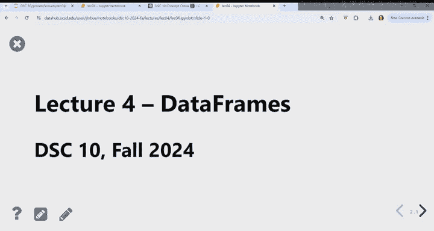

Here's our upcoming announcements you hopefully turned in lab zero last night you do have slip days but try to save them for homework or projects where you'll probably need them more the next lab is out and that's due in a week。

 Thursday of next week but you should do it right away and one of the reasons for that is because we have a quiz coming up next Wednesday and doing the lab is like the best way you can prepare for the quiz。

😊。

We also will put out our first homework on Sunday and that'll be do the following Sunday do as much of those assignments as you can to help you prep for the quiz so the quizz is on Wednesday you were assigned a quiz section yesterday in an email so check for that email if you don't have it or you can't find it send us a message on Ed so you know what's going on the quizzes are 20 minute paper based quizzes there are practice quizzes or quizzes from previous quarters。

On our practice website， so DSc10。com in the corner there's a link that says practice and this is where you access the pretest and discussions and there's old exams and old quizzes here so going through these old quiz questions is a good way to practice the discussion。

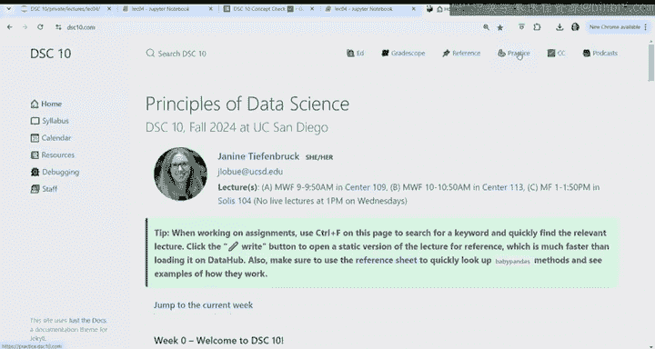

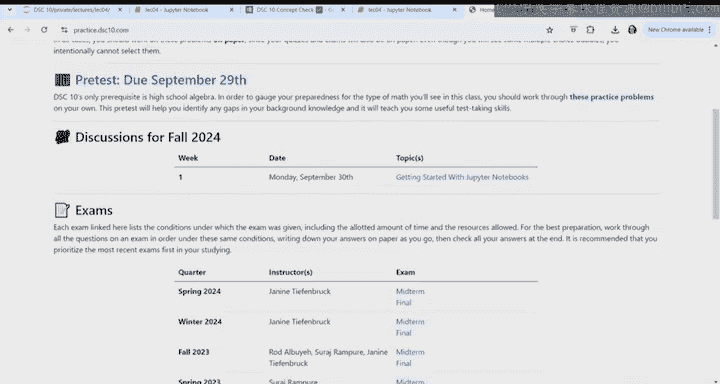

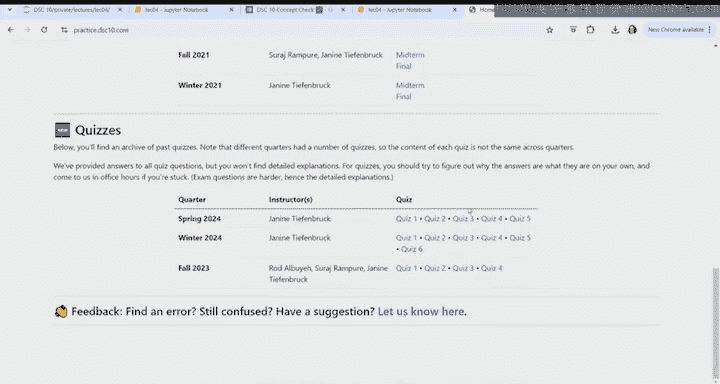

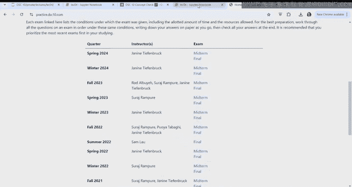

We'll also cover some of these questions。The quizz is on paper so there's no actual computers or notes or anything allowed really and the questions are designed with that in mind like you won't have to do anything crazy complicated in terms of calculations or anything。

 but you should know all the functions and methods that we covered in lectures so review it covers the first four lectures。

 review those lectures remember what abs does， what round does what the uppercase method for strings does for example。

😊，Okay。啊。Does anyone have any questions on the quiz？So we won't say the exact number of questions。

 but all the past quizzes here were 20 minute quizzes so you can see the length。

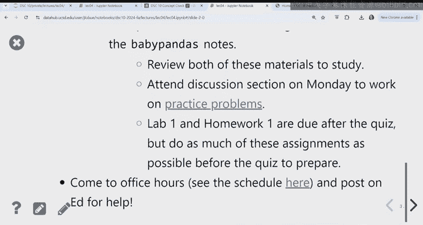

Anything else？

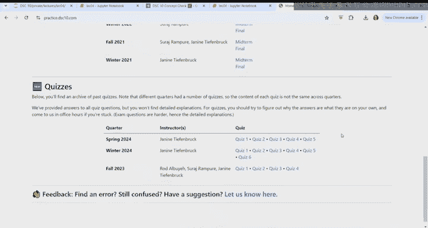

Okay。

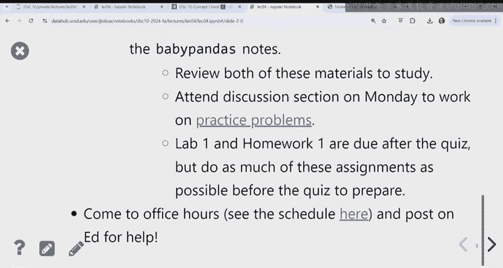

So today we're finally going to start talking about data frames。

 which I'm really excited about because this is the part of the class where we actually work with datas and try to answer questions about them。

 which is hopefully what brought you here the first few days we're kind of learning the necessary Python background so that we can do this on the computer but now we have that background so we're ready to like input datas and answer questions about them。

😊。

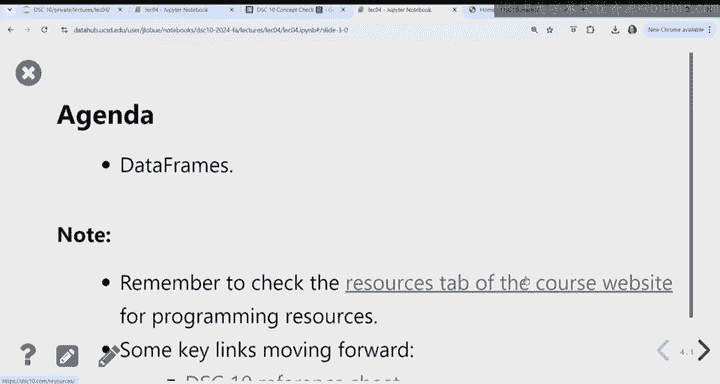

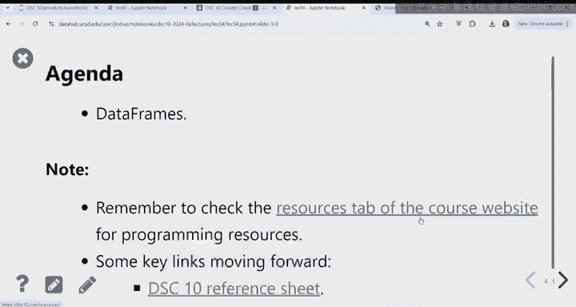

A few resources that I want to make sure you know about。

 I'll show you from the homep page of DSE 10 again。

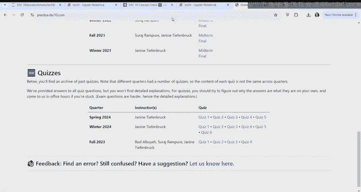

呃。Alongside each lecture in blue is like the associated readings that go with that lecture。

 the baby pandas。

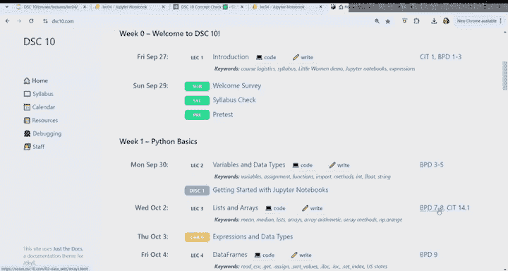

呃。

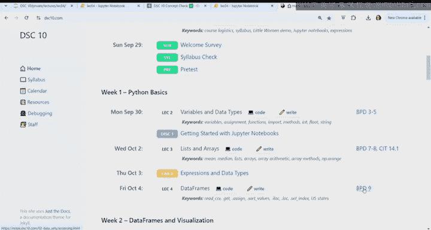

We call them course notes， but they're kind of like a textbook。

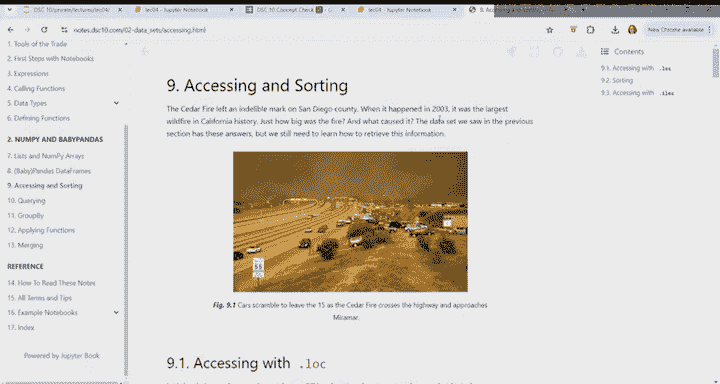

These have。It's basically like a textbook on all the stuff that we covered in class。

 like what are expressions， what are functions， what are the different data types。

And this has pretty much everything that we're going to cover for the first few weeks of the class。

 So this is a good resource to。😊。

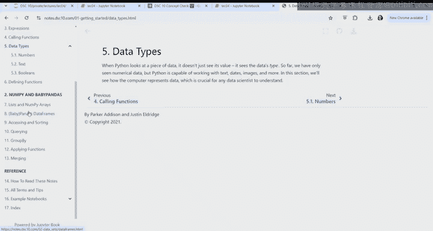

To learn the same thing I'm covering in lecture， but from a different perspective。

 like explained by someone else in writing with new examples。

 so it's just another way to learn the material basically。

That's the baby panda's notes。 there's also a DSC10 reference sheet。

Which is linked at the top reference。

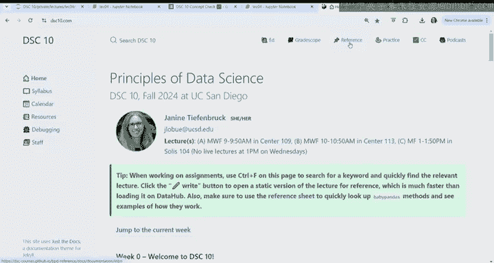

And this is kind of like like a Cl notes version of what we cover in the class。

 all the different baby pandas， methods and functions that we're going to teach you in the coming weeks are here and this menu on the left kind of expands into different。

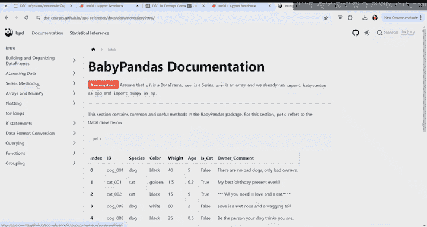

Drop down menus。 and then later in the class when we do statistical inference。

 there's a similar menu of items there。 So this this is meant as like I need to look something up quickly。

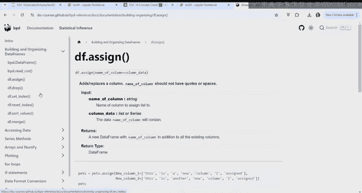

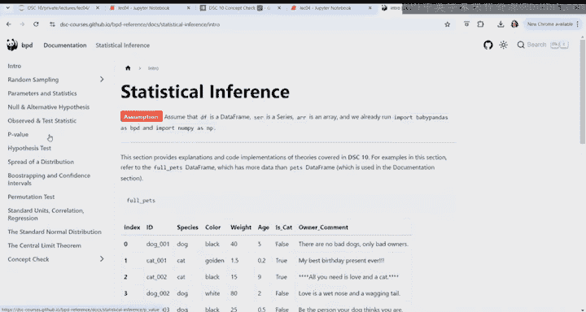

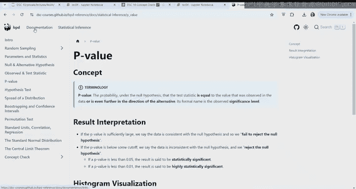

Right。Like what do I do that tells you the syntax， it shows you some examples and stuff like that。

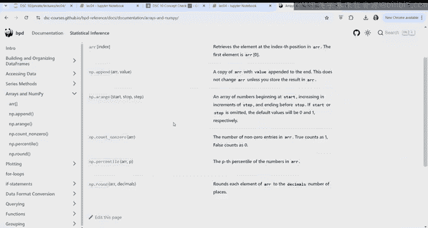

Okay。So those are there for you。

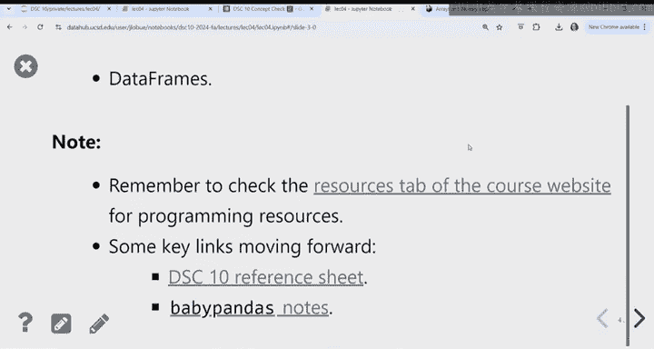

And let's get started working with data frames so data frames come from a package called panndas pandas is like the package that people use in Python to work with data that you would otherwise work with in like a spreadsheet so usually a CSV file which stands for comma separated values and if you open such a file in Excel or Google Sheets right it'll sort of separate it and display it in a nice grid for you and columns and rows and programs like Excel and Google Sheets have their own functions and。

Approaches for dealing with that data and extracting information from it Okay Padas is the Python equivalent of that okay it can do the things that Excel or Google Sheets can do。

 but it can also do more and it can be more customized so it's more general。

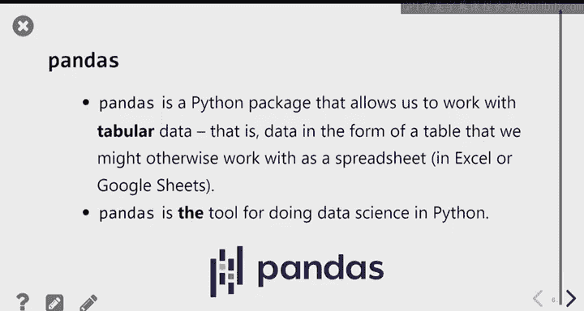

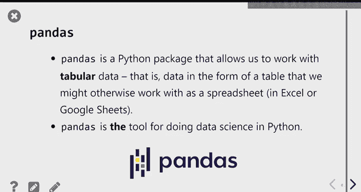

But the pandas package is not so cute。

Right that's why at UCSD we teach you something that we call baby pandas so baby pandas is like think of it as a smaller。

 nicer version of the pandas package， everything in the baby pandas package is also in the larger pandas package but baby pandas doesn't include everything it just includes what we think are like the core things that you need to know right without like many other ways of doing things one benefit of baby pandas as it has much better error messages so it's easier to learn。

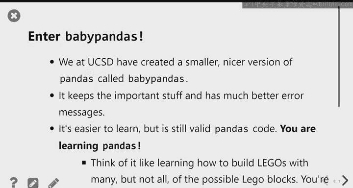

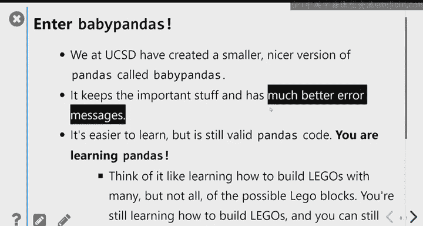

嗯。But everything in baby pandas is still valid pandas code， so you are learning actual pandas code。

 you're just not learning all of pandas because it's too much and it it's kind of overwhelming for beginners Okay so the idea is like we'll teach you the essential parts and then after this class in the future right you'll know enough from the essentials that you can expand what you know until you know all of pandas。

Any questions on that？

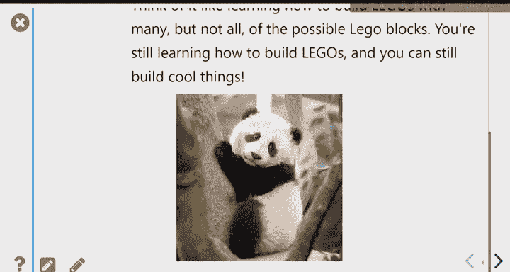

Okay， so I've used the word data frame。 A data frame is just a table。 Okay。

 that's the name that they're called in pandas or baby panda。So to work with data frames or tables。

 we have to import our pandas package or our baby pandas package when working with the full pandas package。

 people usually import it as PD。We're working with the baby pandas package so we're going to import it as BPD and this is the typing shortcut right instead of having to type baby pandas dot when we need to do something。

 we'll just type BPPD dot。

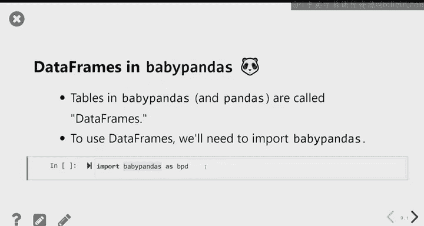

Okay， and then we're gonna use baby pandas to analyze data that comes in a table。

 So we have to find some sort of data that， that comes in a table。 and we have to save that data。

In a file。So， I'm gonna。

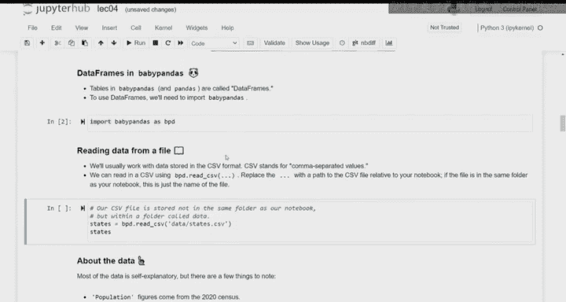

Show you。I'm in Datahub here。And if I click this Jupiter H icon in the top left corner。是。

And then navigate to our course， DSC 10， Fall 20。24 I'll find today's lecture so it's in a lectures folder this is lecture4 and notice that there's a few things in this lecture4 folder right the dot IPPY and B is the notebook that I'm currently lecturing from There's another file of like stuff I had to import at the beginning There's an images folder which has like all the pictures that are in the lecture slides and there's a data folder Okay so inside the data folder。

 there's a CSV file， CSV files look like this。😊。

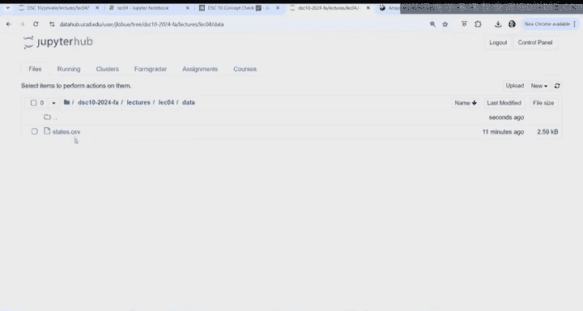

This is a data file of the different states and information about them like their capital and their population and stuff like that so each state has its own row and the sort of important values about each state are separated by commas so this file has all the information about all the states right but it's not like an easy way to access the information if I want to know like what's the population of Ohio you have to kind of manually like scroll and find the right one and there's only 50 states so that's not too bad but we're going to be working with much bigger data sets so you're not going to want to like manually look through CSV files so the idea of data frames is like to load it into your Jupyter notebook and display it in a nice way and then use methods and functions to help you extract the information that you want so the first step is loading it in。

😊。

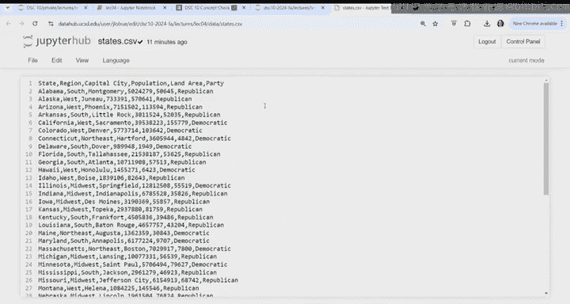

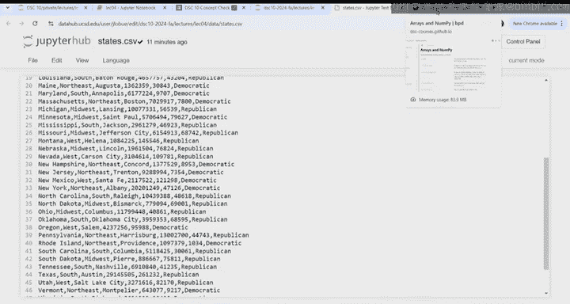

Let me。

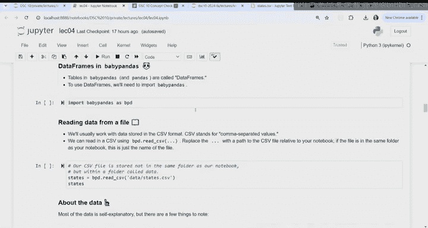

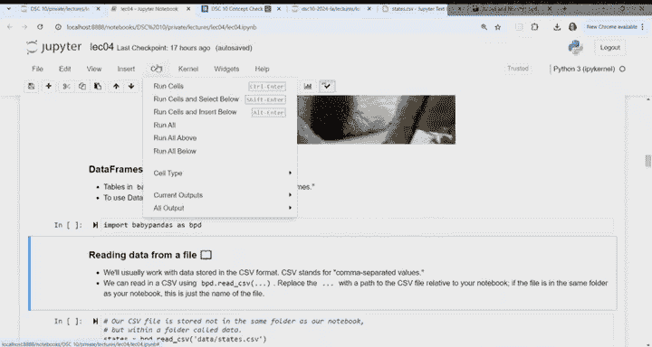

Show you how to load it in。

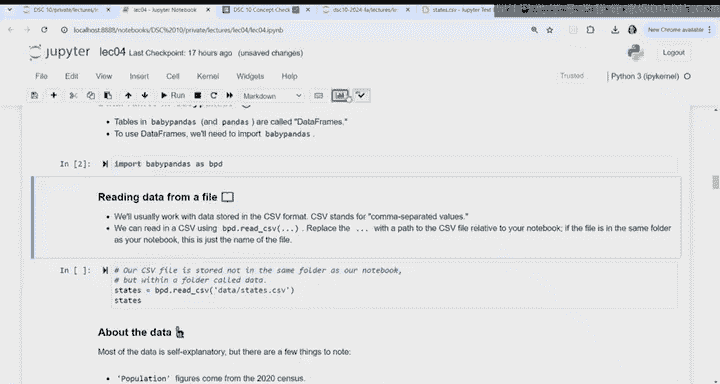

The command to load in a CSV file comes from the baby pandas package， so I start with BPPD dot。

 and then the function from that package is read CSV。And what it takes as input is a string。

 So notice there's quotes around it and the string tells me how to find the CSV file okay and its it's a path。

 like a directions。 In other words， of where the file is relative to where your notebook is So my notebook was in a lecture4 folder and within that folder。

 there was a data folder。 And I'm telling it basically go into the data folder and then get the CSV file from that folder。

😊，And this is all you need to do。To have it read it in and display it in a nice way。 Okay。

 so this is the first data frame that you've seen。Notice it tells you at the bottom like some summary information about the dayframe。

 how many rows and columns it has the first row of the CSV file was like header information and it displays that nicely in bold at the top。

 it automatically puts some shading on the rows， alternating colors to make it easier for you to read and it automatically gives each row a number starting at zero like we learned last time computers count starting at zero so zero through 49 gives like a number to each state。

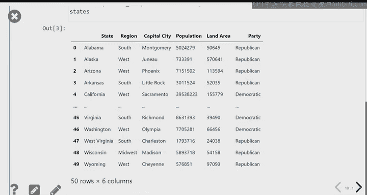

Okay， so let's learn a little bit about the data， most of the data is self explanatory。

 but there's a few things you should know we have for each state the population that comes from the most recent census。

 they do the census every 10 years， so this is the 2020 population。

Land area is measured in square miles。

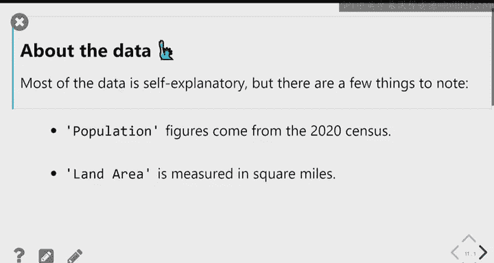

The region column places each state in one of these four regions， Okay。

 so the US Census Bureau determines these regions。

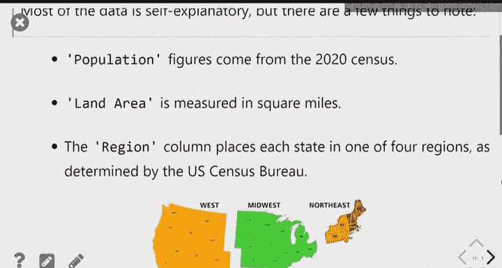

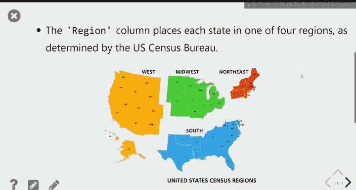

West， Midwest， northeast， south。

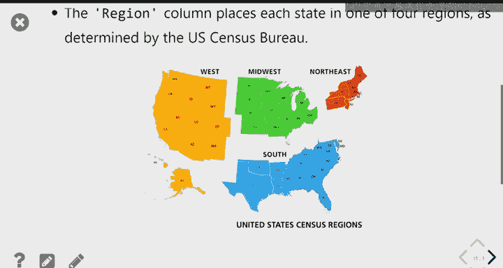

So， that's what we'll use。And then there's a column called party。

 which is like the political party of each state okay and this is not like an easy thing to measure as you may know from following election news right like there's a lot of questions of which way is the state going to go in the upcoming election so this is like a whole data science problem in itself is like classify each state as either Democrat or Republican or possibly neutral。

😊。

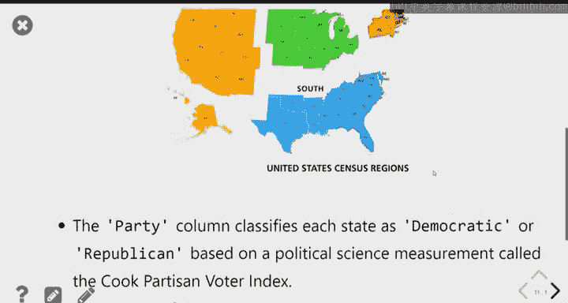

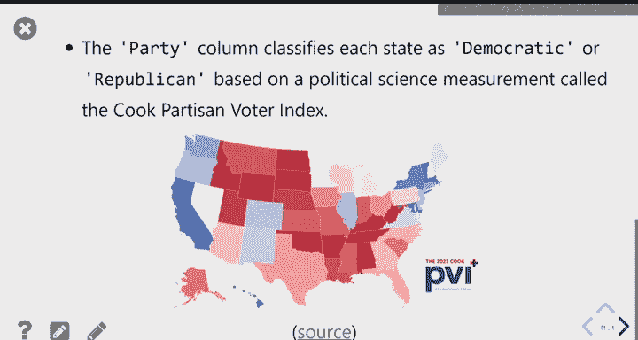

And the one method for doing that is called the， the Cook partisan voter index。 So you can click。

This link， if you want to learn a little bit more about like their methodology for how they assign a color to each state。

 but they have a system right that is based on data to determine whether each state is considered Democratic or Republican and they actually see on this map。

 there's like different levels of blue and different levels of red。

 like different shading right the cookpartisan voter index is actually like a scale where it's like how far do you fall on the。

Liberal conservative scale so like California is is very blue because it's very Democratic and like other states are are more red or less red or more neutral Okay。

 so for our data we're just going to。😊，Look at the color， whether it's Democratic or Republican。

 whether it's blue or red， but we're not going to look at sort of how far， how shaded。

 so the party column just has two entries， either Democratic or Republican。Does that make sense？

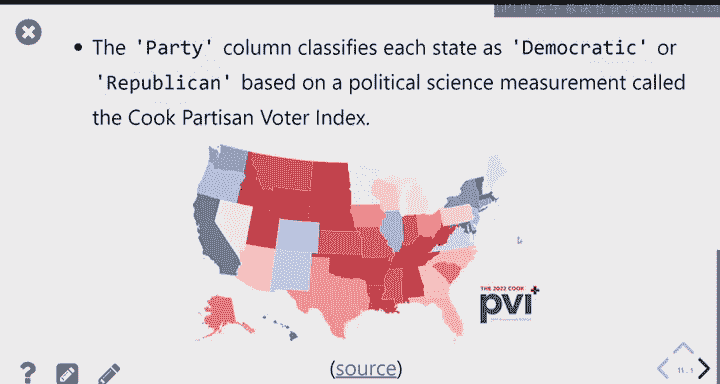

Okay， so data frames are arranging your data in columns and rows right think of each column as an array like you had a whole bunch of population values for all the states that's like an array because it's a bunch of values of the same data type or you had one of the columns was capital city that's also like an array because everybody has a string for the name of their capital。

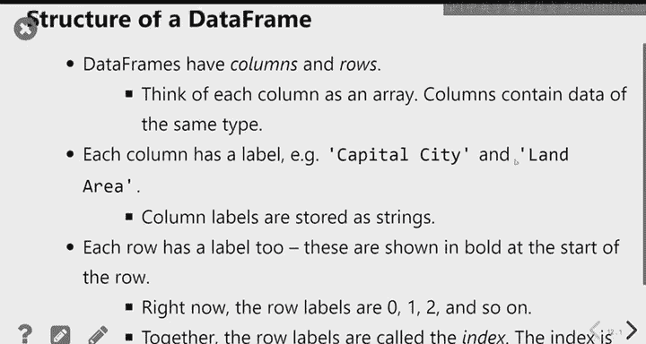

嗯。Columns have labels， those showed up in bold。 Think of the labels themselves as strings。

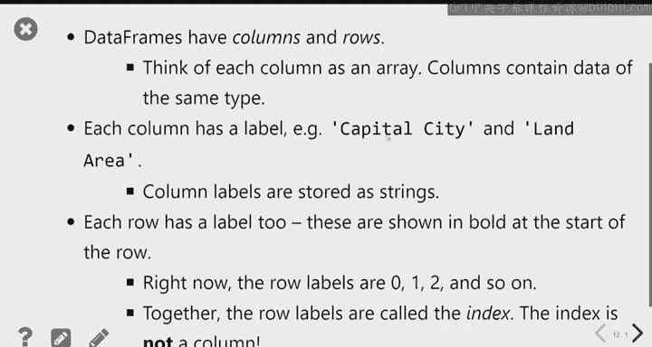

And the rows also have labels。

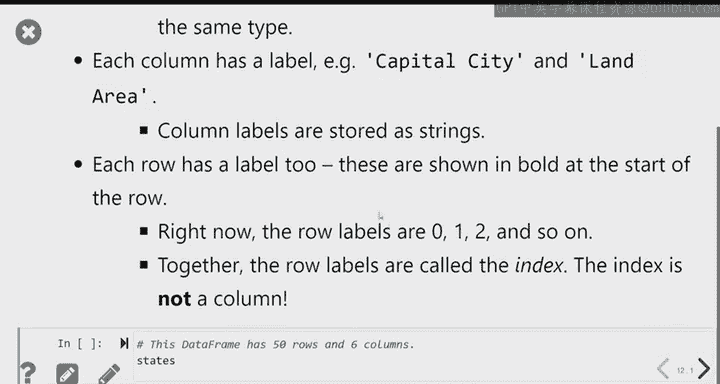

Those were shown sort of down the left side here。

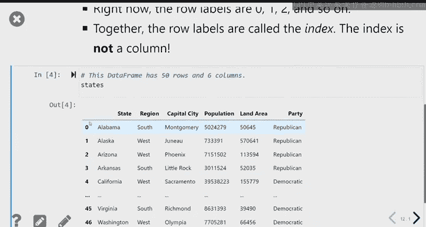

These labels sort of together are called the index of the data frame， it's not considered a column。

 so see how this has 50 rows and six columns， the six columns are these。

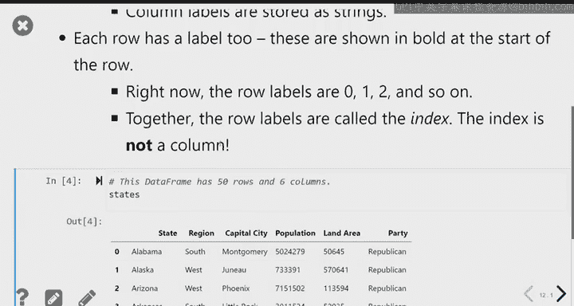

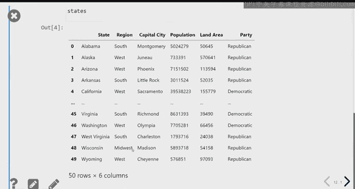

This isn't really a column， this is just sort of a way of labeling each row。

 so you can think of the index as like a label for the row and you can think of the column names as a label for each column。

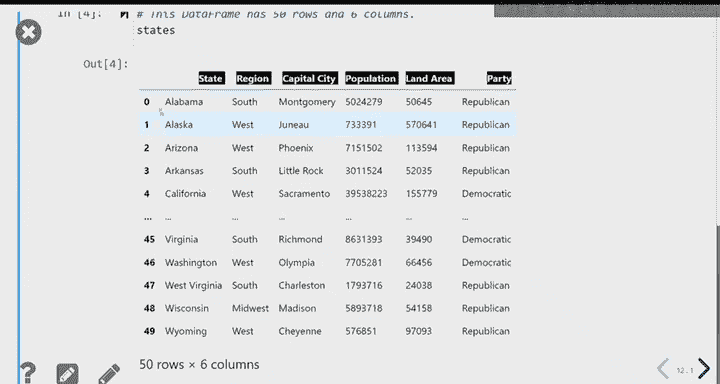

Okay， so now we have our data and we want to start by answering questions about our data Okay。

 so our first question is going to be figuring out the population density of of the different states and in doing this we'll learn some key concepts about how to interact with data frames that you'll use over and over。

So the question is， what's the population density of each state in people per square mile？

And you have the relevant information that you need to calculate this， right。

 because there's a population column that tells you how many people live in each state and you have a land area column that tells you the square mileage of each state。

So essentially what you want to do is for each state。

 you want to take the population number and divide it by the land area number。Okay。

 so how do you do that？

OkayThe strategy is we're going to pull out the entire population column and think of that as like an array。

 a sequence of values， then we're going to pull out the entire land area column。

 that's also an array。😊，And it has the same length， right。

 They both have 50 things in them because they correspond to 50 states。

 And one thing we learned about arrays in the last class is if you do an operation between two arrays of the same length。

 it'll pair them up element wise。 So if you divide the population array by the land area array。

 like the first thing will represent。

The population of Alabama divided by the land area of Alabama， right。

 and the second thing will be the population of Alaska divided by the land area of Alaska。

 and that's exactly all of the densities that you want。

Okay， so then we'll have like a whole sequence of values with all the densities。

But it's just going to be a set of numbers。 the state name is not going to be associated with it。

 So I'm going to add that calculated column of numbers onto the data frame so that I can read off like across the state and its density。

Does that make sense？So that's our big strategy。 Here's how you actually do it。 Okay， so most of the。

 the new Python content that I'm going to introduce today are data frame methods。

 These are things that specifically sort of work on data frames。

 like special functions for data frames and。😊，I will access them。

With the dot notation so my data frame was called states right and the name of the method that I'm going to use is get so I'm going to say states dot get and dot get you just say the name of a column and it pulls out that column Okay so here's what the code looks like here's the full states data frame。

And here's states dot get population。Okay， so the population。

 the first number was like 502 something， right， here's that number， 502 something。

So column names are case sensitive， that means if this population starts with a P。

 I have starts with a capital P I have to ask for it with a capital P。

 otherwise it'll say that's not a column， there's no column called population， if you see that error。

 that's almost certainly you spelled something wrong or like capitalization。

Okay。

And then the result has all the population values， but you notice it also has these numbers on the left。

  zero through 49。

That was from the index， right， these bold numbers on the left。

 those are sort of maintained when you pull out a column。

And so the result isn't exactly an array， because when when we had an array。

 it just showed all the numbers separated by commas。

 the result is something that's similar to an array， but it's called a series。

 It looks like a one column data frame just one set of numbers and the index and a series is basically an array with an index。

So here's the series that I get when I pull out the population column and series is a data type。

So I ask for the type of this column that I've pulled out and it says it's a baby panda series okay so now we know a few different data types for sequences。

 we know lists， we know arrays， and we know series and what makes series special is they have an index associated with them as well。

All right， any questions on that？

Okay， so I know how to grab the population。 Similarlyly， I can grab the land area， right。

 And then I'm going to have two series。

But series do arithmetic element wise is just like a raise do。 Okay。

 so our plan of dividing is still going to work。U。

And what happens is this number represents the population that went with index  zero。

 the population of the first state divided by the land area that went with index 0。

 so the land area of the first state， So what was the first state again， Alabama。

 Alabama has 99 people per square mile on average， right， Do you remember what the second state was？

Alaska has one person per square mile， I think this one is us。😊，Yeah。

 to know that song where you sing all the states。 That's what I'm doing in my head。 This one。

 this one is us 253 people per square mile in California on average。 Okay。

 but like it's not easy to look at this and sing the song in your head and figure out which number corresponds to which state like it would be easier if it just said the state name and the number next to it。

 So what we want to do is add this on。😊，To the data frame。Okay。So。

This series that I just calculated came from grabbing out population。

 grabbing out land area and dividing them element wise。

And the command to assign a new column to a data frame is dot assign。Okay， so again。

 this is a data frame method， I start by saying the name of my data frame that I want to add something to。

 then dot assign。And then dot assign。Requires。Something that looks like this。The name of the column。

 like what do you want to call your new column， then an equal sign。

And then what values should I put in that new column， Okay， So I am creating a column called density。

And then the values that I want to put in the density column are the values that I just calculated and showed you on the last slide。

Okay。Something that's a little weird is that the column name is going to be a string。

 but for this particular method you don't put quotes around it it's just kind of a weird fluke。

 this is like a special case where you don't put quotes around the name of the column。Yes。

 so one sort of consequence of this is you can't。Like have spaces't it？

It's not going to like that so you can replace your spaces with underscores or you can use capitalization of new words if you need to。

For now， we'll just keep it simple and do a one word title。But yeah， good question。

Okay so this is going to add the new column right of those values I calculated onto my data frame so I can quickly like look up California's population density is 253 people per square mile。

So this solves our question of you know what's the population density of each state now I've sort of added that calculated information onto my data frame。

Something to be very careful of is that data frame methods don't actually change the data frame。

Kind of like when we saw string methods， we had a string and we did dot upper。

 but then the string itself was unchanged things data frames， just like strings and other variables。

 only change when you actually purposely assign them a value Okay so you feel like you've just added a column to states。

 but states actually still has six columns right， the new column is not there。

And that's because if I want to。Actually， really add a column to states。

 I have to save the result of the assigned into the variable states。 Okay。

 so this is a common error on like assignments。

People will。

Basically do what I did here。They'll add a column and then the tester will fail。

And the tester will say we were expecting seven columns。

 but your data frame had six and the student will be like， no， it has seven， okay。

But you didn't actually change the variable。 So the way you test is you look at the variable。

States， and you see the variable only has6。 and that's， that's the problem。 So once I assign。

The result here。

To states， now states actually have call。Questions。

Okay， so that's our first example。 Our second example is now that we have this population density。

 let's， let's learn about it。 Okay， so what's the highest population density of any state。

 like California seem pretty crowded。😊。

But is it the most crowded and then what's the average population density across all states So remember how we learned about array methods。

 things like dot min and dot max for arrays， there's also series methods They're basically the same dot min and dot max and things like that for series。

Okay， so。

If I want to know what's the highest population density of any one state。

 what I'm doing is I'm grabbing out the density column， this is a series。

And then I'm asking for the largest thing in that series。OkayThis is a method。

 so notice it's using the dot notation， the series comes first and then dot and then the name of the method followed by parentheses and any input that it requires okay。

 this doesn't take any inputs because all it's doing is looking within that series it has everything it needs right there。

Okay， so the max， wow， so there's some state that has 1。

263 people per square b that's like five times more crowded than California。

What state is this， Well， this doesn't tell me right？

 This is just an operation on the numbers on this the numbers in that series。

 and I've lost track of what state it corresponds to Okay。

 so we'll need something a little more advanced to figure out the name of the state。

 but we'll see how to do that soon。

Here's other things you can calculate， the minimum density。 We already saw this one。 This was Alaska。

The average density across all states。The median density。

 so both mean and median are like some sense of like what's a typical amount of people per square mile。

And another series method that's pretty nice just for understanding your data quickly is dot describe。

It shows you like a bunch of information that you might want to know about your data， like the mean。

 the standard deviation， the smallest， the largest and various different percentiles throughout。

 so you can get a sense of like how the numbers are distributed。

Okay， now let's answer the question we posed， which state was it with that highest population density。

 So theres some state five times as crowded as California。 how do we figure out what state it is？

Okay， and the strategy is going to involve sorting the data。 Okay， so originally。

States are given in alphabetical order。But we have a column called density and what we want to do is we want to rearrange the row so that they're not alphabetical。

 but that they're in order of density。😊。

And the method to do that。Is sort values。And sort values takes an argument called density or called by。

And that's like， what column do you want to sort it by？

So I want to sort the values according to density。And notice that they get sorted in。

Ascending or increasing order， right Alaska， the least populated ones come first。

 the small numbers at the top。 So Alaska， Wyoming， Montana。

 those are the uncrowded states and the crowded states are at the bottom。 Okay。

 we can scroll through just to see what they are。The the winner of this contest is New Jersey。

That's where I grew up。

It's crowded。Another thing to notice about the data frame is I don't see all 50 rows。

 these middle rows are like kind of blocked out and they just put dot dot dots。😊。

In general like this is kind of good practice to see the dot dot dots because you don't want to be like scrolling through the data and finding your answer。

 you want to have Python do it for you okay so it's tempting to just like I wish I could just see the answer but the point is to learn how to extract the answer from big data sets where you can't just see everything。

So something to note about sort values is the buy is optional。

 it'll do the same thing if you don't put it， but we usually like to put it because it makes it like more natural to read and understand what it's doing。

 I'm sorting it by its density。

Okay，So we know the answer to our question， it's New Jersey。

 but we want to kind of pull that out in code and New Jersey came all the way to the bottom。

 we would like it to come to the top so that we could just see our answer immediately。

You can change the order of the sort。

嗯。By adding an additional argument。Called ascending。So。

If I say ascending equals false。That's basically saying， we don't want it to be ascending。

 We want it to be descending。 Okay， so we want the big one at the top。If I do ascending equals true。

That's going to do it in ascending or increasing order。Okay。

 so sort values is a little bit different than other methods you might have seen。

Because the， the inputs have names。We're not just saying sort values density comm true。

 we're like giving the density the name by， and we're giving true， we're like assigning it ascending。

This is what we call keyword arguments or named arguments。啊。The， the true。

 the ascending equals true or ascending equals false。

 You have to use the word ascending if you're going to specify the sorting order。 You can't。

 It doesn't work if you just leave out ascending equals。

Okay， so leaving out by equals， that worked。

But leaving out ascending equals doesn't work。

And what we saw before was that ascending is optional， like putting this at all is optional。

 if you don't put it， it'll sort an ascending order。

Okay。But if you do want to specify the sorting order， you have to use the word。

And you can set this to either true or false， so setting it to true kind of does nothing right that's what would have happened if you didn't put this at all。

 so you tend not to see ascending equals true because it's just that's the default anyway so why bother writing it out。

 but if you want to change it then you have to say ascending equals false。

Questions on that， I know that's a little confusing。

Yeah。あ超した。So yes and no， like don't feel like you have to memorize everything right now because you have like the reference sheet and the lecture slides as you're doing assignments as you start doing assignments。

 you'll see these things so often that you will start to memorize them for the quiz you won't have access to references right so you should know the things in lecture specifically you should know this for the quiz。

はいて三人公式。

Yeah， good question。Instead of ascending equals false， can you say descending equals true？

You unfortunately can't do that。 It's looking for specific names like buy and uscending。

 And so like it doesn't know what to do when you say descend。

Okay， so now。Did I save this in a variable called ordered states。 Yeah， okay。

 so now that I put the states in order， Not I saved it as ordered states。

Okay， so ordered states looks like this。And my question was what state is it that has the highest density。

 and I can see the answer right now just by looking at it， it's New Jersey， right。

 but how do you get Python to pull that out so that maybe you can work with it in the future？

嗯。And the way we get it to do that。Is as follows。We have to grab out the entire column of data that has the data we want。

 So in our case， if I want my answer to be New Jersey， New Jersey is in the state call。

 So I have to grab out。The state call， that's I do that with dot get state。

Okay。And then there's many states here。 I only want one of them。 right， I have to say。

 which state do I want。 And the way that I specify which state I want is。

By counting。Okay， New Jersey is the first thing， so that's we're going to call that state number zero。

Rhode Island is the next thing， so that's going to be state number one， Massachusetts is two。

 we always count starting at zero and there is a way of accessing individual elements from a series。

Using it's called dot IO。And then you give the， the position of the row that you watch。

 So I want the row and position zero， right， and that's New Jersey。Does that make sense？

So first I get the state， if I wanted， I don't know。

 the second highest populated state or second most dense state， I would do dot I Lo1。Okay。

 and I would get Rhode Island。So IO should remind you of the way we accessed elements of lists and arrays in the last class。

 we just did like。Temperature array bracket zero to get the first thing or temperature array bracket one to get the second thing This is similar in the sense that it uses brackets to access particular elements。

 but for series you don't just do bracket position you do dot I Lo and then bracket position。

So IO stands for integer location， and it means like you're counting the rows from the top starting at zero。

0，1，2， three， and so on。

Now， this can be a little bit confusing because the rows already have like a number that goes with them。

 right？ And that's in the index， New Jersey。

Had the number 29 associated with it， why， why 29 for New Jersey， like where did that come from？Yeah。

 so it had to do with where New Jersey falls alphabetically right notice Connecticut or Alaska。

 that's a better one， Alaska's number is one because it was the second state alphabetically。😊。

New Jersey has 29 because it's the 30th state alphabetically， right， But Ioc does not use the。

 the row labels， does not use the index values at all。 Ioc just counts from the top。

 So it would be wrong。

To try to get out New Jersey by using that label of 29， I O 29。

 That's going give you a different state。What is IL 29 going to give you's to give you。

The 30th thing in this order。 So the 30th highest population density state， right。

So there's a difference between the row label。That's what's in the index versus like the position number。

 position number start counting at zero， and the row label might be not counting it。

 not starting at zero because of the fact that we sorted it。Does that make sense？

Okay。Let's look at our next example， what's the population density of Pennsylvania？

Okay， so here's all our states。

Right， and the， the density of every state is in there。But which one's Pennsylvania， I can't see it。

 right， it's one of the middle states。 So how do I sort of figure out what what's a specific entry of my data frame。

Right。I know I want Pennsylvania's density so I could grab out the density column。

And Pennsylvania's density is one of these numbers， but which one？Right。

You could try to do it with IO。Accounting from the top。 which one is Pennsylvania。

 How would you do that。With eyelo， I mean。Yeah， like how would you do it with IO IO is counting from the top so you'd have to know what state number is Pennsylvania alphabetically you'd have to like sing the song to figure out how many states in is Pennsylvania right and that's not a convenient way to get the information you want。

So notice that when you load in a data frame at the very beginning， this was the first thing I did。

 I read in the CSV。

The columns were given meaningful names。

That tells you what's going on in that column， but the rows were given sort of unmeaningful names。

 just numbers。

So it's nice to refer to certain columns by name you say the region column or the land area column。

 but the rows like it's awkward to be like row 47 right while it is like the row with number 47 it's more sort of natural to say it's the West Virginia row right the row actually represents the state of West Virginia more so than it represents the number 47。

Okay， so we can sort of。Of force the row labels to be the state names。

 And the point of doing this is to easily identify like which row corresponds to which state。

So the way we force the index or the row labels to be the state names is we use a data frame method called dot set index and dot set index takes the name of a single column and it uses the values in that column as the index。

So here was the state's data frame as I originally read it in。The index is these numbers。

And then if I say set index to state。

Well， now the bolded labels on the left are the state names。

Okay。Notice the number of columns changes。

It used to have seven columns。Now it has six columns because state is not a column anymore。

 state is like the index。

Something to be careful about when you're setting the index。

 the index is how you're going to refer to specific row。

 so you're going to say this is the Alabama row or this is the California row。

 it would be confusing if there were like multiple states with the same name right then how would you refer to it。

Like for students in a class， right， there may be two people with the same name right and name。

 I shouldn't like store your grades or something in a spreadsheet that's organized by name。

 because what do I do with the two of you that have the same name， right。

 I should instead use P ID or email address or like something that's unique to you Sam thing with the index。

 right， We're gonna be referring to the data by its value in the index， So we want it to be unique。

And then this is the same thing I've mentioned before。

Despite setting the index， right， the state's data frame is unchanged， I have to actually save it。

In the variable states in order for my change to persist。

Okay， so now。Let's answer the question again from this data frame where the row labels are now the names of the states。

What's the population density of Pennsylvania So I'm asking for a population density。

 it's one of the numbers in this density column right so I'm going to grab out the entire density column。

Using get。And now the number that I want is simply the number that goes with the row label of Pennsylvania。

I still can't see it， but I know it's label， so that helps me be able to find it because I know it's label。

Okay。

啊。So， once I。

Once I pull out the whole column right I need to tell Python to like go to a specific spot go down a specific amount。

 find only one of these values I don't want all of them， I just want one of them。

 So the way that I learned before to like go to a specific value was using I Lo and that was counting from the top so if you want the most populated state you could count from the top the first thing position zero right but here like I don't care about where it is from the top。

 I just care about its row label。So I'm going to use a different way of accessing。

And that different way of accessing is called dot look。Okay so i Lo， the I stands for integer。

 like what integer position do you want？And the lo doesn't have the eye。

 It just means we're going to locate something according to its row label。

So the row label that goes with the value I want was Pennsylvania。

So this is just going to pull out the number for Pennsylvania。Similarly。

 I'll show you one that you can actually see。 so you believe me。California。Right。

It just what it does is it looks through the labels until it sees one called California。

 and it gives you the associated number。

So this is our strategy for sort of getting out a particular entry from a data frame like a data frame has many entries in all the different rows and columns right if you want a particular one。

 you can get the whole column that it's in。😊，And then you navigate to the right one in that column using Lo with the row label or I Lo if you just want to count from the top。

Okay， so I'll show you sort of a few different ways。

Here's the。All the densities。

if I say I lo4。Okay， i Lo4 means don't look at this， we're just going to count from the top， zero。

 one， two， three， four。And it's going to give you this as your answer。Does that make sense？

On the other hand。Loke， California。Is not going to look at these numbers。

 not going to do any counting from the top， it's just going to scan through the states one at a time until it finds California。

 and then it's going to give you that number。

So you'll get the same thing。Either way。

No matter which approach you take。

Now， occasionally。啊。Loc and IO coincide， but this only happens sort of by coincidence and it's still doing a different strategy when you say lo versus when you say iL。

 so this happens like when the integer position is the same as the row label okay because IO uses the integer position from the top and Lo uses the row label。

 but when you like first read in a data frame。

The row labels are the position from the top。 right。

 So if you just take this data frame and don't set the index or don't change it in any way。

嗯。And you want。

To grab out the capital city column。LetsSo this column here。

And then Loke 35， what's that going do is it's gonna。Kind of scan through。Until it gets to 35。

 and it's going to give you the corresponding capital city。Whereas if you say Ioc 35。Well。

 the example I have is 35。 but if you're going to do Ilo 35， right。

 you're going to count from the top 0，1，2，3 until you get to 35， So it's going to be the same thing。

 It's just two different ways of getting it。Does that make sense？

我的啤酒。

我意思。Theres。If I put。four。Would also work would。It's not what？Of course。

This the four corresponds to California。Right， it's this。

Yeah， it's finding the fourth or a fifth thing， I guess。So明。So every data frame will have an index。

 right， but you don't you don't use it。 You don't care what it is。 When you use IO。

 it doesn't matter what's in the index。 You're not using it at all right。

 You're just counting from the top。 when you're using Lo， you're referring to a row by its name。

 right， which is in the index。 So let me give you a。

Another one to try。

So， here's states。

What if I want the。

The name of the state with the most land。How would I do that？

Am I going to use right now， am I going to use dot Lo。

 or am I going to use dot ilo or something else？

Right， so first of all， the state with the most land。

 like I don't know where it is because it's just this isn' in some arbitrary order， right。

 so let me sort it。By land area。Okay， remember when you sort。

It sorts it like this。 I could sort it the other way。By doing ascending equals false。Okay。

And then do I want to use lo or Ilo to grab out the name of the state。I look， okay。

I can't just say I lo 0 that doesn't just give the name of the state。 I just want the name。

 So what I do first。

Is。I grab out the column。Well， there's a problem with this too， right。

 state is not actually a column。

state is the index。We'll learn this in the next class。

 but you have to do dot index if you want to pull out the index。So it's a little different。

Maybe I should do it before I。Before I set the index。

Right， if I had done this before I set the index。

Then I would be using like here， if I did it like this。

And then ascending equals false。Then I can do。

Dot getstate。And then I could do。

I lo zero。What would be the solution？Okay， so that's it for now。

 basically what we're going to do the next few lectures is like answer questions like this and learn more tools to answer them。

Okay， see you then。我原你识。

