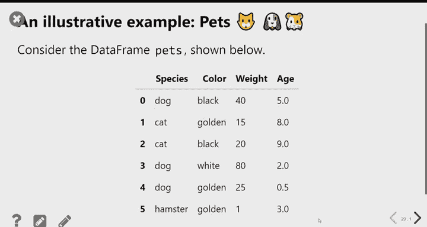
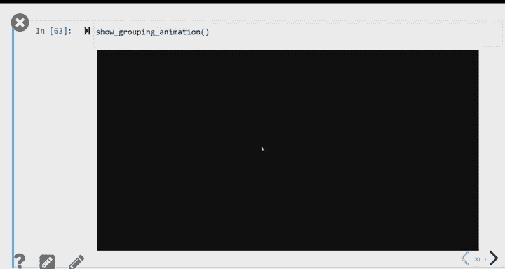
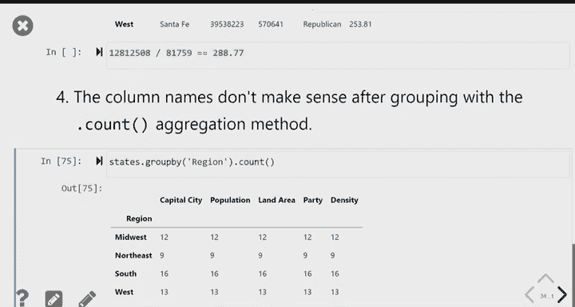

# UCSD《数据科学原理 (DSC 10 Principles of Data Science Fall 2024)》中英字幕（deepseek - P5：DSC 10 - Principles of Data Science - LE -A00- - Lecture 5.zh_en - GPT中英字幕课程资源 - BV1hmAneGEZh

Okay， good morning， everyone。Here's what we have going on。

Hopefully you're working on your lab and homework， they're not due till after the quiz but it's like very。

 very recommended to do them before the quiz because that's the same content that's going to be tested on the quiz so the more practice you have the better shape you are there's also discussion today in which you'll do practice problems from past quizzes and exams all related to the content we've covered so far so that will also prep you we noticed from last week that the earlier discussions were more crowded and the later discussions had more seats so if you don't like sitting in the aisle come to the later discussion sections and then the quizzes on Wednesday you should have an assigned quiz time and we will also assign seats tomorrow so just keep an eye on your email for that and something to know about the quiz is that we won't be able to answer questions during the quiz so the questions have been like vetted and tested our tutors do the test as like a practice to make sure there's no error。

Um but in case you you think there's an issue or you think something's unclear。

 just write your assumptions in the margin for that question and we'll consider it Okay。

 does anyone have any questions about the quiz or assignments？😊，Just for the discussion session。Yeah。

 we're flexible so you can go to anyone just the early ones get filled up the fastest， yeah。

 anything else。Okay， sounds good。Okay， so today we're going to learn some more basically data frame manipulation techniques。

 the two big things we're learning today are querying and grouping。

 and in the last class we learned a lot of data frame manipulation techniques。

 we're going to work with the same data set and basically answer more complicated questions about the United States data frame。

😊，There's a few resources linked here I want to show you sort of how you how you should find help when you when you're stuck like imagine you're doing a homework problem and the homework question asks you to sort the data frame in a certain way and you remember oh I learned in class about sorting but you don't remember the exact details of you know how exactly you would type that in right so on this home page of DSC10 use control F the find。

And search for。Sort， okay， there's little keywords associated with each lecture。

 They're really small font because you're not meant to like read through them。

 You're meant to use this to just find things。 Okay。

 so this tells you that lecture 4 is a lecture where we learned about sorting。

 You could click the code to open the lecture in Jupyter notebook。

 but it takes a little while to load。 So I recommend if you just want to like refer to the lecture。

 you open the right link。And that gets you to a。Like a static copy of。Of what we learned。

And then you can find S and you could see the example we did on the state's data frame and you can mimic that syntax in your own homework problem Okay。

 another thing you can do。Is click the link next to this lecture。

That will open our class notes and take you directly to the part that talks about sorting。

 okay so this table of contents sorting is here， and it's a different data frame they're talking about fires in California。

 but they use the same methods to solve the problem。And then finally。From the home page。

In the top right corner is this reference sheet。Okay。

 and this is kind of documentation on all the different things you can do in baby pandas。

 And this menu on the left expands。To show you like all the different data frame methods that we've seen okay so we saw read values。

 we saw a last time we saw set index， we saw sort values throughout the course we'll learn all of these things there's a lot here like they all expand and you're going to know eventually what all of them mean but for now when you're just starting out you may have to look stuff up okay so if you wanted to sort something where it was it here。

 sort values。It shows you how it's used， it tells you what it does， it describes what the inputs are。

 what it gives back as output， and then it does a little example on a sample data frame。

So all of those ways are ways you can like sort of。Remember how to do stuff and look stuff up。

 does that make sense？Okay， so that's just like a tip for when you're working on your assignments and。

Last class may have been overwhelming we did certainly learn like a lot of different data frame methods。

 especially if' you're new to writing code， you still may be like trying to remember the difference between ins and floats and strings and all those details and now we're like throwing a bunch of data frame methods at you so this slide is here just to say that everyone belongs don't feel overwhelmed I mean it's okay if you' are overwhelmed but like don't make that。

😊，Don't let that make you think that you shouldn't be taking this class or that it's too hard for you。

 Okay， there's。You're going to grow and change as a person from being challenged。

 so keep sticking with it and just seek out help okay so we have lots of office hours， we have  Ed。

 you have classmates that you can talk about problems with， so take advantage of all of that stuff。

All right， as I said， we're going to continue with the same United States data frame。

So notice what I'm going to do is I'm going to read in the original data frame from the file and one thing we did in the last class was we added a new column called density that has the population over the land area for each state。

 so I'm going to add that column， so this is basically the status where we left off last time。Okay。

And now I'm just going to answer some more questions about the data frame。

Which states are in the West？Okay。Basically， the problem is we want to create a data frame consisting of only states where the region is west okay but right now we have all the states。

 not just the western ones。 So how do we do this， sort of create a smaller data frame with fewer rows than the original had。

Okay， and I'll show you the solution。And then we'll talk through like what it is and why it works。

 So the solution。Looks like this right it's a data frame and it only has 13 rows。

 it has exactly the rows where the region column says the value West okay so it's just a subset of the full data frame。

 only certain rows are included。So how do you get such a data frame？嗯。

In order to learn how to get a data frame， you have to know about comparisons and true false values。

 Okay， so when you compare two values in Python， the result is either true or false These are special sort of keywords in Python if you type them I'll just show you if you type them in a cell。

 they turn green， right TRU， not green， TRUE green。

That means Python recognizes them as special words。They're not in quotes， they're not strings。

 we're not thinking of them as pieces of text， we're thinking of them as a two options。

 yes or no situation。😊，嗯。And these have their own data type。

And the data type of true and false is calledB， which is named after a mathematician named George Boole。

 and we call true and false Boolean values So the thing with Boolean values is there's just two options true or false。

 think of it like a light switch on or off yes or no in binary， zero or1。

So true or falses come up when you do a comparison。So here's a comparison。Notice the double equals。

 we've seen the single equal sign before， but the single equal sign means I'm assigning this value to a variable。

 so the double equal sign is what's used to say like are these things the same？

And this is basically just asking is5 the same number as six， and the answer is no。

 right the data type of that result is a boolean， here's another comparison is 9 plus 10 less than 21 and here the answer is yes。

So these are the types of comparisons you can make。You can check equality with double equals。

You can check not equality with exclamation point equals。Less than less than or equal。

 greater than greater than or equal to， those are the basic ones you probably know from math。

 but in math you usually write like less than or equal to with like something under。

 there's no way to do that on the keyboard right so you just type the less than and then the equal symbol。

😊，And。You can do comparisons between individual values。

 like I showed you on the last slide is5 equal to6， right。

 but you can also do a comparison between an entire sequence of values。And a single value。

And that happens similarly to， to what happens when you like add one to an array， right。

 It adds one to every single element of the array。 That's that。That behavior was called broadcasting。

The same thing happens when you compare an entire sequence to a single value。

 it compares each value in the sequence to that other value。So that's what happens。When I。

 for example， pull out a column of this data frame。The way we pull out a column is with get。

So I'm going to get the region column。And then I'm going to do a comparison， right。

 The comparison is。Is each of these things equal to the word west right and what that does it actually does 50 comparisons right it compares is in the first row is south equal to west there the answer is false right in the second row is West equal to West there the answer is true Okay so it does all 50 comparisons for me and gives me the result。

😊，Does that make sense？So this is basically how I'm identifying which states are in the West， right。

 I'm doing a comparison of every state's region with the word West。

 and I'm looking for an exact match。And the ones that come up true。

 those are the ones that I'd want to keep if I'm trying to make a data frame of just the Western states。

Okay so what I need to do now is figure out how to keep just specific rows and the rows that I want to keep are the ones that correspond to choose in that series。

 This is called a query a query is just like code that pulls out specific rows from your data frame you also call queries filters like the act of filtering is taking a bigger set and like putting some criteria on it and only the ones that meet your criteria would go through the filter so you can think of like when you're searching for flights or buying a pair of shoes online any of these things like you have certain criteria I want my flight to not be a red eye I want my shoes to not have heels that are 10 inches tall so like whatever you require you can specify and you'll like limit your search results to whatever you specify that's filtering or querying。

So how do we query a data frame？The， the syntax is as follows。

 You have to start by making a sequence of trues or falses， like we saw how to do。 Usually。

 it comes from making a comparison。 And then the syntax is after the name of the data frame。

You put brackets and then you put that sequence of truths and falses。

 and what it does is it only keeps the ones that had truths。Okay， so states has 50 rows。

And if I put within brackets， something that has 50 trues or falses。

 it's only going to keep the rows corresponding to a true and it's going to get rid of the ones corresponding to a false。

 So that's what the brackets after the name of the data frame does is it keeps only specific rows。

Okay， so。The thing that I'm passing in。Inside those square brackets was this sequence of truths and falses。

Right。The full states data frame looked like this， right Alabama was in the south。

 so that had a false， Alaska and Arizona were in the West， so they had trues。

 and in the resulting data frame， Alabama's gone， but Alaska and Arizona stay。that makes sense？嗯。

Okay， what if the condition isn't satisfy， What if you want to make a data frame of all the states where the region is Pacific Northwest？

Well， there was only four regions and there was no region called Pacific Northwest。

 that's like an informal region。 that's not one of the census regions。So if you。Start by。

Grabbing out the regions。Right， and then you compare them all to Pacific Northwest。

 You're just gonna get a bunch of falses。So what happens when you query a data frame with something that's just all falses？

It's just going to be， there's not be no row， right， The truths are what you keep。

 the falses are what you get rid of。 So everything is gone。Interestingly， it doesn't error。

It's not wrong to ask for this。It's just that there's no results。

 it's when you search for this flight that costs less than $100 and leaves at great times。

 like it doesn't exist， so it doesn't show you anything。Okay。

 let's try to use this to answer a question what proportion of US states are Republican。

 so in addition to using querying， we're also going to learn about the shape of a data frame。

What proportion of US states are Republicans， So the strategy is basically we'll query to keep a data frame that has just Republican states。

 then we'll figure out how many rows are in that data frame。Imagine there were 10 rows。

 then the proportion of Republican states would be 10 out of 50 divide by the total number of states。

So the first step is querying to get only the Republican states and the way we create our series。

Is we grab out the relevant column。Party now it looks like everyone's Republican， but。It's not。

It's just that the first three and the last three alphabetically are a Republican and you only see the first few and the last few。

Okay， and then you compare this。To the word Republican。And when you compare a series。

 you compare it one element at a time， so I'm going to get a series that has the first three truths and the last three truths。

 there are falses in there， right， not every state is Republican。U。And then when I query。

Using that series of true and falses， I'm going to keep just the ones that were true。

 So I know the first three states and the last three states will be the same。 but look。

This is how you can tell it's actually changed。 There's only 31 rows， not all 50。

 even though the first three look the same and the last three look the same。

 it's not the same output。 it's a smaller data frame。Okay。

 so our proportion is 31 out of 50 we could do that sort of in our heads and we can see that it's 31 by looking。

 but one thing we talked about last time is we don't want to just rely on ourselves to like look and interpret things。

 We want to get the computer to extract those numbers。Okay。

 so how do you get the computer to recognize how big the data frame is。

 the data frame has a shape dot shape is going to tell you how many rows and columns a data frame has。

So if you take the data frame only rep and do dot shape。It gives you two values。🤧Yeah。

The first is how many rows， the second is how many call。

Something that you may notice is that there's no parentheses here。

often when I do like dot min and dot max and things like that for arrays or string dot upper dot lower。

 I was putting parentheses because those were methods or functions that sort of like act upon the input to take those inputs and do some output shape is not considered a method it's called an attribute It's like a characteristic of the data frame。

 something that describes the data frame。RightSo the way you access an attribute is you just type dot the attribute and then you run it immediately so you don't need parentheses for shape。

 most things we will work with our methods， but shape is something that's not。嗯。

And notice the result is like a sequence of values， it has 31， and then it has a 7。

 so just like we've seen for other sequences， the way you access individual elements of a sequence is with square brackets。

So shape bracket0 is going to tell you just the first of those two numbers。

And shape bracket one is going to tell you the second of those two。

There's no such thing as shape bracket too。Well， it only has entries zero and one， right。

 this is an out of range issue。So the number that we wanted was 31 dot shape0 is number of rows。

So what proportion of US states are Republican， it's 31 out of 50。

I could have typed 50 manually by hand， but it's kind of considered good practice to let the computer like grab it from the data that way like imagine the number of states changes or something I don't have to manually update every time I typed 50 to 51 if we add another state I just keep like reload the data and then all the code would work correctly。

So the proportion of US states that are Republican is 0。62。

Something that we talk about in the pretest is that proportion。Is a number from zero to1？0。

62 is a proportion percentage。Is a number from zero to 100 right so you would say this is 62%。

 but you would say it's 0。62 proportion。Make sense。Okay， let's try our next example。

 which Midwestern state has the most land area？Okay， so first of all。

 it's a question about Midwestern states。 So like， I don't care about any of the other states。 right。

 The strategy is。嗯。Create a data frame of just the states in the Midwest。Sort by land area。

And extract the first element。Okay， so here's Midwest。

I am keeping the ones where the region is the Midwest。I'm sorting it。And。The answer is Kansas。

So how do we get it in code， we grab out the state of Kansas or we grab out the state column and then I lo zero because it's the first thing in the state call。

 does that make sense？Okay， now what if？Yes。What if instead？I had done this。Replace states。

With states dot set index。State。We talked about doing this last time。

How it makes sense to label the rows by what state they correspond to。

 and let's say you did this for some other reason， and then you wanted to answer the same question。

Well， you could define the Midwestern states to be。The states whose region is the Midwest。

 and it would be those same states。And then you could sort these states by land area。Okay。

And you'd see like Kansas is the top one with the biggest land area。

 but this code wouldn't work anymore。Getstate。il0。What's the problem it tells you state is not found in columns。

 there's no column called state。State is the index now。

 it's not a column and get is only for columns。Okay。

 so the next slide talks about what you do if you want to use get right。

 but get is only for columns and there's no column called state。 Okay。

 What do you do if state is the index。啊。So here's Midwest sorted。

You can just like dot shape was an attribute of the data frame like something about the data frame。

 there's another attribute of the data frame called dot index and dot index tells you what are the values in the index。

And then you can access any particular value in there using brackets with its position number。

 So the index is it's kind of like a series or an array， just a sequence of values or a list， right。

 And I'm going to。Get the first one。Okay， so this is what you would have to do if the。

 the value you wanted was not in a column， but it was in the index。 Okay， so there， there's two。

Sort of strategies。IfIf the answer is in the state column， you'd grab out the state column with get。

 and then you'd lo or I look to the appropriate spot， in this case I look zero， you want the top one。

 but if the state name is in the index， then you have to grab it out with dot index and then use brackets to go to the right spot。

Alright， combining multiple steps。 So I did sort of lots of， I had lots of code cells where like。

 first I queried， then I sorted， then I。Got the index。

 right then I took the first thing of the index。 And as you are。As you are writing code。

 it's good to build it up one step at a time。But you can do it all in one cell。

 You don't necessarily need intermediate variables。

 So if I were actually like doing this on like a new homework problem or something。

 here's what I would probably do。 I would probably start like this。I would probably just be like。

 I need to look at the region。 Let me look at the region column。 Okay， then I would add on to that。

I only care about the ones where the region is the Midwest， so I'm going to compare to the Midwest。

And then I got this sequence of truths and falseses， now I want to use this as the input to a query。

 so I'm going to put that sequence。In square brackets after the name of my data frame。 Okay。

 that should give me a smaller data frame。 Yeah， it looks like I've got a smaller data frame。

But I wanted the one with the biggest land area。So let me sort the values。According to land area。

 I would probably start by doing this。And then I would remember， oh yeah。

 this sorts an increasing order， I wanted it the other way， let me。Add that additional argument。

 ascending equals false。Okay， so now I got it sorted in my correct way。The thing that I want。

Is in the index， the name Kansas is in the index so I'll do dot index and Kansas is the first thing so I'll grab it out with bracket zero Okay so I'm still like developing the solution one step at a time。

 but I don't need tons of intermediate variables like variables are helpful but too many could actually be confusing because they like what did I call what and stuff like that？

嗯。And what else was I going to say Oh I was going to say like don't attempt to write all of this in one go and then hit enter like it's not gonna to work。

 there's going to be some issue somewhere and it's going to be hard to find what it is so always build it up one step at a time and kind of look at your output Now this is very long right I have to scroll over to see it you can space out your code anything that's within parentheses can go across multiple lines so you can just put an opening parentheses beforehand and a closing parentheses after and just space it out if you prefer and it'll do the same thing。

This is more just for readability。Okay， so let's have you guys answer this question on the website。

 which expression below evaluates to the total population of the West。Okay。

 I got the most so it's for A。Which I think is the right one。

So this is going to be just the Western states。哎。And I want the population。Values。Okay。

 this is a series， and then this dot sum， this is a series method， right。

 I'm using the sum method of a series to add these up。That works。 Okay， what about B？This part of B。

Is saying take all the states， get out their population values and add them up with the series method some So this is a number。

Right and you can't query a number， You can query a data frame。But you can't query a number。嗯。This。

Is like an attempt to query？Right but the problem with this is it doesn't specify where we're looking for the word West right。

 Are we looking for a state named West， Are we looking for a capital city named West。

 Are we looking for a region named West right so that's why we write our queries like this。

 it specifies a region named West。Any questions on that one？Okay， let's try this。

 what are the top three most populated Republican states in the South？Okay， this is a handful。

What would be your first step？Top three most populated Republican states in the South。Yeah。

 so there's two like conditions right we want Republican states in the south so you could start with either one one strategy is like query for the Republican states。

 just just get the Republican states then from there query the region to get the South right so you like filter and filter again and what's left is the things that satisfy both。

Okay， Republican states in the South， what would you do after that？Top three most populated。Sort it。

Right。Right， sort it in order of population from big to small and get the first three was one way or the other way get the last right so that's the basic idea we're going to start with a query right we said query for Republican and then query for South。

You can do that two queries one after another， but there's also a way to do a query with multiple conditions。

 right， just say in one go， I want all the states that are like this and like that。

So queries with multiple conditions， you can have all the conditions must be true。😊。

Or you can have at least one of the conditions must be true and there're special symbols for each of these。

 The amberand symbol means and this vertical bar， which for me is like above my entery。Means。

 means or， so at least one must be true。There are special keywords in Python， AN D and OR。

 those will come up green if you type them， but that's actually not what we want to use here。

 the textbook has an explanation of that but those behave differently than what we're trying to do here so we have to use the special symbols。

And a syntax note is you should put parentheses around each condition。So here's an example。These are。

The states where the party equals Republican， this is a bunch of true falses， right。

 true if they're Republican， false if they're Democratic。And this is another bunch of true falses。

True if the region is south， false， if otherwise， and when you put each of them in parentheses and you put this amber sand between them。

 what winds up happening is it keeps only the ones that satisfy both。Okay。

 so Southern and Republican。Is， is these 13 states。

We talked about line breaks like new lines within parentheses， also within brackets， you can do that。

 so there's already brackets here， it's kind of nice to be able to go on a new line and not take up so much space horizontally。

Let's see like what's happening with these operations。Party is Republican。

 Id see the first three in the last three were all true， region is South， right。

 some of these are true。The first in each chunk of three is true when you add them together with this symbol。

What it's doing is element wise and。 So the first thing gets ended with the first thing。

 They both have to be true in order for the result to be true。So here。

 true and and with true gives a result of true。But the second， Alaska has a true here。

 but a false here， so the result is false。The difference between and an or is if instead of this amberand symbol。

 you put the bar for or or means you need at least one of the individual values to be true in order for the result to be true。

 So how would that change the result。 Look at the。Two individual series that you're combining。

And if you put an ore between them， what would the result look like？It would be bigger， yeah。

 in particular， like the first three rows and the last three rows would all be true。

 right because they happen to have a true in the first series。😊，So。There would be more， more truth。

Okay， so my original question is what are the top three most populated Republican states in the south so after I get out the Republican states in the south with my query on two conditions。

 then I'll sort it。According to population in descending order。Okay， so。

This may not be too surprising， Texas， Florida and Georgia are like the big Southern Republican states。

 basically。So you see the answer， right， but how do you get the answer sort of in code？

I know how to pull out like an individual state name if I wanted the top state。

 I would do dot index bracket 0。 if I wanted the second top state。

 I would do dot index bracket one right， but how do you get like three things at a time。

There's another data frame method called dot take， which allows you to select rows according to a position。

So the way dot take works is you give a sequence of integer positions that you want to keep。

 so if I want the first three rows， that's position 01 and 2。So the sequence I'm giving is a list。

 I'm giving a list with entry 0，12， and that's going to keep just the first three rows。

so there's like an analogy to be made。With。With querying and lo versus take and IO querying is kind of like lo because you're specifying like I want specific rows based on some condition so you query when you want all the southern states or when you want all the Republican states you use Lo when you want to find a specific state like what was the density of Pennsylvania that's like the more natural use。

 but sometimes you want to access things by position you use iO when you wanted like the first thing in your data frame and here we use take when we wanted like the first few things。

 the first few rows of our data frame okay the difference is Lo and IL are for series once you pull out a specific column then you use Lo and IO but querying and taking are for data frames you do that on the full table。

Does that make sense。So you won't see take too much because it's much more common and useful to want to grab out rows that correspond to some property。

Okay， so these are some extra practices for you guys to try at home。Let's go on to our next example。

 which region is most populated？So how do we organize states by regions， right。

 We already know how to find the total population of of any specific region。

 The the concept check question was， what's the total population of the West。

 I could do the same thing and change the region。Right， to find the。Total population of the Midwest。

 right， So I could do this sort of one region at a time。

 I could go through each region and find the population of each region。Right，But is there a way to。

 to do it all at once， Like for all the regions， tell me what's the population of that region。

 like in one go instead of four separate tries。 here it's only four， but imagine you had many。

 many regions or many， many categories， right， you want to sort of sum across each category。

And this better way is called grouping。 So the data frame method that we're going to learn is dot group by。

And what I'm basically saying here is group the states by or according to their region。

RightAnd for all the states in the same region， sum up the values。So。

Let's look at the resulting data frame。Okay。This number。1，2，5，5，7， something thing。Oh， no， this one。

7，8，5，8，8。That's this number。That's the total population of the West， okay？

So it appears here right this entry of this result tells me the total population of the West， right。

 Similarlyly， this top entry tells me the total population of the Midwest。

 So I've got like the total population of each region in this column， but it also did more than that。

 It did it for the other columns， too。 This tells me the total land area of the western states。

And the first one tells me the total land area of the Midwestern states。The total density。

That's not a number that actually makes sense right。

 if you had five states and they all in some region right and they all had their own densities and you wanted to talk about like the density across that region。

 what you would actually want to do is like well add up the total number of people and then add up the total land area and divide these values right like the density of the Midwest should actually be this number divided by this number。

Ands it's going to be way less than these numbers here because this is an unreasonable number of people to put in a square mile okay so the way it calculates the density is it's not doesn't really mean density doesn't really mean like a reasonable measure of density。

 but what it's doing is it's just taking the densities for each individual say Midwestern state and adding them all up okay that doesn't mean anything intuitively but that's what that number comes from。

😊，嗯。So GroupI is a very powerful data frame method because it calculates lots of things all at the same time。

We're going to walk through a simple example to understand what the group by method is doing and exactly how it works。

 and then we're going to use this one a lot because it answers so many of our questions very efficiently。

😊，Okay， so we're going to work with an example data frame called PETs。We've got。A few dogs。

 a few cats and a hamster， varying colors， varying weights and varying ages。

And。

This opens a little slideshow that kind of walks you through what happens if you take this PEs data frame。

And you group it according to species。Okay， so group by species。

 that means I'm going to organize the rows according to what species each animal is。

 so all the dogs are going to like go together， think of them going together in a mini data frame right all the cats go together and all the hamsters go together if there were other species。

 there would be more mini data frames。And then what do I do with each of those smaller data frames。

What comes after is some sort of method。That tells me sort of how to combine all the， the values in。

 in the same mini data frame。 So dot mean。Is saying for all three of these dogs， right。

 let's look at the weight column。Calculate the average weight among these three dogs right。

 40 plus 80 plus 25 divided by3 is this number， 48。33 let's do one we can actually do in our heads。

 the average age5 plus2 plus 。5 is 7 and a half，7 and a half divided by three。

 that's why this number is two and a half。Okay so it's separately calculating like the mean weight of all dogs。

 the mean age of all dogs， the mean weight of all cats， 17 and a half， the mean age of all cats。

  eight and a half， and similarly for hamsters。And in the end。

 it just combines sort of one row for each type of species， each animal in its own data frame。

 so the result of grouping by species and asking for the mean is this thing shown in the box on the right。

 it's got three rows， one for each type of species that appeared in the regular data frame。

And a column for their average weights and a column for their average ages。

noticeice that the index changes or gets set when you group by right， Orin。

 the index of the data frame was just the default number 0 through 5， but after I group it。

 it's kind of it knows that it's now a data frame of species right。

 It's describing each species average weight， so it makes sense to put the species as the index and it does that for you。

It also sorts the index in ascending order， so cat comes before dog comes before hamster for strings。

 the order is alphabetical。Notice the color column is gone。

The original data frame had a color column， but when I computed the means of things。

 that color column got dropped， that's because it doesn't make sense to average colors right the mean is an operation you do on numbers。

 not on strings， and it knows that and it just doesn't include that in the output。

Here's another example。I'm again going to group by species。

 so the splitting into mini data frames is exactly the same。But here I'm going to take the max。Okay。

 so the max is saying within each mini data frame， take the largest of all the values that appear。

 So like， what's the largest age of a dog，5。 what's the largest weight of a dog， 80？

What's the largest color of a dog？This one， it seems to give an answer。

 it tells you the largest color is white and what sense is white the largest？Occurring the most。

 well they all occur once， right？So it's not about how frequent it is。Yes。

 it's just like like I was saying with the order， the order is alphabetical。

 latest in the order is what's considered the max， okay。

 so white W comes after B for black and G for golden so that's why it considers white to be the max。

😊，If you did men， you would get black there instead。So Max actually works on each column。Notice that。

See this red。The max weight of all cats is 20。Right。

 but the the cat with the maximum color was golden。 So in the resulting data frame。

 you're going to have something that says cat golden 29， right。

 Was there a golden 20 pound9 year old cat。No， not in the original data。

 but this is not the original data， this is like an aggregation or a combination of all the rows。

 kind of like summarizing them okay so that's important that the resulting data frame you get doesn't necessarily correspond to full rows of the original right it's not saying that there exists a golden 20 pounds。

 9 year old cap it's saying the heaviest cat was 20 pounds and the oldest cat was nine years old and the latest alphabetical color was golden but they may all come from different sources。

おいビいいです。Probably there's no real need for alphabetizing the colors。

So you probably yeah wouldn't really use that column for anything that I can think of。Okay。

 so here's the actual pets data frame and code， if you want to try stuff， right。

 group by species and take the mean。It gives you the data frame that we walked you through in the animation。

But notice that it doesn't like show you how it got there， right， It just gives you the output。

 The the animation slide was there for you to understand what's going on behind the scenes。

 But like when you run the code in Python， it's not going to walk you through it。

 So that's kind of the point of like the lecture to understand like what what the computer is actually doing when you ask it to do something。

Let's try to use this for states。Which region is most populated？Okay。

 so I want to organize the states by region。Right， and then for all the states in the same region。

I want the total population。So I'm going to add。And this is going to have many columns。

 the column I really care about is the population column。

So what I'm going to do now is I'm going to sort the data according to population。

We'll move that here。When I sort the data according to population。

 the most populated region comes to the top and the state regions are now in the index。

So if I say dot index， I'll get southwest， Midwest， northeast。 that's kind of in descending order。

 And then bracket 0 is how I pull out the first one。

This is the same code just more spaced out for readability。Okay。

 so group by is like a really powerful method。😊，And what it does is it aggregates or collects all the rows that have the same value in a certain column right。

 so we were looking at organizing them by region， like all the ones that say West go together for the pets。

 all the ones that said dogg went together right so you get to specify which column you want to group by？

And what that does is it gathers all the rows that have the same value and it creates in the resulting data frame one row for all of those things。

 all of those Western states or all of those dogss get together Okay and the other thing you get to specify is how am I going to combine all the things with the same value。

 Like how am I going to combine all those dos， Should I take the largest， Should I take the average。

 Should I take the smallest，'s there's several different aggregation methods you can do Okay so we saw some is like add them all up。

Mean is average them median is you know what the median is that works for numbers to take the middle value。

 Max and min to take the largest and smallest we haven't seen what count does yet。

 but what count does is it basically says how many of this type of thing were there so like there were three dogs。

 there were two cats there were one hamster。Okay， so I already talked about most of these observations。

I'll just point them out again， one is that the index gets set when you do a group by。

The second is that the aggregation method gets done separately to each column。

 and sometimes it doesn't make sense and that column will disappear。The third thing is that。

The rows don't necessarily read across in a way that makes sense。Okay， we talked about that。

And then let me show you this last example of group buy and count。So what this is saying is like。

There's 12 capital cities in the Midwest。 There's 12 states with a population in the Midwest。 Like。

 it doesn't actually use the values。 It just says how many are there。 Okay。

 so this is kind of redundant。 We'll see next time， like how to simplify this a little bit。Okay。

 thanks。

