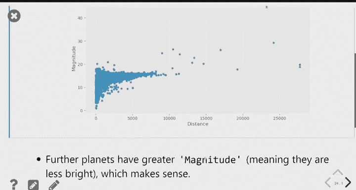
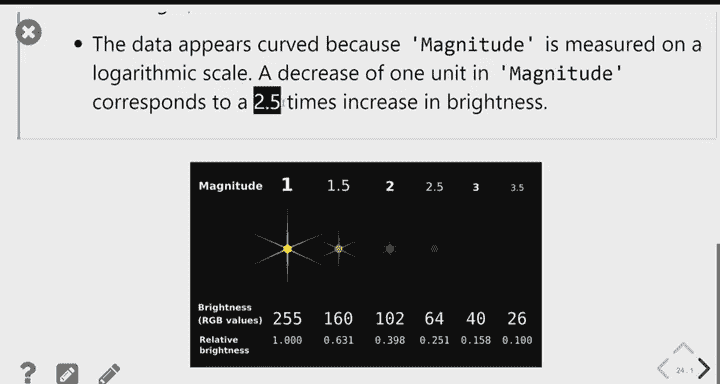
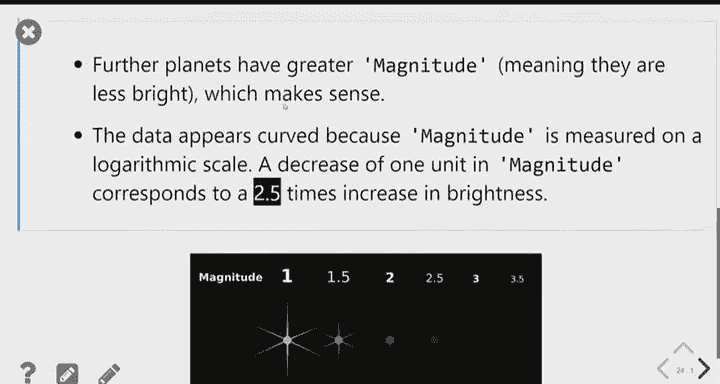
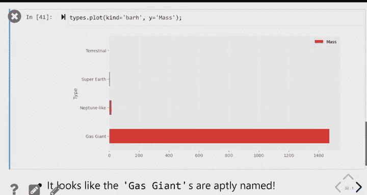
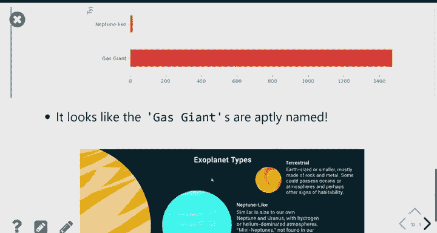
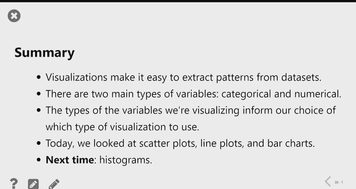

# UCSD《数据科学原理 (DSC 10 Principles of Data Science Fall 2024)》中英字幕（deepseek - P6：DSC 10 - Principles of Data Science - LE -A00- - Lecture 6.zh_en - GPT中英字幕课程资源 - BV1hmAneGEZh

嗯。Yeah。ごさいま。你也特。All right， good morning。The big thing is our quiz today。

 I've had a lot of announcements， so I won't repeat them all。

 but make sure you know where you're sitting the。Ed。Post has more announcements。

 so make sure to check that out about how to prepare and details that you need to know。

Other important deadlines are lab one is due tomorrow and homework one is due Sunday。

 do as much as you can before the quiz today。Okay， so today we're going to talk about something that we noticed last time is that sometimes we want to adjust like the names of our columns or the order of our columns or how many columns we have。

 so we're going to learn how to do that for data frames and then the rest of the lecture we're going to talk about data visualization okay so we'll learn some sort of broad concepts and data visualization and then how to make a few specific types of plots in baby pandas。

I brought my panda today。So something that you should know， just kind of a good point to。

To bring it up in the course is there several keyboard shortcuts that are built in that are very useful to know so now you're using Jupyter notebooks a lot。

 you'll save yourself a lot of time by knowing these things so when you need to run a cell。

Hold down the shift key and press enter。 You shouldn't really be using this run button at the top。

 It's much faster to hold down the shift key and press enter。

 you keep your finger on the shift key and you can run through the whole notebook by just pressing enter。

 save the notebook， control S or command S if you're on Mac。And this one's handy。

 adding and deleting cells。 So if you're。If you notice if you're editing a cell like as I'm typing3 plus7 right the outer bar is green。

 that means I'm like actively editing the cell when I click outside of the cell the outer bar becomes blue so when you click outside of the cell。

 then you can hit the a key and it'll add a new cell above where you are。

Or let me click back on the cell with 3 plus7， if I hit the B key， it'll add a cell below where I am。

 you have to be sort of clicking outside the cell because if you're inside the cell and you hit A or B you're just going to be typing it。

And then if you added cells and you don't need them anymore。

 click outside the cell and hit D twice quickly， DD will delete it。Okay。

 so I use these a lot and they're pretty handy when you're doing your assignments。

 you might want to add new cells to like try stuff out or see your intermediate results。

 so these are good things to know。Okay， so we're going to start by working with the state's data frame。

 I'll load it in。It has the density column that we added， and I've set the index to be state。

And in the last class， we talked about grouping。So one thing you could do is group the states according to region。

And there's many different aggregation methods you could do。 You could， for example。

 sum up the total population land area and density in each region。 You could take the。

The largest in each region。what else can you do you can take the average in each region。Et cetera。

 there's many different aggregation methods， Okay， and one that's especially。

Useful for some things is to count。So what dot count does。

Is it simply tells you how many states are in each region。

So basically it looks in say the capital city column and all the ones that have a region of south are going to get lumped together。

 and it's just looking at how many values were in the capital city column for those southern states。

And it finds for the south， there were 16 capital cities associated with southern states。

 right it's not looking at what the actual values are if you say like dot max or something。

Now it's looking at the actual values and finding the latest alphabetical。

 but dot count is just saying how many。And so you can count capital cities。

 how many capital cities associated with the southern state or you could count， I don't know。

 political parties， how many political party values are associated with the southern state or land area values or population values and it's all going to be the same because it just represents how many southern states are there so when you group by and count you get a data frame that's very redundant you have five columns of data。

 they all say the same thing and further the column names。

 like none of these column names are good descriptions of what the data actually is right it's not saying that the Midwest has a capital city called 12 with a population of 12 people these number 12 is how many states in that region。

So what we want to learn to do is like adjust the columns in our data frame。

 so there's three methods that help you do that， one of them you already know a sign。

 you can use a sign to rename a column right none of these column names have good names so I can add a new column with whatever name I want to give it。

And if I want to keep the data from an existing column。

 I can just get that data out and then reassign it。As a new column in the data frame。

 whatever you assign， the new column gets added to the right。

And then once I have sort of a new column with the appropriate name that I chose。

 I can get rid of any columns that I don't want。So the data frame method to do that is dot drop。

And this has a。A keyword argument columns equals。And then you give it a list of the column labels that you no longer want。

 Okay， so the list would have square brackets。 And in between。

 you'd list all the ones you don't need anymore in equivalent way。

To dropping the columns you don't need is keeping the columns you do need。

And the way to do that is with the get command。So if you use the get command and you input a list of what columns you want to keep。

It'll give you back a data frame with just those columns and in particular。

 the order of the columns in the data frame you get is the order you put here。

 so you can also use this get command to like reorder things like if you have column called column A and another column called column B and you want those two columns but in the other order。

 you can just say get column B column A and it'll swap them for you。

So notice that I'm introducing a different way of using gett than we've seen before。

 we've already used gett to grab out a single column of a data frame and that gives a series so here's states。

When I say states。ge capitalc， it gives me a series with all the capital city names and the label of each row。

 which was the state name so when you just use get with the name of a single column， a string。

 in other words， it gives you a series with that column information。

What I'm showing you new today is a different way to use gett where you input a list， okay。

 when you input a list， instead of giving out a series， it gives out a data frame。

And it gives out a data frame with just the columns you set。Okay， and as I was saying。

 you can swap the order。By。Just putting them in the other order， it'll come out differently。Now。

 what happens if you do this， get a list， but the list only has one thing in it。

Anytime you get a list， it'll give you a data frame。

 It's just that the data frame will have one call。 Okay， so in particular， look at the。

 the difference between。Getting just the capital city as a string without being in a list gives you a series or getting the capital city as a list。

 like the input as a list gives you a data frame。😊，Does that make sense？

 I want you guys to try it out I'm going to give you a few minutes to work on this now you can work with people around you here's a data frame called states by region which came from grouping the state' data frame and counting right but these columns names aren't good。

And they're redundant Can you make this data frame have just one column called count that has the number of states in each region？

Okay， try that out for a little bit。All right， can anyone tell me like the first thing to do？

I have to make a new count column。Okay， so。I'm just going to keep adding on to states by region。

Command at a time。So I'll take the existing states by region and I'll add the new column with a sign。

I'll call that column count like I was told。And then what data do I want to put there？Yeah。

 I can like， so one way to do it， this is not recommended is I want to put the numbers 12，9， 16，13。

Okay， that does work， right， But why I don't like it is I was like having to manually type these numbers。

 right， how can I get these numbers from the data frame？I can do states by region。

 grab out any column you want。 They all have the same values in them。

 I usually grab the one that's easiest to type party。So states by region now has the new column。U。

I'm going to add parentheses。So that I can。Do more stuff on a new line without running off the edge。

 what do I want to do after I assign the new column？It's already grouped。

I just want to get rid of columns I don't need。Yeah。

 there's two ways I could drop the ones I don't need or I could get the ones I do need。

What's easier here？Yeah。Get the one I do need， which is count right。

 it's equivalent to say drop but I'd have to type out five column names and it's just easier to type out one okay。

So this is the sort of desired result。Make sense these three。

Data frame methods in combination assigned drop and get are very very useful to sort of change the names and change the order of things there's no renaming sort of method in baby pandas you can't just say rename this column to that column so we use these three in combination to achieve that。

Okay， any questions？Also I want to make sure you saw at the end of the last lecture there were some challenge problems they're not for going over in class but they're just there for you to practice on your own I had some people working on them in office hours yesterday I have office hours again today if you want to come try them out there they're just harder problems for you to get more comfortable with grouping and querying。

😊，Okay， so today we're going to go on to talk about data visualization。

 we've already looked at data visualizations in this class when we talked about the little woman novel。

 we answered questions based on this picture alone right we could have like written code and looked at data frames of numbers and answer the question that way。

 but it's just easier for humans to look at pictures to absorb information。😊，Okay， this is a。

A picture of data visualization that displays Napoleon's march through Russia in 1812。

 and it's called one of the best data visualizations ever made。And。

The reason that it's so well regarded is that it tells a story without a lot of words。Right。

 it uses colors。 It uses like。The width of segments it uses geography。

 it uses this simple temperature graph on the bottom to tell what's happening and here's what's happening in the story Napoleon's army started out right here the thickness of the bar represents the size of his army so he had a big army and then shortly after a small branch like turned around basically and they came back。

And a little bit after that， another group sort of split off and came back。

 most of the group sort of continued。But the， the bar is getting thinner and thinner。

 And that has to do with the temperatures。 right， They were marching in， in Russia in。

It's a little hard to see down here， but these are dates in October， November， so like late fall。

 wintertime in Russia is pretty cold and by the time they made it to Moscow they had I don't know。

 maybe a third of the original size of the army with them and on the return。

 they faced much more devastation and you can even see particular spots like crossing rivers here。

The river crossing in the negative 20 something degrees。 that's pretty challenging。

 And here's another big one， right， a big decline in the。

In the size of the army so this this visualization uses like the color it uses the tan color for advancing towards Moscow and the black color for returning it uses latitude and longitude because these are actual sort of relative geographies it uses details like the rivers to show you what's happening and it points out specific spots on the temperature graph here so like。

😊，Like right here。Theyt weren't crossing a river， right， but it was just very cold。

 so that explains what happened。So we're not going to make this kind of data visualization。

 but it just illustrates the power of like how and why data visualization is important。😊。

So as I mentioned， we're basically going to use data visualizations because it's better for people to look at pictures than to crunch numbers。

Like that's why when you look at articles online or in a newspaper。

 you see graphs and infographics and things like that， right？

There's whole entire courses in data visualization， we have DSC 106 in our department。

 we're just going to spend about two days on data visualization today and next class。

 but we'll learn a few different types of data visualization and we'll talk about how you choose the right way of displaying your data。

Okay， so when we talk about our data， we're going to talk about rows representing individuals。

 like in our example of states， the states are the individuals that we're collecting the data on。

 and the columns are called variables， that's like the data that we're tracking for each individual。

And there's two types of variables， two types of column data。

 numerical data will say that numerical means it makes sense to do arithmetic。

And categorical means that values fall into categories and the categories may have an order to them。

 like T shirt size is categorical， but there's an order to them。

When we talk about variables in a data frame like this， I'm talking about what the columns represent。

 I'm not talking about like storing a value and a variable in Python with an assignment statement that's a different use of the word variable。

😊，Okay， so here's some examples。Maybe you have a data set of NBAA player salaries。

 right the individuals or the rows would be the players and the variable or the column that you're tracking would be their salary and that would be something you'd want to store as like a float or an in。

Because it's a number and it makes sense to do arithmetic with the values。Company's annual profit。

Flue shots administered per day。 I like the last example because it shows that an individual in a data set doesn't have to really represent like。

A physical person or object like the rows of that data frame would be each day。

 and then the column would be how many flu shots were administered that day Okay so the individual can be a date。

Some categorical variables are things like movie genres or zip codes。

 zip codes are important because even though zip codes are represented with numbers like they're a five digit number。

 we don't use zip codes in any sort of mathematical way right your zip code could be ABC DE or X Y。

 GHK right and it would still serve the same purpose to get your mail to you。

This is a categorical variable that we asked on the We welcome surveys like how much background experience do you have and even though these come categories there's also an order to them。

😊，Okay， use the definition of what I gave about numerical and categorical and answer this question on the website。

 which of these is not numerical？Do you have the answer or type it at the website，cc。dsc10。com。Okay。

 now do you want to tell me what you chose？Okay， the college at UCSD right some of them are represented by numbers sixth。

 seventh， eighth， but first of all not all of them are and second of all。

 even if they were if they were all called first college second college through college we're not using those numbers to like do arithmetic there's no like meaning to be like my college number as twice as big as your college number right that's not like a powerful statement so that's definitely categorical。

😊，But there's another one here that's also categorical， which one is that？Yeah。

 bank account number right same reason as zip codes right we use numbers。

 we happen to use numbers right， but bank account numbers is really just some like unique identifier that says this money belongs to this person right they could give you like a giant pass key or something and that could work instead doesn't have to be numbers so really the best answers E。

These are clearly numerical because you can compare fuel economy like my car has five more miles per every gallon than your car。

 a number of quarters it also makes sense to do arithmetic。

 like you can say I've been here twice as long as you and that makes more sense。Okay。

 any questions on those？Okay， this is important because the type of variable that we have determines the type of visualization that we're going to use。

 and we're going to cover four types of visualizations， scatter plot， line plot。

 bar chart and histogram。And the right choice of which one depends on what variables we have。

 so a scatter plot is for two numerical variables。A line plot is for some。Basically time variable。

 we call it numerical variable that goes in some sequence versus a numerical variable。

 a bar chart is for one categorical and one numerical and a histogram is for just a single variable which is numerical okay so we'll do the first three today and histogram next time。

So we'll start with scatter plots and for our data visualization we're going to go to some new data instead of the US states。

 we're going to work with a data set of exoplanets。

 so exoplanets are planets that exist outside of our solar system and NASA's been searching for them。

 they have various missions and。😊，In techniques for how they find these exoplanets。

And they publish this data on their website like a data set of all the exoplanets they've discovered so far and this is the data that they have okay distance is how far away is it magnitude。

 magnitude means some measure of brightness， but the important thing about magnitude is that low number means brighter right and the terminology for this came from like you see something big and you're like wow that's a first order star like that's a really big bright star like and then there's like a second class star and a third class star right so the low numbers means brighter。

😊，Type is some categorical variable of what the planet is like， when it was discovered。

 how it was discovered， and then mass and radius are ratios So it's this planet's mass over the Earth's mass。

 meaning if you get the value of2， that means it's twice as massive as Earth okay。

 if you get a value of 0。7， it means it's 70% as big as Earth and similarly for radius okay any questions on the data。

Now the exoplanets have these crazy names。Because they're like named after the telescope that found it and the plant like。

I don't know the details， but there's some complicated name and convention with a lot of weird letters and numbers。

 but these are what they call the planets， okay and I have all the information and there's like over 5。

000 rows。So you might have some questions about this data， right， One question is like。

Are the stars that are closer to us brighter， right。

 Is there a relationship between distance and magnitude？

And an easy way to sort of quickly answer that question is to look at a scatter plot。

So here's a scatter plot。It shows distance and magnitude。

So based on what you know about distance and magnitude。

 does this data support the fact that the closer planets are brighter？Yes。

 because the closer planets seem to have sort of a lower magnitude。

 the data kind of tends to do something like this。The closer the distance。

 the lower the magnitude and low magnitude was bright， right first order stars are impressive。

So it does seem to support this。

And the data also appeared curved because of the way magnitude is measured。

 something that's a magnitude， say two star versus a magnitude one star。

 it's only a fraction as bright as a magnitude one star。

 magnitude three stars is only a fraction as bright as that。When you change by one unit of magnitude。

 you're actually changing the brightness by two and a half times。

 so that's why this has a curvy shape to it if you're interested。

Okay， so how did I make that scatter plot and when do you make scatter plots。

 scatter plots are for when you have two numerical variables。

 right distance was a number and magnitude was a number and you can plot them on an XY plane because both are numbers the command to create one。

It's a data frame method， so you start with a data frame of all the data。

And then you say the name of that data frame dot plot and then the plot function or the plot method takes three inputs。

 the first is kind where you're saying what kind of plot should I make in this case we want a scatter plot。

 notice it goes in quotes。And then。Of a variable called X。

 and you give the name of the column you want to use on the horizontal axis， a variable called Y。

 the column you want to use on the vertical axis。Okay， so let's look back at this。ExO。

Was a data frame。So that's my data frame and to plot， I'm plotting from the data frame， okay。

 so you can't plot unless you have a data set to plot and we store data sets in data frames。

And then I'm saying make a scatter plot and the column to use along the x axis is distance。

And the column for the Y axis is magnitude。You can also like ask a different question。

 like maybe is distance related to。I don't know， radius or something。

AndYou just change and use a different column。For the why。Harder to tell。

The resulting scatterplot has a lot of dots in it， there's like a lot of blueness。

 there's one dot for every row of the data frame because each one represents a planet okay if you had a smaller data frame with fewer rows。

 you would have less blueness on your picture。Something useful is。This semicolon， this is optional。

 I'll show you what it does with and without without it gives the same picture but it like prints this output of like what the axes are labeled with and stuff and that's not really nice to look at so the semicolon suppresses that。

Same thing， no output makes sense。Okay。So one thing we saw was that。If you look at that scatter plot。

 let me go back。Most of the data is here。These are kind of like outliers。

Values that are not really typical of the rest of our data set and because we're plotting the entire data frame。

 you know we see every single row of that data frame。

 but what if I want to just like ignore these guys for now and focus on the ones that are close by right？

There's no way to do that with the plotting command because the plot just plots from a data frame。

 what you do is you alter the underlying data frame to get rid of these values， like remove the rows。

 and then do the plotting command and it'll only show you this plot。Okay。

 so the strategy for that is querying。Instead of the full set of exoplanets。

Just keep the ones whose distance is close enough。And I didn't really get rid of very many。

 I used to have 5，043 or something， but the plot's going to look a lot better now because the scale like it scales it to fill up the space。

Any questions on scatter plots？All right， let's look at line plots。

Here's another question that we can answer with the plot how has the magnitude of newly discovered exoplanets changed over time what would be your hypothesis just based on the context of the data？

Yeah。Okay， I think we might have the magnitude backwards。

 but you're saying the right strategy right you're saying the ones that should be discovered first are like the bright ones right like the ones you can see with an naked eye are going to be discovered first。

 the ones that are like less bright are going to be harder to find so the bright ones are the low magnitude and the harder to find ones should be higher magnitude so over time we would expect the magnitude of the newly discovered planets to increase so if you think of a line plot。

 you think it's probably going to go up as you read from left to it。😊，Okay。Okay， so。The problem is。

 I can't really make a line plot directly from this because there's many planets that are discovered in the same year。

RightSo like this planet was discovered in 2017 and it had a certain magnitude。

 but what if there's another planet discovered in 2017 with a different magnitude。

 how high should the line plot go for 2017？In order to make a line plot， we need one row per year。

What's a reasonable way to sort of change this data frame， so instead of one row for planet。

 it has one row per year。Grouping right grouping changes what the data frame is of right here it's a data frame of planets。

 if you group it by year， it'll be a data frame of years right and then how do you sort of aggregate or put together all the the planets from the same year you want some sort of middling operation like mean or median to tell you like what's a typical planet from that year like。

Okay， so let's group by year and take the mean。This shows me， like。You know。

 the planet that we discovered in 1995 were generally pretty close。

 whereas the planets we're discovering now are like generally further。Among other things。

 so now on this data frame。I'm going to make a plot， I'm going to make a line plot。

And I'm going to track the magnitude。Okay so this basically says what we expected that like early in the discovery。

 the magnitudes were smaller and later in the discovery， the magnitudes are bigger。

 over time we're getting better at finding exoplanets and we're finding the harder to find ones。😊。

You can ask other questions， like instead of charting the magnitude。

 you could ask about the distance。And。This is less linear， like less obvious。

 but it is pretty clear at the beginning here。That like for a while， we could only find close things。

 and then we got better。Okay， let's go back to magnitude。

So this kind of matches up with our intuition， something that you'll notice is that in '09。

There was like a pretty big uptick。Here on this graph of the magnitude of planets that they were discovering。

 which means like something changed here。You can think of this as a。

A turning point in their technology and there is actually like a reason for that they had the Kepler Space Telescope。

 which its job was to go out and find exoplanets and it did that well so it found things that hadn't been found before that were less bright than the ones we knew about。

So the command for making a line plot is very similar to the command for making a scatter plot。

 in fact it's the same data frame methodt plot The thing that we do differently is we specify a different kind of plot we want a line plot。

😊，And just like for the scatter plot， you have an x variable as what column do you want to use for the horizontal axis and a Y column for what column do you want to use as the vertical axis？

But if you notice the way I used this command。I said what kind it was going to be。

 and I said what to use for the Y axis， but I didn't say what to use for the X axis。

And that's because what I wanted to use for the X axis was not a column at all。

 The X axis that I wanted was the index， So it would have been wrong if I tried to say。

 put on the X axis， put the year。This would give me an error。

Because it's like there is no column called year。A lot of output。

 but it there's something wrong with me asking for the year。Okay。Instead。

 what I want is something like I want to be able to say that for the X。

 use whatever's in the index and the way that you say that is you just leave out the X and it defaults to using whatever's in the index。

Does that make sense？Okay。So line plots are basically used to show sort of a trend of what's happening over time。

Like。How we're discovering less bright planets over time。

There's an extra video for like more details if you're interested， but this is not essential。

Let me talk now about bar charts。Okay， so bar charts can answer this question。

 how big are each of the different types of exoplanets on average？Okay， so exoplanet。

 one of the things we tracked about the exoplanets。Was their type like gas giant。

 terrestrial and super earth right these are some categorizations that scientists give to planets based on like how big they are and what they're made of。

 like rocky or gas or whatever。So there's only a specific number of categories here。

 and we can see what they are， and we can see like a typical value for each type of planet by grouping by the type okay。

When you group by type， notice the result is a data frame index by type and there's one row for each unique type so I can't really scan through all 5000 rows to see like what values are possible in the type column see I see gas giant terrestrial and superear but are there 20 types are there 100 types are there four types like I can't tell but once I group then I can see these are all the types because that's what grouping does okay so there's actually just four types gas giant Neptune like super earth and terrestrial。

And the mean aggregation method gives me like a sense of what's a typical planet of each type like？

So like， if you look at sort of the radius column。Look at gas giant radius。

 Ga giants are typically like 12 or 13 times bigger in terms of radius than the Earth， Okay。

 whereas terrestrial planets are generally smaller than the Earth。 These are ratios of the。

They're radius over the Earth's radius Okay， so the last column kind of tells you what the different planet types are like。

And a bar chart does the same thing。 A bar chart basically displays those four numbers in a visual way。

 so you can see like， wow， gas giants really are huge。Now that makes sense？So。Here。

 the kind of bar chart that I'm plotting is a horizontal bar chart。

 we tend to prefer this to vertical bar charts because it makes the labels easier to read。

I'll show you what a vertical bar chart looks like。

 you have to kind of turn your head sideways to read those things。

So we'll generally use the horizontal kind。Similarly。

 you could make a bar chart of how the different masses。

Vary with the type of planet and here you can really see gas giant being extremely massive。

 so this is a like appropriate name gas giant right there they're huge in terms of radius。

 they're huge in terms of mass。

This is a little infographic from NASA about like how they actually categorize the different exoplanets and like basically。

 yeah， that's what makes gas giant giant is their size。

 terrestrial are generally earth sized or smaller。E cetera。

Okay so something to know about bar charts is bar charts only make sense when you have a categorical variable and a numerical variable。

 so I couldn't make like a bar chart of distance and magnitude because neither of those are categories right so my bar charts that I showed you were。

😊，This was type and radius and this was type and mass and the type is the categorical part and basically in a bar chart you'll have a bar for each category and the length or how long the bar goes is determined by some numerical variable。

😊，Now， it doesn't really matter like how thick each bar is。

What only matters is how long the bar goes like only one dimension of the bar carries any meaning Also the order of the labels doesn't really matter right。

 you can put the planet types in a different order and it still tells you the same thing right Sometimes it's nice to have it in a certain order like see how it goes from like small planet type to big planet type。

That's kind of nice that I can quickly read off the labels to see which planets are small and which are big as opposed to if these four bars were just like randomly ordered。

 it's like a little harder to parse。Okay。嗯。But yeah。

 it still says the same information even if it wasnt romantic mortar。😊。

The plotting command is the same data frame method dot plot。The kind is bar H， H for horizontal。

 and then x is the category， the column of categories， and y is the column of numbers。Now。

 something that's a little confusing。Is that。I said x is the column of categories。

So the categories I want here were in the index， which is why I omitted that x and y is the the column for the。

The the numbers。So in this case， the radius tunnel。But when you do a horizontal bar chart， actually。

The categories appear on the vertical axis， which you normally call the Y axis， right。

 and then the numbers， the radius values appear on the horizontal axis， which is the X axis。😊。

 so there's like a mismatch between how you use the X and Y inputs versus how they actually display on the screen。

 and that happens because of the H right the bar H is kind of taking a vertical bar chart and flipping it。

So if you just did a regular bar chart， then x being the type and y being the radius would make sense。

So we're going to kind of still prefer the horizontal one for the readability。

 but you just have to remember that the x is the category one and the is the radius one or y is the numerical one even though it'll come out differently on the screen。

Okay， let's try to answer this question， what are the most popular detection methods for discovering exoplanets？

Okay， so I'm going to start by grouping according to detection method。

The exoplan itss data frame had a column for how it was discovered basically。

 looks like radial velocity is a big one， but I'm only looking at a few rows。Okay。

So organize by detection method and then just count how many planets were discovered by this detection method。

And some of them are really like rare and some of them like transit are really frequently used to discover new planets Okay。

 so this is what I was showing you at the beginning of class， these column names are not useful。

 they're also very redundant， I'm going to make a new column called count。😊。

And I'm going to keep just that column， and then I'm going to sort the data according to count。

So this data frame called P detection。Tells me。Which detection methods are most used transitit is first place radial velocity is second place direct imaging is third place notice really like the vast majority of planets are discovered in one of these first two ways right there's a big drop off there。

Now， what happens if I make a bar chart from this data frame？You see。

 transit and radial velocity are much bigger bars than everybody else。But notice the order， right。

 transit is the bottom， radiodial velocity is the second to bottom， even though in the data frame。

 transit was the top and radial velocity was the second to top。

basicallyically the order of the bars gets reversed when you plot a horizontal bar chart。

 and that also has to do with the vertical versus horizontal thing if you plotted a vertical bar chart。

They would appear from left to right in the same order as the data frame。

But when you turn a bar chart from vertical to horizontal， it flips it。Over this axis。

And so these wind up here。And these wind up there。So it changes the order。Does that make sense。

Any questions？Okay。Another thing you can do with plotting is plot multiple things at the same time。

So one thing that we did with bar charts was how does the radius of each type of planet like what's a typical radius for each type of planet。

 and we also did what's a typical。Magnitude for each type of planet or mass。

 like you can do multiple things at the same time。And here's an example of such a graph。

So this is showing me。For each planet type。Its average magnitude and its average radius。

This is called an overlaid plot， it means like were we're plotting basically two different or multiple different plots on the same axes and the way we did it was。

We already learned what happens when you omit the X column that uses the index。

 it turns out that when you omit the Y column， it uses every single column as a different y。

So here is types。Types has five columns。Now if I omit the X。

 I'm not saying what to use as the categorical variable， it's just going to use the index。

 if I also omit the Y， it's going to make five separate bar charts for each of these columns。

So this looks like this， see there's five different colors used。

But this is a really bad data visualization， what's bad about this？2里。

Yeah exactly like the radius numbers are all like pretty small like I think 12 or 13 was like the biggest one and this is on the scale of thousands because the distance and the year go into the thousands right so I don't really want to plot all five of these on the same axes I just want like maybe two of them that are on the same scale。

So I used the get with a list of columns。To give me a data frame that had only the columns that I wanted to plot。

And then I plot。Okay， so here's the full types data frame。

 keep only the columns that you actually want to put on your plot， then plot and omit the Y。

 and then use all of the columns right， but all the ones there are the ones you specifically want it to be there。

开。Does that make sense？Any questions？No， you can't what you do is this instead like that would be a reasonable solution。

 but that's just not how it's implemented what we do instead is you just keep the columns you want and then y equals nothing。

 you don't put a Y and it uses all of those。All right。

 good luck on your quiz and I'll see you guys next time。

