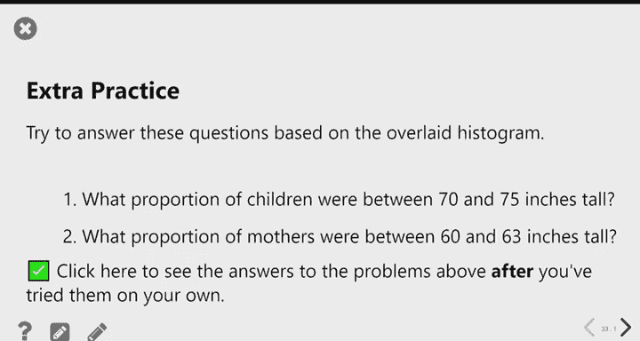

# UCSD《数据科学原理 (DSC 10 Principles of Data Science Fall 2024)》中英字幕（deepseek - P7：DSC 10 - Principles of Data Science - LE -A00- - Lecture 7.zh_en - GPT中英字幕课程资源 - BV1hmAneGEZh

All right， welcome。Okay so you may have seen that the quiz scores are posted remember it's okay if you didn't do as well in the first quiz if you want as you wanted。

 it's only the first quiz you're learning a lot of new stuff you'll have more opportunities to practice and demonstrate what you know but take it as a learning opportunity do as much practice as you can before the next quiz and importantly there's opportunities for you to like learn how you did and how to improve there's like one on one quiz review appointments available with tutors there's a signup sheet for that so take advantage like in a big class you don't always get that much time for sort of personal interactions like that but this is a person who will sit with you and look through your mistakes and help you prepare for the next quiz so it's worth doing。

We have a lot of assignments coming up too， we're getting to the busy part of the quarter where we've got two things going on every week labs and homework so the next lab is due next Thursday it just was released and you have a homework due this Sunday there will be homework due next Sunday too okay so keep on the Sunday and Thursday deadlines and most importantly start in advance so you have time to like get help if things go wrong or take longer than you thought etc。

Okay， so last time we talked about。Different types of data visualizations we saw scatter plots。

 line plots and bar charts and those both involve two columns of data from a data frame Today we're going to talk about a fourth type of data visualization called the histogram This involves only one column of data from a data frame and histograms show sort of the distribution of a variable so the lecture today is the most theoretical lecture of any that we've had so far。

 it's less about like learning how to do it in code and more about like understanding what histograms represent and how to calculate things based on them so we'll be doing some math calculations today and a little more concepts So the next discussion section you' you'll get more practice with this material。

Okay， so we're going to work with the same data that we worked with last time。

 the exoplanets that NASA's discovered。And these were the columns of information that we had。

 distance， magnitude was brightness， such that a lower number is a brighter star。

 a type of planet year it was discovered， detection method。

 and then mass and radius were ratios to the Earth。Okay， so this was our data set。

Lots of exoplanets there。And today we're going to try to answer the question。

 what's the distribution of a variable， Okay， so basically the definition of a distribution。Remember。

 when we say variable here， we're talking about a single column of data， right。

 The distribution of that column is like all the values that occur in that column and how frequently they occur。

 Okay， so this could be like you could talk about the distribution of。I don't know。

 roles you get when you're playing a dice game， like you can get any number one through six and if you roll the dice enough。

 the distribution will be roughly uniform all the same but maybe you only roll the die a few times and the frequencies are not all the same。

You can also have distributions of like a categorical variable like what class year everybody in this class is right。

 some are first year， some are second year， some are third year right knowing how many fall into each category that would tell me the distribution of grades okay so distribution can be distribution of a number or distribution of a categorical variable the point of a distribution is to answer this question how often does a variable take on。

😊，Its it's different possible values， right like what's common， what's uncommon。

 helps you answer questions like that， like the distribution of students majors would be like an interesting question。

So we're going to talk about distributions in the context of these exoplanets。

We're going to start with categorical variables， so we're going to look at type because type was some categorization based on like how rocky or gaseous the planet was and how big it was。

 like things about the composition of the planet。Okay， so。

This is what the full data frame looks like。 But if you want to look at the distribution of type。

 you need to know how many of each type there are so the way you get that information is you group this data according to what type right you want all the gas giants to be sort of lumped together and you just want to know how many gas giants there are。

 So that means the aggregation method is count。And the result is a data frame we'll call it type counts。

That tells you simply how many gas giants， how many Neptune like， how many super Earth。

 and how many terrestrial exoplanets there are。Okay， something to notice。

Is that all these columns have the same data， so if I want to make a bar chart showing like how commonly each planet type appears in our in our known。

Universe。This would be the bar chart， but I did this by plotting the distance column。

 I could have plotted any other column I want， the example says change it to magnitude。

And it's still the same picture right because it's just that column tells it where to get the numbers from and I can get it from any of the columns I usually use the one that's shortest to type because it's easier。

Something to notice about the code I use for making this plot。

We learned about these arguments to the plot command last class， what kind of plot am I making。

 what data do I use right here I omitted the X which means it's using the index the types as the categories and I told it what column to use as the y for the numbers but there's a couple other things here one of them is gives the plot a title you see the title there right that's optional but it's a nice thing to do so people can make sense of what you're showing them this one legend equals false well I'll show you what happens if I set legend equals true。

See in the corner， there's like this little thing that says these bars represent the year。

 Why did I specifically want to type legend equals false for this plot？There is only one column。

 right， but sometimes having a legend in a bar chart isn't like offensive or isn't bad。

 but here it actually would be bad if I kept a legend。What's bad about having this？Right。

 like this is not actually the year。 This doesn't say something like about gas giants happened in the year 1500。

 right， So it's actually misleading to have a legend here because the column names are not meaningful。

 right， So I could either。Change the column name like count we saw how to do that last time。

 or I can just not show a legend and use the title to explain what it is。

There's lots of other optional arguments for plotting， one that you'll see a lot。Is called fig size。

That just controls how big the resulting picture comes out。

 it has like an x dimension and a y dimension， so you give it like an ordered pair， like in math。

 let's say I want to be 10 across and three up。Right， that comes out wide and and short， right。

 Or if I want it to be。Three across and10 up。looks ridiculous okay。

 so you can change this or use the default。😊，Okay， so there's a link here to other details that you might want to know to make your plots look better。

Today we're going to focus on。The terrestrial exoplanets。Because。They're rare。

There's not too many of them。They have the smallest average radius of any type。

The terrestrial planets generally are smaller than Earth in terms of size， like volume， radius。

 and some of the other ones are way bigger。Okay， so we're going to make a smaller data frame of just the terrestrial exoplanets。

 so one specific category， I'm calling it tear， and it just comes from a query right my condition is that the type column has to match this certain value。

So I only have 193 rows that's much smaller than my original data set。Okay。

 and let's say we're trying to practice。Distribution of variables， right。

 So we understand how to show the distribution of a。Of a categorical variable with a bar chart。

 right， This answers my question of like， how many of each kind are there， right。

And now we're going to try to look at the distribution of a numerical column。The radius column。

There's a series method dot described that gives you some information about a column in particular。

 like how many values are there， what's the average value， what's the standard deviation of value。

 some things are hidden here， but it tells me like different percentiles and the smallest and largest。

So this is somewhat useful to understand the values there， but it's not all the information。

 and you might want to visualize this because we talked about how it's better to look at a picture than just to look at a set of numbers。

😊，诶。So what's the difference when we're working with radius which is numerical versus type which is categorical so for categorical we used a bar chart and that answered the question of like how many of each kind of planet are there right but we'll see today that a bar chart is not really the right tool for like how many of each radius are there because radius is numerical。

So let's try it with a bar chart and I'm kind of going to show you what goes wrong。

The first thing is the terrestrial planets， there's 193 of them right。

 some of them might have the same radius， and I need to count like how many of them have this common radius value。

 just like I counted， how many of them are of the same type right so when you want a distribution of something you're generally going to group by it and count to tell you how many fall into each group。

Okay， notice what I'm doing here is I'm just making the column names better。

 I'm calling it count and I'm only keeping that one column。 Okay。

 so terror radius is how many planets have each have each radius value。 So this says there's one。

Terrestrial exoplanet whose radius is 37% of Earth's radius。 Okay。

 There's one that's three times bigger than Earth's radius。 right， It looks like a lot of ones。

 But I I know from this output that they're not all ones。 How do I know that。Yeah。

 there's only 85 rows and I started with 193 planets。

 so some of the like the sum of the count column has to add up to 193 because all the planets are in here somewhere okay。

 so  one plus1 plus 185 times is not enough。So there are some like duplication of radius values and the question I'm asking when I asked about the distribution is like。

 what are those common radius values， kind of like what's typical？

And I'm going to try to answer it with a bar chart。

 and then we'll talk about why this isn't really satisfactory。Okay， so first of all。

I'm showing the bar chart vertically。Because there's just so many different radius values。

And it's nicer on the screen to look at it this way。What do you notice when you look at this chart？

The first thing you might notice is like what's up with some of these numbers on the bottom right they're like really long like 0。

8059999999 like that probably was supposed to be like 0。806。

 but that's one of those numbers that like doesn't get stored well。Okay。

 so some of the radius values are weird and have lots of digits in them。

 okay but that's not that important， let's ignore that。Here's like a tall bar。

What does it say like 11 or something， there's like 11 planets。That are what is this 0。89？Yeah。

 it's hard to tell because it's so small。Yeah， 0。89 is like a very common radius value。Okay， but 0。

9 next to it is like not a common radius value。That's kind of weird because 0。89 and 0。

9 are like so close and this could just be on account of like how much they rounded it right if you if you rounded instead of most of these are rounded to two decimal places or three decimal places like what if you round it to five decimal places or six decimal places then they would like all be in their own category right and that doesn't really tell me anything about like what values are common or not so。

When you group by a numerical column， you're just like counting the things that got recorded as having the same number。

 even though those numbers themselves might have come from rounding and the actual values might be a little different。

Another thing you notice when looking at this plot is that it doesn't say anything about the scale of these numbers。

 and you can tell that when you look in the far right corner。look what happens here。

 this bar represents 1。0。The bar next to it is 0。997 right so sort of the space between these two bars right here。

 if you think of it on a number line， they would be like really close right 0。

997 and 1 are very close， but then the next bar is a 1。

8 right That type of planet is hugely different from the 1。0 bar right。

But it looks to be like equidistant from the 1。0 bar as the 0。

997 like one of these like planets on the left， the 。997 is actually very similar to the 1。

0 but the one on the right， the 1。8 is actually like almost twice as big as the 1。

0 buts because it appears right next to it like this it's not obvious when you just glance at this picture that actually these three planets on the right are like outliers almost all of the data for terrestrial planets are Earth's size are smaller。

 but these three are actually significantly bigger like two or three times as big as Earth。

 they should really be like way far on the right side and standing out as different from all the others。

是的。Right， so you're already coming towards a solution like the way I've categorized the data right now is like you're categorized together with another planet if you' if your radius is exactly the same right all the 1。

0s got together and the 0。997 was left out of that party because it was a little different right but it ignores the fact that 0。

997 is super close to 1 right so maybe we should just put like I don't know， all these 0。

9 anything 0。9 through 1。0 or 0。99 through 1。0 maybe those should just all be like together and say they're close enough。

Right。So we should kind of like make bigger groups that encompass multiple values is kind of the idea and your question is like how big should those groups be and that sort of arbitrary we'll see that it's adjustable but the point for right now is that a bar chart is not going to cut it because bar charts just treat the numbers as categories with no concept of like how the numbers relate to one another like the fact that 1。

8 is much bigger than 1。0 is not sort of captured by a bar chart。So ideally。

 we'd want like something that looks kind of like this。

But the horizontal axis should be more sort of spaced out like a number line。

 so that it actually gives me a sense， and I maybe don't want to distinguish so much between small differences in numbers。

Any questions so far？Okay， so the， the type of visualization that we use for。

The distribution of numerical variables， instead of a bar chart we're going to use something called the density histogram。

 so don't worry about the code right now， I'm just going to show you like what a density histogram looks like。

😊，系。And this is the type of thing that we're going to create。So basically what this is saying。

Is it's kind of saying the same thing that the bar chart was trying to show。

 but it's more kind of like zoomed out like a big picture of you， right。

 It tells us that most terrestrial exoplanets have a radius that's like pretty close to the radius of the earth。

 but a little smaller right， the vast majority， like see how big this bar is the vast majority of exoplanets have a。

Have a radius of like 0。75 to 1。0 times the Earth's radius。

It's not that uncommon to have something between half as big and three quarters as big。

 but it's quite rare to have something less than half as big or to have something larger than Earth's radius。

Does that make sense？So。I want to show you something about specific。

Planets that have a radius of exactly one。If I query to find out how many there are。

You can count the rows， but it's probably better to do this dot shape0， there's seven such planets。

 right now。Having a radius of one is kind of on the borderline of these two bars。

 we'll see that it counts sort of in the bar to the right。But look at the height of this bar。Right。

The height of the bar is like some small decimal。The height of the bar is not seven。

 saying there are seven such planets。Similarly here， like this is a number that's close to three。

 it doesn't mean there's three such planets。In total， somehow in total， this has to represent。

193 planets。Because that's how many there were。So you can kind of compare like the heights of the bars relative to one another and see that。

You know，There's many more in this category than in this category。

 but it's not obvious like how the heights are determined。 Okay， so this is sort of a question。

For us to figure out。How are the heights determined？And we will answer that by the end of today。Okay。

 aside from that question about the heights， any questions so far？Okay。

 so let's talk about sort of how this histogram comes about and what it represents。

 the first idea is the one that was brought up before that you can sort of group similar numbers together when creating a histogram。

 so this is called binning。Binning is basically count up how many numbers fall between certain end points。

And we use the same convention that you've seen before when we did NP。A range。

The left endpoint is included， but the right endpoint isn't。Oops s。Okay， so excuse my writing。

 I should really figure out how to erase this。Okay。Just ignore the writing。

 I can't erase it right now。 Bning is this process of， of putting numbers into。

Into groups based on what numbers they fall between。 So the picture here。

The picture here shows bins between 60 and 76， and they're four wide。

 The width is like the difference between the endpoint。 Okay。

 and I'm just going to go through the numbers one at a time and put them into the appropriate bin。

 Okay， so 72 is the first number that goes。Here， because the bin 72 to 76 includes 72。 Okay。

 that's what this like NP dot A range thing is saying。So 72 goes there。61 goes here。

63 we're considering 63 close enough to 61 that it should get lumped together。Okay， 74 goes there。

 68， 67， 65， 73， 65， 62， 66。Okay， so in the end， this picture kind of represents that like the taller bars are where the values occur more frequently and the shorter bars are where they are less common。

😊，So that's the first sort of major idea for histograms。

How do you plot one of these so we call them density histograms。

 I'm going to talk later about what this word density means。And the plotting command is the same。

 but the kind is hissed。Unlike the other data frame plots that we saw。

 this only uses one column of data， right， you talk about the distribution of the radius column。

 you're not talking about like radius versus mass or something that would be a scatter plot so you only ever need one column there is no X。

 we just call it Y。And then density equals true， we're always going to use this to indicate that the type of histogram we want is a density histogram and as I said I'll explain what that means in a little。

Another useful。Thing to add to this， like just like we saw with the fig size and the labels and stuff。

 you can add extra arguments。If you include this。It means edge color。EC stands for Edge Col。

And the string W stands for white， so I'll show you what that does。So let's look at this。Results。

 this is what I showed you before or something similar to it。The EC equals W。

 it's hard to tell maybe on the projector， but there's like a little white bar separating these two。

 it allows you to see where one thing ends and the other begins。

Without it， it's just like a red mass。Okay。We talked about putting data into bins， right。

 How are the bins determined， What bins should you use， There's sort of a default behavior， which is。

 if you don't say anything about how to bin the data。

 it will bin your data into 10 equally sized bins。 So the way it determines this is it。

It does like the biggest。One minus the smallest one right that tells you like how spread out your data is and then it divides that by 10 and that's the width of each bin right so the first bin goes from the smallest to whatever chunk。

 the next chunk， the next chunk you'll have 10 chunks and you'll wind up at the biggest。

So this would be the width if they're all equally spaced。

Another thing you can do to sort of customize it is you can specify how many bins you want。

 so instead of 10， maybe you only want five bins or maybe you want 20 bins， right。

 changing that number is going to give you like a finer or a coarser picture of what the distribution looks like。

You can also， if you want， specify exactly where you want your bins to start in it。

 like you can say my first bin should go from three to7 and then my next bin should go from seven to 12 like you can make them up and they can even be different like different sizes。

So here's。Some pictures， this is the 10 bins by default。

 notice I didn't specify anything about the bins。This one。I included this bins equals 20。

So what that does is basically now the bins are half as big， right。

 so I get like more detail in the picture。And this last one。

I actually tell it what the endpoints of all the bins are。

 So this says the first bin goes from zero to one half。 the next bin goes from one half to one。

E cetera。And a bin size of a half is like actually pretty big given the scale of the data。

 so this isn't really that useful right because I mean， it tells me like most of the data。

 most of the planets are you know， between half and the whole size of Earth。

 but that's about all that it tells me right it's not that detailed of information。Okay。

 so a question for you， what's the same and what's different from these？Pictures。What's the same？

The general shape is the same。 Like， there's this peak before one。

And then it's pretty sort of light around there， what else？That might be all that's the same。

 what's different？Okay， yes， so this is important。 The numbers you see on the left。

The heights of these bars。This one， the tall bar， was like a little over two。This one。

 the tall bar was like a little over three。And this one， the tall bar was like not even two。Okay。

 so the heights of the bars are definitely different。

 like the scale of these rectangles somehow is different based on how many bins and where the bins are。

Okay， so this is the part we still don't quite understand is like where do these heights come from？

Okay。So let's talk a little bit more about the details of the bins remember I talked about。

How it includes the left endpoint， but not the right right endpoint， that's generally true。

 except for the last one， the furthest one to the right does actually include the right endpoint。U。

When you specify bins， you can like make the bins such that not all the data fits into them。

 Like if let's say the exoplanets， right， most of them were in numbers between0 and1。

 There were a few that were really big。 I could just say， plot a histogram。And like。

These are my bins。And it just kind of shows me only the data that falls into those bins。 right。

 It's not even obvious that there is data bigger than that。

 It only just shows you whatever part of the data would fall in those bins。For equally sized bins。

 which is almost always what you want。NP do A range is a good companion with making bins。

 because what NP do A range does is it makes equally spaced values。啊。So， if you say。NP。

 A range4 right， what's NP。 A range 4， that's 0123， that's the array 0123。

 which creates that if those are your endpoints， the bins are 0，1，1 to 2 and 2 to 3。

And notice the left endpoint is included， but the right isn't。

Except for the last one then it is Okay so it's easy to get this wrong。

 be careful with the endpoints because the number that you put here like four it's not actually including data that's around four。

 The biggest number you get is three so this is the off by one error that happens because Python starts counting at zero and you're just not used to that。

 So this is an easy kind of mistake to make。Okay so here's some more histograms of the same data。

 just， I'm changing the bins。Okay， before you run this。Tell me， just based on the code。

 what's the the， the right most bin gonna be。what values will it go between？

The rightmost bin goes from two and a half to three。Because this the last value in NP。A range。

It doesn't include this， it doesn't include 3。5， so the last value will be three and they're half apart。

 so two and a half to three is the last spin。Okay， so even though there is a planet whose radius is above three。

 it's just not shown in the histogram。Here's an example of the bins having different widths。

 I just told it exactly where I wanted the bin end points to be。

 and I made some of those bin end points close together and I made some of them really far。Right。0。

75 to2， that's like a wide bin there and two to four is also a wide bin。Okay。

So when you look at this， right？See how the 0。5 to 0。75 bin is actually the tallest。Right。

But this been。Is sort of the biggest in another sense。

This bin is the biggest in terms of like how much redness it has， like I would call that area。

Are there more planets？In this bin or in this bin。which is the more typical of planets for them to have a？

A radius between。0。5 and 0。75 are them to have a radius between 0。75 and 2。

Which one's the bigger one， the taller or the area？The area one， right， So this one represents。

More planets。And this one represents fewer planning。So what that's saying is that the area。

It's kind of like what's important when you look at a histogram and not the height。

And this actually winds up explaining a lot。The key idea。

 the other key idea aside from binning is that the total area of a density histogram is one。Okay。

 and this explains like what's going on with the y axis The y axis is like some crazy number that's like hard to interpret。

 but the y axis is designed so that when you calculate the total area of all the redness。

 you get one。Okay， so if you calculate like the area of each bar and you add them all up。

 you'll always get one。And that has a really nice consequence。

 which is since like one can be thought of as like 100% or a proportion of one， meaning everything。

 if you look at a particular bar and calculate its area。

 you'll get some number between 0 and1 like maybe 0。37， for example。

 if you have a bar whose area is 0。37， that means that 30% of the data falls in that bin that the bar represents。

Okay， so when we're talking about。These density histograms are working a lot with proportions and percentages。

 we'll try to use this convention that proportions are numbers between0 and1 and percentages are 100 times larger okay so proportion 0。

34 means 34%。😊，Okay so。Here's that same weird histogram that I showed you before。

The bins are different sizes。And using that fact that the total area is one and that the area represents proportion。

 we should be able to figure out like how commonly。

How common it is for a terrestrial exoplanet to have a radius。Between 0。5 and 0。75。

And the key is that the proportion is just the area。So what I'm asking when I ask this question。

 like what proportion of planets have a radius between 0。5 and 0。75。

 what I'm really asking is calculate the area of that tall rectangle。

So can you use the numbers to calculate its area？Well， areas height times width， right。

 the width is a quarter。Or 0。25， the height is pretty close to 0。8。This involves some eyeballing。

I may not be exact， but I'll be pretty close the area。Is the width times height？

Which is a quarter times 0。8。Whi is 0。2 right， so what proportion of terrestrial exoplanets have radius in that range。

 it's 0。2 proportion or 20%。So this bar represents 20%。How much does the big bar represent？

How wide is this？This is one and a quarter wide， 1。25。And how tall is it， 0。6？0t6 is three fifths。

One and a quarter。Is five， fourth。So that's three fourths。So this is 75% of planets fall here。

 and then it would kind of make sense this is going to be close to 5%。

Almost everything else is going to be here， it's not quite a full five% because you can see。嗯。U。Yeah。

 like it's a little short and there's a little bit here as well， okay。

So the small bars become harder to calculate， but the big ones should be easier。

 A useful trick to know is sometimes like。The fact that the total area adds up to one。

 if they ask you to calculate some bars， it may be easier to calculate the other bars and then subtract from one。

Any questions on that calculation or why I'm doing it？

Okay let's check how well we did right you actually have the data here so I can just query the data frame to say how many。

 this says how many of the planets fell in the range 0。5 to 0。

75 Notice I'm doing greater than or equal to the left end point。

But strictly less than the right endpoint。So it's the bin is this 0。5 to 0。75。

And it was 39 planets out of 193 that I started with， that's very close to 20%。

What was the other one that I did， 0。75？To two。I said that was about oh not 0。22。

I said that was about 75%， that was pretty close。Okay。

 notice that these are approximations because were're estimating the height。Okay。

 so this kind of explains why it's called the density histogram。

 the height kind of represents something about how crowded each bin is relative to its width。U。

I guess。One way of thinking about it is that since areass height times width right if you solve this for height。

 height is area over width so the height is representing like how much area you fit in to one unit of width on the x axis so the height unit is like how much proportion or how much area can we fit in a given x axis unit this means the y axis represents density。

 which is why they're called density histograms and if you want you can think about the y axis as density but I kind of personally find that confusing and I think it's easier to just not worry about the heights very much and to just worry about the area right like I think of the height as being whatever it has to be so that the area works out like if I want。

If I want this bin to represent 75% of the data， right， and I want it to be 1。25 wide。

 I could solve for the height。solve for the height that I need to make that happen， right 1。

25 times x equals 0。75 solve for x。 that's the height Okay so that's basically like how these heights are determined。

Doest that make sense？Yeah。Right， this is a good point。

 like the numbers you see on the Y axis are going to depend on the numbers you have on the X axis。

 right because their product when you add them up across all the bins is always going to be one。

RightSo like if you have like data that's measured like people's salaries or something in thousands。

 right， then the heights of the bins are going to be like small decimals because you have to make them multiply to one。

啊。Yes， so if remember I did this before。Okay。Let's do let's look at it here。Actually。

 I'll just copy it。Well maybe I can do it。Okay， so yeah， here's the one that we had before。

 right and we calculated。The areas of these big bars notice the heights。Pot6 for this one and 0。

8 for that one。 Now let's say change it。TwoI'm just going to stop early。

 I'm just going to stop at one。Okay。So I'm basically cutting off a bunch of big big numbers out of here。

The heights are very different now， right？Does that make sense。The heights aren't six and eight。

 they're I don't know。Much smaller。Okay，And notice the like shape kind of changed too。Because。The 。

75 to 1 bin。Is now the same width as the 0。5 to 0。75 been。 and there's more data that falls there。

 so it winds up taller。So this is like a little trickier than just if I was just doing a bar chart and just plotting like how many of each thing are there。

 right？But it solved some of the weird problems we had with。With them。

Like trying to plot radius on a bar chart。Okay， something to。

To point out when we plot density histograms， even though this is a density histogram。

 I'll go back to what I had before。Even though like the Y axis represents density， it still appears。

 see this， it still appears with the label frequency。

 frequency means like how many times did this happen， but these numbers are not frequency。

 It's not saying there was 0。8 planets with a radius like this。

you can sort of adjust the labels if you want， but we usually just leave it like this and you have to recognize that when it's a density histogram。

 which you see with density equals true， you just know to kind of ignore the label on the Y axis and think of instead about the area。

All right， let's try this concept check question。Suppose you make a density histogram of people's shoe sizes。

Here are the bins that we're choosing and how tall the bars are。

 what should the value of x be so that this is a valid histogram？Okay。

 answer this on the concept check website。All right， we're pretty spread out。

What's the key of this being a valid histogram， like what makes the histogram valid or invalid。

 what does that mean？Yes， the total area has to be one。 That's what this is saying。

 So this is now a math problem， right， What solve for x so that the total area of all these rectangles bins are just rectangles。

 total area of all the rectangles is one。Okay try to solve that math problem What's the width I'll write a little column here for the width of each bin。

 this is four， this is three， this is two and this is four。

 we already know the height so I just have to multiply these numbers。Here I get 0。2。

So this is the product， which is like the area。Right。These are the things I'm multiplying。

This is going to be 0。3。This is going to also be 0。3。The last bar has to represent 0。

2 fraction of the data or 20% of the data， but it is 4 wide， so this has to be 0。

05 tall notice like if I had changed the bin instead of 12 to 16 to be like a wider bin like 12 to 22。

嗯。Then I would still want that bin to represent 20% of the area。

 but I would have to make it shorter in order to achieve the same thing， right。

 And that's because like， it would preserve the area when you make it wider。

 if you want the area to be the same， it has to also be shorter。 So areas what matters。

 Does that make sense， Any questions。So the answer was's this one。Okay， so we've talked about。

Many types of visualizations at this point， this is a useful kind of slide to compare and contrast them。

 the first three all use two variables on different axes and the histogram only uses one variable and it has to be a numerical variable。

😊，B charts and histograms look similar， but they're quite different in terms of their meaning and how you interpret them right bar charts are for categorical variables and histograms are for numerical variables。

In a histogram like the。The last point here in a histogram。

 the area is what really matters in terms of like understanding the distribution right。

 how common is each thing， whereas in a bar chart， the length of the bars is what really matters in terms of interpreting how much of each thing so you make them differently。

 you use them in different scenarios and you interpret them differently。

In this class we're always going to use density histograms and only density histograms。

 it's possible to do what's called a frequency histogram where you simply just like count how many planets fell in this range and how many planets fell in this range。

 that's much easier to make like way easier and easier to interpret as well。

 but it's missing like a crucial property that we're going to exploit which is the total area sums to one。

 and that's a really nice property because like in probability there's this concept of like the total probability is one。

And so we can interpret histograms， density histograms as like the area represents like the probability of that sort of thing happening right Like if you think of the exoplanets we know about as like a sample of all the exoplanets that are out there right then when you say like 20% of exoplanets have a radius in this range。

 that means like if I discovered a new one， I would think it would have a 20% probability of being like that。

There's a little bit at the end of the lecture slides H on a little bit at the end of the lecture slides about overlaid plots。

 which we talked about last time of like how to make。Multiple columns appear。Hang on。

 hang on and there's a new example， I'll let you like read through it and try it out。

 a new example about heights of children and their parents and there's some practice questions。😊。

And you can click on that button to see the solutions。 you can test how you did。 Okay。

 so that's it for now。 See you guys next time。

rryI was curious。Is there another way to test for normal？Like yes， other than like。やっぱりね。

We're going like， I don't know。is there function？I mean。

 we're just going to plot it in this class to look at it because like here's say like on one of them。

 it might look like less swed。I differently looks more。

So using evenly spaced bars is much better for you to tell。

