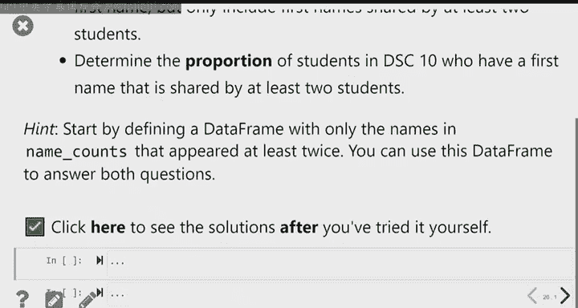
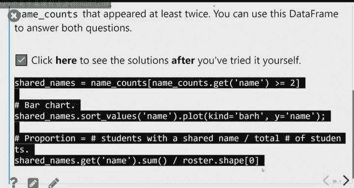
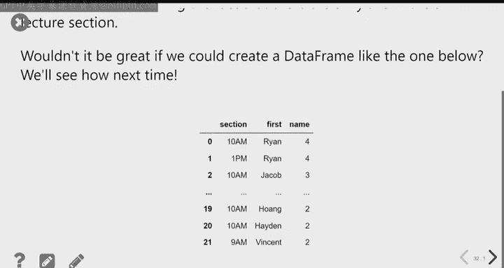
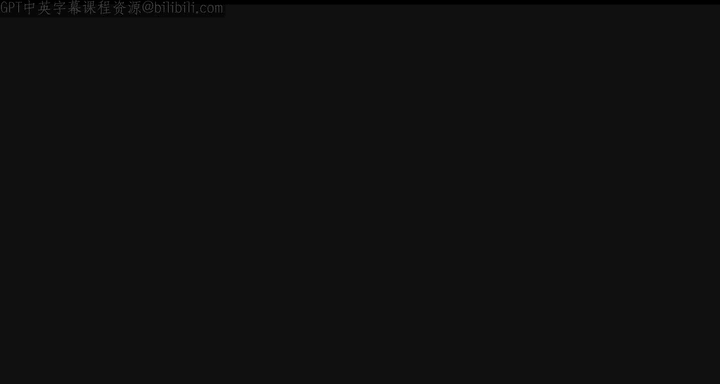

# UCSD《数据科学原理 (DSC 10 Principles of Data Science Fall 2024)》中英字幕（deepseek - P8：DSC 10 - Principles of Data Science - LE -A00- - Lecture 8.zh_en - GPT中英字幕课程资源 - BV1hmAneGEZh

Great， good morning。Today's Monday so we have discussion also the midterm project will be coming out by the end of this week。

 so the project is something you can work on with a partner。

 so it's good to think about who you might want to work with working with a partner is not required but it is encouraged because it's more productive and more fun。

You can work with anyone in any different section of the course。

 it doesn't matter if you're enrolled at the same times。

 but there are some guidelines that you should follow。

 the most important one is that you shouldn't just split up the project and each do half of it。

 you should work together throughout the assignment。

We're having a mixer event tonight which is just like a social gathering for students in the class。

 it's going to be right outside the discussion classroom。

 so lease 104 so if you go there before after for discussion it'd be convenient it's from six to seven tonight。

😊，And everyone's welcome。Theres also some assignments out， so the next lab is due Thursday。

 you submitted a homework last night， which means the next homework is due a week from them。

And then finally there's still a few more quiz review appointments left。

 so if you wanted to learn how to do questions on the quiz or kind of go over things that you missed or concepts。

 you can make a one on one appointment still。All right， any questions？So there's a slip day deadline。

 which is two days， so we have to wait for that to pass。

 but shortly after that you'll see how you did yeah。Okay。

 so today we're going to talk about two things。 The first is writing your own functions so we've used functions in Python。

 but how do you create your own， This is a fairly standard like programming concept that's useful for any programming language if you've programmed before。

 you'll be probably familiar with that。 And then the second part is about applying functions to data frame So kind of writing our own functions and using them to do something to data in a data frame and we're going to work with a fun data set that is all of your first names in this whole three sections of the class。

 Okay so we're gonna to see like what names are popular。Okay。

 so we'll start by the basic programming construct of of writing your own function。

You've used functions before， some of them are built in functions like Max and L。

 some of them were from a package like the NI package or the math package。

 we've also used methods which are special types of functions that are designed for a specific object。

😊，Okay， so let's start with this sort of a math question。

You're driving to a restaurant in LA and it's 100 miles away for the first 50 miles。

 you go 80 miles an hour on the highway and for the last 50 miles you go 60 miles an hour。

The question is， what's your average speed throughout the journey？Okay， you're first。

First thought might be， well， half of it's at 80 and half of it's at 60。

 so the average speed would be 70。But that's not quite right。

Because you have to use the formula that like the speed。

 your average speed is the total distance you went over the total time that you travel。

 so what would that be， what's the total distance？Well。

 the total distance was 50 miles for the first part right and 50 miles for the second part， so 100。

But how do you calculate the total time？Well， like how much time did it take you to do that first segment。

 right， The speed is distance over time。So if you solve this for time。Time is。Distance over speed。

So you went for 50 miles。At 80 miles an hour。Your total time is 50 over 80 hours。嗯。🤢。

So that's how long it took you to do the first half of the journey。

But then it took you some other time to do the second half of the journey by the same logic that one would take you 50 over 60。

Hours，Okay， so it's， it's a more complicated formula than it originally might appear。

 Notice there's a lot of 50s going on， both in the numerator and the denominator。If you pull out。

A 50 from each of those。You're left with basically two in the top。And180th。And160th in the bottom。

So this simplifies to two over the sum one over 80 plus1 over 60。Okay。

 so this is all sort of detailed in the slides。You can see the derivation。

And this is the final answer。So we now know how to solve a math problem。

 What does that have to do with functions， Well， this。

 this math problem solution kind of generalizes whenever you have。

Two to rates like your speed on the highway and you're going for equivalent distances。

 you can express the average speed as two over a fraction1 over a plus1 over B so in our case。

 the A and the B that we were using were 80 and 60。

 but in general you can take any two positive numbers and calculate this quantity and it has a name it's called the harmonic mean。

Okay so we kind of know how to find the harmonic mean of two given numbers by just plugging into this formula。

 let's see what it actually is， your average speed was actually like 68 and a half miles per hour it makes sense that it's a little less than 70 because you went equal distance。

At 80 and 60， but it takes more time of going 60 than time of going 80。

 So you're like closer to 60 than you are at 80， basically。Okay。

 so now we like have a formula for calculating the harmonic mean of any two numbers right and you could kind of calculate change the numbers by like copy pasting and say you wanted to answer a different question of like 20 and 40。

 what's their harmonic mean you could change the values。

 but we don't generally like things where you have to copy paste because it could produce errors。

So we want like a nicer way to do it and the nicer way to do it is make our own function， remember。

 like a function is like a rule that takes inputs and turns them into outputs。😊。

And that's exactly what this formula is。It's like a function where you're given two values A and B。

 it's a rule for what you do with those A and B， you do one over A， you do one over B。

 you add those together， then you do two divided by that and that's like a way of producing a number。

Okay， so we can basically tell Python we want you to make a function。

 like there is no built in Python function that does the harmonic mean， but we can make one。

So this is saying I want to make a function called harmonic mean and it's going to take two inputs。

 I'll call them A and B， and this is what I want you to give back as the answer so calculate this quantity and tell me the answer。

So this cell sort of defines the function， it tells Python what I mean when I say harmonic mean。

And these two cells below actually use the function on different inputs like saying plug these values into your formula。

 so when I plug in A D and 60， I get the same number that I got when I know had this expression where A was 80 and B was 60 and then I can easily sort of change the inputs to calculate amounts for other A's and B's。

Any questions on the。The philosophy or what I'm trying to do， why I'm trying to do it。Okay。

the punchline is like I only have to specify this crazy formula with the fractions and stuff one time。

 right， and then I can use that formula over and over on various different inputs。😊，Okay。

 so let's look more closely at how you make your own function。When you define your own function。

 you use a special keyword de for I'm defining a function and then you give。

The name of your function， just like variables， you can call this whatever you want。

 basically subject to maybe a few constraints like you can't name a function7 because that's already has meaning。

Then in parentheses， you put any inputs that the function requires。

 these are called parameters of the function。So our function for harmonic mean needed two numbers to calculate the mean of。

 so we're calling them A and B， but you could call them X and Y or whatever you like。

The part I always forget is the colon comes after the end of the deathaf line you need a colon。

 if you don't， it'll give you some errors and you can fix it， but that's there I always get。

After that you go on a new line and you hit tabab or space four times I think Python does this nicely for you。

 let me make sure。If I were typing this out， I would sayDeaf notice it turns green。

And notice the name of your function turns blue and then in parentheses I would put the value I'd want to take if I put the colon and I hit enter it automatically tabs you in。

 think if I don't put the colon， it doesn't tab you in， so that's like a clue that you forgot。

And then what's tabbed in is called the body of the function。

 that's kind of like what's actually happening when you use the function。

And there's a special word that I have here called return notice when I type it it turns green and that means it's a special keyword like true or false we've seen that before and the word return means give back this okay so whatever comes after return is what your function is producing as output。

So here what I want it to produce as output is some。Ratadio one over a。Plus one over be。Okay。

So you can sort of refer to it。You know， an already defined function when you're defining your own to make sure you have all the pieces。

But the right way to think about a function is like a recipe， right， Take some inputs。

 does something to it， and give some outputs。 right。

 The inputs to a function are are sometimes called arguments。

And the nice thing about functions is that you don't need to know like how they're working in order to use them right like we've used lots lots of functions that we didn't really understand like how they were doing what they were doing。

 they just did it right like read in a CSV file like I don't know exactly how it's getting that information and loading it in as a data frame。

 but it's doing it right when I say sort values I'm not thinking about what process it using to decide which one goes first。

 I just know that my answer is gonna have sort it so this concept is called abstraction and it's like basically you can delegate things and not have to think about the nitty gritty details of everything。

 you can just rely on the fact that it's gonna to work so for example。

 if you just told people like I have a way of calculating the average of two rates。

 like don't worry about the details but this is some function that does that then they could use your function to say oh what's the average rate if I went 20 miles an hour and 40 miles an hour。

Okay， so you can use your。Your function on whatever inputs。

The function was really meant for positive numbers。

 but when you call the function or use the function。

 I don't know if I said this yet the word call means like to use the function so you'll hear me say that a lot。

 so here I'm calling the function three different times。😊，And any input that you know。

 can be used in the formula for the function will be， will be used。 like it's not going to tell you。

That your values have to be positive for this to make sense in terms of rates It's just going to do whatever recipe you said on whatever inputs you gave。

Okay， so here's another example of a very simple function。😊，Triple， the triple function。

 has one parameter。So that parameter is x， and all it does is triples that x and gives you back the triple of the number you gave it。

Okay。So when we called triple with the argument five。

 what that's basically doing is using instead of x， it's using5。And it's going to give you back 15。

So some terminology of the word parameter is used for like the general form of the input。

 like x is the parameter， it could represent any number and the argument is like what you're actually giving it as the value of the parameter when you call a function okay so the x is the parameter5 is the argument。

And you can change the argument。For example， you can feed in7 plus8。

 What it does is it evaluate 7 plus 8 first right then it basically plugs that in for x。

 so it's going to give you the triple of 15， which is 45。

And you can even give strings as input to this function because all the function does is times 3 and times3 is a thing you can do with strings。

Okay。This is different if you've programmed in other languages。

 you often have to specify like what data type the function is expecting and it'll only work with that。

 but Python is more flexible。So something that can be a little confusing is that the name you choose for a functions parameter exists sort of only locally within that function。

 So if you say triple X。And then you ask it to triple7。

It's kind of using x as7 within the body of that function。But if you just outside of the function。

 ask for X， it's like you haven't defined a variable called the X。 Okay， so x x is 7。

 basically while this function is calculating， it's using x is 7。

 But then after the function given an answer， it forgets what x used to be and has no recollection of the fact that x was ever set。

 so you can think of it as like a temporary setting of variables。The。

 the correct name for it is scope。 It's like。Who knows about this variable and the answer is that within a function it only knows about the variable kind of like while it's actually running。

 the variable name only exists within that function and not outside of it。

Even if you define a variable x outside of the function。Like set x to 15。Right。

When you call the function， it's not using the variable 15。 It uses the。The argument that you gave。

 Okay， so when you say triple 12， it's still going to triple 12， even though there's another x。

 So there's like an outside of the function X and there's an inside of the function X。

Does that make sense？嗯。So functions can take varying numbers of arguments like harmonic mean was a function with two parameters。

 A and B， so it took two numbers as arguments like 20 and 40 The triple function had a single parameter we called it X。

 which means it takes one number as its input。You can even have functions with no inputs， okay。

For example， the function greeting。Anytime you call it。

 it just shows you this string high with a wave。 Okay， now。

 it's kind of silly to like have a function to do just that。

 But why would you want a function with no inputs， basically， like。

 if you have some chunk of code that you wind up having to repeat multiple times。 right。

 instead of copy pasting that whole chunk of code over and over。

 This kind of gives that chunk of code a nickname， like call it greeting or call it whatever。

 And then you only have to say greeting。 and it does the whole body of code。

Most often functions will have inputs because typically you want to use functions to like modify some input to produce some output。

Okay， here's a function with an error。Look inside the body of the function。

What is this function doing， it's taking one input， which is called something。

And it's returning one over zero plus that something。Okay， why is this going to have an error？

Wath question。You can't divide by zero right so like this right here is going to produce an error before it even looks at what your input was so I pretty much know from math the fact that you can't divide by zero that every time I give an input to this function and ask to use the function on a given input it's going to produce an error。

But the point of this example is to show you that there's no error when you define the function errors come up when you try to use the function。

 So I liken that to the recipe analogy， like you could have a really bad like cooking recipe that just tastes horrible and combines really bad ingredients you can like write that recipe down and post it online or share it with people and like no one really complains if you just like share a written recipe for a horrible thing。

 but they would complain at the time where you actually cook it and try to eat it okay so it's like the complaint isn't about the definition of the function。

 the complaint is about the use of the function。I also want to show you something else。

 see this red text here。You can put triple quotes it's typically the first line of the inside of the function within triple quotes。

 it's like a description of what your function does just sort of for documentation to make it clear like what the function is supposed to do so like our function here is just to illustrate the point that you don't see an error until you actually execute or call the function。

Okay， so here I'm defining the function， see no error produced。

Here I'm going to actually call the function and ask it to calculate one over0 plus5。

 and that's where it's going to have an error because here it's actually trying to do the calculation right。

 in other words， when you write down the recipe or write down the function definition it's not actually doing any of those calculations。

😊，It's just saying， here's what you will do when given an input。All right， any questions so far？

All right， let's write a function that does something a little more interesting。

This is a function to。Take in someone's full name and give out their first name。

So a lot of times when you're asked to write a function， you might see some example behavior。

 this is just to help you understand what it's supposed to do right so this says if you were to call your first name function on the input pre deepep Cosla。

 you would see pre deepep as the output。And there's a hint about string methods。Okay。

There's a string method dot split。So。My suggestion for when you have to write a function is do not immediately start with death。

Right，Deaf is like creating the general case for like how to treat an input and turn it into an output。

 Before you do the general case， do a specific case。 So think of an example in our case。

 we'll use pre deepep Cosla。 And what will I do to extract his first name from his full name。 Okay。

 so here's his full name。TheThe hint suggested a string method split and what the string method split does is it separates your string based on like instances of some separator。

 So we actually use this when we did little woman， we split the whole text based on instances of the word chapter Everything that came before the first instance of chapter was like the header material。

 Everything that came after the first instance of chapter but before the second instance of chapter was chapter1。

 So chapter was it's called the delimiter， it's like a thing that separates the different chunks。

 So in a name right what separates the different chunks is a space。

So if you split pre deep Cosla by spaces。This produces a list。

And inside the list are all the different components of that name。Just for the sake of illustration。

Oh。If I were to take this and split it by spaces。Right， you would have sort of a separate。

List element for every single word。If I were to instead， split it by。Question mark。

How long would the list be？How many elements would the list have， three？It would be this。

 notice that。Where are you is going to start with a space。

 because that's what came after the question mark。If you want。

 probably a better way to split it would be question mark space。

And then I just get really the components。Does that make sense？Okay。

 so remember that split produces a list and I just want the first thing from the list。

 so how do you grab out the first thing from a list， you use brackets with the position number。

 first thing is position zero。Okay， so this is how you would like pull out someone's first name if you wanted to change it to a different person。

It would still work。 The only thing that's going to change is like the person's name。

 but the strategy is the same。 So this is like basically what functions are for。

 You want to do the same thing to various different values。

So now that I know how it works on my example， I write the general function， okay。

 so I'll call my function first name。It's input I could call it X right or something。

 but I'm going give it a descriptive name so that when I use it later。

 I remember how to use it right， I'm going say that its input is the full name and then whatever that full name is。

 I need to split it up， extract the first part and then don't forget this word return I need to give that answer back。

So when I ask for the first name of Pradep Cosla， I get Pradep。Okay。

Now you might think of some like corner cases like what if someone has two first names or two last names or a title or something like what is this going to do？

It's just going to give back the first sort of chunk of their name。

 it doesn't really know whether it represents your first name or your last name or your title right so you'd have to make sure your names are in the appropriate format in order to use this。

Does that make sense。Okay， so let's look a little bit more about returning。

 I mentioned it was important to include that word return Return specifies like what the output of your function is going to be when you call the function。

If you want to be able to save the output of your function to some variable。

 you're going to have to use return， but in general。

 you can write a function without the word return。And one thing that's a little tricky is printing versus returning。

So here's an example of a function that does the pythagrant theorem。

 You give it two side lengths of your right triangle and it gives you the hypoase。

 Okay so given an A and a B， it calculates C as remember this is square root of a squared plus B squared so it calculates the C。

 but it doesn't return it， It just prints it。Okay， so what does that mean？

I've defined the function now I'm going to try to use the function。

 and I'm going to try to call the function on inputs three and4， the answer should be five。

 remember for math 3，4，5 triangle。And I'm going to save the result in x。And I see the answer five。

But when I try to evaluate x， I don't see any output。And I'm not able to add 10 to that X and C15。

And the reason is because what am I actually storing in X， I'm storing the output of this function。

And this function didn't actually output or return anything。 It just sort of printed something。Okay。

 so there's nothing to store in x， in fact。If you ask for the type of X。It'll say none type。

 like it's a variable that was defined， but nothing was put into it。Nothing was saved there。

So if you want to actually like have that five and be able to work with it。

 you're going to need to return its value so that you can store it in a variable。

Because only string showing quotes， so this is a number， so when you print a number。

 like I'll just show you， it won't necessarily print the number four， it just shows it as the number。

Does that make sense？Any other questions？Yeah。Assign a function to a certain value。

Like it always has to be like。The definition， Yeah。

 so you have to define the function before you can use it， right， Like this is telling Python。

 I want to， I want to define this name Pythagorean。 And then in order to， to use Pythagorean。

 it has to know like what what you mean by it。 So the de always comes first。

 then the use of the function。 Is that what you're asking。Like X。一個 있을 때야 functional。game。

the output so I'm saying like you can't like sign it to。ThatLike the five， that's output， you mean？啊。

Like like a note input style this far or maybe ask me later just so I can， yeah。

 understand fully what you're saying。 Thank you。Let's try this one。

 This one is a new function called better Pythagoreium。It computes the result， but then it actually。

 instead of prints it， just returns it。Okay， so if I call better Pythagorean。

Now x actually has the value of five， and I can do stuff like add to it。Okay， does that make sense。

 other questions？This is tricky。 So it's easy to get it confused。

 It's confusing because like you see the output when it says print， right。

 but that's not the same thing as like having the output ready to save in a variable。

Something important to know about return is like return means this will be your answer so like you're telling it sort of to stop when you tell it to return like you're saying calculate this answer and give it back anything that comes after the return statement is not actually going to be done because it's already produced its answer so this is a function called motivational it takes in a variable called quote and what it does is it returns the number zero and then it prints your quote。

But if you define that function， and then you call it， why doesn't your quote get printed， right。

 because all the function did was return zero and once it gives its output， it's done。

If you wanted to actually like see the quote。And return0。

 you would have to put them in the other order。Does that make sense？All right。

 now let's look about how we can use functions to help us manipulate data frames。

So this is our roster with fake last names for privacy， okay。

 so these are your real first names of all 442 students in the class。

And what section you have class at， but the last names are crazy。

 they were just chosen by randomly selecting six letters from the alphabet。

They're not even pronounceable most of the time。And the question we're going to answer is。

 what are the common first names among students in our class？Okay， if you want make a conjecture。

 who do you think like what name do you think is the most common？

And the problem is it's not easy to answer directly from this roster because there's no column of first names。

 but if you did have a column of first names， then it would be easy to answer because you could group you could group by first name。

 what aggregation method would you want。Count how many of each name， right？

 So I just need to basically create a new column that has only the first names from the full name column。

 Okay， but we already have a function for how to extract a first name from a full name。

 Like I did it for Pra deepip Cosla。 I did it for Barack Obama。

 I just want to do it now for all 442 students。So。How do I do that right。

 We somehow need to call our function on everybody's name。 So like here's our full roster。

If I grab out the name column and go to the first student。It's Jacob Ercuga。

And I try to extract Jacob's first name， and I can by feeding that full name。

As input to my first name function。And I could do it for the second person on the list。

 Stephen Dixpa。Right， and find out that their first name is Stephen。Okay。

 so I basically know how to do it for each individual。

 but I don't want to have to do it 442 times and change the IO value。Okay。

 there's a really nice data frame method called dot apply。

 which basically does it for you dot apply works by taking a function and applying or using that function on every element of a column in a data frame。

 and that's exactly what we want。The way it works is you first grab out the column you want using get。

That produces a series， right， and then you do dot apply and the name of the function you want to use。

 and it'll use that function on every element of your series。

We call apply a series method because you don't just directly say the name of your data frame dot apply。

 it's not done on a data frame， it's done on a series。And the output itself is also a series。

 it's going to tell you basically convert all of those full names into first names。

You don't need parentheses。After the name of your function。

 because you're not actually calling your function。

 you're giving your function name as an input to the apply method。Okay。

 so you grab out the column that you want， the name column。

And then you say dot apply my first name function to it。

 and this just immediately does it for every single person。Okay， so here's everybody's first names。

 you see how useful apply is， it's like you can write a function that works for one thing and then instantly like do it for everybody。

Okay， so here's all the first namess。Now I'm going to put those first names on。As a new column。

 using a sign。Okay， so I'm going to take the output of my apply。

That's the set of names I just showed you and make a new column on the roster。Great。

 now I'm ready to group， right？I'm basically using the terminology from last class asking for the distribution of first names right a distribution tells you what values there are and how common they are so I'm going to group by first name and count and then I'm going to sort the values。

In descending order。So this is where you'll see the answer to the question of what's the most popular name。

And the most popular name wins by a landslide。 There's nine Ryans and the second most popular name only has five Are there any Ryans here。

 Hi Ryan， only one okay well I don't know what section they're in right or if they're here。

 whatever they're watching from home， but there are nine Ryans in our class， which is a lot。

Another interesting thing here is the number of rows。

 there's 382 distinct names among our 442 students， so there's a good number of duplicates。

I'm going to give you a minute to try this activity。

Make a bar chart that shows how many students have each first name。

Except I don't want the bar chart to have 382 rows。 That's too many to absorb， right。

 So only include the names of， of duplicate。Like names that are shared by multiple people。

And then determine the proportion of students in the class who have a shared first name。

Okay I'll give you a couple minutes to try this。And then I'll talk about the solution。

All right， raise your hand if you got the bar chart。I'll give you a couple more minutes。

Okay， I'll show you。How I would do it name counts has everybody right。

 but I don't want all these rows， so I need to change this data frame before I plot off of it I'm going to keep only the ones where this value in the name column is at least two。

So I'm going to do the condition。For my query is that name counts when I get out the value in the name column。

 I see a number I could say greater than one or I could say greater than or equal to two。

So this is going to be a smaller data frame with only the duplicate names。

 there's 37 duplicate names， so I'll give this a name。Fhared names。

And then I could make a bar chart from this using dot plot。

I have to specify what kind of plot I want， I want it to be a let's say horizontal bar chart。

 let's just do that for now。And see how it looks。I get the weird output。

 that's because I didn't put the semicolon， semicolon will suppress that thing about the axes。

I didn't even specify the x and the Y， what is it doing？Remember what the x does when you omit it。

 it uses the index， that's fine because those were the categories， when I omit the Y。

 it uses every single column， there's only one column so I just save a little typing by omitting the Y。

啊。It's a little small， you can make it a little bigger if you want。Fig size。I don't know。

 let's say 10 across and 15 up and down。It's a little better。

 but it is kind of weird that all the like less popular names are at the top and all the most popular names are at the bottom。

 I should I probably want to sort that。So before I plot it， I would need to do the sorting。

 sort values by the name column。U。And I guess I want ascending equals true because it's going to reverse it for me。

Or I could just omit that。So this is probably the nicest looking bar chart with the most popular names at the top。

 and you can see if your name is in there or not。There's 37 repeated names。And now。

The next question was， determine the proportion of students in DSC 10 who have one of these names？

So let me look at the shared names data frame。Anybody who's included here is someone who has a shared name。

 So how many people are included here。 Well， there's 37 rows。

 but that's not the right value because there's not just one Ryan。 There's 9 Ryans。 right。

 So basically， I I need to add up the values in this column name is going to tell me how many total people are represented here。

 So how do I add out， add up the values。 I'll grab out the name column。 That's a series。

And series have a sum method dot sum。Okay， so 97 people， that's a lot。

 have a shared first name with someone else in the class， okay。

 but what am I dividing this by to get a proportion？😊，I'll just do roster。

 shapepe0 was the full 442 students in the class。Okay。

 so about 22% of people in the class have what we'll call a name buddy。Any questions on that？

New like to。あブメ theバ。So I did， the query was the name column had a value greater than one。

You can also click right here to see the solutions in the solutions code it's written as greater than or equal to  two。

 but that's the same。Thanks。So we just used apply to calculate the first name of everyone。

 you can also use apply on built in functions in addition to functions that you wrote yourself。Okay。

 so。If I grab out the name column， right， I can apply like the nuI function NP。

 log to take the logarithm of all these numbers， okay， why you would want to do that unclear。

 but it's something you can do。Something that I think is a little useful is like something about the。

Oh no， this doesn't work。Yeah， never mind。We'll see what I was going to do later。

 calculating the lengths of the name， there's a different way。

Let's look at the name counts data frame。What I was going to do is calculate like the lengths of each name。

 Okay， but the problem is that。The names are in the index。

And if you try to like apply a function to the index here I'm trying to apply the max function。

 you might want the length function， whatever， do something to the names。

 right it doesn't work because apply is a series method So apply only works for series and series come from columns not from the index So like this slight difference between the index and a column is constantly like rearing its head in different ways there's always like a slightly different way of dealing with it when it's in the index a very useful thing to know is if something's in the index and it's just more convenient to not be in the index like in this case。

 there's a command called reset index， which basically turns that index into a column and gives you back that default index of the number。

0，1，2，3。So， if I。Reset the index。The data frame now looks like this first name is now a column and just gives me some arbitrary numbers at the beginning。

And now I can ask for the maximum of each name or the length of each name。

So I'm going to grab out the first column。And then I'm going to apply the max function to it。

What is a max of the name Ryan？It's why。What do you think it's doing？

It's the alphabetical like ordering of letters， it takes the largest letter in each name and largest is alphabetical。

 so Ryan， the latest in the alphabet letter in there is a Y。Okay。

 the one that I thought would be more interesting was the length。The name Ryan has four letters。

 I think Kyle was next， so that's what that's doing。Okay。

 now let's answer a slightly more complicated question。

Let's say you're one of the students who has someone else in the same section as you or someone else with the same name as you right like your name is Jacob。

 there were multiple Jacobs， but you want to know is there another Jacob in your same section right so it's not enough to be a name buddy if they're in a different class they have to be in your section as well。

Okay， so our strategy is， let's say we're working with Jacob Erkuga。 right。

 first figure out what section is Jacob Erkuga in。Then in that section。

 how many people have a first name of Jacob， if it's just one that means Jacob is all alone。

 no name buddy， if the number is two or more， that means Jacob has another Jacob in the same class。

So this is how you would do this in code。 Here's the full roster。

The first question is which section is Jacob Ercaga in？That's a query， right？

I'm going to start by just keeping the single row corresponding to Jacob Ercaga。

query to just get his row。Then。Grab out the section。And go I lo 0。

 We're assuming in this analysis that the full name is unique。 Okay， so this is the only Jacob or。

 So there's only gonna be one row。 We just go to that top row and get out the section。

 and it's gonna say 10 AM。Okay， now I want to find out how many Jacobs are there in the 10 a section。

So I'm going to have a query with two conditions。Sort of broke down the condition separately。

 The first condition is that the first name is Jacob。

 and the other condition is that the section is the 10 AM。

And then I'm going to query to find out like which elements of the roster are Jacobs and 10 as and shape zero is going to tell me how many。

So there's actually three Jacobs in the 10 AM。 I think that's all the Jacobs。

 They're all in the 10 AM。So what we just did with Jacob， right， we can do more generally。

 given a name， a full name， we can figure out how many students in the same section as this person have the same first name okay and the strategy is exactly what we did for Jacob。

 but we're just generalizing it。Okay。Notice I'm using a data frame within a function that's totally allowed。

The strategy is the same， it's just a little more general right instead of Jacob Erkuga。

 I've got name a variable right a parameter， if you will。

 so what I'm doing is I'm finding the row corresponding to this particular person。

Find their first name and what section they're in。And then within the full roster。

 seeing who else has that first name and that section。And how many such students there are。So。

 basically。There's three Jacobs in the section with that Jacob。

 there's only one runung in this section with this runong。

So we can now apply this function that we wrote。And add the result onto our data frame to get a whole column of values that are like how many people in your section have your first name。

Okay， so we're calling this column shared。So there's three Jacobs in the 10 a section。

 most of these values are going to be one right because it's kind of hard or rare to have someone in the same section with your same name。

These are all the students that have someone in the same section with the same name as them。

 So like there's gonna be a lot of of Ryans here。 there's four Ryans in the 10 AM。 Actually。

 you're the only one in this class。 There's four Ryans in the 10 AM，4 Ryans in the 1 PM。

 And there was 9 total。 right， That's what this is saying。There's two Stephanie's in the 9 a。

 et cetera。Okay if you want， you can limit it to an individual section， like since this is 9 a。

 I'm going to have an additional condition that I only want 9 a people。Right？

So there's three Dilllans， any Dlans here？Hi Dylan， hi Dylan， there's two Jadens， any Jadens。Hi。

 two Kevins。There's actually， maybe even more。The dot unique series method tells you like all the values that exist。

 but without repetition。 Okay， so these are all the names that have duplication in our section。Okay。

 what we're going to do in the future next time is like try to create a data frame that has the same information。

 but in a nicer way like notice here I have three rows。

 they all tell me the fact the same thing that there's three dilllans in this section but there's like a row for each person I kind of just want something that just says Dylan 9 AM3。

 meaning like there are three dills， I don't need to have that repeated three times。Okay。

 so this is what we're going to learn how to do next time。

 sort of a more compact version of this information。Okay， I'll stop there， see you guys next class。

