# UCSD《数据科学原理 (DSC 10 Principles of Data Science Fall 2024)》中英字幕（deepseek - P9：DSC 10 - Principles of Data Science - LE -A00- - Lecture 9.zh_en - GPT中英字幕课程资源 - BV1hmAneGEZh

All right， good morning。Today's Wednesday， but there's no quiz today。

 there's only quizzes certain days， so there's nothing this afternoon even if it says so in your schedule。

There is a lab due tomorrow and the next homework is due Sunday and then hopefully some of you got to go to that mixer on Monday to meet a project partner or you're otherwise connected with a project partner。

 you can work with one other person if you like or you can work alone。

 but we do recommend trying to work with someone。And make sure to read up on the guidelines and in particular。

 if you're working with someone， make sure that you're actually working together on all the problems and not splitting it up。

Okay， so today we're going to learn two more like advanced data frame manipulation techniques。

Grouping on multiple columns and merging。 So we're going to continue with the same data that we were working with last time。

 our student names。

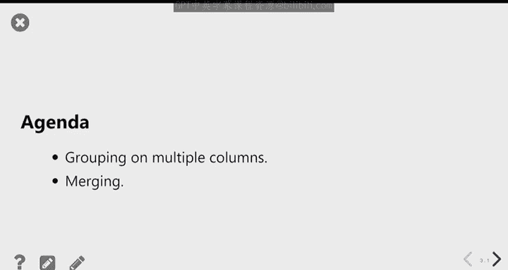

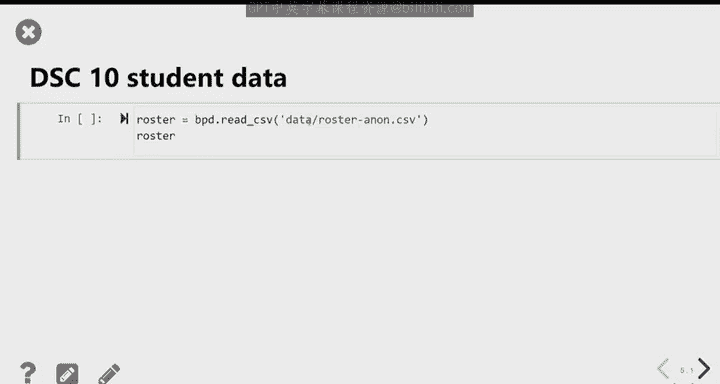

So this was our roster as we read it in。

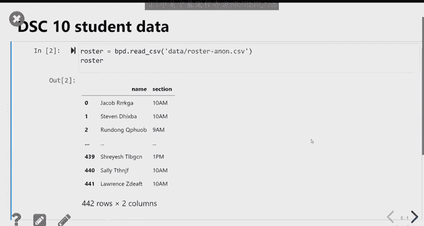

And one thing we did last time was figure out how to get the first name only from the full name Okay。

 and our strategy for that was we wrote a function that extracts the first name from a single full name。

 and then we applied that function to the entire column of the data frame to get out everybody's first name all in one go Okay。

 so the first cell here defines the function and you can use this function。

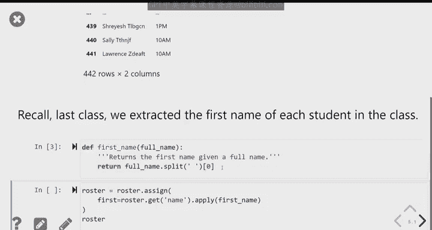

On an individual person。I'll do it on myself。

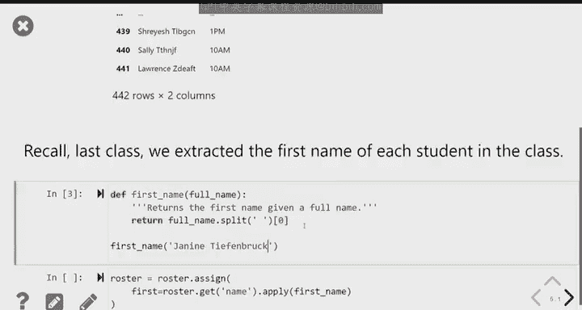

Okay， but we don't want to do it on one person， we want to do it on everybody all at the same time Okay so the strategy for that is you grab out the column of the data frame that you want to use the function on with get so ours was called name。

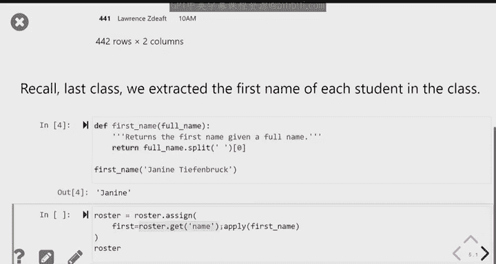

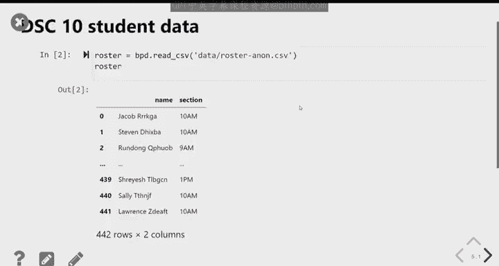

And then apply the function first name to that column that produces a whole nother series of data。

 and I'm adding that on with a sign to make a new column。

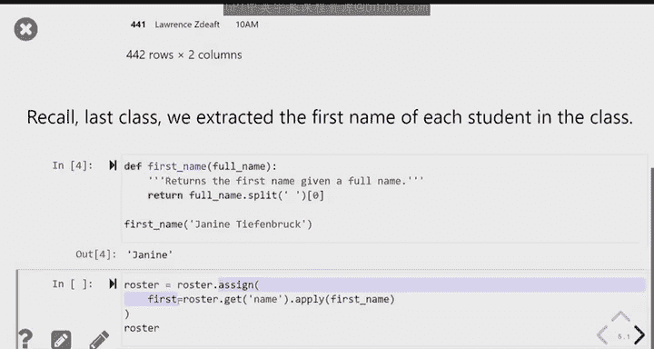

Okay， so now my roster has first names。

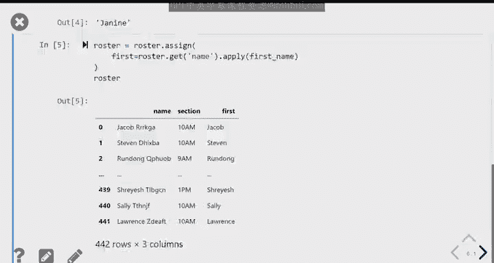

And we saw that like Ryan was the most popular name。 There were nine Ryans。

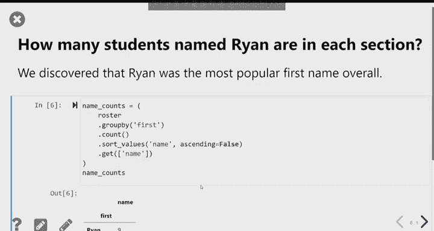

And I figure that out by organizing the data， grouping by first name and counting how many of each name there were。

 and I sorted it in descending order so that the most popular names came to the top。

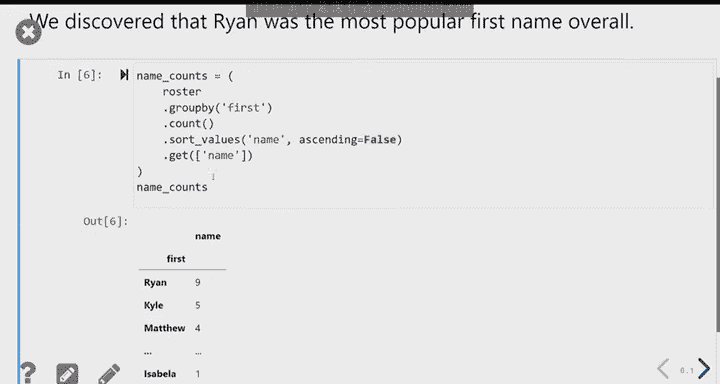

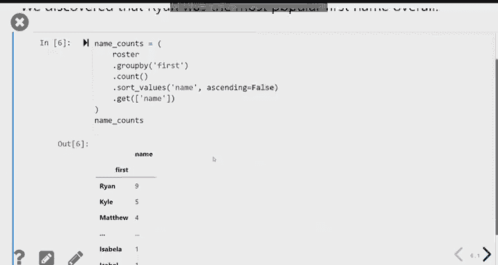

Okay。

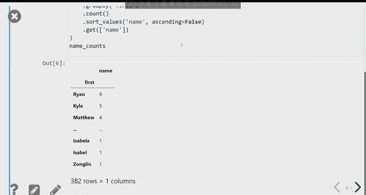

So if you wanted to know like how many Ryans were in each lecture section。

 you could first figure out who are the Ryans。

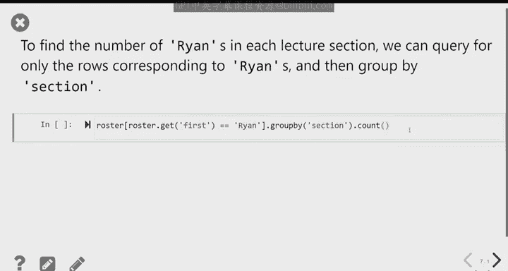

Right，This gets the nine rows corresponding to all the Ryans。 And then you can organize them。

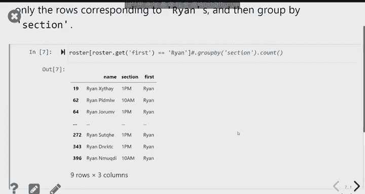

According to section and count how many Ryans fall in each section。

 So this is like the distribution of Ryans by section。 There are four in the 10 AM。

1 in4 in the 1 PM and 1 in the 9 AM。So what question for you is why is the rows of this data frame ordered this way？

Why isn't it not like 9，10，1？Yeah。やな場合。How many you like。Its so I didn't sort this by how many Ryans。

 It's not sorted， by Ryans。It happens to be， but I didn't do that like yeah。Like you married board。

Right， so it treats 10 AM。 It's not really number order。 It's like alphabetical order。

 These are strings， right， They're not numbers。 So the number 9 is less than the number 10。

 but the string。For ants。nine is less than 10， right？But for strings。

The string 10 is less than the string9 because how are strings compared you compare the first letter or character of each thing in whichever one is earlier。

 that's the one that's considered you know smaller less， so just like alphabetical order。

 A comes before B， any name that starts with A comes before any name that starts with B。

 same thing with these， any any number string that starts with one comes before anything that starts with9 Okay so that explains the order。

Just a detail that you should know。

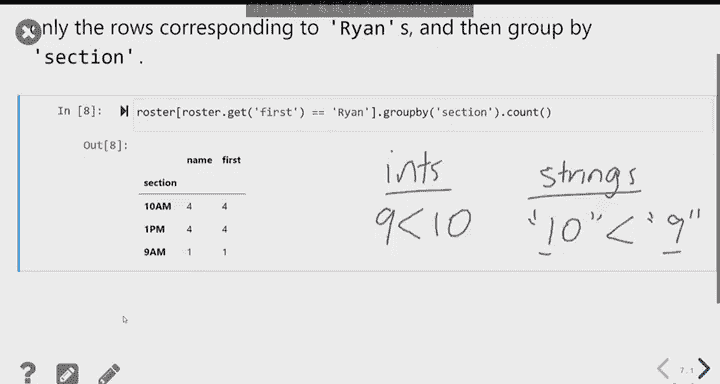

Okay， so I know how to basically find the distribution of Ryans。 right。

 What if I cared about a different name， How are the Kyles distributed。

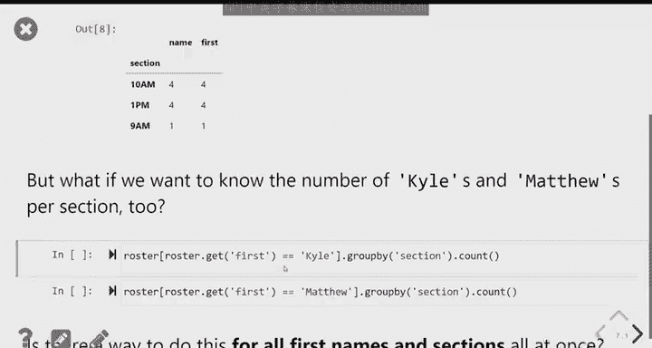

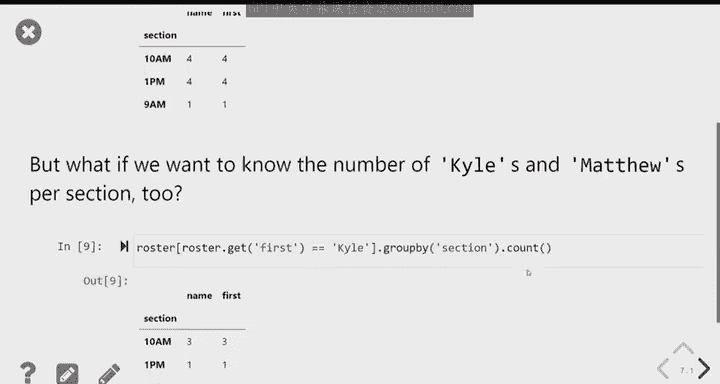

There are three ks in the 10 a and one in each of the other sections。

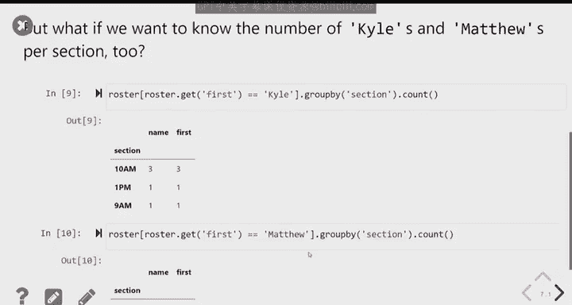

How are the Matthews distributed。 There's3 in the 1 PM and1 in the 9 AM。 right。

 So for any given name， I can tell you how people of that name are split among the different sections。

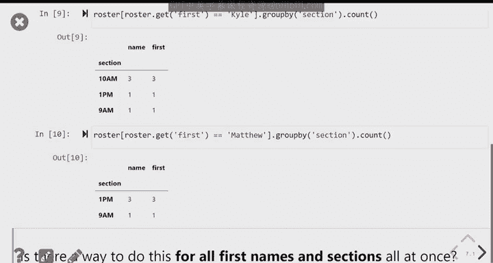

But is there a way to do it for all the names at the same time， like for every name。

 how are those people split up by section？

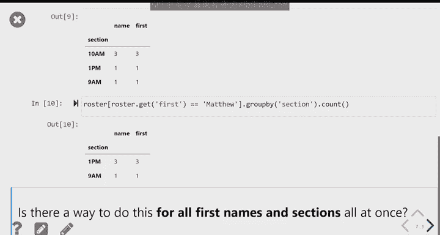

Okay， so right now we don't really have a way to answer this question directly。Right now。

 here's one thing we can do。 right， We can group according to first name。

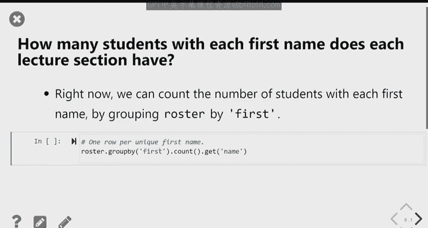

And that just puts all the people with the same name together。

 But it doesn't tell me like how they're further split up by section。

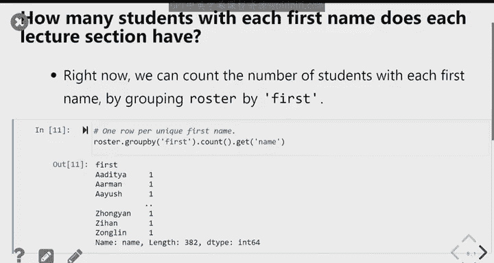

Similarly， I could split up students by section， grouping by section。

 but it doesn't tell me within that section whether people have the same first name or not。

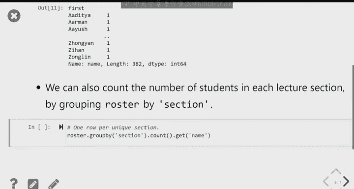

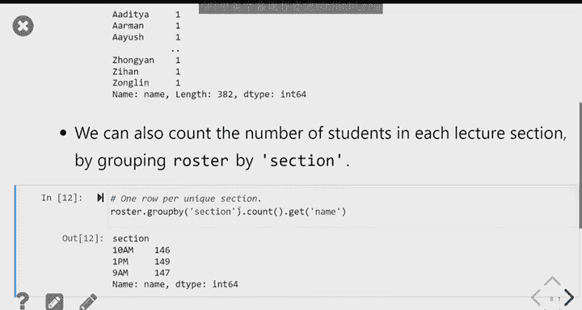

So essentially what I want to do is I want to group by like both of these right I want to know like I want the Ryans in the 9 AM class to be in one pile and the Ryans in the 10 a class to be in another pile and the Kevins in the 10 a class to be in another pile right like your pile。

 which group you go in is determined by both your name and what section you're in。

Does that make sense。

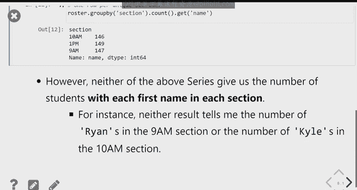

So the solution to this is we can group on multiple columns okay。

 we can specify like our groups are determined by having the same value in several columns in this case。

 both first name and section， if you have the same value in both of those columns like your Orion and the 10 AM。

 that means you go in a certain group。

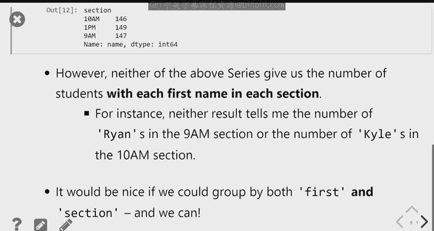

Does that make sense。So really like the philosophy is the same and even the code is very similar。

 but it's just more general than what we learned before when we did grouping on one column。

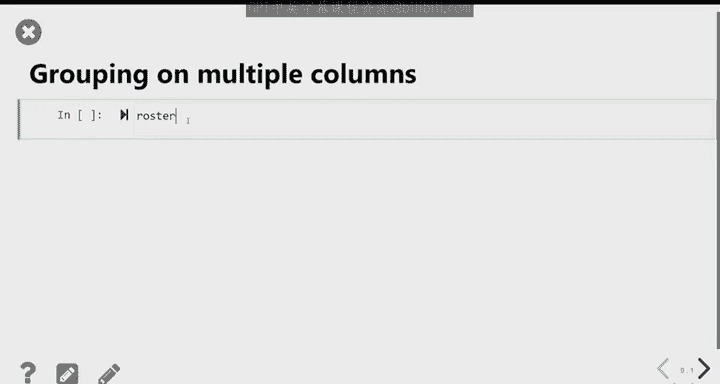

Okay， so here's the roster。And the way this works to group on multiple columns is。

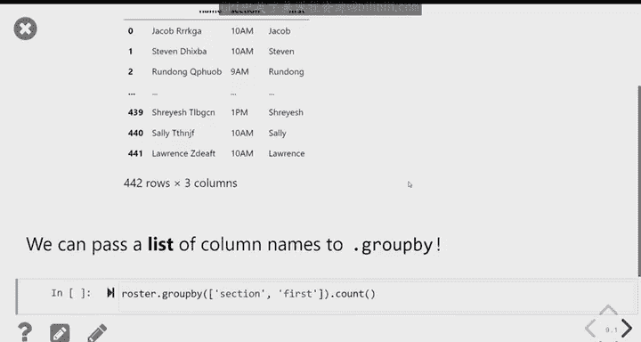

Instead of putting a column name as the input to group by， you give a list of column names Okay。

 so the square brackets means this is a list and it's going to group by both of them and it's going to count up how many individuals have a given section and a given first name。

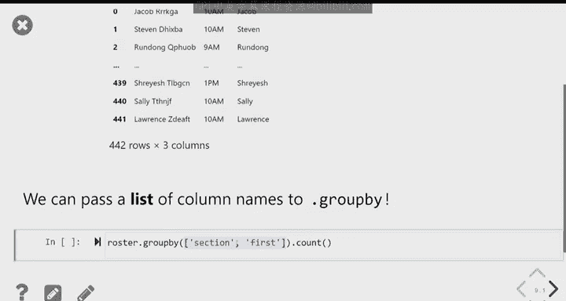

So I'm going to get all the。The 10 a Edens together。

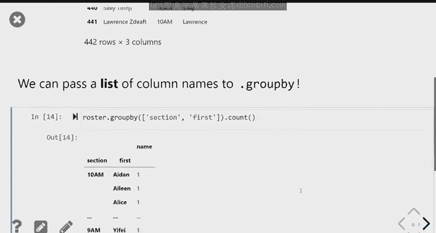

All the 10 a。 aens together， all the 10 a Alices together， etc cetera。

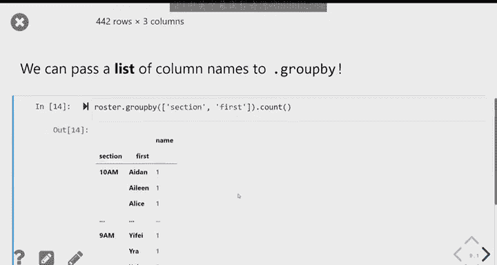

Most of these are going to be one， right， because it's pretty rare to have someone in the same name with the same section in the same section with the same name。

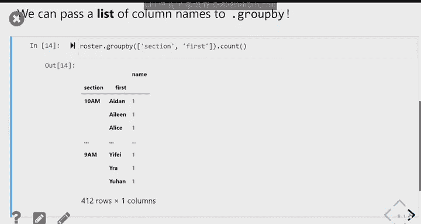

Okay。

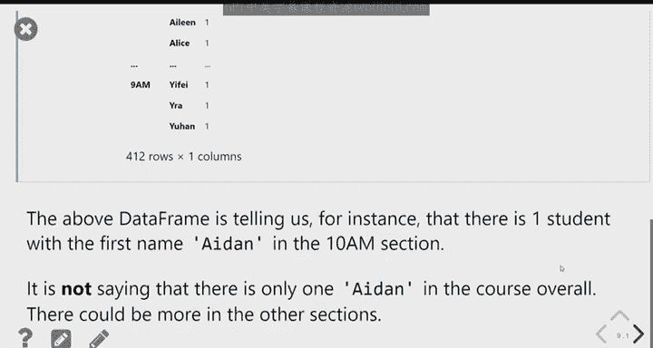

Something to be careful of interpreting this， for example， 10 a A。Are you， You're the 10 AM A。

 you're a different A。 Okay， this is perfectly illustrating my point。

 The fact that there's one 10 AM A in here doesn't mean that there's only one Aden， right。

 It means that there's one 10 AM An。 but we also have a 1 PMden。 and we might have other A。

 Does that make sense。

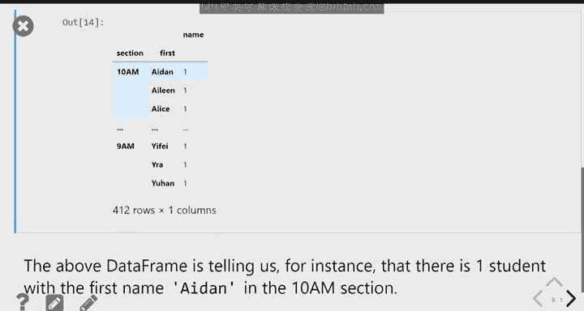

Okay， so this is the syntax， like how you exactly type it out。 It's the same as before。

 the name of the data frame dot group I。 And then in parentheses， you give the。

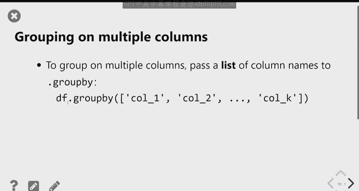

The what you want to group by。 But here it's the list。 Okay。

 so the square brackets separate the the elements of the list。 And， and as before。

 it's not shown on the slide。 but as before， you're going to need to do。

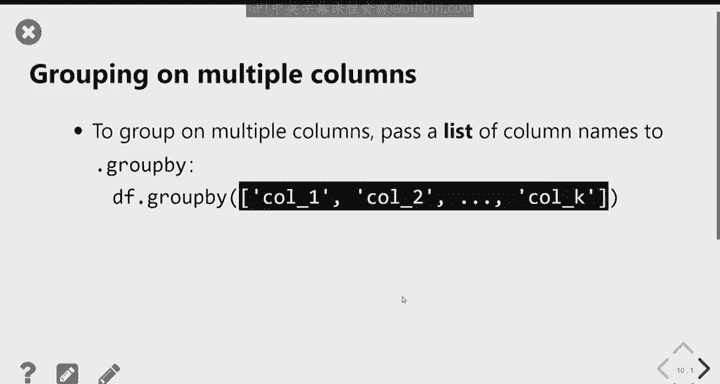

Dot something， right， some aggregation method。Every group by command has to specify how do you want to organize the things in the same group。

 like what do we want to do with the rest of the data， sum it up， count it， take the mean。

So how does it determine the groups One way to think about it is it groups by column one first okay and then within those groups。

 it further groups， those separately based on column their value and column 2 and so on right。

 our example we were grouping by two columns， but you could group by even more。

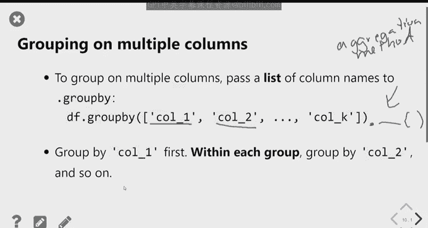

系。The resulting data frame is going to have one row for every combination of entries in the column that you specified。

 right like 10 a8 and 1 a8 in their different combinations of value。

 so they're going to have different rows。

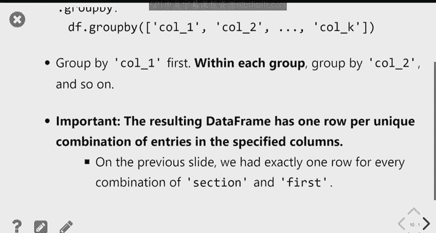

Another way to think of this is creating subgroups like groups within groups。

 you first organize people， what did I do here， first group by section。

 and then within each section I group by first name。

 so it's like take all the students put them in three piles based on what time they have class。

 take each of those three piles and further subdivide them based on what their first name is。Okay。

Let's look at the result when I do this。

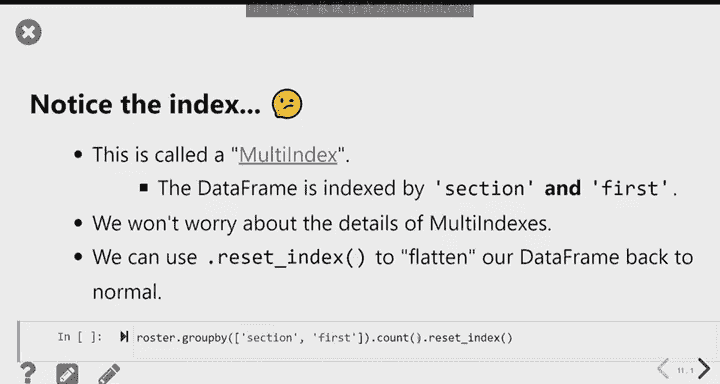

Okay， when I group by section and first name and count。

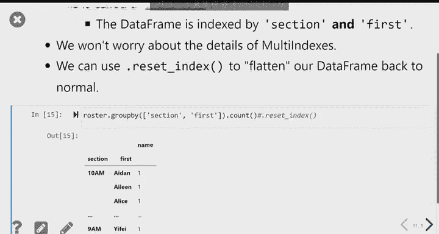

Notice there's kind of like two columns become the index。Oh yeah， question。嗯。いえの。The second one is。

A subgroup。 So like here I'm saying group by section and then first name。

 So see how this section is like a big chunk， like all these people。

 like these many first rows are the 10 AM people right， and then within the 10 AM。

 I'm subdividing it by name。Does that make sense？And one question you might have is like。

 what if you do it in the other order， there's a slide on that coming up in just a minute。

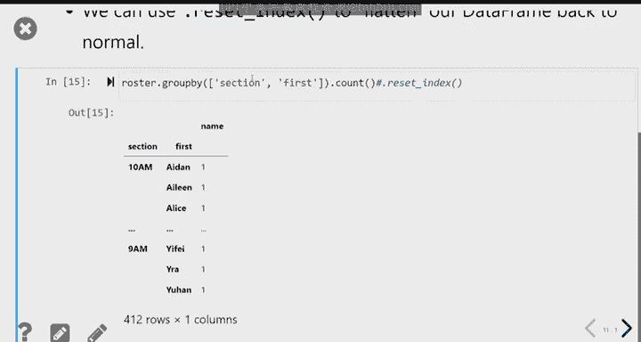

So hold on to that thought。

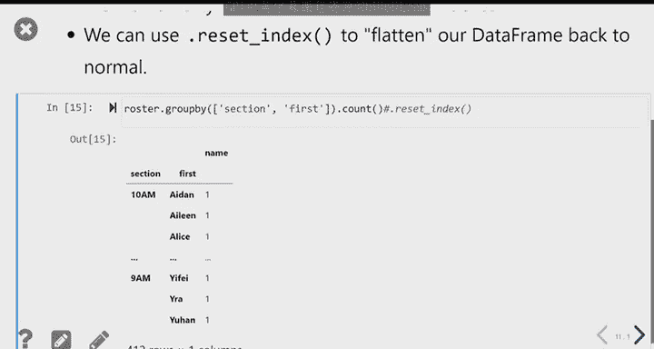

Okay， so yeah I was showing you something about the index right when I group by both section and first name now like both section and first name are the index right because there there's a unique row for each section and first name combo This is called a multi indexdex and it's possible to like work directly with data frames that have multiple columns as the index but we're generally going to avoid doing that just for simplicity and use the reset index command to bring these values from the index back to being in columns because we're just more comfortable working with things in columns。

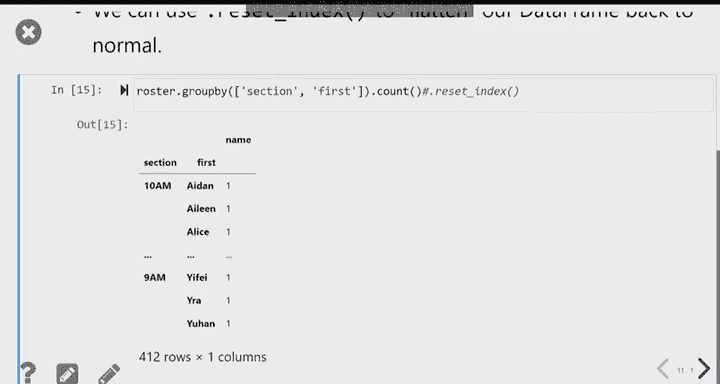

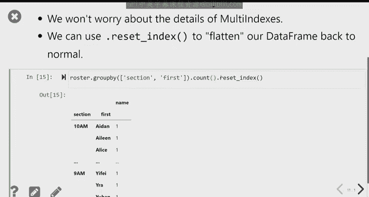

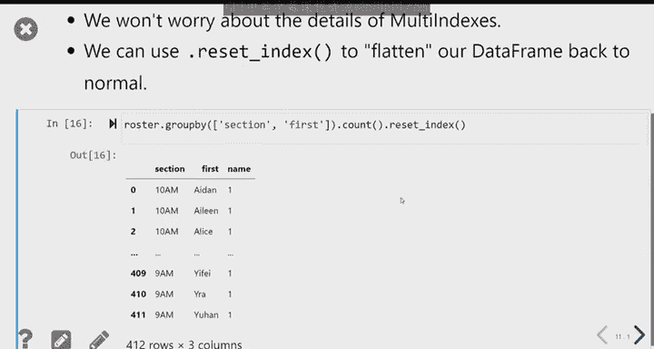

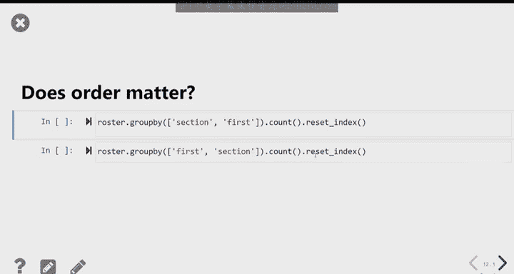

So here's the similar to the question that you had asked， right here I'm first grouping by section。

And then within each section， I'm grouping by first knee。 Okay。

 so I've got all the 10 AM people first， then all the 1 PM people， then all the 9 AM people。

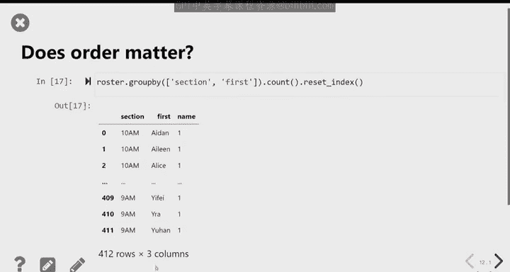

What if I did it the other order， grouped by first name， and then grouped by section？Okay。

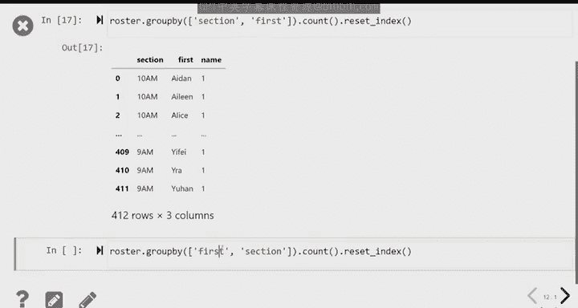

Well， look at the result。It looks a little different， right？ I see Aia， Arman。

 Ayush as like the first names。 And those were not the the same first rows that I saw before， right。

 But it still has 412 rows。

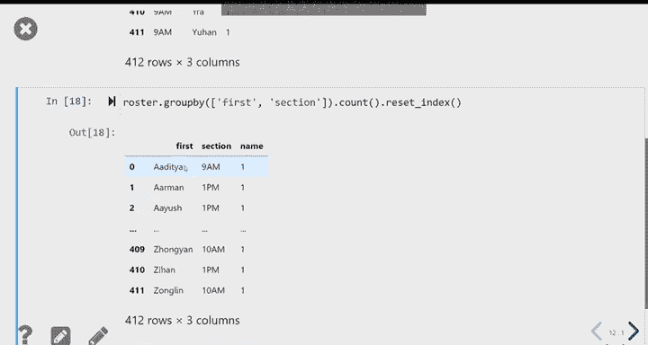

In fact， it captures the same information is just showing it in a different order。

 right The reason for that is like who winds up in a group together。

 people with the same name and same section， right， and and can kind of be done in either way。

 So I could like the strategy I described before was make three piles。

 one for each section then further subdivide those by name。 That's one strategy。

 an equivalent strategy is put all the Ryans here， all the aids here， all the Kevins here。

 and then further subdivide the name groups into sections。

 And either way you still get the same number of little piles with the same people in each pile。

Does that make sense。So the order of the rows will be different。

 also the order of the columns will be different。

But it's still really the same information。Notice when I group by section and then first name。

 I get the columns in that order， when I group by first name and then section I get the columns in that order。

Okay any questions on that？

I'll give you a couple minutes。

To try this one， so I'm defining a data frame for you called counts， which is。

 as we described grouping by both of these things。

And counting how many people have each first name and section combo。

 and then your task is find the lecture section with the most Kevins。

Okay， so try that out in your notebook if you have it open。

Okay， so my first step is noticing that most of these rows are not relevant to me。

 like I only care about Kevins， so I'm going to filter or query this data frame。

To keep only the row corresponding to Kevins。 So I'm going to take counts。And what's my condition？

Counts。ge out the first name。Equals。Kap。And I'll show that data frame that I just made。

Okay， much smaller。Right now I want the section with the most Kevins。So I mean。

 I can see the answer here， but how do you get it out systematically。

 I should probably sort this data frame。You can sort it either way。

 you can sort it descendending and go to the first thing or you can sort it asending and go to the last thing。

I'll sort descending and go to the first thing because I think that's more natural。

The value I'm sorting by is in the name column， which really represents the number and then ascending equals false。

Right。And then the solution would be from here。Get out the section。

Which is a series and then go to the first thing in that section。😊，Okay。

 so the section with the most Kevins is the 9 a section。是。

So it is possible like when you're accessing one thing from a data frame。

 it is possible to do the ILO before the get。But we will not do that in this class because。

When you I look。嗯。Directly from a data frame， like let's look at Kevin's again。When you do IO0。

 you're getting the entire first row but rows are like not series exactly because the data in them is different data types like some of them are strings and some of them are ants and stuff it's possible to work with rows but it's a little more complicated because of the mixed data types so we'll just generally avoid it and will always when you want to grab something out of a data frame will always do get first because that always produces something with the same data types because it came from a column and then IO。

Good question。Any Kevins here。

Nine am Kevins。All right。

Here's another one for you to try using the same data frame counts。

Find the longest first name in the class that is shared by at least two students in the same section。

嗯。All right， let's talk about the solution。 Can anyone tell me like the first step in their strategy？

I mean I'm。Yeah， so first of all， I don't know how long each person's name is without like individually counting it。

 right， given a single person's name。Like I's do Alice。

How can you figure out how many letters the name Alice has？The L function。

This is a built in function。RightThat tells you how many characters a string has。

 So what I want is I want to use this function on every element of the first name column。

 What's the strategy for that。Apply， right， So basically， I have to take。That first name column out。

 remember that apply works on a series okay， so you can't just do counts。 apply something。

 you have to first grab out what you want to apply it to this column。

Then。The function I want to apply is LEN。And Aden is going to have five， then what do we see six。

 then five？

Okay， so this turns this into basically numbers， and I want to basically put these numbers on as a new column to my data free。

So let me call it like with lengths。And I'm going to do counts dot assigned。

And I need to name my new column， I'll call it length。And that's the values that I want to put there。

Okay， so now my data frame with lengths looks like this。

What's the next step of my strategy。

嗯。这说。

Right， I， I was only caring about ones that are shared by at least two students， right。

 so with lengths。

Such that。The name column here has a value that's at least two。So with link。Get name。

 I'll just say greater than one， it's easy。

Okay so these are all the duplicated names。I'll save it in a data frame called duplicateupd names。

By the way， it's perfectly valid to first query the data frame to get just the ones with duplicate names。

 then add the lengths okay because there's a lot of lengths that we just calculated that we don't wind up using so either way is equivalent and then I want the longest name so I want to sort this。

By the length column。I'll sort a descending order because I want the long name at the top。

Okay。So。I can see that the name is Stephanie， but I'll do my strategy， get out the column。

 which is called first。Then I look zero， these are two，9 a， Stephanie's， any Stephanie's here。

This is a good way for me to learn people say。

Alright。Any questions on that？There weren。Like what？Just sorting stuff and then point to top。😔。

I mean， not really。Like， what would you want to do？We're sorted by life。The。

CoAnd then sorting by the length。You can this wake up。

I mean you can write functions to do whatever you want basically。

 so like if you have like a e special case in mind， you can make a function to do that。

 but I guess anything like that would be more custom right so it's not like a standard method that's available。

Okay， any questions on any of the name stuff or the grouping with multiple columns。

We're going to apply some of these techniques to a new data set。

 this is a data set of C temperatures that was taken right here in La Joa by like the Scripps Pier and they've been doing this for a very long time from 1916 until currently they're still doing it。

 we have the data up till June 30th of last year。

So this has tons of rows， 37，000 rows。And it just has a few columns， year， month and day。

 describing when the reading was taken， and then the surface temperature of the ocean in Celsius。

So my question is， say you wanted to use this data to find the single month such as maybe November 1998。

That had the highest average surface temperature。

How would you need to group the data in order to help you answer that question？

So answer this on the concept check website， cc。dsc10。com。

The columns are year month day in surface time。

All right， I want to see how people are voting， so input your answer。😊。

Okay， I have the most votes for C。Which is correct， but I also have a good number of votes for E。

 Let's look at this。

Okay， so I really like this example because it's kind of fun to。😊。

Try all the different solutions and see what they tell you， they all tell you something。

So。

Let's start with。Okay。Let's start with looking at our data frame， CT。

Okay。And then what would happen？

What's the first one， C temp group by surface temperature dot mean， can I copy this control？

Yeah， okay， so if I group by surface temperature and take the mean and what is that doing。

 it's saying which days you know， had the same surface temperature。

 maybe some random day in August of 1916 had the same surface temperature as yesterday， right。

 Yes's not in here。 But， you know， theres could be various different days that have the same surface temperature。

 And what's it going to do It's gonna to lump them all。

 And it's going to average the year in which that they occurred。

 the month in which they occurred and the day in which they occurred。😊。

Okay。So this is mostly nonsense， like， I mean， it's something。

 but it doesn't it doesn't really tell you anything useful， right。

 It's not really logical to group together different dates from like a century that happened to have the same surface temperature。

And that's basically the problem with E。

Is like， you don't want to organize things with the same surface temperature。

 You want to organize things that occurred like around the same time and then compare the surface temperature between those different。

 different dates。

Okay， so it doesn't make sense to group by surface temperature。

 We want to calculate the average surface temperature surface temperature per group。 Okay。

 what about this one， grouping by month and taking the mean。

Okay， so what does this tell me？This tells me， like。All the January days。Their average year。

 their average day and their average surface temperature。 Okay。

 the average year for almost all of these it's like 1968 or 1969。

 And that's because it's kind of like in the middle of our data set。

The average day is like halfway through the month。Depending how many days that month had， right。

 Those things aren't really useful。 Average surface temperature per month。 This tells you。

 like the seasonal。Like variation in our ocean's temperature。 like generally， like it's。

 it's much warmer in the ocean in October than it is in January。

If you wanted to visualize this better。You could plot it。I would make like a line plot。

The X I would want the month。And the why I would want the surface temp。

Okay， so this is basically showing you that it's hotter in the ocean in the summer and it's colder in the winter。

When you first。So whatever you do your dot plot on， dot plot is a data frame method， right。

 so you have to put it after a data frame， so equivalently。

I could take this data frame I created and store it as like monthly temps or something。

Okay and then do my plot based on this data frame。And it uses the the data in the data frame to make the plot。

 Does that make sense， So I just didn't save it in a variable， but it's doing the same thing。

 It's using the grouped data。 It's using whatever comes before the dot plot as the data for the plot。

Yeah。

So this is tells you something， but it doesn't really answer the question that I want because I wanted to separate different Novembers。

 right， November 98 should be different from November 2020。

So the next one is what does that it groups by both year and month。

So that it puts， for example， August of 1916 is its own row。 September of 1916 is its own row。

 so all the days that go together have a common value for year and month that's what the question was asking like all the November 98 days should get lumped together and then we're calculating the average surface temperature for that year and month。

 notice we're also calculating the average day， which is not really useful but it's when you define what aggregation method to use。

 it does the same thing for all the columns。 So you just discard or ignore the ones that you don't need。

How would I plot this？Let me try resetting the index。Or no。

 don't reset the index Let me just see what happens if I plot this。And a line plot。

I'm not going to reset the index and it's going to use both the year and month as the horizontal axis。

And as the Y I'm going to do surface1。

Okay， it's a little crazy。Right， because。There's so much variation every year。But you can see that。

Sort of the。It's kind of going up a little bit， that's global warming。

All right， what about this one， group by month and day？

Okay， what does this tell you， all the January 1s， all the January 2， all the January 3。

 So this is also telling you like the seasonal variation。

But it's on a finer level of detail than the one we saw before。

 So you could just group by month and you'd say you'd see January is cooler than October， right。

 But if you group by month and day， let's look at the plot we get there。

It also shows you that January is cooler than October， but it shows you in finer detail。

 because each individual day's average is plotted。

The last one。

This one's not really going to make sense。

Group by month in surface temperature。

So this is like all the January days on which the surface temperature was 11。2。

 the average year in which that happened was 1946。Right。

 whereas all the December months where the temperature was 18。9。

 the average year which that happened was 2014， the fact that the average years are increasing roughly does kind of tell you something interesting right like there weren't December days where the surface temperature was so high like 100 years ago。

 that's a more recent thing。Okay， but generally， if you want to compare surface temperatures。

 you don't want to groo by surface temperatures， right， You want to group by something else。

 So that surface temperature is the remaining column that something that gets the mean of it taken。

 right， because it asks for something about。

The highest average surface temperature。 So you want the surface temperature to be one of the columns that remains because all the remaining columns are the things that get the aggregation method applied。

 right， The mean gets taken of all the things you don't group by。So that's kind of a clue。

OkayI think we saw these plots before。

Let me just make sure。Oh， this is just grouping by year， I didn't do this one。

This just shows the average temperature per year。As a line plot and there's， you know。

 a good amount of ups and downs， like it's not constantly increasing or constantly decreasing。

 but it is generally increasing right， So that's the global warming picture。

 but if you just looked at this data， you might be like， wow。

 like things are getting way better right since since the pandemic like there's been this huge improvement。

 but that's actually false。

，And the reason that's false is look at the dates of data collection。

This is a detail， but it's important to pay attention to like where your data comes from and what it represents because that can impact how you interpret it the data。

I only have the data up to June 30 of 2023。 So the 2023 numbers represent the first half of the year where the ocean is colder。

 like it hasn't been summer yet。 So it seems like things are so much better in 2023。

 but that's just because I don't have all the data yet。

Does that make sense。

Okay， so we learned about grouping on multiple columns， now we're going to talk about merging。

This is another data frame manipulation technique and we'll introduce a new example。

So I'm making up some data frames here， I was defining them sort of from scratch as opposed to importing a data I'm just using the assigned method and telling it what columns I want to have and what values they should have in So let me show you the data frames that I made The situation is you have a bunch of clothes that you're looking to resell and you want know sort of how much money you can get from selling your used clothes。

So。Let's say the thrift shop or wherever you're selling these offers you a different amount of money based on the type of item that you're selling and its original value。

 so if you resell a shirt， you can get 20% of its value back。 if you resell a pair of pants。

 you can get 30% of its value back， etcter。

，And then that's called offer percentage。

And then clothes is a data frame that has like your selection of clothes that you want to sell。

 you bought an expensive dress for $150。 And so if you were to resell it right you would get 50% of that 150。

 you would make $75 by reselling that dress and similarly your shirt originally cost $30 you can make $20% of that and so on。

 So the question is if I sell all the clothes in my collection， how much will I earn。

Right，And this is a question that you can answer。By like matching up the data from different data frames。

 right， like when I was talking about selling the $150 dress。

 I had to sort of know to look from this row here corresponds to this row in the first data frame Okay。

 but it involved like me manually sort of combining the data frames or combining the information from the data frames in the right way。

So the， the merge method that we're going learn helps you basically combine information from different data frames when the the information you need is spread across multiple data frames。

So let me show you sort of the solution。

So I'm using the new merge method to merge the two data frames， and this is what it tells me。

It tells me， like。嗯。That the， the retails or the thrift shop except shirts at 20% of the。

 of their value。 And I had a shirt that I was trying to sell for $30。

Let's find the dress row because we talked about that， right， The。

 the resale shop accepts dresses for 50% of their value。

 And I had this dress for 150 that I was gonna sell。 Right。

 So now I have like all the information that I need together in the same row。

And if you wanted to answer the question from here。

You would basically just have to multiply these percentages by the prices and add them up。 Okay。

 so everythings sort of collected in the same in the same spot。

 So I'm going to show you sort of how this merge works。

 And we'll click through a presentation similar to the one when I showed you group by right So these presentations are like are meant to help you understand what's going on when you。

 when you use this command， but just like in group by。

 it's not going to show you like all the intermediate steps when you ask Python to compute。

 It's just going to give you the answer。 So this is to help you understand where the answer comes from。

OkaySo here's the two data frames， offer percentage and clothes。Oops。

Notice the coloring offer percentage is in blue and clothes is in red。

 So the way the command works is you say the name of one data frame and we'll visualize that as being on the left Okay so we'll call it the left data frame So the name of one data frame then dot merge and then the name of the other data frame in our case。

 the clothes data frame is on the right Okay so we have a left data frame and a right data frame and we want to kind of put them together。

Then there's these two other arguments that specify a column in each data frame that you're going to try to match up。

So the clothing type column in the offer percentage data frame has similar values to the item column in the clothes data frame right。

 the word dress appears in both of those， the word shirt appears in both of those right having a match there kind of indicates that you're talking about the same thing。

And it's going to go through the the left data frame one row at a time and try to match up the word that it sees in the column you said with a corresponding word in the other data frame in the column you said Okay。

 so it sees the word shirt。And it's looking for the word shirt in the item column on the right。

And it finds it here。And so what it does is it makes like a combined row that has the information from both data frames right from the left data frame。

 we keep the clothing type column and the offer percentage column and from the right data frame。

 we add the item column and the retail price column Okay notice it's a little redundant to say shirt twice。

 but that's what it does。Now， the next row of the offer percentage is for pants。

 so we look for a row on the right data frame that also talks about pants。

 right and we find it and we make a match。Now dress matches with this row， dress。

 and we put all the numbers that correspond to dresses together in the single row。ok。

This one is a little interesting because shorts appears in the left data frame。

 but doesn't appear in the right data frame， meaning the retail store。

 the resell store will accept shorts， but you don't have any shorts to resell So this fact that it gives you 30% for shorts is not really relevant to you because you're not selling any shorts。

And since there's no match， nothing's going to appear。

 nothing's going to get added to the data frame。It's just going to go on to the next thing。

 look for shoes。Well， for shoes， you actually have two pairs of shoes that you're trying to sell right so this number on the left that shoes go for 50%。

 that number is relevant to both of your pairs of shoes。

 so it's going to make two rows of your data frame。

 both of them are going to say shoes 50% from the left data frame。

 but they're going to have different values in item and retail price from the right data frame。

Does that make sense？So the final result of your merge is this data frame。

 and it comes from basically comparing the two columns that you specified。

 looking for matches and every time it sees a matching word。

 taking the full data from the row on the left with the corresponding row on the right and combining them in a bigger row。

嗯。So this is the syntax， you take your left data frame， dot merge it with your right data frame。

 there's the special keyword arguments left on and right on is where you specify what columns you want to try to match up。

The column names can be different in the different data frames like we saw。

And in the end， you're gonna have a row every time there is a match。 And if there's no match。

 those rows are going to disappear。

So let's try to use the merged data frame。

This is the result of the merge to answer my original question。

 if I were to sell all the clothes in my collection， how much would I earn？

Okay， so let's see my strategy。I'm taking offer percentage， I'm taking out this whole column。

And dividing it by 100。

Okay， this gives， for example， 0。2。3，5， etc cetera。And then I'm going to take those values。

 and I'm going to multiply them by the retail price column。Okay， so that is multiplying two series。

And the series multiplication happens element wise。 So this is saying I would get $6 for that shirt。

Here's the $75 for that dress。And then I'm just summing them all up using the series method sum。

To say I would get $176 if I sold all those things。

That makes sense。Okay， now we can ask like a symmetry question similar to the one we asked for grouping on multiple columns like does the order matter so here's the one I showed you where I put offer percentage as the left data frame。

Here I'm swapping the rolls of left and right， so I'm putting clothes on the left and offer percentage on the right。

And do you get different results？

Well， kind of， right， This one started with my shirt。This one starts with my dress。

But it's still like the same data in each row， right， It's just the order of the rows is different。

And also， the order of the columns is different because it does the columns from the left data frame。

 followed by the columns from the right data frame。 So it still has the same information。

 but the rows and columns are in a different order。

 That's exactly the same answer we gave to the to the group by question where you group by two columns and you switch the order。

 You'll still get the same information。 It's just going to appear differently。

These are some details about merge， like if the column names you want to merge on are the same。

 there's a shortcut。

What's it called argument instead of left on and right on， you can just say on。

So。If I had something where they were both called clothing type。

I could just instead of specifying left on equals clothing type and right on equals clothing type。

 I could just say on equals clothing type。

You can also merge using the index instead of a column。

So。If one of my data frames had the clothing type as the index。

Instead of saying left on and giving the column name， I would do something else。

 you know slightly different syntax that says basically use the index instead。

 itss left index equals true。 it says， you know instead of looking for a specific column to find matches。

 look in the index there's a corresponding right index equals true。

 So these are these are all small details about you know special cases。

 you can look them up as you need them。

What we tend to focus on when we ask questions about merge on like exams and stuff is about understanding like how many rows you'll get when you combine data frames so let me first clear out the concept check because I don't know if I did that。

Op。

Okay， so I'm going to show you two data frames。

Nice weather cities and schools。

And the question is， if you don't write any code just you know， looking at the data frames。

 how many rows are you going to get if you merge these two data frames on city。Okay。

 so you're looking for matches between the city column of this data frame and the city column of that data frame。

 how many rows will you get？不。

Okay， let's see how people are voting。

Ooh， pretty split。Between A and B。

Four or five。 Okay， so what is it doing， Basically。

 I'm asking you to go through the process that I did in the clothing examples。Animation， okay。

 so I'm matching up rows from nice weather cities with row from schools if they have the same city name。

 So here's La Jolla。😊，There's only one school in Mohoia， right， So that's going to create one row。

The next in nice weather cities is San Diego。But there's two matches here for San Diego。

 so that's going to create two rows。Austin has one row。

Los Angeles has one row， so the answer should be five coming from one plus two plus one plus one。

Does that make sense？

Let's actually look at the merge。Just see what it is。

These are the five rows， one for La Jolla， two for San Diego， one for Austin and one for LA， right。

 the two San Diego ones， they had the same weather data， but they have different school names。

Okay， here's another one for you guys to try。

Without writing code， can you figure out？How many rows you would get if you merge these data frames not on city now but on state？

Raise your hand if you have an answer。I heard。13， yeah， let me show you quickly why it's true。

 this California。Matches with four rows here。The next California matches with four rows here。

 Texas matches with one row and California matches with four rows。

 so you can look at the merge data frame， make sure you understand where those rows come from。

There's a few additional practice problems which are good to look at。

 you'll see more in discussion and I'll see you guys next time。

