# Umar《用PyTorch从零开始编写LLaMA2｜Coding LLaMA 2 from scratch in PyTorch》deepseek翻译中英字幕 - P1 - GPT中英字幕课程资源 - BV18ycKecEsX

Hello guys。 welcomelcome to my new coding video In this video。

 we will be coding Lama2 from scratch and just like the previous video in which I was I was coding the transformer model from from zero while coding I will also explain all the aspects of Lama So all the each building block of the Lama architecture and I will also explain the math behind the rotary positional encoding。

 I will also explain a grouped query attention the Kv cache。

 So we will not only have a theoretical view of this concepts， but also a practical one。😊。

If you are not familiar with the transformer model。

 I highly recommend you watch my previous video on the transformer model and then if you want you can also watch the previous video on how to code a transformer model from zero because it will really help you a lot in understanding what we are doing in this current video。

If you already watch my previous video on the architecture of Lama in which I explain the concept。

 it will be also really helpful if you didn't its I will try to explain all the concept but not as much in as as in the in detail as in the last video so please if you have time if you want please watch my previous video on the Lama architecture and then watch this video because this will really give you a deeper understanding of what is happening。

And let's review Lama， the Lama architecture。 Here。

 We have a comparison between the architecture of the standard transformer as introduced in the attention is all you need paper。

 and the architecture of Lama。 The first thing we notice is that the transformer was an encoder decor model。

And in the previous video， we actually trained it on a translation task on how to translate。

 for example， from English to Italian。While Lama is a large language model。

 so the goal of a large language model is actually to work with the what is called the next token prediction task。

 So given a prompt the model tries to come up with the next token that completes this prompt in the most coherent way so in the in a way that it makes sense the answer and we keep asking the model for the successive tokens based on the previous tokens。

 so this is why it's called a causal model So each output depends on the previous tokens which is also called the prompt。

Contrary to what I have done to， in my previous video on coding the transform model in this video。

 we will not start by coding the single building blocks of Lama and then come up with them。

Bigger picture， but we will start from the bigger picture so we will first make the skeleton of the architecture and then we will build each block。

 I find that this is a better way for explaining Lama also because it's the model is simpler。

 even if the single building blocks are much more complex And this is why it's better to first look at how they interact with each other and then zoom in into the their inner workings。

Let's start our journey with the embeddings。 so this block here， let me use the laser。

 so this block here so we are given an input and we want to convert it into embeddings。

Let's also review what are embeddings。 These are my slides from my previous video on the transformer。

And as you can see。We start with an input sentence， so we are given， for example。

 the sentence your cat is a lovely cat， we tokenize it， so we split into single tokens。

 we match we map each token into its position in the vocabulary。

 The vocabulary is the list of all the words that our model can recognize。

These tokens actually most of the time are not single words and what I mean is that the model doesn't just split the word by white space into single words。

 usually the most commonly used tokenizer is the BPE tokenizer。

 which means byte pair encoding tokenizer in which the single tokens can also be a sequence of letters that not necessarily map to a single word。

 it may be part of a word or maybe it may be a white space it may be multiple words。

 it may be a single digit etc。And the embedding is mapping between the number。

 so the input id that represent the position of the token inside of the vocabulary to a vector。

 this vector in the original transformer was of size 512 while in Lama in the base model so the 7 billion model it's 496 the dimension is 4096 which means this vector will contains 4096 numbers each of these vectors represents somehow the meaning of the word because each of these vectors are actually parameter vectors that are trained along the model and somehow they capture the meaning of each word。

 so for example if we take the word cat and dog they will have an embedding that is more similar compared to cat and 3 if we compare the distance of these two vectors so we could say the Eide and this。

So of these two vectors。And this is why they are called embedding。

 This is why we say they capture the meaning of the word。

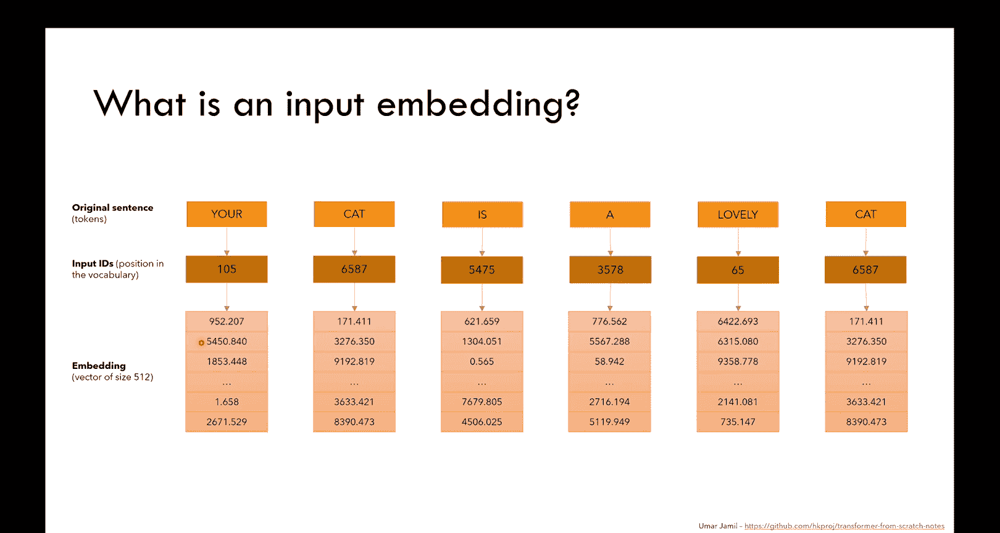

So let's start coding the model。We open。We open， I will open Vi studio code， and。First of all。

 we make sure that we have the necessary libraries。 I will also share the repository of this project。

 so the only thing we need is torch Santauspiece， which is the tokenizer that we use in Lama and TK ODM。

The second thing is from the official repository Lama you should download the download script。

 its this file download do S that allows you to download the weights of the Lama model。

 in my case I have downloaded the D Lamma 27 billion along with the tokenizer。

And this is the smallest model， actually。😊，And I will not even be able to use the GPU because my GPU is not powerful enough。

 And so I will run the model on the CPU。 I think most of you guys will do the same because it's actually a little big for a normal computer unless you have a powerful GPU。

So let's start coding it。 Let's create a new file， model dot。Pie and let's start on our journey。

Im the necessary things。 So we import torch。Import。And also， dot， dot and N。Okay。

 these are the basic thing that we always import。 I remember we also need math。And then， also。

Do our glasses。And this is all the imports we need。

Most of the code is actually based on the original Lama code。

 so you don't be surprised if you see a lot of similarities。

 but I simplified a lot of parts to remove things that we don't need， especially for example。

 the parallelization and。I also try to add a lot of comments to show you all the shapes change in each tensor。

And that's it。 So let's start。 So the first thing I wanna create is the class that represents the parameters of the model。

 so。Here we already see that we have two type of heads。 One is the number of heads for the queries。

 So number of heads for the queries。 And here we have the number of heads。For the K and the V。

 So the  query the keys and the values， because with we will see later with the grouped query attention。

 we don't have to necessarily have the same number of heads for the query key and values。

 like in the original transformer。 But we can have multiple number of heads。

 and we will see why and how they work。This will be set when we load the tokenizer。

These two parameters indicated the dimension， the hidden dimension of the FF and layer so they fit forward the layer。

 The basic idea is they try to when they introduce the grouped query attention。

 they try to keep the number of parameters because with the grouped query attention。

 we reduced the number of heads of the K and V， but they incremented the number of parameters of the fit forward layer。

 So as the number of the total parameters of the model remains the same。

 This allow to to compare the full the base transformers So with all the heads for the query。

 the key and values with the one they use in Lama， which has a reduced number of heads for the K and V。

But this is just a decision， an architectural decision。Then we have some E P。

 This is a number that is very small， and we will see why we need it。每高。

And these are all the parameters we need。 Also here we have two parameters that we will later use for the KV cache。

 and I will explain you later what is it and how it works。Let's start as saw as I said before。

 let's start with implementing the skeleton of the entire model and then we implement each single part and while implementing each single part。

 I will also review the background and how it works and the maths behind it。

This is the main class that will represent the entire model。 So all the model we can see。

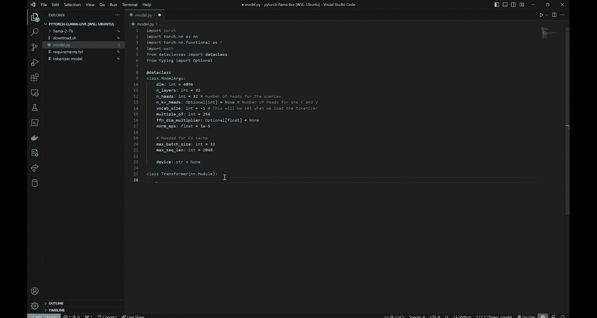

Here， so all this model here， except for the softmax。

We make sure that we have set the vocabulary size。Save the values。

This is the number of layers of the model。 So this is represents。

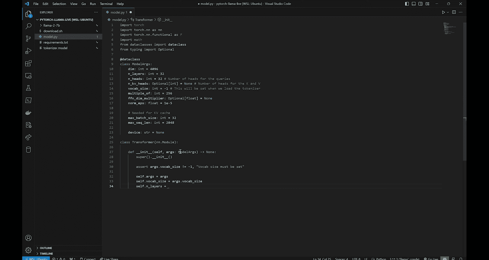

This block here is repeated many times one after another just like in the transformer the bi transformer if you remember correctly this block here and this block here were repeated one after another many times and here it's repeated 32 times and the last the output of the last layer is then sent to this RMS norm then today the in linear etc。

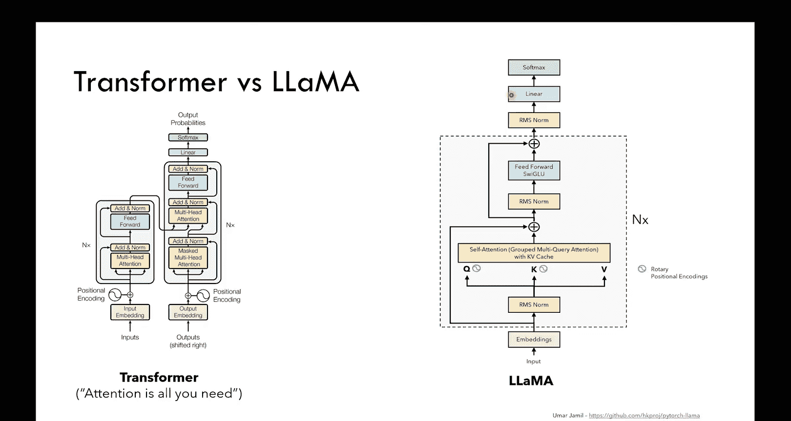

I'm using the same names as used in the transformer in the code from。From the Lamma repository。

 because when we will load load the weights of the model， the names must match。 otherwise。

 the torch doesn't know where to load the weights in。

And this is the reason I'm trying to keep the same name。

 I only change some names to make them more clear。 but most of the other names are same。

This is a model list。 So this is the list of the layers。We will create later the encoder block。

Which is。Each of these blocks here， this is the encoder block。For now， we just create a skeleton。

 So we have a list of these blocks。 Then we have a normalization。

And the normalization is the RMS normalization。 we will implement it later。

We need to G tell him the size of the features。And the E P S is a very small number that is needed for the normalization calculation so that the we never divide it by 0。

 basically。And then we have the output layer。Okay， then we need to pre computeute the frequencies of the rotary positional encodings。

 So let's do it。I created this method and then we go to implement it and I will show you how it works。

We check， I think we have a parenthesesis， okay。This is the base transformer model。 So first of all。

 we have N layers。 We have， first of all， the token the input embeddings。 So we convert the。

The input into embeddings。 Then we pass it through a list of layers。

 The last layer output is sent to the normalization than to the output。

 So this logic will be more clear in the forward method。Okay。

Here you will see one thing that is different from the previous transformers is that the sequence length that we want is always one。

 and this is because we are using the K V cache。And we will see why。 So in the previous。

 let's review here。

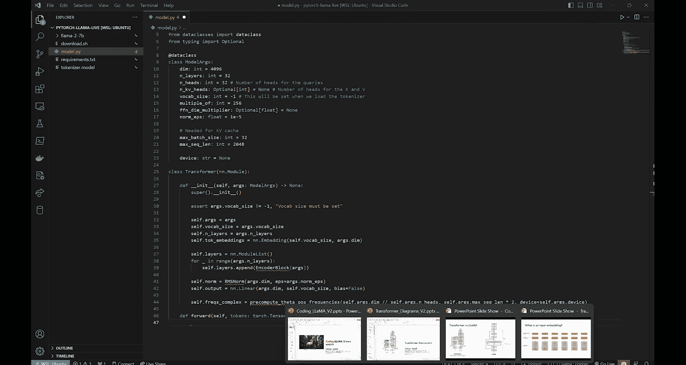

Here。When we give the input we want to give the prompt and the model will give us a soft max of the next token。

 but with the KV cache we don't need to give all the previous tokens because maybe we really computed them in the previous iteration so we only need to give the latest token and then the model will output the next token while the intermediate tokens so the cache of the previous tokens will be kept by the model in its cache because here we have akiv cache but we will see this mechanism later so for now just remember that the input here that we will get is one token at a time。

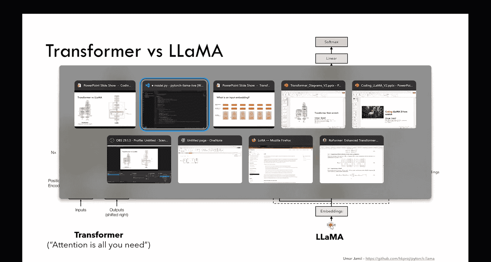

So we will get a batch with sequence length。Okay， so。We ready to size。

So you this then is token stop shape。And we make sure that the sequence length is actually one。

And second thing is this model is only good for infferencing， not for training， because for training。

 of course， we need to not have the KV cache and we only we need to be able to process multiple dokens。

But our goal is actually to use the pre traineded Lama weights。

So we convert the tokens into embeddings。As you can see， we had the dim dimension。

 So the dimension of the embeddings， which is 4096 for the base model。

 but depending on the model size， it can be different。Okay。

 I promise I will explain this line here and this line here much more in detail just in two minutes。

 Let me finish it， and I will explain everything together。 So this is basically we are。

 we pre computeute something about the positional encoding that we then give to the successive layers but let's finish writing it and then we I explain expand this method and this one and everything will be clear。

So suppose we， with this one， we retrieve something that is needed for computing the positional encoding。

 which then we feed to the next layers。So we consecutively apply all the encoder blocks。And finally。

 we apply the normalization， just like。

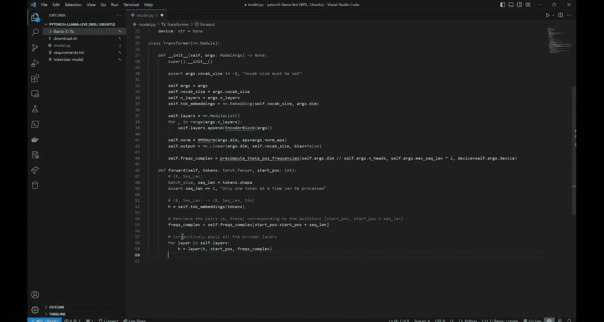

Y。So we apply these blocks one after another many times。 and then we apply the normalization。

And then we calculate the output using the linear layer。And finally， we return the output。

So this is the skeleton of the model。 So we take the input。 we convert it into embeddings。

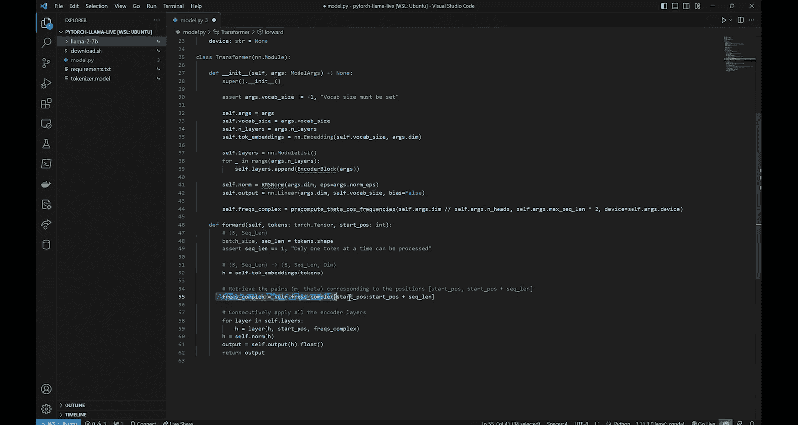

This part， I will explain later。 we give these input embeddings with something about the positional encoings to these blocks。

 One after another。 We take the output of the last one and give it to the RMS S norm。

 We take the output of the RMS S norm， give it to the linear layer。

 And then the during the inference， we will apply the soft max。

Now， let's concentrate on the positional encodings。

 Let's first review how they worked in the original transformer。

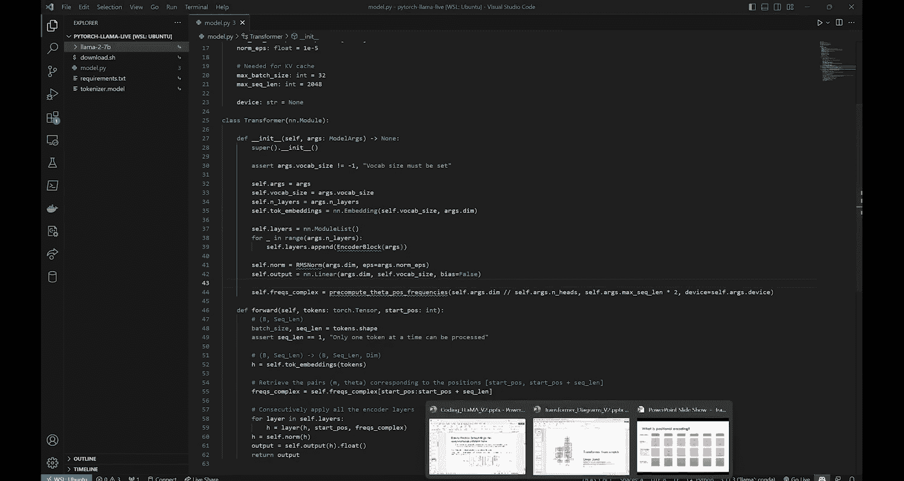

As you remember in the original transformer， so the transformer in the attention is all you need。

We first take this sentence， we convert into embedding vectors， so vectors of size 512。

We then add another vector， which has the same size， So 512。

 that represents the position of that token inside the sentence。 So every sentence。

 every token in the first position of a sentence will receive this vector。

 every token in the second position of a sentence will be have this vector added to it and every token in the third position of a sentence will have this vector added to it。

 this vectors are precomputd because they only depend on the position not on the word they are applied to and this is why they are called absolute position encoing because they only strictly depend on the position of the word inside of the sentence。

While in the contrary in the rotary positional embeddings they are a little different。

 let's go have a look。 first of all， the rotary positionally encodings or embeddings。

 they are computed right before the calculation of the attention and they are only applied to the Q and the K matrices not to the V。

Let's see right。The first thing we need to understand is the difference between absolute positional encodings and relative ones。

 The absolute positional encoings are the one we just saw。

 So they deal with one token at a time and each token gets its own embedding While the relative positional embeddings。

 they come into play during the calculation of the attention and the calculation of the attention is basically done using the dot product because its query multiplied by the transpo of the keys divide by the square root of the model So there is a dot product in between and that we want with the relative positional encoings we we change this dot product so that we introduce a new vector that indicates the distance between the two tokens involved in the dot product。

 So， for example， in the original transformer。😊，We have this formula here。

 so query multiplied by the transpose of the keys divided by the square root of the model while in the relative position encodings which are not the one used in Lama。

 So this is just an introduction。The relative positional encoings。

 we have another vector here that represents the distance between these two tokens。

 and we compute the attention mechanism like this。😊，The rotary position embeddings。

 the one that are used in Lama， are something in between the absolute and the relative。

 absolute because。each token will get its own embedding。

 but relative because the attention mechanism will be evaluated using the relative distance between2 token。

 let's see。The relative position， the rotary position embeddings were introduced in the F the paper from。

 from this company， J and。The authorsers of this paper。

 they wanted to find an inner product that works like this。 So， first of all。

 what is an inner product， We are， we are all familiar with the dot product。

 The inner product can be thought of as a generalization of the dot product。

 So it's it's an operation that has some properties that reflect what is the dot product。

 So the outs of this paper wanted to find an inner product between the two vectors， a query and he。

Such that they only depend on the so this is the symbol for inner product。

 So this inner product only depends on the embedding of the two tokens involved。

 So X m and X n and the relative distance of these two tokens， so the distance between them。

 For example， if the first token is in position 2 and the second position token is in position 5。

 So m equal to n equal 5， the distance between two will be3。Or minus3， according to the order。

 and they wanted to find a dot product that has this property that only depends on the embedding of the first token of the on the embedding of the second token and the relative distance between them。

 then they saw that if this function G is built in this way。 Then we achieve that objective。

 that is we take the first token。 So the query， for example。We multiplied by the W matrix。

 This is actually done also in the vanilla transformer， but okay。

 I suppose there is no W matrix here。We convert it into a complex number in this form。

 We take the key key vector。 We transform into a complex number into this form。

 and we define the inner product in this way。This inner product will basically depend only on the distance between these twoken。

 so they wanted to find an encoding mechanism such that the attention mechanism which is based on a dot product which is an inner product behaves like this。

 so it only depends on the embeddings of the vector and the distance between them。And if we。

 for example， this formulation here， if we apply it on a vector of dimension 2。

 so we think of embedding of with only two dimensions， it becomes in this form here。

 this is due to the errors formula。 so each complex number thanks to the L formula can be written as the sign plus the cosine plus a sign。

And。This matrix here reminds us of the rotation matrix。 Let me give you an example。

 Suppose our original vector is here。And if we multiply this vector v0 by this matrix here。

 the resulting vector will be rotated by the angle theta。

 So this is why they are called rotary positional embeddings because the matrix here represents a rotation of the vector So when we want to visualize how the rotary position embedding work we have to think that they will map it into a vector space and they will rotate each word to an angle that is a multiple of a base angle theta and proportional to the theta angle proportional according to its position。

 so that two tokens that occupy similar positions will have similar inclination and the two tokens have different positions will have different inclinations。

And this is the idea behind the rot positional embeddings。

 But how do we actually compute them into in in the code in the pythtor。 Well， to compute them。

 we need to build a matrix like this。 and actually， as you can see。

 this matrix is actually full of zeros And so when we calculate the embedding in this way。

 we will do if we do a matrix multiplication。 we will be doing a lot of operations that are useless because most of these items are0。

 So the authorss of the paper proposed another form that is more computationally efficient。

 And this form basically says that we take the embedding of the vector to which we want to apply the positional encodings。

 So， for example， this one， this is a vector。 So the first dimension， the second dimension。

 the third dimension and the last dimension。 So if this is， for example， the vanilla transformer。

 this would be。😊，X D， which should be 512。We multipied elementwise by this matrix plus another vector that is actually based on this vector。

 but with the positions and the signs changed， so this is actually in the first position we have the second dimension with its sign change。

 the second position we have actually the first dimension in the third position we have the fourth dimension but with sign change so it depends only on the embedding of the word。

 but in it changed with the signs and position change。😊。

And then we multiply this element wise with another matrix that you can see here， this vector。😊。

Then this will be the encoding of the token we are talking about and。Now。

 what we can pre compute is this matrix here because it doesn't depend on the token to which we apply it to and this metrics here。

 because it doesn't depend on the token we apply it to。And they depend on M。

 So it's a the position of the word and theta。 What is theta Theta is a series of numbers defined like this。

And so let's first build the code to pre compute this and this here。Let's do it。

I will first write the code and later I will show you how it works。😊。

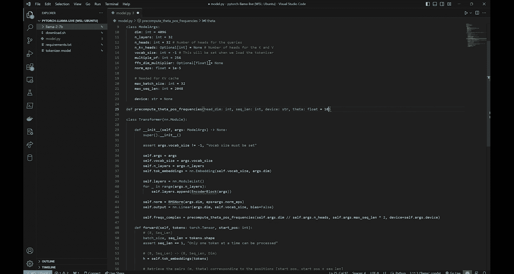

This data parameter 10000 comes from the paper。 It's written here，10000。

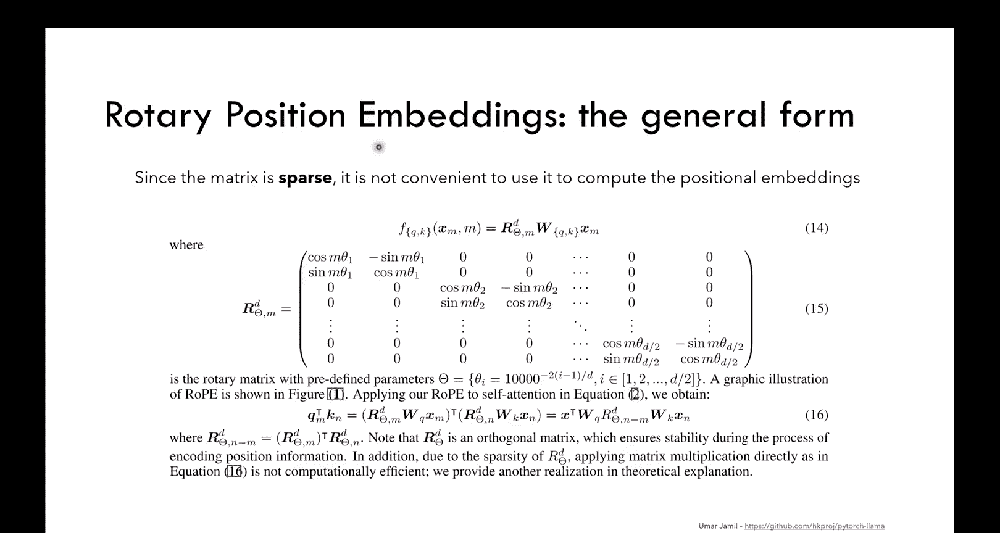

We first need to make sure that the dimension of the word to which we are applying the embedding is actually even because we can in the paper。

 it's written that the this rotary positional encodes cannot be applied to。

An embedding which has a odds odd dimension。 So cannot be 513 must be 512 or 514 or any other event number。

And this is。As written in the paper。Even okay， now we build the sitta parameters。

 which is a sequence。And the shape of this data will be。Haad the dimension divide by 2。

 because we will apply these embeddings to each head。 So not right after the embedding。

 but after we have split them into multi head。 So each token the token of each head。

We check the size of the dimension of each head and we divide it by 2 because y divide by 2 because in the paper。

 they also divide by2， so d divide by 2 here。

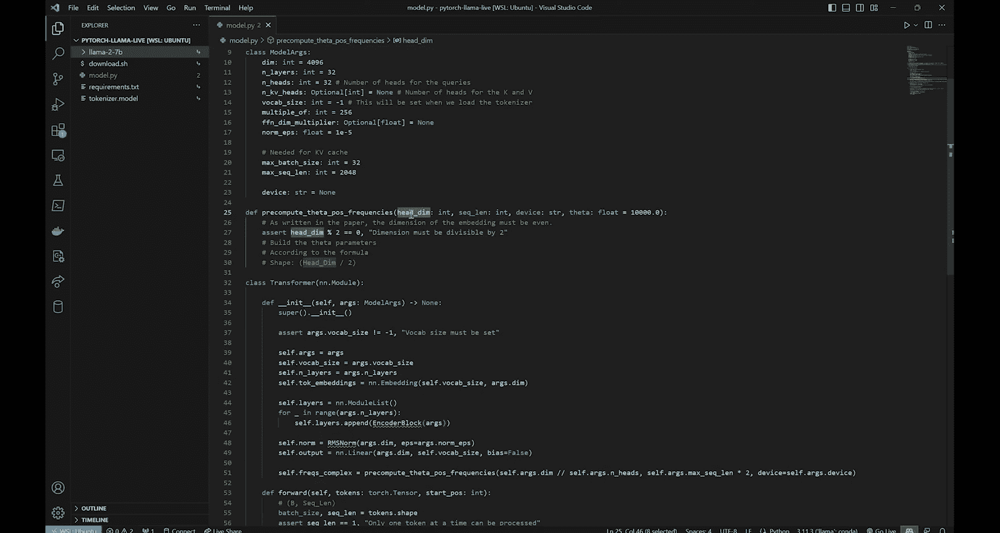

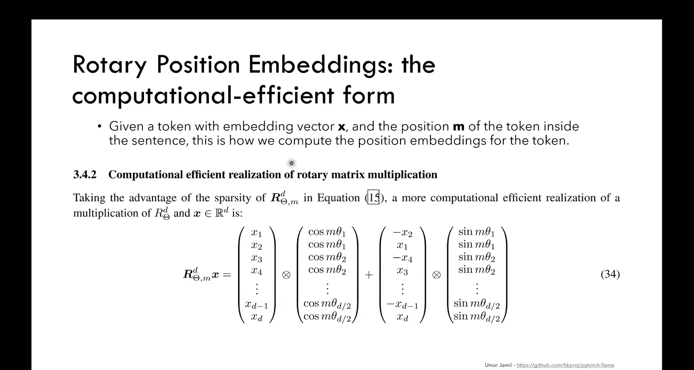

Okay， so what's the formula here。 The formula is theta of I。Is equal to 10000。To the power of。

-2 multiplied by I-1 divide by dimension for I。Equal to1，2， etc cetera。 up to dimension divide by 2。

So now we are computing this part here。This part here。Which is a serious。 So I hear it starts from1。

 we will start from 0 so we don't have to do i minus1。And theta is equal to one over the。3 top。So。

10000 to the power of。되룸메 레。Divide by a dimension。Why do we do one over theta well because this is to the power of minus2。

 so something to the power of a negative number is one over that something to the power of the positive exponent。

And then this will result in a matrix with shape head dimension divided by 2。 So shape is。

Haad dimension divided by 2。

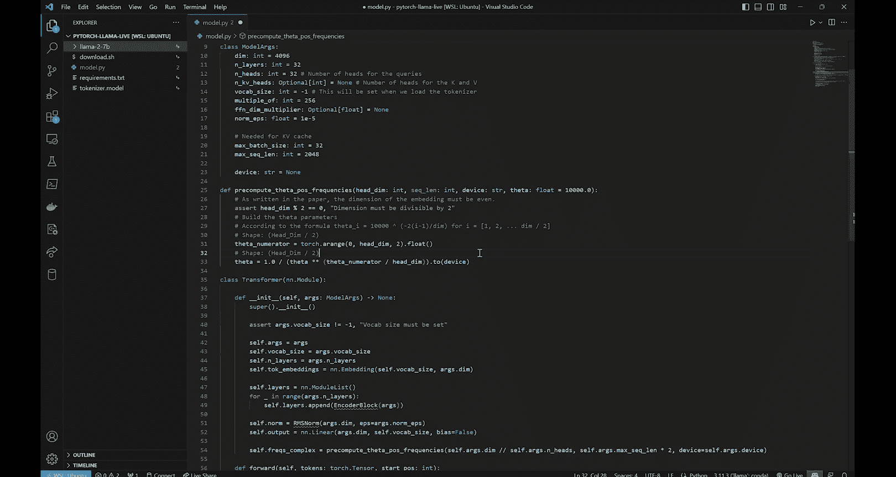

Now we construct the positions。 What are the positions。

 Because we want to build these two mattressrices， they depend on theta。

 So the series of theta that goes from theta1 to theta dimension divide by 2 and that we already have Now we need to build the ms because the Ms。

 the possible positions of a token can be many。

We basically give as input to this function。The maximum sequence length that we can afford multiplied by two。

 because we can we have also the prompt， which may be long。 So we say， okay。

 let's pre compute all the possible theta and M for all the possible positions that our model will see and the all the possible positions is given by this parameter sequence length。

So now， construct the positions。And the shape is sequence length， which is。嗯。

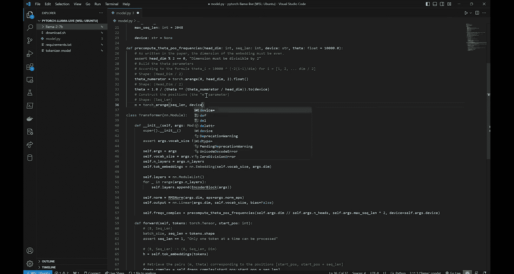

Now we need to multiply M by all the sequence of thetas。But each M with all the theta。 So。

 for example， if we have M equal to1， we need M1， Theta 1， M1 theta 2， M1。

 theta divide D divide by 2， Then we need M2， theta 1， M2， theta 2 M 2， theta 3。 So for that。

 we will use a auto product。

The otherer product， I will show you later basically means multiply all the elements of the first vector with all the elements of the second vector。

All the possible combinations， so。So， for example， here we have a。

That's the frequency is equal to torch other product。And threeta。Okay。

 so what we are doing is we are doing the auto the auto product within M。

 which is the positions multiplied by theta。 This will basically take the first element of the first vector and multiply with all the elements of the second vector。

 Then take the second element of the first vector and multiply it with all the elements of the second vector。

 etc cetera， et cetera。So， if we start。With the shape， let me say shape of。M is sequence length。

Let's say outer product with。Haad dimension divided by 2。

 This will result in a tensor of sequence line。By add dimension divided by two。 So for each position。

 we will have all the theta。 then for the second position。

 we will have all the theta for the third position， we will have all the theta。And so on。No。

We want to write these numbers into a complex form， and I will show you why。I multiplied by M。

 multiplied by theta。Where R is equal to one， as follows。So， we compute。Let me also it。Shape。

 and then I explain you how it works。This is。Here to。Okay。Let's write some formulas。

I could also you know not explain all the proofs， so I know this in the next few minutes will be a little boring because I will be explaining all the math behind it。

😊，But of course， I don't think just you just like me you like to watch just some code and say， okay。

 this is how it's done。 No， I like to actually give a motivation behind behind every operation we do。

 and that's， I think one of the reason you are watching this video and not just reading the code from the meta repository so。

Let's do some math。

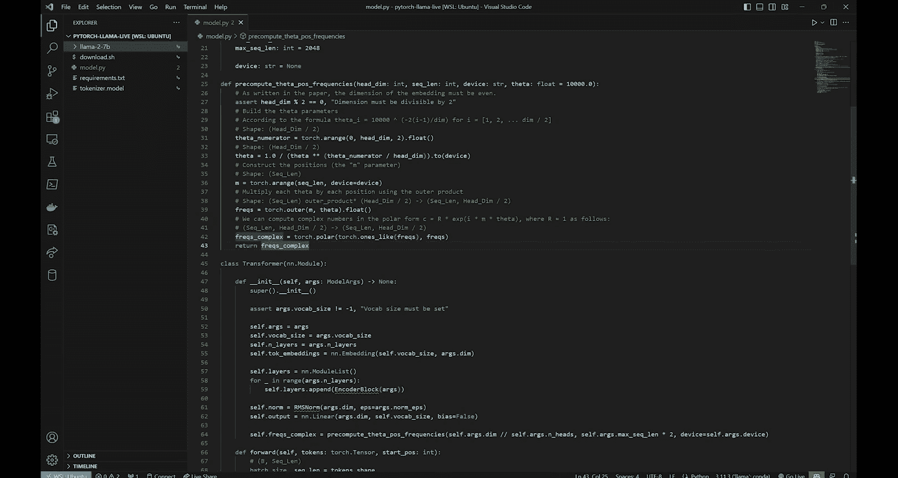

The first thing we need to review is how complex numbers work。 Okay。

 a complex number is a number in the form。A plus I multiplied by B where a is called the real part and the B is called the imaginary part。

And I is a number such that I to the power of 2 is equal to 1。

 so the complex numbers were introduced to represent all the numbers that involve somehow the square root of a negative number。

As you know from school， the square root of an average number cannot be calculated。

 but so that's why we introduce this constant I， which is the negative number。

 which is the square root of minus1。And so we can represent the square root of negative numbers。

 and they can also be helpful in vector calculations。 and we will see how because。

Because we have the El formula， the El formula says that e to the power of I multiplied by x is equal to cosine of x plus I multiplied by sine of x。

 so it allow us to represent a complex number in the exponential form into a sum of two trigonmetric functions。

 the cosine and the design， and this will be very helpful later， because our goal。

Our goal is to calculate。This mattresses here the cosine of m theta and the s of M theta。

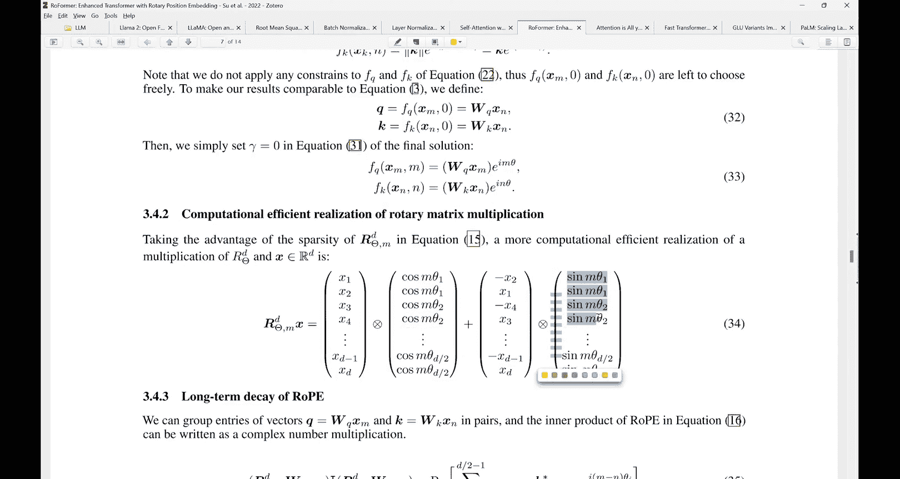

And the first thing we did is we calculated all the theta 1。 then we calculated all the positions。

 Then we calculated all the possible possible combinations of positions and thetas。

 So what we did is。

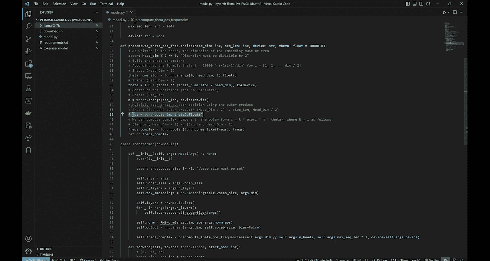

We calculated a vector。That represents the theta。そう。Theta 1， theta 2 up to theta D divide by 2。

 Then we calculated all the possible ms。M can be one， can be2 can be whatever。 So sequence length。

 let's say。Then we calculated the product of each of them。

 which all of for each for all the possible data。 So， for example。

 we created a new metrics that for has M1 theta 1 M1 theta 2， M1 theta 3 up to M。Up to。

M1 theta d divide by 2。And then， M2。Theta 1 M2， Theta 2 and2， theta 3， etc cetera， etc cetera。

 until M2 theta。D divide by 2。These numbers are still not complex numbers。

 They are just real numbers because theta is a real number m is a real number。

 but they are not complex numbers。 Then we convert them into complex numbers。

 So what we do with the last operation here。 This one here。

 we convert each of these numbers into polar into its polar form。

 a number in polar form is a number that can be written as R multiplied by E to the power of I theta。

 which can be written as r cosine of theta plus I sine of theta y because it can be represented in the graphical。

 let's say graphical。

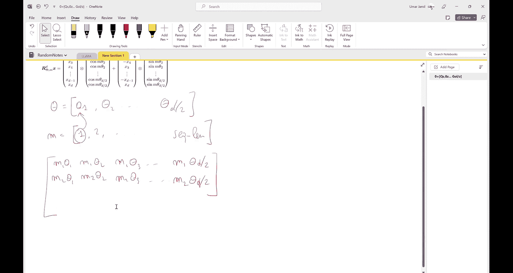

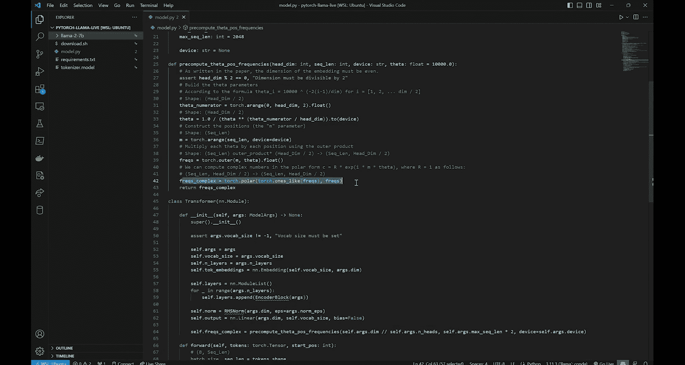

Plae X， Y。As you know， complex numbers can be represented into the 2 d plane X Y。

 where the real part is on the X and the imaginary part is on the y。

So we are actually representing a vector of size， let's say， R。With an inclination of theta。

Because as you know， the projection of this vector on the real part are cos theta plus I the the the projection on the y axis is sine of theta and。

Here I forgot R。 Yeah， I forgot an R here。Are sin of theta。

 So this is another way of representing complex numbers。 And what we are doing is we are。

Calculating these metrics and then converting all these numbers into their complex form。

 So we are converting it into another matrix。That has R equal to 1。And this number here， for example。

 this item here will become。Cosine of。M1 theta 1 plus I。Sine of M1， Theta 1。

This number here will become another number。So this is only one number。

This is become another complex number that is the cosine of M1 theta 2 plus I sine of M1 theta 2。

Et cetera， et cea， for all day。Because we are not increasing the numbers the over the total numbers。

 This shape of the tensor also doesn't change。 It just becomes a more complex number。

 So instead of having M Theta 1 where it becomes cosine of M Theta 1 plus I M Theta 1。

 Why do we need this form here， Because we need。Signs and cosines and later we will see how we will use them。

Now， the point is， imagine we are giving a a vector because we want to apply these positional encodings to a vector。

 So how to apply them， Because the vector we will will be given us as list of dimensions from x1 to the last dimension。

 just like in the original transformer we have a vector of size 512 in this case。

 it will be much smaller because it's the dimension of each head。 And as you remember。

 each head doesn't watch the full dimension of the embedding vector but a part of it。 So but for us。

 okay， imagine it's only one head。 So if it's only one head， we will watch the full dimension。

 So for now don't consider the multi head just suppose that we only are working with one head。

 So imagine we have a token with its full dimensions。 So in the case of Lama 496 dimensions。

 And in the case of the vanilla transformer，512 how to apply it。Let's do some math。Actually。

 let's do some more mat。😊，So， we are given。We are given。

Suppose a smaller embedding vector because we want to do the calculation and not go crazy。Otherwise。

4096 it's a little difficult to prove。I want to make a a list of operations on this vector until we arrive to this form here。

So let's start suppose our embedding vector is only made of four dimensions。X1。X 2， x 3 and x 4。Okay。

 the first thing we do is。I will do some transformations and I will later translate them into code。

 so for now just follow the transformations I'm doing。This is the transformation number one。

I want to group successive tokens， successive dimensions。Into another dimension， So x1。

And x2 become another dimension in this tensor。And x 3 and x 4 become os， very badly written。

X4 become another dimension in thistensor。 The total number of items is still 4。

 but I added another dimension。And this has size 4 by one。 right This one has2 by 2 by  one。

 So I split it into multiple tensors。And okay， now this next thing I do。

 I consider this first number of this part to be the real part of the complex number and this one to be the imaginary part of the complex number and the same for the second vector here。

So I do another transformation that we will call2。In which。X1。Plus I X 2， and then x 3。Plus IX2。

This vector has less items because now two numbers became one complex number。Now， I multiply this。😊。

Eleant wise with the vector that we pre computeutd before。 as you remember before。

 we pre computeuted this one， cosine of M1 Theta 1 plus I of M1 theta 1 cosine of M1 theta 2 plus I because they suppose this position this token here。

 suppose his position is M1 because we need also the M。 So suppose this token here。

 his position is M1。So we take all this row here， M1。And this will become our new metrics here。

We only have four dimensions。 So four dimensions means we have a theta 1 and theta 2 because D divide by 2 until D divide by 2。

 so。Eleement wise with cosine。Of。嗯。1， the do1。Plus， I。Sign。O。And1， Theta 1。And then， we have。

Cusisine。Of M1。Theta 2。Plus， I。Of sign。Of M1 theta 2。

Now we have an element wise product between the first item of this matrix and the first item of this matrix。

 actually they are two vectors。 and then we have the the product of two complex number。

 this complex number here and this complex number here。 So let's do。

 let's see how to compute the product of two complex numbers because I don't want to write very long expressions。

 I will call this one。F1。 So F1 is the cosine of M1 Theta 1 and F 2。Is the signine of M1 theta 1。

And for the same reason， I will call this one F3。And F。4。No。😔。

Let's compute the product of the first item of this vector and the first item of this vector。So， x。

1 plus。I X 2。Multipliied by。F1 plus I F 2。This is equal to。X 1， F1。Plus， I。X 1， F2。Plus。I X 2， F1。

Then we have this product I X 2 multiplied by I X 2， but it will become I squared x to F 2 I squared。

 We know it's equal to -1， so it will become minus。X 2。F2。This one can then be written as real part。

 so all the terms that don't have I。X1， F1。minus。X 2， F2。Plus。I， that multiplies x1， F2。X 1， F 2。

Plus。X 2。F1。Okay， this is how to compute the product of two complex numbers。 Let's do it。

 So the first number here in the resulting matrix from this element wise multiplication will be。X 1。

 F1。X 1。F1。Minus。X2， F2， X 2， F 2。Plus。I。Of x1， F2。Plus。X 2， F1。The second element。

 we don't need to do do this multiplication because they have the similar structure as the first one。

 so we just change the x1 with x3， x2 with x 4， this is x4。And F1 with F3 and F2 with F4， so。

The resulting metrics will be。X，3， F 3。Minus。X 4， F4。Plus。Hi。X 3， F4。Bus。X 4， F3。

This one can then be split back。 So this complex number。

 we can split the real part and the imaginary part。 and this we will call it transformation number 3。

So we can split it into two in a tensor of two dimensions。

 One is the real part and one is the complex part， whereas is x1。F1。Minus。X 2。F2。Then， x。Wan。😔，F 2。

Plus。X 2， F1。This is the first tensor。 The second tensor will be。X 3。F 3。😔，Minus x 4。F 4。

 and the second will be x 3。F4。Plus x 4。F3。😔，I'm really sorry for the bad handwriting。

 but it's my touchpad is raw， Not so good。Then we do another transformation there in which we flatten all these values so。

This will be the first item this the second， the third and the fourth。 So we remove this dimension。

 the inner dimension。So we flatten these matrix。And it will become x1。F1。Minus。X 2， F2。

 the second items will， will be x 1。F 2。Plus。X。2。😔，X 1， F2 plus2 x 2， F 1。Then we have x3， F3。

Minus x 4。F4。Then we have x 3。4。Plus。X。4， F3。Let's compare these resulting matrix with what is in the paper。

 So let's compare it with。This one， oops。Let me zoom a little bit， okay。

The resulting matrix is exactly the same as what is in the paper。 So x1 multiplied by F1。

 which is the cosine。As you remember， M1 theta 1。 So x 1 multiplied by F1。Plus， minus x 2。

 So minus x 2， multiplied by F 2， which is the sign， as you can see here， sine of M1 Theta 1 here。

 it's not M1 because it's for the generic M， but we set M equal to M1。

And the second dimension is also correct。 So it's x1， F2。 So x1。

 wait x1 here because here is the sum。 So the order doesn't matter。 So x 1， F 2。

 So x1 multiplied by the sign plus x 2， F1， x 2， F1。And let me check if we can use。Oh， okay。

 the third dimension is x 3， F3。 So x 3 multiplied by the cosine minus x 4 sine minus x 4 sine。

 Then we have x 3， F4。 So x 3， F 4， F 4 is the signine of the 2。And plus x 4 F 3， x 4， F3。

 F 3 is the cosine of theta2 also in this case， because we have， there are。

 we have the sum here inside。 the， the order doesn't matter。So as you can see。

 we started with a vector of dimension 4， but it could be of dimension n。

 and we multi we did some transformation， we then multiplied with the metrics that we precomputed here。

Then we did some other transformation， and the end result is exactly as doing this operation。

 So now let's translate this into code。 because this is actually what we need to apply the embedding vector to this vector here。

 So to this token how to apply the embeddings， the rot embeddings through this series of transformations。

 So I could have also written the code and not tell you anything。

 but I like to give proof to what I do so that you know that what I'm doing is actually actually described in the paper and we are actually doing it according to the paper。

 There is also a visualization in the paper that is really helpful。 So what we did here， for example。

😊，Is we transform the embedding vector into split it into a a new tensor， which has half dimension。

 but group by grouping two consecutive dimensions。 So the two consecutive dimension x1 and x2 and x 3 and x 4。

Then we multipied it with transforming into a complex number。

 we multiplied it with M theta that we pre computeuted。

And this visualization of why we do this is present in the paper X in particular。

 at this figure here。So here they say if you have a word with n dimensions， you need， of course。

 of D dimensions， then of course， you will have theta of D half theta because we have theta 1 theta 2 up to theta D half。

We group successive dimensions into a new。Complex number that if we project it on the complex plane。

 it will result into this vector。 So the x 1， x 2 vector you can see here。

And then we multiply it with the complex number m theta 1。

This will result in the number being rotated by the angle indicated by m theta 1。

 and this is the encoded number is the encoded token。

 and this is exactly what we are doing with our matrix transformations that I show you right now。

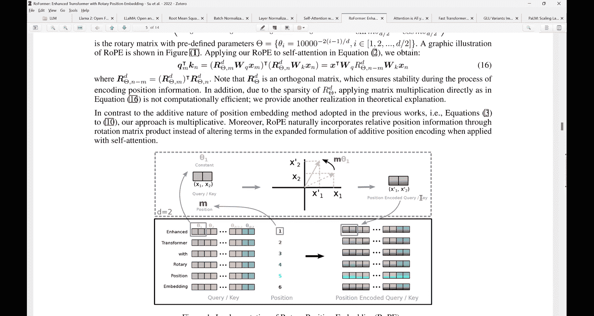

Now， let's translate this into code。Apply rotary embeddings。

X is the token to which we want to apply the rotary embeddings。

Fixx complex is the output of this function， but only for the position of this token。

 So only for all the positions of this token， because this will have all the all the data for all the possible positions。

 but we only need the positions for this particular token。And then， we need the device。

The first thing we do is the transformation number one， I think I call it Yeah。

 this one here and number one and number two。 So the first thing we do is we transform the two consecutive dimensions into a new tensor。

 and then we visualize it as a complex number。 This operations are supported by Pythtorarch。

 So we do them。

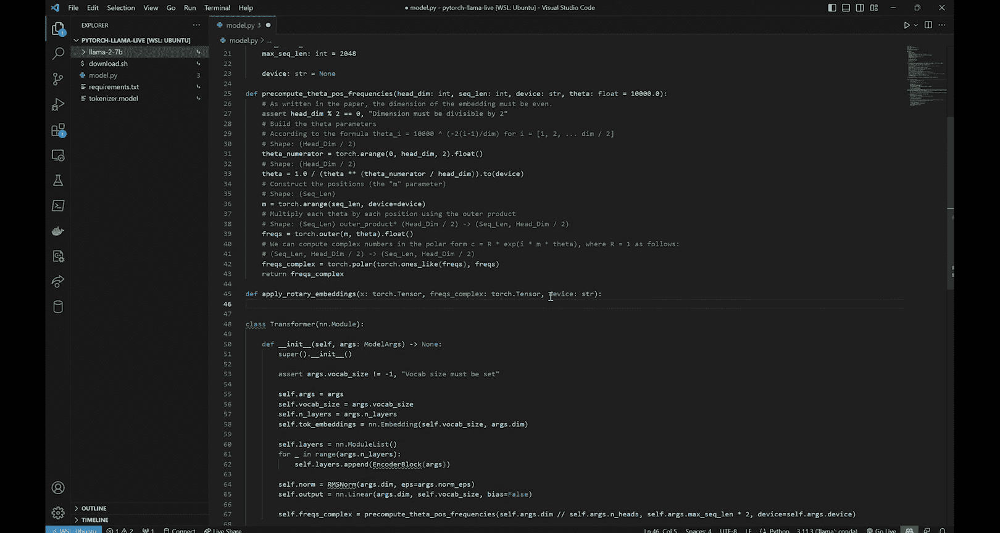

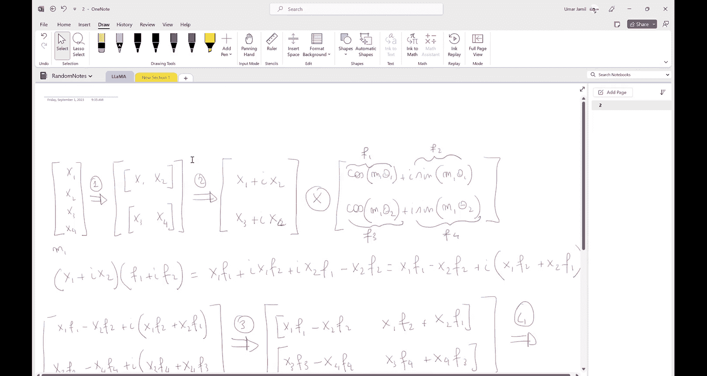

So we create x complex。Is equal2。Okay， this operation here is basically saying take two consecutive dimensions and group them。

And then we transform this intermediate sensorsor into a complex sensorsor by using the view as complex operation from torch。

Let me write some comments。 So we are starting from B sequence length。H。

Haad dimension because I saw before this x is actually not the original vector。

 but it's already the one divided into with its head dimension because we， we。

 we will have a multi head multi head attention。 But if there is no multi head attention。

 then this head dimension is actually the full dimension of the token。 So 4096。

Then we we have this tensor here， but this tensor has two dimensions less than this one。

 It doesn't have the batch dimension and it doesn't have the head dimension。 so we need to add it so。

Take the fris complex， and we add the two dimensions that it's missing。And here we are。Doing， okay。

 let me write all the transformations。Here we are going from here to。Divide by 2， Y divide by 2。

 because every two consecutive pairs are becoming one complex number。 And here we go from。

Sequence length to head dimension divide by2。We are mapping it to。1。

 because this is the batch dimension sequence length， then the head dimension 1， and then head。

Dimmension divide by 2。

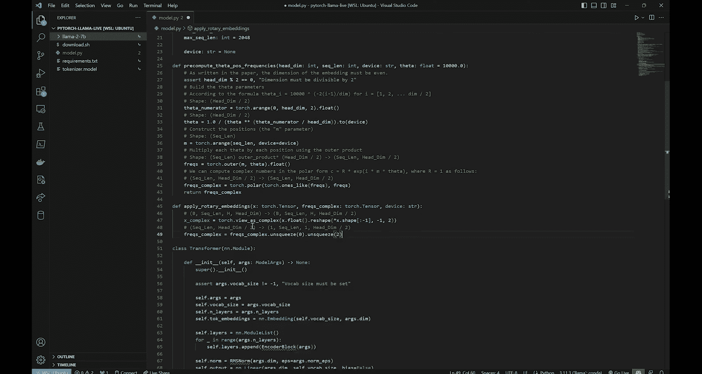

Now， we multiply them together。 So we do this operation here。 So element wise multiplication。

 which will result in a rotation， as we saw in the figure before。

 So that's why I call it X rotated is equal to x complex multiplied by。

The complex number of the frequencies。In this case， we are doing sequence length。Hdge had dimension。

 divided by 2。

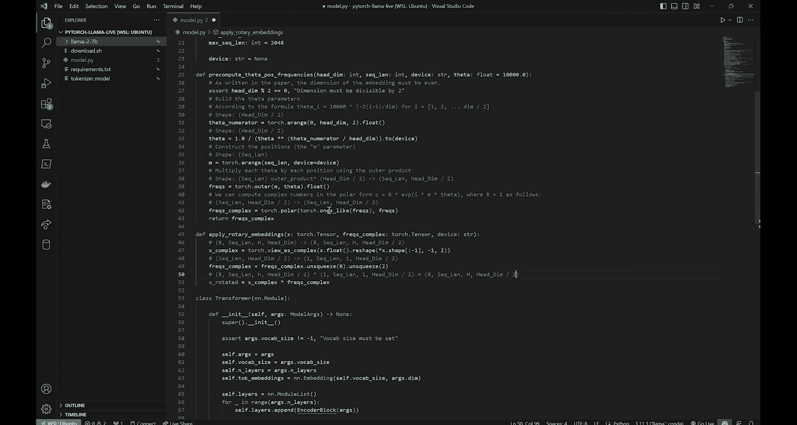

Then， we。We multiplied， we obtain this result。And then we。First， transform it into。

 we transform the complex number into a tensor in which the first item is the real part of the complex number。

 and then the。A complex part， the imaginary part。 and then we flatten it。 So let's do it。

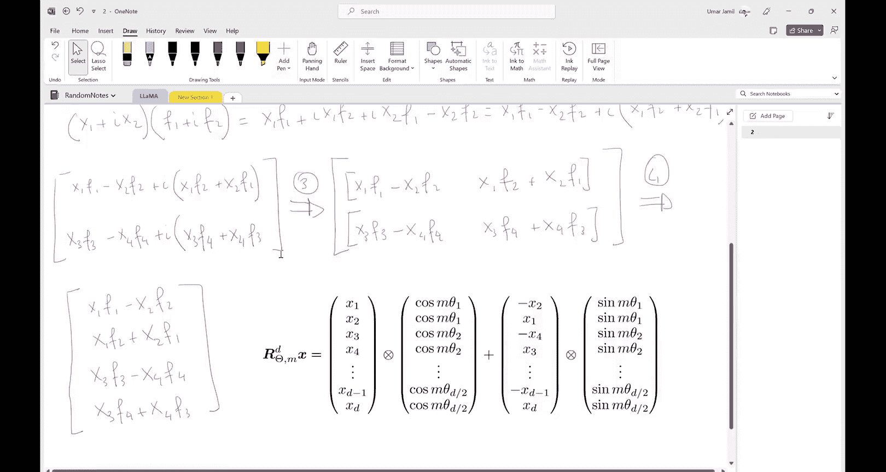

This operation view， as real， will transform the tensor like this。

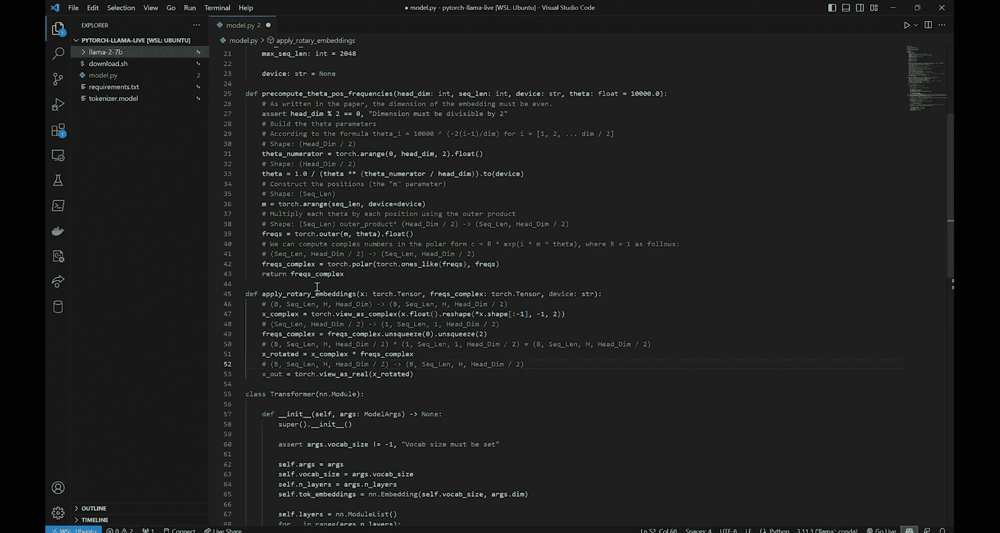

So it's this transformation here in which we transform the complex number into a tensor of two dimensions。

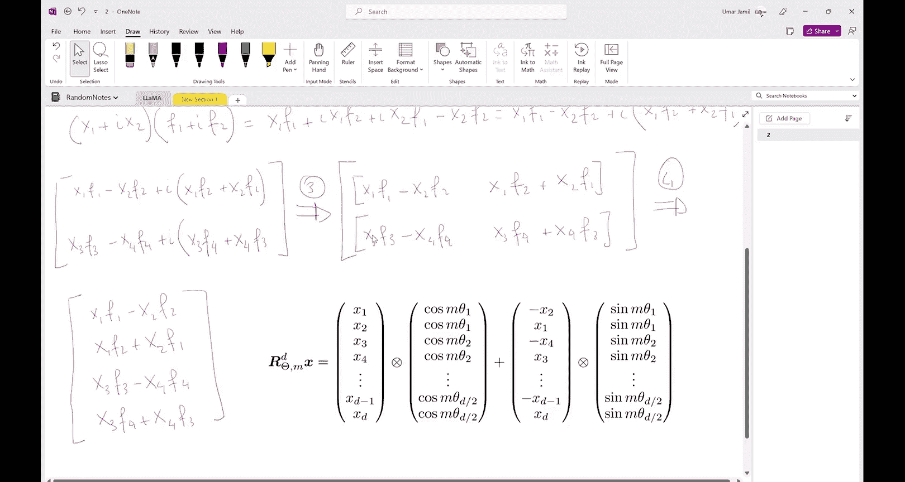

Because that's why you can see this additional dimension here。And then we flatten it。

You can just say to flatten it with the shape of the original。嗯。With the original tensor。

 we give it so。Become。And this is how we calculate the embedding。

 So given a tensor of representing a token。Or a list of tokens because we have the better dimensions。

We can apply the embeddings like this during doing all these transformations that we have done here and that are represented in this code。

 and they are all equivalent to doing this operation as written on the paper。

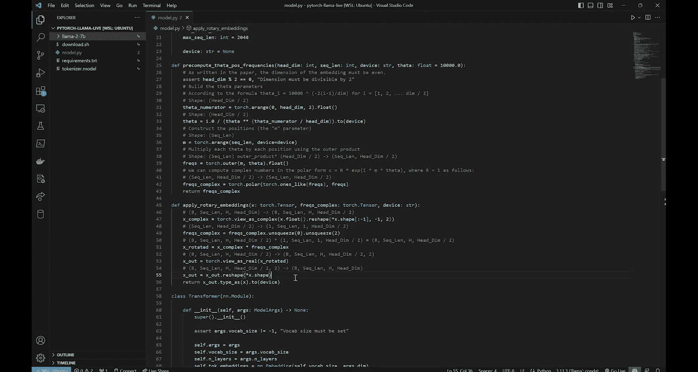

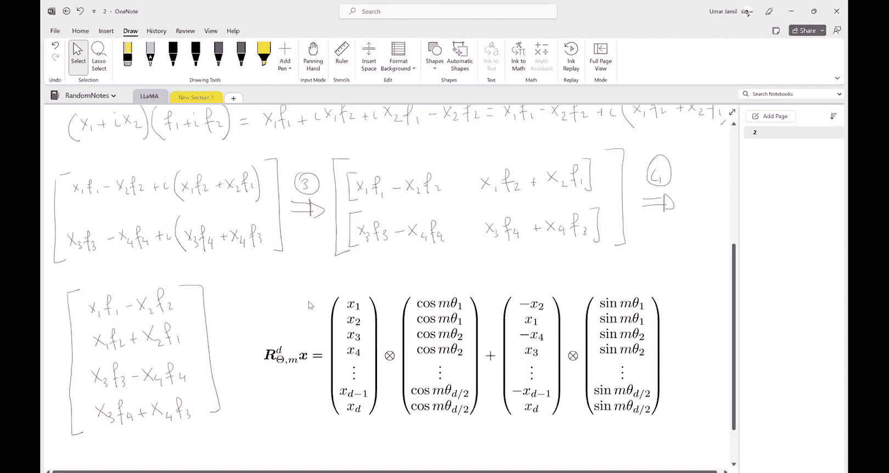

Now， we need to go forward with our transformer by implementing the rest。

 The next thing that we can implement is this RMS S norm because it's present at the output of the of the transformer。

 but also at the input。 So let's go review again， the architecture。 We can see that。

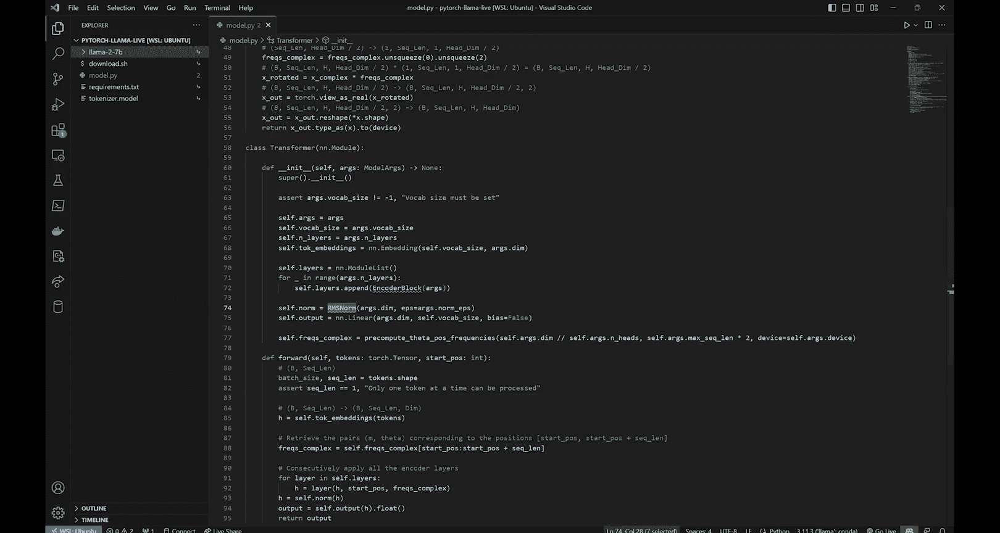

We have the normalization， the RMS S normalization here， but we also have it here and here。

 So let's implement it。Let's also visualize how the RMS norm works If you want to have a deep understanding of how normalization works in my previous video about tlema I actually described the why we need normalization。

 how it was historically done and how it works also at the autograd level。

So I will not repeat the same lecture here。 I will just briefly introduce how it works。

 But if you want to have a better understanding please watch by my previous video。

 So as you remember in the original transformer， we used the layer normalization a layer normalization work like this。

 We have an input where we have some items， suppose item 1 item 2 up to item 10 each item has three features。

 So a1 a2 a3， what we did with layer normalization， we computed two statistics， one for each item。

 So M and sigma， So the mean and the sigma and we standardize each item normalize each element of this input matrix。

 using this formula here， which transforms it into a distribution with0 mean and variance of one and this formula comes from。

Probability statistics。 So as you know， if you have any random variable with it's a mu and sigma。

 if you do the variable minus， it's mean divided by the standard deviation。

 So the square root of the variance， it will result into a Gaussian of mean 0 and standard and the variance of one。

We then multiply this with the gamma parameter and we also add a beta parameter here。

 but this was done in the layer normalization。In Lama， we use RMS S normalization。

 and let's see the difference。In RMS normalization。

 the paper of the RMS normalization claims that we don't need to obtain the effect of layer normalization。

 we don't need to compute two statistics that is the mean and the variance and actually they claim that the the effect given by layer normalization can be obtained without recentering the values so without recentering them around the mean of0。

But just by scaling， however， the variance in the layer normalization was computed using the mean because if you remember。

 the formula of the variance is x minus the mean of the distribution to the power of2 divide by n so。

To compute the variance， we needed the mean， but we wanted to avoid computing the mean because we don't need it。

 This is not what the RMS S paper claims。 RMS S paper claims that we don't need the mean and we don't need to recententer。

 So we need to compute a statistic that doesn't depend on the mean。

 That's why they introduce this statistics here， which is the root mean square that doesn't depend on the mean and in practice gives the same normalization effect as the layer normalization。

And we also have a gamma parameter also here that is learnable and that's multiplied。

 So as you can see， the only difference between layer normalization and RMS normalization is that we don't recenter the values and looks like that recententering was not necessary as written in the paper because they say in this paper we hypothesize that the recaling imvariance is the reason for the success of layer norm rather than the reering invariance。

 So they just rescale the values according to the RMS statistic。

 And this is what we will do in our code。 So let's build this block。

So the A S value you can see here is a used。Is used as a denominator。

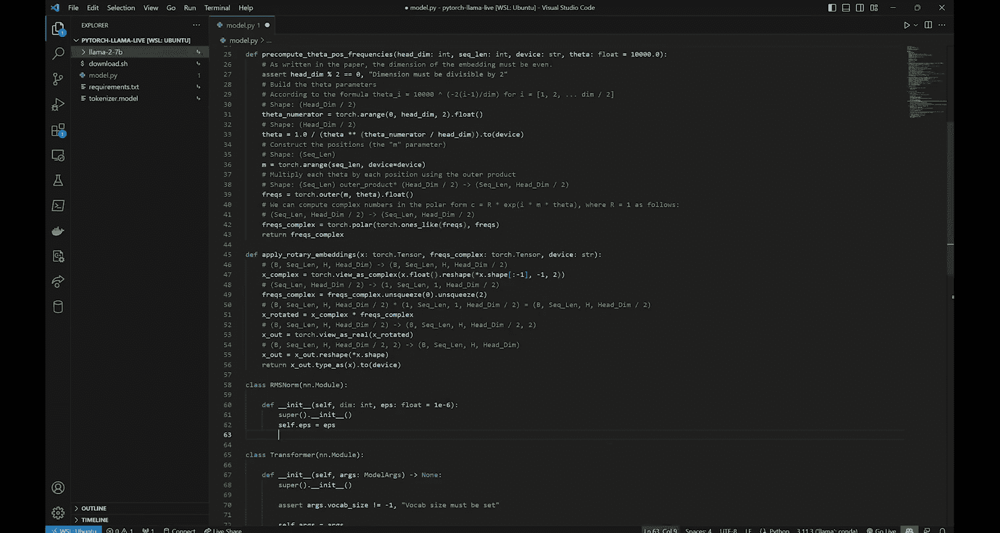

Let me go back here is used here as the added to the denominator。 so to avoid a division by 0。

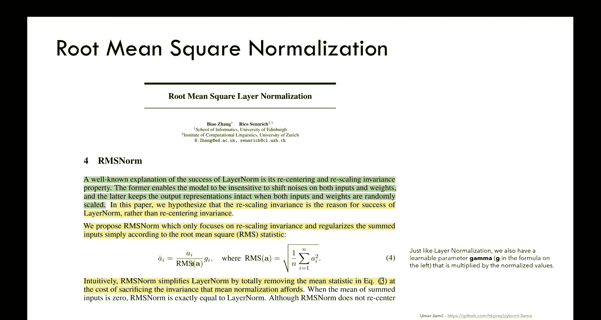

And then we have the gamma。The gamma parametermeter。And this sit， then we define the function norm。

Where x is。Bch sequence length dimension。Okay， so well return x。Applied by torch dot R S Q t。

Our S QRT stands for the one over the square root。And that's it。We want to buyイ by gama。So we have。

 as you can see， weight is actually， is a number a list of ones with the dimension the。

 So the multiplied by。B sequence length in results in B。

Sequence length the whereby is the button dimension。And here， what we are doing is。

This is our S Q R T is equal to1 over S Q R T of x， just as a reminder。And。

The dimensions here are multiplied by。B。Its length1。Which results in。P has length dimensions。

So what we are doing is exactly multi just this formula here。

 So just multipied it by one over RMS and then multiply it with gamma here。

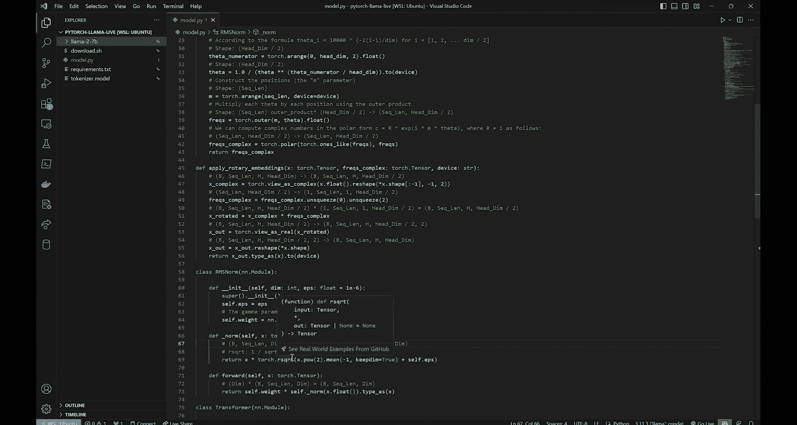

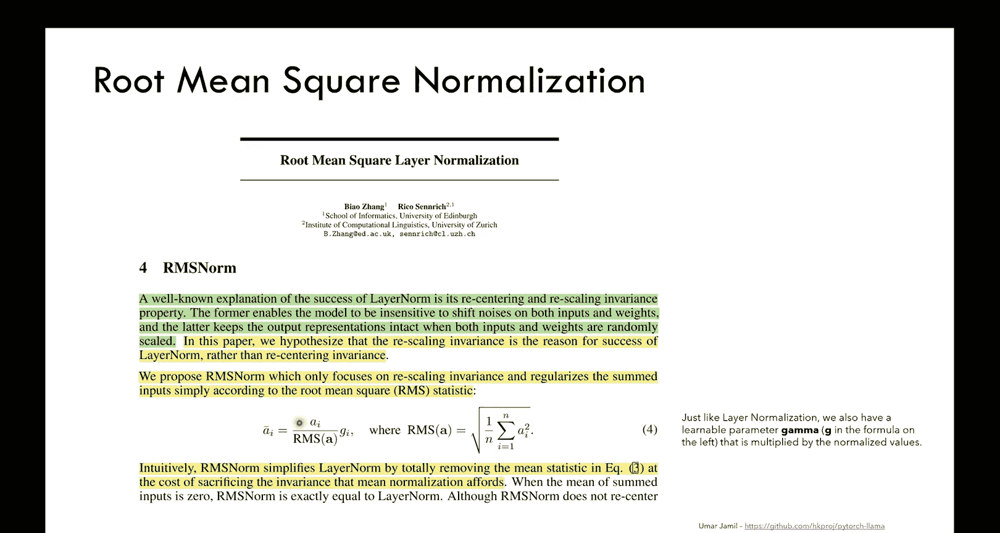

Now that we have also built the RMS S norm， let's go check our next building block。

 which is this encoder block。 So what is the encoder block。 Let's go back to the。

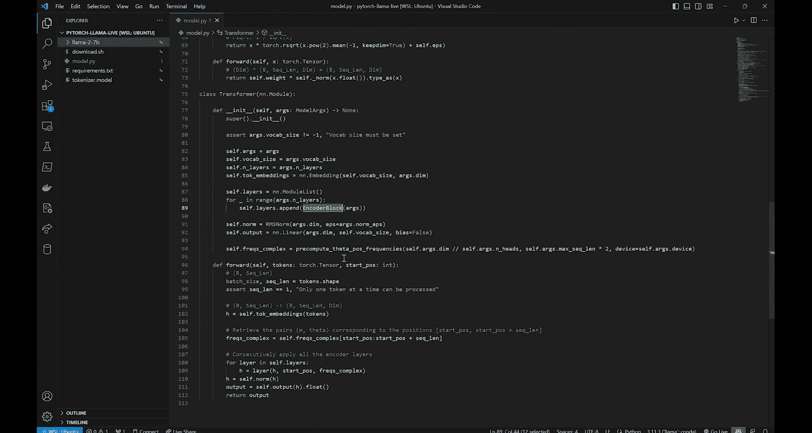

Transformer here we have the encoder block is all this block here that contains a normalization。

 It contains a self attention here。 it contains skip connections。 you can see here。

 another normalization， another skip connection and a feed forward layer here。

I think the easiest one to start with is the。Fil fit forward。 But we can also， we can also okay。

 let's start first build the encoder block， and then we will build the attention。 and finally。

 the fit forward。 So we first build the skeleton of this， then the attention。 and then this。

 let's go。

Here we save some parameters。What is the head dimension is the dimension of the vector divide by the number of heads。

 So 4096 divide by here is the divide by 32 because as we can see。

Here we have the dimension of the vector of the embedding vector is 4096， but we have 32 heads。

 So each head will see 4096 divided by 32 items from each token。Then we have a self attention block。

 I define it， but don't build it right now。 Just define the skeleton。 Then we have the fit forward。

Then we have the normalization before the self attention。So， cell attention。This is our RMS norm。

And this is the motivation behind this argument， norm A P， S。Then we have an after the fit forward。

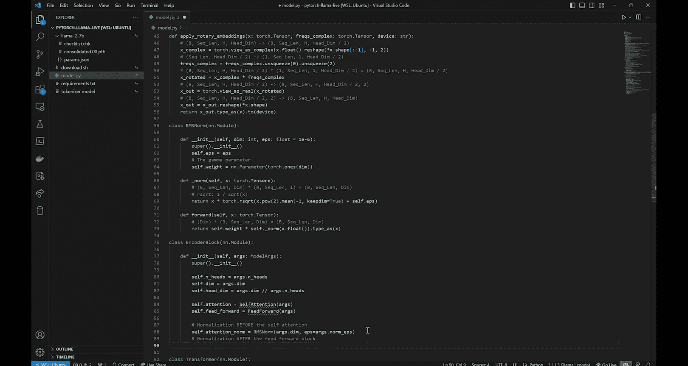

Is it opt。It's after the attention， not after the fit forward。

So before defeat fit forward block。And then we have norm A。O。Okay。Now。

 let's implement the forward method。Start pause indicates the position of the token。

 I capture the same variable number as in the original code。

 It's actually the position of the token because as you remember。

 we will be dealing with only one token at a time。 So start pose indicates the position of the token we are dealing with。

These are the pre computed。Frequencies。So we need to the skip connection and yeah。Okay。

The hidden is equal to x plus。

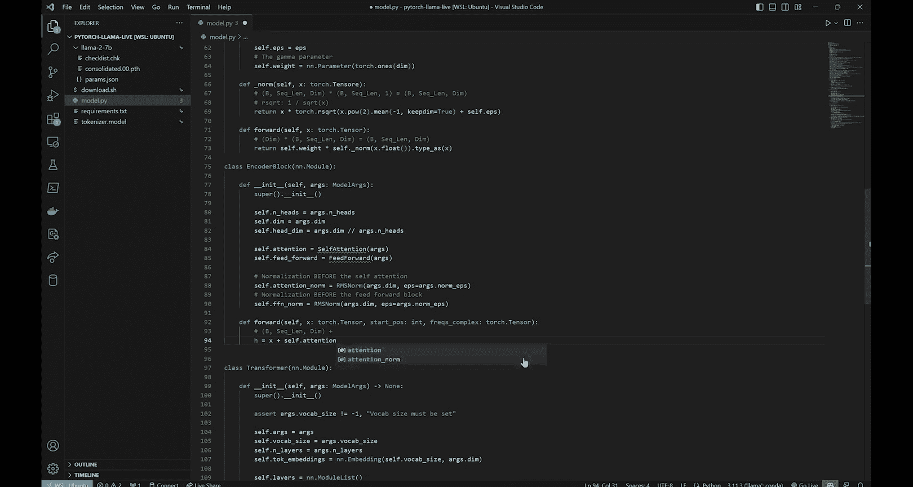

The attention。So we calculated the attention of what of the normalized version of this input。

 So we first apply the normalization。

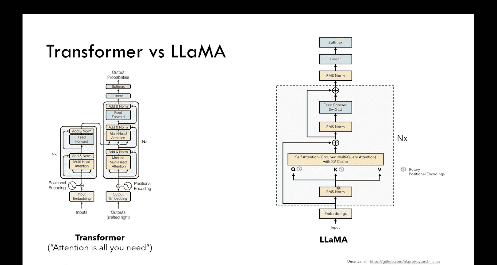

And then we calculate this attention。 And to that attention， we also give the。Frequs because。

 as you remember。The rotary positional encoings are up kind of they come into play when we calculate the attention。

And these operations involve tensors of size b sequence length dimension。

 which is x plus the skip connection。Plus， the output of the attention。B sequence length dimension。

Which results in。B sequence， length dimension。Then we have another。

 we have the application of the fit forward with its skip connection。 So out is equal to H plus。

And before we send it to the fifth forward， as before we applied the normalization。

And this is the output。 Now， we need to build the self attention and the fit forwarder。

 Let's start with the harder part first。 So the self attention。

 because I think it's more interesting before we build the self attention。

 let's review how self attention worked in the original transformer and how it will work here。

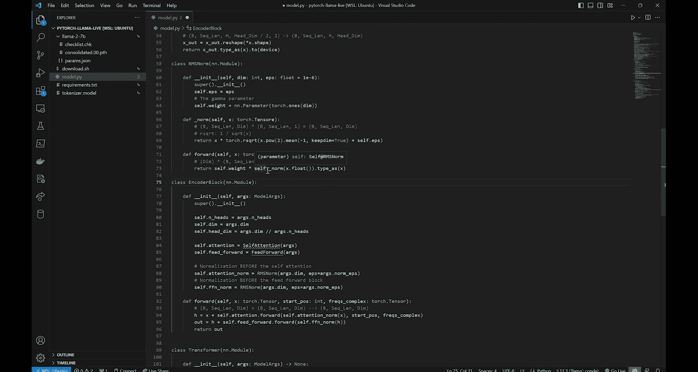

So， okay， this is the original paper from the， the the original paper of the transformer。

 So attention is all you need。 Let's review the self attention mechanism in the original transformer。

 and then we will see how it works in Lama。In the attach is all you need， we have an input。

 which is a sequence by the model， so a sequence of tokens。

 each token modeled by a vector of size D model， we transform them into query key and values。

 which are the same input。We multiply by a w matrix， which is a parameter matrix。

 which results in a new matrix which has this dimension of sequence by D model。😊。

And we then split them into the number of heads that we have such that each vector that represents the token is split into suppose we have four heads。

 so each vector each head will see a part of the embedding of each token。

 so if the token was 512 in size， for example， the embedding vector。

 the first head will watch 128 dimensions of this vector。

 the second head will watch the next 108 dimensions， the next head will watch the next 108 dimension。

 etca， etctera， etcter。We then calculated the attention between all these smaller mattresses。

 so Q K and V。This results in head1， head 2， head 3 and head four。

 we then multi concatetnate them together。We multiply with the W metrics and and this is the output of the multihead attention in this case it's called selfat because it's the same input that acts as query as key and values in case the query comes from one place and the key and the values come from another place in that case it's called crossat and that kind of attention is used in multimod multimodal architectures。

 for example， when you want to combine for example。

 pictures with captions or music with text or you want to translate from one language to another so you have kind of multimodality and you want to connect the two together。

But in our case， we are modeling a language， so self attention is what we need。😊，Actually。

 attention is all we need。 So let's watch the。How it works in Lama。Okay。In Lama。

 we need to talk about a lot of things before we build the self attention。

 We need to review how the self attention works in Lama， how is the K， what is the KV cache。

 what is the grouped query attention and actually how the inference works。

 So we need to review all this stuff before we proceed with the code。

 otherwise it will be very hard to follow the code。So。Let's first talk， talk about the inferencing。

Given suppose we have a model。 So that has been trained on this particular line。

 So we are the line is love that can quickly seize the gentle heart。

And this is a line from Danteliggiri。 you can see this from the A Paso from the from the inferno 5canto。

 it's not the first line， actually， but this is Paulo Francesca， by the way。

And we will we have a model that has been trained on this line love that can quickly seize the gentle heart。

Now a model that has been trained on this particular line using the next token prediction should have an input that is built in this way so the start of sentence and then the tokens that represented the sentence。

 then the target should be the same sentence with the end of sentence because the transformer is a sequence to sequence model it maps one input sequence into an output sequence of the same size。

This means that the first token will be mapped to the first token of the output。

 The second token of the input will be mapped to the second out token of the output。

 the third token of the。Input will be mapped to the third token of the output。

 but it's not a one to one correspondence because of the mask of the causal mask that we apply during the self attention。

To predict this particular token can， for example， the model doesn' not only watch the same token in the input so that but also watch all the previous tokens。

So the model to predict can needs to access not only dead。

 but also as was love dead and the self attention mechanism with its causal mask will access all the previous tokens。

 but not the next ones。This means that when we do the inferencing， we should do it like this。

 we start with the start of sentence and the model will output the first word to output the next token we need to give the previous output to token as input also。

So we always append the last token of the output to the input to predict the successive tokens。

 So for example， to output that we need to give S S love to output the next token。

 we take this that and we put it in the input so that we can gather the next word。

To output the next token， we need to append the previous output to the input to get the new output quickly。

Now， when we do this job， the model is actually we are giving this input which is a sequence of four tokens and the model will produce a sequence of four tokens as output them。

But this is not really convenient when we do the inferencing because the model is doing a lot of dot products that are not necessary that have already been built。

 for example， what I want to say is that in order to get this last token quickly，We are。

 We need to access all the previous context here， but we don't need to output love that can。

 because we don't care。 We already have these tokens。 We only care about the last one。 However。

 we can just tell them the transformer model to not output the previous tokens。

 We need to change the calculations in such a way that we only receive at the output of the transformer only one token so that all the other tokens are not even calculated。

 and this will make the inferencefercing fast。 And this is the job of the Kv cache。

 Let me show you with some diagrams。😊，As you can see at every step of the token。

 we are only interested in the last token output by the model because we already have the previous ones。

 However， the model needs to access all the previous tokens to decide which token to output。

 because the model needs to access all the prompt to to output to the next token。

 and we do this using the Kv cache to reduce the amount of computation。

 So let's do with some examples。 S we do the same job that we did before。

 So the inferencing of that model。😊，We give the first token。 So the S O S， this will be multily。

 This is the self attention。 So it will be multiplied by the transpose of the keys。

 This will produce this matrix here， which is one by one。 So you can check the dimensions，1 by 4096。

 multiplied by。4006 by one will output a metric that is1 by one。

This will be multiplied by the values， and this will result in the output token。

 So this is the inferencing step1 in which the only token we give is the start of sentence。

 then we take this token output the token at the output we this is actually not the token because this has to be map to the linear layer。

 etc cetera， etc cea， but suppose this is already the token。And then。We append it to the input。

 so it becomes the second input of of the input。 So this is S O S。

 and this is the last output we multiplied by the transpose of the keys。 we get these metrics here。

 we multiplied by the values and we get the two output tokens as output。

Because it's a sequence to sequence model。Then we append the output of the previous as the input and we multiplied by the transpose of the keys。

 We get these metrics here。 we then multiplied by the Vs， and we get three tokens as output。

 We then append the output of the last one at the Q， we multiplied by the transpose of the keys。

 we get this metrics here。 we multiplied by the V and we get these sequence as output。

 but we see some problems and the one that I told you before we are doing a lot of computations that we don't need。

First of all。This dot products that we are computing here because this is the self attention。

 so Q multiplied by the transpose of the keys will result in a lot of dot products that result in this matrix。

😊，These dot products that you see here highlighted in Violet have been already computed at the previous steps because we are at the step number4。

 but these have already been computed as previous plus not only they have been computed already。

 we don't need them because we only are interested in what the latest token that we added as the input so to the prompt。

What is this tokens dot product with all the other tokens。

 Because this tokens dot product with all the other tokens will result in the output of the last token。

 the one we are interested in。 So if there is a way to not do all these computations again and also to not output all the previous tokens that we actually don't need because we always access the last latest token。

 Yes， we just use the K B cache。 in the K B cache。What we do is we。Always take the last token。

 and we use it as input。 so we don't append it to the query。 We just use it directly as query。

But because the query needs to access all the previous tokens， we keep the keys and the values。

 so we append the last input to the keys and the values， but we don't append it to the queries。

 we replace it。Entirely， with the queries。Let's see with an example。For example。

 this is our first step of inferencing。 So this is just the start of sentence token So we just have one token。

 we multipplied it by the transpo of the keys。 It will result in one by one。

 so we only have one token as output。This token we in the previous case was appended to the queries。

 so it became in the next step。 it became a matrix of dimension 2 by 4096， but in our case。

 at the time step 2， we don't append it。 We only append it to the end of the keys and the values。

And we only keep the queries here。If we do this product again now we will see that this row here is the only one we are interested in。

 so the one that was not vit in the previous diagram and if we do this dot product it will result in only the last talk and the one we are interested in and every time we keep doing this job。

We will see the key and the values grow。😊，The queries will be always the last token。

 but the number of dot products that we are doing during the inferencing is much less。

 We don't need to do all those dot products that we did before。 So compare this is time step 4。

This is four dot products。 compare it with the previous time step 4。

 So here here we have 16 dot products。 So we reduce it by a factor of4。And so it's。

 that's why it's much faster to do inferencing with the KV cache。And let's review again。 So here。

 as you can see， the matrix K O K。 and every time we add the to into the Q grows， right。

 but all these previous values with the KV cache， we are not computing it again。

 So that's why this is much faster。 We only compute the one we need。😊。

And we only get one token as output。 If this mechanism is not clear。

 please watch my previous video about La in which I describe it in much more detail and also with much more visualizations。

😊，Now let's go build this。There is another thing actually I want to show you before we go to build it。

 which is the grouped query attention。😊，This one here， so。

I call it group multi query attention because it's actually the successive version of the multi query attention。

 It's something in between the multi head attention and the multi query attention。 But actually。

 the real name is grouped query attention in the paper。 Also， it's called grouped query attention。

Now， the reason we introduced the group to query attention is first of all。

 we had the multi query attention， the multi query attention basically were introduced to solve one problem。

 that is。We。First， had the multi head attention。 We introduced the KV cache with the multi head attention。

 Just the one we just saw。 The problem was that with the multi head attention。

 we were doing too many dot products with the multi head with the Kvc。 We do less dot products。

 This resulted in a lot less computation。 but it also resulted in a new bottleneck for the algorithm。

 So the bottleneck was not longer the number of computations。

 but how many memory access we were performing to access these sensorsors， because in the GPU。

The GPU is much faster at doing computations that it is at moving tensors around in its memory。

 So when we are optim an algorithm， we no long， we not only need to consider how many operations we are doing。

 but also how many tensors we are accessing。 And where are these tensors located。

 So it's not a good idea to keep copying tensor from one place to another。

 because the GPU is much slower at copying memory from one place to another than it is at computing operations。

😊。

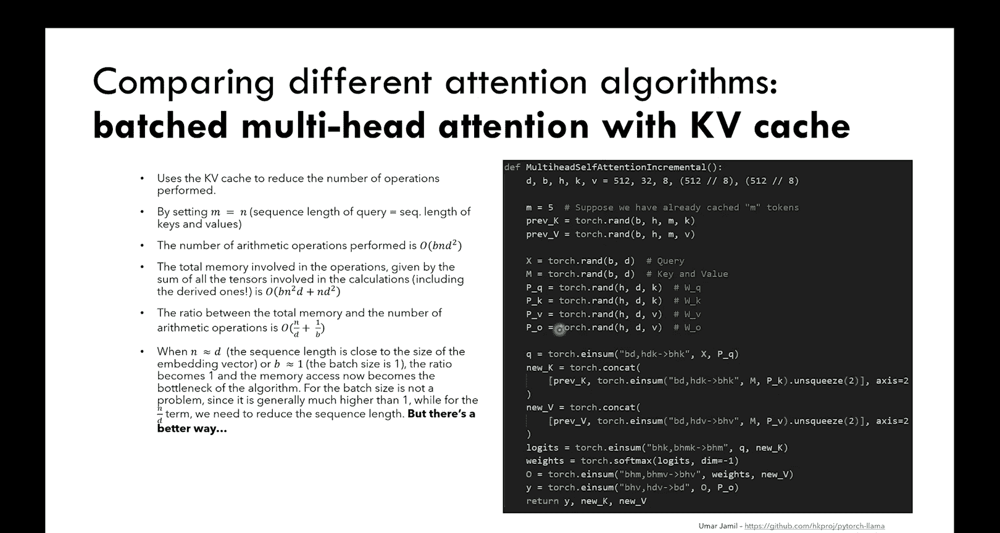

And this is can be visualized on the data sheet of the GPU。 You can see， for example。

 that computing operations is a 19。5 the of floating point operations per second。

 And while the memory bandwidth。 So how fast it can move memory is 40 times slower。😊，So it's we are。

 we， we need to optimize algorithms also for。Managing how many tensilors we access and how we move them around the memory。

 This is why we added the we introduced the multi query attention。

 the multi query attention basically means that we have many heads for the queries。

 But we only have one head for the key and the values。

 This resulted in a new algorithm that was much more efficient than the algorithm just with the KV cache because the KV cache。

 Yeah， it reduced the number of dot products， but it had a new bottle like。

 That is the number of memory access with this algorithm。

 We also may optimize the memory access but we lose some quality because we are reducing the number of heads for the key and the values。

 So we are reducing the number of parameters in the model。😊，And this way， the model。

 we because we are reducing the number of parameters involved in the attention mechanism， of course。

 the model will degrade in quality。And but we saw that practically。

 it degraded the quality not so much。 So actually， the quality was not bad。

 And this was in the this paper。 So they showed that the quality degradation was very little。

 So from 26。7 to 26。5。 But the performance gain were very important。 We went from。

48 microsecond per token to5 microsecond or 6 microsecond per token。 So a lot faster。No。

Let's introduce the grouped query attention or the group multi query attention。

In the multiied attention， we had。N N heads for the queries and heads for the keys and N heads for the values in the。

Multi query attention， we have n heads for the keys， but only one head for the keys and the values。

In the group to multi query attention or the group query attention。😊，We have。

Less number of heads for the keys and values。 So every two head for the queries， in this case。

 for example， we will have one head for the keys and the values。

And this is a good balance between quality and speeds because of course the fastest one is this one because you have less heads。

😊，But of course the better the best one from a quality point of view is this one。

 but this is a good compromise between the two so you don't lose quality。

 but at the same time you also optimize the speed compared to the multi head attention。

So now that we have reviewed all this concept， let's go build it。 So please again。

 if you didn' not understand very much in detail， this part is better。

 You go to review my other video about llma in which I explained all this part much better。

 Otherwise， if I have to repeat the same font of the previous video。

 this would be in the current video would become 10 hours。

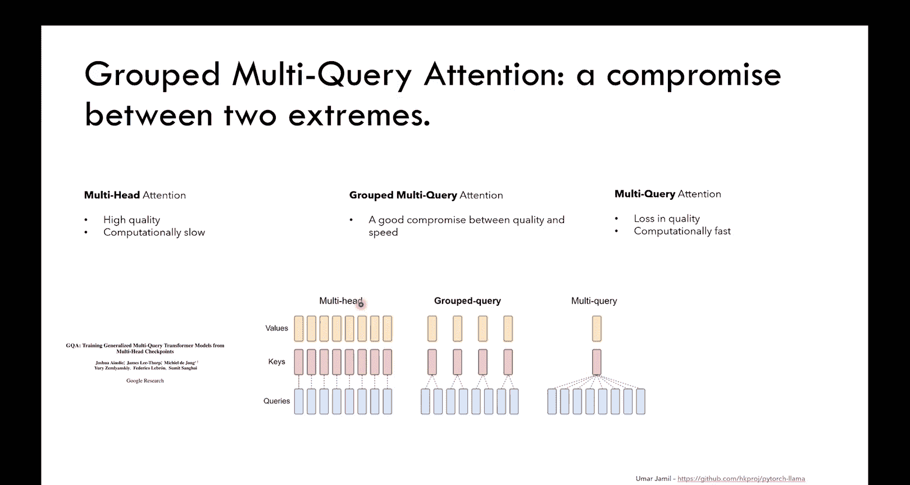

So let's go build it。😊，Okay。We need to save some things compared to the original code from Lama from Facebook from Meta。

 I actually remove the parallelization。 First of all， because I cannot test it。

 I don't have multiple GP PU S。 I don't have a very powerful GPU， actually。

And so I simplify the code a lot。And KV heads indicates the number of heads for the the keys and the values。

 because they can be different than the number of heads for the queries。

And this is why we also have an heads Q。This value here is represents the ratio between the number of heads for the query and the number of heads for the keys and the values。

 we will use it later when we calculate the attention。So let me write some comments。 So this is。

And then we have a cell dot。😔，Had the dimension， which is。

This indicates the the part of the embedding that will be visualized by each head because as you know。

 the embedding is split into multiple heads， so each head will watch the full sentence。

 but a part of the embedding of each word。Then we have the W mattresses， W， Q， W， K， W V and W， O。

 just like in the normal P transformer。And they don't have any bias。Oops， why did I write true。

And then we create a cache。 We will see later how it's used。 I just now created。

One for the keys and one be the for the values。Okay， finally， we implement the forward method。

 which is the salient part here， so。Cll X is。To simplify the code for you。

 I will write for each operation， I will write the dimensions of the tensor that is involved in the operation and also the resulting tensor from each operation。

This start position indicates just the position of the token inside of the sentence。

And these are the frequencies that we have computed。O。Let's start by extracting。size。B。😔。

Sequence length。And dimension。By the sequence length， we know it's one。So。代满兄弟。

Then what we do is we multiply， just like in the original transformer we take the query。

 the key and values we multiply by then the W Q， W Q and W Q matrix。 So X Q is equal to self dot W Q。

This means going from B1 dimension to the。关。Had dimension。

 So the number of heads for the query multiplied by the dimension， because we are。In this case。

 we are this is actually equal to dim。So the number of heads multiply the head dimension。

 as you can see from here。So we are not changing the the shape。In this case， however。

 we may change the shape of the。Because the number of heads for the KV may be smaller than Q。

So these metrics may have as last dimension that is smaller than X Q。And the same is for X B。So here。

 let me write some comment， apply。The W， Q， W， K and W V Mat。To queries， keys and values。

Which are the same because it's a self attention。 So the query key and value is always x。

We then divide them into their corresponding number of heads。So X Q is equal to X Q dot view。B size。

 we keep it like this。Sequence length is one。So， we divide。B。1 H Q multiplied by head dimension into。

B1 head。H Q。And had the dimension。So， we divide them into。The edge heads。For the query。

And then we do the same for the key and the values。Anything for the。No。We have multiplied， okay。

 we have the X input。 We multiplied by the W Q， W Q and W Q， Y。 Let's go check the code here。

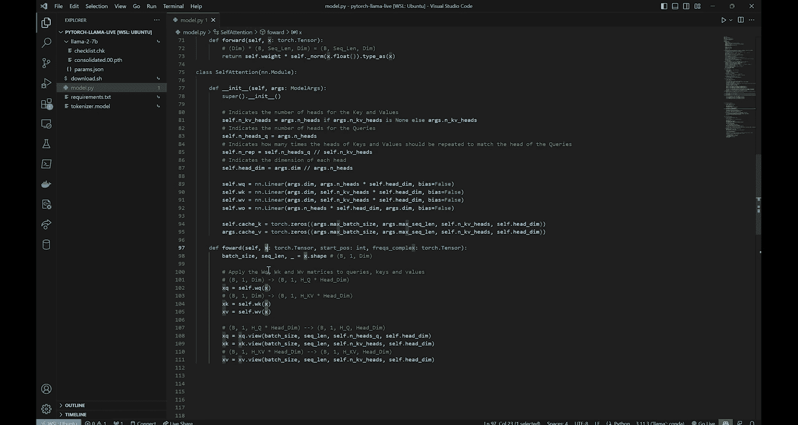

As you remember， we take the input we multiplied by W Q， W K and W V。

 This will result in these mattresses here。 We then divide them into the number of heads。

 But in the case of cred queryation， they may be different。

 So this may be four heads and this may be two heads， and this may be two heads。

 So they are not the same number。The next thing we are going to do。 And this is present in the。Here。

We need to apply the rotary positional encodings to the query and the keys， but not the values。

 Let's do it。

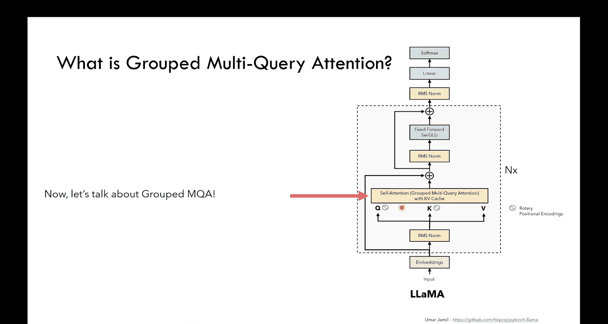

And this is how we applied it。Pional encodings。This will not change the size of the vectors。

You can see that here because at the end we have the same shape as the original input vector。Okay。No。

Now comes the KV cache part。 Let's watch again， these lights。

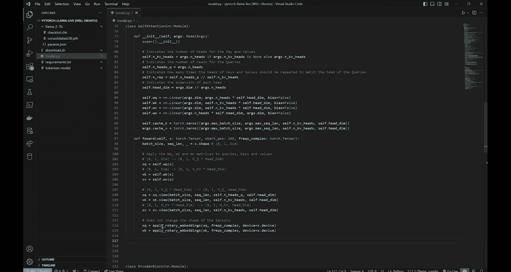

As we can see here， every time we have an input output token。 So， for example， the attention to here。

 it supposes the token number two。 we append it at the end of the keys and the values。

 and this is exactly what we are going to do。

So what we do here we keep a cache of the keys and the values because they are will be used for the next iterations。

 because at every iteration in x we only receive the latest token that was output from the previous iteration we appended to the k and the V and then we compute the attention between all the K。

 all the V， but only the single token as query。let's do it。 So first， replace。

This is the position of the torken。This should be one because sequence length is actually one。

 always。But I try to keep this code the same as the one from Lama。From meta up。This is。Basically。

 it means that if we have a one token from many batches， I mean， we have one token for every batch。

 we， we replace them for for for because we can use， we can send the we can process multiple batches。

 So we replace the entry for this particular position for every batch。Okay。

Now we replace it only for this position here， but when we compute the attention using the KV cache。

 that's cool watch again。

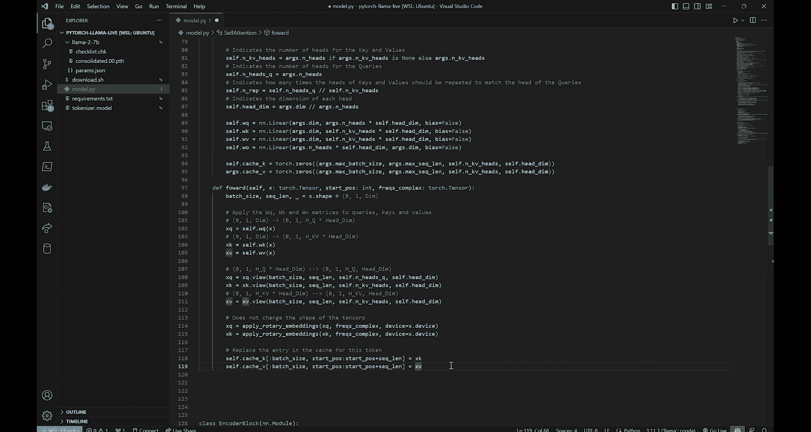

We need to calculate the product， the dot product between the only one token。

 but all the keys and then we will need to multiply with all the values and this will result in only one token as output so we need to extract from this cache。

 all the tokens as keys and all the tokens as values up to this position here。

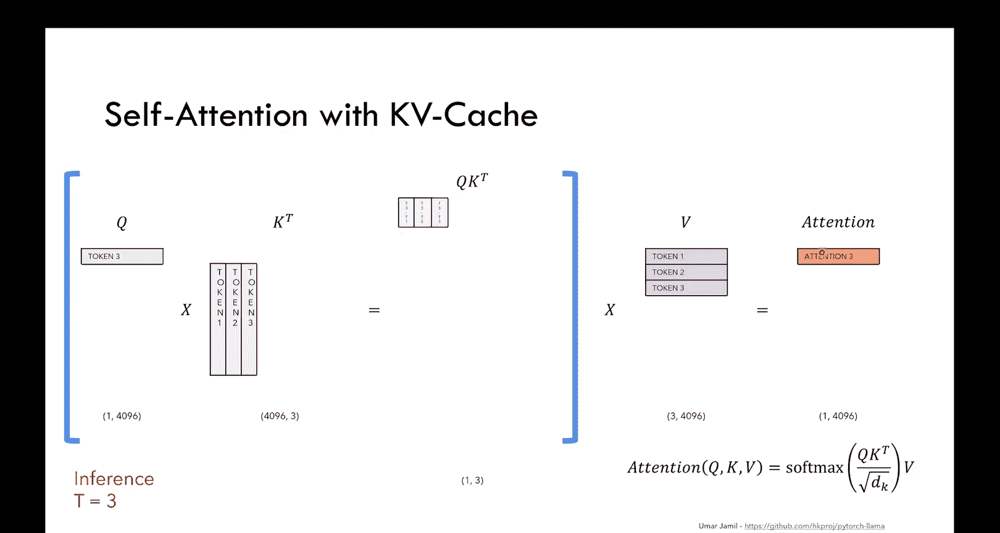

The one we are passing。P is equal to。All， so starting from 0 up to。Start pose plus sequence length。

And the values。嗯。Lnk。No。Now， what happens is that let me write also some。

Sizes here we have B sequence length。😔，Of K and V， because the sequence length of the input is always one。

 We know that。But the sequence length of the cache means all the。All the cached case。

 keys and values， which are up to start position。 So this sequence length is actually equal to start position。

And actually， start position plus  one。My next dimension is the number of heads for the K And V。

 and then the dimension of each head。Now， the number of heads for the keys and values may not correspond to the number of heads of the queries。

 So how do we compute in the original code from Lama， what they did was basically。

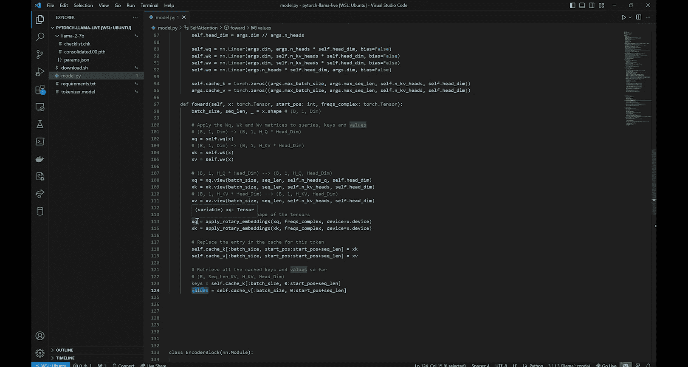

Let's go， check the code for here。从。In the grouped query attention we have that the number of heads for the keys and the values is not the same as the number of heads for the queries So there are two ways one is to make an optimized algorithm that actually takes this into consideration the other ways is to just copy this single head into multiple into multiple heads such that we arrive to this situation here and then we just compute it just like a multihead this is not optimized solution but is the one used by the code by Lama and it's also the one I will be sticking to because I don't have any way of testing other codes because the only model that that supports the grouped query attention is the biggest one from Lama so with the 70 billion parameters but my computer will never be able to load that model and so I don't have any way of testing it so that's why I also didn't optimize the code for actually computing the grouped query attention but I will just replicate this single head。

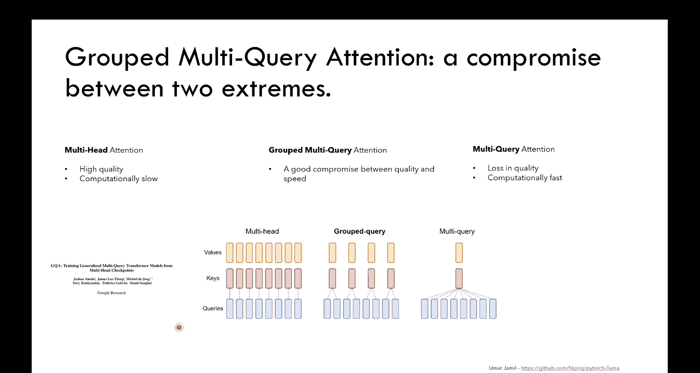

Multiple times such that we arrived to this situation here。So， I will also repeat。Okay。

 this will function here。 Re K V， just repeats the the， the keys。

Until we reach the number of for this number of times。 So and wrap。

 what is this is the ratio of the number of heads of the queries by the number of heads of the keys。

 So if the number of heads of the keys is。4 and the number of heads for the queries is 8。

 need means we need to repeat twice each head。So let's build also this method since we are here。Okay。

 we don't need to repeat it。 So there is only one repetition。 We just return the basic。

T or otherwise we repeated n times。So the first thing we do is we add a new dimension。

And which you can do like this。But sequence can length。Number of heads。Then nothing。

 And then this will add this new dimension in this position。Then， we expand it。And then， we shape it。

Basically， we introduce a new dimension。 We repeat this all the sequence this dimension number of times。

 So and wrap along this dimension and wrap number of times， and then we just flatten it。

So we remove remove again this dimension。And this is how we repeat this。The keys and also the values。

 now we can repeat。Okay， now we just proceed just like with the standard the。

The standard calculation for the multi head attention that is we first move the head dimension before the sequence dimension。

 because each head will watch all the sequence， but a part of the embedding of each token。So。

 what we are doing is。Bch1， because one is the sequence length of the queries。

The number of heads of the queries。And had the dimension。Bch。Head sequence length and head dimension。

We do the same for the keys and the values。Then we do the standard formula for queries multiplied by the transpo of the keys divided by the square root of the dimension of each head。

So x Q。 So the  query is multiplied by the transpose。Of the keys。

All of this divide by the square root of the。Dimension of each head。Then we apply the softm。

And this one will result in a shape of。Where is one， add dimension。Multiplied by。KB。

The softm doesn't change the dimension。Then we multipied by the values。So， the formalize。

Quries multiplied by the transpose of the keys， and the output we then we do the softm。

 Then the output is multiplied by the values。So， this will result in。嗯，B。And then we。

Multiped by the output matrix。 But before we remove all the heads。 So we concatenate again。

 this is what we did also。

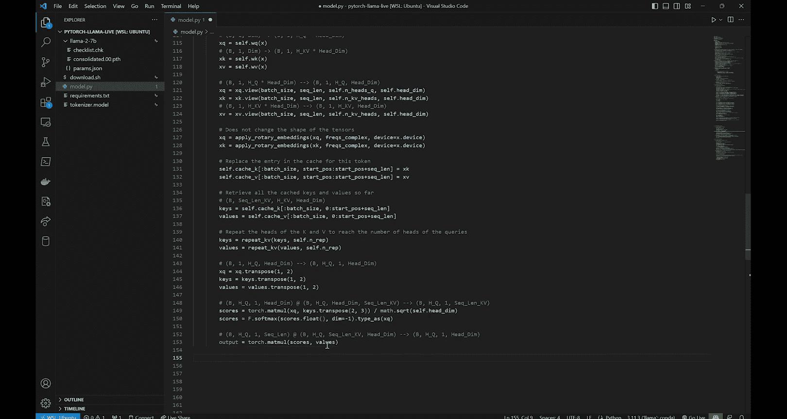

Here， so here we take the output of all the heads。 Then we concatetnate them together。

 and then we multiply it by the W O matrix。

And this will result in a。be王 team。You want dim。 This one is。BHQ。1 head。Dimension into。B1 hq。

Add dimension。Because of the transposition。And then we。Remove the dimension for the head。 So B1。戴没说。

And this is our self attention with K V cache。 So let's review what we have done。

Here I think I made some mistake because。Self。That's why it's colour differently。 Okay。

 let's review what we have done。When we calculate the self attention because we are inferencing。

 so this code will only work for inferencing， we can use the KB cache。

 the KVc allow us to save a number of dot products that we don't need。Why。

 because every time we are comp in the original transformer。

 we were computing a lot of those products。For tokens， output tokens that we don't care about。

In this case， we simplified the mechanism to output only one token。 as you can see。

 the output of the self attention is B。 so batch one token only with its embedding size。

 which is 4096。So we are only out of outputting one token， not many tokens。 We input only one token。

 and we output one token。AndBut because we need to relate that single token with all the previous tokens we keep a cache of the keys and the values every time we have a token we put it into the cache like here。

 then we retrieve all the previous save the tokens from the cache and then we calculate the attention between all the previous tokens so the keys and the values and the single token as input off as queries。

The output is the only token we care about。 This is the idea behind KB cache and the grouped query attention is the fact that we have a different number of heads for the keys and values。

 but in our case we do have we do have a number different number of heads for the keys and queries。

But we just to repeat the one that we are missing to calculate the attention。

 So the calculate the is calculated just like the previous transformer。

 like a normal multi head attention。But by repeating the missing keys and values heads。

 instead of actually optimizing the algorithm， this has also been done by metata in its official implementation。

 and I also did it here。The biggest reason is because I cannot test any other modification。

 I cannot test the the。Another algorithm that actually tries to optimize this calculation。

 So if I find another implementation that I know is working， I will share it with you guys。

 Otherwise， I will try to run it on collab and see if I can come up with a better solution。

 But for now， we just repeat it。 But at least we got to the concept of the group query attention。

 That is we have less number of heads。 And it's something that is in between between the multi query attention and the multi head attention that doesn't sacrifice quality。

 but improve speed。Now， the last thing that we didn't implement is the fit forward layer for the fit layer forward layer。

 the only thing that we need to review is the Sw glue activation function that we can see here。

And this activation function has been changed compared to the previous activation function used in the vanilla transformer。

 which was the yellow function。 And the only reason we replaced it is because this one performs better。

 And as I show in my previous video， there is no I would say is we cannot prove why it works better because in such a big model with 70 billion parameter。

 it's difficult to explain why something a little modification works better than another。

 We just know that some things that work better in practice for that kind of model or for that kind of application。

 And this is actually not my opinion， this is actually written in the paper。

 So as you can see here in the。Conclusion of the paper。

 they say that we offer no explanation as to why these architectures seem to work。

 We attribute their success as all else to divine benevolence。

 So it means that when you have such a big model and you change a little thing and it works better。

 you cannot always come up with a pattern to describe why it is working better。

 You just take it for granted that it works better and you use it because it works better in practice。

So to implement this regularig function， we need to apply the this is the formula from the original transformer so the。

We have two mattresses here。 So this is thelu function of the first linear layer and the second linear layer in the Lama。

 We use the ziglu function， which involves the three mattresses here because they incremented the number of parameters here。

 and also they were experimenting with the。G to query attention。

The architecture of Lama has has some more parameters to adjust the number of parameters of this fit forward layer。

 So as it respects some constraints。 and this is actually used in deep learning research whenever we modify the transformable model and this reduces the number of parameters or increases the number of parameters。

 the first thing the researchers do they adjust the numbers of parameters of the feed forward layer so that when they make comparison between two models。

 they have the same number of parameters so。

I will also， of course， use the same structure because otherwise I cannot load the weight from the pretrain model。

So， let's do it。The hidden size is calculated like this。 So four times the dimension。

 then they do the two third of this dimension。And then they also have a multiplier。

 if it's specified。Then they say round the hidden os。By using this modification。

 so to culating the hidden dimension like this。It may not be the case that this hidden dimension is a multiple of the this number here。

 so maybe they want the the size of the hidden layer to be a multiple of 256 part by calculating it like this。

 it may not be。 So what they do is they make it round up to the next multiple of the multiple of parameter。

This is a way to do it。Okay， let me give you an example。

 It's easy to show with an example than to actually write it。 So suppose you have a。

The hidden size is equal to， let's say 7， but you want it to multiple of is equal to 5。

 So you want the hidden size to be a multiple of five。 So how do we do。Well， what we do is basically。

 we do。Hidden plus 4 in this case。 So we do 7 plus 4， which is 11。We divide it by5。

 which is equal to 2。And then we multiply these two by 5。 So it will result in 2 by 5 is equal to 10。

 It will result in the first multiple that is bigger or equal to this number here。That's the idea。

Then we have these mattresses for this Wiglu function， it's very easy。

We just follow the formula for this regularig function， which is。Here， so W switch of what is wish。

The switchish is the slu function because the switch with the beta is equal to 1 is actually the slu function which has this graph here。

And then we multiply it with another parameter matrix here。

 and then we apply to another linear layer W2。 So in total， we have three metricsric W1。

 we call it W 2 and W 3。

And they don't have bias。Oops。This is the hidden dimension。Okay。

 now we will implement the forward method。The first thing we do is we calculated this wish function。

Then we calculate， so we are calculating， let me show you。

We are calculating this one xw Swish of xw， then we calculated this X v。

Then we multiply them together， just like in the formula。Sish multily by x。B。

 and then we apply the last M linear layer， which is W 2。

B results in a multiplication by the W2 matrix， by the way。And then we turn x。

And this is the fifth forward layer。Now that we have all the building blocks。

We need to go to the inferencing。 Let's start building the inference code， so。Inference dot pi。

 The first code。 we will be first we will build the code to load the model。

 and then we will build the code to influence the the model。

 I will actually also show all the inference techniques that are out there and which one we will apply and why。

So let's start by building first the code for loading the model so。Let we import the stuff we need。

We need the Json to load the parameters， and then we need the。Sentence piece to load the tokenizer。

 because the sentence piece is the tokenizer that had been used。 and it's a library from Google。Okay。

Our model import， model arcs and the transformer class。We define a class Lama。Which is our model。

Takes the transformer， a tokenizer。Which is a sentence based processor。And then， the model arguments。

Oops。As。And is it like with model orx。 Yeah， model。Or。OK。Now we built a static method， static method。

 and we call it built， just like in the original code from Lama。In which we pass the directory。

 which where the checkpoints are saved in this case， the director name is Lama 27 B in my case。

But it depends on which size of the model you have downloaded。Then the tokenizer path， which is the。

 the path to the tokenizer。 This is the file of the tokenizer that I downloaded。

Then we have a load model。Play max sequence length。Max patch size。And we have device。Okay。

 this is only for displaying how much time it takes to load the model。

If we are want to load the model， we will also。Low the checkpoints， so。

Checkpoints is equal to sorted。😔，The global method allow you to find all the files that match this。

Filter。Okay， see that we are loading。Checkpoint this one。And then we actually load it。

And we save it on the CPU。We can show how much time it takes to load the model I in my computer usually takes our。

Ill 10 to 20 seconds。Then previous time we we write it。

 So we can also show how much time it takes to。Load all the parameters of the model。

 Then we load the parameters。 So the Json file。We read it open it has read only file。And。Okay。

 then we build the arguments。Maximum sequence length is the one we have specified。

And then we have the max batch size is the max batch size。The device is the one we have specified。

 and then all the parameters loaded from the Json file。Then we loaded the tokenizer。Then we。

 by using the tokenizer， we can populate the vocab size。Of the model as。

The vocabulary size is actually not the number of tokens inside the tokenizer。Now。

 this is also the default tensor。For。For Pythtorch。

 So whenever Pythtorch wants to create a newtensor， what kind of type it should use。

 it's defined This is by meta。 So they want for kuda to use this type that I show you here。

Defa tensor type， torch dot couda half tensor。This changes the precision that the tensor supports。

 so how much space it occupies in memory。Otherwise。Then we created the actual model。Okay。

 when we load a checkpoint， actually the checkpoint is a list of key and values。

 each key is a matrix in the model， so the weight for example。

 of a linear layer or the bias of a linear layer or something like this。

And the names that we have using used for the variable names and the mattresses here， for example。

 WQWK match actually the name that are present in the checkpoint here except for one name so to make sure that I have used the right names。

I will load the。😔，The checkpoint with the strict equal through strict equal true means that if there is at least one name that doesn't match。

 it will throw an error。So， if load model。Mo the dot load state died。Sttripped equal true。

 So if there is at least one name in the loaded file that doesn't match the the name in the classes that I have created here in the model。

 it will throw an error， but I know that there is one key that we don't need which are the frequencies for the rotary positional embeddings。

 which we actually are computing every time we create the tensor， so we are creating them。

Here by using this function。 So we don't need to load them from the model so we can remove it from the model from the checkpoint。

 So because the checkpoint is a dictionary， we can just remove this。It's called rope dot frex。

And then we can print how much time it took to load the model。And then there's lama。Model tokenizer。

😔，And model as。Now， before we proceed further， let me test if the model can be successfully loaded。

So let's do it if name。First， I will set the manual C D to 0。Later， we use it for inferencing。

Then I don't want to use kuda because my， my GPU doesn't support it。

 So I say allow kudi called4 and device is equal to。Storage dot， Kuda dot is available。

And allow kuda else CPU。 Next time， if you want to load the model with kuda。

 just set this per variable to true。 But in my case。

 I will always leave it to false because I don't want to load kuda。

So you can length I set it to 1024。Max spec size， let's see。3。And device。To rise。No。😔，Let's run it。

 and hopefully。It will not。Cush。Wow， already。Not densesorれ， but tensor。So。Let's run it again。

There is always a lot of typos when you write code。Another problem here。😔，Not storage， but。Tsor。

 it should be。陈肃。B floats，16 tensor， yeah。Let's try again。Hidden。😔，Hid what hidden dimension。

 of course。And let's try again。Yeah， all okay， okay， wonderful。

It means that at least it's doing something and it's not crushing， which is always a good news。

So our next step is actually to build the inferencing code， so。What we want to do is actually。

 we want to be able to give some prompts to the model and then check the output for this prompt。

 So let's define some prompts。We will define some prompts here。 And here we pass， for example。

 the size of the prompts。And then， we want to。You know， we want to inference。Inference the model， so。

Before we start inferencing the model， we need to build the code for infferencing the model because we need to find a strategy for selecting the next token。

 etc cetera， etc ceter。 So let's review how the inferencing works and what are the various strategies for inferluencing。

Okay， so when we are dealing with the next token prediction task， when we want to inference。

 we usually give the prompt and then we want to predict the tokens。

 but we give one token at a time and every time we give one more token the model will output one more token as output and we only keep the last one but with the KV cache actually we always give one token at a time。

 the KV cache will keep the cache for the keys and the values and we only output one token。Okay。

 the point is， we need to find strategies for selecting this token among all the tokens that we have in the vocabulary。

 And this is the job of the logicits and the Soax。 So let's review how they work。 Now， imagine。

I give you the following task as human。 So complete the following sentence。 I think nuclear power is。

 and then you have to choose a word。 Now， you， as human。

 may have thought of the possible next tokens， which may be clean， dangerous， cheap， expensiveansive。

 safe， difficult or something else。The choice of the next token in your head depends on your education。

 on your experience with nuclear power， and your opinion on the matter。

Large low language models also face the same problem。 When we give them a prompt。

 Then the model has to choose the next ver。 The model。

 the uncertainty of the choice derives entirely from their training process and the strategy that we use to select the next token。

There are many strategies。 for example， we have the gridy strategy。

 the beam search temperature is a parameter， random sampling top K。

 top B in this video we will review all these strategies and how they work。

 But first we need to understand what are the logics。Let's look at the transformer model from Lama。

 so。The output of the self attention is a sequence in the case of the K V cache is only one token。

 We then run it through a linear layer。 So after normalization， we run it through a linear layer。

 the linear layer will transform the embedding that is output from the self attention here into a。

Into a list of numbers that represent the kind of the probability， they are not really a probability。

 but we can think of it as a probability。Of that token in the vocabulary。

 So if our vocabulary is om made off， let's say 100 tokens。

 this linear layer will output 100 numbers。 And after we apply the softm。

 this 100 numbers will become the probability of that token being the next more probable token for the prompt given to the input。

 So given an input， a prompt， the model comes up with a probabilities。

 probabilities for which token to choose next and。So what is the job of the linear layer and what is the job of the softmax。

 The linear layer converts the embedding of a token into a list of numbers such that each numbers represent a score that later with the softm represented the probability of that particular token in the vocabulary。

The softmax job is just to scale the logics in such a way that they sum up to one。

 so that's why we can we can talk about probabilities with the softm but not with the logics。😊。

So the output of the softm is just a probability distribution over all the words in the vocabulary。

 That is each word in the vocabulary will have a probability associated with it。

 But now given these words each one with their probability。

 how do we choose the next token there are many strategies？😊，The easiest one is the greedy。

 The greedity strategy basically says we just select the token with the maximum probability。

 So imagine we are inferencing。 and the time step is the first time step in the gridity strategy。😊。

The prompt is Celia。 you're breaking my heart。 You are shaking my。 Okay。

 this is a line from a very famous song from Simon Simon Al G K Funungel。

 And the next word for those who know。😊，Will be confidence。 So Cellia， you're breaking my heart。

 you are shaking my confidence。Suppose the so output of the softm is this distribution here。

 So we have 40% probability for this word，20% for this word，15% for this word and 10% for this word。

With the greedity strategy， we always choose the token with the maximum probability。

 Then we appended to the input。 So the input as the next inference step becomes Cellia。

 youre breaking my heart。 you are shaking my confidence and then the model has to come up with the next word。

 which if you know this song is daily。😊，If we use the gridity strategy。

 we select the one with the highest probability。 So in this case case it's daily and it's also the correct one。

 So this is how the gridy strategy works at every step we choose the token with the maximum probability which is then appended to the input to generated the next token and so on。

 but if the initial token happens to be the wrong one。

 so not only the initial but the initial two three tokens happen to be the long wrong ones。

 it's very likely that all the next tokens will also be wrong because we are giving a wrong prompt to the model。

 So imagine at the time step1。We don't choose confidence。

 but somehow the model came up with a high score for liver。 So you are shaking my lever。

 but then the next word， the model will not be able to come up with a reasonable next word because there is no song that says you are shaking my lever。

 So if we make a mistake in the early stage of the greedy。

 all the next token very probably will also be wrong。 but it's very easy to implement。 and however。

 it performs poorly in practice that it's very it's not used so much。

Another strategy is the beam search In beam search， we have a parameter， which is called the K。

 which means that at every step， we not only choose the top one but the top K at every step。

 And we always keep the top two best performinging tokens。 So in this case， for example。

 imagine we are 10 step 1。 So Cellia， you are breaking my heart。 You are shaking my。😊。

And the top two words are pizza and confidence。Pizza somehow has a higher。

 has a higher probability because maybe the model has never seen this song before。

 So it doesn't know that the next word is confidence。So maybe the model outputs these probabilities。

 but we choose the， the two top most per the， the two tokens with the。

Highest probabilities at the next time step。We make two prompts  one in case we choose the first one。

 So the first token one in case we choose the second token。

 And then we see what are the next possible choices If we use the first token and what are the next choices if we use the second token。

 So we check the model output for the first prompt and for the second prompt。 And in case we use。

 for example， the first prompt， the model will output this。Probabilities。

 and if we use the second prompt， the model will output these probabilities。

 What we do then is we calculate the cumulative score for each possible part。 So for P， for example。

 the probability was 40%。 but after P， the model produced the probability for the margarita。

 for example， is 0。0%。 So for this part， P margarita， it's 0。004 per the probability is 0。4%。😊。

Pizza andchovis， it's gonna be 0。2% or 0。002。However， with confidence。

 we get a new next token that can be either daily or monthly。😊，With daily。

 we get a cumulative score of 0。16 and with monthly of 0。02。 So as we can see at the time step 2。

 even if at the time step 1， P was the most probable word because we kept the second choice alive。

 So we didn't kill it just like we we did it with greedy。 Let me use the。😊，Lser。

We can see that the confidence then produces a next token that is very probable because now the model has more prompt。

 and so it can come up with more specific choices for the next token。😊。

With the very high confidences， so。We， we can't compute the， the。

Cmulative score of all these parts and we keep the two parts that have the top choices。

 So now the pizza part has been killed because it's later we chose pizza at the beginning because somehow the model thought it was pizza。

 but then it couldn't find the model was not so confident about the next words。

 But in the case of this token here， the model was very confident about the second score。

 So we killed all these part here and we kept this one until we arrived to the last token in which we just selected the path with the highest score and that's the output of our inferencing strategy with beam search。

And repeat the steps of the last of the last slide for all the successive tokens until we arrive to the last one。

And then。With the beam search at every step， we keep alive the top K partss and all the other are killed。

It increases infferranncing time because at every step we must explore key possible options。

 but generally it performs better than the gridity strategy for the reason that I have just shown。😊。

Another thing that is interesting in infferencing is the temperature。

 because the idea of the temperature is that we want to make the we can make the model more confident or less confident。

 So， for example， when we compute the logicits， which are not the probabilities。

 So they are what will become the probabilities after we apply the softmax。

 So before we apply the softmax， we can scale the logics。So that if we use for example， like this。

 So for example， you have this logics here。I choose the negative numbers。

 so the softm probabilities are reasonable numbers。And then。So these are the logics。

 and if we divide these logics before applying the softax by a number that is low。

 so low temperature， its called the this number is called the temperature。

 it will make the model more confident because it will make bigger probabilities bigger and smaller probabilities smaller so the gap between the low and high probability increases。

 So for example you can see that with without applying any temperature。😊。

The highest logic gets 80% probability， but applying a 0。4 temperature。

 the highest logic becomes 98% probability。 And if we apply a high temperature。

 it makes the model less confident。 So the gap between the low and the high probability reduces。

The temperature is important if we want to increase the confidence of the model or not because it can be used in conjunction with other strategies like for example。

 the GD or the top K or the top V that we will see later。Another strategy is the random sampling。

 So as we saw the logicits are not a probability distribution。 but after we apply the softmax。

 they become a distribution。 So what we do because it's a distribution。

 we can also sample from this distribution For example， in this distribution here。

 that becomes from this logics here， we have one token that can be chosen with 12% probability。

 one can be chosen with 7% probability and one that can be chosen with 80% probability。

 if we flip a coin by 80% of the time， we will choose this token and 12% of the time we will choose this token and 7% of the time we will choose this token。

 So this means sample from this distribution， It means take a number from distribution distribution According to its weight to its probability。

 Now， there is a problem with this sampling strategy here that with very little probability。

 It may happen that we choose tokens that are total crap。 For example。😊，In this。Scenario here。

 for example before。With the greedity strategy or with B search， for example， this token here。

 if we use a random sampling， we will choose the word pizza with 40% probability。

 the word confidence with the 20% probability， but with a very little probability。

 it may happen that we will choose the word Pokemon with 10% probability。Of course。

 the probability is low。 So the the probability of us making bad choice is low。

 but it's there is this probability。 So this is a problem with random sampling。

The next strategy is the top K In top K， what we do is to avoid selecting the crappy tokens。

 we just remove them。 So we take all the logics， we sort them。

 and then we just keep the highest K so that the crappy one， we just remove them from this。

Distribution， and then we calculate the distribution for the rest。

 So we apply this opt max only to the one that survive。The problem is also here。

 given the following these two distributions， the low probability tokens can still make their way into the top K because it all depends on the distribution to which we apply the top K。

 Let me give you a graphical example。 Imagine we have a distribution that is very flat。

Suppose this distribution here。 So some more， some words， this are， this is our vocabulary。

This is the probability of each word。 So the word number one， word number two， word number 3。

 word number  four， etc cetera， etc cetera， etc ceter。But more or less。

 all the words have the same probability。 So imagine we take the top 10 words。

 so it will select all these tokens， right。Okay， so it will select the token number one。

 talkingken number two， token number three， talking number 4 up to whatever token here is here。

Imagine we have another distribution that is made like this， so we still have a vocabulary。😊。

Vocabulary， we still have a probability distribution。And。The distribution is made like this。

 So because it's sorted， we have a distribution that is。Very skewed with the。

Because we still keep the top 10。As you can see， we will select this token， this token， this token。

 this token， this token， but this tokens here are very crappy compared to the this one here。

 So they will still make their way into over selection。 And this is not something that we want。

 We want to avoid selecting crappy tokens， but we still want to have some randomness。

 So we don't want to be totally grity because sometimes。The tokens that are in the top and tokens。

 maybe they are very they， they are all reasonable。 Also。

 sometimes the prompt can be quite ambiguous。 So we don't know which even as humans。

 we may not know what is the next word to be chosen。 So we， we want some randomness。

 but we also don't want the very low probability tokens， but with this top key strategy。

 the top pro the low probability tokens can still make their way into over selectionction。

And this problem is solved with top P with top P we only keep the tokens with the highest probability such that the cumulative probability is greater than or equal to the parameter P。

😊，What does this mean？It means that if we have the previous distributions， So one that is quite flat。

 for example。And the one that is has a mode。 So， for example， this one。

So this one is nearly 90% and the other one are 0。000%， but this more or less。

 all of them are like 0。2%， and then they go down。In the case， imagine P is equal to， let's say 0。5。

 In this case， we will select all the tokens such that the area under the。The curve is equal to 0。5。

But here， because this first token is already 0。9， we will actually only select one token and all the craping ones will not be selected because this area under the under the curve is already 0。

9。😊，And this is the idea behind the top P。 So to， when the model is when the distribution distribution is more flat。

 we select more tokens because it means that we are more uncertain about which token to choose。

 But when we have a big mode， we select the fewer tokens and。

This way we we we we avoid getting the low probability ones。

 So now that we reviewed all the strategies for selecting the token， we will implement it。

 And in the case of Lama， also in the official code。

 they actually implement the top P strategy in my case。

 I think that the beam search is a reasonable choice。 So in my another video， maybe while。

 I will make how to implement the beam beam search。 But for now， I will implement the top P。

So let's go build it。 So we implement the method。 Let's call it text compilation。

Which is the same name that's used in the original code from Lama。Even。Promps。At temperature。That is。

0。6。And。So 0。6 means that we want to make the model more confident。T P。

Means that we want all the tokens such that the cumulative probability。Is at least 0。9， So 90%。Okay。

I think here should be lowercase， okay。So if we didn't specify the max generation length。

Then we just generate the maximum total。So got marks。Ags。

Just generate as much token as we can up to the sequence length。And then we， first of all， convert。

Each token of the prompt。So each， each prompt， actually。In two tokens， using the tokenizer。嗯，哼。😊。

Then we， as we saw before， we need to add the beginning of sentence when we。When we in， we get the。

 we， we， we pass the input to the model for inferencing。But not the end of sentence。Okay。

Because we specify the max batch also for the model when we built it for the KV cache。

 So we need to make sure that the batch size of the prompts is not too large。And then。

 max prompt length。With the maximum prompt length that we have in the prompt。

I'm not writing any message， even if you should， but okay for us， it's just basically debuging。Then。

 the total。人。Is how much we want to how many tokens we want to get from the model。Okay。

 now we create the list。That will contain the generator token。This means create。A tensor of shape。

 batch size by total length in which each item is actually the padding token。

And then we fill the initial tokens with the prompt tokens。Okay。

We also need this variable that tells if we reach the end of sentence in any of the prompts。

This indicates is if the token in this position is a padding token or not， so through。

If the token is a prompt， token fools otherwise。And then we can finally make the full loop to generate the tokens。

Let me check to QDm。😔，Range from one。O。Now we generate one token at a time。

The logics come from the model。 So set dot model， dot forward。We need to pass one token at a time。

So which token the one currently we want to output， so。Coect。-1。s only one token。

And we also tell the model what is the position of this token because for the KB cache。

And if we use the temperature。We apply it。As you can see， every time when we want to inference。

 we always select the last token。 But because we are using the carry cache actually have model。

 we only output one token at a time， so。The next token will be selected according to our top P strategy。

 So we have the probabilities。 and now we use the apply the soft P in the top P。

 I just define it here。 So sample。Top B， and then we implement it。

If we didn'ty any specify any temperature， we just use the greedy。Okay， now we have the next token。

 according to this strategy or this the。Then we only replace the token if it is a adding token。

 So the problem is。We already have some tokens that come from the prompt， but we don't want to。

 but we still need to give the prompt to the model。

 but we are only giving one token at a time to the model to build the initial cache。

 so we will give the first prompt tokens will be given to the model。

 not because we care about what the model will output for those tokens。

But only because we want the Kv cache to be built for those positions。

 and after we give the last token of the prompt， then we hear about what is the model outputting So for only replace the next token if it is a padding token and which one is the padding token。

 the one that was not an initial prompt token because here we built tokens full of paddings。

 but then we replace the the prompt tokens with the the padding tokens with the prompt tokens for the the one with for the initial tokens。

 all the other have to be inferred by the model so。Token。This means basically check this mask。

 What is this mask if it's true if the token is a prompt token。 So if it is a prompt token。

 replace it with this one。 And if it's not a to prompt token， just keep it the current one。Okay。

 then。Since we do not care about what the model outputs for the initial prompt tokens。

 but only for the last prompt token。We don't care if we find an end of sentence position for those tokens。

 so and then end of sentence is only reached if we find it for one of the tokens that we actually want to inference。

 not the one that we sent to the model just to build a KV cache。Okay， this basically means the。

The E end of sentence for a particular prompt is reached only if the it was a padding token。

 So only if it was a padding token。 So it was not a prompt token。 this means not。

And we actually found an N S token at the from the model output。

 If all of the prompts have reached the end of an sentence token， then we stop this for loop。

 We don't need to inference anymore more。Now we prepare the output。

This means that if we found the end of end end of sentence token for one of the prompts。

 we just cut the prompt output there， the model output there at that particular token。

 we don't care about what it output next。This is the output text， and then。We output the tokens。

 and the text。Hopefully I didn't make too many typos and mistakes。

 So now we need to build the sample top P。 so we have the logics that are the output of the model。

 We transform them into probabilities by using the softmax， but given these probabilities。

 we need to use the sample top P strategy to select all the tokens search that the cumulative probability is equal to top P。

 which in our case is0 0。9 so 90%。There。森部。嗯。Okay， the first thing we do is we sort these probabilities in the sending order。

We then calculated the cumative sum。Then we create the mask that says which tokens we want to keep and which one we don't want to keep。

 So mask is equal to。Probil sum。Minus probability sort。More than p。

 Why do we do a minus probability sort， Because we want to shift。 Let me show you on the slides。

Here。You can see here， for example， the cumulative probabilities。 So the probabilities are this one。

0。44444%，40%，6%，4% and 3%。 Then we calculated the cumulative。 that means。U to here， it's 44%。

 Then this one plus this one is 85%。 Then this one plus this one plus this one is 91%。

 This one plus this one plus this one plus this one is 96%， etc cetera， etc cetera。

But imagine we have a 0。990 per90% probability。Or 0。5 5% probability。

We need to keep up to this token here because this one is not enough， it's 0 point。

 so we need to up to this one。 So the first number that is less than or equal to p。

 and it's this in case it's this one。 So that's why we shift it。 We want also this token inclusive。

And this is why we do this minus probability sort。Then all the one that we didn't select we zero them out。

其中。

P。And then we redistribute the probabilities because， of course， if we remove some items from here。

 they don't sum up to one anymore。 so we need to redistribute the probabilities。

And this is very easy。

Okay， then the next token is basically。Suppose we keep the first two tokens。

 And then what we do is we want to sample from them。 So the first token is 0。44% probability。

 The second token is 0。40% probability。 But after we redistribute their probabilities， actually。

 this one will be a little higher and this one will be a little higher than 40%。And then。

Then we sample， it means that the first token will have a slightly better chances of being chosen and the second token will have slightly less chance of being selected。

We want one sample because we want one token。And is not text token。And then， next token。

Because this indicates which index to select， then we need to map that index to the actual number in the vocabulary。

 but because we already changed the order of this numbers because we sorted it。

 So initially the logics were built in such a way that the first logic corresponded to the first number of the vocabulary。

 The second logic correspond to the second number of the vocabulary but because we sorted it by the sendinging order。

 this order has been gone。 So we don't know now just given the token selected。

 we don't know which number it maps back into the vocabulary。

 That's why the sort method returns two arguments， one is the sorted the numbers and one is the indexes that it changed So it will tell you for each position。

 what was the original position item in that position So this is why we actually query using gather。

Together。Allow us to retrieve from。An element， what was the original one。Given this index here。

And then we return the next token。And this will map back into their vocabulary directly。

And this should be it。 So now let's create some prompts。 and let's run the code。

 I have some prompts here that I copied and pasteed。 So now let's build the。The inference good。

 So auto toolings。Alt text。We want to generate maximum 64 tokens。

We assert that the line of the output text is actually equal equal to line of prompts。 It should be。

So， I in range。Hopefully， the model will work。And then， we print。The output text for each prompt。

 So let's run the code and let's hope for the best。Okay。

 self attention is missing the required forward function， let's see why。😔，Oops， it's forward。

 It should be forward。Let's run again。Some received。This is wrong because it should be dimension。

Not div， but should be。Dim。😔，Let's run again。For B float，16。So let's see why。😔，Eos。Tking。

 let me check。Okay， now it's training。 I just changed this tensor from。Capital T to small T。

I will investigate why。Well， we have an output。 So let's check。 First of all， let's check the prompt。

 simply put to the theory of relat relativity states that。

Says that one time is relative to the observer。 Mos is relative to the observer。

 Spe is relative to the observer。 Energy is relative to。 So looks like it's not bad this。

Suppose the second prompt is if Google was an Italian company for the dominant food。

It would be listed on the Milan stock Exchange as the Milan stock Exchange is the largest in Italy。

 But since Google is a US company， it is listed on the Nasdaq stock Exchange。

 So it avoided actually answering the question。 Let's try the few short prompt。

 So this is how copied actually from the Lama code。

 So they asked to translate from English to French。

 and we after cheese after cheese we expect to find fromage onon onon etcter。 So looks correct。

 And we can also see that the the spaces have been kept。 So these spaces were not added by me。

 but actually by the model。 So it keeps the output aligned with what was the prompt。😊。

And then I created a zero shot prompt。 So tell me if the following person is actually the rhemon thisguised as human。

 So the name is Umar Jail。 and the decision is。He is a hero in every sense of the word。

 Hes a hero in every sense of the word。I'm very happy， Lama。Actually， okay。

 this is the output of the model。😊，With manual seed 0。

 if I think I change the seed to something other number and run the model again。

 the the output will be totally different or maybe slightly different。 I hope not。

 but it may be different。 Anyway， thanks for watching my video guys。

 I tried to convey the idea of what made what is the architecture inside Lama。

 And even if I didn't build the training code because actually to build the training code is rather complicated。

 We need a big corpus of text， we need to tokenize it。 And it's gonna take a long long time。

But I hope to make another video in the future on how to train a language model。

 maybe with a smaller data set and with a lighter architecture。

And I try to convey all the math behind all the choices and also the how the inner workings of the KV cache and the the group to query attention。

 If you have any questions， please write in the comments。

 I also will share the repository with the code that I have previously built for this。

And which has much more comments than the one I have written here。

 It's more much more in detail so everyone can understand step by step all the dimensions involved here。

 I tried to write the most important dimensions， but because of time， I didn't write all of them。

So thank you again guys for watching It was a long journey but I can assure you that you learned a lot hopefully and I hope you will visit again my channel for more videos about deep learning about Pytorch about coding and about everything that we love in AI Thank you for watching guys have a nice day。

