# Umar｜多模态语言模型｜Coding a Multimodal (Vision) Language Model from scratch in Pytorch - P1 - GPT中英字幕课程资源 - BV1VTcGeDEWc

Hello guys， welcome back to my channel Today we are going to code a visual language model from scratch Now what do I mean by first of all by visual language model and what do I mean by coding from scratch the visual language model that we will be codingting is called the polygama and it's a language model visual language model that came out from Google around two months ago about the weights but the paper came out around two weeks ago。

So we will be coding it from scratch meaning that we will be coding from scratch the vision encode。

 you can see this here， okay， the linear projection which is just a linear layer。

 the language model itself， so which is the transformer language model。

 how to combine the embeddings of the image tokens with the text tokens。

And of course how to generate the output using the condition so what is a visual language model first of all a visual language model is a language model that can extract information from an image so if we have an image like this for example and a prompt like this for example。

 where is the photographer resting the visual language model can understand where this photographer is resting by looking at the image and generating a response in this case the response is in a hammock under a tree on a tropical beach。

The topics of today basically are， first of all， we will be talking about the vision transformer。

 which is the vision encoder that we'll be using to extract information from this image。

But this vision transformer has been trained in a particular way called contrastive learning。

 So we' will be talking about a lot about contrastive learning。

 because I want to review not only what is contrastive learning。

 but also the history of how it works。 So the first wellknown model is a clip。

 and then it was transformed by in into S by Google。So we will be seeing these two models。

Then we will be coding the language model itself， so the gamma language model how to combine the embeddings of the vision model and the language model。

 but this one will do it in code and we will be talking about the kV cache because we want to use this language model for inference so we want to do it in a optimized way and the best way of course。

 is to use the kc so we will be coding it from scratch not only we will be coding it I will explain step by step how it works the rotaryal encoings because we need them for the language model and the normalization layers because we have them in the vision model and also the language model we will be seeing what is the batch normalization。

 the data normalization and the RMSMS normalization。I will be explain all the math behind them。

In this video I'm also using a slightly different approach at teaching， let's say。

 which is by drawing so I will be drawing every single tensor operations that we'll be doing especially in the attention mechanism because I want people to not only look at the code and hope they get something like an idea of how it works。

 but actually I want to show each single tensor， how it's changing by drawing it from scratch。😊。

I think this helps better visualize what happens in the transformer model。

 especially during the attention mechanism， so we know what each view operation。

 each reshape operation that we are doing to each tensor and also the matrix multiplications that we are doing so we can visualize what happens to the tensors itself。

What are the prerequisites for watching this video while you have a basic knowledge about the transformer。

 you don't have to be a master about it， it's better if you have watched my previous video on it which will give you the background knowledge to understand this video and you have a basic knowledge of neural network so at least you know what is a loss function you know what is a linear layer。

And at least you know what is back propagation， you don't need to know how it works or the mathematics behind it。

 but at least you know that we train models using back propagation。Having said that， guys。

 let's jump to work， so the first part I will be explaining is the visual transform。

So this vision encoder we will be seeing what is contrastive about it and we will be coding it and then we will move on to how to combine the embeddings of the image tokens and the text tokens the only part that we will not be coding is the tokenizer because I believe it's a separate topic that deserves its own video so hopefully I will make another video about it so let's start。

All guys， before we go deep into each of these topics let me give you a little speech actually。

 so we will be exploring a lot of topics like a lot of topics we will be reviewing， for example。

 each of the single operations that we do in the attention mechanism and we will be looking at it from the code point of view but also from the concept point of view and from the tenor operations point of view。

There may be some topics that you are already familiar with and that's perfectly fine。

 there are some others that you are not familiar with and that's also perfectly fine because I will be explaining each topic multiple times so for example we will be implementing the attention mechanism at least twice so if you don't understand it the first time along with the code then you will have another time to understand it and with a different explanation。

And the same more or less goes goes on with all the other topics。 For example。

 we will be first introducing the normalization in one part。

 and then I will review again the normalization the positional encoding done in one way。

 and then we will see another type of positional encoding。

 So don't worry if you don't understand everything at the beginning because I will be reviewing anyway each topic multiple times。

 the important thing is you don't give up。 So if there is some topic that I couldn't explain because of lack of time。

 For example， I will not be explaining how convolutions work。

 because there are plenty of videos on how convolutions work。 So if you can post the video。

 watch five minute video on how a convolution work and then come back to this video。

 that's the best approach I recommend。 The second thing is always write down all the code that I am。

 I will be showing you So write it line by line character by character。

 because that's the best way to learn。 So now let's get started。Let's start with the first part。 Now。

 the first part we will be talking about is this contrastive vision encoder。

 which is something that takes any as input an image and converts it into an embedding。 Actually。

 a series of embedding。 We will see one for each。Block of pixels of this image。

 so basically our image will be split into blocks of pixels like this into a grid and each of this grid will be converted into an embedding you can see here。

This embedding is a vector of a fixed size。😊，That will be concatenated with the tokens embeddings because as you know each token is converted into what is known as an embedding which is a vector of a size。

 they will be concatenated and sent to the transformer which will basically attend to this image tokens as a condition to generate the text。

 so this is called the conditional generation， but okay we will explore all this stuff here。

Let's talk about this vision encoder。 Now， the vision encoder， first。

 we need to understand what is why it's called contrastive vision encoder and to understand why it's contrastive。

 We need to understand what is contrastive learning。 So let's go back to another slide。

 which is this one。Let's go here。So imagine for now we will consider the image encoder as a black box and later we will transform this black box into something more concrete。

Now imagine that you go to the internet and when you go on Wikipedia。

 you see an image and when you see an image there is always a description of what is inside that image。

 If you use a crawler， you can crawl all of these images with the corresponding description that this will produce a data set of images along with the description。

 So now imagine that for some now for now imagine we have a text encoder that is most usually is a transformer model and then we have an image encoder which most of the cases it's a vision transformer and for now we consider them as black box So it's something that takes as input an image and produces here an image and produces an embedding representation of this image and if you feed a list of images it produces a list of embeddings one corresponding to each image what is this embedding it's a vector that captures most of the information of this image and we do the same with this text encoder so the text encoder is。

from a model that produces a series of embeddings we we' will see later。

But imagine you have this text encoder that given a text that produces a single embedding of a single text。

 but if you feed it a list of text， it will produce a series of embeddings each corresponding to one single text。

😊，Now， imagine the data that we were talking about before。

 which is the data set of images along with the corresponding descriptions。

 So imagine we feed this data set of images along with the corresponding description to the image encoder and respectively to the text encoder。

 it will produce a list of image embeddings and a little list of text embeddings。

Now what do we want these embeddings to be Of course we want the embedding of the first image to be representative of that image。

 so we want this embedding to capture most of the information of that image and of course we want the embedding of the text number one to be a vector that captures most of the information about the that text。

Moreover， with contrastive learning， we don't want only to capture information about the image or the text。

 but we also want some propertiesism and the property that we want from these embeddings is this。

We want the embedding of each image when it's dot product with the embedding of the corresponding text。

 it should give a high value for this dot product and when you do the dot product of an image with a text that is not the corresponding one。

 it should produce a low number for this dot product。

 So basically with contrastive learning what we do， we take a list of images， we take a list of text。

 which is the corresponding text for one for each of these images。

 So imagine that the image number one correspond to the text number one。

 the image number two correspond to the text number two， etc cetera， etca， etc cetera。😊。

We encode them into a list of embeddings， and then we want to train these models。

 this text encoder and this image encoder to produce embeddings in such a way that when the dot product of the image with its corresponding text is done it should produce a high value。

 and when you do the dot product of an image with a not corresponding text which for example。

 I2 with text3， it should produce a low value now。What we can do is basically we take this text embedding which is the list of embeddings。

 we take this image embeddings which is the list of vector。

 we do all the possible combinations of dot products so the image number one did with the text number one image number one with the text number two image number one with the text number three etc cetera。

 etc cea， then we do all there also for the text number one so the text number one with image number one text number one with image number two text number one with image number three etca。

 etc ceter。😊，And then we want to find a loss function that forces these dot products are to be high so that each text with its corresponding image to be high while all the other possible combinations to be low in value。

😊，And we do that basically by using what is known as cross entroum。

To understand why we use cross enpis。 we need to explore how language models are trained。

 and we will do that very briefly。 So do not get as confused。 So when we train language model。

 we do the we do so using what is known as the next token prediction task。

 Imagine we want to train language model on the following sentences。 So I love。😊，Ppperoni pizza。

 pepperoni。Pizza。How do we train such a language model？ Well。

 we give a prompt to this language model。 For now， let's consider it as a black boxer。 So I love。😊。

I love pepperoni。We feed it to the language model。The language model will produce a series of beddings which are then converted into logics so what is the logics the logics is a distribution。

 it's a vector that tells what is the score that the language model has assigned to what the next token should be among all the tokens in the vocabulary so for example imagine this first number here corresponds to the token hello the second token here corresponds to the the second number here to corresponds to the token let's say P。

The third corresponds to the token a car， the fourth number to the token a dog， etc cetera。

 etc cetera， Which one we want to be the next token。

 Of course we know that the next token is the pizza so we want the token number pizza to be high and all the other tokens to be low in value。

So we use the crentpis basically to make sure that the next token is pizza so how do we do that Basically we the language model will output a list of numbers and we force the language model to produce the following output so P should be one and all the others should be0。

To compare these two things。 this one should be a distribution。 So basically， the cross entropioser。

 what it does， it takes a vector。 It converts it into a distribution with the soft max function。

 and then we compare it with a label。 and we force the output to be equal to the label。

This will change the language model to generate a distribution the next time after the training in such a way that the pizza is given a high number and all the others are given a low number and this is exactly the same that we do here for contrastive learning so we can use the crossentropis to force for example in this column here only this number to have a high value and all the others to be have a low value and for this row here only this number to have a high value and all the other number in this row to have a low value and for example for this row we want the second item to have a high value and all the others to have a low value etc。

 etc。😊，And we do that with the crossentroppium。Now here is the code that the pseudo code that they show in the clip paper on how to implement the clip training with contrastive losssom so basically we have a list of images and a list of text we encode them and they will become a list of vectors called image vectors and text vectors here。

 image embes and text embeddings。We normalize them later we will see why we normalize stuff。

 but okay to make sure that we reduce the internal covariate chip， but for now ignore it anyway。

 we normalize them later we will talk about normalization。

We calculate all the possible dot products between these embeddings。

 So the text embeddings and the image embedding。 So we basically generated this grid here then。😊。

We generated the labels the labels are what well for the first row we want the label the first item to be maximum for the second row the second item for the third row。

 the third item and that's why the labels are arranged this is basically the function arranged generates a number between a0 and in this case and minus1。

So for the row number0， we want the item number0 to be maximum for the row number one。

 we want the item number one， xel until the row number n minus1。

 we want the n minus1 item to be the maximum  one。😊。

Then we calculate the crossentpis between what is the output of the model so what are the numbers assigned by the model to each of these dot products and what we want the maximum to be among these numbers。

 this is the labels and we do it by rows and by columns this one you can see here then with sum this losses and we compute the average so we compute the average loss between the all rows and all the columns。

And this is how we do contrastive learning。 Now let's explore what is the problem with clip。

Alright so what is the problem with clip well the problem with C is very simple is that we are using the cross entropys and the cross entropyos basically needs to have a does the comparison between do distribution so in language model we compare the output logics which are transformed into distribution。

With the label so which item of this distribution we want to be the maximum one。

 and we do the same here。 So we have this column。 we convert it into a distribution and we do it through a function called the softm function。

 So the softm function， basically it is a function that takes as input a vector and converts it into a distribution。

 What does it mean it means that when you have a vector like this， for example。

 it will be a list of numbers。To be a distribution， each of these numbers needs to be non negative。

 So it needs to be greater than or equal to 0。 And plus all of these numbers needs to sum up to one。

 That's what a distribution is of course， the model will predict some numbers and it cannot force the sum of these numbers to be one。

 and it cannot force the numbers to be non- negativeative。 So we apply to the output of the model。

 this function called the soft max， which transforms them into distribution。

 And then we can compare it with the labels。 So So our label， in the case， for example。

 for the first for the second row will be this。 So we want the first item to be 0。

 The second item to be one。 this one to be0。 This one to be 0。 This one to be 0。 this one to be 0。

 but we need to apply the soft max to the output of the model。Now， the softmx function has a problem。

 which is and we we see now。This is the expression of the softm。

 basically we take the output of the model and we exponentiate each item in the output vector。

 which could be a row or a column。And after exponentiating。

 we also divide them with the sum of all the other items。

 so the exponential of all the other items so which means that we need to calculate first of all for each row。

 the exponential of the item， and then we need to divide by the sum of all the exponentials of all the other items including itself。

😊，The the problem is that we are using this exponential。

 the exponential is basically a function that grows very fast。

 So if the argument of the exponential grows， the exponential will become huge。😊。

And this is a problem for computers because in computers we store numbers using a fixed representation which could be 16 bit or 32 bit。

 which means that we cannot represent up to infinity。

 but we can represent each number up to 2 to the power of n minus1 basically if you don't have negative numbers。

So if the exponential is too big then our numbers will grow too much it may not be represented by 32 B and that's a problem so we need to make this soft max function numerically stable so whenever you heard the term numerical stability in terms of computer sciences means that we want to make sure that the number can be represented within 32 bits or 16 bit or whatever range we are using。

How to make this soft max numerical stable。 Well， the trick is this this。

 the soft max is each item is exponentiald。 so we do the exponential of each item。

And then we divide it by this this denominator， which is known as the normalization constant。

 which is the sum of all the exponentials of all the other items in the vector。😊，Now， as you know。

 this is a fraction。 So in a fraction， you can multiply denominator and the denominator by the same number without changing the fraction。

 So we multiply by this constant call the C。Each number can be written as the exponentials of the logarithm of the number and this is because the exponential and the log are inverse functions so we can write C as a follows so the exponential of the log of C。

By using the properties of the exponential， which means that the exponential of the product。

 the product of two exponential is equal to the exponential of the sum of the arguments。

 we can write it like this and then we can bring this exponential inside the summation because of the distributive property of the product with respect to the sum。

After we bring it inside， we can use the same rule we applied above。

 which is the explanation of the product is equal to the explanation of the sum of the arguments。

Now what we notice is that if we subtract something from this exponential， this my log of C。

 we can make the argument of the exponential smaller， which may make it numerically stable。

 so what we choose as this log of C basically we choose the negative maximum number in the array that we are normalizing using the softmax。

😊，This way， basically the argument of the exponential will decrease and it will be less likely that this exponential will go to infinity。

😊，Which makes it numerically stable。Now， this is basically means that to calculate the cross entropys for each of these columns and each of these rows。

First of all， the model needs to output a list of text beddings and list of image embeddings as you can see then we do all the possible dot products then for each column first of all we need to find the maximum value in this column so that we can subtract it before calculating this softm then we need to apply the exponential to each of these items then we sum up all of these exponential to calculate the normalization constant then we divide each of these numbers by these normalization constant so as you can see to apply the cross entropys involves a lot of computations and also it forces you to always have imagine you want to parallelze this operation imagine that you want to distribute each row between different devices so this device here needs to have all the row in its memory because it needs to calculate this normalization constant so it needs to have access to all of this row and if you want to do。

😊，Paralyzed by column then you need to have all the column in your memory because you need to calculate them first of all。

 the maximum item， then you need to calculate this normalization constant then you need to normalize them so divideiding by this normalization constant。

 So it is involves a lot of computation， but also it makes it difficult to parallelze because at any moment each device needs to have at least one full row or one full column which does not allow us to go to very big batch size。

😊，And this is a problem So if you look at the s paper。

 they say that note that due to the symmetry of the softmax loss。

 the normalization is also independently performed two times。 so first of all。

 to make the softmax numerically stable we need to go through each single vector calculate the maximum then we need to calculate the softmax but then we also need to calculate the softm by rows and then by columns y because this matrix here is notsymmetric so as you can see this is image number one with all the text and this is text number one with all the images and this item here is not equal to this item here because this is image number one with the text number two and this is image number two with the text number one because it's notsymmetric means that you need to calculate the softmax for each single rows and then you need to calculate it for each single column and then you can calculate the loss。

😊，So the problem with the clip is that it's very computationally expensive to calculate thislossom。

 this contrastive lolossom。That's why in the Sigli paper they propose to replace the crossenttropy loss with the sigmoidloum so with the s what we do is as follows again we have an image encoder that converts a list of images into a list of embeddings。

 one for image image then we have a list of text which convert each text into a list of embedding one for each text。

Then what we do。We calculated these all the possible dot products。

 so the image number one with the text number one image number two with text number two and also image number one with text number two number three text 4 text 5。

 blah blah， blah， so all the possible dot products between all these embedding。😊。

Then instead of treating the loss as a distribution over a row or a column or a row。

 so we don't say in this row， I in this column， I want this item to be maximum or in this row。

 I want this item to be maximum。We use what is known as binary we use it as a binary classification task using the sigmoid loss in which each of these dot products is treated independently from each other。

 So this is considered a single binary classification task in which we say， okay。

 this item here should be one。 This item here should be0。 This item here should be0。

 This item here should be0 independently of what are the other items。 This one here should be0。

 This one should be here0， etc cea， etc cea。 And we can do that with the sigmoid function。

 So as you can see， this is the function， the sig expression of the sigmoid function。

 it takes as input to this value called z， which will be the dot product of our vectors。

 and the output of the sigmoid is this stuff here， which is a number between0 and1。😊。

So what we can do is we take each of these dot products， we run it through a sigmoid。

 and then we force the label to be one for corresponding text and images and0 for not corresponding ones。

 So each of these dot products now becomes a independent binary classification task。😊，Basically。

 this allow us to grow the batch size to millions of items and also to parallelize because we can put this block here into one device and it can calculate it independently from this other device because they do not need to calculate any normalization constant for each item or the maximum item in each row or column because each of them is independent from the other。

😊，Now you may be wondering why are we even using a contrastive vision encoder， I mean。

 why cannot we just use an ordinary vision encoder that just takes an image and extractstructs some kind of embeddings that capture the information of this image。

 why we want it to be contrastive。Because we want these embeddings to not only capture information about the image。

 but we want these embeddings to be good representation that can be then contrasted or can be used along with the text embeddings and this is exactly what we do in a visual language model。

 we extract some image embeddings which are vectors representing we will see later a patch of the image。

 So you need to think of this image as being divided into a grid。 and this first second third 4，5，6。

 So we produce in this case， for example，9 embeddings， which are nine vectors。

 each of them represents information about a patch of the image。

So we want these embeddings to not only be representing the information of dispatches。

 but also to be able to be contrasted with the text which is what we do in a visual language model so we have some prompt and we kind of contrast it with the image embeddings to produce an output It is not really a contrastive learning in this case because we are using it as a condition we will see data how these things are merged but we want a visual language a vision encoder that is already trained to be used with the text because it has a better representation for the image for being used along with the text that's why we use a contrastive vision encoder Also we use them because they are cheaper to train so you can basically train a vision contrastive vision encoder you just need to crawl billions of images from the internet each of them already has a kind of a description because you can for example in Wikipedia you always have the description of each image but also the internet。

When you have an image， you always have the HTML alt text， it's called。😊。

Wwhich is the alternative text that is displayed when the image is not shown so you always have access to some kind of description Now of course this vision encoder may be noisy because we crawl stuff from the internet。

 which means that this stuff may not always be correct so sometimes you see a picture but the description displayed is not correct or maybe the Chroner didn't get the correct information but because we train it on billions and billions and billions of images eventually it learns a good representation of this image。

😊，So this vision encoder that we will be using is basically a vision transformer。

 So now let's talk about a vision transformer。Let's talk about it here。

 so the Vi transformer is a transformer basically that was introduced in this paper an image is worth 16 by 16 words。

In which basically they train a transformer as follows。 So first of all。

 what do we how does a transformer work。We will see later in detail what is the attention mechanism。

 but for now I just need you to remember that the transformer model is a sequence to sequence model。

 which means that you feed it a sequence of embeddings and it outputs a sequence of contextualized embedding。

What we do to encode an image with a vision transformer。

 we take an image and we split it into patchesism the in this case， for example。

 we can split into 16 patches them so this is the first group of pixels。

 this is the second group of pixels， this is the group of pixels on the bottom right of the image。

 this one is on the top right， top right， etctera， etctera。

We extract information about this patch using a convolution。

So when you run a convolution you can extract information about a group of pixels from the image and then for example。

 this one will produce this output， this one， the convolution of this patch will produce this output。

 the convolution of this patch will produce this output etc ce and then we flatten them so we lose the positional information just take we don't care if this four is the top right or the bottom left we just concatenate them one with each other。

We do we lose the two dimensionality in this case， basically。

 so we we transform into a sequence of patches instead of being a grid of patches。

Then we add this position information so we say that okay， this is the patch number one。

 so how do we do that this patch basically the embedding of this patch that will be the result of this convolution will be a vector。

We add to this vector， another vector that tells the model hey。

 this is the patch number one and this is the patch number two and this is the patch number three。

 etc cetera， et cetera， so we do that by editinging so this plus operation you can see here。😊。

And unlike the vanilla transformer or the transformer model that we see for language models。

 these positional encodings are not calculated using sinenooidal functions but they are learned。

 so they are vectors that get added so the positional encoding number one always gets added to the top left patch。

 the positional number two always gets added to the second patch from the top left etctera， etcter。

 the positional encoding number 16 gets added always to the bottom right patch。

So the model has kind of access to to the representation of the image so model will learn basically that the patcht number 16 is always on the top right and this is always on the top left。

 we feed it to the transformer so this is a series of embeddings because with the sum of two emddings a series of embedding we feed it to the transform model for now let's consider it as a black box and later one we code it we will explore each layer of this transformer。

😊，The transformer what it does， it does the contextualization of these embeddings so at the input we have this each series of embeddings。

 each of them are representing one single patch。The output of the transformer through the attention mechanism will be a series of embeddings again。

 but each of these embeddings is not only capturing information about itself。

 but also about other purchase。😊，In language models we do what is known as we use the attention mechanism we use what is known as the causal mask。

 So this first embedding should be in only capturing information only about itself。

 the second one only about itself and the previous one。

 the third about itself and the two previous one， the fourth one about itself and the three previous one etc ceter。

 This is what we do with the language models with visual language models and with the sorry not with visual language。

 but with the visual transformers。We don't care about being the model being autoaggress we say so we don't want these patches to only encode information about the previous patches because in an image there is no auto aggressivegressiveness so it's not like the patch number 16 of an image depends only on the previous patches and the patch number one does not depend on any others because imagine you have an image in which the sun is here or the light source is here then this part here will be light will be illuminated but so the illumination here depends on what is coming after in the image so in the image we don't have this auto aggressivegressive relationship。

While in the text we that we do because we we write the text from left to right or from right to left。

 but anyway， each word that we write depends on what we have written previously。

But this doesn't happen with email so basically these contextualized embeddings。

 they capture information about themselves， but also all the other embeddings。😊。

And we use this contextualize the embedding to capture information about each patch。

 but also how it is present in the image。 That's why we want them to contextualize them。

 So we want each patch to include information about its position which is given by the positional encoding。

 but also about what is surrounding this patch in the image by contextualizing them。

 So when we code it， this will be more clear。 For now。

 I just want you to get a idea of what we are going to code。

 So we are going to code a model that will take an image will apply a convolution。😊。

To extract a series of embeddings you can see here。

 we will add the positional encoding to these ones， which are learned。

 we will apply the attention mechanism， which is will be a series of layers actually of the trust model that will contextualize this embeddings and then we will use this contextualized embedding as input to the language model for decoding the output of the language model。

 So let's finally start coding。😊。

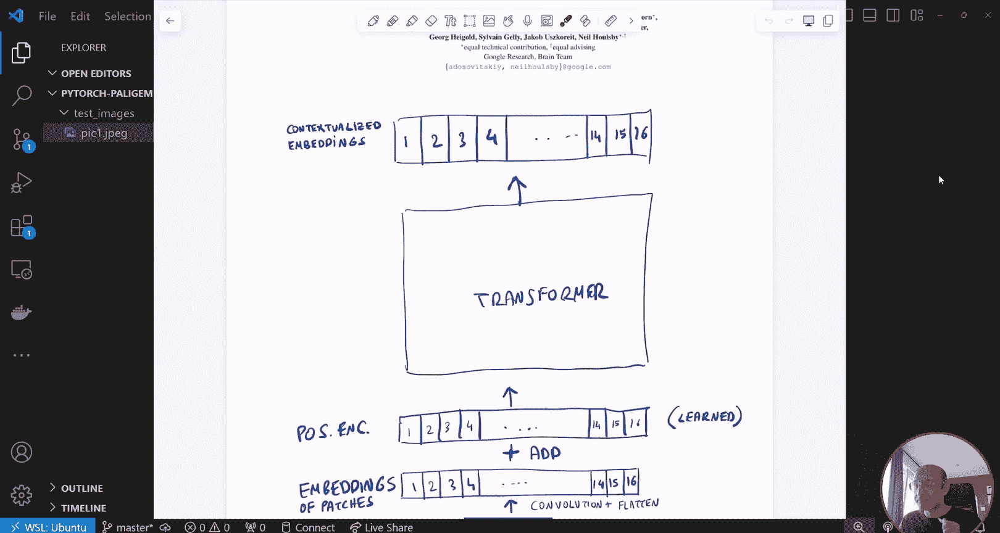

Now in this video I will be using a slightly different approach。

 which is I will not be writing each line， I will be copying each line and explaining it step by step because I want this video to be more about explanation than just the coding because I want to use the code for explaining what happens under the code under the hood so let's create our first file which is the modeling。

Oops， are you using Chinese。Sip dropp。And let's start by importing stuff which we need。

 I don't need compileilt。And then we create our first class， which is the sip config。

So what is this basically we will be using this vision encoder and this vision encoder will have some configurations so why do we need a configuration class because polygama comes in different sizes let me put this one okay。

Plygama comes in different sizes， which means that each of these size of polylygama。

 each of these models， polygama models has a different configuration for its vision encoder。

 so let's see each of them the hidden size basically it's the size of the embedding vector of this vision transformer that we are going to encode the intermediate size is the linear layer that we use the size of the linear layer that we use in the fit forward networker。

The number of hidden layers is the number of layers of this vision transformer。

 the number of attention heads is the number of attention heads in the multi head attention。

 the number of channels is how many channels is each image has which is RGB。

 the image size is because Bali Gamma comes in I remember three sizes and so 224。

 448 and 896 something like this。The default information that we put here is the for polylygama 224。

 which supports， of course image of size 224， so if you provide any image it's first get reized into 224 by 224。

The size of each patches， so what is the number it will be divided。

 each image will be divided into patches， each patch will be 16 by 16。

And this is a parameter for the linear normalization we will see later the attention dropout is another parameter that we will not be using in the attention transformation basically it's a dropout that we use in the attention。

 but we will not be using it and the number of image tokens indicates how many output embeddings this attention mechanism will this transformer vision transformer will output which is how many。

Image embeddings we will have for each image。 Now， before we saw that each an image encoder is something that converts an image into one single embedding。

 so that represents all the information about that image， but in the case of the vision transformer。

 we can use all the output of the vision transformer to have because as we saw before。

 vision transformer is a transformer models， which takes as input list of embeddings。

 and it outputs a contextualized embedding。 So each of these contextualized embedding will be the tokens of our image。

 So it will not be one single embedding that represents the whole image。

 but list of embeddings that represents a patch of each image。

 but also information about other patches to the attention mechanism， but we will see this later。

 So now this class is very basic is just a configuration of our sli。

Now let's start by coding the structure of this vision transformer， so let me copy this stuff here。

Papa how to follow this video now I am copying the code because I have already written it before and I want to explain it instead of coding it because I also allows me to copy the comments and also allows me to avoid any mistakes while coding it。

 but I recommend that you code it from scratch so you take this video and you just type whatever I am pasting here。

This is the best way to learn because it's like when you study a mathematical proof。

 you should not just watch the proof on the piece of paper because even if it you think it makes sense to you。

 it doesn't actually because when you write it by hand so when you code each of these lines by hand your mind will think why am I typing this。

 why am I writing this， why am I multiplying this number by this number。

 why am I calling this function So you question yourself when typing that's why I recommend that you type this code。

 why I am pasting it， I do it by pasting otherwise this video will be 20 hours So。

The first thing that we do is we created this vision model this vision model is made up of a transformer and has a configuration。

 So basically what we are doing is we take the pixel values of this our image which will be loaded with the num pi So when you load an image with nu piquebes converted into an array that is channel by height by width but we can have a batch of images that's why we have a batch size here。

 So the batch dimension and our vision transformer we convert this into batch size num patches which is how many num image tokens we have here and each vectorctor will be of a pixel dimension called em dimme here。

😊，So basically have our visual model will take an image。

 as you can see a batch of images and it will give us a batch of list of embeddings。

 one list of embeddings for each image where each embedding is a vector of size em team。😊，Okay。

 now let's code the vision transformer， which is very simple also。 So let's do it also step by step。

 actually。 So this visual transformer is basically a。Torch layer where we pass the configuration。

 we save this embedded beam， which is the hidden size we saw before。

 which is the size of this embedding vector。We first need to extract the embeddings from this we need to extract the patches from this image which will be done with this layer we will call a sli vision embeddings。

 then we will run it through a list of layers of the transformer which is this sigL encoder because it reminds the encoder of the transformer which is a series of layers of transformer and then we will have a layer normalization and we will see later how layer normalization works。

😊，The forward method is very simple。So the forward method is basically we take these pixel values。

 which is the image， which is a patch of images， and we convert them into em beddings。

 which is which basically means that we are extracting the patches from these images。

 So let's visualize it here。😊。

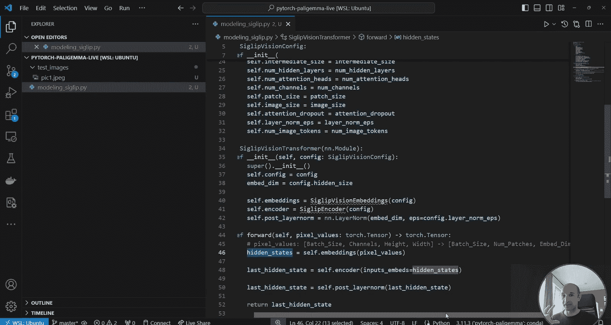

So what we are doing with these image embeddings， we are taking these images。

 We will run a convolution here to extract patches。

 then we will flatten these patches and add the positional encoings and this stuff here will be done by this s vision embedding then we take this embeddings which are patches plus the positional encoding and we run it through this encoder which is a list of layers of the transformer So this stuff here is our encoder。

 what is the encoder Well the encoder is a list of layers of the transformer so you can think of it as being a list of these layers here actually this layers here。

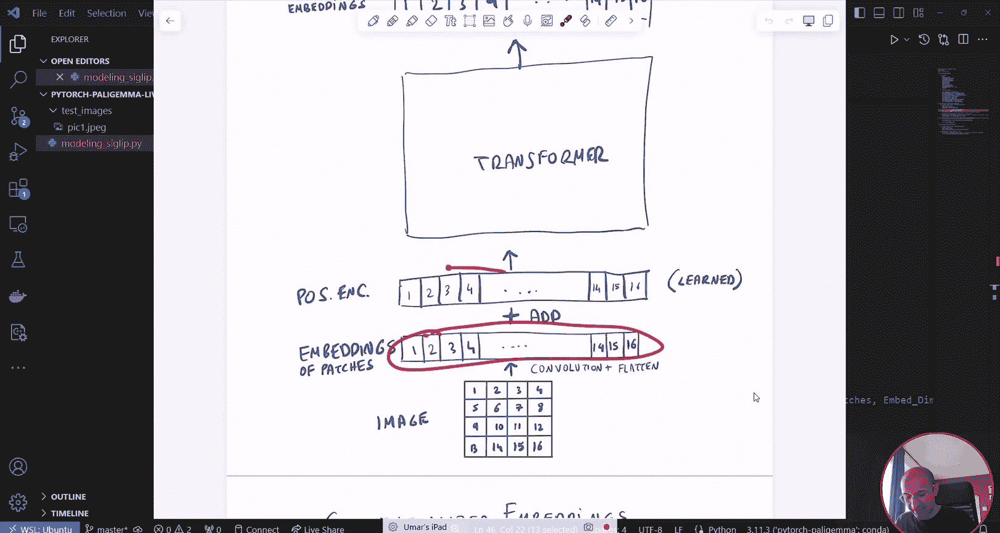

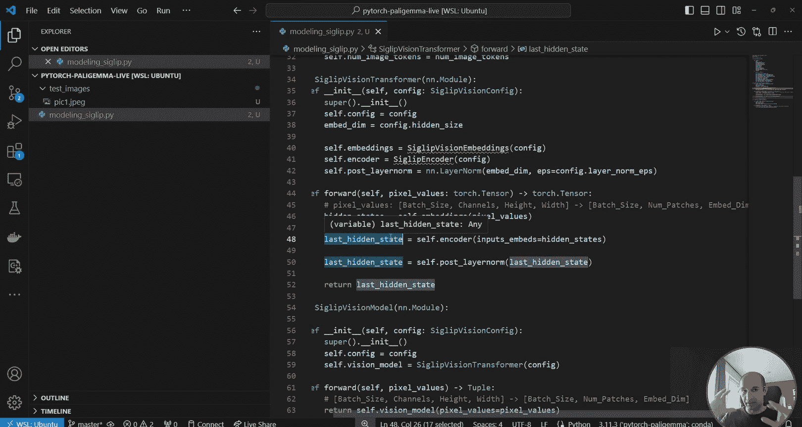

One after another， which includes a multi head attention， a normalization。

 a fit forward network and the normalization in the case of the visual transformer the normalization is done before the fit forward and before the multi head attention。

 but that's the only difference。So this part here， so a series of layers is called the here we call it the encoder because it resembles the encoder side of the transformer。

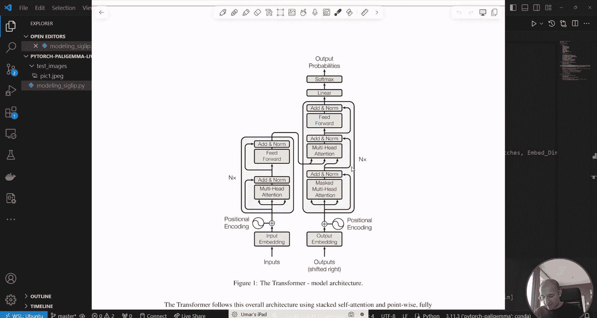

And then we have a layer normalization。 So now let's go to code this vision embedding。

 So we want to extract the information about these patches。

Let's do it where are the vision bad things here。Okay。Alright， so。

The vision embeddings is basically okay taking again the configuration because each of these models needs to have access to the configuration because they need to extract a different information from this configuration。

 So we have the embedding size， which is the size of the embedding vector which is the hidden size The image size is how big is the image and the patch size is how big is the patch that we want to get from this image。

 So basically we are talking about this。In this case， the patch size I remember is 16。

Which means that we are going to take this patch here is going to 16 by 16 pixels also。

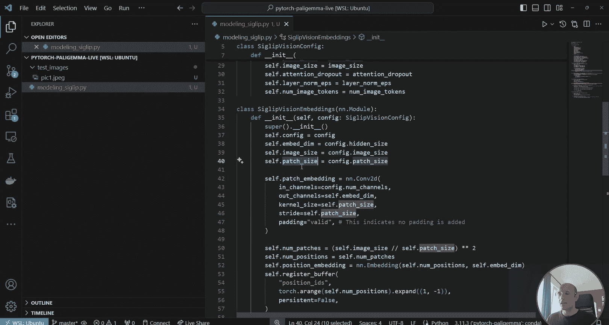

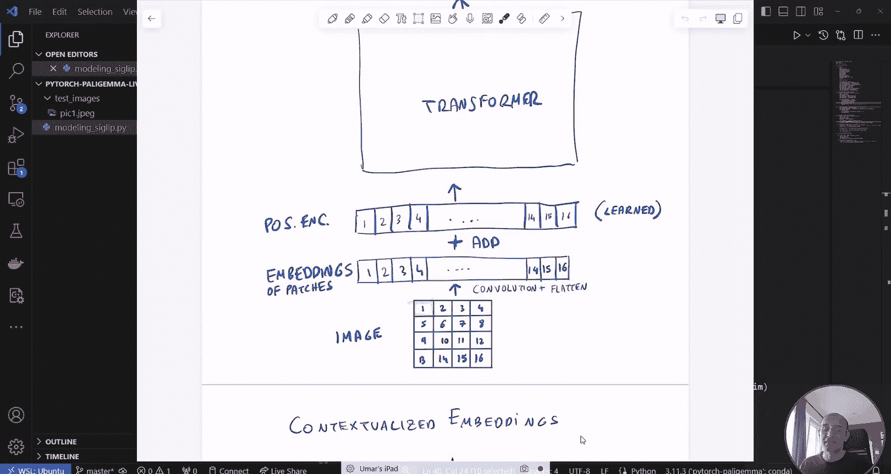

How do we extract these patches， We do that through a convolution That is a 2D convolution。

 which it takes as input the number of channels of the image。 So three channels are G。

 and it produce all channels equal to the embedding size， so the hidden size。The kernel size。

 so as you remember， the convolution works like this， so let's use the iPad actually a drone。

 so the convolution works like this。 so we have an image。😊。

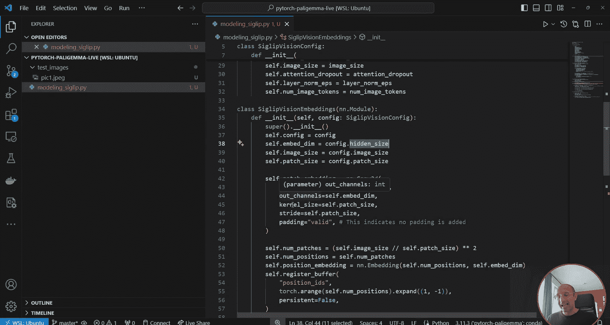

Which is made up of let's say pig sels， so suppose this is the grid of pig sels。

And we have a lot of them。Basically the convolution works like this imagine the kernel size is three by3 so we take a three by three group of pixels。

 we apply this convolution kernel so if you are not familiar with how convolutions work I will not be reviewing that here but basically it means that we have a matrix here。

😊，You multiply each number of these metrics by the value of the pixel on which it is applied to。

 it will produce features one feature。And then you slide this kernel to the next group of pixels then you slide it again slide it again。

 etc cetera， etc cetera and it will produce many features in the output features however as input we have three channels which you can think of it as three parallel images one that is only red one that is only green and one that is only blue we run these kernel on all of these channels and it will produce features how many kernels do we have depending on how many output channels one so for each output channel we have one kernel that is we have three channelss actually that is used for one for each of these number channels。

😊。

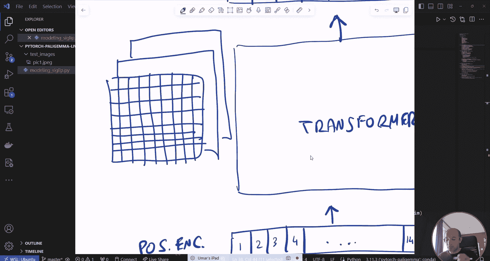

This slide tells us how we should slide this kernel from one group of pixel to the next。

 and we are using a slide that is equal to the patch size of the currents。

 which is equal to the current size， so which means that we take the first os。

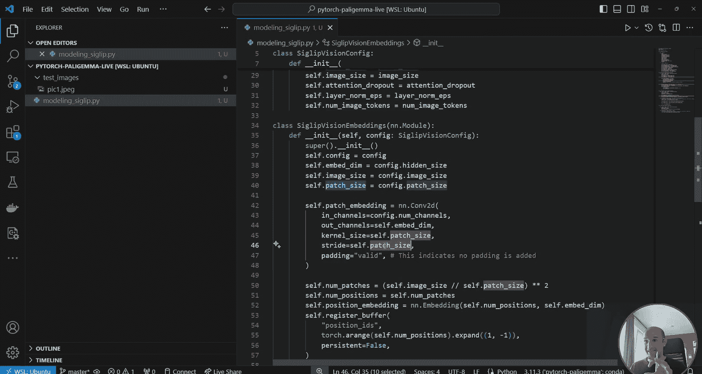

We take the first group of， let's say three by three cames。

 then we skip three cames to we slide it to the next group of three by three。 So there is no overlap。

 So we take this came here。Then we slide it to this group of pixel here。

 then we slide it to this group of pixel here so that there is no overlap so basically what we are taking is a list of features each extracted by independent patch of this image that we run the camera on。

😊。

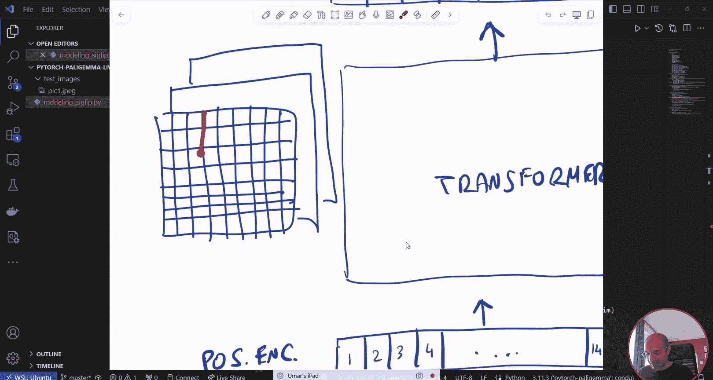

And the padding valid means that there is no padding added so basically this patch patch em padding is extracting information from our image patch by patch where there is no overlap between these patches how many patches do we have well it's the in size of the image which is 224 in the base version of gamma。

😊，Plygama divide by the patch sizes， so image size is the number of pixel divide by how big is it each patch and then to the power of two because we have along two dimensions this image so we run the patch the patch is a square。

 so it's 16 by 16 or3 by 3 or whatever the number of patch size is。

How many positions we have so how many positional encodings we need well it's equal to the number of patches that we have because we need to encode information about where this patch came from so how many positional encoings we need equal to the number of patches that we have and what is each of these positional encoding it's a vector it's a vector of the same size of the patches so it's equal to embedded dims you can see here。

And it's a learned embedding， so it's a positional encoding that is a learned embedding how many we have we have known positions of them。

 each of them with this size here， and we will see later that each of them is added to the information extracted from the convolution so that each convolution output and codes information about where it came from in the image。

😊，We register these position ideas in the。In the module， which is just a list of numbers。

 and we will use it later。So this is just a range of numbers。

 so between zero and the new positions minus1。Now let's implement the forward method then。

And this is the reason I like to copy and paste the code because I can copy all the comments without typing them one by one otherwise it will take me forever so what we do is okay we had our image which is a pixelix values here the pixel values came from num pie so we will see later how we load the image but basically you have to think that you load the image with the numy and nu loads a batch of images which is a channel height and width it's a tensor with the three channels and with the height of the image and the width of the image。

We will see that H and width is equal to the same because we resize each image to the input size of the image expected by the model。

 so we will resize in the case we are using the smallest polygama we will resize each image to 224 by 224。

😊，We extract these patch embeddings to this convolution so you can see here so this will basically take our image which is a batch of images and convert it into a list of embeddings of this size。

 so each image will be a list of embeddings of size em dimensions。

How many patches we have well the number of patches for the height and the number of patches for the weight in this case it will always be the same so you can think of it as a number of patches。

 a total number of patches。😊，Each of patches with dimension embedding dimension。

 and as we saw before， we flattened these ones， so we extract them here， let me delete it。

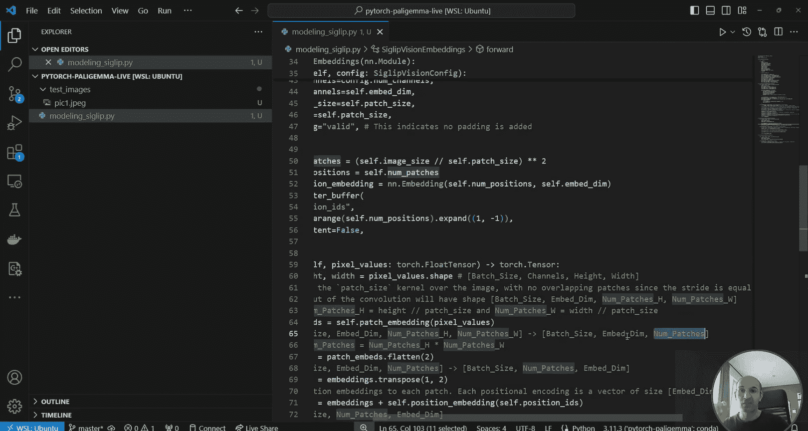

So we extract these patches， So we run the convolution， and then we flatten them here。

 So basically the convolution will give us 1，2，3，4，5，6 up to 16 or whatever the number of patches is。

 And then we convert it into a tensor where the the patches are flattened。

 So the first patches here and the last patches the last element of thistensor。

 And this is what we do here。😊。

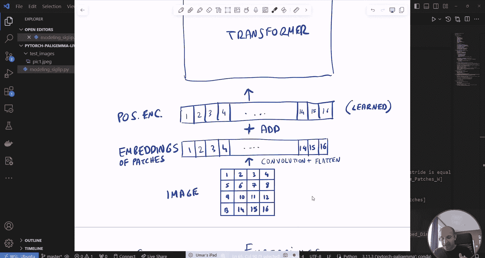

Here， because the output of the convolution is a2 by two grid。

 but we don't want a 2 by two grid we only want a one dimensional long list of patches。

 and this is done by this flattened method here。Then we transpose because we want the number of patches to come before the embedding dimension because as input to the transfer room we need to give a sequence of embeddings so that's why we want this noom patches dimension to come before so that it becomes a batch of sequence of embeddings and each embeddings is a vector of size embedding dimension。

Each of these embeddings we add the positional encodings。

 which positional encodings well the position extracted from this embedding layer but which embedding do we want to extract all the embeddings so from0 to suppose we have 16 patchs from 0 to 15 what is where is this information0 to 15 is in this selfpedott position and this which is a range so as you remember a range is just generates a list of numbers between0 and the argument minus1 so we we extract this all the positional encodings from this position embedding layer which is this embedding layer here we add it to the embeddings so what we are doing basically is we flat in this embeddings we did that before then we add a positional encoding vector extracted from the positional encoding layer。

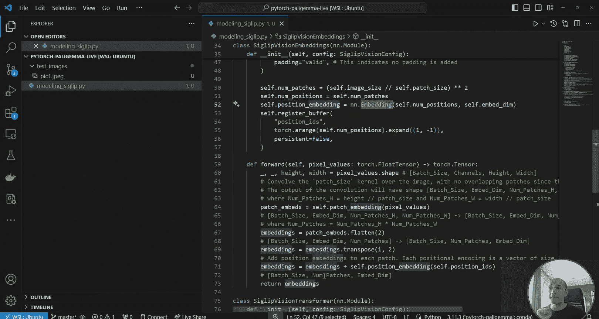

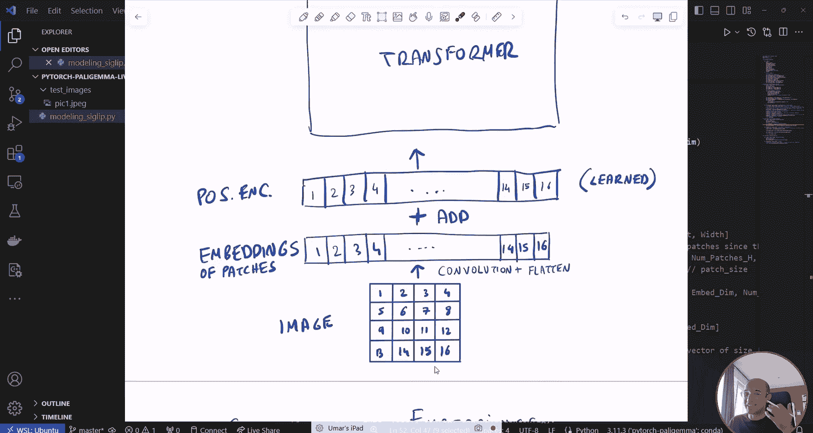

And these positional enings are learned。 So learned why。

 because this embedding layer here is a list of embeddings that when we the model is traineded。

 these embeddings will change according to the need of the model。 And basically， we encode them。

So it's not like we are telling the model this is position number one。

 this is position number two we add another embedding that is added to this patch each of these patches and then the model we learn to modify this positional embedding vector in such a way that they should encode the position information because each of these position embedding is always added to the same patch so the first patch always receive the position number0 the second patch always the position number one we hope that the model actually tries to change this position embedding is such a way that they encode the positional information and actually it does because the model actually learns then to relate patch with each other by using their positional informations the only way for the model to do that is to change this position embedding in such a way that they encode the position information。

😊，If you remember from the vanilla transformer， we use the sinusoidal functions so if you want to look at the original transformer if you remember。

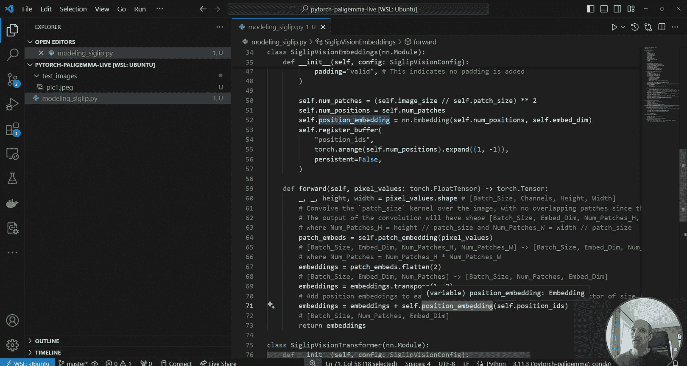

Here。We have this position information。Where is it here。

 So we create this position encoding using synnooidal functions。 So instead of learning them。

 we actually precompute them and then we force the model to learn the pattern encoded by this synnooidal functions。

 in this case， we are not forcing the model to learn any pattern。

 we want the model to create the pattern that is most useful for the model itself。

 So we hope that the model will try to create this embedding layer in such a way that it create some embeddings that are helpful for the model to to understand the position information。

😊。

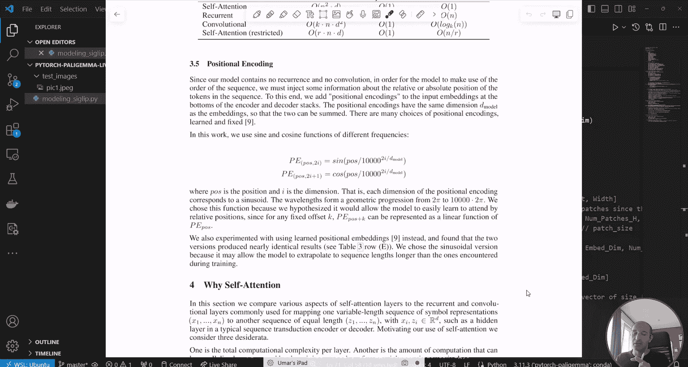

And this is the meaning of position em body。 Now， we skipped before the normalization layer。

 So let's go actually to understand what is normalization and how it works because so that we always I don't leave anything behind that is not explained。

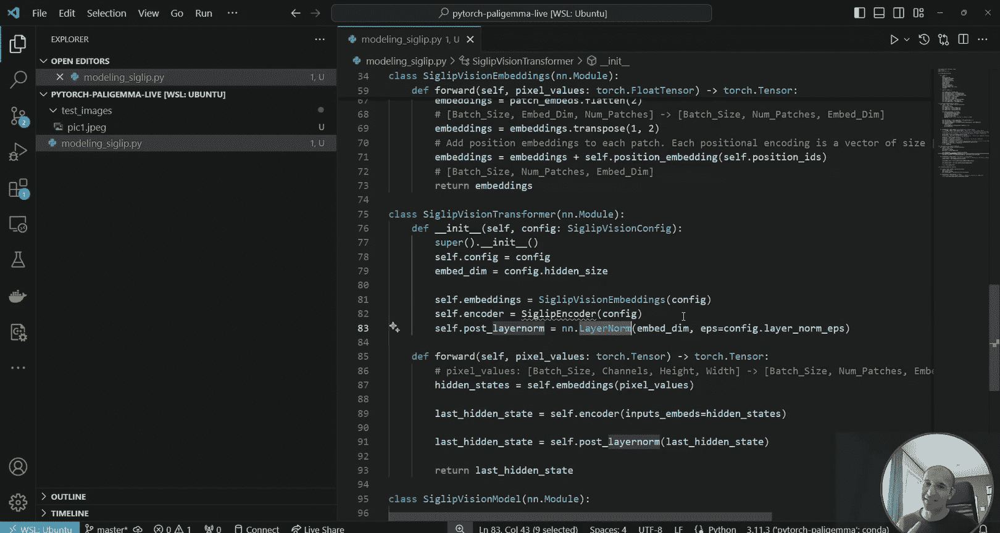

All right， let's talk about normalization， so imagine we have a list of linear layers。

Now a linear layer is defined by two parameters， one is called the input features and one is called the output features imagine we have input feature is equal to 4 and the output feature is equal to4 actually there is another parameter called the bias so it indicates if the linearization the linear layer also has a bias term and suppose that it's true。

To the input of the linear layer usually we have a batch of items and each item is made up of features。

 supposeose that for now as input there is only one item and it's made up of four features and as you can see the input features are for。

What will happen with four output features is this the linear layer。

 You can think of it as a number of neurons where the number of neurons equal to the number of output feature of this linear layer。

 What each neuron does， is basically it has a weight vector， as you can see here。

 made up of four weights。😊，Equal how many weights does it have well equal to the number of input features that this layer accepts。

 so which is a four？What each neuron will do it will do the dot product of the incoming vector。

 So the input vector x multiply dot product with the weight vector of this neuron plus the bioer。

 which is one number for each neuron。And this basically that product plus this bias will produce one output feature because we have four neuronss。

 we will have a four output feature， so each nen will do the same job。

 but each nen will have its own weight backward and its own bias number。

 So this one here will have its own weight back different from the other ones and its own bias term here。

Then suppose that we have another vector that takes as input four features and produces two output features。

 so you can think of it as a linear layer with the two neuronsons where the first neuron has a weight vector made up of four numbers because the incoming vector has four features and then one by a term here。

It will produce an output vector of two items， the first item will be this number here and the second item。

 the second dimension will be the dot product of the weight vector of this second neuron with the input vector plus the biostr of the second neuron。

Now， what is the problem with the。With the linear layers， but actually with all layers in general。

 the problem is this it's called the cavariate shift。

 The problem is that when you have an input vector。

That changes from one batch to another in magnitude。

 then the output of the layer will also change in magnitude a lot depending on what is the incoming vector so for example。

 imagine this the first input vector is all the numbers are more or less around one and the2。

And the output is also more or less around suppose around the two。

 then if the next vector that is coming to this layer is much different in magnitude from the first one。

 then the output will also be much different in magnitude。

And this is a problem for the model so the problem is that if the input of a layer changes。

 then the output of this layer will also change a lot So if the input changes drastically the output will also change a lot drastically because the loss of a model during training depends on the output then the loss will also change a lot because the loss then determines the gradient during back propagation。

 it means that if the loss changes a lot， then also the gradient will change a lot and if the gradient changes a lot。

 because the gradient determines how we update the weights of the model during training then also the update of these weights will also change a lot So basically what happens is that if the input the distribution of the dimensions of this vector that is coming to the input of a layer changes drastically from one batch to the next then the output of the model will also change and then the loss will change。

 then the gradient will change then the update of the weights will change。

But we will see that the loss will oscillate a lot。

 And also the weights will try to keep up with this changing input distribution。

 which basically will result in a model that trains slowly。 So here I have made a simple。

How to say summary of what this happened， so a big change in the input of a year will result in a big change in the output of a year。

 which will result in a big change in the loss of the model。

 which will result in a big change in the gradient of the during back propagation which will result in a big change in the weights of the network and what is the result of this is that the network will learn very slowly because the network will spend most of its time but most of the effort trying to keep up with the this distribution change in the input instead of actually learning the features。

How to map the input to the output。So the first solution to this problem was batch normalization which was introduced in this paper and with batch normalization what we do basically is that we have usually not a single item as input we have a batch of items I suppose that we are training a classification image classification model so we have as input a list of images for example。

 the image of a cat， the image of a dog of a zebra of a three of a stone etc cetera， etc cetera。

 so you can think these are the dimensions of the vector that represented a cat。

 these are the dimensions of the vector that represented the dog。

 these are the dimensions of the vector that represent a zebra， etc cea， et cetera。

So what we do with batch normalization is that we calculate a statistic。😊。

For each dimension of each item。Which statistic do we calculate the mean and the variance and then we normalize each item by subtracting the mean and divided by the standard deviation。

 this will basically make each dimension of each item be distributed according to a Gaussian with the mean0 and the variance of one。

😊，So basically what will happen is that if we normalize each number if because the image of a cat is much different from the image of the zebra。

 because the color distribution is different， the RGBs distribution is different so the pixel intensity is much different from each other。

😊，What will happen is that the model will not see this change in magnitude。

 but it will see and also will not see a change in distribution because all of these items will be distributed according to a mean of0 and the variance of one。

 So what will happen is that the model will oilate less in the output。

 So it will osate less in the loss。 So it will ohiate less in the gradient。

 So it will make the weights of the model ohiate less。 So the model。

 the training will be more stable。 It will be it will converge faster， basically this way。 So。

To summarize why do we need normalization is because the input of the model。

 which depends on imagine you are training classification image classification model。

 then the input depends on the image， and the image can be much different from each other。

If the image changes a lot， we don't want the model to feel this change in magnitude of the input。

 We want the distribution of the inputs to be remain constant， let's say。

So that the model doesn't oscillate so that this doesn't force the model to kind of just to keep up with the distribution this change distribution。

 how do we do that， we try to keep the distributions constant so always try to have the input features to be distributed according to a fixed distribution which is mean of 0 and1 and we do that with this formula here which comes from probability statistics basically each distribution if you subtract its mean divide by the standard deviation it will result in a Gaussian distribution of mean0 and variance of one。

Of course， this is valid only for cation distributions。

And and this will basically result in a more stable training。 Now。

 the batch distribution actually works fine。 However， it has a problem with the problem is that。

Which best normalization each of these statistics so the move and the sigma are calculated along the batch dimension。

 so we calculate the mu and the sigma for the dimension number one of each of these vectors along the batch dimension so basically to calculate this mean we are summing up the first dimension of each of these vectors and divided by the number of items that we have。

So we are mixing the features of different items， so we are mixing the dimension number one of the cat with the dimension number one of the dog。

And so basically to have good results we need to use a big batch because if we use for example。

 a cat and the dog it will result in one mean but imagine in the next batch we have the cat and the zebra it will result in a completely different mean and then the next suppose in the next batch we have a cat and the three maybe it result in another different mean。

 so also we will still have this problem of covariant shift because the mean is changing a lot between each iteration。

😊，So the only solution to this actually is to use a very big bed size。

 so we are forced to use a big bed size in order to alleviate this problem。😊。

Of kind of mixing the dimensions along the batch dimension。

We introduce the layer normalization with layer normalization what we do is instead of calculating the statistics along the batch dimension。

 we calculate them along the item dimension， so the mu and the sigma that will be used to standardize the cat will only be dependent on the dimensions of the cat not on whatever the cat comes with。

😊，So we are still doing each item minus its mean divided by the standard deviation。

 But instead of this standard deviation and this mean coming from the first dimension of each item。

 it comes from the average of this all the dimensions of the each item independently from the others。

 So it doesn't matter which other item the cat comes with。

 it will always result in more or less the same and same sigma。

And this makes the training even more stable because we we are not forced to use a big batch size。

And this is why we use normalization。

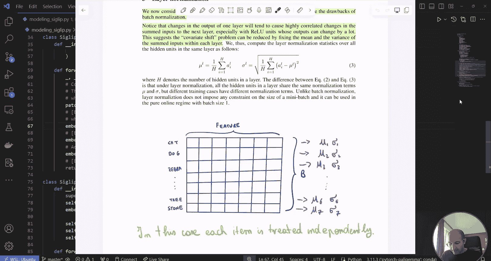

Okay， we have seen what is normalization now we should implement what is this thing called the encoder。

 so this is a sigLip encoder Now the encoder is made up of multiple layers of the transformer model。

And the architecture， more or less， if you look at the vision transformer paper it is like this。

 so I changed it a little bit because I wanted to use the exact names that we will be using so we have first of all what we have so far is this thing called the sli vision embedding which is basically taking the image it is taking some patches of this image using a convolution Each of this output of this convolution is an embedding is used as an embedding it's a vector。

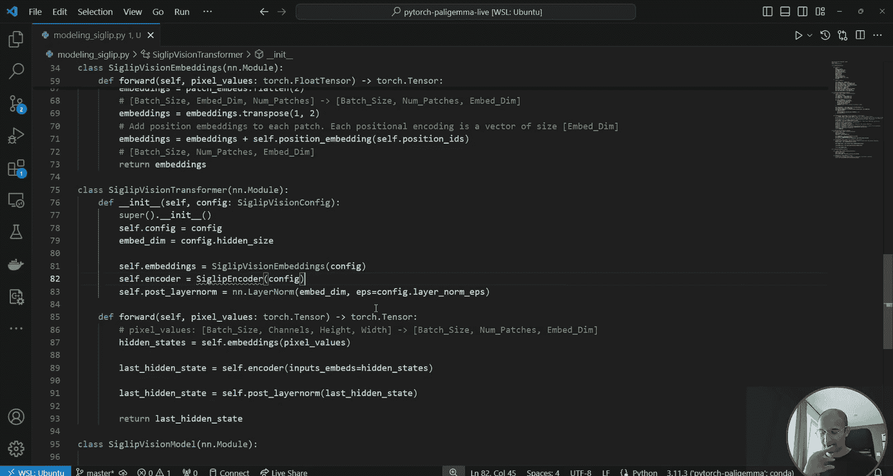

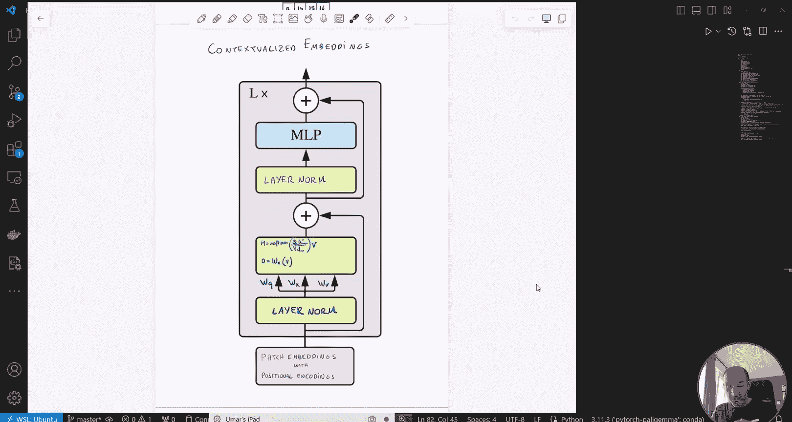

And this embedding vector is added to another vector called the positional encoding。

 which is learned。 And then we feed this stuff to this thing called the encoder。

 So we convert it into embeddings at the positional encoings。 Then we feed it to the encoder。

 And at the input of the encoder， you need to think that we have this layers。

 repeated n times here it's written L times。😊。

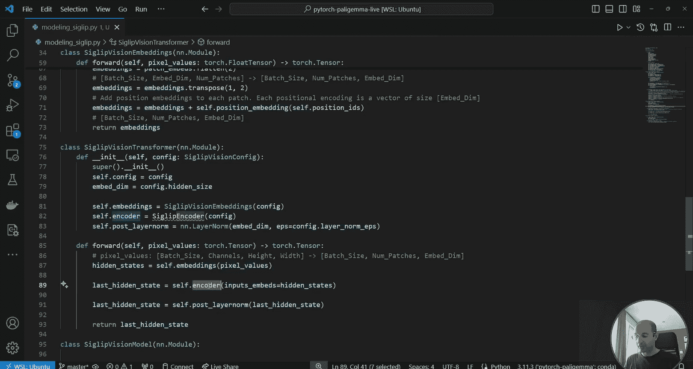

One after another such that the output of one becomes the input of the next layer。

The thing that you need to understand about the transformer is I repeat it is that the transformer is a sequence to sequence model that converts a sequence of embeddings into contextualized embeddings what does it mean it means that at the input you have a list of here embeddings each representing a patch of the image as an independent part so this embedding here only captures information about the first group of pixel。

 this embedding here captures all information about the second group of pixel etctera， etca， etc。

 but then through some magic called attention mechanism this contextualized this embeddings become contextualized at the output of the transformer and we will see in detail this attention mechanism。

Such that this embedding here at the output of the transform。

 the first embedding is representing information about the first patch plus other it includes information not only about the first patch but also about other patches and so is the second。

 the third， the fourth and the last one so they become contextualized in the sense that they infer capture information about the context in which they appear。

😊，Which is different from language models in which each token captures information about the previous tokens in the case of the vision transformer。

 each patch includes information about all the other patches。Now， each of these layers。

Is made up of so we have the this is the input of the encoder let's say and we will have the first layer of this encoder the first thing that we do is we apply a layer normalization and we saw how it works and why we use it the output of this layer normalization is a cop the first the input of this layer normalization is saved for a skip connection that we do later then the output of this layer normalization is a sent to the self-attention mechanism its this one here。

And this self mechanism takes the output of the layer normalization as a query key and values。😊。

It calculates the attention just like the usual formula soft marks of the query multiplied by the transposal decay key divided by the square root of D model。

 multiplied diabetes， etctera， etc ceter。The output of this self attention is then summed up with this S connection here。

 then the output of this submission is sent to this layer normal along with the S connection that is used later。

Then the output of the linear organizationization is sent to this multi layerer perceptron。

 which is a list of linear layers we will see later。

 and then we do another summation here with the skip connection plus the output of the multi layerer perceptron。

And then we do another layer like this and another another another。

 and the output of the last layer is the output of our vision transformer。 So as you can see。😊。

D vision transformer takes as an input image converted into patches。

 patches are then fed to this encoder， which is a list of layers and the output is a contextualized patches or embedding of these patches。

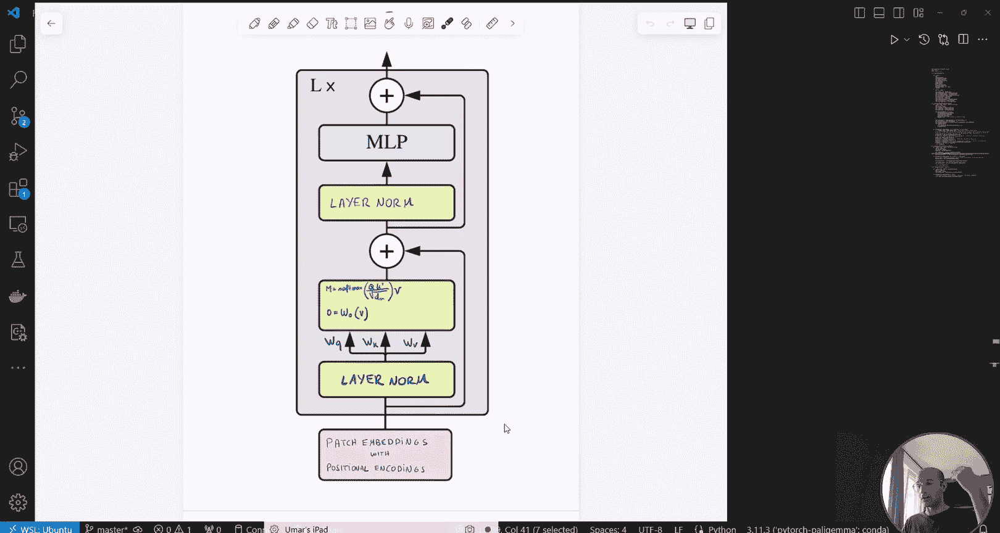

So let's code this encoder which is basically this structure here and we will code each part of this structure and while coding each part we will go inside on how it works so the normalization we already know how it works。

 but we still have to explore what is this stuff here called the selfat。

 what is this stuff here called multi layerer perceptron。

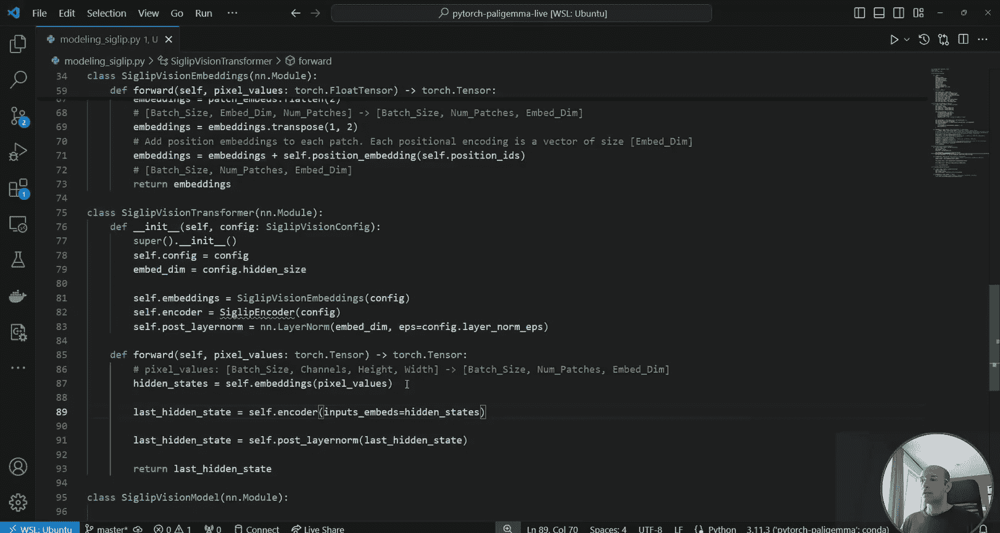

I believe it's convenient for us to go first through multilayer perceptron and then we go to the self attention。

 I think because the self attention is a little longer to do， so let me do a simple part first。

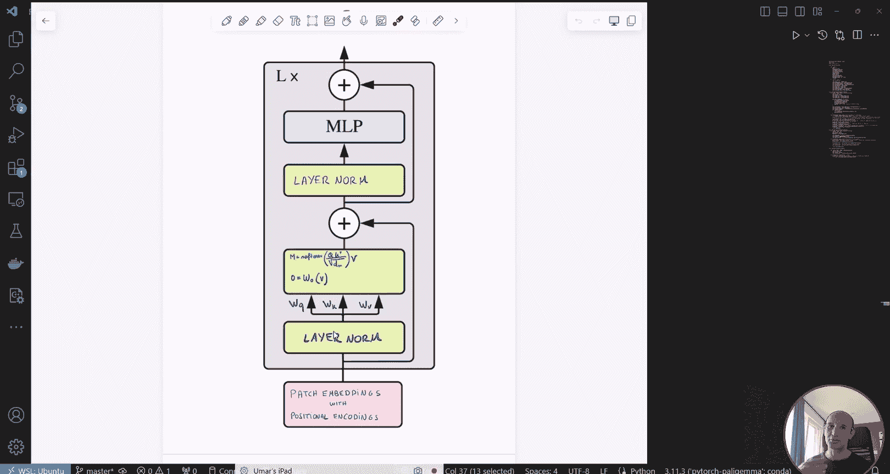

Okay， let's code this encoder。Now I will copy the first part。This one here so let's copy it here。

 so the encoder is made up of again the constructor is made up of the configuration。

 we save some stuff which is the hidden size， then we have a block called the selfat block in this called this in here it's called the s lip attention now not about naming abus so I am using the same names as the hugging face implementation。

For only simple reason， which is I want to be able to load the pretrained weights from hugging face so the pretrained weights for the polyga are available on the hugging F hub so we want to be able to load them but each of these preload pretrain the models they have this dictionary of weights so where the dictionary tells you where to load each of these weights and if the names do not match you need to create some conversion script so I didn't want to do that and also it would just complicate the code useless so I just use the same names so that we can load basically the pretrained weights from hugging face。

Also because my code is based on the hugging face implementation so to create my code I use the hugging face implementation but simplified a lot a lot a lot。

 for example I remade my own KV cache I did a lot of modifications to simplify it。

 but it's based on the hugging face implementation。Anyway。So we have this thing called the selfat。

 Then we have layer normalization。 So we saw it's where is it。

 and we have this layer normalization here。 Then we have this multilayer preceptor。

 which is this stuff here。 And then we have another layer normalization， which is this stuff here。

 So we have two layer normalization。 So now let's implement the forward method。

 and the forward method I will copy it line by line。 so we can understand okay， this forward method。

 Now the first thing we do is we save a residual connection。

 which is we basically save the input that we feed to this encoder because we need to reuse it later。

 So we are saving this skip connection because we will need to use it here later。😊。

Then we run it through the layer normalization， the input。

And it's done here so the layer normalization does not change the shape of the input。

 it's just normalizing each of these dimensions such that they all come up。

 it's like they came out from a Gausian of minus0 and the variance of1。

Then we apply this magic thing that we will explore later called the self attention and the self attention system also does not change the shape of the input tensor。

 but as we saw before the attention mechanism is something that takes as input embeddings and gives you contextualized embedding so it does not change the shape of these embedding。

But we will implement it later so for now just think of it as a black box that you fit in beddings and it gives you contextualized beddings。

 then we have a residual connection and we can see that here so this residual connection skip connectional called which is this first class year so we are taking what we save before with the output of the self attention so what we save before is this residual s here plus the output of the self attention which is this hidden states here。

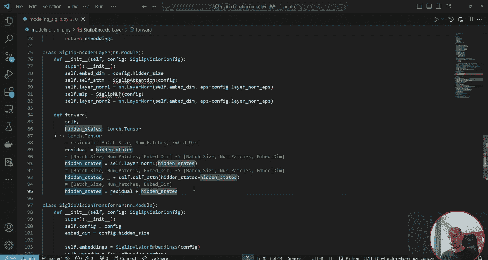

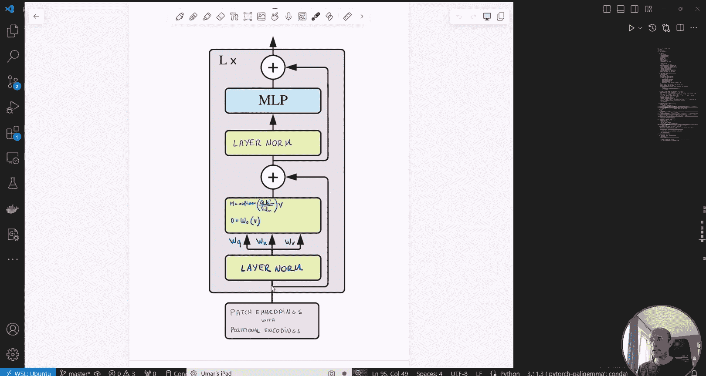

ThisThe result of dis sumation is saved again because there is another skip connection after。

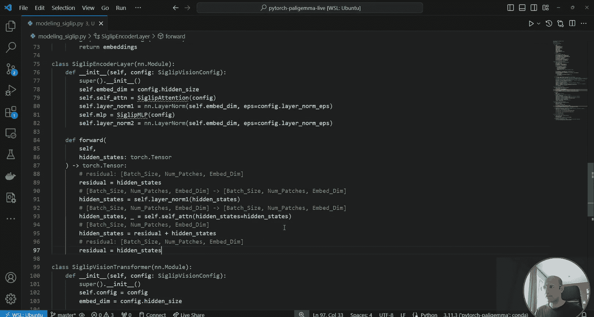

I don't know why my alt tab is not working， so we save again another this stuff here。

 so we save it because later we need to use it here for the skip connection。

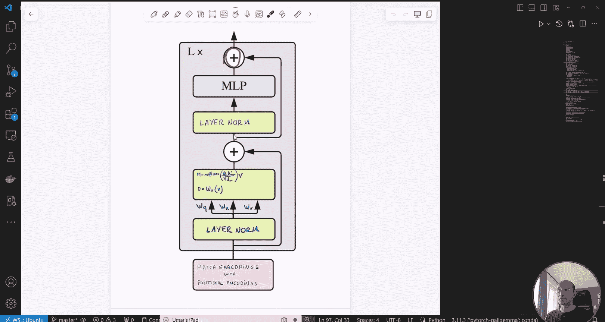

Then we do a guess another linear layer normalization。

 which also does not change the shape of the input tensor。

And then we have this thing called the multi layerer perceptron。

 now the multi layerer perceptron is something that is not easy to explain what is used。

 but basically。The multi layer perceptron， we will see later is a series of layer。

Linger layers that takes each。Embbedding input embedding and transforms it independently from each other from the other。

 so while in the self attention there is kind of a mixing of the patches incoming so that you get contextualized in the multiceptton there is no mixing between this let's call them tokens or patches。

Each of them is transformed independently and the multilay perceptioncept allow us to increase basically first of all it adds parameters to the model so the model has more degrees of freedom to learn whatever it's trying to learn。

😊，And the second objective of the mutla perceptron is that it allow to prepare， let's say。

 prepare the sequence of patches for the next layer。

 So if the next layer expect these patches to be somehow different the multi layer preceptron allow to transform them also it adds a linearities so the multi layer perceptron also includes the nonlinearity which adds which basically allow as you know nonlinearities allow you to model more complex transformations So if you just create a list of linear layers without any nonlinearities that you cannot model complex functions so that for example。

 in the classification you cannot map non nonlinearly separable data but by adding。

No linear transformations， you add complexity to the model so the model is able to map complex transformations。

 so the multi layer per just adds parameters and this linearity。

 which is helpful to allow the model to learn whatever complexity it needs。To。

 to map the input to the output。After the multi layerer perceptron。

 I guess we have a we have another skip connection and then we return the output of this skip connection here and also the skip connection does not change the shape of the tensors of the embedding。

Now let's code first this multilayerceptron， it's the easiest stuff to do， so let's do it。

Let's go here， I will also always copy first the structure and then the forward method so we can explore a little bit the structure and then we explore the logic。

So this multi layerer perceptron， just like in the vanilla transformer， is made up of two layers。

Plus a nonlinear transformation so the first layer takes each of the embeddings which are we can also call them tokens or patches because most of the time we are dealing with language models and expands them so each of these vectors which is of size the hidden size is expanded into this thing called intermediate size usually it's chosen as three times the hidden size or four times the hidden size I remember in the var transform to as four times the hidden size。

Then we apply an only linear narrative to this expanded tensor and then we compress it back to the hidden size dimension。

So let's do the forward method now which is this one here。

 so the first thing we do is we convert each of these embedded dimensions into intermediate sizes so again we have a batch of images each image is made up of no patches。

 number of patches， each of these patches represented by a vector of size embedding dimension with the first fully connected layer we are expanding each of these patches into the intermediate size then we apply。

In all linear neuro transformation in this case is the Jelu function now you might be wondering why are we using the Jelu function or the siglu function or whatever only narrative there is。

The reason is always practical， so basically there is no like a rule of thumb for choosing the no linearities to use for a specific case。

 there are just some heuristics。And the heistics is that initially the transformer when it was introduced it was with the re function as nu nonlinearities between these two fully connected layers。

 but then people explored the other known linearities and they saw that they work better now nu nonlinearities actually there is also some logic behind the choice of a nonlinear nonlinearities so because the nu nonlinear define also the flow of the gradient so for example if you use the relu function if you look at the graph of the relu function let me throw it actually。

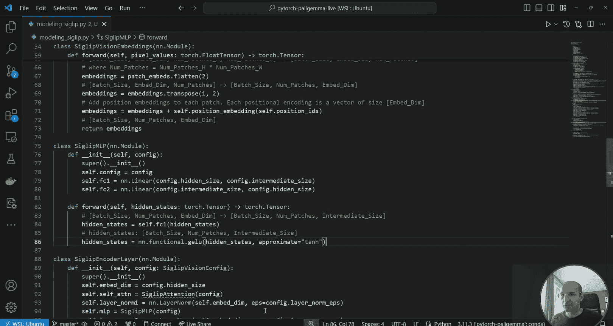

The graph of thelu function is something like this。Why I cannot throw it， okay。

So basically anything that is negative is0， well let me use another color。

Anything that is negative is becomes zero basically and everything else is forwarded without any scaling。

😊，嗯ん。So this means that if the input of the relu function is negative。

 the output will be0 and actually for any negative input there will be no gradient because the gradient will be multiplied by zero so it will not flow That's why for example we introduced the liquid Relu and other like in the relu family there are other functions that are low also a little bit of gradient flow from the gradient from the negative side。

😊，So the non nonlinear linear narrativeity basically tells you how the gradient will flow during back propagation。

 so having an only nonlinear linear narrativerity。That allows allows the gradient to flow back even when it's negative。

 it means that the model is not forced to always have the activation to be positive to have some feedback from the loss function to optimize its weight。

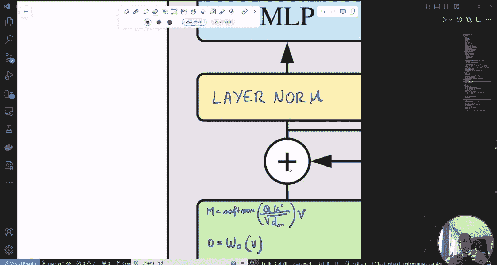

And why we are using the Jlu because people have tried it and probably works better compared to thelu function for the same class of applications。

 so in the vision transformer you the Jlu function but in the Lama for example they use this withlu function in other scenarios they use they use other functions and it's mostly based on heuristics on how they work in practice。

Also because a model is usually made up of billions and billions and billions of parameters and it's not easy to find the regularity to understand why specific nonlinear nonlinearity is working better than another one。

😊，Now， okay， then we apply the second linear layer。

 which is basically a recompressing back this intermediate state into the embedding size。

 and then we return it。And this is our mutator perception。

Our next part is going to we are going to code this attention mechanism for the vision transformer and we will see that it's different than from those of language models because we don't have any causal mask or attention mask。

Alright guys so we have seen the multiceptor now let's go to the multihead attention and for that I want to use the slides because I believe it's a little faster to explain on the slides and then we proceed with the code so what is the multi head attention the multi head attention is a way of contextualizing stuff which means that you start with a sequence of for example patches and you can think we have for example four patches each of this patch is represented by a single vector of 1024 dimensions so you need to think of this as a vector of 1024 dimensions so you need to think there are 1024 numbers in this row vector and we have the patch number to the patch number three and the patch number for each of these patch was extracted from a group of pixel from the initial image and it's only representing information about the patch it was extracted from so the part of the image it came from。

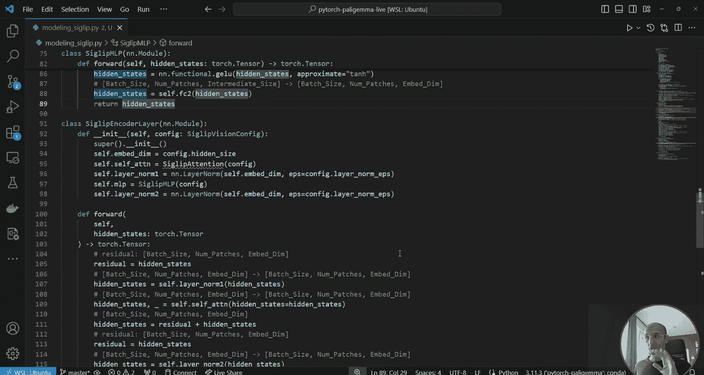

With the multi head attention system， what we mechanism。

 what we are doing is we are contextualizing these patches。

 which means that the output of the multi head attention is a tensor of the same size as the input so this is a tensor of size of 4 by 1024。

 the output will be a tensor of size of 4 by 1024， but where each of these embeddings now does not capture information only about itself but also about the other patches in the sequence。

This is for vision transformer。 for the language models， we want something slightly different。

 So for language models， we do have a input sequence， which is a sequence of tokens。

 each token representing one single。I don't want to use the term word because it's wrong。

In my videos I always make the simplification that each token is a word and its word is a token。

 but this is not the case actually in tokenizer， so usually a token can be just any sequence of characters。

 does not necessarily be does not need to be necessarily a word。

 but for us let's treat them as word it just simplifies the explanation。😊。

So we have a list of tokens each token is represented as an embedding， let's say of 1024 dimension。

 so it's a vector of 1024 dimension， so 1024 numbers for this one， 1024 numbers for this one。

 etctera， etc cetera。The multi head attention in the case of language models。

 what we want is we want to contextualize each token with the all the tokens that come before it。

 so the output of the multi head attention in the case of language models。😊。

And this would be known as the self attention mechanism with causal mask。

Is a sequence with the same shape as the input sequence。

 So this vector this metric here is a4 by 1024， so the output will be 4 by 1024。

And each of these tokens is not capturing information only about itself。

 but also about all the past tokens。 Now， the word I does not have any past token。

 so it will only capture information about itself。 But the word the love will capture information also about the token I。

 because it comes before it。 And the word pe only will capture information about I and love。

 because they come before it， et cetera， et cea。 until the last token。

 which capture information about all the sentence。Why do we want to do this in language models。

 let me give you a little understanding of why we do it in this way with language models and why the transformer is revolutionary for language models。

This is going a little off topic with respect to the view transformer。

 but I think if you understand this， then you will understand the big part of the transformer and why it even exists。

 So let's copy this stuff here。Let's open a new page。

Now what we do with the language models is you need to think that a language model is something that we need we train on what is known as the next token prediction task。

 which means that given a prompt the language model try to understand what is the next token that completes this prompt how do we generate text with the language model we start with the sum tokens which are the prompt we generate the next token we put it back into the prompt and we ask again the language model。

 what is the next token， the language model gives us the next token then we put it back into the prompt and then we ask again what is the next token etca。

 etca。So we need to train a language model to train a language model。

 we need to train a model to predict the next token given the pastor tokenom。

And the transform allow us to do that in parallel when training。

 which means that we start with an input that is a series of embeddings which are uncontextualized。

 so we start with this one and each of these actually is one single token so this is only I this is only love。

 this is peoning。😊，Eoni。 And this is a pizza。The output of the transformer of the self-at mechanism will be a series of embeddings that are contextualized in such a way that each token capture this information only about itself but also about all the past tokens so how do we train and the transformer can do it in parallel so the self- attentionten mechanism will take this as input and generate this output in parallel。

 so it not will generate one token at a time， but it will generate all of them in parallel using this multi head attention。

How do we train a language model basically？As we saw before。

 language model is something that given a prompt needs to predict the output。

 So what we want is that。We we take the input， which is this sentence here。

 We feed it to the transformer。 The transformer will transform it into a sequence of embedding。

 contextualized embedding。 And then we need some labels to train this language model。

 So the labels what will be。 Well， we will， we want whenever the language models is given the word I to predict the word love。

So big。 I think I'm using not the pen。Here。The word love。

 whenever the language model sees the word I love， it should predict the word pepperperoni。

Whenever it is the word the sequence， I love Peetoni， it should predict the pizza。

Whenever it sees the sequence I love the Peroni P， it should predicted the token end of sentence which is a special token telling。

 hey， I'm done with the generation。😊，Because the transformer can generate all of these contextualized embeddings in parallel。

 we can also calculate the loss for each of these predictions in parallel and calculate with back propagation updates the weights of the model to tell in parallel how the model should predict each of this token given the previous tokens so when we are given a sentence and we language model。

 the language model can can be trained with only one four pass on how to predict the next token inside of this sentence given the previous tokens as context in only one single pass of the transformer that's why the transformer is so powerful because this contextualization happens in parallel so we can calculate the output in parallel for each position and because we know already know what is the label because the label is just the next token given the previous tokens。

 we can calculate the loss in parallel for each position and the model we learn in parallel how to generate exactly this sentence in。

😊，In one pass only So the model will not learn to generate one token at a time。

 given the previous but。All the sentence in one par。 And that's why it's so powerful。

Now let's go back to a revision transformer。😊，Okay。

 so we have seen what is the difference between the vision transformer and the language model。

 so in the vision transformer we want to contextualize tokens or patches in such a way that they capture information about all the other patches。

 but in the language model we wanted to to to only capture information about itself and the previous tokens。

😊，How does this self attention mechanism work， We start with， of course， an input sequence。

 Our goal is to create an output sequence that is contextualized。

 and there are many intermediate steps。 So now we will see what are these intermediate step 1 at a time。

 so。😊。

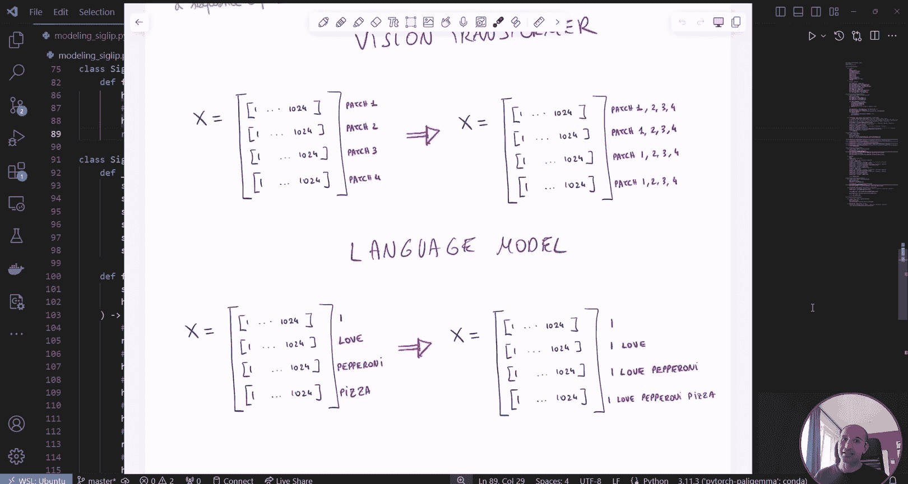

Let's start by creating the class of this this attention mechanism， and we will create it。

 Let's create it here。Okay， so in the input we have the configuration of the model。

 we save some stuff that we will need later so the hidden size the number of attention heads because we are dealing with multi head attention。

Had the dimension we will see later what is it and whys why it's used the scale is basically the if you remember the formula from the the attention is the queries multiplied by the transport transpose of the keys divide by the square root of the model and this is one over the square root of the model。

 So the stuff that we need to divide the query multiplied by the keys with。😊。

Then we have this dropout which is zero， I never saw it used in polygama。

 but I believe there are other s models that use it so they put it here。

But you can think of it like nonexistent for now。And then we have these three linear layers called the WKWQ and WV。

 which are parameter matrices that are also present in the vanilla transformer we will see later what they are used for。

 and then we have this output projection which in the paper of the transformer is called the WO matrix and we will see later what it is used for。

Let's start by implementing the forward。 So the forward method is this one。

 What is the input of the forward method， Well， the input of the forward method of this attention mechanism is basically what。

This is the output of the layer normalization in this encoder layer class。

 so the output of the layer normalization is fed to this self attach mechanism。

So it is something of this shape。 So it's a batch size by non patches by embedding dimension。

 So what is does it mean， It means that we have a batch of images。

 Each of these images is made up of some patches。 How many defined by this number， No patches。

And each of this patch is represented by a vector with the size embedded dimension。

 you can think of it as a vector of 1024 dimensions so I don't remember the exact number of dimensions right now。

You can also think as these knownon patches as a sequ length。😊。

So before we saw that a language model is made up of a sequence of tokens here you can think of it as a sequence of patches where the sequence length is this no patches here。

The first thing that we do in a selfat mechanism is we take the input and we run it through the tree transformation。

 One is called the WQ，1 is called W okay and one is called WV。

 And after we run it through these transformations， the output will become  query key and values。

So let's do it。And it's this stuff here， So we take the input sequence。

 which is this hidden states and we run it through WQ here。

 it's called the Qpro WK here it's called the Qpro W here it's called Vpro the shape of the tensor does not change。

 Basically these are parameter metricism So they just the parameter to our selfat that transform the input sequence so that they become query key and value So it's the query key and value is just a transformation of the input sequence。

 however。In this case， each token still is independent from the other。

 So there has been no contextualization happening with the linear layers。

 So linear layers always straight each token independently from the others。

 just like the multi layerer perceptor， Each token in the multilayer perceptron is expanded and then reduced Here is not even not expanded nor reduced。

 is's just transformed because the size is from embedding dimension to embedding dimension。

 So it's just a transformation of the single token。Why we want to do it。

 Because the self attention mechanism needs to see the same sequence in three different ways as query key and value。

 So we do three different transformations。 So later we will see why they are called the query key and values。

The second thing we do is basically we split this each of these tokens into smaller tokens。

How many smaller tokens based on how many heads we have。 And now we see why。

 So let me do something strange， which is I'm not copying the entire line。 I'm copying a part of it。

 so。We take this query states which is a tensor of batch size num patches embedding dimension and we are splitting the embed dim dimension into smaller parts called the head dimension。

 how many of this head dimension we have we have num heads。😊，Okay。

 let me copy it all otherwise I think it's going to be confusing。

 sorry we also have this transposition later we will see how it works。

 we will visualize the tensor operations。We do it for the query， the key and value。

 let's do it and then we see what is it about。Okay。So。

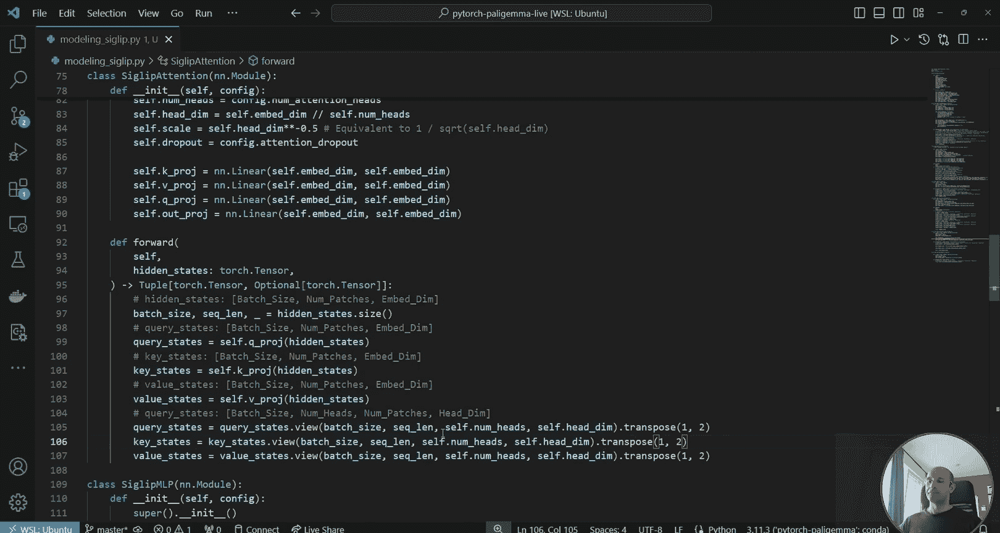

Let's go to the slides。So at the input of this visionion transformer。

 we have a sequence of patchesism， you can think of it as a sequence of vectors。

 each vector made up of let's say， 1024 dimensions。

 or you can think of it as a sequence of tokens in case we are working with the language model and each token is represented by 1024 dimensions vector。

The first thing that we do is we convert to this input sequence which we will call x into query key and value and we do it through three transformation one is called WQ1 is called Wq and WVN which is basically a matrix multiplication Now if you look at the shape of the input sequence here it's 4 by 1024。

 So here you can see the input sequence is 4 by 1024。

Where 4 is representing the sequence dimension so how many tokens or how many patches you have and the hidden size represents how many。

 what is the size of this embedding vector。We multiply each of these with a W Q， W K and W V。 Now。

 if you look at the dimensions here， W Q， W K and W V。

 they are the sizes embedding dimension to embedding dimension。 However。

 here I have represented it as。

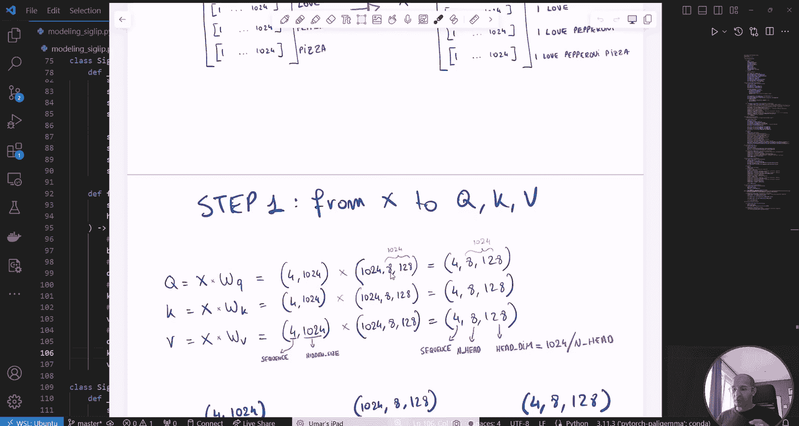

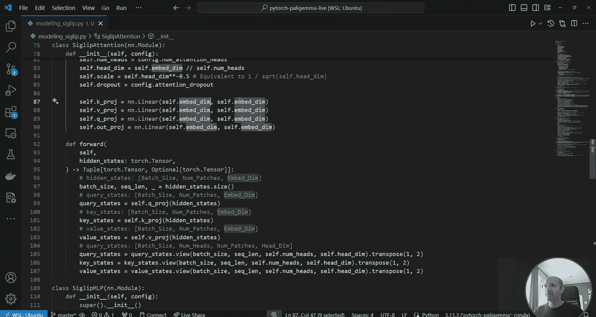

Ebedding dimension to 8 multiplied by 128。The overall size is the same so it's 1024 by 1024。

 However I'm splitting this second 1024 into8 groups and later we will see why so you can think of it as a matrix multiplication that takes is matrix multiplication between this tensor here for by 1024 and this other tensor which is also 1000 by 24 by 1024。

 however in which the second dimension is a split into sub groups。

 how many eight groups because8 is the number of heads we are going to work with each having 128 dimensions。

 if you do this matrix multiplication it is。It will result in this output here。

 so basically it's a 1024 multiply this dimension here cancels out as you can see and then we have the second dimension that remains so in the metrical implication the inner dimensions cancel out and the outer dimensions remain。

No。You can， if you are confused by this， you can think of it like this， so it's like a 1024。And it's。

1024， nothing has changed。I'm just grouping the dimensions。 So that's why it's possible。

But it this grouping is helpful， and now we will see why。

Let's visualize this tenor operation at a the matrix level。

 so when we do query this x multiplied by WQ， we have nx which is a 4 by 1024。

 so it's a sequence of tokens， each token is 1024 dimensions。

And we are multiplying by a very big matrix， which is 1024 by 8 by 120。 How to visualize this matrix。

 Well， this is a WQ。 So it's a parameter matrix。😊，It's also WK and WV so they all have the same dimensions you can visual I like this。

 you can think of it as a matrix made up of 1024 rows each row is made up of smaller vectors。

 how many smaller vectors8 of them and each of these smaller vectors is made up of 128 dimensions。😊。

The overall size of this matrix is still 1024 by 1024， but each of these。

 let's say these vectors are split into eight groups。😊。

So that the output is also a matrix in which each of the tokens is split into multiple subgroup。

 So it's a matrix that is for rows。 So as you can see this is four is the number of rows。😊。

Each row contains eight groups of smaller embeddings。

 and each of these smaller embeddings is made up of 128 dimensions。😊。

So why are we even doing this with multi head attention basically what we want to do。

 if we want the multi head attention is a way to relate tokens with each other。

We don't want to relate tokens to each other by watching the full embedding of each token。

 we want to do it with eight different heads such that each head works with a smaller part of the embedding of each token。

So the head number one will only watch the first 128 dimensions of each token in the entire sequence。

 the head number two will watch the next group of 128 dimension so the dimension from 129 to 256 of each token so this head will learn to relate all these tokens by only watching this part of the embedding of this each token this head will learn to relate tokens by only watching this part of the embedding of each token and this last head will watch will learn to relate to tokens by only watching the last part last 128 dimensions of the embedding of each token why。

😊，In many languages， a word may have different meaning。

 depending on the context in which it appears if we don't have multi head attention。

 because the multi head attention， we will see later is based on what is known as what is a dot product。

If we compute the dot product over all the token， then there is only way of calculating the dot product between two tokens which is the full embedding of the first token with all the full embedding of the second so there is only one way of relating two tokens with each other by splitting each token into smaller groups each dedicated to one head。

 so this is had one head two and the head eight and all the intermediate heads are here。😊。

We learn to relate tokens to each other differently because each head is watching different parts of the embedding of each token and this is useful for language modelling for example。

 because in language modelling， especially for example in Chinese。

 each word may have different meaning depending on the context in which appears。

 so it be a noun in some context it may be a verb in some other context or adverb in some other context。

 etc。😊，So we hope that this head here， for example， learns to relate this token as a verb。

 this head here we learn to relate this token as a noun and this head here maybe we learn to relate this token as an adverb or some other property that this token has。

😊，And this multiha attention also has another advantage because the multihad attention is based on dot products between tokens。

 this head here will do the dot product of this first 128 dimensions of this token with the first 128 dimensions of this token。

😊，And this head， because it watches this part of the embedding and this other head watches this part of the embedding。

 they can work independently from each other and so because they can work independently from each other。

 this computation can be paralleled that's why in the attention attention is all you need paper when they talk about the multi head attention。

 they make this drawing with the multiple drawings behind you can see here with the head dimension appearing here。

 which means that each of these head is computing this scale dot product attention in parallel with the other heads because each of them is working with a different part of the embedding of each token so they can work independently from each other。

😊，And this is what we are doing here。 So we group this。

This the metting of each token into multiple subgroups。😊。

It dedicated to one head because we want this multihandd attention to happen in parallel because each head is working with a different part of the embedding of each token so it becomes much faster because we can compute all this stuff in parallel anyway。

What we have done in the code is as follows。 So we have taken our input sequence。

 Now here for the drawing， I have chosen a 4 by 1024。

 but in the code it should be depending on how many patches we have。

 So no patches by embedded dimension， we have multiplied each of them by the Q K and V。

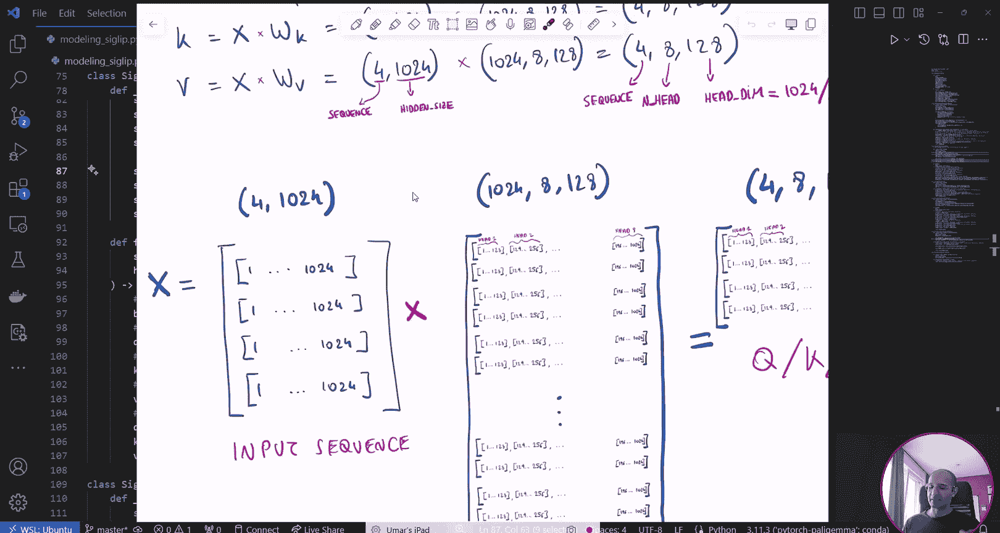

And then we split them here， as you can see in multiple heads so we added this head dimension here in my slide。

 I just pretend I am multiplying directly with a parameter matrix that is already split into multiple heads。

😊。

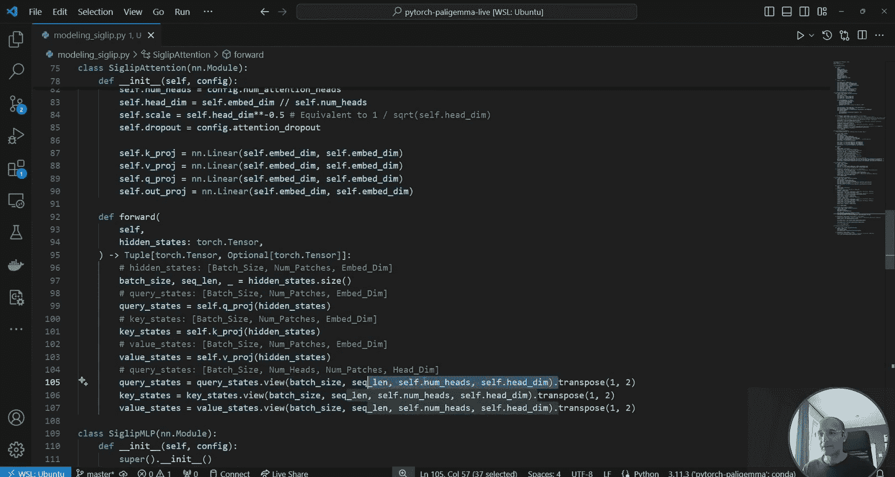

Why am I doing it differently here than compared to the code because we will be useful for this visualizing it this way will be useful for when we will be talking about the language model。

 and especially we will be talking about the group query attention because with group to query attention we will see that the number of heads for the query is much bigger than the number of heads for the keys and the values So here in the vision transformer。

 the number of heads of the query key and values is the same so we don't use the group to query attention and that's why。

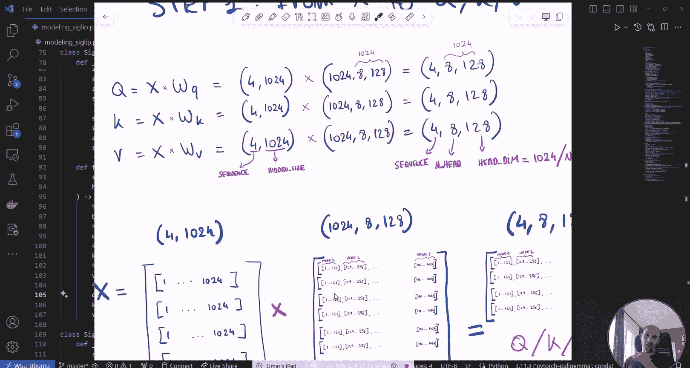

We use the same number of heads for the query key and values。

Then we do this transposition and now we see what is thistposition。

 So when you do this multiplication here， So you multiply the input by the Q projection。

 it will return the same input shape。When you do this view， it will just split this last dimension。

 So this embedded dimension into smaller parts。 So it will become nu。It will become like this。

Bches by heads。 So we are splitting。This dimension into these two smaller dimensions so nu heads by head dimension so basically what is this head dimension head dimension is the embedding full embedding divided by the number of heads so this one imagine this is 1024 then imagine this is8。

Then this will be 128 because it's 1024 divided by8。And。

Because we are not reducing the number of parameterss。

 so we are not throwing away anything we are just grouping differently each of these embedding。

With this transpose here， we are changing the position of the two two dimensions。

 So which dimension the dimension number one and the dimension number two。

 which is the num patches with the nu heads。So basically we are doing no heads and moon patches。

 so this will be the output of on this expression， so it will be a tensor of this embedded of this shape。

 bed size no heads， moon patches head dim， Why are we doing this transposition， Let's see。

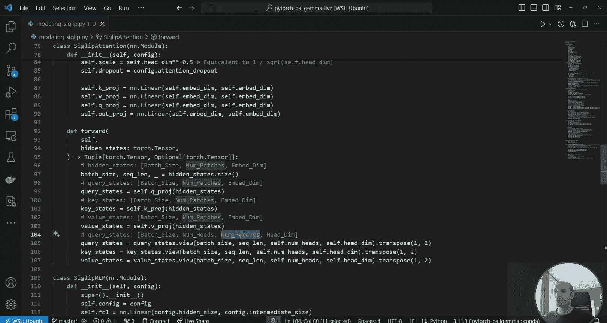

そう。We have when we multiply by this WQWK and WV， which is already includes the grouping。

 we are grouping each of these vectors into subgroup each dedicated to one head。Now。

 what we have here is a sequence of tokens， each token is made up of eight group of embeddings。

 each group of embedding is made up of 128 dimensions。 what we want， however。Is。

Because we want to compute the head multi head attention in parallel。

 which means that each head should be able to visualize the entire sequence。

 but a smaller part of the embedding of each token we need to transpose these two dimensions。

 So we exchange the sequence dimension with the head dimension and a way to visualize this is this。😊。

That let's do it。 So we have this sequence of tokens， each token is divided into8 groups。

 each group is made up of 128 dimensions。 we want to convert it。

Into multiple sequence made up of only the part of the embedding dedicated to each token。

 So when you do the transposition of these two dimensions here， they become like this。 So 8，4，128。

 How can you visualize this matrix。 You can visualize these as follows。

 It's a big matrix that contains8 smaller metrics， each smaller mat contains four tokens and each token contains 128 dimensions。

 which is exactly the dimensions that are dedicated to each of these head。

 So you can think of it as a a sequence，8 sequences。 When each sequence is made up of。😊。

Tokens and each tokens contain only the part of the embedding dedicated to each of the head that each of the eight heads its composed of。

 so this sequence here will only contain the first 128 dimensions of each token this sequence here will contain the next 128 dimensions of each token and the last sequence here will be a sequence of four tokens and each token will be made up of the last 128 dimensions of the initial tokens。

😊，Why are we doing this， Because now we can compute。

The multi head attention using this stuff here independently from this one。

 independently from this one， independently from this one。

 because each head has a sequence of four tokens and each token is made up of 128 dimensions and we end up in what we saw here so we can compute this scale dot product attention using the Querion values where the  Queran values are not the entire embedding of the token but are only the part of the token dedicated to that specific head。

😊，So this head here， suppose the head number one will be using the first 128 dimensions。

 this second head will be using the second 128 dimension。

 the last head will be using the last 128 dimensions， etc。

So we have created that's why we did this transposition。

 because we now we can treat each head independently。

 each head is made up of is working with the four tokens， which is the sequence dimension。

 and each token is made up of the part of the embedding dedicated to that head。

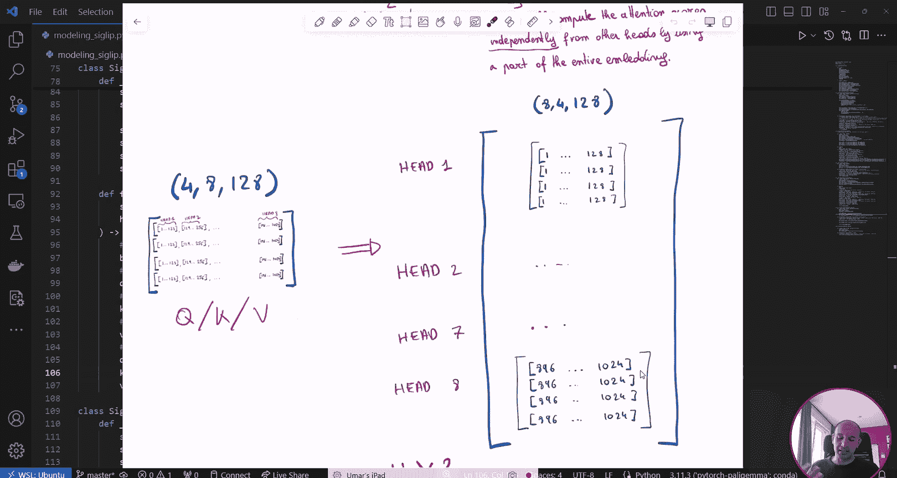

And this is why we do this transpose here。The next thing that we do in multi head attention is， well。

 we have these query values。 What should we do， we should do query multiied by the transpose of the key divide by the square root of the model。

 and that's it Yeah， so let's do it。Let's calculate the attention weights， which is this one。

 so we take the query multiplied by the transpose of the keys where we are transposing the second and the third dimension what is the second and the third dimension it's the nom patches with the head dimension because the query is a pet size。

 the loom heads， the nom patches， head dimension to multiply it with the keys we need to exchange the last two dimensions。

 otherwise you so multiplied we need like this we need。This stuff here。

Then we had dimensionation and new patches。Such that， if you remember in the matrix multiplication。

 the inner dimensions cancel out and the outer dimensions remain。 So the outer dimensions basically。

Is nom batches， nom heads then the hidden this is head dimension will cancel out with this one and will have to with the nom patches。

 So the output of this multi head attention basically is a matrix that is a nom patches by nom patches for each head。

Let me delete this one。So I know its not easy to visualize it like this so let's visualize it on the slides So what we are doing is we are multiplying the query with the transpose of the key and then we are dividing by the square root of the model but we already computed it here so this is the square root of the model。

😊，And we just because it's already one over square root， so we just multiply it。

 we don't need to divide by it。So let's visualize in the slides how this multiplication works。

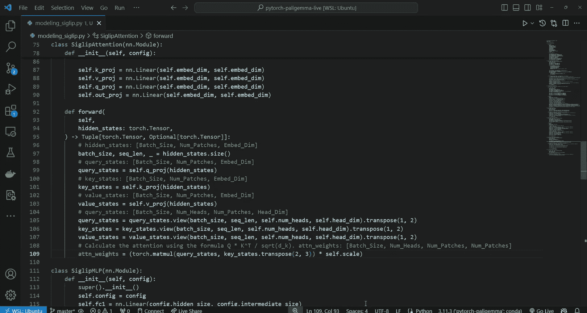

Okay， we already saw why we do the multihaitation because we want to parallellyze the computation。

 etc ceter。 So now what we are doing is we are for each head。Each head， as we saw before。

 is is made up of one sequence of embeddings where each embedding is not the full embedding of the token。

 but it's a part of the embedding of each token。 So it's a smaller embedding。 let's say。

 So each head basically will do the following matrix multiplication when you do query multiplied by the transpose of the keys。

 Each head is made up of a sequence of tokens。 and each token is not the full embedding of the token。

 but it's the first 128 dimensions of each token。 When we do the transpose of the keys。

 each of these row vectors becomes a column vector， as you can see。😊。

And when we do this matrix multiplication for each head， we will be getting this matrix as output。

 which is sequence by sequence， because as you can see when you multiply this matrix here by this matrix here you get four by four matrix as output because the inner dimensions cancel out。

😊，What does this matrix represent each of these numbers represents the dot product of one token with another token so you can think of the rows as being the queries and the columns as being the keys。

 this one here is the dot product of the first token of the queries。

 suppose that each of these tokens represent sentence like I love pepperoni pizza。

Then this is the word I， this is the word love， this is the word pepperoni， this is the word pizza。

Then this number here represents the dot product of the word I with itself。

 so the first query with the first key， this one here represents the dot product of the first query with the second key。

 this one represents the dot product of the first query with the third key。😊。

And we do all the possible dot products， as you can see here。

Now you are and what does this metrics represent， This represents somehow the relationship between two tokens。

 So the bigger the dot product， the more intense is the relationship between two tokens。 Actually。

 it's then defined later we will see that we apply the soft mark。

But you can think of the dot product as being how the self attention mechanism is relating to toosis。

 how intense is the relationship of this tuto cancer？

Why do we have this square root of the model as the denominator because we want to scale this dot product based on because usually when you train a model。

 you train multiple variants of it， for example。We when we some， for example。

 imagine you want to try you train multiple ions and you have this you try multiple number of heads。

 you don't want the magnitude of these numbers to change between one tri and the next one。

 so basically by dividing by the square root of the model you keep the magnitude constant。嗯。Now。

 what is this metrics doing so this matrix tells us how two dos are related to each other。

Now in a language modeling we also apply what is known as the attention mask。

 so we don't want the word eye to be related to future tokens。

 so usually we don't want to compute this dot product we don't want to compute this dot product and we don't want to compute this dot product because we don't want the token eye to be related to all any other token because there is no previous tokens We also don't want the word love to be related to the word the pepperpeoni and the pizza because they come after it。

 but we want of course the word the pepperpeoni to be related to the word love so there should be a number here so we don't want to mask out to this one。

 This is called attention mask。And how do we apply that Basically if we don't want some interaction between talkingken to happen。

 we can calculate the metrics as usual， so query multiplied by the response of the key and then we replace all the numbers。

 all the relationships that we don't want with minus infinity。

 so here we can replace this number here with minus infinity。

Here we can replace this number with minus infinity and then we can replace this number with。😊。

Minus infinity。So that after we need to apply the softmax。

 the softmax will convert each of these numbers into a probability score because we want the relationship of one token with other tokens to be between0 and1 and also we want each row to sum to1。

Laterten we will see why because actually when we do the contextualization we are doing a weighted sum but okay let's forget it about now。

 anyway the point is we apply the softmax row by rh。

 So if we don't want the relationship of two tokens to be considered by the attention mechanism。

 we replace that particular dot product with minus infinity before we apply the softmax because the softmax we saw before is an exponential it's e to the power of x when E is to the power of minus infinity it will become zero。

 So the output of the softmax will become zero for all the interaction that we didn't want So that's why we replace it with minus infinity。

😊，No， let me。Back whatever had before。Okay， so this is where we apply the mask。

 so as you can see if we apply the mask before we apply the soft masks。

 it will replace with zero old interactions that we don't want。😊。

And this is what is the this matrix here is known as attention weights。

 So it tells us how intense is the relationship between two tokens。

 And this metrics here is calculated independently for each single head because here I show you only one metrics here。

4 by 128。 but we have eight of them and each of them is calculated in parallel。

 So you need to think that you have eight of these metrics if you have eight attention heads。

 and in this case in the code， you can see that the output is a list of a batch because maybe we have multiple images。

 Each of these images is managed by multiple heads。

 Each of these heads will learn to relate tokens differently。

 So each of these heads will give us a no patches by no patches matrix。

 So sequenced by sequence metrics。 where each of this number represents how this head is relating two patches with each other。

😊。

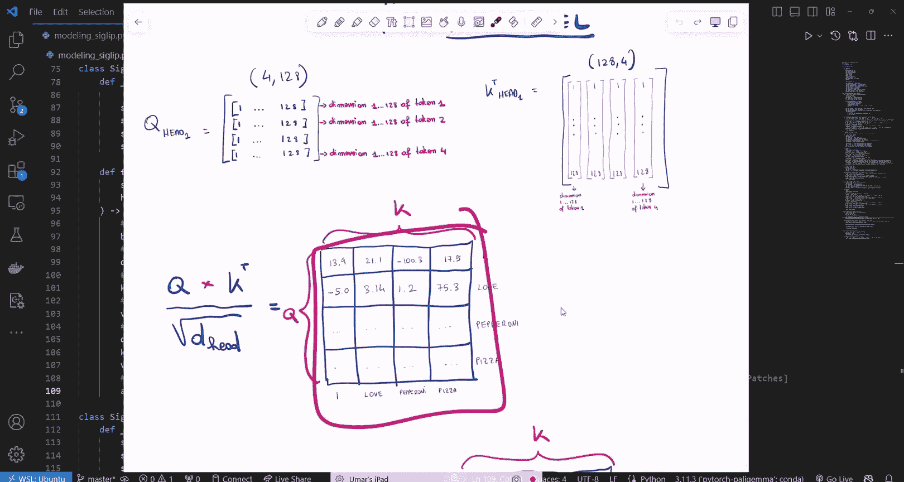

So now we have seen how to calculate these attention weights。

 which basically it's a matrix that tellss you how to tokens are related to each other。

 it's kind of a score of how the attention mechanismism thinks tokens are related to each other。

We continue our journey， the first thing we do okay we verify the dimension of this matrix。

And then we apply the soft marks， the soft marks， as we saw before。

 is a way to convert these attention scores into numbers that are between 0 and1 and also such that they sum up to one。

🎼And we do it by soft with the softm function， which is applied by rows。 And that's this dimension。

 This is what is the meaning of this dimension parameter， which tells you how you want to apply it。

 So we are applying it to the last。Dimenssion， you can think of this as the row dimension。

 this as the column， so if you applying it on entire on the columns it means you are applying it by Rosa。

Then we have the dropout but as I said before we don't use the dropout because I didn't see it in the parameters of the polygama ever being used so we have it but we don't use it and as you remember the dot dropout basically it takes random with the probability P it will set some activations to zero so some numbers of this input matrix to zero but we don't use it and it only happens during training and it's a way to reduce overfitting but it's not used。

The next thing that we do in the multi head attention is we' are multiplying this attention weight matrix with the w with the V sequence。

 the value sequence。So we multiply this mathematical means matrix multiplication we are multiplying these attention weights with the states which is the value sequence。

 which is a transformation of the input sequence through this Wv matrix and also by grouped by heads let's visualize this operation so let's go here so the output of the attention mechanism of the query multiplied by the keys is this matrix here where each number represents the how to tokens are related to each other by applying the softm this number become between 0 and1 in each row and also in such a way that the sum up to 1 so here you can see it's 1。

0 because there is only one number here it's 0。4 and 0。6 so the sum up to 1 and here is 0。20。40。

4 so the sum up to 1 etcter。

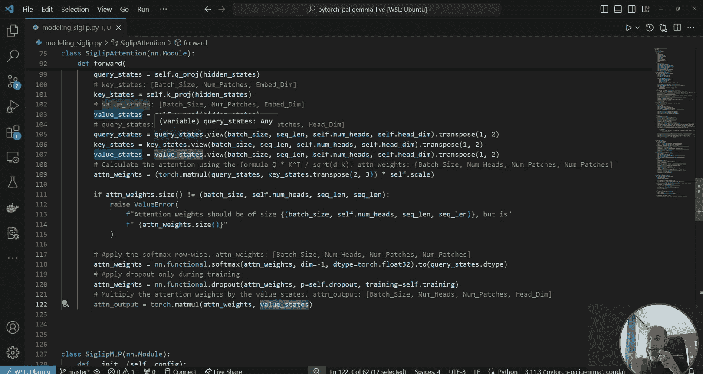

Now， when I see that these numbers represent the intensity of how the attention mechanism relates to token is because now when we multiply this matrix here。

 which is in the code is written as attention weights。

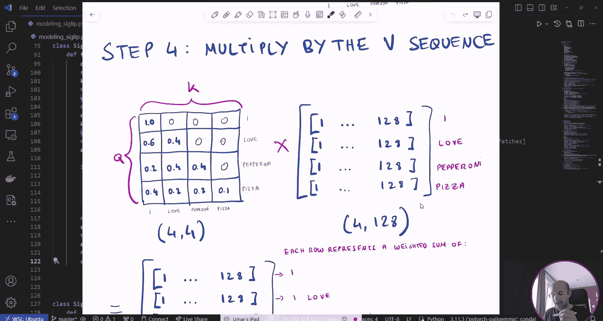

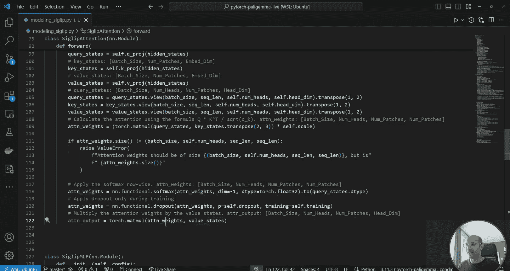

We multiplied it by the V matrix or the V sequence or the value sequencer。

We are computing a weighted sum why。When we do this matrix multiplication we are multi multiplying for example。

 a 4 by4 matrix by a 4 by 128 metrics where each of these v matrix is one for each attention head just like each of these matrix here At weights is one for each attention head so each of these attention heads will be doing this product in parallel So each attention heads does query multiplied by the transpose of the keys in parallel。

 the soft mark in parallel and this multiplication with the V matrix in parallel。😊，I mean。

 not these operations in parallel， it's the attention heads that work in parallel。

 the operations are sequential， of course。Now what is the output of this product it's a 4 by4 multiplied by 41228。

 so the output is a 4 by 128 because the inner dimensions cancel out and the outer dimensions remain。

Let's analyze this output matrix here， so it will be a matrix with a four tokens so each token represented by not the full dimensions。

 but because we are working with multi head attention each head will have a smaller part of the embedding of each token so it will have 128 dimensions in case we have eight heads and the embedding dimension is 1024。

This first number here will be the dot product of the first row of this matrix with the first column of this matrix。

And as we can see from this row here。All the values are0 except the first one。

 which means that only this token here will contribute to the output here。

 which means that this and the second number in this matrix here。

 So this stuff here will be the dot product of the first row of this matrix with the second column of this matrix。

 but most of the values here are0 except the first one which means that only this token here will contribute to this second number here。

 So all the dimensions in this row will be contributed only by the first token multiplied each multi the dimension of the first token multiplied by the number one。

 because all the other tokens will be multiplied by00 and the0。😊。

Let's look at the second row of this matrix here， this one here， the first number。

 so the first dimension of the second row of the output matrix will be the dot product of the second row of this matrix with the first column Now the first two numbers are non0ro and the second two numbers are0。

 which means that only the dimensions of the first two tokens will contribute to this output embedding for each of these dimensions。

 So for all the dimensions here will only be contributed by the first two tokens because all the other tokens。

 whatever there is the number is here。They will be multiplied by zeros so they will not contribute to this output embedding that's why we can say that this is a contextualized embedding。

😊，In which the contribution to this contextualization only comes from the first to token how are they this to token contributing Well each of these numbers in the second token will be multiplied by 0。

4 and each of the numbers in the first token will be multiplied by 0。

6 this you can see it as the first token contributing 60% of the information to this contextualization and the second token contributing 0。

4 to this 40% to this contextualized embedding and you can do the same for the third output so this output here the first number will be the dot product of this third row multiplied by this first column and as you can see here we have a 0 because of the causal mask。

😊，Which means that only the first three tokens will contribute to the third embedding here。

 how much each token will contribute， Well， it depends on how are this number distributed。

 the first token will contribute 20%， the second token will contribute 40% and the third token will contribute also 40%。

 So that's why when we talk about the attention which metrics we talk about how to the metrics the attention mechanism。

Is telling us how intense is the relationship between two token so that each token will contribute。

 that token will contribute to more to the output embeing。So if the word。

 let's say pizza and I are very related to each other。

 when then the embedding of the word I will contribute most to the output of embedding of this for contextualized position。

😊，So it means that the fourth conceptualual position will be 40% based on the information contained in the token eye and 20% of the information contained in the word the love and the 30% in the word。

 the pepperoni， et cetera， et cetera， et cetera。😊，So this is why it's known as weighted sum because you are summing the contribution of each token if it's not mued out。

Weighted with the attention score associated by calculated using the attention weights metrics here。

 and we do this for each of these head in parallel。

So each head is watching a part of the embedding of each token and is learning to relate them differently and then doing this weighted sum differently。

😊，And each head will contribute will output a list of contextualized embedding。

 but each of these contextualized embedding will not be a full token。

 it will be part of what is the full token and now we see how we can merge the result of this multi head attention and for that we need to look at the original paper so if you look at the original paper。

😊，We calculated this multi head attention in parallel and how can we merge the result of this multi head attention Well we go here and we basically conco these heads So we take the output of the first head。

 we concot it with the next， we concot with the third head with the fourth the fifth etctera， etcter。

 all the heads So until we get the full dimension of the original token back because each head is made up of 100 in case suppose 128 dimension So this will be the first 128 dimension then the next 100 and the third 100 etc cea until the last 120 dimension so we get back the 124 dimensions back。

And we do this stuff， let's go back here。Here， so each head。

Will return a contextualized embedding for each position， but it's a contextualized embedding。

That does not include all the original token contextualized。

 but a part of it because each has is working in parallel with a part of the embedding of each token。

 then we concatenate them。 So what we do is we basically we want to arrive to this stuff here。

 So we have a contextualized embedding here one for each of the heads。Okay， first we need to do。

 I believe， a transposition so we need to transpose back because before we transpose right so we we put the head dimension first and then the sequence dimension So now we need again the sequence dimension and then the head dimension after so that each we go from this configuration which is for each head we have a contextualized list of tokens we want to get a list of tokens in which each head is contributing its 128 dimensions which areualized embeddings a smaller embeddings。

 let's say。

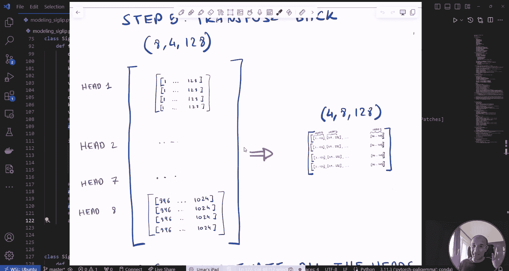

So let's do this transition also in code， I believe it's here。

 so I think there is another checking of the output dimension。We tro force back。

So we do this transposition back， so we did the first transposition here to exchange the number of heads with the sequence dimension。

 now we transpose back。So we go back to the nom patches and num heads。

 so it's a sequence which sequence is made up of smaller eight groups or nom heads group and each head is made up of head dimension variations。

We do this contiguous because we want to reshape， okay， it doesn't matter。

 you don't have to know why we do this contiguous， but basically。

Contiguous means that we want the tensor to represent the information in the memory in a contiguous way so that the next operation that we are going to do the reshape is basically does not require any computation because when you do a reshaping or a viewing of a transfer of a tensor。

 there is no change in the memory layout of the tensor。

 actually the pythtorarch will just change what is known as the strain of the tensor。

 So if you go to a tensor。We are going a little out of topic。

 but there is this thing we call the stride which tells you how to go from one dimension to the next term without changing the layout of how thesetensorities are located in the memory so when you do a view。

or reshape the Pythtorarch will just change these numbers on all the strike okay I will do another video on how this works but anyway but this contuous allow us to have this sensoror all in the memory as a contiguous memoryial location so that this reshape operation can be done without。

Without computational overhead。Now let's get it back on track。

 So we did a reshape operation in the slides。 So after we have to do we did the transpose operation and now we need to do a reshape operation。

 So the transpose operation basically allow us to get again at the first dimension。

 the sequence dimension， then the grouping of the group of dimensions of each token and each group contains 120 dimensions now we need to concatenate them how can we concatenate them。

 well we just want to merge this heads again together into one single token。

 and we do that with this reshape operation。 So with reshape。

 basically we are going from num heads head dim to embed dim， which is in this case， it's a 124。

 So how does it work the reshape， basically。😊。

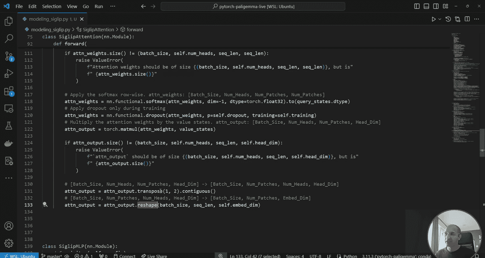

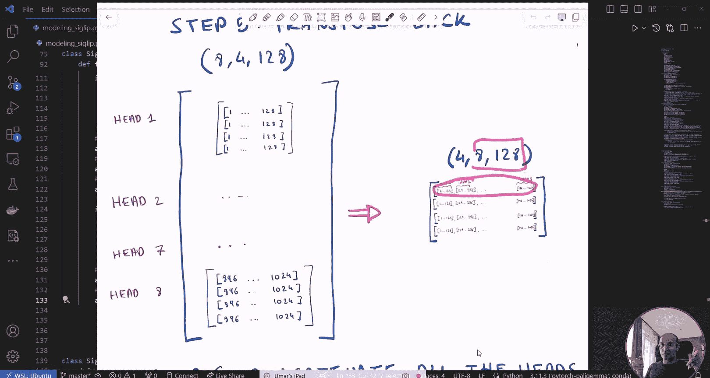

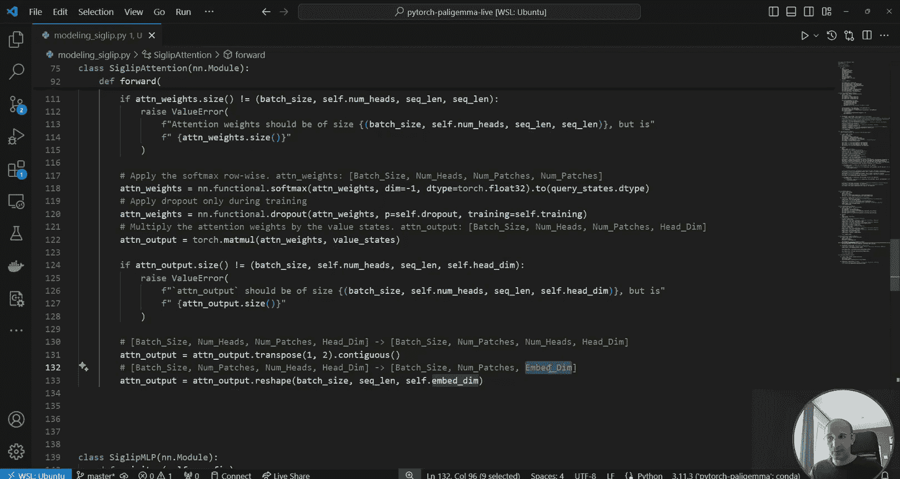

The the pythtorch will take each of these groups and will just merge them。

 so it will just concatenate them with each other。 So instead of being a matrix that contains sub arrays where each sub array contains a multiple sub arrays and each of these sub sub array contains 120 dimensions。

 it will just become a matrix that contains one array that is made up 1201024 dimensions。

 so which is the concatenation of all these heads。😊。

So this is how we merge the information of all this multi head attention that was done in parallel into one single token that is a contextualized version of the initial token。

😊，So we as you can see， we got back the initial shape。

 so we started with before at the beginning of the multiheadd attention。

 we started with the4 by 1024 input sequence and we end up with 4 by 1024 sequencer。😊。

There is one last part that we need to do。That is multiplication with this WO。

 So if you look at this concatenation that we have done。😊。

The concatenation basically takes this tend to this this first token here is just the concatenation of the first 128 dimensions。

 which are the output of the first head， then the second 128 dimension。

 then the third 128 dimension and then the last 128 dimension in total they are 1024 dimensions。

But there has been no mixing between the result of these heads。

 so it's just a concatenation of multiple of independent calculations。

 each calculation done by one head independently from the others。😊。

But we want the token to not be a concatenation of independent calculations。

 we also want to kind of mix the result of these heads with each other and the mixing happens when you do this multiplication by WO the WO matrix is a matrix that is embedding size by embedding size。

😊，Wwhichch basically as you can see does not change the shape of the input so we have the input of this WO will be 4 by 1024 we multiplied by 1024 by 1024 so it turns the same input shape。

But it will be because let's look at this number here。

 this number here is the product product of the first row。

 so the first token with the first column of this matrix。

And the first column of this matrix is 124 parameters so all of these heads so the 120 dimensions of the first head1 120 dimensions of the second head。

 etc cetera， et cea， we all participate in the same dot product giving up one single number here so there have been a mixing of the results of this head if we don't multiply it with the W is not there is no mixing between the result of each head which happen independently in parallel and that's why we multiply by W so we don't want each token to be a contextualized version of multiple sub tokens each calculated independently from each other by the multi head attention we want to of course it to happen because we want to parallelize。

 but then we want to mix the result of this multi head attention and we do that by multiplying by WO。

And now let's do it。For now we just merge so this reshape is basically doing the concat that we saw before in the attention paper。

 now we do the multiplication with the WO which is this stuff here so out projection it won't change the shape of the ten so that is input to it and then we return it along with the attention weights。

 actually we will not be using the attention weights。And now finally。

 we have implemented the multi head attention。I just realized we forgot something guys。

 so we forgot to implement this encoder so we created the layer of the encoder。

 but we didn't create the encoder itself。 So what we created basically in this vision transformer is this stuff here so let me open the slides。

😊。

We created one single layer like this one， but we didn't create the sequence of this layers because an encoder is a sequence of this layer。

 So let's do it。 it's very simple。 So this is a single layer。

 but we need to create a sequence of them because we apply one after another such that the output of one is used as input for the next one。

 it's a very simple class So let's create it。😊。

Let's create the。Constructor， so it's just very simple。 it's okay we save the configuration。

 and each we create a sequence of layers where each layer is this encoded layer to which we pass the configuration。

How many we create based on how many layers it should have， so the transformer layers。

And the forward is very simple。 I can just copy it all。 It basically says， okay， we have the input。

 We give the input to the first layer and it the output of this layer becomes the input to the next one。

 So we do a for loop。 And then we return the the output of the last layer。 This is very simple。

 And as you can see between each layer， there is no change in the shape of the tensor that is fed。😊。

I believe I think we have coded all of the Siig Li， so which is our revision transformer。

You may think that I have lied to you by saying that at the beginning when we were talking about contrastive learning。

 you okay， actually let's look at it， otherwise we will have the doubt。😊。

When we were talking about contrastive learning， we were talking about generating one single embedding for each image。

 but here we are generating a sequence of contextualized embedding。😊。

So how can the image generate one single embedding for a single image So in the transformer。

Is it sequence to sequence model， so you give it a list of patches as inputter and it will give you a sequence of contextualized patches as outputer when working with something like C。

 for example， if you want only one single embedding for each image。

 you can just take the first output contextualized embedding from the transformer as a representative for the whole image。

😊，Because it will force the model to put all the information in the first contextualized the embedding。

 So that's one way to do it。 Another way is to just to take the average of all the output embeddings by the transformer to generate one single embedding。

 Anyway， this was just closing a note before we move to the next part， which is our language model。

 So let's go back to the architecture， which is here。

So we have quoted this part here the vision encoder。

 so we feed an image it will be the vision encoder extracts some patches。

 each of these patches become an embedding to this embedding。

 we add a positional encoding which is learned， we send it to this magic box called the transformer layer which will contextualize them。

 we take the output of this contextualization and this becomes our image embedding them。Now。

 before we can feed it to the language model， these embeddings may not be of the same size of the embeddings used by the text layer。

 so we will need to introduce this linear projection So in the next part of the video we are going to code the language model including this linear projection here and we will learn how to merge this tokens the image tokens and the text tokens。

Okay， let's start。 So the next part that we are going to code is basically how to load the image from the disk to convert it into a tensor and also how to organize the text。

 And we need we will see that we need to do the preparation of the text is has to be done in a particular way。

 Let's see actually why we it has to be done in a particular way。 So let's open the slides。

 Oops I think I closed it。 So let me open it again。

All right。So as you can see we need to find a way to combine the image tokens with the text tokens。

 so first we need to tokenize the text， but we need to create some placeholders for where we will put the image tokens before the text tokens so I will use the term image tokens and image embeddings interchangeably because you can think of the image embeddings as kind of tokens that represents the image or and the text are the embeddings that represent the text that is the prompt from the user。

So the first thing that we need to do is know we need to know how to load this image into a tensor because then as you can see from our Sig Li code。

 the input to the siig Li is a tensor that has the channel， the height and the width dimension。

 which is then transform into patches and codeexualized， etcter。

Then we need to tokenize the text， we need to create this list here。

 but we will create first a list of tokens each corresponding to the text tokens and then we will add some placeholders where we will put the image tokens。

And then it will be the transformer that will。Take these placeholders and replace it with the image。

 So I know it's a lot of things to remember。 So don't worry。

 let's code it and we will see it step by step。 So let's go。

We create a new file called， let me check here， processing， processing polygamma。Got by。

We do some imports。Okay。We create this to a cost answer， and later we will see why we need them。

For now， just create them。Okay， let's start from the beginning。

 so let's create this class called the polygama processor。This up here。It has a constructor。

 which is this stuff here。It will take as input the tokenizer how many image tokens we need to generate for the image and what is the image size that this particular gamma will work with。

We save it。 We save these two values。 And then what we do。

 We need to add some special tokens to over tokenizer。

 So now I show you why we need to do it and how it works。

 So the tokenizer that polygamma is using is the tokenizer of the gama model。

 but the tokenizer of the gamma model was not created with the special tokens for the image。

 So what they did they basically created this additional tokens called the because polygama can be used for multiple purposes。

 So what we saw here in my slide is basically here is trying to extract information from an image。

 So we have an image we have a prompt and the polygama， So which is basically the gamma model here。

 will they code the response by interpreting prompt and using this one as additional information for the prompt。

😊。

The image。Plygama actually can do much more than this。

 polylygama can also do image segmentation so it can segment the part of the image that， for example。

 for this lag， it can do object detection so it can detect all the instances of three for example。

 if we do object detection for trees， it will probably give us okay this is not a bounding box this box here telling that this is a tree if we do it ask it to detect all the feeds it will give us two boxes。

 one for this one， one for this one， etc。 So polygama can do a lot of this and the way it does it by using special tokens for a segmentation。

 they are called segmentation tokens and for object detection they are called location tokens。

AndBut we will not be using them so our goal here is just to influence polygama so we will not be working with object detection or object segmentation。

 but if you want more information on how these tokens work there is a very nice article not only this one from Google so here in Google they say。

That polyligama uses the gamma toizer， but they extend it with these further tokens that are used to tell。

In the output of the model， where is the segments， where is the bounding box position that it has detected or where is the location of the of the segmentation mask that the model has detected。

😊，Another article that I recommend is the hugging face blog article about polygama。

 so let me find it， I believe it is this one here in which they describe how this attention masks works so as you can see polygama can detect the cat and will give us this output which is a lock tokens as you can see lock 009400 256 which this number 0094。

0 256 tell us the deposit position of the top left top right。

 bottom left and bottom right corner of this bounding box here。

But we will not be using here because we are only interested in using the polygama as a conditional model for generating an output condition on the image that we feed it in。

But anyway， because the tokenizer used by polylygama is adding this special token。

 we also added them here and how to add them and how many to add them is described in this article you can see here and so basically we have 1024 location tokens for image detection and then 128 tokens for object segmentation。

Okay， received the tokenizer。Then what do we need to do。

 we also integrated this constant called image token。

What is this constant basically when we process our text with the gamma tokenizer。

 the gamma tokenizer will only generate， of course the tokens for the text。

 but later we need to also insert in this tokens， the image tokens。

So what we need to do， what we do basically is we insert some placeholder tokens that will then be replaced by the embeddings extracted by the vision encoder and this placeholder tokens that we will be using is this image token here and we added also。

😊。

And we added it here in the tokenizer。Now， how to use this polygamma processor。

 So the polygamma processor is a special class that's given an。Text。

 which is the prompt of the user and an image will load the image， pre processces it， so resize it。

 res scale it to whatever the vision model needs to see。And we'll create this。

Text tokens with the placeholderer for the image tokens， so let's do it。We create this method here。

 the call， why we create the call method well basically this allows the instance of the processor to be called like a function so when you create the processor we will create it like this like polycama processor and then we can use it like this passing the arguments here so this is why we implement the call method。

And the code method takes as input a list of text and the list of images。

 but we will actually only accept one text and one images because I don't want to deal with the padding。

 Otherwise it will complicate our code。 Our goal is not to make it universally perfect。

 Our goal is to learn by doing and how it works。 Actually is this code will be usable So we will actually run the inference later。

 but it will only work with one image and one prompt at a time。

 It doesn't matter because later we can I will try to make the code for fine tuning this model。

 and we will see that we will change this code a little bit to accommodate for the paing。😊，Anyway。

 we need to process these images and we will use a special method called the process images。

 So if we take each of these images and we need to resize it。

 we resize it to the image size that is accepted by this polygama version。

 So as you can see the weights of polygama。

Actually so there is multiple weights， but this is2 to four only res the images to the size 1。

224 by 224 and generates 128 tokens for this each image。

Then we rescale this image and later we will see why we do it and then we normalize it to using the mean and the standard deviation of Iaginator。

 it's not really the im mean standard deviation， but later we will see how it works。😊，Anyway。

 suppose that this method here will load the image will rescale it， will normalize it， etc cetera。

 and convert it into。😊，A sensor that can be then processed by the vision model。We do it here。

 So we create here a tensor。 So because this will return a list of tensor。

 we need to create a one single tensor with the batch size。

 So we stack them stack basically it means that if we have a list of tensor。

 it will create one single big tensor where it adds one another dimension called the batch size one So instead of becoming a list of tensor。

 it will become one big tensor。This is a luy tensor。 It is converted into a torch tensor。And then we。

Create the input to the model。 So later we really expand this method。 So now I just create them。

What is this method going to do while this method is going to， let's check here。

 it's going to create the tokens of the text and create the placeholder for the image tokens。

And then。We tookken is itita using the placeholder tokens for the image， and then we return it。

 So now let's expand。Thisiscover， I know that I have copied a lot of code。

 Now I will explain it one by one。 So let's start at input。

 We have a list of text and the list of images。 Let's process these images So let's create this process image function。

😊，What is it going to do？Let's copy it。 It's very simple， actually。Okay。

 the process image takes us input a list of images， what is the size that we want of these images。

 what is the kind of resembling that we want to do when resizing this image you can do linear。

 you can be kic， etc。😊，ARscale factor if we want to rescale this image and the normalization mean and then the standard and this has the same meaning as the normalization that we do in the neural networks so we want the image no matter what it represents to always have the same distribution more or less so centered on zero and the variance of one。

😊，And the way we do it is basically we take the image values so the tensor。

 we subtract the mean of all the images that we have in our data set。

 and usually we use the mean of the imagenet dataset and the standard deviation of the image net dataset。

I don't know why in the hugging face they use 0。5 because it's actually not really 0。

5 it's very close to 0。5 each of these numbers， but it's not really so maybe it works anyway and we have one for each channel of the image so one for R one for G and one for P。

So what is this function going to do first it res the image by using this resembling method。

 then it will convert the image into a nuI array then it will rescale it so that the pixel values instead of being between 0 and 255 will be between0 and1。

 then it will normalize using the mean and the standard deviation of imagenet and then it will move the channel dimension to be the first dimension so instead of being height width channel it will be channel height width。

Let's implement these very simple method so the first the is size。

The re is just going to resize the image using the methods already implemented by the pill library。

 so this one called the Py Python imagingaging library。

So it will take the image and it will reize it using this re method。Then we have this risk scale。

The scale is just going to rescale the image so it will convert each pixel value instead of being between 0 and 255。

 it will resscale it into between0 and1 why because as you can see here we pass a scale factor of one over 125 255 so that's why we are multiplying it by this scale。

The next thing that we are doing is normalizing， normalizing means that we want the each of these values to be distributed like it's coming from a ocean of mean zero and variance of1 and we do it by subtracting the mean and dividing by the standard deviation as you can see here。

嗯。I believe we have already implemented everything for the process images。😊，Now let's go further。

 so we have these images， we are processing them， so they are still a list of images。

 we convert them into they are converted into a list of nuumpy arrayser and we do that here。

As you can see first we convert them into Nmai arrays then we scale normalize transpose。

 so we have a list of Nmai arrays， this list of Ni arrays is converted into a single tensor instead of being a list of tensor it become one big tensor。

And then we convert it into a torch tensor。 This torch tensor is the pixel values that will be fed to the model to the image encoder。

Now we need to take the our text。And we need to tokenize it。

 but we need to tokenize it by already accommodating for the position in which we will put the image embedding。

And we do that by processing this each of these texts through this function called add image tokens to prompt。

 which as the name implies， we add this image token placeholders to the prompt and the way it's done is here。

It's very simple， actually， all let go。You can save it here。

 It's a long comment because I found a little bug in this one， but okay， later I explain to you。

 But basically， we add the some image token placeholders， how many of them。 Well。

 depending on how many image tokens this model needs in the case of polygama 22 4， we did 128 tokens。

 I believe。

Oh no， this is not， this is the text do I think it's 256， I remember correctly。Later we can check。

 I think it's in the config oftson。Let's go here。

256 image tokens。Then we add the beginning of San token and then we add then the prompt of the user。

 it's called the prefix prompt。How did I come up with this function， I didn't come up with it。

 I copied from hugging face implementation， but how did hugging face come up with this actually。

 it's from the paper of polygama。 So if we go to the polygama paper， let's go here。

Here here they show you how to prepare the input for the gamma model so we have a list of image tokens then we have the prompt of the user that tells us what the language model needs to do with this image so if as you saw the example before in in the introduction here the prefix is this one so we want the language model to tell us where is the photographer resting by looking at this image and the model will generate this output so this is called the prefix。

So this is the prefix and the prefix is built by first taking okay we take the image tokens and we are adding them here and based on how many this model particular size of polygama needs then we have the beginning of sentence token and this one then we have the tokens of the prefix which is the task that we want the language model to perform and then we have a separator。

 the separator token is a slash n so its the new line new line character。

So we have this beginning of set the token。 So we then we have the token the task the prompt by the user based on what task we want the language model to do。

 And then we have the separateparator token， which is a flash and。 Now， in the paper。

 they say that they tokenize the step token separately。

So this slash and needs to be tokenized separately from the rest of the。

Input because we don't want the slash and to be merged with this with the with the prompt by the tokenizer。

 So as you know， the tokenizer will convert a sequence of。

Characers into tokens and if in the dictionary of the language model there is one character suppose that we ask the language model to tell me where in the photograph and suppose that in the and then we have this new line suppose that in the vocabulary of the language model there is a token that is like this so rougher and thescape end it will become one single token so suppose that this one becomes a token number3 and then there is another token that is a space pro to it becomes a token number5 and then the token the D is another token so it's the token number6 so we don't want the escape end to be merged with whatever comes before it so the paper they recommend to tokenize it separately So that's why I wrote this comment here to note that it should be tokenized separately but I don't know why in hanging face。

They do it without tokenizing it separately。It could be a bug or it could be some other indication that I am missing。

 so I just write it now later I will investigate and probably p the hug place team。

But for now we just need to think how we prepare the input so that input is prepared like this。

 A number of input image tokens， What is each of these image token。

 it's this place holder token that we created here， this image token。

 how many of them depending on the size of the model and we have this beginning of sentence token and then we have the prefix the prompt of the user and then we have the selection we take all of this and we tokenize it。

Using our tokenizer。And we return this stuff here。 So we return this input。

 which is the input I and the attention mask that will be generated by the tokenizer。 In this case。

 we are not using any padding。 So the attention mask will be just a list of ones。

 So what is the input I as you remember， tokenizer is converts the text into a list of numbers where each number represents the position in the vocabulary of each token。

 So these are not embeddings。 These are just input ideas。

 So it's a list of numbers where each number represents the token position in the vocabulary。

 So imagine our vocabulary is made up of words。 So the word hello the sentence hello word may be tokenized as follows。

 So。It may be tokenized as a list of two tokens， for example， three tokens， for example。

 the first one corresponding to the word the hello。

 then the one corresponding to the space and then one corresponding to the word word suppose its the token number9 so these are called input I so it's not an embedding it's just one number for each token then by embedding later this will be converted into embeddings which will be one vector for each token so with the suppose 1024 dimensions。

So this one will be for the first look in 1024 dimensions。

 then for the second look another 1024 dimensions et I said I said now。

So this is how we prepare the input。 So for now， we have reized the image converted into a tensor。

 Then we have taken our prompt。 We have added some placeholder tokens for the image。

 Then we have added the prompt of the user， and then the slash and character。

 as indicated by polygama。And now our processor will return this stuff Now we need to understand what to do with this stuff。

 so we need to code our language model Alright guys。

 so let's continue our journey by creating another file here called modeling gem dot pi which will be our language model。

 so the language model that will the code the answer of the answer using the prompt given by the user and the image that we have provided as input。

So we create this file， we import a little bit of stuff， the usual stuff， so torch， some mat typing。

 and then we import the sd model that we have created before。

 so the vision model and the configuration that it needs。I let's do a bottom up approach。

 which means that we first create the structure of the model and then we create each single component。

So let's do it。Let's do it。 this one。Alright。Our main class will be called the polygama for conditional generation so why it's called conditional generation because we are conditioning the generation of text on the image that is provided as input this is why it's called conditional generation and also actually it's because of how we create the attention max mask that we will see later because we are attending to all the tokens of the prompt of the user and all the tokens of the image。

Without any causality， so it's used like a condition， but we will see that later。

 So the constructor accepts a configuration file which we are going to create now。

 it will create an instance of the vision model。 So the encoder of the image。

 it will create this multimod projector， which is a linear layer。

 let's actually visualize it all these components。

So we go here and then we open this stuff so basically the multimod projector is this linear layer you can see here linear projection。

And the vision model is this contrastive vision encoder。

 and then we have gamma for causal language modeling， which is this our transformer decoder。

 So this class basically polyligamma for conditional generation is actually the class that will make connect all these components together。

I don't know why my pen is not working， my iPad pen。Now it's working。 lookss like。 So， yeah。

 now it's working。 Okay， let's continue。

Alright， so we have created this it will create an instance of the language model。

 it will save some stuff like what is the language model。

 what is the vision tower which is the image encoder， the multimod projector。

 which is the linear layer that will convert the size of the embedding output by the vision encoder into the size of the embedding of each text token so that they can be concatenated together。

 we also save the padding token。We need to create another method called T weight and we will see later what is this about or actually we can check now what this is about。

So T weight basically means this so let's go back to our here and let's open the attention mechanism and actually let's open the transformer model so weighttying is a technique for kind of reusing the parameters of one layer into another and specifically in the case of language model most language models are in the code only language model which means that they are only made up of this part of the transformer without the cross attention so there is no this block here so they are made up of the self attention with the normalization then if forward with the normalization a lot of layers like this so one after another then we have a final linear layer that projects the embedding output by these layers into logicits and then we have the soft marks to understand which of these tokens has the maximum probability score given by the language model。

Now in this the job of this linear layer is basically to convert the embedding out the contextualized the embedding output by the last layer of this series of layers into the vocabulary size which is exactly the opposite that this layer is doing so the embedding layer。

 the embedding layer is converting the token ideas so the position of each token in the vocabulary into an embedding while this linear layer here is doing exactly the opposite converting an embedding into its positioning the vocabulary so。

😊，Many language models， not all of them use a technique called the weight time which basically shares the parameters of this layer and this layer because they are doing basically one the inverse job of the other。

Wwhichch is also a technique actually to reduce the total parameters of the model because if you are sharing these parameters。

 you you will reduce the number of parameters and in many language models depending on the vocabulary size these parameters can be actually quite expensive on the overall total number of parameters of the model so it could be by 10% of the parameters in this layer here so if you are sharing them you are actually reducing the number of parameters。

 let's say by 10% because on how many tokens you have in your vocabulary。

So we created this method here， T weights， and later we will implement it also in the language model。

 so in the gamma theder language model that will tie the weight of these two layers。Okay。

 now that we have seen also this one， let's go further。

 which is the implementation of the forward method， so。🤧嗯。So implement the form method as follows。

 So it accepts the input I。What are the inputide， The inputide will be the inputide extracted from this polygamma processor。

 which will be the some image tokens。 So a lot of tokens like this one， image image image image。

 how many， depending on the size of polygama we are using。

 then it will contain a beginning of sentence token， then it will contain the prompt of the user。 So。

 for example， tell me where is this photographer。 and then a new line character。

 the token corresponding to the new line character。Yeah， thanks。 Okay。

 so then we have the pixel values， which is the again。

 is the image extracted from this polygama processor。

 which is the image loaded by this polygama processor rescaleed， resized and。😊。

Nize using the mean and the standard deviation of this image net standard mean and standard deviation。

It is converted into a pair into a tensor and then provided as is then the goal of this polygama for conditional generation will be to take this image and feed it to the image encoder to get extracted the image token then we have this attention mask the attention mask is provided directly by the tokenizer so whenever you tokenize text using the tokenizer it gives you two output one is the input IDs and one is the attention mask。

Because we will not be using any padding， the attention mask will be a series of one。

 Later we will see how we also need to modify the attention mask。

But actually we will not be modifying because we will not be using any padding so yeah then we have the Kb cache which we will talk about later when we actually use it so for now just consider it as something that you don't know anything about and later we will discuss。

Okay， so let's see that。Okay。We have first we make sure that we are not using any padding because I didn't implement the code to manage the padding。

Then we extract the input embeddings of the text tokens and the image placeholder tokens。

 So in the language model， we have added a fictional token called the image。 So this token here。

Which will be converted into an input I。 So it will be converted into a number。

 which corresponds to its position in the vocabulary。

 What we are doing is we are converting all the input tokens， which are the image tokens。

 the beginning of sentence token。 the tokens of the prompt plus the new line character into embeddings。

 Of course， the embeddings produced by the image placeholder tokens will be junk because we will not be using them because they do not correspond to the actual image features。

 But later we will replace them inside of this one with the correct one。

 So now we have this input embeddings。 The first thing we do is we。😊。

Extract the features of the image and we do it like this。 So we feed the pixel values of the image。

 which istenor directly to the vision tower。 So the vision tower is our st vision model。

 So it means that we are using the forward method here。 So we are feeding the pixel values here。😊。

It will extract what it will extract some patches with their contextualized embedding。

 So it will for each image it will give us N patches。

 and each of these patches is a contextualized patch， actually。😊。

The second thing we are going to do is we are going to resize these embeddings， image。

 embeddings into the same size of the language model。

Ebeddings and for that we do this other line so we take is image embeddings extracted by the vision encoder and then we resize them using a linear layer called the multimod projector so later we will see this is actually just a linear layer that will convert this embedding so this em dimension extracted from the vision encoder into the hidden size which is the same embedding size used by the language model for each of each of its tokens。

Now， we need to merge the tokens extracted from the vision model with the text token extracted from these embeddings。

 which already contains some placeholders for where we should put the image tokens。 And for that。

 we will create another method called let me， first paste it called merge input I with image features in which we pass the image features extracted from the vision encoder。

 the input embeddings extracted from the language model with which already contains the placeholders。

😊，The input I， which are the original input I fed to the tokens fed to the language model and the attention mask given by it and the cableB cache later we see why we need the cableB cache。

Suppose that these input features have been merged。 So we will get these input embeddings。

 these input embeddings。 What are they。 Well， let's visualize it on the。

Oh wait， wait， wait。 where is it my okay？呃，ops。So let's go here。Okay。

So what we are doing is basically we are creating this stuff here。

 so we are taking the first we are taking the image features extracted by the vision encoder and these features are here。

Then we are resizing them using this multimodal projector， which is this stuff here。

 which will reize each embedding vector to the correct sizes so that they can be concatenated with the embeddings of the text token。

The text tokens， one we took inize them， they already contained some placeholder tokens。

 which are those image tokens we saw before in the processing polylygama。p file。

Our goal is to replace each of them with the features extracted from this vision encoder after it has been reized by the multimodal projector and for that we will use this method here。

 so this method takes the image features extracted after they have been reized the input embedded extracted from the language model which contains the text tokens and the placeholders and it will replace this stuff here。

So suppose that now everything has been replaced， so we treat it as a black box what we are doing to do。

 we are going to feed all this sequence， which is a sequence of image features and the text tokens to the language model which will use the prompt of the user which are these tokens and the image fed by the user to generate some text So let's implement this part here which is just calling a method。

😊。

呃。And it's very easy。Because it's just calling a method。 And later。

 we will implement this language model。 So for now。

 I created the structure of what we are doing So we extract。 First， we tokenize the text。

 The text already containss place hold。 We replace display place hold with if features extracted from the vision encoder。

 We feed everything to the language model。 The language model。😊，generate some output。

 and we return this output。 Now， our goal is， of course。

 to implement all of these blocks that we have created that we have taken for granted for now。

The first thing that we can do is to implement this polygama config。

 which will give us some understanding of what is the kind of configuration that this polygama needs。

😊，For that， we created。We need to create this polygama config。Okay。

 the polygama convic basically takes as input over so the polygamma is so what is gamma。

 what is polygamma and what is sli。😊，I think you should already have an understanding of it now。

 So polygama is all of this stuff here。 all this stuff here。

 So it's a combination of a vision encoder and a text decor language model。 So a gamma model。

So it's composed of two parts， it's composed of a sigip vision encoder along with a linear layer that will change the embedding size。

 and it's made up of a language model called Gemma language model。

So in the polygama needs of course the configuration for this block here。

 so the language model and the configuration for the vision encoder so that it can create an instance of this sli class and of this gamma language model passing their own configuration to them。

And this is what you see here， so you have the vision config。

 which is the configuration of the vision encoder， the text config。

 which is the configuration of the text， the coder， which is gamma。😊，The ignore index is not used。

 We will not be using it for label。 So if we are training， but we will only doing inference。

 the image token index is the token corresponding to the placeholder image token。 So this token here。

 So let's this this stuff here。The vocabulary size， so what is the vocabulary size of the model？

The projection dimension is how what is the final dimension that the image features should be reized to before fitting to the language model。

 so what is basically the output size of this linear layer。

Then we have the hidden size， which is the embedding size of the language model。

 so the language model has some tokens， these tokens are embeddings and these embeddings have a dimensions。

 how many dimensions， 2048 in the base version of gamma。

This stuff is something that hugging face needs we will not be using it。

 we save the padding token ID in case it's fast so we save the vision encoder。

 we save the text encoder and then we need the configuration of the text language model。

 which is the Gemma model to which we pass the of course the text configuration and to the vision encoder we pass the vision configuration。

We have how many number of tokens for image tokens each image will generate。

 which is basically the size of the image divided by the batch sizes。

 so it's actually how many patches you get for each image。

Which is also corresponds to how many image tokens you get here。

Because of course， if you divide the image by four， you get four patches。

 if you divide it in smaller parts you get more patches and each a polygama size， so polygama 224。

 I think it has 256 tokens， another one has more， etca， etca。

The projection dimension is how we want to reize this image， token， etc cetera。

 So now let's create also the configuration for the gamma model。

Which is just the configuration of any language model， because it has。Vocabulary size。

 how much tokens we have in our vocabulary， the hidden sizes， so what is the size of the emending。

Ebedding vector of each token， the intermediate size of the fit forward layer as we saw before in a sigli。

 the number of hidden layers so how many layers our transformer has in this gamma language model how many attention heads for we have okay here we have a difference this is called the grouped query attention when you have a different number of heads for the query and for the key and values。

The number of heads here refers to the number of heads for the queries and the number of heads for the key values is this parameter here。

 We will see later how it works。The head dimension is how many dimensions it head will work with。

 as we saw before， we divide this big embedding into smaller groups， one dedicated to each head。

 this is how many dimensions each head will watch。Now， this configuration， it's a hard coded。

 but actually it will come from the configuration file of the polygama model that we will load。

 So if you go to hugging face， you can see。

Fパ点。

You go to 2 to4， you can see here we will load all this configuration from this config dodgegeone file。

 which as you can see contains this text config， this visual config。

 which contains exactly the information that we need here。

This max positional encode indicates how much the maximum number of positions our model has been trained upon。

Which is necessary for the rotary position encodings。

RMS norm is we will see later what is the RMS normalization but just like the layer normalization we have this parameter called the RMS norm APS。

 okay I will explain it later actually。The rope data is another parameter of the rotary positional encoding。

 which is the base frequency and also we will see later what is it。😊。

The attention bias indicates if in the attention matrices we are we want the bias because as you remember we have the WQWK and WV matrix matrix。

 these are linear layers and we can have also the bias term。

 but we I believe we never use the bias for this。

And it looks like we， yeah， we don't use any bias for it， so if they don't overwrite it。

 then it remains false。

Drop out just like before we are not going to use it and they adding openken ID and we save all this stuff。

 So nothing so sophisticated here。Now the first thing that we are going to do since we have already implemented polylygama for conditional generation。

 I believe that the first thing that we can do is this method here。

 merge input Is with image features， but for that we will need to understand what is the KV cache。

Alright， so let's start coding this method。 So let me go also here in the code that I have already written。

 so I will quote it piece by piece。So that we don't get lost in the explanation。

So we create this method， which has this signature。If you don't see it， all it's this one here。

And let's extract okay， the first thing we do is we extract some information from the input system。

Which are what is the embedding dimension from the image features because we need to which are already reized。

Because we pass them after sending them through this multimodal projector。

 so they have already been recized to the same size of the text tokens。

 then we have these input I which tells us how many tokens we have。

 the input I if you remember correctly is not the embedding of each token is the number indicating the position of each token in the vocabulary。

 while the input embeddings are the embedding of each token after they have been extracted from the embedding layer of the language model。

And that's why we have this。It's a vector。 Now， the first thing that we do is we scale these image features so。

We scale these image features， which also helps it's like the same kind of scaling that we use in。

In the attention mechanism， so we do query multiplable transpose of the key divide by the square root of the model here we do the simple the same kind of scaling because probably they have tried multiple variations of the model and we want the magnitude of the numbers to remain the same that's why we divide it by the size of the hidden size So if you should want to double the for example。

 the embedding size of the image features， you want the magnitude of the numbers more or less to remain the same。

 That's why you scale them。Now the first thing that we need to do is to create the final pencil that will hold the combined features of the image tokens and the text tokens and this is and it distensor here。

 it's made up of zeros and it has the size of batch size sequence length so what is sequence length。

 the sequence length is the number of input I we have What are these input I。

 the input I that are coming from this processing polygama class。

Which are the placeholder for the image tokens， the beginning of sentence text。

 the tokens of the prompt and the new line character。

So they could talkken corresponding to the new line character。

So we created this sequence of empty embeddings of which size of embedding size dimension。

 embedding dimension， which is the same size of the embedding vector of language model because the image tokens and the text token will have the same size。

 which is embedded dim here。😊，We want to be of the same of the same D types。

 or if it's floating point32 of the input em and we put it on the same device。

The first thing that we do is we create some mask that will be useful for understanding which is a placeholder token。

 which is a text token and which is a padding token， even though we will not be using any padding。

 so I just took the original implementation which was already handling the padding but we will actually never have padding tokens。

😊，How to understand which one is a text token well a text token is something that is not an image placeholder token and it's not a to a paing token。

 what is an image token well something that is equal to the image placeholder token and the padding tokens are the tokens that correspond to the paing token ID。

This mask will be useful for us to understand where to put the embeddings of the image tokens in this final embedding tensor。

 where to put the text token in this final embedding tensor and where to put the embedding tokens in this final embedding tensor。

😊，We expand them， so here we see them and later we will see why we need to expand them。

 so basically we are creating， I believe the few dimensions more。

Because we need to create the batch size dimension and the sequence dimension。You know。

 we already have the sequence dimension because it's already given by the input ID。

 we are creating the batch dimension and then we are expanding it to this embed dim dimension。

Later we will see why we need it。 so basically this means that the text mask here。

 so let me draw a sample of how it may look like。Oops， what did I do。Here。The text must here。

Will be something like this。 So if suppose that the the input I are the tokens corresponding to the image。

 So suppose that is the 557。 So we have。7 times7 so we have many tokens corresponding to the placeholder for the image then we have the beginning of sentence token super usually is the token number one。

Then we have the prompt of the user， so suppose that it's token number 56。

 78 and 99 and 21 and 11 then we have the slash and token so its suppose it's the token number two。

What we the text mask here will be basically something that is like this， so it will be 0，0，0，0，0。

 and then it will be1，1，1，1，1，1， and then it will be 0 actually one because thislashhan is still part of the。

Text them， the image tokens mask will be 1，1，1，1，1。 and then a series of 0。

 because all the others are text tokens。And the padding will be equal to all zeros。

 So I don't write all of them， but you can understand it all 0 because we don't have any patting to。

Then we are expanding them to this expand basically repeats these zeros and ones along this dimension。

 the embedding dimension that we are adding here with this unsqueze。

And we will need it later for for another method which is the where method。

 so for now just keep in mind we are just expanding this token by repeating this series of0 and 1 along a new dimension。

So the first thing that we do is we copy the text embeddings into these final embeddings。

 and we do this by using this method。 So we say this final embeddings。😊。

This where method basically says that if this condition is true。

 it will take the input from the second argument， otherwise it will copy the third argument so if wherever this condition is true。

 it will copy this stuff here， wherever this condition is false it will copy this stuff here。So。

We are saying that whenever the text mask is one， we copy the embedding from the input embeds which correspond to the text inputs plus the placeholder for the image。

 but we will only be copying the text text tokens because for the image image tokens we will have zero in this mask。

Otherwise， just keep the final bending as it is。😊，Then we add the image to cancel。

As you can see here。Whi is using another method called the mass scatterter and we cannot use the tor dot where because the sequence length of image scale is not equal to the sequence length of the final em medding。

 but basically this does the same job as the where。

So what we are saying is that copy from the scaled image features where this stuff is true。

So we are copying the image features where the image mask is through。

 where the image mask is through where we have the placeholder tokens for the image。

 so we are copying in the final em bedding the image tokens where before we had the placeholders。

Then we copy the padding and the padding we just zero out everything because we don't care about what is in the padding。

 So what we are saying is that whenever the padding mask is true。

 just copy a0 it tends to made up of0， otherwise keep the final padding as it is。

Now comes the interesting part so for now we have created the final embeddings and what is the final embeddings is this stuff here so let me show you again from the iPad it's this stuff here so now here we have the first image token embedding second image token embedding third image token embedding blah up to 256 image token embeddings in the base version of polygama if I remember correctly。

And then we have the embeddings of the tokens corresponding to the prompt。Plus， the padding。

 but the padding we will never have because I excluded it from my implementation。

So now we come to the interesting part， which is the creation of the attention mask and the attention mask has to be created in a particular way based on how we are working with the KV cashier。

And for that I need to introduce the kwi cache so that's why this part is interesting so let's go So let's talk about this thing called kacheache but before we talk about thekibache we need to understand what is the problem that the kvicache is solving so when we train a language model so as we saw before the transformer can be thought of as a model as it's a sequence to sequence model which means that you feed it a sequence of n tokens and you get as output and tokens this end tokens as output are not normal tokens anymore they are contextualized tokens means that each of them is not capturing information only about itself but also about other tokens which depend on the mask that you use if you use the causal mask it means that only each token will only capture information about itself and all the previous tokens if you are not using any causal mask then each token will encapsulate information about all the other tokens in the sequence which is what we do with vision encoders like the image encoder we saw before the sli1。

Because the transformer is a sequence to sequenceQ model， so let's open our iPad。

Now， because the transform is a sequence to sequence model， it's very useful during training。

So suppose that we want to train。 we train a language model on the following sentence。

 So it's always the same， which is I love。그てる 원。Pizza。But on my calligraphy。

 I write very fast recently。We feed it to this black box that we will call the transformer model。

Each of these stuff here， each of these torkens is actually an embedding。

 so we will get as output a list of embeddings， but they will be contextualized。

Contextualize one for the first token， one for the second token， so this is the second embedding。

 this is the third embedding and this is the fourth embedding I again making the simplification that each word is a token and each token is a word。

How we train the language model Well we force the language model to predict the next token given the contextualized embedding。

 So this contextualized embedding here contains information only about the word I in case we are using the causal maskcus。

 So let's here his。This only contains information about the token I。

 this contains information about the token I， but also the token love this contains information about the token I love pepperoni pep and this contains information about all the other tokens I love pepperoni。

😊，pizza萨。What labels do we use when training a language model Well， in this case。

 we want a first language model that given the prompt it should predict what is the next token。

 So given all the I the language model should predict the word love。 So the label here is love。

Given only the token La I love， so the prompt I love that language model should predict the token pepperperoni。

Given the token， the prompt I love pepperoni， the language model should predict the pizza。

And given all the sentence， it should say end of sentence， so it means， hey。

 I'm done with the generation。Now this is how we train a language model。

 how do we actually influence a language model is the same way so we start with what is known as a prompt。

 so suppose that the user only gives us one toolken as a prompt the word I and suppose that our language model has been trained on the sentence before so I love Peoni Pa。

How can we generate the entire sentence？ Well， we feed this single token to our black box。

 which is our transformer。 So now I will do write it reversed because I don't have space above。

Transformer。The transformer will generate it's a sequence to sequence model。

 which means that it takes as input to one embedding corresponding to our prompt token I。

 and it will generate one contextualized embedding。So it will be one embedding。

 What do we do with language models。 We project this single embedding into logics。

 So we use the linear layer at the。Output of the transformer， which is this stuff here。

To generate logics for this tool， so let's go back here。This， this is the output embedding so out。

Good embeing。We convert it to the linear layer。Into logics。

This logics tell us what is the score assigned by the language model to each token。

 So how likely that particular token is the next one to convert it into a probability score。

 So something that sums up to one， we use the softmax。

 So suppose that we have already applied the softmax。Actually， let's apply it softm。

It will remain a single embedding。I'm sorry a single logics token。

 but the difference is that now they sum up all to one。

 which one we selected the one with the highest number usually this is called a greedy strategy。

 there is another strategy called the top P which means that we sample from top the tokens with the top score。

Up to 90% so suppose that there are three tokens here okay actually at the top we will see later when we implement the inference for now just think that we are always sampling the one with the highest probability score so we use the grid strategy。

By using a gridy strategy what will happen is that probably the model if it has been trained well it will tell us that the next token is very likely the token love so this is how we know what is the next token how do we generate then the next next token we text this token love。

 this token love and we put it back into the input of the language model so now we feed a new input to the language model let's remove this stuff。

Deelete。Now we are feeding two tokens to the language model。 Lagu model is our transformable model。

 So it's a sequence to sequence model。 It means that it takes as input2 tokens。

 it will output2 to cancer。 So it's taken as input to embedding them。 I am drawing here the text。

 but actually you need to consider that these are two embedding embeddings of these two tokens。

 So we feed the two embeddings。 It will output two embedding them。One corresponding to the token I。

One， corresponding to the token I love。Very ugly writing so let me write it better one corresponds to the token I so the first position。

 one corresponds to the second position which is because this is a contextualized embedding。

 it will include information about I and love。Now， before what we did was to project this output embedding into logics。

 Here we have two embeddings。 Which one should we project into logics。 Of course。

 it's the second one why。Because。This embedding includes information about the two token。

 so it's like we are using the entire prompt。 So what we do is we。Send it to our linear layer。

Linear layer。It will become logics。 So let's write。 actually， Los。

 Then we apply this thing called the soft max， which will convert this logicits into probability scores。

 How do we understand what is the next token using I love S parameterter。 Well。

 we sample from this soft max， Which one， the one with the highest score。 So。

We take the one with the highest score as the next token。

 So which the language model has been trained well it will be the token Pe peon。

 so it will be the token。别录呢。Now what do we do， how do we generate the next， next next token。

 we take this toward the pepperoni， we feed it back into the language model and we ask again the language model。

 hey， generate the next token。Let's delete this stuff here。Hi love。Pペonni。

We feed it to the language model， we are feeding three tokens to the language model。

 which are converted into three embeddings then are to the transformer。

 the transformer will output the three output embeddings， one corresponding to each position。

Now without writing the first position will correspond to a contextualized embedding that only includes information about the token I。

 The second embeing contextualized embedding will include information about I and love the third contextualized embedding will include information about I love pepper pei which one should we project of course the third one because it's the one that encapsulates information about all the prompt so this way we keep doing this way and we generate text Now what is the problem here the problem is that at every step of inference we are generating a lot of embeddings suppose that the prompt is very large。

A lot of embeddings that we are not using。 so we are creating them because the transformer is a S to S model。

 It's generating them， but then we are only projecting one single embedding to the logicits and then to the soft mark to understand what is the next token。

😊，And as you know， the transform model uses this thing called At mechanism and the attention mechanism generates this matrix that is a sequence by sequence。

 which is the attention scores matrix that we saw before。😊。

Which means that when you have a thousand tokens。It will generate a matrix that is 1000 by 1000。

 so it's 1 million numbers in that matter。 So it's a huge matrix and then you only need to use a part of this matrix that we generate this embedding here。

 So is there a way to not generate the embeddings that we are not going to project into logics。

 but only generate the one that we only need to generate the next toolken Yes。

 and it's possible through what is known as the cable and the trick is here So now let's open this other slide。

😊，The trick is this one， so when we calculate the attention matrix so the query multiplied by the transpose of the key is divided by the square root of d model or d head in case we have a multi head attention。

😊，What we are getting is suppose that we want to generate the word pizza by using the prompt I love pepperperoni if we do it naively we will pass all these embeddings so I love and pepperperoni to the transformer。

 the transformer will convert them into query key and values using the projection WQ WK and WV。

 let me check if my yeah it's still working。😊，嗯。It will convert them into query key and values and now then we use the query key and values to calculate this matrix here so the query multiply the transpose of the key which is this matrix here。

 then we multiply this matrix by the V matrix by the V sequence and it will give us the output of the attention which is contextualized embedding you can see here and we saw also before that when we multipplied maybe we are doing what is known as a weighted sum using this weights as weights in this weighted sum。

😊，No。When this is the input of the model， so the input of the model is I love pepperperoni and the output that we are getting is the three contextualized embeddings。

 So the embedding corresponding to only to the word I the embedding corresponding to the word I love and the embedding corresponding to the Ila pepperoni we know that we only need this one here because this is the only one that we need to project into logicits and then to generate the next token。

 So is there a way to not compute this two stuff here that we will not be using， Yes。

 and the trick is here。 the trick is this embedding contextualized the embedding here is the result of the multiplication of this matrix by this matrix but not all of this matrix by the V sequence。

 but only the last row of this metrics by the V sequence because。😊。

This number here comes the the number。 Let me okay。

 then this number here comes from the result of the dot product of thisarrow here with all the columns of this matrix here。

So this number here comes from the dot product of the first this last row of this matrix with the first column of this matrix so the second number in this matrix output vector comes from the dot product of the last row of this matrix with the second column of this matrix。

The third number here comes from the dot product of the last row of this matrix with the third column of this matrix。

 et ceter， et cetera for all the 128 dimensions， so what we need to generate only this one is the last row of this metrics。

 but all the v sequence。😊，So basically to have the so because the attention metrics as we saw before。

 we can consider the rows to be the queries and the columns to be the keys to have only this last row here。

 we need only the last token as a query， but all the previous tokens including itself as keys and we need also all the tokens as values。

That's why what we do is the following when we generate text with a language model。

What we do is imagine we have a prompt。 Let me draw in a such a way that it's not confusing。

 so I think we can continue here so。Imagine we start again the process of generation of text。

 But this time we do it with the the heavy cache。 So we start with one token， let me do it。

Top to bottom， otherwise， it gets confusing because before I die the top to bottom。Okay。

 we use only the token I as input to the language model。

 the language model will convert it into an embedding， blah， blah， blah。

 then we feed it to the transformer。Suppose that it's only made up of one layer， actually。

 it's a series of layers。This single token will be converted into query key and values。

 so it will be a sequence of tokens but in this case we only have one so theq sequence will be one token。

 the K sequence will be one token， the v sequence will be one token。

We do this thing called self attention。Which will calculate that matrix so the query transpose of the keys。

 which will be a matrix that is one by one because we only have one token。

And then we multiply by V so it will result in only one contextualized embedding as output。

 So it's this stuff here， what we do we project it into logs。Which is an auto vector。

 then we convert it into soft marks， which is an auto vector。たたた。And then we sample the next toanum。

The difference with the KiV cache is that whenever we pass a token to the input of this self attention。

 we cash the key sequence and the V sequence into a buffer called the KV cache。

 So now imagine that there are。There is a box here called the Kb cacheier that initially is empty。

 but after we pass the token I， it will contain the embedding， so the Q embedding。

 sorry the K embedding corresponding to the token I and also this is the kb cache so it is made up of the key cache and the V cache。

😊，This is the key cache， then we have the Vc which is initially empty。

 but after we send in the first token we save this v sequence。

 it only contains one token so we save it here so it's the token I。

We compute the self attention using the query key and values。

 which will result in only one output embeing， we project it into logicits。

 we project it into soft marks， we sample what is the next token。

 very probably it will be the token level。What do we do now What we did before was that we took this word love。

 put it back inside of the prompt and then asked the language model again what is the next token。

 but with the Kibache we do something different。😊，With the kache。

 we always take that previously generated the token， so in this case is' the token love。😊。

We use it as input。Only the single token love。Let me delete a little bit here。

And we use this single token as input to the language model。

Now what happens is that we transform this single token love into its embedding。

 which is an uncontextualized embedding， we feed it to the first layer of the transformer as a query key and values For now the query key and value contains only one token。

 the token corresponding the emdding corresponding to the token love。However。

 when doing self attention， we don't use only one single token for love for for the keys and values。

 we take this single token love， we appended to this buffer called KV caches。

 so now it contains a love here for the values also it contains love。

And then we use this buffer as the key and value sequence in the selfat， so we take this token love。

 we converted it to query key and value。 The query key and values are one single token。

 but the key and value we append them each of them into their respective buffer here and then we use the content of this buffer to calculate the selfat。

 What happens is that we have only one query， but now we have two keys and two values which will result in exactly the calculation of this last row of this matrix。

😊，That the last row that we are interested in to predict only the next token and not to generate all the other contextualized embedding In this case we are only seeing two tokens。

 but later we will see with the third token it will be exactly the last row of that matrix。Anyway。

The output of this self attention because we have one query， two keys and two values。

 I can guarantee mathematically。 it will be one single embedding。 you can verify by yourself。

 but basically， if you have one query， as you saw before。

 the self attention mechanism will generate a matrix that is a sequence by sequence。

 but in this case， it's the roles of these metrics are defined by how many queries you have。

 So we have only one。😊，And we have， however， two keys， so the key number one and the key number two。

😊，So it will be matrix that is one by two， and it will result in only one output embedding token when you multiply by V。

And we saw that before actually， when we calculated the dimensions of the output embedding。

 we saw that it's only the last row that generates the last embeddings and this is exactly what we are doing here。

Anyway， this the self attention calculated like this also using the query。

 the single token but as key is and value the content of the buffers， the keys and the KV cacheier。😊。

To calculate with the cellification will result in only one output embedding。

 which is exactly the contextualized embedding that we are interested in to generate the next token。

 we project it into logics。 We project it to the software axis。

 and it will result in the next token being the。😊，ペペロに。

Nively what we did before was take this word the pepperperoni and feed it back into the prompt and then feed all the prompt to language model。

 but with the Kb cache it's different so we use the last generated token Peperoni。😊。

Let me write it all theoni。We feed it to we convert it into a single embedding。

 so the query key and value here are one single token but before computing the self attention we put this key and value inside each of their buffers so now the buffer for the key contains a pe peoni as well pe。

And also the V contains a pe peoni。 Then to calculate the selfat。 we don't use this key and V。

 We use the content of the key cache because it contains three tokens。 So as query。

 we use only one token， which is the word the pepperoni， but as key and V。

 we use the content of theki cache。 So it will result in a matrix that is exactly the last row that we saw here because it's exactly this one now because we have as a query。

 only the word the pepper peoni and as key is the token， I love pepperperoni。

 which will result when multiplied be the v sequence。

 which is three tokens because we have also the V cache。😊。

Will result exactly in the computation of this output embedding here。

 which is only one single embedding。😊，Which is exactly the one that we need to predict the next token。

 which will be the token pizza， I guess。et cetera， et cetera。 So this is the caB cache。

 this caB cache basically allow us to during inferences。

 so during token generation to avoid generating all the emddings of all the input sequence。

 but only generated the last。😊，Embbedding， contextualized embedding。

 which is exactly the one that we need to predict to the next token。

There is another thing that we used to know about Cbyc which is the prefil the prefiling is basically we started here with with a single token as a prompt of the user so we only use the word I but usually the prompt is a little longer so it's not only one token from the user the user maybe suppose that the user uses multiple tokens so it uses the word I love。

😊，What we do is because we have already access to all the tokens of the prompt of the user。

 we are not generating them。 We can prefer instantly using all of the prompt of the user。

 all the K cache corresponding to the prompt of the user so we can do instead of doing first adding I and then adding love。

 we add both of them in the same for webpa， how to do that， we use both of them。

 we convert them into embedding so it will result in two embeddings。

 we feed it to the language model as query key and values initially the KVcache is empty。

This will result in a co sequence of two tokens， the K sequence of two tokens。

 and the b sequence of two tokens。We put the key and the V inside of the respective buffer called the K buffer and the B buffer。

 which comprise the ca。 So now it contains I and love。 This contains I and love。Then we。

Calculate the self attention。 So now we have two tokens for the query。

 two for the keys to for the values because the content of the KV cache contains two tokens。

Which will result in two by two metrics， so it will result in two output embedding。

And the two output soft marks， which one we project in the logic it's only the last one。

Because we are we are not interested in predicting the word love。

 We are all interested in knowing what comes after love。

 So we only take the embedding corresponding to the position of the word love。

 we projected into logics。And we project it into softmax to understand what is the next token So only during this prefiling phase we actually allow the generation of multiple output embeddings and then we discard the one that we don't need Why do we do it because we don't want to add one single token at a time because it will be too slow if you have a lot of token so you just add them all at once in the kV cache and then you use the scB cache which is a pre field now to generate one token at a time。

😊，The reason we do it is because the GPU is very fast at parallelzing stuff。

 so it's very good at parallelzing computation， so actually by doing all of these computations inside of the GPU will result in a much less wall clock time instead of adding one token at a time。

And this is guys the heavy be cash。 So now we can finally code it。😊。

Okay， let's go the next part。 So we copy this part here and all of this and all of this。 Actually。

 let's copy it all。So now that we know what is the KiB cache。

 we know that we have two parts to do when we work with the KB cache。

 the one part is called the prefiling and one is token generation during the prefiling we send all the prompt of the user。

Do the cl。To the model using as a query key and value and this will create the initial cache that will then be used by subsequent during token generation So where we generate one token at a time why do we do this two phase because we want the prompt is already available to us。

 we don't want to edit one token at a time while the token generation。

 we want to generate one token at a time because we don't have these token。

So to create the attention mask for the for working with the cableb cache， basically。

 So when we are working with the preing phase， we will have that the number of  queryries key and value will be the number of the tokens inside of the prompt。

 So we generate a mask that is sequence by sequence。😊，Because it will be used in the attention mask。

 so let's visualize it actually。So suppose that we are doing the following， so。

This suppose that we receive a prompt that is I love pepperoni and we want to generate the next token。

 which is pizza。The attention calculation will result in the following attachment score。

 so it's a matrix that is 3 by 3 in which we want to mask out some interactions between tokens。

 especially for each query cannot attend to future keys。

And the way we do that is we create an attention mask of the same size of the attention matrix。

 as you can see， so three by three， so sequence by sequence。In which we。Before we apply the soft Mac。

 we add this thing called the masker to this matrix。

And this mask is made up of minus infinities for all the position in which we don't want an interaction to happen。

 And this is what we are doing here。 So at the beginning， we create。

We are inserting the prompt of the user and we should mask out future tokens， however in。

And we create a mask that is the two sequence by sequence。

 So this is during the prefiling so when the KB cache is not or the KB cache does not contain any item means that we are doing it for the first time。

 so we are prefiling the prompt of the user。😊，Now， we are not adding any minus infinity value to this K is to this attention mask during the preing。

 Why for to understand that， we need to understand how polygama attends to the image tokens and to the prompt of the user。

 So for that， let's open the page of。

发你嘅吗？And here we can see the attention mask。So a prompt in the polygama is made up of the image tokens which are 256 in the case of the smallest polygama。

 then we have the prompt of the user which is the beginning of sentence token plus the prompt of the user so for example the prompt of the user may say extract where the photographer is in this picture and then we have a separate token which is the new line token we saw before。

As you can see， the attention mask here is not masking out anything for the part that corresponds to the prompt because the prompt of the user is made up of the prompt。

 So the textual prompt plus the image and we don't mask out anything why because and it's quite and it's different than what we usually do with language models because。

For the image tokens， we can understand that we don't mask on anything because each text token that we re generate needs to access all the image tokens。

 so it will be conditional on all the image token。 that's why it's called conditional generation and that's fine because we saw that each image is each image feature each image embedding is encoding not only itself but also all the other embeddings and we want each text token to watch all the image to be predicted。

 And that's fine。 The point is why in the prompt is is not causal So as you can see the first token of the prompt which is this one。

 So suppose that the prompt is two token， for example I love and we want to generate the word the peonian pizza which should be the first output token and the second output token you can see here。

😊，Why are we not applying any causal mask to the tokens prompt of the textual prompt？

Because the text prompt is usually very short and we want and it usually describes what is the task that we want the vision language model to perform and it's a choice that the polygama authorss made which is because usually this prompt represents the task that we want the language model to perform we want all the tokens that we will be generated to watch all of tokens in the prompt moreover。

 we want each token in the prompt to watch even future tokens of the prompt itself。😊。

So you can think of this。As the query， this one has the keys。When we will do prefiling。

 what we will have is the following。 So we will have。The prompt， let's use a different color。

 So we will have all the tokens of the prompt， which are the textual prompt。

 which is the textual prompt that we will send to the model plus the image。と更生。

And we do not need to generate any mask here because each。

Text prompt can watch even future tokens of the text prompt because you can see that this is the keys。

This is the query number one of the text prompt and this is the key number one of the text prompt。

 this is the key number two of the text prompt and as you can see the query number one of the text prompt so this beginning of sentence token can attend to the key number two of the text token。

😊，It's a choice that the polygama authors made， so they said okay usually the prefix of the because we are not generating this prefix。

 which is the prompt that we send to the model telling what the model needs to do with the image。

We do not need to add any causality because we do not need the model to be causal with respect to this prefix。

 because we are not going to generate it。 However， the only thing that we are going to generate is is this called thing called the suffix。

 which are the output tokens predicted by the model using the prompt textual prompt and the image。

 and this needs to be causal。 So the first token output by the model needs to attend all the previous keys。

 which are the image tokens。 So this three image tokens plus the four tokens of the text prompt。

 Then the next token predicted by the model should be able to access again， all the image tokens。

 So the first free tokens， then the four tokens of the textual prompt plus the last generated token by the model。

 then when we generated the next next token， it will needs to access。The first three image tokens。

 then the next four text tokens of the prompt and the two tokens predicted by the model before。

 So it is causal only in the generated text， not in the prefix part。

 which is different than normal language models in normal language models when we pre even the。

When we pre the prompt， the prompt itself is pre using the causalal mask because the prompt is just a part of what the model would generate if it would start with only the first token。

But this is not the case in polygama。 It's a choice that the polygama team made。

 So it's not like the language model has to work in this way or there is any advantage or disadvantage。

 The only advantage if we want to say is that the information about the prompt is replicated in each of these tokens because each of these tokens basically includes information also about future tokens that are part of the prompt and this happened when they train the model。

 So when you train the model also you don't mask out the。The future topicss inside of the。

Textual prompt。 you only mask out what you expect the model to generate using the image token and the textual prompt。

 So to rehearse。Let's go back to this image。 What is the text prompt。

 So when we reference a language model， we provide a vision text visual language model。

 we provide an image as a condition， and then we provide some。Text prompt。

 which is a description of what we want the language model to do with this image， for example。

 tell us where is the photographer in this picture and then the model will generate some tokens as output telling was where the photographer in this case is and what we do when we train this language model is that let's go back here we do not mask the tokens of the textual prompt。

 So when we ask the language model what to do with this image we do not mask how to during training and also during inference。

 of course， because the model needs to work in the same way。😊。

But we mask out only what we expect the model to generate。

 So the causality is only in the generated tokens， and it's a choice that you make with the language model。

 It's not necessarily it has to work with this way because normal language models。

 they actually mask out all the tokens， there is no like not masking out of the prompt because usually the prompt itself。

 you can consider it as something generated by the model even if it's not。😊。

So this is more of a philosophical question that technical but the reason is that it's a choice made by the polygam authorss also in visual language model especially like polylygama。

 the task or the prompt and the text prompt is usually very short。

 it tells the model what to do with the image that it's being fed。

 so for example localized where is the cat in this image or extract all the numbers or tell me where is the photographer in this image et ceter。

 etc ce。😊，And also usually the generated output of the model is very short。

 so we don't use at least polygama models like polygama are not used for generating very long content。

 but they can be， of course， fine tune to do it。So let me delete this part otherwise。

It remains here forever。Okay。

Alright， so now we have seen how we generate the mask for the preing so in the past for the preing we do not mask out anything because we do not mask out the text prompt and we do not mask out the image prompt。

The interesting part is that when we generate the text。

 we generate one token at a time with the caV cache。😊，Which is this else part here。

We also do not mask out anything why， because let's go back to the polygama here picture so here。😊。

When you generated the first token， the first token is to access all the image tokens and the text tokens。

 so does not we don't need to mask out anything。😊，When we generate the next token as you can see it needs to access all the image tokens and all the text tokens plus the last generated token here so we do not need to mask out anything。

 then again for the next next token we need to access all the previous tokens plus the two previously generated tokens so we do not need to mask out anything because we are generating one token at a time so it needs to access all the previous tokens plus the image tokens plus the textual prompt so we never need to mask out anything so you may be wondering why are we never masking out anything because we are working with a Kb cache and with the Kbc we only generate one single row of this metrics at a time and as you can see we always generated the last row and the last row is always the last token that needs to access all the previous tokens so we never need to mask out anything however during training when you train a model on something then you need to mask out because the model will generate all the contextualized embedding in parallel and you want each contextualized embedding to only be contextual。

😊，On the previous topic so you need to mu out so during training we will have a cap mask but during inference which is our case we don't have any causals mask at least when working with a clV cache and at least when working with models like polygama if you work with a normal language model like normal like Lama for example when you do the prefiling you actually need to mu out the prefiling part but in the case of polygama because of the choices made by the polygama team we do not need to mask out anything。

😊，And this is why we do not need to mask out anything。

 So when we we will in the future plan to make another video on how to find you in this model that we have made。

And we will see that we will need to introduce some kind of mask。

And the mask will have to be generated exactly like shown by the polygama paper。

 so let me check if my it's still working， sometimes I lose connection with my cam so I need to check every once in a while。

We add then okay， we have created this mask which is filled with zeros because we need to fill up minus infinities to all the positions where we want to mask out something。

 but we never mask out anything。 So we always make this atensor full of zeros when we are preing。

 we generate a sequence by sequence mask。 but when we are generating tokens。

 we only generated the last row of that metric。 So we have only one query So as you can see assert query is equal one。

 So we only have one query and then we have how many keys we want which is how many keys there are in the cab cache we add the plus one to this cableB cache because before using the caB cache we add this current token So the query token inside of the cabc then we extract it before calculating the selfat like we saw before。

😊，As you know the KV cache， when we do the attention computation。

 we have one attention computation for each head so we need to add the head dimension because there will be one attention matrix for each head and that's why we add this head dimension here。

😊，Okay， now we have generated the key。😊，Let me check what else we need to do。

 we need to generate the positions of the tokens that will be used by the rotary position encodings。

So when we are working with the preing part of the pre C cache it means that we have n tokens that are part of the prompt of the user which are the image tokens plus the text tokens。

 then we need to generate enough positions to apply the rotary position encoding so which the position encoding how many of them we need we need up to how many tokens there are in the prompt which is indicated also by the number of ones in the attention mask which is generated by this processing poly gama code So when you generate the tokenize the text。

 it will give you the input I and another tenor of the same size as the input I with all ones indicating that we do not mask out anything and if you count the number of ones。

 it also gives you how many tokens there are in the input I so that's what we are doing here。

We generate enough positions so when we are doing the prefil。

 suppose that the prefiling is made up of 256 image tokens。

And then three tokens of the textual prompter。 So what we will this will generate basically 0，1。

2 blah， blah， blah，255，256，257 and 258， a sequence like this。

 this sequence will be then used it to understand which rotary positional encoing we need to apply to each token。

When we are， however， doing them。呃。Token generation。

 we only have one single query to which we need to apply the positional encoding。 And for that。

 we only take the one token。 So this will generate only one single mask。

 which is the position corresponding to the last。To the last token okay so when we do token generation。

 basically we have some tokens that are already saved in the C and then we have one new token which is the last predictor token which we use as query。

To understand what is the position of this token we also pass the attention mask in the case of the attention mask。

 it will indicate that it's all made up of once how many ones well indicate well based on how many tokens there are in the KV cache plus one because we also have the new token that we need to add to the KV cache before doing this of attention So what we are doing here is the same so we are counting how many ones there are in the KV cache which is already plus one。

And then we take this last number。And this is how we generate the position ideas。

And then we return this stuff here。 So let me return this stuff。Okay。

 so we have implemented this method。 So what does this method do this method basically takes as input the image features。

 it takes as input to the input Is and the input embeddings。

 What are the input embeddings are the image the embeddings of the image placeholder。

 which we will not use。And then the image features our goal is to put all the image features in the right places in these input embeddings based on where are these image embeddings placeholder positions and we we do it here。

 then here actually， then we created the attention mask。

 which is basically just made up of zeros which do not confuse the zeros in the attention mask we are creating here with what we are probably commonly used to see in the attention mask。

 So let me show you actually this one also。😊，So usually you are probably used to see the attention mask as a bunch of nu1 and0 and the0 indicates which number should be masked and the one indicates what is the number that should not be masked。

This1 and zero is actually then converted into a number of in a series of minus infinities and the zeros before being updated to the attention matrix。

Instead of creating a ones and zero which then converted into minus infinities and zeros we are already creating the mask that can be directly added to the attention mask。

 so we are creating a bunch of zeros which basically means that you add a bunch of zeros to this metric so like you are not masking out anything if you want to mask out something then you need to add some minus infinities in this mask。

 but we never add any minus infinities so we are not masking out anything。😊。

And this is our method that combines the image features with the text token system。

 our next goal is to create the structure of the polygama。Actually。

 we can create this polygama multimodal projector， yeah。Al right。

 so let's create this polygama multimod projector， let me put already this stuff here。We just cop it。

 it's very simple I just I don't even need to copy it first the constructor and then so the polygama multimod projector is just that a linear layer that converts the size of the image features extracted from the vision encoder into the same size of the embedding size that is used by the language model。

 so it's just a linear layer that converts the hidden size of the vision model into the projection dimension。

 which is equal to the embedding size of the text text model here。

So this project projection dim is equal to the you can see here is equal to the hidden size that is then then used by the language model。

So it's basically resizing the embedding so that they can be concatenated with the text token。

Let's go back here。 So as you can see， we are just applying this linear layer。

 Our next step is to code the language model itself。 So the language model。

 the gamma language model is a transformer model， So it it we will code a language model。

 So transformer model。 So we create this gamma for causal language model。

 which takes the configuration of the gamma model as input and the gamma model。

 which we will create later。Basically in the hugging phase， whenever you see something。

 something for causal language modeling， it is a transformer model plus a language modeling head。

 which is the linear layer in the transformer that projects each bedding into logics。

So this is basically the transferable model， this gamma model and then this is the gemmma for causal LM is the gamma model plus a linear layer that's why we are reusing this instance plus a linear layer so the forward method will be very simple。

😊，We need to implement these two methods which are used for the weight tying。

 So we saw before that weighttying basically means that we share the weights of the embedding back layer with the logics layer。

 so this is what we are doing。 So when we tie weights we just copy from the embeddings to the language modeling head。

 which is the linear layer that converts the embedding into logicits。Then we have the forward method。

 which is also very simple because it will not do anything except for applying。

 sending the stuff to the language model and then applying this linear language modeling head。

 which is the linear layer to convert into logics。So， as you can see here。We send the input directly。

 so the attention mask， the position ID， the input emddings， the caBc。

 we send it to this language model， which we will implement later。

The output of this language model will be a series of embeddings， but we do not want embeddings。

 We want logics。 So this is what we do。We take the outputs。

 we take the hidden states from these outputs， which are the series of embeddings。

 We apply the language modeling head。 so it's the linear layer。

 we make sure it's a floating point in numbers。 we return and we return whatever result is it So we return the logics and if the user specified the kbcche we also return the updated kbcache。

 that's it。 because here there is no logic。 the logic will be here in gamma model Yeah so let's go to implement the gamma model Allright。

 so what is the language model， a language model is an embedding layer plus the series of transformer layers and then we have the language modeling head。

 the language modeling head is already implemented here in gamma for causal language modeling so we just need to create the other part which is the embedding layer and the list of transformer layers。

Let's do that。 So we create first big constructor。 So this。Dma model， which takes the configuration。

 some information that it needs， so the vocabulary size。

 why we need the vocabulary size because we need to create the embeddings。

 how many embeddings we have depending on the number of tokens in vocabulary。

 each embedding vector will be of size， hidden size。

This indicates the position of the embedding token inside of the vocabulary and basically I think the embedding layer takes it as input so that it does not update the gradient for this token here。

And then we have a list of layers for our transformer。

 these are called here are called gamma decoder layers， so they are the transformer layers。

 we have how many of them we have depending on this parameter no hidden layers and then we have a final normalization which is RMS normalization which I will describe later。

 what is it and why it's different from layer normalization。We need to implement this method here。

 get input embeddings， which is used by the language modeling head， so as you can see we use it here。

We use it here to extract the initial embeddings from the language model which are then combined with the image features we saw before here and then sent to the language model。

 so the language model here is receiving not the input I。

 but it's receiving the embeddings already so the image embeddings plus the text embeddings。

Which is the same embedding that we will receive here in the forward method of a demo model。

Now let's make the forward method。Wwhichch is also very simple because we do not implement much logic here so we receive the attention mask。

 the position ideas which are the position that we will apply to for each token how to apply the positional encoding to each token we didn't talk about the positional encoding yet because we applied the rotary positional encoding in this case which are applied during the calculation of the attention so they are not applied at the beginning like we saw before with the s or with the vanilla transformer but they are applied just before calculating the attention。

We have the input embeddings which we saw before are the image features plus the text tokens and in case we have the KB cache。

 also the instance of the KB cache which we didn't implement yet， but we already know how it works。

So。Let's do it。 So the first thing that it does， it is taking and applying some kind of normalization。

 which is the same reason we apply normalization also to the input of the image features。

 we want the kind of the magnitude of the numbers to remain the same。

 even if the number of dimensions increases。Then this language model is made up of a series of layers of。

Transformer layers。 So what we do is the output of one layer becomes the input of the next one。

 and that's what we are going to do here。呃Oite。Copipyed。So we take the coded layer。

 we send it the first hidden states， which is the input of this forward after it's been normalized。

We send the attention mask， we send the position ens the KV cache and it will return something which is contextualized embeddings which become the input of the next layer。

 so we replace basically these hidden states with the output of the first layer so that it becomes the input of the next layer and we do it for all the layers。

The output of the last layer we send this to a normalization。Layer， which is the RMS S normalization。

 which we didn't see yet， but we will talk shortly。

 So I want to actually redraw what we are doing so far。 So where we have arrived。So for that。

 let's go back to the iPad。

All right。So what we are doing basically is this， so we have created the embedding before we have merged them with the image tokens and the text tokens。

 we did not apply any positional encodings because we are will doing the rotary positional encoing。😊。

Which are applied exactly when we calculated the attention。

 So if we were to draw the the gamma architecture， it would be like this。 So we have the。Ebedding。

Then I remember there is some kind of normalization doing but it's linear not a normalization layer。

 it's just we are normalizing the embelding so it's not a layer actually so we do not have to draw it then we have a series of layers and we have n of them Each of these layers is made up of a normalization。

RMS normalization， Then we have self attention。 So attention。 Then we have a。Plus。

 so skip connection here。I think I made it too small， so let's make it a bigger。M Le。

Then we take the output of this one and send it to another normalization。

 which is again an RMS normalization， then we send it to a fit forward network。

The output of this one is sent again， to another。Skip connection。

Then the output of the last layer will be sent to again another normalization。

 which is the RMS normalization， then we send it to a linear layer for the logicits。Linear。

 and let me shift it down。And then we have the soft masks。 So so far。

So far what we have made is basically we are now creating this structure here but without coding the single block so we are just creating the forward method that will run the output of the embeddings to each of this layer one after another and will'll apply the final normalization RMSMS normalization which is this stuff here and then it will be sent to the linear layer when it will be sent to this linear layer with gamma for causal LM because as you can see gamma for causalLM will take the output of this。

Model， What is this model。 It's everything except the linear layer。

 And then well apply this linear layer called the language modeling head。

 which will convert it into logics。 And often we will apply the softm。 But that is for sampling。

 So now we need to create this decoder layer。 So what is this decoder layer。

 This decoder layer is this stuff here。 we need to code the normalization。

 We need to code the attention mechanism。 We need to code the fit for one network。 And of course。

 all the skip connections。 So let's do it。

Alright， the first thing that we can implement actually very easily is the RMS normalization。

 So let's explore it。 So I have a light ready there for that。

 So as we saw before with layer normalization， what we are doing is that we are normalizing each value using some statistic collected from the value from each item itself in the batch。

 So each item in the batch。 supposeupp it's a batch of pictures and the first picture is that of the cat in the later normalization。

 what we are doing is for each dimension of this vector we calculate a statistic using this vector。

 which is the mean and the standard deviation， and then we normalize each value in this vector using this two statistic。

 How do we normalize while we re it around。😊。

Here is not written， but I can show you the formula here。

You basically subtract the mean that you calculated and you divide it by the standard deviation。

And the layer normalization actually works fine， but recently in most language models we are seeing another kind of normalization that is known as root mean squared normalization。

😊，Basically， what we do with this normalization is that each of these features in this each item of the batch。

 we are normalizing it in such a way that it becomes like it's coming out from a distribution Gausian distribution with a center of0 and a variance of1。

What they claim in the root mean square normalization paper is that they say。

That the success of the layer normalization is not because of its recentcentering imvariance。

 but because of its riskcaling imvariance， which means that to actually reduce this internal covariate shift which is the reason we use normalization。

 the model does not need to see the values centered around0 it just needs to see the values mostly surrounded around whatever mean they are centered upon so the values of this cat。

 for example， they do not need to be all around zero。

 they could be all around 500 or all around minus100 as long as they are more or less around 500 or more or less around 100。

 all of them。That's the meaning of reducing the variance to one so we want most of the values to be around whatever mean it is and this is a hypothesis made by this paper and it's actually verified because most language models right now they do not suffer from the internal covariate shift because they can be trained successfully very fast just like the layer normalization ones。

😊，But by using this root root mean square normalization。

 why it is advantageous of instead of layer normalization because instead of computing the two statistics or the mean and the variance we only need to compute one statistic。

 which is this root mean square statistic， why do not we do not compute just the standard deviation like we do with the layer normalization because to compute the standard deviation you need to have the mean。

But we do not want to compute the mean because we we do not want to reer them and because we don't compute the mean we cannot compute the standard deviation。

 so we replace this standard deviation with another statistic that allow us to reduce the variance which is this root mean square statistic which is calculated as follows so we take each item in this vector so this item this item this item this item this item z we make the power of two of each of these item we sum them up all we calculate the mean of this summation so divide by n basically。

Square root， and this gives us the square root means square statistic for this item。

 Then we take each of this item and we divide it by this statistic multiplied by a learnable parameter called gamma。

 which is one for each feature。😊，So basically with rootmen normalization we are obtaining the same covariate internal covariate shift。

 I mean it always the same problem of the internal covariate shift as layer normalization but by computing one less statistic so we compute less staistic so it is faster basically。

😊。

And okay， yeah， so let's implement it。 let me put away this stuff。Alright， so now we copy this class。

We put it here。Then we later we explain it， it's very simple。 let me copy all the forward method。

It's very simple okay， so what we are doing with RMS normalization is that okay we are creating a weight matrix。

 which is the number of parameters， one for each feature in the vector to which we apply this foot normalization。

 how many dimensions will have this vector well the same as the toe cancer because we are will we going to normalize toe cancer So this de will be the hidden dimension of our language model。

😊，We compute this root mean square statistic as follows。

 so we calculate the power of two of each item。 we compute the mean of this power of two。

 So what we are calculating here is basically this term here so let me show you this term here。

 then we do one the square root of this which is this R square t。

 but actually we are not doing the square root we are actually calculating the one over the square root of whatever is the argument of the R square t so stuff here。

And instead of dividing each item， we are multiplying with one over S squareRT。

 which is exactly like dividing one by the square root。😊。

Why do we have this item here plus self do Eps in the argument of the square root？

Well because this Rs squareRT is one over the square root of whatever is inside。

 but if the computation of this statistic produces a number that is very close to0 in this division we are basically dividing by0 which will make the output of this division this number here very big so instead of to avoid this division by0 we add to the denominator of this division so this denominator we add a very small number called EPS as you can see it's a very small number to avoid this division by0 and it's the same parameter that we also pass in the layer normalization as you can see here we pass this parameter which is a very small number to avoid this division by0。

So the forward method is basically just doing this normalization and then we multiply each of this number by this gamma parameter。

 which is a learnable parameter， as you can see here so we have here we have this gamma parameter。

And then we return it， that's it， this is normalization Now we can move to the next part。

 which is the coding of this decota layers。

Alright， let me check Gamma model so we can create the decoder layer。 So let's copy some code。他的。

Alright， so the decoder layer， as we saw before， it's this stuff here。

 So we need to create something that manages all these blocks here。 So something that takes an input。

 a list of embeddings apply a normalization， then apply a transformer attention sorry。

 then it applies a skip connection。 Then the output is sent to another normalization。

 then to a fit for layer block， then again another skip connection， then produces some output。

 So we just created this simple block， which is the same structure as the decoder layer that we the encoder layer that we have created in Sli。

 So it's the equivalent of。

This block here， the encoder layer， it will be doing the same job。

So let's do it so what we are doing is we are saving some stuff so the hidden size of the model then we are creating the attention block which we will quote later the multi layerer perceptron which is the fit forward natural block the first normalization and the second normalization because in the decoal block we have two normalizations so as you can see here we have one normalization here and one here。

So the forward method is the same very similar to the one we have quoted for SigL。

 so we take some hidden states， which is the input to this layer。

 the attention mask which will be sent both the attention mechanism。

 the position IDs which also will be sent to the attention mechanism because we are using the rotary positional encodings and the cableVc which also will be sent to the attention mechanism。

So let's actually， let me just copy it。 and then I explain it because it's the same as the encoder。

So we take the input， we apply the first normalization to this input， which is this stuff here。

 this normalization。

Then we send the output of the normalization， this hidden states。

 we send it to the self attention block along with the attention mask deposital encoding and theKB cache。

 and this will produce an output which will be then summed up with the skip connection here which is this stuff here so we take the output which is hidden states plus this residual which we saved before to create the skip connection。

Then we create another skip connection and we send the output of the self attention to the second normalization。

 which is this stuff here， this normalization， the output of the normalization is sent to the multi layer perceptron。

 which is this one here。

And then we take the output of the multi layerer perceptron。

 which is the fit for1 network plus the skip connection that we saved the before which is this residual stuff here and that's this plus sign here。

 and the output is then returned and this is the decota layer Now we need to code the multilayer preceptron and the selfat mechanism block。

 I believe the faster stuff to do is the multilayer perceptron so let's do that first。😊。

So let me go there。It's also very similar to the multilaceptron that we have already coded for the sli。

 but it's slightly different。So the multi perception here which is also known as fit for one network is basically as we saw before in the SigL。

 it is something that two linear layers that first expands the embedding vector applies some nonlinearity and then reduces it back to the original size and this is what is done here but in this case we also have another linear layer called the gate projection which is used by the activation function that this gamma language model is using。

We saw that different language models have different activation function。

 which is based mostly on heuristics on how they work。

 So let's implement the forward method which is very simple here and we will see why we need this gate projection。

I made a code to convert this very long， I mean this very long this line into a series of steps so that you can see each single stepping being done independently。

 but let me describe it what we are doing here basically is first we are applying the gate projection to the input to this fit forward network。

 which is the list of embeddings that we saw before。

And the function that we are using is the Jlu function。

 which I believe is the same that we are using also for the sig lip， let me check。😊，Yeah。

 the same pun。But we also have this gate projection here。

 So basically is adding some learnable parameters before sending it to this activation function。

 we multiply the output of this activation function with the upper projection the upper projection is basically the one that takes the embedding size from the original embedding to the intermediate size。

 So it's expanded size。😊，And then the result of this multiplication， which is a vector。

 which is a tensor of size batch size， the sequence length and the intermediate size is then reduced back to the original size by this down projection because with the up projection you are expanding and the down projection you are putting it back to the original size so the down projection will take the intermediate size back into the hidden size and this is the multiair from not gama it's a slightly different than the other one because we have this gate projection which is additional parameters basically and it's the same kind of gate projection that we also have iffi remember correctly in Lama in which we have this regular function with its own gate projection it's just parameters that are learnable before applying the neural nonlinearity we also said that the neural nonlinearity is chosen based on heistic on how they work well in particular case but also on some properties that we want from them with respect to the gradient So some activation functions allow the gradient to flow for negative values some otherss don't allow it etc etc so it's all based。

😊，On practical application， someone trained， tried using it so that it works better and then we start using it。

Okay， now we also have the multi layerer preor now comes the biggest part and but not the hardest because we are really familiar with the attention mechanism。

 So we need we need to quote the attention mechanism， which will comprise the self attention。

 the use of the KV cache， the grouped query attention。

 which is something new and the rot positional encoding。

 So it will be a little bit of learning experience。 So let's start。😊，Alright。

 so let's start coding the next part， which is gamemma attention。 So we start by creating the class。

 Let me copy it。And I will do it slowly because this one has a lot of innovations。

So let's start by creating the constructor， which is our usual constructor。

It takes in the configuration of gamma。 We also take another parameter。

 which is the I D of the layer。 So the position of the layer in the the transformer。

 because as you know， the code the gamma is the code only model， it's made up of many layers。

 and in each of these layers will have its own K cache。 So to know which KB cache to use。

 because there is one cache for each layer， we need to also pass the layer index to each layer。

 So it knows where to put its key and values Then we say save some parameters。 So the attention drop。

 which we will not use the hidden size is the size of the embedding vector of each token。

 the number of attention heads for the queries。The number of the head dimension。

 which is how many dimensions each head will work with in the multihead attention。

 which is a part of the entire embedding of each token。

 how many heads we have for the number for the keys and values in the multi head attention and this is different those for the query because we are going to talk about group query attention。

 so we can calculate how many groups we have in this group query attention。

 but later I will explain how it works。The maximum positional embeddings。

 which are how many positions we can encode in the positional encoding using the rotary positional encoding and what is the best frequency of the rotary position encoings。

Now we have some other stuff， so first of all we make sure that the hidden size is divisible by the number of heads because as you know each head has to watch a part of the embedding of the entire token。

 so it must be divisible by the number of heads。Then we create our projections， which are the WQ。

WK and WV projections that we saw in the multi head attention。

 but in this case we can see that we have not hidden size as input as output number of features。

But the number of features are calculated as the number of heads multiplied by the header dimension Now why this is different from the multiheadation that we have implemented for sigL So if we go to look at sL and we look at the attention。

 you can see that each of these WqWq and Wv matrices is hidden size by hidden size here it's called the embedding dimension。

 but okay it's the same thing So it's the size of the entire token with the output features being also the same number of dimensions here。

 however， it's a slightly different why。If we look at what is the nu heads。

 num heads is the number of heads for the query and this is actually the full the number of heads for the query in group query attention is equal to the is bigger than the number of heads for the than for the keys and values。

 later we will see why。 but for now let's concentrate on the dimensions。

 So in this case this WQ matrix。 So it's called the Q pro which stands for which is the WQ matrix in the multi head attention has an output number of output features。

 So suppose that the number of heads。😊，So number of heads is equal to 8 and suppose that the hidden size is equal to 1024 so the WQ matrix will be a matrix that is 1024 by 8 multiply by the head dimension but the head dimension is what the head dimension is how many dimensions it had will watch by using the number of heads of the query as a reference so 1024 divided by 8 which is 128 I think so yeah。

😊，So it's 8 multiplied by 120。 so actually the WQ matrix is 1024 by 1024。

 What changes in group quo is the WK and Wv projection actually WK actually will be 1024 because that's the hidden size as input and the output features will be the number of heads for the key values which actually we can check here。

😊。

In the configuration， we can see that the number of heads for the。呃。Qu is is 8。

 and the number of heads for the key and values is only one。 So actually。

 this is the case of not of group query attention。 It's multi query attention。 So， so let's say。

 okay， suppose that we have only one head here。 Also one multiplied by 128。

 So is equal to 1024 by 128。😊。

And the same size is also for WV， because as you can see， the expression in WV is the same。

 It's the number of heads for the key value multiplied by the head dimension。

 And then we have the output projection， which is then。

hiitden size by hidden size because the number of heads multiplied by the head dimension。

 so it's actually number of heads is 8， which is always referencing the number of heads of the queries。

 So this is 1024 by 1020 So as you can see the difference with the group to query attention is that we have a less head for the keys and values which results in a smaller projection for the embedding of each token when it's used as keys and value。

 let's see why So let me open a new page and let's switch to the iPad which is here Okay when we do normal multi headd attention。

 what we have is that each token is divided into multiple groups of dimensions。

 So one dedicated to each head。 suppose that we have an initial token。😊。

Let me use a pen。 and let's use a smaller size。 So imagine that we have a token with 1024 dimensions in total。

 if we divide that in8 heads。We will have that each of the head will manage 128 dimensions of this token。

 so  one to 128， then the second head will manage 129 to 256， etctera。

 etcter until the last one which will be I don't know how to do the equation let me check 896。

 I guess 896 up to 124 right。128 yeah should be correct。So this is the head number 8。

This is the head。2， and this is the head one。When we do the product query multiplied by the transpose of the keys。

 each of the query is multiplied。 So dot product with each of the keys。

 but only in the part dedicated to each head because each head is working independently。

 So suppose that this is our query。 So this is our query， let me write it with a different color。

 So this is our。😊，Query， and then we have some key。

And this key also in the normal multi head attention。

 we have the same number of heads for the query and the keys。

 So suppose that we have the same number of heads also here。 So we can copy this stuff， I guess。

Too hard to copy。Okay， copy。P。😔，So what will happen with the multihead normal multi headd attention is that each head will do the dot product of the first head of the head number one。

 for example， will do the dot product of the first 128 dimensions of the query with each of the keys because you need to think that we don't have one key we have multiple keys because it's a matrix the matrix is a sequence by sequence。

 so each head each query is attending to all the past keys。So here we can write。Key number one。

 key number two， So Q key number one， key number two and key number three。

 and this is the query number one， and we do it for all the queries。 So for each token。

 each token will attend all the past tokens as key。At least in the language modeling。

So what will happen is that we are doing a dot product with the first head we'll do a dot product of the first 128 dimensions between the query and the key then again between this query and this key and then between this query and this key in parallel。

 the head number two will do the same stuff so the head number two will take the next group of 128 dimensions so the dimensions from 129 to 256。

And well do the dot product with the。Next group of 128 dimensions for each of the keys。

 so it will do the that product of this query with this key and then this query with this key and then this query with this key all in in parallel。

Each head is working in parallellay。Now， what happens is that and we do it for all the heads。

The problem with the multi head attention is that the。

 and this was described in the multi query paper。 So if you want。

 I can give you the reference to the paper。 It's called the multi query paper。

 multi query attention paper。And it's this one here in this paper basically Noam Shazier described what is the problem with multi head attention at least from a computation point of view。

 he claims that with multi head attention the problem is not in the number of computations that we are doing which is the bottleneck of the computation but rather the number of data transfer that is happening in the GPU because of this multi head attention and for that we need to talk about。

How the GPUs work。 So in a GPU， what we have。Ms this。

GPPU has a very big memory called the high bandwidth memory。

 which is in the order of gigabyte or tens of gigabyte。 I think the a 100 goes up to 80 gigabyte。

 then we have some smaller memory called local memory so local memory。

And this one is in the order of the megabyte， I don't know if it's 10 of megabyte。

 I think in the tens of megabytes， so it's a one magnitude of order smaller three magnitudes of order smaller。

And then。And then we have the Qrusm。The chs are many and they all work in parallel all of these courses。

 so when you do a matrix multiplication， what happens is this。

You have the metrics that you are trying to multiply in the high bandwidth memory。

The the kernel that manages this matrix multiplication。

 which is a Quda kernel in case you are using an Nvidia GPU， will copy。 for example。

 the first part of the matrix from the high bandwidth width methodology to the local memory and each core will work with a part of this big matrix to compute this matrix multiplication in parallel。

 So each of one is we'll be working with a smaller part of this metrics to calculate this this part in parallel it's much easier to visualize with the summation because。

 for example， if you have summing two matrixes like this matrix and this matrix。😊。

And you get this matrix as output。 What happens if you divide it into four parts is that。

The result of this part of the metrics only depends on these numbers and these numbers。

 so the first head can work with these two parts， the second core or not head。

 the second core can work with these two parts sum them up to produce this one the third core core can work with these two parts and resulting in this part and then the last core can work on this part which will result in this part of the matrix so as you can see the metric sum can be done in parallel by multiple course each working with a part of the matrix。

What happens when we do multi head attention is that。

The dimension suppose that because the heads are working in parallel。

 the first head will copy the first 128 dimensions of the query to the local memory of the GPU。

 which will then be accessed by the course to compute these dot products。Meanwhile。

 the second head at the same time needs to copy the second 128 dimension of the each token to the local memory and then needs to also copy for each query。

 the second 128 dimensions from the high bandwidth memory to the local memory so that the chs can work with it Now what happens in the multi query attention paper so this paper here。

 what they say is that。The bottle legck of the computation of the attention is not in how many dot products we are doing。

 but how much time it takes to copy the memory from the high bandwidth bandwidth memory to the local memory so that the course can work with it。

Why， because in the GPU， we have a lot of course that are very fast at computing computation。

 but the GPU is not so fast at copying stuff around。

 So the memory copying is very slow compared to how much computations it can perform。 For example。

 let's open the a 100 GPU data shifter。😊，It's here you can see that the A 100 has okay。

 80 gigabyte of memory in the high bandwidth memory。

And it can do this kind of teroflops operations per second if you are working with the 32 bit。

But as you can see the GPU memory bandwidth is much slower than the number of operations it can do because the Thera floating point operations per second means billion thousands millions of billions of operations per second so it means thousands of gigigga operations per second。

 while here we have only 2000 gigabyte per second transfer speed。

So basically in a lot of computations that we do in the GPU。

 the bottleneck is not how much compute we are using but how much data transfer is happening for this compute and as a matter of fact。

 flash attention basically exploits this difference in computation and memory transfer。😊。

To reduce the memory transfer and redo computations， because you。

 it's faster than to redo computations twice ice instead of copying a different stuff from the GPU to for the computation。

 So basically， what we do is we， we are willing to sacrifice computation。

To reduce the data transfer this is what we do with flash attention this is also one of the reasons we use the gradient checkpointing so gradient checkpointing basically means that during the backward pass we reduce some computations instead of saving them because if we save them then we need to re copying them from the high end with memory to the local memory so it's faster to redo them instead of copying them the already processed one to speed up the computation so the wall clock time which means the total time to compute the attention is determined actually is bottleneck to not by the number of dot products that we are doing but how much data transfer happens。

So how to reduce the data transfer that we do when we do the multi head attention？

One way is to use less heads for the keysism。So what will happen is that the first head。

 Imagine we only use one heads for the keys instead of having multi head。

 also for the keys and values。 so we don't have this part anymore。 We only have a multi head for the。

 We have many heads for the。Let's see。We only have one we only have multi head for the queries we don't have multi head for the keys or we have less heads for the key imagine that we are in the extreme case in which we only have one head for the key and value but have we have multi head for the query what will happen is that the first core will copy the first 128 dimensions for the queries from the high bandwidth memory to the local memory and also the 128 dimensions for each token for the keys。

It will perform the computation Now meanwhile also the second head needs to do its computation so in parallel so how can it do it needs to copy the 128 dimensions for the query but it does not need to copy the next group of 128 heads dimensions from for each of the keys because it can be it can reuse the one for the keys so each group of heads of the queries is sharing some heads for the keys so that they don't need to copy again for different heads。

 these dimensions but they can share the already copied ones。

So this is the extreme case of having only one head for the keys， but we can have a group of heads。😊。

So we can do for example that instead of we have eight heads for the query and then we have four heads for the keys。

 so the head number one and2， for example for the query will share this head here and then the head number three and4 will share this head here so the head number one and two for the query will share this head here so that the total amount of transfer for the keys is only this part here。

😊，And then the head number let's add here add number three and the head number four will share a different head of the keys。

 but it's shared as you can see every two head we are sharing one head of the keys so these two head will not need to copy 128 dimensions each but 128 dimensions in total for both of these heads this reduces data transfer which speeds up the computation of the attention and this is the reason we have here in the computation of the attention。

 the projection for the WK and Wv has less parameters because we are trying to compress this tokens into smaller tokens。

Equal to the number to the number of heads that we need for this projection。 So for the keys。

 for example， if we have only two heads for the keys。

We will compress these tokens into 256 dimensions so that。

Every four heads of the query will have one head for the key imagine we have four heads for the keys and values then we will have this one will be four so what will happen is that every two heads of the query will be using one this one will become 512。

Every two head of the query will share one head of the keys。

 so the total data transfer is reduced so the speed we speed up the computation of the attention。

 Of course you may be wondering， but this should also reduce the quality of the model because we have less parameters we have less expressive power for the keys and values and it's true。

 So if you look at the paper they say that in the multi queryry attention it reduces the quality of the model but not much so it's something that we can afford to lose and the group query attention is basically let's。

Would grade a pension paper。Which is this one。So in the multi query attention you have one head for the keys and values which is shared for all the heads of the queries in the group query attention we have a group of heads for the queries sharing one head of the key。

So when you have multi query attention you have only one head here for the query and the key keys and values。

 when you have a group query attention you have multiple heads of the keys sharing one head of the queries sharing one head of the keys and values。

So basically， the multi query attention， multi query attention。

 which is only using one hat for the Ks and values， reduces a lot of the quality。

A good compromise is between the full multi head attention and multi query attention is the group query attention。

 which reduces slightly less the quality of the model。

 but still gives you this computational advantage of reducing the quantity of data transfer。

 Another very big advantage of。😊，Group query attention is that you reduce the size of the kBc because as you remember。

We have one kb cache for each layer and in each kB cache we need to save each token。

 so if we compress these tokens， the total amount of memory required for the kbc reduces and actually the kbcache is also one of the bottlecks in today these's language model。

 So we have this big language models that like 70 billion parameters or whatever。

 but the problem using them is not even actually the GPU memory requirement just for storing the model but actually for storing this big kb cache because you have to store each single token in each of the layers of the model which actually grows very fast if you have a lot of tokens。

😊，Okay， now that we have seen how the group query attention works， we can proceed further。

Let's continue our journey so the next part that we need is this beautiful thing called the rotary positional encodings that I will not explain right now。

 I will explain them after explaining completing the attention module。For now。

 we just consider them as a black box that adds some information encodes the information of position in the tokens。

 and later we will see how it works。Let's implement the forward method。

 So the forward method is this one。 So basically， it takes the hidden states。

 which is the input to the after the the in the decokota layer is the output of the first。

RMS normalization。Then we have the attention mask， position the position that we need to apply to each token because we need to apply the positional encodings and then the KB cache in case we are using it and now we will implement it so the computation of the attention is the same as before。

Let me copy a big part， so like this。The first thing we do is we extract the batch size and how many what is the length of the queries so what is the length of the input sequence Because as you remember when we do token generation during the prefiling the queue n will be all the inputs prompt。

 but then during token generation， the queue will only be one single token because we want to generate only the last part of the attention matrix so the last row so we need only one query。

But how can we have all the keys to attend to because we have something called the kc。

 which will store all the keys？So what we are computing here is the same as before。

 So we are converting the input sequence into query key and values。 and then we are splitting this。😊。

embeddings into groups of dimensions based on how many heads we have for the query key and values for the query we will split it into nu heads number of groups。

 number each group will have head dim number of dimensions and for the keys and values we will have a num key value heads number of groups and each group will have head dim number of dimensions to manage。

Then we do this transposition so I can show you again， what does this transposition do。

 so let's do it actually。Let's go back to our。Here。

So the first part that we are doing here up to the transposition is this one。

 So we are multiplying the input sequence with W Q。

 WK and W V and splitting these beddings into heads。

So that each embedding is group is a list of groups where each group is managing some dimensions。

So now what we end up is basically a sequence of what tokens where each token is made up of groups and each group is managing。

 for example， 128 dimensions。Then we use this transposition because we want to have at the first dimension。

 the heads dimension， so that we have a structure like this so instead of having a sequence of tokens where each token has groups of dimensions we want a list of groups where each group is a head each head has some tokens。

 how many equal to the sequence length and each token is a mini token which is the dimensions dedicated to that specific head。

 so the head number one will have 128 dimensions， the head number two will have the next number group of 120 dimensions。

 etca， until the last one which will have the last group of 128 dimensions。

This allow us to compute the multi head attention for this using this sequence， this sequence。

 this sequence and this sequence all in parallel。

Okay。And this is the meaning of this transposition。This transpose。

 The next thing that we do is we apply the rotpositional incoings now。

We didn't talk about the rotary positional encodings and we will talk about later。

 but for now you need to think that we are not changing the shape of the keys and queries and values。

 we are just modifying them by adding some information that encodes their position and this will be done by this method called apply rotarypositional embedding。

We will see later how it works。 For now， just think that in the query and the keys。

 we have encoded some information， which will be leveraged by the attention mechanism to。

Rlates tokens to each other differently based on their position， basically。

But we will see that later， so suppose that we have already encoded the depositional information。

 so now we need to as you remember when we do work with the Dki cache，😊。

We pass only one single token as input to the layers of the transformer and this single token is added to the kV cache in the keys and the values cache of this particular layer。

 then we retrieve the content of this KV cache which includes the newly added token and all the previously saved the token and then we use this。

😊，Output of the kvy cache to calculate the attention so let's implement this kB cache so it's very simple because it's only one method to implement which basically will just take the single token that we are sending in which is this key states will add it to the key cache will take this value states which is one single token added to the value cache and then retrieve all the content of the cache as output so all the past token it has seen plus the current one。

😊，So let's implement it and we go to the beginning of the file。Here。Class ca。 Let's do it like this。

So we create a constructor， as you can see， it is a kind of a buffer with that includes one buffer for each layer of the model。

 one for the keys and one for the values。We also have this helper method that tells us how many items the kbcache correctly stores。

 so if this Kbc does not contain any item we say0 if it contains something then we return what is the number of items it stores which as you remember when we add the something to the Kbc we are adding this tensor here which is the key value states and value states which are tensorors of this shape so that size number of heads sequence length and head dimension。

Which means that the sequence length in is the second last dimension， so that's why。

We returned the second last dimensions to retrieve the sequence length currently stored in the cabic Asia。

We then implemented the update method which is also very simple and I added some comments to it to make it simple so basically it means that this will add the content of these key states and value states to the kB cache of this layer and then it will return whatever is stored for this layer so if we have never added anything to the kB cache of this layer then we created it so we basically append this tense sourcea。

It means that we have nothing else to concatenate it with， however。

 if we otherwise we already have some tokens in the key cache and the value cache of this particular layer。

 then we concatenate whatever is already present with the newly incoming token along which dimension along the sequence dimension and the sequence dimension we saw before is the dimension minus-2 that's why we concatenate them along the dimension minus-2 So after concatenating them we retrieve all the content of the k and the V cache and return it for the current layer and this is what is happening here。

😊，Here so we add these incoming key values and key states and value states for the caV cache then we retrieve them and we use them to compute the attention Now you need to remember that when we do use the cab cache there are two phases when working with the model with the cab cache there is one part called the prefiling in which we have the prompt the prompt in our case will be the image tokens plus the user prompt so what the user wants the model to do with this image。

It will be a list of tokens， so these key states and these value states will be a list of tokens。

 so they will be all added to the cache for the first time because initially the cache will be empty and will be retrieved here。

😊，When we do talking in generation， we use the last token output by the model。

And we added one at a time to the KVc， but we always retrieve all the content of the KVc to compute the attention because each query needs to attend all the past keys and values it needs to attend all the past keys which are then used to compute the weighted sum using the values。

Okay， what is the next part of the computation of the attention well， well well here。We have this。

Repeat。Now， we need this method called the repeat KV。

 which basically will repeat the dimension of the。Of the keys and values that are missing for the heads of the query。

Okay， let me explain it with the iPad because it's much easier to draw than to explain by words。

So let's go here。

Let's go here。Okay， so what happens with this repeat method is that we have the projection through WK and WV of the token that results in a smaller token。

Which gives us some benefit from the KB cache point of view for example。

 but to compute the attention each head needs to share the heads each query heads needs to share the head with other query heads when working with the keys so for example the first two heads of the query needs to share one head for the keys then the second two heads for the query needs to share one head for the keys。

What we do is basically we repeat this because we are working with the naive implementation of the attention which does not really actually benefit from this optimization。

 so what we do is basically we just repeat the missing heads。As you can see here。

 so we we take the heads that are missing and we just repeat them to match the heads os。

To match the heads of the creative， so。Like this one so that it's like each head。

 each query head has its own head also for the key。

 this is because actually we are not creating a custom ka kernel for the computation of the attention。

😊，So we repeat it and we just pretend like the group to good attention never happened。

 but for example， if you use the flash attention， flash attention actually leverages the reduced number of heads of the keys and values to optimize the computation of the attention。

😊。

So basically we are kind of reversing the effect of group query attention when calculating the attention because we don't have this custom ka kernel that can leverage this by not copying the missing heads。

The repeat KV function is very simple， so we can implement that as well because it will just repeat the heads that are missing for the keys and values。

So let's implement it here。As you can see if we have a tensor and we know that this tensor has the following shape。

 so the batch， the number of heads， the sequence length and the head dimension。

If we only need to repeat it once， then we just return it because we don't have to repeat anything。

 otherwise we introduce a new dimension， which is how many times we want to repeat this number of heads and then we we do this reshipping which will basically repeat this number of heads that much number of time actually the repetition is done by the expand method here so we introduce a new dimension here which is the number of repetitions and then we expand it this expansion basically repeats whatever content is this content here for each of the heads in the N rep heads so basically we are repeating whatever comes after these two dimensions this number of times。

And then we remove this helper dimension that we have created the NR dimension that we only created to repeat the number of heads。

And how do we do it we best multiply the number of repetitions that we need with the number of key value heads。

 so at the output of this method， the number of heads that you will have is the same as the number of heads of the query。

So let's go back here， so now it will these key states and the value states will have the same number of heads as the query。

 so now we can just compute the attention like we have always been doing so by doing the query multiplied by the transpose of the keys divided by the square root of the model etc ce。

 etctera。So let's do it。We also added the attention mask。

 so we computed the attention weights just like this standard formula query multiply the transpose of is divided by a square root of the de model the model is the number of dimensions managed by each head。

We then add the attention mask right before using the soft mask。 So the attention mask。

 that's why we in our case， will always be made of zeros because we don't have any padding。

 So we don't need to mask anything and also during the prefil。 We don't mask anything。

 because we always let the prompt the user prompt。 So the text prompt to also attend feature tokens。

 Why because the poly gama autos made this decision。

 And they decided that the prompt the user prompt or the task prompt does not need to be causal because anyway。

 it will never be generated by the model， it will always be set by the user。

So we apply the soft marks and then the dropout， but the dropout we never have。

 So this stuff here is very simple。 So we apply the soft mark row by row， and we apply the dropout。

 but the dropout is always0。 and we as you know， the dropout is only applied to during training。

 but just ignore it like it's not there。Then the output of the multi head attention is multiplied by the value states。

So these attention weights is multiplied by the value stay value matrix。

 which will result in that weighted sum we saw before。

 So each token is an aggregation of previous tokens based on the score defined in the attention matrix。

 So if you want to visualize it again， I can show it to you again。 So let's go here。

When we do the multiplication with the V， which is here。Basically this output token。

 let's say this one here is a contextualized token that will include information about tree tokens。

 I love pepperoni and it will be a weighted sum of these tree tokens so I love pepperoni based on the following weights so basically the token I will contribute to 20% of information the token love will contribute to 40% of information the token pepperoni will contribute 40% of information and the last token will not contribute any information because it has been mued out。

So this is what happens when you multiply baby that you are doing a weighted sum using the attention weights as weights。

Then what else we need to do， we need to check okay， the output shape and that's fine。

 I can do that so。We do this one。And then we transpose back。Like we did before。

 So we transse back to have again， the sequence length as the second dimension and the nuome heads as the third dimension。

Then we concatenate all the heads together just like we saw before。

 So now each token is back to the head hidden size dimension where this hidden size is the concatenation of the output of each head but if you just concatenate the output of this heads。

 then each embedding will just be an independent calculation of each head concatenated together。

 So we need some kind of mixing mechanism and this mixing mechanism is given by WO which will mix all these dimensions with each other so that the result of each head is kind of mixed with each other through this WO projection so that this output。

Token for this multi head attention is not just a concatenation of multiple independent heads。

 but it's something that is also mixing the results of these independent heads。😊，And then we result。

 we return the result of this multi head attention。 Now。

 one thing that we have considered as a black box so far is the rot positional encoding。

 So we have said， okay， we are encoding somehow the positional encodings in these queries and keys and then the multi head attention will leverage it。

 Now it's time to expand on that and understand how it works。 So let's split。😊。

Alright so let's talk about positional encoding guys so traditionally we are used to work with the positional encodings applied directly at the entrance of the transformer which means that we take some embeddings so we transform we have our tokens which indicates the position of the token in the vocabulary we convert them into embeddings using the embedding layer which is this stuff here。

😊，And then we add some other vectors to these embeddings that encode the position information of each token because otherwise the model has no notion of position。

 the model treats each token as you so before each head just does a dot product of two tokens and if the position information is not encoded these two tokens that the dot product can only access the embeddings so it does not have any notion of which token comes first and which comes later。

So to encode this information we basically traditionally we are used to add a positional encoding here to the embeddings of each token and so that the embeddings basically encode the information of the position in the original transformer paper they propose these synenooidal positional encoings which are also known as absolute positional encodings because they encode the absolute position in the inside each token so the token number one will have some dimensions。

 some vector that will encode the position number one。

 the token number five in the sentence we have the position number five added to it， etca， etc。

What we use in most language models nowadays is the rotary positional encodings。

 which are in the family of the relative positional encodings and they work as follows。

 so let's open the paper。They were introduced in this paper called Roformer Enhanced Transformer with rotary positional embedding。

Basically the idea with this position encodings is that we do not add them directly to the embedding of each token so that each token encodes the information of its position。

 but they modify the attention mechanism in such a way that the attention mechanism takes into consideration the position of the tokens to relate them differently based on the position let's see how they did so basically in the paper they say。

 okay we have this multi multi head attention mechanism that it uses the dot product as to relate tokens to each other So they said okay can we find an encoding of the embedding vectors of tokens such that when we do the dot product which is an inner product so this sign here is the inner product So can we find an encoding for the token called fQ for the query and fk for the keys that encodes。

😊，The position information inside the embedding X M for the query and X N for the keys such that when we do the dot product。

 so this function G， this dot product， the output of this dot product only depends on the embedding of the first token the embedding of the second token and the relative distance between them so that's why they are called the relative visual recordings because they depend the dot product is modified so the attention mechanism is modified such that the dot product should depend only on the。

😊，Embbedding of the first token on the embedding of the second token and the relative distance between them。

 so we need to find a way to encode information inside of our embedding such that this dot product will depend only on the embedding of the first the bedding on the second and the relative distance。

So how to encode this information inside the embeddings well they they they proposed the following case for the two decades。

 so imagine we have an embedding vector made up of only two dimensions。😊。

How to encode the information。Of the position in this two dimensional vector as follows basically we create a matrix that is a rotation matrix。

 So if you have ever worked with the rotation matrix like when you do rotation of a vector into this space。

 you basically multiply the vector by this matrix here where the argument of the cos and the sign is a multiple of an angle that defines by how much you want to rotate this vector。

Bye。So if we basically encode multiply the two dimensions of this vector by this matrix here。

 which is we will see what is it and then this matrix here， which is a rotation matrix。

 then basically we are rotating this vector by some angle defined by this M theta angle。

This will encode the information， so the output of this operation。

 so the output of this operation will be a 2D vector。

 which will encode the information of the position based on this position M。

Such that when we do the dot product of two vectors encoded like this。

 this dot product is guaranteed to be。To be a function of the embedding of the first vector。

 embedding of the second vector and the relative distance that was encoded into them。😊。

The difference of the distance that was encoded into them。Basically。

 but we usually when we have an embedding we do not have a 2D vector。

 we have a multidimensional vector of maybe 1000 dimensions or  2000 dimensions。

 so they take the 2D case to the general case and the general case basically they say okay instead of multiplying the token by so instead of using this 2D rotation matrix we need to have this big rotation matrix here for an d dimensional vector so here is the d dimensionmensal vector。

If you look at this vector this matrix here， as you can see， it is a sparse matrix。

 which means that it is mostly made up of zeros and only some elements are non-zes。

 so if we encode the information using this transformation here by using this metrics here we will be doing a computation that will result in the following property being verified。

 which is that when we do the dot product， this dot product will only depend on the embedding of the first token。

 the embedding of the second token and the relative distance of the two positions that was encoded into these tokens。

 but we will be doing a lot of unnecessary computations because a lot of zeros will will be multiplied by other elements which will result in zeros so we are doing a lot of computation uselessly because in a sparse matrix if most of the elements are non zeros and only some of them are non-zes。

 that means that we are doing a lot of computations uselessly。😊。

Because you already know that in advance that they are zero so is there a better way to compute this encoding mechanism to reduce these unnecessary computations knowing already that most of them are zeros and we also know where they should be zeros well yes it is possible and they propose another more computationally efficient realization of these metrics。

😊，Which basically says that if you want to encode the position information inside your tensor。

 inside your embedding。You need to take the embedding here。

 So a D dimensional vector because we know it's a D dimensional vector so where D can be 1000，2000。

 whatever it is。 supposeuppose in our case it's 1024。You multiply element wise。

 so this is element wise multiplication by another matrix constructed as follows where the first element is a cosine of M Theta 1。

 the second element is a cosine of M theta 1， etc cetera， etc cea。

 where M is the position that you want to encode in this vector and the theta 1 theta 2 are computed using the following formula here。

 So they show it。You。Theta I is equal to the 10000 to the power of minus-2 I divide by D。

 where I is from 0 to d divided by 2。 I remember correctly。They show it here。 Yeah。

 I goes from one to D divide by 2。So let's go back so basically what we are doing is we are multiplying each dimension of this vector by a cosine where the argument of the cosine is a multiple of a base data multiplied by the position of the token that we want to encode into this token plus the dimensions of this vector but rotated and with changed signs multiplied element wise with the sign of the same arguments that we use for the cosine and if you encode your vector like this and when you do the dot product of two vectors encoded like this。

 what will happen is that the dot product is guaranteed to be the number that comes out of this dot product。

Will be depending on the embedding of the first vector。

 So the information that was encoded before adding the positional encoding。

 the embedding of the second vector。 So the information that was encoded in the vector before adding the positional encoding and the relative distance plus they also say that。

Basically， the rotary positional encoding also have a decaying effect based on the distance between two tokens。

 which means that the dot product， as we know， the dot product is converted into a score by the soft marks。

 So it tells us how intense is the relationship between two tokens。 So the bigger the dot products。

 the more that token will contribute to the output contextualized the bedding as we saw before。

 So each of the attention scores tells us how much information that token will contribute to the output contextualized the bedding。

 So with the rotary positional encoding， what happened is that this dot product will modified in such a way。

That the dot product will be high when two tokens are close and as they move apart。

 so the distance between the two tokens for which we are doing the dot products grows。

 the dot product will will decrease in magnitude， so the output number be smaller and smaller and smaller based on the relative distance between the two tokens and they give a relative upper bound based on the relative distance between two tokens。

So rehearsal to encode the position information of a token using not positional encoding。

 we need to do the following computation where we take the vector of the token。

 we multiplied by a special metrics constructed like this plus again， the vector or the token itself。

 but with dimensions change it in position。 So first we create a special vector where we put first the second dimension of the vector。

 but with the change sign， then the first dimension， then the fourth dimension with its sign change。

 then the third dimension， etca， etc。😊，And then multiplied by assign sign these metrics constructed as follows using the theta values calculated according to this formula here。

This one here and the each of this sign and cos is basically。

Working with an argument that is a multiple of this base data multiplied by the position that we want to encode into this token。

And if you want to visualize in the rotary positional encoding paper。

 they also say what is the meaning of this rotarypositional encoding。

 So basically each two dimension， as you can see from this matrix here。

 each two dimension are being rotated by the same angle。

 So basically we have a token that is made up of many dimensions。

 So each pair of dimensions is getting rotated like a 2D vector。

 So each two dimensions are considered like a two dimensional vector which is getting rotated by an angle that is a multiple of the base angle。

 multiple with respect to the position that you want to encode。

And this is the the meaning of the generaling。 So the generaling to to re first again。

Modify the attention mechanism in such a way that the attention score that is generated is dependent on the relative distance between to tokens and they also prove in the paper that this attention score decays as the distance between the token chrom。

Okay， now that we have seen how it works， let's code it them。And actually。

 in the quote that we are going to write， you will see that。😊。

I am going to use the hugging face implementation of the rotary positional encoings and we will see that the rotarypositional encoding that its implemented in the hugging F library is slightly different fromging with the formula that you see here。

 this one here。😊，But it according to the authors， it results in the same computation。

 So they they do it this way。 I will also share the blog post in which they they explain why they do it this way。

 So it's a slightly different， but the idea is the same。

 so it will result in a slightly different calculation， but the effect is the same。 So let's do it。

 Allright， let's implement this rotary positional encoding。

 So the first thing we need to create create is this ga or rotary positional encoding class。

 So for that we can do it， I think here it's same no problem。

Let's do it here。Okay， so we are giving some parameters。

 dim is the head dimensions because each head， because the rotary positional encoings modify the attention mechanism。

 the attention mechanism is performed independently for each attention heads。

 So each head will have its own positional encoding applied to the token。

 so this dim is set to the head dimension。 So the number of dimensions managed by each head in the multi head attention。

Then we have the max position beddings， which tells us what is the maximum number of positions we can encode。

 This is set to 8000。 actually， in the gamma configuration here， it's initialized to 200。

 but actually it will be overwritten。And then we have the base parameter theta。

 which is set to 10000 also in the original paper。 So let me show you from the paper。

Let's go here。I think I can find it here。 as you can see， it's 10，000 to the power of minus-2 ID。

 So this stuff here。

And then we have this inverse frequency。 So this inverse frequency is just the formula you can see here。

 So 10000 to the power of minus-2 I divide by D where I goes from it's written here。

 I goes from0 to1 to D divide by half。 So D divide by 2。

So the formula we are using is actually I think this one here to calculate it so 10000 to the power of minus to I divide by D。

 so it's 10000 divide it's 10000 to the power of minus minus something but when you have the negative power it means one over the same thing with the positive power so that's why we have one over 10000 to the power of the positive power so。

Let me write it actually， when you have x to the power of-3， it means one over x to the power of3。

 So that's why you have one over 10000 to the power of something。

And what is this something that we are raising to the power 10002？

It's a list of numbers that goes from0 to dimension divide by2。

 which is the I divide by D where d is the number of dimensions so of the vector to which we will apply the rotaryal encoding。

 which is according to this formula here， so I goes from0 to divide D divide by D divide by 2 and D is the number of dimensions of the vector to which we apply the rot positional encoings in our case it's equal to head the dimensions because each head will have positional encoings applied to it。

We use this a range to generate a list of numbers from0 to D divide by 2。

 So basically it's a0 to dim by skipping every。What else we need to do here， I believe we need to go。

 let me check。Okay， so now we can implement the forward method of this。

So to calculate the lotary positional encoings we need to generate。

 So now let me check the go back to the paper and then extend the forward method。

 So to calculate to apply the lot positional encodings， we need the vector itself。

Oops。The vector itself。 and then we need to multiply each dimensions by some cosine and each dimensions rotated and with its changed sign changed with some signs computed as follows。

 So given some positions we can for each position M compute the cosine and the sign that will be needed to multiply by these vectors。

 and this is what we do in the forward method here。

 we actually extract the cosines and the signs that will be applied to each tokens depending on the positions of this tokens。

 So for each token we will have a different position。

 So this m parameter indicates the position of the token。

 So for each M we can compute the cosines and the signs and this is what we do in the forward method here。

😊。

So we take the inverse frequency。 We add another the。Another dimension， which is。

 I believe is's for the batch dimension。And then we disable the auto cast。

 So the auto cast in torch is for mixed precision。 So I don't want to go too much into the detail of this stuff。

 but。Mixed precision is basically when you train when you train a model。

 you don't have to work with floating point 32 numbers， always because the most modern GPUus。

 they also support working with 16 bit numbers， which makes computations faster and also reduces the memory of these computations。

 of course you use a little bit of precision， but the the precision that you need for some operations is not necessary for some operations。

 you don't need that much precision。 So the multi automatic mixed。Precision。

 I think it's called handles this automatically for you。

 So it will use the smaller precision for the numbers when computing certain operations and the higher precision。

 So 32 B when computing other operations such that we are kind of we never lose much quality in the model。

😊，Probably here for the rotary position encoings， we want to retain the full quality of so the full precision so we disable this automatic autocast。

Okay， so we are basically multiplying each frequency by each position that we want to encode because as you can see from the paper。

 So let's go here。

We need to multiply this M by the base frequency。 We have already the best frequencies in this in frequency expanded。

 So we are multiplying it by each M。 So we are computing the arguments of this coss and science here。

😊。

We concatenate this cosines and signs y because we have them for team divide by 2。

 so for half the vector， but we need it for the entire vector。And we are concatenating here。 Now。

 this is actually different from what we do in the paper。

Because in the paper we need to repeat each argument twice for each successive dimensions。

 so for each two dimensions we need the same argument。

 what we are doing here with the concatenation is actually we are taking this one then this one then the theta3 then theta 4。

 and then again we are repeating theta 1， theta2， theta 2 theta 4 instead of doing theta 1， theta 1。

 theta 2 theta 2 theta 3， theta 3， So the overall numbers of numbers that we will produce in the arguments that we produce is the same but instead of being liking the paper theta 1。

 theta 1， theta 2 theta 2 theta 3， theta 3， theta 4 the 4 b blah， bh we are actually doing theta 1。

 theta 2， theta3 and then we are repeating them theta 1， theta 2 theta 3。

 why are we doing this Now it's a very long story， but basically it looks like when hugging face converted the。

Weights of the model， for example， Lama from the original pretrain model into the hugging phase。

 they permuted the。Projection， the query and the key projection， which is the embedding of the token。

 each dimension was permuted。And then to accommodate for this permuted dimension。

 they are doing again a different computation for the rotary positional encoings。

 so the overall effect that will result from this computation is the same as the original paper。

 but they are doing this doublepp permutation because one permutation was already done when doing the conversion of the script from the original pretrain model to the hugging phase format。

😊，And this issue is explored in， in the。In the hugging phase transformer repository by this user who posted why the positional encodings are done differently than the paper and the authorss。

 the hugging phase explained， saying that the when they converted the weights from the original model to the hugging phase model。

 they permuted the dimensions of the WQ and Wq and WQ and W are the projection metrics that are used to compute the query and the keys。

 we apply the rot positional encoings to the query and the keys。

 So we need to recomp do another permutation to counter effect the effect of the first permutation。

 So that's why the。The computation we are doing does not reflect exactly the paper。Let's go forward。

 So we have created the argument of the cos and design design。

 So now we compute the cos and the sign doing with this argument。

 So when you calculate call the cosine function on a tensor， it will calculate the cos using the。😊。

Dimenssions of this vector as arguments for the co and the same we do for the sign。

 So the output of this forward method here。

In the paper is basically this two thing here that we need for applying the rotary positional according to each vector。

 and we have computed the design and design for each position that we have in our sequence。

 So for each M that we have in our sequence。 So let me delete this stuff otherwise it remains in my notes forever。

Let's go forward now we need to implement another method called apply rotary positional embedding。

Which we include here and which I also copied from Haging phase。What well do basically， okay。

 this will add another dimension， which is the head dimension to this cos and signs that we pre computeuted。

Where did we precompute them Well， we computed them here。

 so as you can see we extract the cosines and the science using the rotary positional encod class that we have created before。

Using the value states is not used， it's just used to extract the data type of the resulting vector。

And the positional ideas that we want to encode so the m parameter of feature of the arguments of the cosine and design sign。

 so we compute the cosines and design sign and then we use them to apply the rotary positional encoding to the query and the keys which will result in the output query and the keys with the rotary positional encoding applied so now we are implementing this method here。

😊，Which will encode the queries by multiplying the dimension of the vector query with the coines。

 which is this part of the formula。 So as you can see the vector multiplied by the cosine。

 and then the rotated vector so with its dimensions changed and the size changed multiplied by the side。

 which is this part of the formula here， we need to implement this method here rotate half。

Which is， again， not equal to what is in the paper， because we need to change the。

 We need to permute the dimensions because the original vector for the Q and K are permuted by。

This query projection and this key projection。This rotate health method basically will take the first part of the embedding。

 and then it will take the second part of the embedding with its assign change I believe here。

And it will concatenate it。 It's different than the paper because in the paper we need to create here。

 we need to create minus x2 than x1 minus x 4 x3。 but here what we are doing is minus let me check。

 imagine the token is made up of 1000 dimensions。 So we are doing minus51124 dimension this is minus1513 minus514 minus515 And then we have 0。

1 to3 up to 512 So it's different than this one here。

 but because of the permutation that was done to the WK and W WQ and WK projections。

Okay， now we have also implemented the rotary positional encoding them。

 which encode the position information right before the attention so that the attention mechanism will reflect this encoded information inside of each token it matches。

With the that product。What else do we need to build here， I believe we have everything。

 So let me do a very simple。Check， I think we have everything。Guys。

 I think now we can proceed to the inference code。 So we need to use this method。

 So this classes that we have built to actually inference something。 Let's do it。😊，Alright， guys。

 let's go to the inference code。 So let's create a new file called the inference。😊，py。

I also have prepared the test image that I will be using to influence the language model。

 I will ask the language model， what is this building and the language model should tell me that what is the name of this building You can prepare any any image that you like So I also have this inference do by So the let's start by writing some code。

 I will copy a large amount of code because it's nothing no much machine learning here。So basically。

 I'm using a library called the Fire， so let's import stuff first。The， oops。存。

That's import some stuff。 So I importing the appeal for the image loading torch Fire Fire is a library that allows you to pass the command line arguments to a file to a script as parameters to a function。

 so it will do automatically the passing the command line parameters。

And what I need to pass it to as command line is the model parts。

 So what are the weights of the model， the prompt that we will be using to influence the model。

 the image that we will be using as condition for this prompt and the max number of to to generate the temperature that we want to apply later we will see what is it。

 the top P， we will see do sample， if we don't want to use the griditty strategy and if you don't want to use the kuda or the MP in case you are on the MacBook So first to use the CPU as device for the computation in the neural network。

The first thing that this battery will do is， okay， we'll print which device we use it。

Then it will load the model using this method that we will implement later with the load hugging phase model。

 given the part and the device will load the model with the hugging from the hugging face。

By copying each tensor in the right position， but because we kept the name。

 the same as the hugging face model， so we don't need to do any name conversion。We copy some。

 we basically take the input and we process it using this polygama processor。

 which will take its input to the tokenizer。嗯。And the the， the prompt and the image。

 and it will transform it is input for our gamma model， which will then decode it。 And we。

 we will do that this in test inference method。 So for now。

 we are just creating the polygamma processor and the model itself。

 using this load hugging face model， which we will create later。 Actually， you know， let's do it now。

 So let's create a new file called os。😊，And this Us file needs to have the following code。

So it's importing some stuff and then it's loading the hugging face method so it's loading the tokenizer which I said we will be using the hugging phase one so we will not be codinging the tokenizer but the weights of the model we can load them and if you look at the hugging face model if you go to the repository of the model you will see that each model is a list of safe ten of files each of these test safe ten of files is actually a dictionary that contains the weights of the model so you can actually click on this icon here and it will show you what each of these1 contains as you can see this one contains the multimodel projector weight and the biasas。

 this one contains the vision tower embeddings encoded layers one layer2 layer3 etc ce etc ce for all the layers and for each layer it contains the WQ projection WK projection Wv projection the weights and the biasas the weights the bias of the layer normalization the weight of the layer。

Momalization， et cetera， et cetera。And each file contains a dictionary that contains some part of the weights of this model。

 so what I'm doing here is I find all the safe or files and then I load them each of them into a dictionary and then I use this dictionary to load the state d of our neural network。

I also create the model using the config dot Jone file that is present in the repository of the hugging phase。

😊，Model so every hugging phase model has this configurationfig Json so we created the configuration that is used to create our model using this configuration file and then I call T weights which will copy the weights of the embedding layer to the language modeling head which is the linear layer that projects the embeddings into logics and then we return the model the model and the tokenizer so here there is no machine learning I'm just loading the。

😊，The weights of the model from the save of files creating the model using the configuration saved in configdo Json and then loading this state di which means that I am loading the weights into our class this class here into this model class and then I'm tying the weights and returning the tokenizer and the weights so now we can launch the inference so we have the model and the tokenizer we have created the processor so we have initialized it then we need to launch the inference。

Let's see how the inference works。 So let's go back to here。This test inference is also not so hard。

 but we need to do some。Explanation， on some parts。

So what we are doing is first of all we take these inputs so the image and the prompt。

 which is the text and we pass it to the processor and the processor will give us as you can see from the processing polygama it will return as the pixel values and the input IDs and the attention mask。

So we get this， these values from the processor。 So we need to create this function。

 which is also a simple helper function that allows to。

Get the output from the processor so we load the image。

 we create the prompt which because the processor expects as input of the text as a list and the image as a list。

 even if it only works with one of them with the list of size1， it takes the output of the processor。

 which is the input I， the attention mask and the pixels and values of the image。

 then it moves to the right device， each of them so moves to the right device is also a simple function that moves each tensor to the device specified by this function this parameter device。

And then returns it。 So now we have the input I， we have the attention mask。

 we have the pixelix values， we create a canV cache， which is empty。

And what we do for based on how many tokens we need to generate or I already remove the label。

 So let me remove it based on how many tokens we want to generate we launch the inference at the beginning。

 this input I only includes the prompt。 So it includes the image tokens and the text tokens without。

 of course， any output tokens because we need to generate the output。

 So what we are doing as the first iteration of this for loop is the prefiling。

 So the Kwi cache is empty。 the input I contain the image tokens placeholders and the text tokens。

 the pixel values contains the image loaded as a lu array and then the attention mask。

 which is just a list of once because we are never working with adding now。😊，The model itself。

 so the polygama model， which is this here， will merge the image features that we are passing。

 so these pixel values， it will run them through the image encoder。

 which will return some image features。These image features are replaced with the we replace the image placeholder tokens with the image features extracted from the image encoder。

 so now we have a list of embeddings where the first embeddings are the image embeddings and then the text embeddings。

And then we send it to the language model for decoding so let's go back to the inference。

 so the first iteration of this for loop is the prefiling which means that the query key and values are the same sequence length and they contain the tokens of the prompt。

😊，The output of the prefiling is a list of embeddings， which we project into logics。

 but we take only the last logic to predict the next token。

 So that's why we take out the logics and we take only the last logic here。

 So this is the sequence dimension and we take the last item in this sequence dimension。Now。

 what do we do with this logic。 So now what let's go to the iPad， actually。

 because I want to explain how top top P works。So let's go。 let me check if this is working。 Yeah。

 still working。So now we can do this one。

Oops。This one， okay。Let's open a new page。 So when you generate logics。

 basically it corresponds to kind of a distribution after you apply the soft max。

So the logics is a vector， so let me throw here is a vector。为。

The number of dimensions is equal to the vocabulary size。So you have one number for each。

Token in the vocabulary and it indicates it's an indication by the model on what the model thinks should be the next token。

😊，What we do is we can do to understand what is the next token we need to apply the softmax。

 which will convert each of these numbers so each of these numbers into a probability score so something that sums up to one and it's always non negative。

And we could take， for example， the highest one to predict what is the to understand what is the next token Another way is to use the sampling method。

 So this is a list of numbers right one for each position in the vocabulary so for example。

 for the token hello， the model could say some score the token pizza it should give another score for the token。

I don't know car， it will give an another score， et cetera， et cetera。We can also do sampling。

 which means that we sort all of these numbers that we get， so all of these numbers that we get。

 we sort them in decreasing order。And then， we。Take them the top one。

Such that sum up to a probability score。 So with the top P， what we are doing with the top P of 0。9。

Suppose that today talkingken hello， we have assigned the model has assigned a probability。

 let's say of 0。2。 this one is a 0。5 and this one is 0。1。 Then we have some other token， let's say 0。

05 and then another token that is 0。One again， I don't know if this sum up to one， but okay。

 and then some other token and some other token， we sort them in decreasing order。

 which means that we sort them like this so we take hello。0， the first one should be pizza。Bes up。0。

5。 Then we have a hello。0。2。And then we have a car。0。1， then we have something else thats 0。1。

 then we have something else that is 0。05， etctera， et cetera。With the top P， let's say of 0 point。

 not 09。 It's little too much。 Let's say top P。Of 0。7。

 we will basically sample from this distribution by only considering the tokens such that the cumulative score is at least this one so we will take basically all the tokens that when they sum up we sum them up with their probability score they sum up to this amount。

 and then we sample from them sample kind of a weighted sample in which we take into consider。

 for example， with a 0。7 we will consider only these two tokens。

And then we sample from we then rearrange these numbers such that again they sum up to one。

 so suppose that after applying again the softm this sum up to this will be changed so this will become let's say 0。

75 and this will become 0。25。Then we sample again from this distribution。

So basically what will happen is that 75% of the time we will choose this token and 25% of the time we will choose this token this is the meaning of top P so among all the tokens we sort them we take only the one with a cumulative probability score that reaches this top P and then with some sample from them just like they are a distribution by themselves。

😊，Before asse them because they need to be a distribution so we need to apply the softm again so this is what we do with the top P instead what we do with greedy is that we just take the highest one and that's it but with the top P we are actually sampling from this distribution。

But we are not considering everything to sample because some of them are basically the model is saying don't use this token because the probability is called assigned to it。

 It's very， very slow。 So why should we even consider it。 So that's why we use top P。

 We only consider the most likely one chosen by the model。

So we don't introduce any noise in the generation process。

What else？ I think nothing。 So let's go。So what we are doing here we are sampling with the top P if we decided to sample。

 otherwise we just take the one with the highest probability score。

 which is the griditty strategy if we don't want to sample。

There is also this thing called the temperature。 So what is temperature。

 temperature basically means that we want to divide。

As you can see here， we divide the logicits before applying the soft Maxax。

So that the basically what happens is that before we apply the softmax。

 these numbers are not probability scores so they not sum up to1。 So for example this may be 10。

 this may be 7， this may be 5， this may be2， this may be1， this may be 0。1 etc cetera， etc cetera。

When we apply the softm， we are basically sorry when we are applying the temperature。

 we are making the difference between them a little smaller so we basically if the model is giving us the following distribution so it's telling us that this token is likely but this is very much more likely and this is less likely and this is less likely etc cetera。

 cea what we are trying to do with the temperature is basically we are reducing the gap between these peaks so that when we do the sampling here we are more likely to choose more diverse tokens because then with the temperature what will happen is that the hellello instead of being chosen 25% of the time it will be chosen。

 let's say 33% of the time and this will become 0。66 so basically we are introducing some noise in the choice that we do but only restricted to the top70% tokens chosen by the model。

I know it's a little difficult to visual， but basically with the temperature we are trying to make it more likely to choose more diverse tokens because we are reducing the gaps between the probability scores of the tokens。

And then we do sampling with the top P， which I will put later is a simple method that does what we saw before。

 So it we sort by descending order， and then we sample from the distribution。 So actually。

 let's do it。 I think it's， let's do it one by one。 So sample top P。

Sample top P we can put it here so as you can see we are sorting in the sending order。

 we are calculating the cumulative sum， we are only taking the one that have the cumulative sum equal to the p parameter we do it here so we mask out all the others and then we normalizedize again so that the sum up to one because we have removed some tokens from this distribution and then we sample from this distribution using this multinoial and then we take the token chosen by this sampling operation。

So we have applied the topic so now we know what is the next token。

 we take this token and we add it to this generated the tokens array if the next token corresponds to the stop token which is the end of sentence token then we stop the generation。

 otherwise we keep generating and then we take this input I as you can see then as for the next iteration。

 because we are using the key cache。At at each inference step， we use as a query。

 only the last predicted token。 So this is what we are doing here。

 So at the second iteration of this four loop。Other input ideas will only become one single token。

So the first iteration we are doing the prefiling， so the input I is all the tokens of the prompt。

 so the image tokens and the text tokens of what we want to do with this image。

At the second iteration， this input I will only be one token。

 so how can the model will work with only one token because the model always has access to all the previous keys and values because they have been saved in the keyV cacheier So when we calculate the attention。

 the model will add this。😊，Single token to the KB cache。

 retrieve whatever is inside the KBc and use it to calculate the attention。😊。

This way we generate to cancer， we keep increasing the attention mask by adding one because we want to attend to all the past token the can be cash because we don't have any part。

Usually you are used to think of the padding as something that is present on the right。

 but actually padding can also be done on the left。

So because on the left we don't have any padding tokens so the attention mask is always made up of once and also in my implementation。

 I am not never working with the paddings。We generate these tokens。

 we concatenate them together because we save them into an array so we need to generate a tensor which is then sent to the tokenizer for decoding and then we print the output of the model。

And now we can finally run the generation， so the inferences。

 so I will copy the script that I have already prepared them。

And this I have already saved the weights of the model so if you want to run this code you need to download the repository of this model。

 clone it locally and then you use it as you send the you set the path to where you save it you give the prompt then my prompt is that this building is and the model should tell me what is this building and the image file is this building here。

 it's a building in Xan China。And then we use this temperature， the top P and we do not sample。

 I want to degree this strategy and I also want to use kuda。

 we run the script like this so now let's run it， I hope there are no problems。I think yeah。

 should be no problem。 So launch inference。Let's see。Alright guys。

 so after I have launched the inference， actually， my computer went a little crazy。

 so I had to switch back to using the CPU and then it worked because I don't know why my kuda sometimes doesn't work and it blocks all my computer So if you run the inference using the code that we have made。

 it should give this output So this building is the oldest clock tower in the world which is actually I don't know if it's the oldest hour in the world。

 but actually this is called the Jonnglu。 So it's a clock tower in Xan。

 So it's a very famous building and looks like the output is correct。

 So thank you guys for watching this video。 I know it has been a very very long journey and I had to do a lot of explanations。

 I had to kind of improvise sometimes to do this explanation。

 So it is possible that there may be some imprecisions in my way of explaining because I don't have a transcript that I'm reading for all of the things that I have talked about So sometimes I just look at the code to try to come up with the right words to how to。

😊，Explain it and of course you cannot find always the right words immediately。

 maybe you need to watch it at least for one minute to get the right words。

 but hopefully at least 90% of the content is super correct and the other 10% maybe will have some noises so I will try to clarify the things that I have not been explained correctly in the comments or in the description of the video。

😊，Thank you guys for watching this video， so please share it with your friends and like it if you like it and subscribe to my channel。

A lot of people have asked me what is the best way to contribute economically to me to support me。

 but I believe I thankfully， thank God， I don't need any economic support for now。

If I would ever need it I would be the first one to ask so if you want to help someone economically there are many people in the world that you can help so there are people in war areas in Palestine。

 in Ukraine you can help them economically， but for me I just need you guys to follow me and to share my video this is the best way to help me out。

Also， I work at a company known as Write and my team is currently hiring。

 we are looking for amazing researchers and you can find more information in the description of the video。

😊，We train our own models， we have plenty of GPUs so if you are a researcher in dealing with the language models but any area of machine learning you are feel free to send your resume so thank you guys and have a nice day。

