# Vizuara《从零开始搭建大语言模型｜Building LLMs from scratch》中英字幕（Claude-3.7-s） - P10：-10-Lecture 10_ What are token embeddings_.zh_en - GPT中英字幕课程资源 - BV1qG8HzUE2D

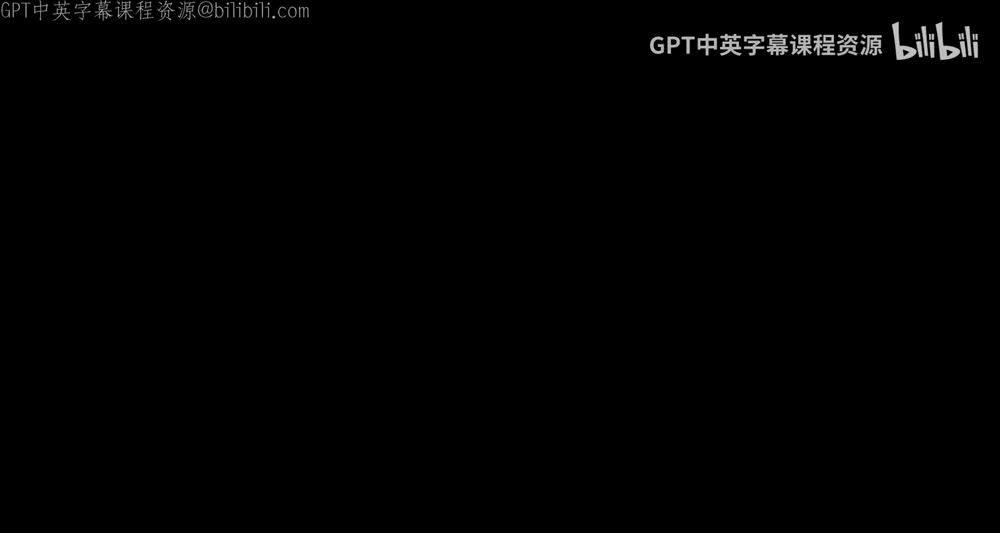

🎼Yeah。Hello everyone， welcome to this lecture in theBuild La language models from Sctch series。Today。

 I am going to cover a very， very important topic and that topic is called token embeddings。

Let me highlight this over here。So today we are going to learn about this concept called token embeddings。

 people also call these as vector embeddings or word embeddings。

 calling them vector embeddings is fine， but word embeddings is not entirely accurate。呃。

Tokens can be words， can be sub wordss， or even can be characters。And token is a more broader term。

 and that's why I prefer to use the word token embeddings。

So what are token ems and why are they so important， let's get started with today's lecture。

If you look at this workflow of how large language models actually work。

 there is an input text and lets say the input text is this is an example。

 what happens next is that the input text is broken down into tokens。

Let's say this is the one token is is the second token as is the third token。

 and example is the fourth token。This is an example of a world based tokenizer。

 so each token will be one world。But the way tokens actually work in models such as GPT is that GPT uses a byte pair encoder as a tokenizer。

Which is a sub word tokenizer， which means that even parts of words or even characters can be individual tokens。

But that is not the main focus of today's lecture if you want to understand about tokens in detail。

We have covered that in one of the previous lectures and we have also seen about byte pair encoding in one of the previous lectures。

So， tokenizing the words is the step number one， then comes step number two which is converting these tokens into token IDds。

 so every token is converted into token IDs and then comes step number 3。

We don't just stop at these token IDs， token IDs are converted into something which is called as token embeddings。

And these token embeddings then serve as the input to training the large language models such as the GP。

And then there are a number of post processing steps and then comes the final output。

So today we are going to look at step number three after you generate the tokens after you generate the token IDds in step number one and2。

What are token embeddings， why do you need them and why this third step is so important。

 especially when dealing with language。So as I have mentioned here today。

 we are going to learn about step number three， which is creating token embes awesome。

 so I have broken down today's lecture into one，2，3。嗯。

Four to different five to six different modules and are going through we are going to go through some Jupiter notebooks。

 some code， and I have also constructed some presentation especially for today's lecture。

The reason is that I want this lecture to be very comprehensive。

 I have seen so much content out there which really does not motivate the concept of token embeddings。

 it does not show small practical demonstrations。All of this is going to be covered in today's lecture。

 so we are going to start with a conceptual understanding of why token embeddings are important。

 then we are going to see a small hands on demo where we will play with token embeddings to give you an intuitive feeling。

And then we are going to look at how are token embeddings created for large language models。

So let's get started with today's lecture in which the first part which I am going to cover is conceptual understanding of why token embeddings are needed。

So， as I mentioned， I've created a separate presentation in this build LLMs from Sc series and this is titled What are token embeddings and why do we really need them？

So呃。Okay， let's get started with this problem of you have words， right？

And you want these words to be input to the machine learning model or to the large language model。

 let's see。But computers can't understand words right。

 so you need to represent the words in the format of numbers。

So let's say we assign random numbers to each word， so let's say cat is 34 book is 2。

9 tablet is minus 20 kitten is minus 30。So let's say in the LLM framework which we just saw。

We have already converted the tokens into token IDs right and we have maintained a vocabulary so let's say a vocabulary consists of all the tokens and a token ID corresponding to each token so then these token IDs itself can be the training input to the large language model so then why do we need this step number3。

So yeah words can be represented as numbers and I have already converted tokens into token IDs like this。

 so why can't I just use token IDs as the input to the model？There is a reason for this。

 We cannot just use randomly assigned numbers， and the main problem is that。

The beauty of language is that some worlds are related to other worlds。 For example， cat and kitten。

 cat and kitten， they are related， right。Dog and puppy， theyre related words。

But just assigning random numbers or token IDs to each word does not really capture the semantic meaning between these individual words。

So CA and kitten are semanically related， however， the associated numbers 34 and minus 13 does not capture this relation。

That's one of the major problem of just using token IDs。

 and I want to explain this to you in another way。

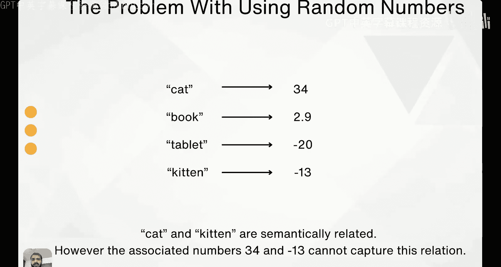

When all of us look at this image， we see that it is a cat。

 but do you know why convolutional neural networks work so well？

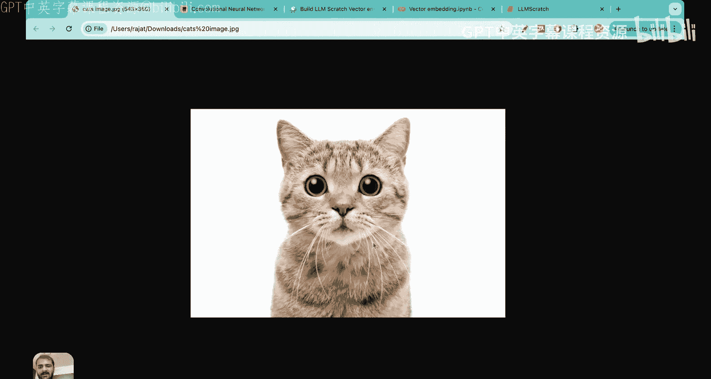

Because convolutional neural networks don't just use the pixel values and stretch it out as one input vector。

 they actually encode the spatial relation between the pixels so that these two eyes are close to each other right the whiskers are closer to the eyes these two ears are close to each other that is an information which is content in the image itself and we should exploit this information when we give in when we feed the input to the model。

If we don't exploit the information which is inherently present in the image we are not doing an optimal thing。

 I could just take these pixels here， convert them into numbers and feed them as input but then I won't extract the information which is already available to me in this image like with parts are closer to each other the ears are closed the eyes are closed。

 the nose is closer to the eyes etc。Thats why convolutional neural networks work so well because they exploit this spatial relation between pixels and they exploit this information inherently present in an image。

Consider a text。When you look at sentences。We as humans are able to understand what sentences mean because words carry meanings。

And there are some words which are closer in meaning to other world。

This is the inherent advantage in the text which we need to exploit。

 we need to exploit the fact that cat and kitten are closer to each other。

Dog and puppy are somehow closer to each other in meaning if we don't exploit this information。

 we will train for a huge amount of time and we won't be doing an optimal machine learning training。

Words are beautiful， they carry meaning， so then why not exploit the similarities in meaning between different words。

So then you might be thinking okay what about one hot encoding so Ill take every word so I'll first have a huge vocabulary of all possible words and then I'll assign one hot encoding so dog would be000 let's say one and then rest will be zeros so to every word there will be all zeros but there will be only11。

So let me do one hot encoding for every word。So dog will be this puppy will be another one hot encoding。

But this also leads to a similar problem with random number assignment。

One hot encoding also fails to capture the semantic relationship between words。Let's say。

 for example， if you see dog and puppy。How do you know from this one hot encoding that dog and ppy are more closer to each other。

 There is， we don't encode this information at all。 And again， it leads to the same problem。

 Words have meaning。 and why don't we exploit this meaning when we construct。

The inputs to be given to the large language model。So assigning random token IDs does not work。

 one hot encoding does not work。Okay， so then how do you encode semantic relationship or how do you encode the semantic meaning when you are going to convert these words to numbers。

Then came the idea that what if every word was encoded as a vector。

 this is going to be very important。 I am going to take four words here dog， cat， apple and banana。

 and I am going to say， why don't you encode every world as a vector。

Then you might be saying what should be the dimension of this vector， is it a two dimensional vector。

 is it a three dimensional vector， is it a00 dimension vector？Then I will say， well。

What if the dimension is determined by features。Then you might ask， okay。

 which features then I'll say that okay， let's take these four over dog， cat， apple and banana。

 and I look at these five features has a tail。Is eatable has four legs make sound is a pet。

And based on these questions， so first I'll ask the question， does it have a tail， Is it eatable。

 Does it have four legs， Does it make a sound， Is it a pet based on the answers。

 If the answer is yes， it has a tail， the value of that feature will be very high。

If the answer is yes， it's eattable， the value of that feature will be very high。

 This is how I will construct these vectors。So let me show you what I mean in some detail。

 So let's say you look at a dog right Look at the values which are very high。 Ha a tail。

 This value is very high。 has four legs。 its value is high， makes sound。 its value is high is a pet。

 its value is very high great look at cat has a tail It's again。

 the value is very high has four legs makes sound and is a pet So now if you see dog and cat。

 you will see that their kind of closer to each other， right。

 because whichever values are high in a dog are also higher in a cat as well look at the first index has a tail。

 It's higher in both dog as well as cat look at the second index。

 It's low in both dog as well as cat look at the last index is a pet。

 It's high in both dog as well as cat。Now let's look at the vector representation for apple and banana for apple and banana has a tail has four legs and is a pet are very low。

But what is high is is eatable Make sound is also very low。 So if you look at apple and banana。

 you definitely see that they are closer to each other right because whatever is high for apple is also high for banana Whatever is low for apple is also low for banana。

So the good thing is that if we represent words as vectors and if we construct these vectors in a smart manner。

 vectors can capture semantic meaning。😊，Which was not captured before when you did one hot encoding or when you did random number assignment。

 The semantic meaning was not captured。 Only when we represented words as these vectors。

 was the semantic meaning between different words captured。

 One more thing to note here is that dog and cat are similar or closer to each other。

 then let's say dog and banana。 If you compare dog and banana。

 you will see that whatever is higher in a dog， let's say has a tail is lower in a banana。

 Whatever is higher in banana， let's say is eatable is lower in a dog。

 So based on vector representation， you can group words which are similar to each other and also see which words are farther away from each other。

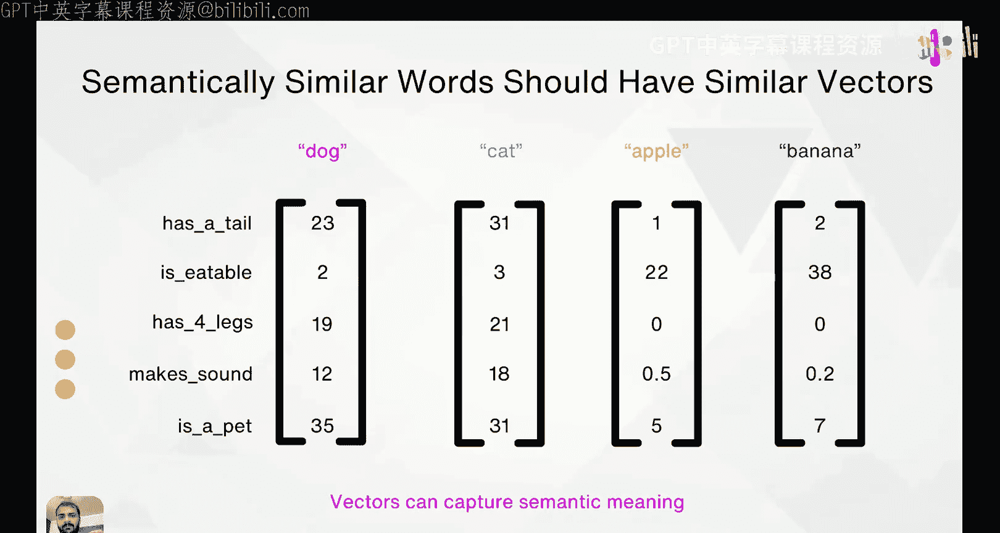

Isn't this awesome， similar to how we encoded the。Information inherently presented present in an image while feeding the input to a convolutional neural network。

 what we are doing here is that we are saying that what is the information inherently present in text and that information is that textual words have semantic meaning so then why don't we convert these words into vectors that can capture this meaning。

Great， so these are called as vector embeddings。And they are also called as token embeddings because every token is converted into a vector embedding。

That's where the world or that's where the， I would say phrase token embeddings actually comes into the picture。

So the first。Point to take away from this lecture is that vectors can definitely capture semantic meaning。

Now the next question is， how do you construct these vectors？

How do you make sure that okay how how do I make these vectors so that let's say dog and puppy are closer dog and cat are closer but dog and banana are farther apart how do I make these vectors and thats all I am going to tell you in the next part of this lecture。

How do you come up with these vector embeddings or token embeddings？And the answer here。

 the real simple answer is that we have to train a neural network to create vector embedding。

So for example， we have information， which are all the tokens and we have some output。

And based on this information and the output， we have to train a neural network to make sure that the vector embedding is correct。

Where does this information come from its from text。

 so based on the sentences in a textual document we know which words are closer to each other。

 which words are similar to each other and those should have similar vectors that is the training data and we train a neural network to construct the vector embedding。

And I'll explain this to you in a bit more detail， but just know this that creating these vector embeings is not easy。

Because I'm just showing four words right now， but imagine there is a vocabulary of 50。

000 words when GPT 2 was trained it had a vocabulary of 50，000 words。

And you have to create a vector embedding in for these many words。Remember how。

How computationally expensive that would be， and that's why training GPT takes a huge amount of time。

Okay， so this brings me to the end of the presentation where hopefully I wanted to convey two points first is that。

Words carry meaning and to give these words as input to the large language models。

 we need to exploit this meaning。 if we just use random token ids or if we use one hot encoding。

 this semantic relationship or meaning between words is not exploited。

But we saw a glimpse of if words are represented as vectors。

 maybe we can incorporate the semantic relationship between the different world。

Incorporating world or representing words as vectors so that the semantic relationship is preserved is called as vector embedding and it is also called as token embedding。

In the last part of this PPT， we saw that creating these vector or token embeddings is not easy。

Because you need to train a neural network to make sure that the right vector embedding is created。

Great， so now we have finished the the first aspect of our agenda today。

 which was essentially to show you all a conceptual understanding of why token embeddings are muted。

Now， what we are going to do is that we are going to see a small hands on demo so that you improve your conceptual understanding of token embeddings This demo is not related to the main code file which we are developing for。

Building a large language model， but it is just a toy demo。Which I've constructed over here。

So let's get started with this demo。Many big companies like Google already have pre traineded token embeddings。

 which means that this word to week Google New 300。 let's search about it a bit。

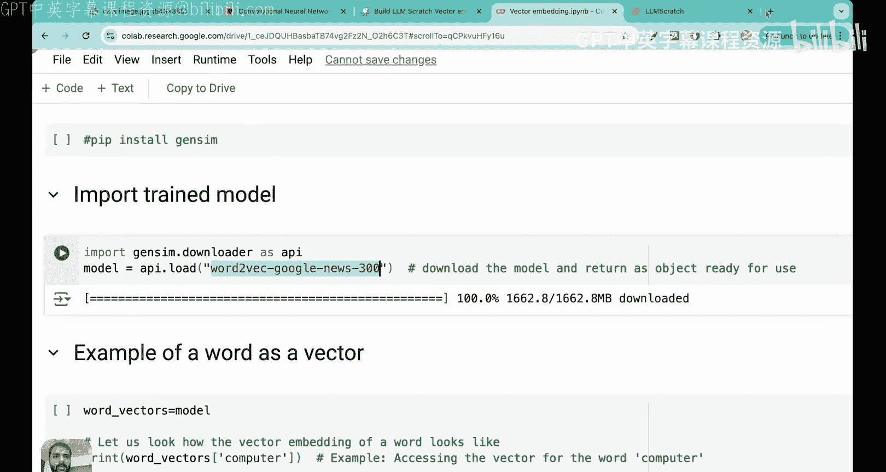

So Google， so there is a Google news data set which has about 100 billion worlds。

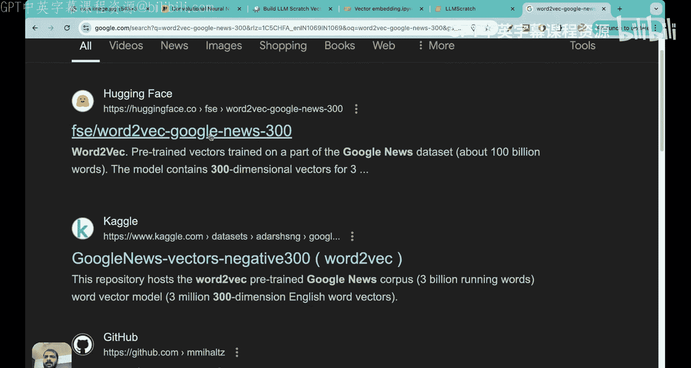

So this word2 Google New 300 are already three trained vectors on this huge data set。

 so Google has already trained or trained the neural network to create this vector embeddings so what has been done is that we get the Google news data with 100 billion words and then we do the training to map every word to a vector。

Now what is this 300 the 300 is basically the number of dimensions when we create token embeddings or vector embeddings。

 words are mapped into a large dimensional vector space。

In the demonstration which you just saw this was a five dimensional vector space。

 but five dimensions are not really enough to capture all the meaning so here we are using a 300 dimension word2 w which means that every word is transformed into a 300 dimensional vector and then we train based on the underlying data so that the semantic meaning between the words is preserved this is already a pretrained data set。

When GPT was built or when large language models are built they don't use a pretrained data set。

 they train these embeddings along with training the large language model itself。

 I'll come to that in a moment but for and now for the sake of this demonstration just know that I am already using pretrained word2 vector which means that this model it can take any word as an input and convert it into vectors a 300 dimensional vector。

So what I'm going to do now is that I'm going to。Assign a dictionary which is word vectors and equal to model。

 so model is basically the word2 vector embeddings。In this World to week， Google News 300。

And then world vectors is the dictionary， how is it a dictionary basically it will be every there will be words in this dictionary and then every world will be assigned to a 300 dimensional vector。

So let's see what the vector for a computer looks like so if you print this out you will see this is the vector for a computer it is a 300 dimension vector does not mean anything right now for now just know that it's 300 dimension vector and if you print the vector shape for any word you will see that it is 300 which means that every word is encoded into 300 dimensional vector thats fine what I want to show you now is I want to prove to you that welltrained vector embeddings actually capture the semantic meaning right。

So king plus woman， minus man。 What do you think this should be。

 Just tell me the first thing which comes to your mind。

 You can pause here right now and think about if words are actually。

If vectors are actually encoing the meaning between words and if I have a vector for king。

 lets say if I have a vector for a woman and if I have a vector for a man and if I add the vector for a king with the vector for a woman and then I subtract the vector for a man。

 what should I be left with？Okay， I hope all of you have got the answer。

 so I should be left with something which resembles similar to a queen。

Because king plus man in in ideally should be equal to queen plus woman， let's say。

Queen plus a king plus woman should be equal to man plus queen。

 So king plus woman minus man should ideally be queen。 Why， because we take a masculine aspect。

 we subtract another masculine aspect。 So what should remain is only a feminine aspect。

And women in a man are there， so ideally the answer to this should be queen， right？

Then we will be satisfied that the vectors are indeed encoding some meaning。 So let's try to do this。

 So we are going to。What we are going to do is that we are going to add king and woman and we are going to subtract man。

 and then we are going to print out the words which are the most similar to the answer。

And when you print this， you will see that indeed queen is the answer of this and the vector。And。

The probability of getting queen as the answer is around 71%， which means that。呃。

Here is a list of top 10 answers and out of this queen is the most preferred answer。

So this is the first indication to all of you that。

If you convert words to vectors and then you do additional and subtraction of these vectors。

 essentially you are encoding some meaning here。So somehow the vectors have this information that the vector for king encode some masculinity。

 the vector for woman encode some femininity， the vector for man encodes some masculinity。

These vectors also have the meaning that somehow king and queen are closer to each other。

 Some man and woman are closer to each other。 Isn't that amazing。

 This really blew my mind when I knew about this for the first time。😊，And when I knew about this。

 these things such as one hot encoding just seemed so boring because in one hot encoding。

 no information is captured， no meaning is captured。

But if you actually convert words to vectors and preserve meaning。

You can get some you actually get the meaning preserved。

 I was not really sure that the meaning will be preserved as vectors， but it it is preserved。

We can also do a couple of other things ideally women and men should be closer to each other King and queen should be closer。

 uncle and aunt are related， boy and girl are related nephew and niece are related paper and water are related。

What we can do is that we can now check whether the vector embeddings are also related to each other。

 so what we do is that we convert these words into vectors and test the similarity between vectors the way it is done is by I think finding the distance between the vectors。

So。What I do here is world vectors drop similarity women and men and I do the same for all these other rules。

So if you look at the answers you will see that for the first five the similarity score is pretty high because woman。

 man， king queen， uncle aunt boy girl， nephew niece are closer to each other awesome right but if you look at the last two words paper and water they are not closer to each other they are not related at all and our vectors are capturing this meaning let's say there is a vector for paper somewhere there is a vector for water somewhere these vectors are so far apart that they are not related to each other and that's why the similarity score is very low。

In fact， if you see woman and man， king and queen， uncle and aunt， boy and girl， nephew and niece。

 these vectors are closer to each other because they capture the meaning。

But paper and water are not close to each other at all。

 and that's why the similarity score between those these two vectors is low。

We can also do some cool things like we can find words which are similar to a given word so if you look at tower and then look at the vectors which are most similar to tower so the answers are skyscraper tower spire。

et cetera。We can also see some other things like similarities between man women， semiconductor。

 earthworm， nephew， niece etc and here we can see that the magnitude of the difference between the man and woman so this is a vector difference and if you see NP dotline alger norms so this is finding the norm of the difference in difference in these two vectors so youll see that the magnitude of the difference between the man and woman is 1。

73 the magnitude of the vector difference between nephew and niece is 1。

96 but the magnitude of the vector difference between semiconductor and earthwor is 5。67。

This is another indication that the vectors actually encode some meaning and if you find the magnitude of the difference between the vectors it is an indication of how closer in meaning the words are。

 isnn't that amazing let me repeat that again if you take two vectors and if you find the magnitude of the difference between the vectors that is an indication of how close or how far the words are in their meaning。

So when you do vector embedding or when you do token embedding。

 the beautiful thing is that you actually retain the information or retain the meaning。Of words。

 and then you feed these embeddings into the large language model。

And that makes a huge amount of difference instead of let's suggest feeding1 hot1coings。Awesome。😊。

I hope everyone is with me until now I could have directly started with step number 3。

 but I wanted to show you this small hands on demo so that you get an intuitive feel that if vector embeddings are trained nicely like they are done in this word to wake Google news model we can actually encode meanings。

In these vectors， awesome， so I hope in point number one and 2。

 I have been successful in making you understand what is the need for token embeddings and that if token embeddings are created successfully。

 they can indeed encode some meaning。Great， now let' us come to the third point which is how are token embeddings created for large language models。

So the way this is done is that we start with a vocabulary。

 we start with a vocabulary for large language models， and then we have tokens in that vocabulary。

And then we have token IDds so let me show you so this is the vocabulary so the first step what is done is that we take the vocabulary and we have token IDds。

Every token ID is converted into embedding vectors so if you have if you see this is the output this also call as the embedding embedding weight matrix don't worry about this right now。

There are two things you need before you construct this matrix you need， first of all。

 the vocabulary size。And second thing you need is the vector dimension。

 so you need how many dimension vector is the embedding going to be？So for example。

 let me actually ask， let me go to Cha GPPT。And let me ask Cha GPT。What was the vector embedding。

Dimension。For training。GP T 2。Also数。What was。The vocabulary says。

Vocabulary size means how many tokens were there and how many token IDs was there。Okay。

 so remember this the vector embedding dimension for GPT towards 768。

And for the smallest model and for the largest model， it was 160，0。

 So let's stick with 768 for now and the vocabulary size for G2 was 50，2，5，7。

 So I'm going to go here right now and let's look at how the embedding matrix was then constructed。

 So the vocabulary size was 50，25，7 right， which means GP 2 had these many tokens。 Those were subors。

Made through byte pair encoding so there are 50257 tokens and token IDs so token IDs went from 0123 up to 50257。

P zero。2，5，7。Awesome， and then what we are going to do is that for each of these token ids。

 each of these token id which corresponds to one token。

 there would be a vector and the vector dimension of 768 in this case。So for the zeroth token ID。

 there will be 768 vector of 768 dimensions， for the token id of 1。

 there will be a vector of 768 dimensions， similarly for the token id of 50257 there will be a vector of 768 dimensions。

 so for every token ID there will be a vector of 768 dimensions。

So think of the size of this embedding layer weight matrix right for let's say if you look at the first token ID there will be 768 weights because when you construct the vector it has 768 dimensions for the second token ID which is token  id1 it also has 768 weights Similarlyly if you reach to the end of 50257 this token ID and the token corresponding with it has 768 weights so the number of tokens in this token in this embedding matrix is 50257 in 2768。

So these are the weights， okay？And this is called as the embedding layer weight matrix。

 this is extremely important。 so once you get the token Is， so if I go to this flow map right now。

 once you get the token IDs you convert this token IDs into an embedding layer weight matrix。

And initially when this weight matrix is initialized we do not know how the vectors are right。

 what I showed you over here the word 28 model it is a pretrain model。

 but now I am going to tell you how is it actually trained。

So before so you just now know the size of this matrix that if you are the person training GPT2 you know that okay I have to ultimately create an embedding layer weight matrix which has 50257 rows and which has 768 columns but you don't know what each weight value will be so then what do you do what you do is that you initialize the embedding weights with random values that is the first step so all of these 50257 into 768 values will be initialized randomly step number one。

This initialization serves as the starting point for the LLM learning process。

Then what do you do these weights are then optimized as part of the LLM training process this is extremely important when GPT2 was traineded these values were not known before what were the ideal weight values。

A training process was implemented where we had these many parameters。

 50257 by 768 parameters were there， and each of these weight parameters were optimized during the training process and that is how vector embeddings or token embeddings were created。

How was the optimization process done， we had the training data and based on the data。

 we knew which world were closer to each other， which world were farther apart from each other。

For example， when we looked at this World2 it the training data was Google news right and we had so the Google news of course if we had 300 billion wordss we have the information that King and queen are similar。

 man and woman are similar。So that training data is used。

As underlying information to modify each of these parameters。

So if you know about neural network training， similarly back propag is implemented here to optimize all of these weights of the embedding layer weight matrix。

And that is how token IDs are converted into vector embeddings。So。

 if you think about it at the heart of it large language models are just giant neural networks right and one part of these giant neural networks is training and embedding layer weight matrix。

So if you look at this。This graphic here so token embeddings are fed as an input to the training right thats what this graphic shows but during the training of the GPT while it is training to predict the next world we also train the embedding itself so the embedding neural network is traineded and then we also train the prediction for the next world so there are two trainings actually which are kind of going on here。

For now all you need to remember is that words， so we start with a vocabulary such as for GPT2。

 we start with this vocabulary of 50257 tokens and then we have to decide that okay when I do the vector emdding what the dimension of the vector I want and then that 768 then that decides the size of your embedding layer matrix so we have 50257 rows and we have 768 column for each token ID we are going to have a vector with 768 values。

However these values decided through training through back propag。

 we start out with initializing these values of the embedding layer in a random manner and then all of these values are optimized during the training process。

I hope you have followed until this point because now Im going to take you through code and we are actually going to learn a bit about these token embeddings and we are going to learn how to essentially create。

This embedding layer matrix which we just saw over here。

 so please keep this image in mind and remember that there are two dimensions which are important。

 the vector dimension， which is the size of the each vector and the vocabulary size。O。

So let us illustrate how the token ID to the embedding vector conversionver works with a hands on example。

So lets say we have the four input tokens which are input number or ID number 2351 remember these are token IDs so every token ID is associated with the world。

To give you。Like a concrete feel for this。 let's say the example is。So Im going to look at 0，1，2，3，4。

5， so I need six words actually。So here it's going to be。Let's say my sentence is quick。

My sentence is quick。Fox。Is。显。House。Let's say this is my sentence so what I will do is first convert this into tokens so let's say quick and I'm just showing world tokens world based tokenizer for simplicity。

 let's say quick is one token f is one token is is one token in is one token the is one token and houses the next token then we arrange these tokens in ascending order and then assign them token IDs。

So。House will probably come first with a toconid0。Then no I think f would come first with a token 90。

 house pseudo come second。With the token ID1 I hope I'm not making any mistake here。

Then in will come two is will3， quick will come4， and then the will come5， right？

And now what I want to do is I want to encode or I want to rather convert token ID23。

5 and1 into embeddings or into vector embeddings， so what is ID number2 is this word in2，3 is5 and1。

So I want to convert these words in is the end house， I want to convert them into embedding vectors。

2，3，5 and one right so2，35 and1 correct So then my input idds are to or tensor23，51。

 remember we are using tensors here because ultimately we are going to use back propag to optimize the embedding layer weights。

 so it is much better to represent everything as tensors。

Great so these are my input id and now for the sake of simplicity we are going to use only small vocabulary of6 words remember GPT2 had 50257 tokens in the vocabulary right now just for simplicity we are just going to use a small vocabulary of only6 tokens instead of the 50257 words in the B tokenizer and lets say we want to create embeddings of size 3。

So your CGPT to 768， right？So here I told you two two dimensions were important the size of the vocabulary which now we are assuming 6 and the vector dimension so in this code file I am assuming the vector dimension 3 so what I am going to do here is that for each of the worlds in my vocabulary which are these worlds so for now I am starting with these six worlds for each of these six worlds in my vocabulary I will have a vector and that vector will have three dimensions okay this is how I am going to construct the vector embedding。

So the vocabulary size will be6 what are the six words quick f is in the house then output dimension will be three which means that every token of this vocabulary will be converted into a vector of three dimensions how that is done in practice is that we create an embedding layer and then we use power dot n n dot embedding。

And then what we do is we we pass into two arguments， the vocabulary size。

 which means the number of words which need to be converted into embeddings and the output dimension。

 which is the dimension of each vector embedding。Awesome right so this is how we use the Tordo and embedding let me show you this in Python right now so if you look at the embedding documentation。

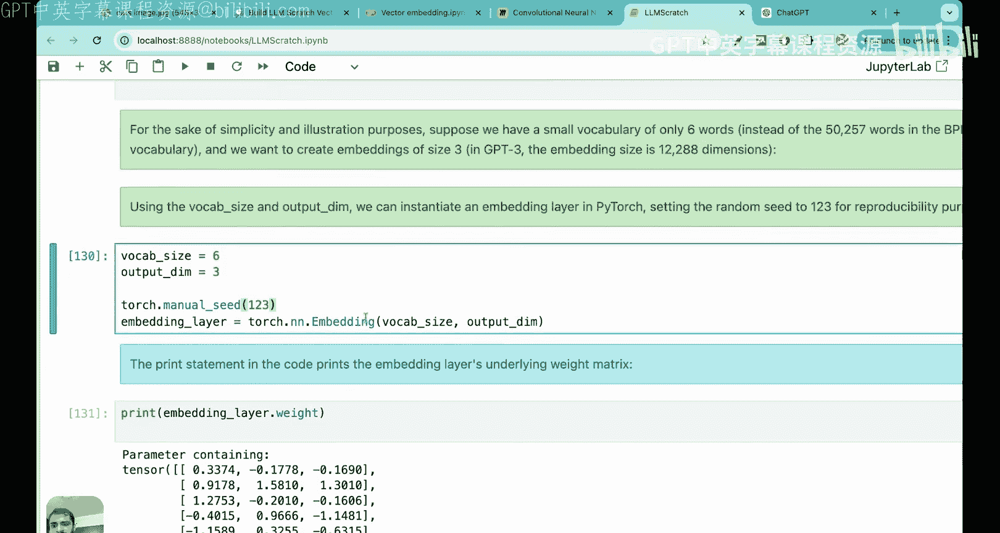

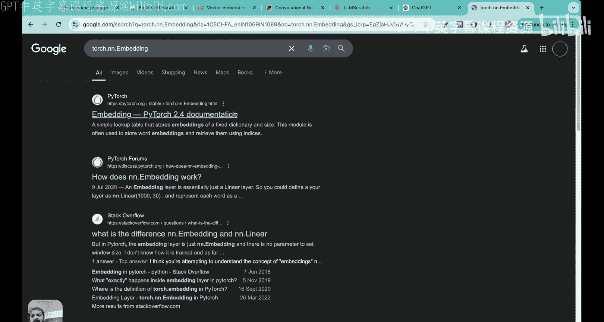

You will see that it's a simple lookup table that stores embedding of a fixed dictionary and size。

 What this means is that we need to have a vocabulary and we need to give the size of the embedding vector that's it and then it creates a dictionary I'll show you why is it called a lookup table and I'll tell you okay why does the word lookup table come in to the picture for now all you need to remember is that the way we initialize these vector embeddings is storage dot n n dot embedding and this initialize the weights of the embedding matrix in a random manner right so here I showed you that every weight in this vocab in this embedding matrix is initialized randomly so let me again show this to you here now you see I have six Ids right？

So，0。When。读。3。4 and 5。And each of these will have a three dimensional vector associated with it one。

2，3，1，2，3。1，2，3，1，2，3，1，2，3，1，2，3， so I will have essentially six rows and I will have three columns。

 This is my embedding layer weight matrix and all of these values are initialized randomly How can you get this values。

 you then just have to type embedding layer dot weight What will what this will give you is it will give you all the weights which are initialized through the embedding layer。

So when you print this you will at this and you will see its exactly the same size as what we are shown over here it has six rows and three columns here also you see we have six rows and three columns every row here corresponds to the vector associated with that token ID so this is the three dimensional vector with the zero token ID this is the three dimensional vector with the first token ID this is the three dimensional vector of the second token ID etc。

So now you can see a tensor has been returned and these are the initial weights which need to be optimized。

So， as we can see here， the weight matrix of the embedding layer consists of small random values initially。

And these are the values which are optimized during LLM training as part of the LLM optimization itself。

 which we will see in further chapters。 So when the LLM is optimized。

 there are actually two broad level things which are optimized。

 First is the embedding layer weights and second is actually the weights。

Wwhichch are needed later to also predict the next world Ill come to that in one of the upcoming chapters。

Moreover， we can see that the weight matrix has six rows and three columns as as we saw over here。

 and there is one row for each of the six possible tokens in the vocabulary which we already discussed each row is essentially the vector embedding of each token。

Or each token ID great。Now， what we can do is that once this embedding layer has been created right。

 what I want to show you is that how can we get the vectors for each ID？

And that is actually pretty simple because this this is the first pro is the vector for the0 with ID the second row is the vector for the first I etc。

 So lets say if you want to get the vector for I number3。

Let me show this to you in code I number three is is right And if you want to get the vector for is how do you do it。

 you first look at I number3， So I number 0，1，23， So this this is that I number right So then all you need to do is look at this corresponding row in the embedding weight matrix that's why it's called a lookup table to find the vector associated with a particular I you just need to。

Take this matrix， you look at the vector corresponding with that particular I row number。 That's it。

 This is exactly what we are going to do over here。

We want to obtain the vector representation for I number three right So that's what we are going to do。

 We are going to access the embedding layer。 It's a lookup table and we are going to access the。

Ebedding matrix for the token ID 3。And what will this be this will be the fourth row because the zero id is the first row。

 the first I is the second row， second I is the third row and third ID is the fourth row， that's it。

And then when you print this， you will get this vector。 So this is the vector， which is the。

Vectctor embedding for that particular ID which is ID number 3。

 so I have also written this over here if we compare the embedding vector for token ID3 we see that it is identical to the4 row so look at this this vector it is exactly the same as the4 row right。

In other words， the embedding layer is essentially a lookup operation that retrieves rows from the embedding layer weight matrix via a token ID let me explain this in simpler words。

 the embedding layer is essentially just a lookup operation and what this lookup operation does is that if you give it an ID number it looks for that particular row and retrieves a vector for you so for example if you want the vector for ID number 5。

All you will need to do is look at this particular row， which is row number6。

And then it will retrieve or it will give you that particular vector if you look at if you want the vector for ID number0。

 just look at row number one。If you look at the vector for ID number or if you want the vector for ID number one。

 just look at row number2。So thats why you can so the embedding weight matrix is of course a matrix of the weights for vector embeddings。

 but it' is also a lookup table if you specify the ID number you can use the embedding weight matrix to find the exact vector representation for that particular ID。

So that' is why if you look at the piyage documentation。

 this embedding is also called as a simple lookup table， I hope you have understood this right now。

Okay， so one major portion of this lecture was for you to understand the embedding weight matrix and why it is actually considered to be a lookup table。

Awesome now let's come to the next part So previously we have seen how to convert a single token ID into three dimensional embedding right we just gave a single token ID and converted it into an embedding vector but remember what we started from I wanted the vector representations for these four ids so I wanted the vector representation for I number one I number5 I number two and ID number three so how can we give these four to the lookup table we just specify the particular array so here we have the input Is right。

We have the input IDds for which we want the vector representation all we do is that we just use the embedding layer and pass in the input IDs。

So similar to what happened here， what this operation does is that it first looks at the input Is and it sees that there are actually。

4 values in the input I， then what it does it goes through each individual。

Id and looks up the embedding vector for that I， that's it。So when you pass in the input IDs。

 it will first look at this thing and it will look at first it will look at row number3。

 then the row number four， row number 6 and row number two。So it will look at row number four。

 row number6， row number three and row number two， and then it will print out the answer。

So essentially each row in this output matrix is the corresponding vector embedding for that particular I。

So the only thing which you have to remember right now is the embedding layer is a lookup matrix and you can pass a single ID to this lookup matrix。

 you can even pass multiple IDs or a group of IDs and in just one line of command you can get all the vector embeddings for that particular or token ID。

This is how embedding layer is actually implemented in practice right now small random values have been initiated but。

嗯。We are going to train these values so that they actually capture the meaning and that is what we will come to in one of the subsequent lectures。

Okay， so let's see how much of the lecture we have covered so far。

 We covered this part where we saw that。We saw that the embedding layer is essentially a lookup operation that retrieves rows from the embedding layer weight matrix using a token ID。

Here is an image which also explain this so let's say this is the weight matrix embedding matrix and let's say these are the token IDs which we want to embed or we want to find the vector representations so if you actually pass in this token IDs to the embedding layer what it will do is that it will first look at each particular ID so it will look at ID number two which means it will go to row number 3 which is highlighted in blue that will be the first answer of this lookup table。

Then it will look at ID number  three and that will mean row number four， that is the second row。

Of the final answer， then ID number 5 which is essentially row number 6 and then it will give the vector corresponding to row number 6 and finally ID 1。

 which means row number2。So then it will give the vector corresponding to row number two， that's it。

So， this is the embedding weight matrix and then it just looks at the particular row based on these IDds and then it gives the vector embeddings for all the IDs which we ask for so here we ask for f jumps over dog and then it gives the vector embedding for all those IDs。

So if someone asks you what's an embedding layer， you can say that it's a simple lookup operation that retrieves the vector for the particular token ID。

 that's it。是。Now I want to show you one last thing actually it is a bit of a finer detail but I think it is important for you to also think about an embedding layer in some another dimension right so let's say we have the following three training examples let's say we are we want to have the embedding for ID number two ID number three and ID number one。

So let's say there are four words in our vocabulary and which means that。For 0，1，2，3。

 these are the ids with these four words and we want to encode each of these ids into a vector。

So let's say the embedding dimension is 5， so each of these each of these id。

Well have a vector with basically 1，2，3，45 with 5 dimensions。

 so the ID number0 will have a vector embedding of five dimensions ID number one will have a vector embedding of five dimensions etc。

 ID number two will have a vector embedding of five dimensions and ID number three will have vector embedding of five dimensions。

So， the embedding matrix which we create we pass in the first argument。

 the first argument is the vocabulary size which is the four number of rows and then the second argument is the embedding dimension so that is5 right and so then if you print out the embedding weights you will see that and you can even try this in Python the embedding weights will be these which are initial as to random values。

And。You will see that there are four rows and five columns because we have four IDs in the vocabulary and each ID has has a vector with five dimensions。

 this is great。Then what we do is that we just retrieve those vector weights which we need。

 So then we pass in this I X。 So we only need vectors for Is 2，3，1。 We don't need the vector for I 0。

 So then these are the。Ids which are passed and then we do the lookup operation and then this is the embedding table which is extracted or the embedding matrix which is extracted for IDds 2。

3 and1。Now， one thing which I want to explain to you that this embedding layer is actually the same as a neural network linear layer。

So Ill try to explain this quickly because I don't know to divert you from the main purpose of the lecture。

 but let's say if you have a neural network with four inputs。4 as the input dimension。

 and then you have three。Btches of inputs coming in the first batch is basically the first ID number which is2 and encoded as a one hot representation The second batch is the ID number so lets see the Is which we needed I is 231 right so the second batch is the ID number 3 which is encoded as the one hot vector 0001。

And the third ID is the ID number one， which is encoded as 0100。

If these three are the input batches which are fed to this neural network and let's say there are five neurons here。

The output of this linear layer is x into W transpose。

So what is W every neuron here will have four weights associated with it because every input has four dimensions if you look at the first input it 0。

010， it has four dimensions， so every neuron here will have four weights associated with it。

So if you look at this weight transpose matrix， the first column will be the weights of the first neuron。

 the second column will be the four weights of the second neuron。

 the third column will be the four weights of the third neuron。

Fourth column will be the four weights of the fourth neuron and the last column will be the4 weights of the fifth neuron。

So lets say x is the input matrix， W transpose is the weight matrix when you do x into W transpose。

You will get essentially a matrix which has three rows。

And it has five columns y 3 rows because for every input we have three inputs。

Input number input number one， input number2 and input number3。

 and for each input we want a vector embedding with five dimensions。

 so there is three rows and there is five columns so each row corresponds to the vector embedding for that particular input。

Now， if you look at this， if you look at this output， look at the first pro 0。

6957 and if you look at this output， youll see that it is exactly similar。In fact。

 both these outputs are completely similar。So what is exactly happening here？

What the embedding matrix is actually doing underneath is that it is the same operation as a neural network linear layer。

So what an embedding does is actually is that you have inputs right。

 so let's say we have three tokens。3 tokenines those are converted into one hot representations they are fed into a neural network with5 neurons y5 because the vector dimension is 5 and then we have a linear layer whose output is x into w transpose this gives the same output as the embedding layer。

So earlier I showed you torage dot n dot embedding right here I am showing you torage dot n dot linear。

Then you might be thinking why is an n dot linear not used to define the embedding matrix the reason is it is not used is because。

So， both embedding layer and Nn layer lead to the same output。

 both embedding layer and the Nn linear layer lead to the same output。

 but embedding layer is much more computationally efficient because in the Nn layer we have many unnecessarily multiplications with0。

So you could just use N n dot linear operation over here and do the x into w transpose。

 but here you see you have to do one hot encoding so there are many zeros and a lot of unnecessary computations are there。

These unnecessary computations really scale up when we are dealing with vocabulary sizes of chat GPT2。

And that's why we use the embedding layer here， So there is also the torch。

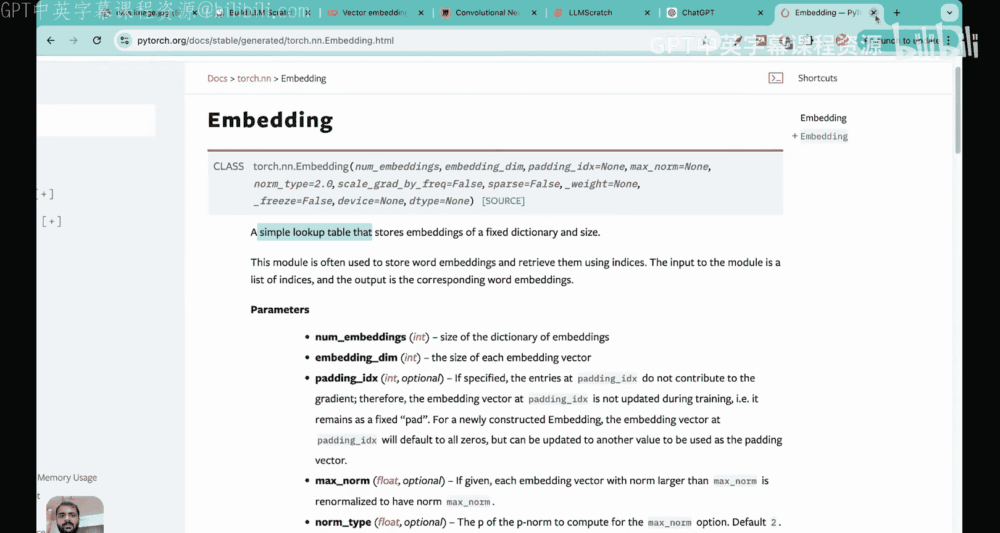

Dot n， dot linear。This layer is also there。 There are two layers。

 and even you can use an end dot linear to create the embedding matrix。

 but the reason it is not used is because it is not efficient。

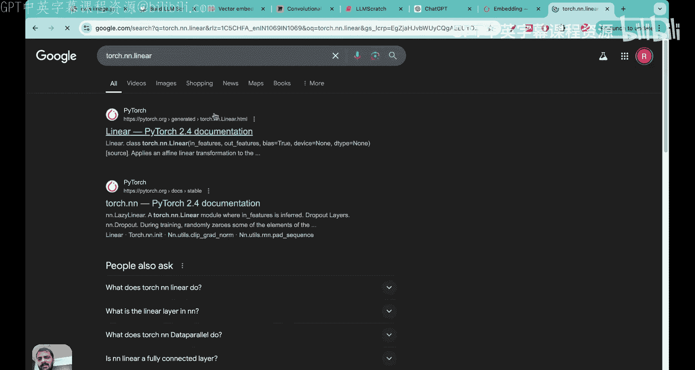

So the embedding layer is much more preferred over the NN do linear layer when you create the embedding matrix。

 this is just a small takeaway for anyone who is familiar with neural letters but if you are not don't worry if you did not understand this part mostly I wanted to cover made some other major points in today's lecture and some of them are first I wanted you to understand the conceptual understanding of why token embeddings are needed。

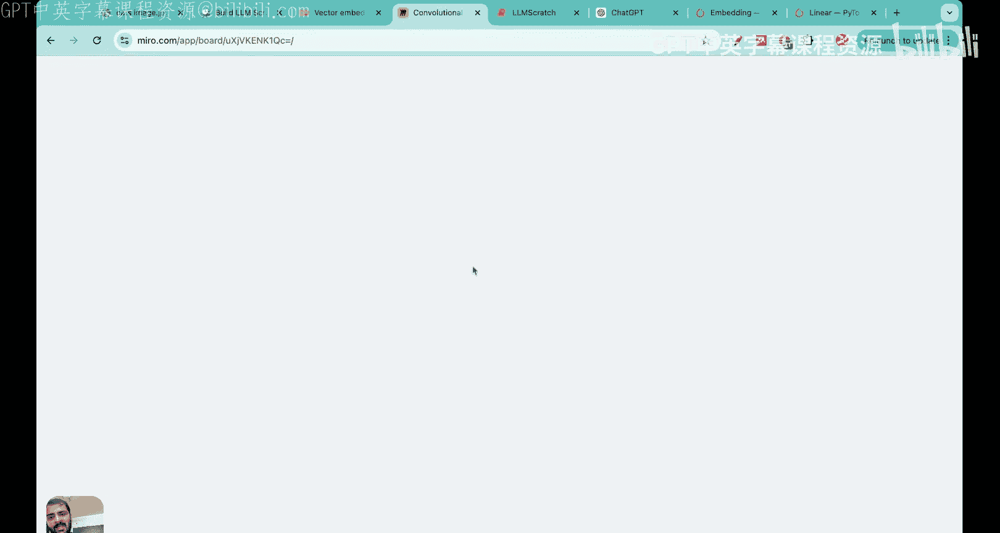

In convolutional neural networks we exploited the spatial features of an image before giving it as input for training。

 this is exactly what we do in token embeddings words can be represented as vectors and those vectors can carry meaning that is called as vector embedding or token embedding。

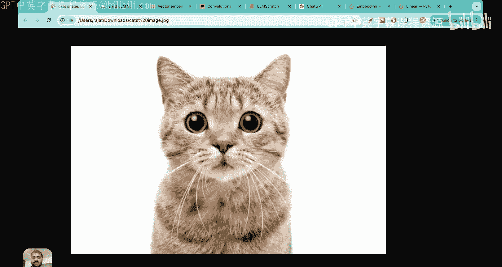

And if the token embeddings are trained properly， I showed you an example where the vectors can actually carry meaning。

 so if we have vector for king which encode some masculinity。

 if we have vector for woman which encodes some femininity and we subtract the vector for man。

 which also encodes masculinity， the answer is a vector which encodes femininity which is queen。

What also we can do is that we can show that if you take two vectors。

Of words which are similar to each other and if you take the magnitude of the difference between those vectors。

 that magnitude is much lesser than words which do not mean anything。

Which means that if you have vectors for worlds which are similar to each other。

 they might be closer together in space。So if embeddings are created nicely。

 they can actually encode the meaning between words。 I found this concept very hard to understand。

 So I wanted you to first understand that it is possible to have vectors in such a way that they encode meaning。

 Many people don't even understand what does it mean that vectors have meanings。

So the first two points in today's lecture were devoted for you to get a conceptual understanding of why token embeddings are needed。

Then we looked at a practical aspect of how token embeddings are created to create a token embedding matrix you need two parameters。

 you need your vocabulary size and you need the vector dimension for GPT2 the vocabulary size of50257 and the vector dimension of 768 so we essentially have an embedding weight matrix which has  phi0257 rows and 768 columns for each token ID in the vocabulary you have to construct a vector。

Now， how are these weights of the embedding metrics determined they are initialized randomly。

 these weights are initialized randomly， and then the embedded weights are optimized as part of the LLM training process that is very important。

So this this is how the embedding weight matrix is created。

 but what' is also quite interesting is that at the heart of it the embedding weight matrix is just a lookup operation。

 which means that if you have a embedding weight matrix，If you have an embedding weight matrix。

 you can just pass in the input ID or the token ID for which you want the vector embedding and then you get it corresponding to the particular row。

 you can even pass in a bunch of input IDs and then the embedding layer will just look for that the row corresponding to the input ID and retrieve the vector embedding for you。

So simple way to look at the embedding layer is that it's essentially just a look of operation that's it。

Now， towards the end， we also saw one more thing that whatever the embedding layer does can actually be done using the neural network linear layer。

But the reason its not preferred is because the embedding layer is much more computationally efficient。

Awesome in this lecture I have not covered how to train the embeddings。

 but I just wanted to give you an overall understanding of what token embeddings are。

 what is the embedding layer weight matrix。But in subsequent lectures。

 we are also going to see how to train the embedding layer。

So in this example which we saw I directly used the pretrained word to a Google news right later we will also see how this pretrain is done and how GPT2 GPT3 and GPT4 did the pretrain for for creating the vector embeddings。

In the next lecture we are going to look at another important concept which is called as positional embedding。

 so until now we looked at how to convert words into vectors right。

 but when sentences are given the positioning of the sentence also matters a lot。

The cat sits on the mat， so cat and matter close by。

 but if mat is somewhere far away they are not related so position of the words also matter a lot apart from their semantic meaning。

Up till now， the vector embeddings which I have showed you do not encode the position for where the world comes in the particular sentence。

 but that is another。Feature of words and sentences， which we are going to exploit。

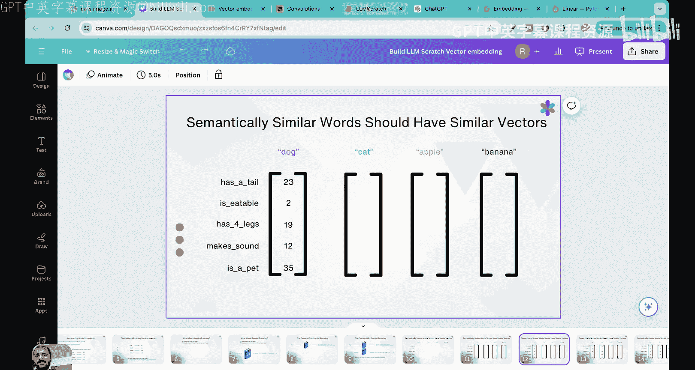

In images， we exploited translationnational innuvaris and we also exploited spatial similarities between features。

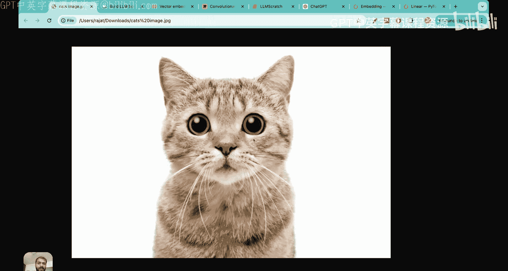

In vector embeddings， we have already exploited the semantic relationship and the semantic meaning between words。

 but we will also see how to exploit the position and where the words are positioned in sentences。

And that will be the subject of the next lecture where we are going to learn about positional embeddings。

Thank you so much everyone， I know these lectures are becoming a bit long。

 but I deliberately want to construct everything so that I show you a whiteboard approach。

And I also show you presentations and I also show you the code files I'll be sharing this code file and also this code file with you so that you can play around with it。

 have access to it。Please comment in the chat if you are liking these lectures because then I will modify adapt it accordingly and as I say many times the most important thing is showing up for these lectures。

Don't lose interest， don't lose motivation and keep on learning along with me thanks so much everyone and I look forward to seeing you in the next lecture。

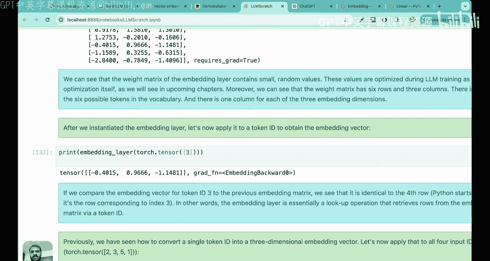

。

