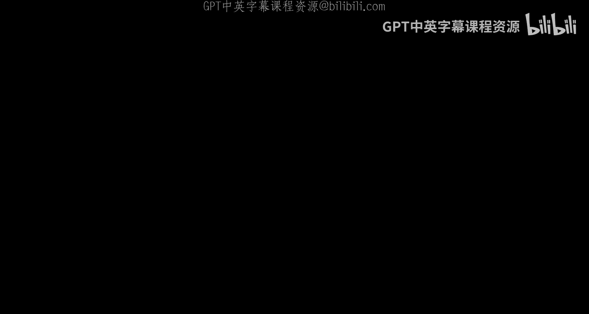
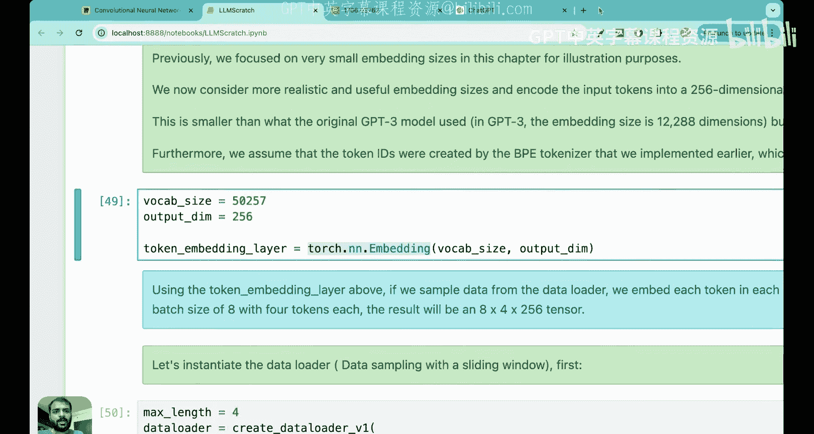
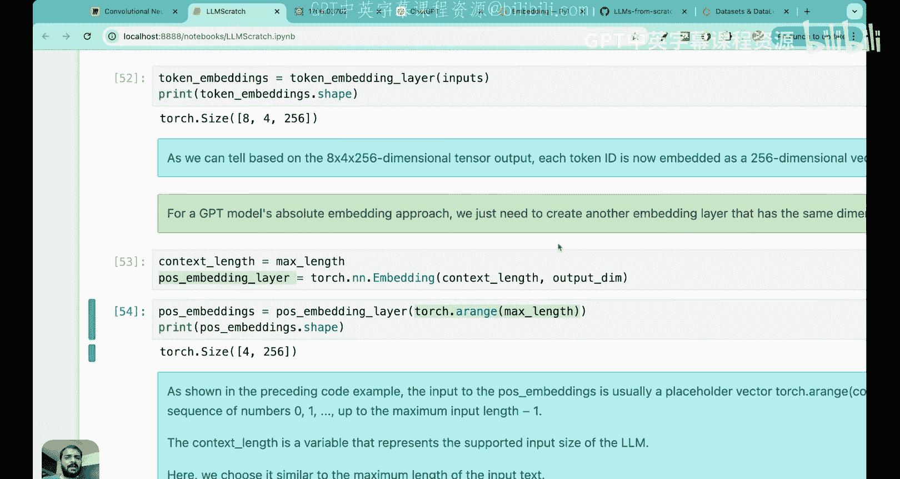

# Vizuara《从零开始搭建大语言模型｜Building LLMs from scratch》中英字幕（Claude-3.7-s） - P11：-11-Lecture 11_ The importance of Positional Embeddings.zh_en - GPT中英字幕课程资源 - BV1qG8HzUE2D

Hello everyone， welcome to this lecture in theBuild Lage language models from Sctch series。

Today we are going to be looking at a very important topic and that is called as positional encoding。

So Ive divided today's lecture into two to three modules。

 initially we will look at what all we have covered so far then we will try to understand why is positional encoding really needed and then finally we will do a handson codinging exercise in Python where we will actually add positional encoding layer along with the token embedding layer which we have already created so far。

So let's get started if you have not seen the previous lecture on token encoding or token embedding。

 I would highly encourage you to see that lecture because positional encoding builds on top of token encoding。

If you are coming to this lecture series for the first time， welcome。

 I have designed the lecture so that they are good to watch even as standalone lectures。

 but of course if you go through the previous lectures。

 your understanding of the current one will be much better。So let's get started until now。

We have looked at something which is called as token embedding and what is meant by token embedding。

So token embedding is the step number three in the LLM training process so first we have we start with an input text then we convert that text into tokens so for example if the text is this is an example the tokens can be this is an example this what Im showing right now is an example of a word based tokenizer but there are other tokens such as subward based tokenizer or byte pair encoding tokenizer which actually GPT uses so remember that one word is generally not equal to one token you can even have sub wordss or characters as tokens for the case of simplicity。

I'm just showing here the token X text to be individual words， so thats step number one。

 step number two is maintaining a vocabulary of the tokens。

 sorting them in ascending order and assigning a token ID to each token thats step number two。

 but even then we are not ready to give the token IDs as input for the GPT or for the LLM training。

 there is a very crucial step number three which we looked at in the previous lecture and that's called token embeddings。

Basically， the token ids which we obtain are converted into vectors。

So that the semantic meaning between the different words is retained if you directly use the token IDs as inputs to the large language model。

 we do not retain the meaning between words so for example dog and puppy are related to each other cat and kitten are related to each other if we don't convert token IDs into token embeddings this semantic relationship or this meaning between the words is lost。

That's why it's very important to have step number three。

 so if you have a vocabulary with GPT uses let's say of around 50。

000 words GPT2 was trained on a vocabulary of 50，000 words which means of 50。

000 tokens which means we have 50，000 token IDs and then there is a vector corresponding to each token ID。

That is called as token embeddings every token is converted into a vector in a higher dimensional space。

So now you must be thinking， okay， so now I have these vectors which capture the semantic relationship between words and now I can feed these vectors as inputs to the large language model。

 right？Almost we are almost there， I promise there is just one last step remaining in the data preprosing part。

And then in the next lecture ons well come to training the LLM we'll see the attention mechanism etc。

 and the last step is called as positional embedding。

So why is this needed so let's say we have a sentence the cat sat on the mat and then another sentence on the mat the cat set。

So if you look at both of these sentences， the cat cat award appears in both of these sentences right。

 and in both of these sentences cat is a token that will be assigned to token ID。And。

And that will be convertednot into a vector。So the vector for cat will be the same in both of these sentences。

 although the position of the cat in these two sentences is different。So until now。

 if we just use the vector embedding， we do not have any information about the position of the particular world。

So in the embedding layer， in the token embedding layer， whatever we have seen up till now。

 the same token ID gets mapped to the same vector representation。

So the token ID for CAAT will get mapped to the same vector regardless of where the token ID is positioned in the input sequence。

So， for example， cat the position of the cat is different in these two sentences， right but。

If we don't do anything about the position， if we don't encode the position。

 and if we just use the embedding layer we learned previously。

 both of these tokens in both of these sentences will have the exact same vector representation。

So in the embedding layer， which we have seen so far， the position is not incorporated。

There is a figure which demonstrates this pretty nicely so let's say this is the embedding layer weight matrix which is basically we have all of these tokens in our vocabulary those are converted into token IDs and for every token ID there is a vector in a higher dimensional space so each row correspond corresponds to one such vector for the token ID now if you want to embed these token IDs which means if you want to convert these token IDds into vector representations you will see that these the the token 5 comes here and the token 5 comes here also and these two tokens clearly appear at different positions in the sentence。

But if you look at the embedded vectors for these two tokens they are exactly the same if you look at the first row here that is the embedding vector embedded vector for the token 85。

 the first token 85 and for the second token 85 you will see that the embedded vector is the third row。

 so if you look at the first row and the third row they are actually exactly the same。

So the main point here is that the same token ID result in the same embedding vectors。

Wwhich says that we are essentially not exploiting the maximum information present in sentences in sentences there are there is meaning between different words which we already captured through vector embeddings。

 but the position also matters a lot right？CAT appears at different positions here and that completely that may change the meaning of the sentence entirely。

 so it is very important to also encode the information related to tokens and the position at which the token appears in the given sentence。

So it is very helpful to inject additional position information to the large language model。

Along with capturing the semantic meaning， it is extremely important to inject this additional information about the position to the LLL。

So now let us talk a bit about how do we encode this information about the position so let's say if I give a word and I convertert it into token ID and I convert convert it into a vector how do I also give information about the position of the world lets look at that so there are essentially two types of positional embeddings。

The first type of positional embedding is absolute and this is the more commonly used positional embedding and the second type of positional embedding is relative positional embedding。

So， as you must have guessed from the name itself these two positional embeddings are different。

 let us look at absolute positional embedding initially in absolute positional embedding for each position in the input sequence。

 a unique embedding is added to the tokens embedding。To convey its exact location。

Let me repeat that in absolute。In absolute positional embedding。

For each position in the input sequence， a unique embedding is added to the tokens embedding。

 So for example， if you look at these two sentences cat set on the mat cat set on the mat the token embedding for cat in both is the same right。

 but as I said for each position there will be a different positional encoding which will be added to the token encoding so let's say the token encoding is X。

For sentence， so let me say， so let's say this is sentence number one。

And let's say this is sentence number two。So let's say the token encoding for cat is x in sentence1 and for sentence2 also it's x because its the same old。

 but now the positional encoding is different because in the first sentence the cat appears in position number two so there will be some different positional encoding for this position and for for the second sentence the cat appears in position number5 so there will be some different positional encoding so the final embedding will be the addition of the token embedding plus the positional embedding so for sentence1 the final vector embedding for cat will be x plus y for sentence2 the final vector embedding for cat will be x plus z so they are different now see they are not the same so cat won't be embedded in the same manner in both the sentences。

And so some information about its position will be incorporated。

That is exactly what happens in absolute positional embedding。

 and there is a nice figure to showcase this。 So let's say。We have four tokens in the input sentence。

 So let's say the first token is the。The second is CA。The third is set。And the fourth is mat。

So what I've shown over here is that these are the token embeddings so for the word though this is a three dimensional token embedding for cat it's the same three dimensionmensal token embedding for sat it's the same and for mat it's the same ideally the vector embeddings for every word will be different but I am just showing this for the sake of simplicity remember the vector embeddings for each world are ideally are actually different but I just want to show a visual demonstration here so these are the vector embeddings now what we will do is that for each vector embedding will add a positional embedding and these positional embeddings are different based on the position so for example the comes in position number one right so the positional embeddings are 1。

11。2 and1。3 cat comes in the second position so the positional embeddings are 2。12。22。

3 sat comes in the third position so the positional embeddings are 3。13。23。

3 mat comes in the fourth position so the positional em。4。14。14。3 again。

 these numbers I'm just showing for representative purpose。

Now if you add the token embedding to the positional embedding youll see that although the token embeddings are the same for these worlds。

 the final embeddings which are also called as the input embeddings which will be fed as input to the LLM they are different because the positional embeddings which are added to each token embedding is different so for the word the the final input embedding is 2。

12。22。3 for the word cat the final input embedding is 3。13。23。

3 and similarly for mat the final input embedding is 5。15。1 5。

3 this is the intuitive idea behind absolute positional embeddings。

We have token embeddings and then we add positional embeddings for different positions。

So finally we get an input embedding which encodes positional information， that's it。

One more key thing to remember here is that the positional vectors have the same dimension as the original token embeddings。

Can you think why this is the case， why should the positional embeddings have the same dimension as the token embeddings？

Pause for a moment to think about this。Okay so the reason the positional embeddings should have the same dimension as the original token embeddings is because we were to add them together right and this addition would be difficult if the dimension of the positional embedding is different so for example here if this positional embedding was a four dimension thing adding this four dimensional vector to a three dimensional vector would not be possible。

So in absolute positional embedding， the positional vectors have the same dimension as the original token embeddings。

So this is absolute positional embedding， the second type of positional embedding is called as relative positional embedding。

And this is also a very interesting way of encoding positional information。

 so in this type of embedding the emphasis is on the relative position or the distance between the tokens。

So， the model essentially learns the relationships in terms of how far apart rather than at which exact position so that is a bit different than the absolute embedding right for each position in absolute embedding there is a separate positional embedding。

But in relative positional embedding， what we care about is how far apart different worlds are rather than their exact position。

Now， you must be thinking where exactly is relative positional encoding important so relative positional encoding is actually very important because the model in this case can generalize better to sequence of wearing a lens。

Even if it has not seen such length during training so for example in absolute position encoding。

 if you train with a sequence length of 5 and if in the test you have a sequence length of 6 it is very difficult for the absolute position encoding to know what to do because it is trained for five positions and five position embeddings but in this case of relative position embedding。

The model can generalize better to sequence of wearing lens because even if it gets some random length during the testing phase。

The absolute position does not matter anyways， all that matters is the relative position between different world。

Can you try to think of an example where relative positioning might be more important than absolute positioning？

Okay， so it turns out that relative positionings are actually better if the sequences are very long and if longer paragraphs or longer input sequences need to be analyzed because then we need to know the relationship between how different words are connected rather than the exact specific position。

I'll come to the advantages and disadvantages of both of these in a moment。Okay。

 so in the next in the next section， which is section number five。

 I want to discuss about just these two types of encodings and which one to use in practice。

 which one does GPT uses， etc。So both of these type of positional embeddings。

 which are absolute embedding and relative positional embedding。

Are very good because they enable the LLMs， let me switch color。

They enable the large language models to understand the order and relationship between the tokens。

And this actually ensures more accurate and context aware predictions。

 so whichever positional encoding you use it is actually much better than not using any positional encoding because it makes the LLM more aware of the order and relationship between tokens and that actually leads to better predictions。

Now let's come to point number six。 So the choice between the two types of。

Posal embedding really depends on the specific application and the nature of the data being processed so for example generally absolute position encoding is preferred when the fixed order of tokens is crucial such as for sequence generation so GPT was trained using an absolute positional encoding and the original transformer paper was also trained using absolute positional encoding。

Relative positional encoding on the other end is suitable for tasks like language modeling or long sequences where the same phrase can appear in different parts of the sequence。

So generally relative position encoding is useful if you are analyzing long sequences and where the same phrase can repeat over and over again。

For all practical purposes， I would say absolute positional encoding is the one which is used more commonly。

 in fact as I mentioned Open air， GPT models， so GPT3， GPT4 etc。

 use absolute position embeddings that are optimized during the training process。

So one thing to remember here is that similar to the embedding vectors we do not know what values of the positional embedding to be used so for example here I randomly showed these values 1。

1 1。1 1。3 right ideally as I mentioned in the previous lecture the vector embeddings need to be optimized right we need to know the weights for each vector which whats the value for each vector similarly when GPT was developed。

Even the values of the positional embedding vectors need to be optimized and these positional embedding vectors vector values are actually optimized during the training process。

 this optimization is actually a part of the training process itself。

So when you look at the model training for GPT， we also have to optimize for the token embeddings and we also have to optimize for the positional embeddings we do not know about these values before。

Remember I mentioned that along with GPT the original transformer paper。

 which is called as attention is all you need so let me show you this paper yeah this paper。

 so they also used an absolute positional encoding and in this case they actually propose some formula for how to encode the different positions so they use sinusoidal and cosine formula over here。

So you can read a bit about what they have written here。

 since our model contains no recurrence in order for the model to make use of the order of the sequence。

 we must inject some information about the relative or absolute position of the tokens so they have added absolute positional embedding and they have used some formula for how to actually calculate the positional embedding for each token。

On the contrary， when GPT was trained， no such formula was used and the positional embeing vector values were actually optimized during the training process itself。

I hope everyone is with me until this point because now we are going to jump into a handson demonstration of looking at a very real life example such as GPT2 looking at the vocabulary transforming that vocabulary into token embeddings adding positional embeddings to those to embeddings and then generating the input embeddings which are the final input to the LLM training so you might be noticing that I'm using the words encoding and embedding interchangeably so sometimes positional encodings are also called positional embeddings so these words are used interchangeably all you need to remember is that when someone says encoding or embedding it's usually a vector in a higher dimensional space。

Okay so now let's come to the next part in the next part what we are going to do is we are going to implement positional embeddings in a hands on manner。

 so Im going to take you to the Jupiter notebook now very similar to how we have been doing in the previous lectures。

Okay so previously especially in the last lecture we focused on very small embedding sizes in this chapter for illustration purposes now we are going to consider a much more realistic and useful embedding sizes and encode the input tokens into 256 dimensional vector space so remember I mentioned that in token embedding you have every world and that word is projected into higher dimensional vector space usually that dimension is very high so GPT3 I think was trained on a vector space of around 256 or even more dimensions。

So we are going to consider a vector space of that size right now for demonstration。

As is written here， this is smaller than what the original G3 model used So in g 3 the embedding size is actually 12。

2，88 dimensions， so it's nowhere close to 256 but it's fine Let me actually ask Jeep chat GP what is the。

vector embedding size for GPT2 for GPT2 for one of their smallest model， I think it is around 256。

So let me ask Cha GPT， what is the。Victor embedding size for。Gput2。So if I ask this to charge GPT。

 you will see that。For the all their models it actually starts from 768。

 so the value of 256 we are using is three times smaller。

 but its fine it's at least the same order of magnitude。

So okay we are going to encode the input tokens into 256 dimensional vector representation and then we are going to assume that the token id were created by the byte pair encoder tokenizer which has a vocabulary size of 50257 let's check this。

What's the。Vocabulary。Size of G， P2。3 do they mean。

So let's see the vocabulary size is 502257 using the byte pair encoder。

 this is exactly what we are going to use right now in today's hands on example。

So as I mentioned before to actually create the embedding layer or this is also called as the token embedding matrix。

 you need you need two quantities or two variables the first you need the vector dimension so basically every token ID in the vocabulary will be converted to a vector of these many dimensions and right now we are going to use 256 over here。

2，5，6。And the second thing which we need is the vocabulary size and the vocabulary size in our case is as Ive already mentioned here it is 50257。

 this means that there are 50257 token IDs and each of these token IDs will be transformed into a 256 dimensional vector。

awesome。So now what we are going to do is that we have defined the vocabulary size to be 50257。

 we have defined the output dimension which is the vector size as 256 and then we are going to create a token embedding layer using torch dot nN dot embedding so torch dot nN dot embedding actually creates this kind of an embedding layer provided we have those two inputs which is the vocabulary size and second is the vector length which we want so while I'll put the link of this in the chat or in the information section of the YouTube video as well。

So when you run this， you will see that the token embedding layer has been created and it takes to input the vocabulary size and the output dimension awesome。

So now once the token embedding layer is created， we need to remember the token embedding layer is is essentially a lookup matrix where if you give it。

The Ids So if you have a token embedding layer and if you provide the token embedding layer with input IDs which you want to look for。

 it will give you the corresponding embedding vector so for example this is the token embedding matrix right you and this is lookup table Why is it a lookup table because if you pass in the input ID it looks up that particular row and it gives you the vector associated with that so now we need to create the input IDs so that we can generate the vector embeddings or the token embeddings for those inputs and to create the input ids we are going to use something called as data loader so we looked at data loader in the when one of the previous lectures so what we are going to do here is that we are going to have a batch and that batch size will be equal to8 and we are going to use a context size of four which means that the maximum input length is4 which means four tokens at a time can be passed as inputs that's also called as the context size。

So let me actually show this to you in pictorial format so that it's easier for you to visualize。

Okay， so this is the input which we are going to create。

We are going to divide the data into batches and the batch size will be equal to 8 so the parameters will be updated after processing every eight batches right now we are not looking at parameter updating at all I just want you to be aware of the dimensions so the input which will be looking at one time is a batch of eight so there are eight rows over here and each row corresponds to one input sequence so if you look at the first row these will be four tokens if you look at the second row these will be four tokens so the first row when I say four tokens these are four token ids so remember the goal is to look at these four token ids and to predict the next world。

So you can think of each row as an input to the LLM and each row consists of four token Is。

Now our goal is to transform each of these token IDs into a 256 dimensional vector right so if you look at the first row the first row has four token IDs and we want to transform each into a 256 dimensional vector。

So before coming to that， let me show you how the inputs are initialized and how from the data loader。

So you so I have already defined a data loader in this Jupyter notebook and you will have access to that when I share the code file with you if you have not seen the data loader lecture I highly encourage you to go to that but if not it's finalll try to give you an intuition of whats happening here essentially what we are doing here is that we are looking at the raw text and this raw text is actually the verdict。

So this is a book called the verdictict。And let me actually refresh this so that it appears in a better format here。

 so this is actually a book called the verdict and this is the main text which we are using as sample text for these set of lectures。

So， what is happening is that we are taking this raw text and we are chunking it into batches so each each batch is of size 8。

And for each batch。We are looking at a max length of four。

 so only four input tokens will be used to predict the next world。

 so think of this matrix which I showed you over here。

So we are going to create a data loader which takes in the raw text， which is a batch size of8。

 which is a max length， which are the number of essentially columns which is the context length which is equal to4 and then a stride of four and shuffle equal to false so stride basically means that let's say if you look at this text right and if you want to。

Create inputs so the first input will be I had always thought because the context size is4 now since stride is equal to4 the next input will be jack giizbon rather a if the stride was equal to one the next input would be had always thought jack but now the stride is equal to4 so after one input will skip12 three four times and then give the next input。

So what we are essentially doing is creating inputs so the batch size is8 right so the first batch will have this as the first row of input。

 this as the second row of input this as the third row of input and so on up till eight eight batches and each of these tokens。

Are converted into token IDs。And then what we want to do is map each of those token ids into vectors。

That's what we are doing exactly through this data loader data loader just helps us to manage the task of inputting the data。

 batching the data， creating different batches parallel processing much easier so it's highly recommended to use data loader I'll actually just show you the data loader so its this link data sets and data loaders in Python it's actually highly useful when dealing with large language models。

Okay， so once we define a data loader like this， we just iterate through the data loader and we can get inputs and targets。

So if you print out the token Is， So this is the input of a batch and if you see this exactly similar to what we had written on the whiteboard。

 So if you look at one batch， it will have。E input sequences and each input sequence has four token IDs or four tokens。

And using these view to predict the next word for each input sequence。So。

 this is the batch of inputs which we have received and now what we actually want to do is for each of these input token IDs。

 we want to convert each of these into a 256 dimensional vector representation。

But first lets look at this token ID tensor and its8 by4 tensor because it has eight rows and four columns the data batch consists of eight text samples with four tokens each awesome now what we are going to do is that we are going to convert each of these token ids into a 256 dimensional。

Vectctor using this embedding layer。So as I told you what this embedding layer is is it's actually a lookup table right so if you look at this embedding layer and if you give the token ID it will generate the or it will fetch the corresponding vector representation for you that's exactly what we are going to do over here so these are the inputs right now lets say I'm looking at one batch which has eight rows and which is four columns and I have given the input IDs as randomly assigned over here right now。

But let's say these are the input ides。 So for the first first batchge， the input ides are 108。

20 and 21。Now what is done is that these input id are then mapped to the embedding vector matrix so we know the corresponding row so if you look at the first row its 10810 and 20 these are the input id right so then here you look for the input id of 10 and then if you find then you find the corresponding vector for it。

Then you look for the input I of 8 and then you find the corresponding vector for it。

Then you will look at the input I of 20。And then you find the corresponding vector for it。

And then you look at the input id of 21 and then you find the corresponding vector for it。

So basically， for each token in this input input batch。

 one embedding vector of size 256 is generated for each token in the input。

So Ive just constructed another visualization for you all to。See it further。

 so if this is the input batch for each token ID here it is converted into 256 dimensional vector。

So if the size of this original input batch was 8 by 4。

 when we generate the embedding vectors for each of these the we will get a tensor which is 8 by 4 by 256。

 so its a  three dimensional tensor now y 256 because for each of these 8 by 4 32 values for each of these 32 values we have a 256 dimensional tensor。

So for each of these， you can think of like。A vector which has basically 256 dimensions so there is a vector here vector here vector here vector here etc ceter I cannot show the three dimensional structure right now but it is basically 8 by 4 by 256。

Okay so that's what we are going to do next so we have this inputs right which is the batch of inputs generated from the data loader we are just going to pass it as an argument to the lookup table to the embedding layer and then we are going to get this tensor which is 8 by 4 by 256 which is exactly the tensor shape which I was showing to you over here that is the 8 by 4 by 256 tensor after we pass the input Ids to this lookup table of the embedding layer basically what this lookup table does is that it generates the 256 dimensional vector for each of this token Is。

Up till now what we have done is that we have broken down the input text into batches so let's say we so this is the first first batch this this is the first this is the first input of the first batch remember each batch has eight inputs so this is the first input we converted into token IDs and then each of the token ID is have has a 256 or 256 vector length。

embedding。That' is what we have done until now it is as simple as that I hope everyone is following until now I am trying to explain this vectorial and tensial notation as in detail as possible but of course sometimes it gets a bit difficult so if you have any questions you can ask it in the comment section。

So here I have written that as we can tell based on the 8 by 4 by 256 dimensional tensor output。

 each token ID is now embedded as a 256 dimensional vector awesome。

And now we have what we have to do is that we have to add a positional embedding。

Posal embedding vector to each of these vectors similar to the token embedding。

 we also have to create another embedding layer for the positional encoding so remember that at each time only four vectors need to be processed right because if you look at the context size that is equal to4 at one time in the input only four tokens are going to be given。

So at one time only the input the maximum input size is 4。

 which means the LLL is going to predict the next world based on a maximum of four tokens。

 so actually we need to encode only four positions in this case。

So the embedding layer size will have1，2，3，4 rows and the number of columns will be the vector dimension which is 256 that is fine because for every position we are going to have a 256 dimensional vector remember we have to add this vector to the。

Token embedding vector so the size should be same the size here was 256 right every token which was embedded had a size 256 so here also for every position we need a 256 dimensional vector but there are only four positions right it can either be the first token the second token third token or four token so the number of rows when we create the embedding layer for positional encoding is going to be4 which is the context length。

So now let us write that in the code， so remember when we created the token embedding the number of rows was the vocabulary size。

 but here the number of rows is going to be equal to。

The context length so now we are creating a embedding layer for the positional embedding number of photoss is equal to the context length and the number of columns is output dimension which is 256 because each vector needs to have a size of 256。

Great， so we have created the positional embedding layer right now and now I am going to visually try to explain how we are going to add or how we are going to essentially create the positional embedding vectors。

So let's look at our input matrix again here the batch size is8 so we have eight rows and the context length is4 which that's why we have four columns so if you look at each input sequence let's look at the first row if you look at the first row it has four token IDs let's say those token IDs are 10820 and 21 each of these token ID is now a 256 vector length vector because we have done the embedding we have done the token embedding so each token IDs a 256 dimensional vector。

So this is the first batch of input you can see that there are four positions here maybe these words are the cat set on now what we need to do is that we need to add1 positional encoding vector for each of these to to the token embedding for 10 for the token ID 10 we have to add a positional embedding vector to a token ID of 8 we have to add another vector to a token ID of 20 we need to add a positional vector to a token ID of 21 we need to add another positional embedding vector。

So we need to add one position vector to each of these four token embeddings。

And remember that the same positional embeddings are applied。Because there are only four positions。

 right， So the positional embedding。We just need to do it once and then for every token for every input sequence the same four positional embeddings can be applied so for example this is the batch on the right if you look at this batch。

Which is row number three， let's say there are some input Is like one。读。

5 and 6 let us say these are the token ids now whatever positional positional embedding we added to the first input the same positional embedding can be added to this input because the positions are the same either it is position1。

2，3 or4 we just need to encode the different positions right。

So that's why the positional encoding size or the positional embedding size。Has to be 4 by 256。

 we only need four positional vectors， four positional embeing vectors and then each vector will of course have size 256。

So then the positional embedding vector matrix which we have will be a 4 by 256 matrix Why do we only need four why not have a separate positional embedding for each of the inputs here because for each of these inputs we only want to encode whether the token9 is in the first position second third or fourth。

 so we only need the positional。We only need four positional embedding vectors。

 one for the first position， one for the second， one for the third， one for the fourth。

 and then you can add the same4 to basically all the input sequences in a given batch。

That is what we are going to do so in the next step which is the step number 13 we are going to generate the four positional embedding vectors from the positional embedding matrix so as I told you all embedding matrix are essentially lookup tables so to generate the embedding vectors we just need to pass these position012 and 3 and then it will generate the corresponding vectors according to that。

So how to pass the positions you just use tor dot arrange max length what tor dot arrange max length will do is that it will create01 and12 and3 so max length is equal to 4 so tor dot range will create a sequence of number 01 up to max input length minus1 so this will be01 to3 so essentially it will create the tokenide is 012 and3 and then we can just look up the positional embedding table and generate these four positional embedding vectors。

So then what we do is that， as I said， we just look up the positional embedding layer matrix。

W which is a lookup table and just pass in these four arguments0123 so then it generates four vectors each of size 256 these are the four positional embedding vectors which we need one is for position number one second is for position number two third is for position number three and fourth is for position number4。

So， as we can see， the positional embedding tensor consists of 4256 dimensional vectors。

 we can now add these directly to the token embedding。So lets see how that is done。

 let's look at one batch for now and then let's see how to add the token embeddings with the position embeddings。

So， we have generated these four positional embedding vectors from the positional embedding matrix great so we have completed step number 13 and so finally we come to step number 14 this is the last step where we have to add the position embeddings to the token embeddings so if you look at the token embedding matrix it is 8 by 4 by 256。

As we had already seen before， so for each token id there is a 256 dimensional vector and how many token ids are there there are eight batches and each batches4 token id so 8 by 4 that's why the size is 8 by 4 by 256 and then the positional embedding we just have 4 256256256256 so this is just 4 by 256。

So， for the first position we have a 256 dimension vector。

 for the second position we have a 256 dimension vector for the third position we have a 256 dimension vector and for the fourth position we have a 256 dimension vector。

So now we are adding the token embeddings with the positional embeddings so you must be thinking this is 8 by 4 by 2 56 this is 4 by256 how does python really add them so when you add such matrix as mates what happens is a broadcasting operation so what python does is that it converts this 4 by 256 to 8 by 4 by 256 by duplicating these same values eight times。

So then what is essentially happening is that to the first row these four values are added to the second row。

 these same four values are added to the third row。

 these same four values are added similarly to the eighth row， this same four values are added。

So finally the input embeddings which are the result of the token embeddings plus the positional embeddings have the size of 8 by 4 by 256 and these are the input embeddings which then will be the final training input to the LLMs。

So we did so many things to reach this stage right but I hope you have understood this part I just wanted to show you for GPT2 we had a vocabulary size of around 50000 and I showed you a vector length of 256 so first I showed you how to create the8 by 4 by 256 token embedding matrix in the first place so our initial task was for you to understand how is this token embedding itself created so every token id in a batch is converted into a vector of size 256 and then for each position we add a positional positional embedding so first we need to see how many position are there and for that the parameter which becomes important is the context length。

Because that is the maximum length of the input to be fed at any time to the LLM so only those many positions are important so the context length is4 so we then create so we only need four positional embedding vectors。

 one for position 1， second for position 2， third for position 3 and4 for the position number4。

 and then we add it to the tor embedding matrix。How do we add Python as a broadcasting so even if the token embedding matrix is 8 by 4 by 256 and even if the positional embedding is just 4 by 256 it just copies these four values eight times。

So essentially what happens is that to each row of the token embedding the same positional embedding for vectors are added and that's how we get the input embeddings 8 by 4 by 256 I hope you have understood these dimensions so8 because in each batch we have eight input sequences and in each input sequence we have four tokens that' why4 and y 256 because each token ID or each token is essentially a 256 length vector。

I hope everyone has understood this lecture on positional embedding now let me go back to the start where we looked at what all we have covered and what needs to be the input to the LLM。

So look at this diagram。So， in today's lecture we actually looked at one more step。

 which is I would say maybe step 3。5 in that case and that is adding positional embeddings to the token embeddings and that finally leads to。

Input embeddings。 So these input embeddings， which we obtained。

 So actually let me add right here positional embedding。

 So what we actually added to the token embeddings。Was positional embeddings。So呃。

So what we added here was。Yeah positional embeddings and then this resulted into input embeddings so token embeddings plus positional embeddings is input embeddings and then these are the ones which are actually used as input to the GP。

So essentially what we did in token embedding and positional embedding is we try to exploit as many things in textual language as possible。

 the first thing which we exploited semantic meaning， when we did token embeddings。

 when we did positional embeddings we exploited the fact that the different positions also mean something。

Until now， we have not seen how exactly to obtain the values in the positional embedding。

 see even in today's lecture， we just randomly initialized。

The embedding matrix right like if you see in the code this positional embedding layer is randomly initialized so watch what to do and end embedding does is that it initializes a matrix。

With number of rows as context length number of columns as output dimension and it puts random values in this So then how do we know the actual values so that is actually a part of the LLM training process and it's exactly similar for the。

Token embeddings as well so we need to optimize the values in the token embedding layer and we need to optimize the value in the positional embedding layer。

 however for us to reach the optimization stage stage first it is very important for you to understand what exactly is positional embedding what exactly is token embedding and that was the whole purpose of today's lecture。

This brings us to the end of today's lecture。 Thank you so much， everyone。

 I hope you understood a lot。 I hope you understood the difference between absolute。

Absolute and positional embedding。Yeah absolute and relative sorry absolute and relative positional embedding I hope you understood why positional embeddings are added and most importantly I hope you understood the dimensions  ultimately I feel it all comes down to dimensions people who understand the dimensions really don't feel scared or intimidated by the subject so if someone understands where this 8 by4 by 256 is actually coming from right this 8 by 4 by 256 then I feel they will have a much stronger grasp on the subject so thats why today I spent a lot of time on explaining these dimensions。

Thank you so much everyone and if you have any doubts or questions please put it in the comments section the lectures are getting a bit more involved in detail now so i'll be happy to interact in the comments section and solve any doubts or questions also let me know if you're liking this teaching style which is a mix of the whiteboard lectures plus the hands on coding I'll of course be sharing the code file with all of you thanks everyone and i'll see you in the next lecture。

。

