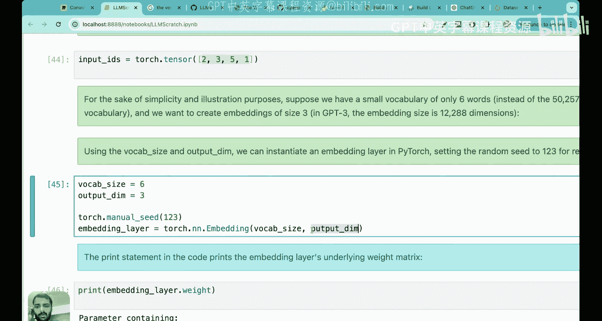
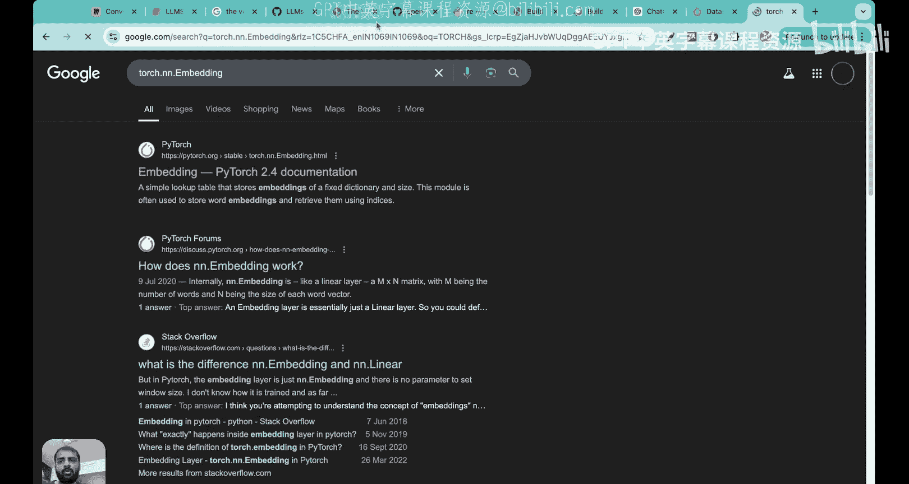
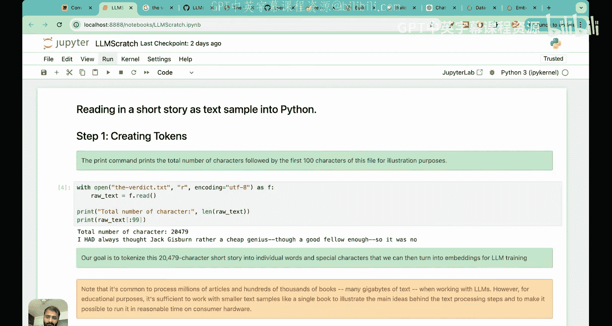

# Vizuara《从零开始搭建大语言模型｜Building LLMs from scratch》中英字幕（Claude-3.7-s） - P12：-12-Lecture 12_ The entire Data Preprocessing Pipeline of Large Language Models - GPT中英字幕课程资源 - BV1qG8HzUE2D

🎼Yeah。Hello， everyone。Welcome to this lecture in theBuild La language models from Scratch series。

This is a very special lecture because it covers one of the most fundamental aspects for building a large language model and that is building the data processing pipeline。

When people learn about large language models， I think that they do not pay too much attention to data processing。

 but it's really one of the fundamental building blocks of having a strongly performing large language model。

So what does it mean data processing？The main idea behind data processing is that we all know that。

Large language models have sentences， right and they deal with text， they deal with sentences。

But if you have a big P file that cannot directly be be given as input to the large language model。

 it needs to be processed further。And that this whole procedure of processing the data before it is fed as input to the large language model is called as data preprocesing。

So in our case the data is text， the data is paragraphs， the data is documents。

What can we do to this data so that it can serve as an input to the large language model and well be answering this question in today's lecture well answer this question in four steps which are the four fundamental steps needed before any sentence。

Is transformed into。A forum which is good enough to be an input for a large language model。

The first of these four steps is called as tokenization the second of these four steps is token embeddings the third is called positional embeddings and the fourth is when we create input embeddings this is the final step and these input embeddings then serve as inputs to the large language model remember that input embeddings are the summation of token embeddings and positional embeddings so well learn about token embeddings in part2 and we learn about positional embeddings in part3 and then we'll sum these two to create input embeddings。

Even when we look at tokenization it can be broken down into three parts world based tokenizer。

 subor based tokenizer and character based tokenizer the subor based tokenizer has many types and byte pair encoder is one of them GPT2 and in fact many GPT models use this byte pair encoder tokenizer which is subor based tokenizer。

Token embeddings is essentially converting token Is into vectors。

Positional embeddings is encoding information formation about the position。

Awesome right so let's get started with these four steps which well cover in detail in today's lecture first we will start with tokenization。

 so let me zoom in over here。So when you want to build a large language model you need to go through three stages stage one is for building the basics of an LLM stage two is for three training and stage three is for fine tuning。

Today's lecture comes under stage one and more specifically it comes under the data preparation and sampling part。

Off stage one。So as I mentioned， first we will be looking at tokenization and initially we will be looking only at world based tokenizer。

So what we'll do right now is that well construct our own world based tokenizer from scratch。

Although this is not the tokenizer which is used in GPT models， GPT use subur based tokenizer。

 but if we directly move to subur based tokenizer， you lose the intuition。

 you lose the feel of how exactly tokenization is done。

So first we will start with word based tokenizer。And。

For that we need a database right we need a data very simply speaking world based organizationization is just converting the entire data into chunks of words thats it。

And I'm going to show you how that is done， it's not as easy as it looks。

So the data set which we are going to use is a book which is called the verdict。

 it is a book which is written in 1908 you can also search about it。

It has this this cover and we are going to use this as our input data set it has a lot of text。

 as you can see over here。So in world based toization。

 what our aim would be would be to take this text and to convert it into words。

And break it down into words right so then let's move to Python right now immediately and lets see how to code this out from scratch。

So this is the Python notebook， which we willll be going through in today's lecture。The first step。

 as I mentioned， is creating world based tokens from scratch。

So initially what we will be doing is that we'll open this data set。

 we'll open this document and we'll read this document the way it is done is that you have to use this with open and then you assign a variable called raw text which contains the entire text which is read by Python I've actually downloaded this book from this particular link you can download it online Ill share the file with you so that you can also run this code on your own。

So once the data or the book itself is downloaded or read by Python。

 what you can do is that you can check whether it has indeed been read so you can print the total number of characters and you can even print some portion of the text。

So you can see that the total number of characters is 20479 and here I'm printing the first1 hundred characters of this file so its I had always thought Jack Giizburne rather a cheap genius though a good fellow let's check whether this is actually correct so in the book it's exactly the same I had always thought Jack Giizbone rather a cheap genius great。

So we have read the data set successfully。Now let's move next to the portion of how do we split this data into tokens？

I've added a small note here， which you will also see when I share the notebook。

 but when actual large language models are constructed。

 the data set which they process is millions of articles and hundreds of thousands of books。

But for educational purposes， it's sufficient to work with smaller text samples like a single book。

 as I'm showing right now， because the hardware capacity。

 it requires minimum hardware capacity and it's also much easier to demonstrate but whatever we are seeing right now can easily be scaled up to larger and larger data sets。

Now， that question which we want to ask is， how can we best split this text to obtain a list of tokens？

So let's see for that we are going to use the regular expression library in Python so you can head over to this link。

 which I'll also share in the YouTube video description。

And let me show you how this library can be used So you first take some random text I have chosen a sample text here hello world。

 this is a test。And then what we do is that we take this test。

 we take this text and using the regular expression library。

 we split this text based on wherever white space characters are there。So。

 what this commander does is that it reads the text and then it splits the text wherever it encounters white spaces so it scans the text from left so first we scan it from left and after hello and comma is encountered there is a white space here see。

So then it splits here。Then it goes on scanning further then after world dot。

 there is a white space here， there is a white space here， year， and here。So。

 it creates splits at those locations where white spaces are there and you can see this is the result so the result when we split this is hello then white space then world dot then white space then this comma then white space then is then white space a then white space and then test。

呃。Do you see the problem with this tokenization， why can't we stop over here？

The reason we can't stop over here is that hello and kma are both in a single token。

 I don't want that I want punctuations to be in a separate token because I want my LLm to know which are punctuations which are normal words so I want kma to be a separate token I want fulltop to be a separate token Similarlyly if you actually go through the text there are so many other characters like there is this character here I am sure there is a question mark somewhere I want all of these special characters to be separate token split from the text。

That's the first mistake here， the second mistake is that I don't want white space characters at separate tokens。

Now this is a debatable topic because sometimes it's good to have white space characters for example if you're writing Python code indentations are important right white space characters are important in that case it's good to have white space characters are separate tokens but for the sake of demonstration I don't want to white space characters so there are two things I will modify here along with splitting here we only split where white spaces are there right I also want to split wherever different characters are encountered like quotation exclamation mark question mark etc and then I want to remove the white spaces。

We'll do exactly this right now。So what Ill be doing right now is that I'll take this text then what I'll be doing is that I'll split but I'll split on all of these characters so earlier we only split on the white space character right but now Im saying here that whenever you encounter a comma or a full stop or a colon or a semicolon or a question mark or an underscore or an exclamation or inverted comma bracket slash you split there that's what I'm instructing this regular expression library to do so this is the first thing I'll be doing the second thing I'll be doing is removing the white spaces so what this line of code does is that it scans through the result so it scans through the tokens。

And it results a true value it outputs a true value only white space is not there so wherever white spaces are there it outputs a false value so this item dot strip item dot strip is true only when white space is not there。

I turned out script is false when a white space is encountered。

So when this list of tokens is passed through this item。 script function over here。

 only those tokens which are not a white space will be returned。So。

 let's print out the result and lets see the result so here you can see hello is a separate token comma is a separate token world is a separate token dot is a separate token awesome right？

So呃。Yeah， so hello is a separate token comma world dot is this。

 this dash dash is also a separate token， awesome。So now all of these separate characters are individual tokens and we have also removed the white space see white spaces are not different tokens over here。

 so we have essentially taken a small sentence and we have converted it into individual tokens now well apply these same two commands on this entire data set。

Which we are reading。So exactly the same commands will be used will define a variable called preprocessed which is a list which contains all the tokens of the entire essay。

 so what we are first saying is that you scan through this essay scan through this essay split wherever these special characters are encountered and also split where white space is encountered in the second sentence we are saying that you have take the list which is called a splitprocessed right now。

Retain all the tokens in this list， but get rid of all the white space characters。

 We don't need those as tokens。 That's what we are saying in the second sentence right now great。

 so preprocessed is the list which contains the tokens which the essay has been broken down into awesome。

Just to make sure we have done the tokenization correctly what I'm going to do is I'm going to print the first 30 tokens in this list so here you can see the first 30 tokens are I had always thought Jack giizbon rather so here you can see I had always thought Jackbon it has been broken down into individual words but even these characters are separate tokens。

So if you see over here， this dash dash is a separate token。

So tokenization is actually pretty simple here we are looking at world based tokenization where every token is a separate world or a character and when I say character I mean special symbols like comma exclamation mark fulltop。

 quotation， etc。Awesome， so here you can also print the length of this list。

 which gives you an idea of how many tokens are there。

 So when you print it out you'll see that we have 4，6，9。

0 tokens over here and there may be duplicateplications also because we have not gotten the rid of duplicates here。

 That's why I'm just printing out the total length of tokens。 It's 4，6，90 great。

So now we have the entire data set which is an essay we have converted it into a list of tokens but we need numerical representations right computers doesnt don't understand words so then we need to convert these tokens into token IDs that is the next step all the tokens which we have generated need to be converted into token IDs and there is a specific way to do this。

First what you do is you take all the tokens you remove the duplicates and you arrange the tokens in an ascending or an alphabetical order so let's say if the dataset was the quick brown fox jumps over the lazy dog you break it down into tokens let's say the quick brown fox and you arrange them all in alphabetical order so brown dog f jumps lazy over quick the and then to each of the tokens you assign a token ID since they're in alphabetical order the first token will have token  id0 the second token will have token ID1 etca do up till the end the last unique token will have the token  id7 in this case。

So basically， this is called lesser vocabulary。The vocabulary is essentially a dictionary where every unique token is mapped to a unique impteger which is called as the token ID for all practical purposes the computer only cares or the LLM rather only cares about the token IDs not the tokens because the token IDs have a numerical representation。

So what I showed you here is called constructing the vocabulary and the vocabulary is a dictionary which maps the tokens to tokenides。

This is exactly what we will be doing in code as well so we have the pre processcesed right which is a list of all the tokens first we need to convert this into a set so we get rid of all the duplicates also and then we sort it in as sending order。

So you take all the tokens and you sort them in ascending order and you can also print out the vocabulary size so here youll see that is 1130 now after you sort all the tokens in ascending order you have to assign a token ID which is an integer to each token so you can do that that through enumerate so when you use the enumerate function in Python what it does is that it creates integers and tokens。

So then you create a dictionary which is called as a vocabulary and。For each token in the dictionary。

 there is essentially an integer associated with it and enumerate anywhere lists down all the integers in alpha in ascending order。

 So the first token will be assigned a token id of 0。

 The second token will be assigned a token id of 1 etc ce。

So what we can do over here is we can actually print out the items in the vocabulary and then see the first 50 items so here you can see first all these special characters are there who have the token 9012 etc。

 and then all the separate tokens。Are associated with a token ID。

 so we can see that4 has a token ID of 35。Ha has a token idea of 47， etc cetera。

So its the vocabulary is essentially a dictionary so if someone gives you a token ID you can see what the corresponding token is if someone gives you a token you can see what the corresponding token ID is awesome right so that is the second step we have converted the tokens into token IDs。

The third step， what we have to do is that。We have to implement a tokenizer class in Python what this tokenizer class will do is that it will take the vocabulary and it will have an encode method and it will have a decode method what the encode method will do is that for any given world it will convert the world into a token ID what the decocode method will do is that for any given token ID it will convert it back into the token。

So let me illustrate this for you over here。So after we saw the concept of token IDs。

 we now need to implement a tokenizer class in Python。

So this to whenever an instance of the tokenizer class is created we have two methods we have the encode method which is tokenizer not encode what this method will do is pretty simple。

 it will just take the text， break it down into tokens and assign a token ID to each token the second method is the decocode method what this method will do is the exact reverse it will essentially take token IDs convert them into tokenized text and then generate the original sample text from these token IDs。

So that's what we are going to implement now， so you can see that this is the tokenizer class。

And whenever an instance of the class is created we need to first pass in the vocabulary which you already saw and then we maintain two dictionaries when is the dictionary string to int which is of course the vocabulary because the vocabulary is just the dictionary which converts the string to an integer and then we have to maintain a reverse dictionary which is integer to string so what this says is that for every string integer pair in the vocabulary this dictionary will be the reverse so this dictionary will be integer mapping to string so whenever an integer is given as the lookup this dictionary will return a given string。

So that's the deco part。So then we define two methods the first is encode the encode will have exactly the same things what we saw here so here we saw the first command of splitting the text based on these characters the second was to get rid of white spaces that is how we created tokens right so the encode method which I am showing you has exactly the same thing we first have this preprocessed list and we have the whatever text is given as an input to this encode method well first split it based on these characters well get rid of the white spaces then whatever remains for all the strings which remain we' see the corresponding integer in the vocabulary and then this method will return a list of token idds。

That's it the Decode method will do exactly the reverse， it will take as input a list of token IDs。

And then what it will do is that it will convert。It will use this integer to string dictionary and based on the tokenideides it will convert these integers into strings and then it will join the different strings together。

There is one more subtlety here that when we join strings like this。

 there is usually a space before punctuations and we need to get rid of that space so that's just the second sentence over here。

So this is the decoder method which returns the text great so this is how a tokenizer class is created and once we create a tokenizer class we can actually define an instance of this class so I'm creating an instance of this class called tokenizer and I pass in the vocabulary which I already had defined so if you remember this is my vocabulary。

Based on the data， based on this data set。So now what I'm doing is Im creating an instance of this simple tokenizer version of one class and passing in the vocabulary and now once an instance is created I can access two methods encode and decode but for the encode method I need some text right so let's give it some text so it is the last he painted you know Mrs。

 Giizbon said with pardonable pride let's see where this text appears。So pardonable yeah。

 so I'm giving this text， it is the last he painted， you know。

 Mrs Giizbon said with pardonable pride。So this is the text which I am giving as an input to the tokenizer class and let's see if it can encode it so then I use the encode method for this text when this text is passed what will happen is that first it will split first it will split based on the characters。

 remove the white spaces and convert the tokens into token IDs。And when you print the IDs。

 you will see that these are the token IDs for each of these tokens。

So basically it will have one token ID， there we will have one token ID last we will have one token ID and these token IDs are printed over here。

Now we can also test the deco method so you can pass in these IDs back to the deco method and you will see we record the same sentence it's the last he painted。

 you know Mrs。 Giizbone said with pardonable Pri awesome right。

So we have successfully implemented an encoder method and a decoder method and we have also created the tokenizer class in Python so you must be thinking this is great。

 what are the disadvantages here why doesn't GPT models use this kind of a world based tokenizer？

Well there is a major disadvantage if you come across a text。

 lets say the text is hello do you like T and if you try to encode this text with a tokenizer you will get an error。

Can you try to think why you have got an error here。

 you can pause this video for some time to think about it。

The reason you have got an error here is that these some of these words were not present in the vocabulary。

So， the world hello was not present in the worldic short story at all。

 hence it is not contained in the vocabulary， so if you control a hello here you will not see it over here。

So this is the main problem with world based organizer。

 it does not know how to deal with out of vocabulary world。So。

 if you give it if you give it some text to encode which is not present in the vocabulary。

 it returns an error because hello is not present in the vocabulary， so how do I encode it？

That's one of the major problems with。World based encoding scheme。

 and that's why we have to add special context tokens。So。

Until now we have implemented a simple tokenizer， right， but how to deal with。Tokens。

 which are not known a simple way to do this is to augment the existing vocabulary with two tokens。

 the first token will be an unknown token so if a world comes in the input text which we do not know it will be mapped to this unknown and then the corresponding token ID the second token which is very important is called end of text。

So you can see here I've added these two tokens at the end of the vocabulary。

So unknown token is simple to understand but you must be thinking what is this end of text and this end of text token is actually also used for training GP when you work with different documents which are inputs you need to specify where one document ends and when other document starts so when you give inputs。

This is how it' is done so let's say this is the tech source one。

 then this is the T source2 T source3 and T sourceur4 let's say this is a news article。

 these are news article， these are Redit posts， these are blogs and let's say these are newspaper clippings。

So after this first text source is finished we need to give end of text at the beginning of the second text source which says that text source 1 is done now the text source 2 begins similarly at the beginning of the text source three we have to give this end of text token and at the beginning of text source four also we have to give this end of text token。

So when working with multiple text sources， we add end of text tokens between these texts。

These tokens essentially act as markers signaling the start or end of a particular segment this leads to more effective processing and understanding by the large language model。

And remember， when Cha GT preprosses the input resources， the text resources。

 it also gives we also give the end of text tokens。So now we are going to deal with special。

 these are called special context opens。So we will modify the tokenazr to use an unknown token if it encounters a word that is not part of the vocabulary and we will also add a token between unrelated text called the end of text token。

So heres the all tokens which are basically all the tokens in our current vocabulary and we are extending this by adding two tokens at the end of this the end of text token and the unknown token and then we create the vocabulary again it is the same token to token ID or token to in teacherger mapping but now it has two additional tokens and token IDs thats why the length is 1132 if you look at the length of the initial vocabulary that was 1130。

Right so the length has been increased by 2 and we can even print the vocabulary and look at the last two items in this vocabulary we have the end of text token mapped to a token idea of 1130。

 we have an unknown token mapped to a token idea of 11，31 great。

So now we have augmented the vocabulary with these two additional tokens and now we are ready to actually modify our tokenizer class。

 so our simple tokenizer version of1 class had an encode and de method which we are going to retain but we are going to change some things in the encode method what we are going to say is that if the item does not so if whatever is contained in text it does not exist in this ST or to It dictionary。

 what we can say is that you can replace that text with unknown and then you can map this unknown to the corresponding ID which is there in unknown。

 so unknown token is there in our vocabulary so if some item is encountered in the string to integer conversion which is not there in the vocabulary we replace that item or that world with unknown and then we return the integer or the token ID associated with the unknown token thats how we deal with unknown tokens the deco method actually exactly remains the same。

So now let us test this simple tokenizer version2 so I create an instance of the simple tokenizer version2 and the text one is hello do you like t the text2 is in the sunlight terraces of the palace so now we are also going to merge these two text which is the input which I'm going to test the tokenizer on but when we merge we are also going to give this end of text token this is how it's done in G so we could have directly given these two sentences but we indicate when the first sentence and and when the second sentence starts so this is my input text which I will now feed to my encode method and you will see now there is no error although hello was not included in the vocabulary what is done now is that in this simple tokenizer version to hello is not there in the vocabulary so when hello is encountered by this encode method it replaces it with the unknown token and assigns it that corresponding token ID which is well known 30。

So that actually it's 1131 for unknown and whenever the end of text is there so end of text is here we have a token area of 1130 great and now you can decode it back so when you decode it back the decoded output will be unknown do you like the end of text in the sunlight terraces of the unknown so there are actually two unknown words your hello and palace because palace is also not in the data set but now by by augmenting the vocabulary with this additional tokens we are able to encode and decode even unknown words successfully。

Awesome。😊，So so far we have discussed tokenization and we have also seen some special tokens and we saw the tokens like unknown and end of text。

 one thing to remember is that depending on the LLM some researchers also consider additional tokens like beginning of sequence end of sequence then a padding token etc。

 will not go into details about these tokens but it is important to remember that these unknown and end of text are not the only special context tokens。

 there are also other tokens which some researchers consider。Now for GPT。

 the tokenizer used for GPT models doesn't use an unknown token。

 but it does use an end of text token， okay。Okay， so until now we have looked at word based tokenization。

 you can take a pause， take a break if you want， because now we will be moving to the next section which is types of tokens and well also look at the tokenizer which is used by GPT and thats called as byte pair encoding。

So GPT models use a byte pair encoding tokenizer。And we will now learn about that。

 so if you want to take a break at this point， feel free to pause and then come back to this second part。

Okay， so until now we looked at world based organization and we actually constructed our own world based organizer。

And we saw that by adding it by adding special context tokens it could also deal with unknown words which are not present in the vocabulary so the near question would be why not this why this was not used for training GPT and why do we even need to study about other tokenization algorithms？

So world based tokenization， as we saw， is just breaking down the sentence into individual worlds。

The main problem with world based tokenization as we saw is that it gets very difficult to deal with out of vocabulary words we need to add these special context tokens etcter the second major problem is that。

Let's say there are two words boy and boys， there is ideally a lot of similarity in these words right。

 but both of these words will be assigned separate tokenitees and there is no meaning which is captured。

In the tokenization。Because the tokenids are different。

 there is nowhere we get some kind of an intuitive meaning that these two are similar。

 they actually contain the same root world。So the second major problem with this is that。

We do not understand the。Similarity between wordss based on their root words。

 all of that meaning is lost。And the third major problem is that it leads to very large vocabulary sizes because if you are training GPT and if you look at the number of words in the English language。

 let us actually see。We we only looked at this data set right but for training GPT you will need to have a vocabulary with a huge number of worlds。

 so number of worlds in the English language。So lets see so the number of worlds in the English language are estimated to be around 600。

000 to1 million that is a huge number of worlds， right？So to actually make a vocabulary for this。

 we would need。A vocabulary size of this much which is really very high。

 So world based toization schemes also need a very large vocabulary size， and that's a big problem。

Then how to solve these problems there is another end of the spectrum which is essentially character based tokenization what what what happens in character based tokenization is that。

When you look at sentences， different words are not tokens， but instead of characters are the tokens。

So instead of the tokens being my hobby is playing， the tokens are now M， Y H。

That's it the the tokens are individual characters Can you think of the advantages and disadvantages of this。

 you can pause the video here if you want。Okay so the major advantage of this approach is that it leads to a very small vocabulary remember one of the major problems of world level world based organizationization is that we would need a large vocabulary but the number of characters in the English language is just around 256 and every language has a fixed number of characters so the vocabulary which we will be using in character based organizationization is actually very small thats one of the big advantage and it actually solves the OV problem which is out of vocabulary problem。

But there are some other major issues with character level tokenization。

Similar to the word based tokenization， the meaning which words carry is completely lost。

So for example， boy and boys， there is no meaning encoded。

The same root word is used in these two words boy that also is lost why is it lost because we completely destroy the words down to their individual characters right we get a small vocabulary size but in essence we are removing the soul of words which is their meaning by breaking it down into characters。

So the meaning associated with words is completely lost。

There is another major problem and that is that the tokenize sequence is much longer than the initial raw text。

 so for example hobby right if you look at hobby in word based tokenization hobby was a separate token but now there will be five tokens for this h O。

B， b， y。So this one word is actually converted into Phi tokens and this becomes a big problem in dealing with large data sets。

The tokenize sequence is much longer than the initial raw text。

 so these are the problems associated with character level tokenization。So。

 essentially the major problems with world based organization is that it needs a large vocabulary。

 the major problem with character based organization is that the meaning is completely lost can we think of best of both worlds can we think of something which does not need that much vocabulary but it also retains the essence of wordss thats where sub world based organization actually comes into the picture。

And the byte pair encoder which GPT models are using that is actually subbo based tokenization。

 as you must have guessed in subbo based tokenization。

 not character not full world are tokens and neither full characters are tokens。

 but sub wordss are tokens。And there are some rules for subword based organization。

 the first rule is that we do not split frequently use words into smaller sub wordss。

So those words stay the same， but we split the rare worlds into smaller meaningful subors now what does this mean so for example if you consider boy and boys boy may occur many times in the dataset so that will not be split that will be retained as one word boy。

 but boys。Boys will actually be split into boy and S。

So boys is a rare word maybe and it is also derivative of the word boy so it will be split into two words boy and S so now instead of having two separate token for boy and boys we just have one token which is boy so you can see that this tokenization retains the root world so boy and boys both will have the boy token as common just boys will have an extra token which is s。

So subword based tokenization can also have word entire world as tokens can also have characters as tokens。

 and it can also have subword as tokens， but it follows these two rules so if there is a world which occurs frequently that is retained as a single token but if there is a rare world that split into smaller meaningful sub wordss which retains the root world。

嗯。So the subor splitting actually helps the model learn that different words with the same root word as token。

s as tokens and let's say tokenizing are similar in meaning so this is an important point which we did not achieve in world based tokenization and even character based tokenization the subw splitting actually helps the model learn that different words with the same root towards such as token such as tokens and tokenizing are similar in meaning thats very important so this meaning is actually encoded in subor based tokenization。

Now， how is subbo based toization implemented， there are certain algorithms to implement subur based toization and one such algorithm is called as a byte pair encoding。

So this algorithm itself was developed in 1994 and the main purpose of this algorithm was to compress data。

 I not spend too much time on it but let me take you through a quick example so lets say if this was the original data what happens in this algorithm is that we actually first look at a byte pair which occurs the most so in this case aA is that byte pair right which occurs the most。

So we look at the byte pair which which occurs the most and we replace the byte pair with another variable which does not occur in the data。

 so AA appears the most so we will replace it with another variable which is called as Z so now the compress data becomes Z AB D Z AB A。

Then we will look for the next common byte pair that is aB and that is replaced by another variable which is y so then the further compress data becomes z Y D z Y AC。

So， only one byte pair is left and after that we do not do the compression further there is one more round which can be done this z y can be replaced with w and this z y can be replaced with w so that is the last round of compression this is how the byte pair encoding algorithm works we look at byte pairs which occur the most and we go on replacing them with different variables and we compress the data。

So， you must be thinking how is exactly the byte pair algorithm used for large language models and how does it relate to the subor tokenization rules which we saw so we saw that in subor tokenization。

The most commonly used words are represented as a single token。

 while rare words are broken down into two or more subward tokens。

 we will see that this is exactly what the byte pair encoder algorithm achieve when it is applied to sentences or when it is applied to vocabulary。

So essentially lets take a practical example if you have this data set of words。

 let's say if you have， this is your vocabulary， let's say old appears seven times older appears three times finest appears nine times lowest appears four times。

So， what you do first is that you add another token which is similar to the end of text token which we saw earlier this token indicates that a world has ended so after each word you add this token。

So now this is our vocabulary。Now let us see how subur based tokenization or how byte pair encoding is actually done first what is done is that all the words are split into their character based tokens into character level so in this vocabulary we have all of these different character level tokens and we also mention their frequency。

Next， what is done is that similar to the byte pair encoing algorithm。

 we look for the tokens with the most common pairing。

And then we merge them so let us look at these worlds。

 it seems that the most common pairing is e and S because it comes in finest nine times and lowest four times so it comes 13 times。

 right？So the most common byte which starts with E is ES so this is actually the byte which occurs the most so then what we will do is that we will merge e and S and then we will create a separate token so now the new token which is created is ES and then we will apply the same thing then ES is one token then we will look for the next commonly occurring byte and that is ESP so then ESP in the next iteration ESP will be a separate token。

In the iteration further than that ESP followed by this slash W will be a separate token。

Then we will see that thes O and L also appear 10 times so then we will merge O and L into a separate token then we will see that O l and D is that by pair which is also occurred 10 times so we will merge them so finally the list of tokens which you will have will look something like this。

This is the final list of tokens after you do four to five iterations of the most commonly occurring bytes and if you merge them so these will be the list of tokens now if you analyze these list of tokens there are also characters in these tokens but there are also words in these tokens。

And the beauty of these tokens now is that we are retain the root words because if you see。

 lets look at our words。In the vocabulary， ESP occurs in finest and lowest right。

 so ESP is a root world。Which can occur in many world and the world based organizer and the character based organizer will never learn this。

But now we have learned this even older， if you see older and old。

 these would be two separate tokens in world based tokenizer。

 but now old is a token and then E and R are separate tokens。

That's exactly how sub world based organization actually works we retain the root world。

And some kind of meaning is encoded and since it is not exactly world based tokenization also。

 we don't need that much amount of tokens to construct a vocabulary。

So now in this simplified example， this list of 11 tokens will serve as our vocabulary and then you must be thinking when when do these iteration stop。

 when do we stop this merging， we stop this merging of bytes based on let's say you have a maximum token count or let's say if you have already specified the maximum number of iterations which will happen。

So this is a gist of how the byte pair encoder algorithm actually works We have an entire separate lecture devoted to this you can have that you can look at that lecture it's a one hour lecture which goes into a lot of detail of byte pair encoder but here I just wanted to give you an overview of how the B algorithm works and why GPT is using it GT is using it because it also does not want a very large vocabulary size which would have been needed in world based tokenizer and we also need to retain some kind of root meaning like we know that EST is a root world so we retain that and we don't want a separate world for old we don't want a separate token for older instead I just have a common token for old。

So byte pair and codinging is the best of both world， it is an efficient vocabulary size。

 it also retains meaning。Awesome， so that's why actually GPT uses the Bte pair encoding what we can do right now in code is we can have a simple implementation of the Bte pair encoder algorithm and lets see how this actually works。

So there is a Python library which is called as T token and is this is the Bte pair encoding tokenizer which is used in open AI models so we are going to use the same tickk token so you need to first install the tick token library and then you can actually directly create tokens so what I'm doing is I've created a tokenizer from T token and I'm using the same encodings which are used in GPT2。

Remember our previous tokenizer class had this encode method and the Decode method similarly here also we have the encode and Decode so let's see let's see we give this text which we had already given in the previous example。

And you see in world based encoding we have to augment the dictionary with special worlds， right。

 but as you will see over here。Jep this byte pair ending tokenizer deals with this unknown text so Ive given this text here hello do you like tea in the sunlit terraces of some unknown place some unknown place is not even a word so ideally the tokenizer should show show an error right let's see if it's indeed the case so now I do tokenizer or do encode text and I allow the special character end of text so here you see when we encode there is no error。

So how do you think the BP organizekenr dealt with this random world？

Remember the Bte pair encoding tokenizer is a subw based tokenizer so it has characters and it has subwors also as tokens so it is very likely that this word is actually an accumulation of these characters or subws that is the advantage of that is another advantage of byte pair encoder tokenizer we dont need to create special tokens like unknown tokens。

With the with the same vocabulary of tokens which we have。

 it can actually replace any world which is even not present in the vocabulary。

So three advantages of by pair encoder first the vocabulary size is not too high。

 second it retains the meaning of root towards and third。It automatically deals with unknown words。

So the vocabulary size of B pair encoder which was used in GPT2 was around 50，000。

 you can see that its much lesser than the total number of words in the English language。

 which is what we might have required if you use the world based tor。You can also Google this， so。

Number of or the vocabulary size。vocabulary size。🎼哦BPE。Tokenizer used for G2。So let's see。

 so the it has 50，000 tokens， yeah， so close to around 50，000 tokens。

So awesome so this encoder method works without mentioning special unknown tokens also and now we can also do decoder and now you can see hello do you like tea in the sun terraces of some unknown place even the decoder works perfectly。

So instead of writing our own world based tokenizer。

 what actually works the best is using suborl based tokenizer which employs byte pair encoding。

 it is already provided to us by the Tk token library， we can use Tik token。

ge encoding to create the tokenizer。And then we can test the encode and decocode methods there are some notes here。

 so the first note which is important is that the BPp organizer encodes and des unknown words such as some unknown place correctly。

It can handle any unknown world。So how does it achieve this that is the important question right so the algorithm underlying BPP breaks down words that aren't in the predefined vocabulary into smaller sub units or individual characters as I said。

And this enables it to handle out of vocabulary words。 So let's say you are given this。

And you want to encode it right if you use a world based tokenizer。

 it will failure because these words are not there， this is not a word。But if you encode this。

 it will print out some token IDs why this is the case， so I will screenshot here。

So let' us look at this screenshot what the BPp algorithm is actually doing is that all of these which are individual subors or subcharacters are tokens。

So whenever this new world is given to us， it' is usually broken down into these tokens。

 which are either subboers or which are characters。

So thats why that's how it deals with out of vocabulary words like this which don't even mean anything and of course then the decocode method also works and it returns back the same sentence to us。

So here I've done some exploratory thing like I got the encodings for GPT2 and I got the encodings which are commonly associated with GPT3 and GPT4 and I printed out the vocabulary size。

 so you can see that the vocabulary size subsequently increases because as better and better models of GPT are trained we have a larger and larger and larger vocabulary。

Okay， so this is how the byte pair encoding algorithm actually works。

 we not cover character level encoding because that is not generally employed in large scale LLM models。

So now let's go to the start of this lecture and let us see how much have we covered so far。

Okay so yeah right over here so until now we have covered I think tokenization thats the first section which we have covered it took some time but it is very important now let us move on to the next parts which are token embedding positional embedding and input embedding so if you look at this figure this is what we are covering up till now we have finished token tokenization and we have finished token IDs and now we will cover token embeddings and positional embeddings。

So if you want to take a break over here， please pause this video， take a break。

 and then we will start with these sections。Okay， so I hope everyone is with me until now it has been a long lecture so far。

 but I hope you' are energized and excited for the next part。And here'， as I mentioned。

We have got the token ids， but these token ids need to be encoded into a higher dimensional vector space。

That' is called token embeddings and then we need to add positional embeddings to these token embeddings to create input embeddings。

 which will be the final input to the large language model so lets begin this embedding journey。

And this journey begins with。Token embedding。So okay， let me scroll down to my lecture notes。Yeah。

 so before actually coming to token embeddings there is one more small point which I want to cover and that point is actually extremely important。

 I could have directly skipped to the embedding portion without covering this point but I want this lecture to be as close to real life as possible so I want to show you all the finer things which need to be considered。

When dealing with the data preprocessing and one such thing is creating input target pairs。So。

 lets see what this actually looks like to start discussing about giving an input to the LLM we also need to have a discussion of what the input really looks like so we know that LLMs predict the next world right。

That is the main task which LLMs do so if you have the first word LLM it will predict the next word learn if you have LLMs learn it predicts the next word to if you have LLMs learn to it predicts the next word predict if you have the LLMs learn to predict it predicts the next word which is1。

So there is an input and there is a target but we now need to see how to represent this in numerical format and the way this is done is as follows first we need to determine a variable which is called as context size context size is the maximum length of the input which the LLMCs at one time which basically means how many tokens will the LLMs process to predict the next word it can be four tokens it can be 256 tokens in large models the number of tokens which the LLMCs is usually pretty large more than 150 more than 200 it can even be more around 500 etc for now here I am showing a context size of4 which means that at one time the LLM can see a maximum of four。

four tokens so what we do is we create input output pairs based on this context size so here is one sample input output pair when the LLM receives this input it has to predict the next word in the output so for example。

 if one is an input the next word which is predicted by the LLM should be word if one and word or the input the next word predicted by the LLM should be add if one word at is the input to the LLM the next word predicted is a and if one word at is the input to the LLM the next word which is predicted is time。

So this is how the input output pairs need to be constructed。

 so remember when you look at one input output pair there are actually multiple prediction tasks which are happening。

So if you look at this input output where there are four prediction tasks happening right if one is the input word is the output if one word is the input at is the output if one word at is the input or is the output if one word at or is the input time is the output so there are four prediction tasks so keep this in mind。

So what we now need to do right now is that we have to if provided a text sample which is a text sample which is like this。

 we have to break this text sample down into input output pairs like these we have to break down the text sample into input output pairs like this based on the context size so lets see what what this will look like。

So our main aim is to create the input output pairs right and the way we will do it is by using something called as data loader。

So before I started learning LLms， I have not， I had not used data loader before。

 but it's actually a very， very useful。诶。2 I would say。

 which is provided through Pytor and it just it just helps to process data in a much better manner。

 So what we are going to do here is that we are going to create this input output target pairs through a data loader and we use a sliding window approach don't worry about this terminologies I'll explain what it actually means So what we are going to do here is that let's say this is sample text in the heart of the city to the old library and let's say we are using a context size of four Okay so I will I will create two tensors based on the sample text one will be my input tensor and when will be my output tensor or the target tensor let's look at the input tensor first each row of the input tensor will be。

An input to the LLM and each row of the target tensor will be an output of the LLM。

 very similar to the input output pair which we just saw over here。

This is an input output pair so the first row so the first row of the tensor x and the first row of the tensor y will be an input output pair the second row of the tensor x and the second row of the tensor y will be another input output pair etcter。

 So using data loader will first collect。So using first using data loaders we will collect the input in a tensor x where each row represents one input context and will also create another tensor y which consists of the corresponding prediction targets so if you look at the prediction targets they are just the input which is shifted by one word。

So remember， this is important the prediction so if you look at the target。

If you look at the first row of the target it is actually just the first row of the input but shifted by one world because we are going to predict the next world that is important so lets see how these input output pairs are actually created using the data loader。

So I'm going to scroll down。Right here yeah so we have implemented this byte pair encoder tokenizer right and using this tokenizer we encoded some sample text but now we will encode the entire data set which we are which we are using in this lecture so the way to do this again is we first read this text and store it in the raw text and then we use the tokenizer to encode this raw text this tokenizer is this byte pair tokenizer which we have got from tick token。

Okay， so we are encoding this raw text now and if you print out the length of the encode in text it is 5145。

 which are the number of tokens。In the training set after applying the byte pair encoding tokenizer。

So now what well be doing here is that here I have just mentioned what the input output pairs can look like so if you have this x as an input pair and y as an output pair。

If 290 is the input 492，0 is the output， if 290 comm 4920 is the input22，41 is the output。

 so there are basically four prediction tasks happening in one input output pair similar to what we discussed on the whiteboard。

This can also be printed out in textual format， so if and is the input established is the output if and established is the input himself is the output if and established himself is the input in is the output this is what we want so we want to create input output pairs such as these so this is an input output pair and for that well use the data load so let's see how well use the data loader。

So it is actually very simple we first encode the entire text into token IDs and then what we are going to do is we are going to chunk this book into overlapping sequences so this is one more thing the one more concept which I want to explain here is that before we learn about chunking you need to understand the concept of Str。

So let us say here in this case my first input is in the heart of right my second input here is the city stood the so if you actually let me scroll down below where I have the photo yeah。

So lets look at this second example first， my first input is in the heart of my second input is the city to the so let's mark these two inputs。

 let's mark the first input and the second input so here the sp is4 because the input moves by4 position so if this is the first input to construct my second input I have to move one23 and4。

Then to construct my third input I will move to the this position then my third input will be all library a relic。

 so this is tried equal to4 so here what I am doing is I am not missing out any world but between my different inputs there is no overlap。

Now in this first example， you see stride equal to 1。

And why is this sp equal to1 because the first input here is in the heart of and the second input is the heart of the so see there is an overlap between the first input and the second input because the sp is1 if the sp is4 it leads to this this second example over here。

So the sp actually determines how much we move from one input batch to the next input batch。

So that is another important variable when we construct the input data so what so that is why it is called as a sliding window approach if the stride is equal to1 we just slide by 1 to create the next input but if the stride is equal to 4 we stride by 4 to create the next input。

So， that is why sliding window approach so what we are doing here is that the final input tensor will be input IDs and the target tensor will be target IDs so to visualize this you can just think of these two tensors over here。

Yeah， the input tensor。The input tensor will be x and the target tensor will be the target ID and what we are doing here is that we are appending so we are first looping over all the token IDs based on the context length and the stride which we have and then we are appending the inputs to the input chunk so we are appending the input input chunks to the input ID tensor and we are appending the target chunk to the target ID tensor and what is the input chunk it just theken it is just the four token IDs at one time that's it and what is the target chunk it just the input chunk shifted by one so let me show this to you in here so when the code is implemented。

The this first row is the input chunk that is appended to the input tensor this first row of the target is the target chunk that is appended in the first iteration in the second iteration the second row is appended second row of the input and the second row of the target similarly we loop over the entire text and we append the input tensor and we append to the target tensor。

So at the end of this data loader， when this data loader is created， we have the inputs and outputs。

呃。So I hope you are understanding this part， this is a bit of a detail but it is very very important because what this data load enables us to do is enables to include the stride and later you will see that it also enables us to do batch processing parallel processing etc until now just remember that we have created input output pairs like this we have created input pair and we have created output pair。

And now what we have so this is just the this is the just the data set so we created the input data set and we have created the output data set we have to pass this data set now to the data loader。

So what the data loader does is that it takes the data set and then it also takes some other attributes like we have to specify the batch size this is very important batch size is basically how many input batches do you want to process at one time before updating the parameters this is the exact same notion as the batch size in other machine learning frameworks。

So a batch size of one will mean that only one input output pair is processed at one time before updating a parameter if batch size of4 it means four input output pairs are processed before updating the parameters。

There are some other things here such as number of workers number of workers means how many threads you want to split the code on your CPU let's say for a parallel processing you don't need to worry about this right now so data data loader is basically something which can be used to process the data set basically the input output tensors which we described here what the data loader will do is that it will go over these input and output tensors and it will generate。

The input output batches so after creating the data loader you can actually print the input batch。

 you can print the output batch and this is what it looks like。So this is the first batch of input。

 this is the first batch of output， this is the second batch of input and this is the second batch of output。

You can also do a batch size of8 and when you use the data loader with a batch size of8 this is the these are the input output tensors so since we are doing a batch size of8 it means the LLm parameters which we look at later will be updated only after this entire batches processed so you'll see the input has actually eight eight inputs and the output has eight rows so each row so this is the first input and this is the first output this is a second input and this is second output what this actually means that is that there are four words in the input and there are four words which need to be predicted in the output like the next world so each input output pair has four prediction tasks which we learn about before。

Okay so until now what we have done is that we saw the word embedding， we saw the word tokenization。

 we saw the byte pair encoding which is sub word tokenization before coming to vector embedding or positional embedding it was very important for me to tell you how the data itself is loaded。

 how the inputs are given and how the outputs are given to the LLM and I also wanted to show you the importance of context size and stride if you did not understand this data loader data loader part if you did not understand data sets and data loaders I also share this link in the information section but you can now try to proceed to the next part。

We don't strictly need to understand data sets and data loaders before understanding the token embeddings which I am coming to right now in the next section。

 so again you can take a break here and focus your full energy on what is going to happen next which is token embeddings。

Okay， so now we are ready to proceed with the next section， which is token embeddings。

So up till now we have looked at tokenization， we have looked at converting tokens through tokenids。

 we have looked at the byte pair encoding， we have looked at data data sets and data loaders now let us come to the next step which is token embeies。

So before actually looking at the code for token embeddings I also want to intuitively show you why token embeddings are needed in the first place and why can't we just use token IDs as inputs so we saw the data sets and data loaders and we saw that inputs have token IDs right why can't we just leave it at that stage why are embeddings needed。

So to motivate the concept of why embeddings are needed。

Let' us look at this so computers need numerical numerical information right it requires numerical representation of words so how can we represent words in numbers you might you might be saying that this is already done in token IDs right we can just assign one token ID to each world and that's it we can maybe even assign the random numbers to each world so then every world will be a number and computer or the LLM rather would understand that information。

What is the problem with that。One of the major problem with that is that lets say if you have two words cat and kitten。

 these words are semanically related， but if you randomly assign token ids or numbers to these words。

 that semantic relation or that meaning between these words is not captured at all。

Because let's say the token id for cat is 34 let's say or the number associated with kitten is minus 13 we are nowhere encoding this information right that cat and kitten are actually related to each other so then you might think that what about one hot encoding what if I create a dictionary of words and wherever that particular world appears Ill just represented by one all others will be0 so then dog let's say will be000100 dot dot dot。

Puruppy would be something like 000100。 do do， so the one will appear at different positions for dog and puppy。

The same problem exists for even this case， one hot encoding fails to capture the semantic relationship between the words。

So even if we do one hot encoding know where we are saying that dog and puppy are actually related to each other。

 so the semantic meaning between the words is lost if we just used one hot encoding。

And that's where token embedding actually comes into the picture the main idea is let's say here have four wordss。

 dog， cat， apple and banana， and let's say represent each world in a vector format。

And how to get this vector， let's say each vector has five dimensions based on has a tail is etable has four legs。

Make sound， or is a pet。And let's say I fill in the information for the dog so then dog will be represented。

 let's say by a five dimensional vector and you can see that has a tail has four legs makes sound and is a pet have higher values。

Now， when you encode a cat， you will see that has a tail has high value is eatable has low value。

 has four legs has high value， make sound has high value and is pet has high value。 Now。

 when you look at the vectors for dog and cat， you can see that the dimensions for which dog is higher is also the same dimensions for which cat is higher。

So there is some meaning which has been encoded here right you can look at these vectors and you can say that these vectors are actually similar to each other so maybe if you plot these vectors in a five dimensionmensal space they will be grouped together that that implies that dog and cat are actually related they are words which are similar to each other they are both animals they both have four legs they both make a sound they both are pets they both have a tail。

Similarly， if you encode apple and banana for has a tail for has four legs for make sound and ease a pet。

 they will have lower values。But apple and banana will have much higher values for is eatable so if you look at apple and if you look at banana you will see that these two vectors are closer to each other and if you look at dog and if you look at apple you will see that they are very far apart because apple has a high value for is eatable and dog has a low value for that。

So if you actually can embed words as vectors。Then you can capture or retain the semantic relationship or meaning between words this is an extremely important idea and that is where token embeddings actually come into the picture。

If we do this， if we can successfully embed words as vectors and capture the meaning between them。

 and if you feed these inputs to the LLM， then those inputs be will have a lot more meaning and that will lead to much more successful LLM models rather than randomly giving token IDs。

So， this is the main idea behind token embedding or vector embedding。

 vectors can essentially capture semantic meaning。Now you must be thinking that okay， this is great。

 but how do I generate these vectors， how do I get the values。

For these vectors and actually to get the values for these vectors。

 we have to train a neural network and we have to create vector embeddings。

So if you look at GPT and if you look at the vector embeddings， it's a huge high dimensional space。

And so every word is converted into that higher dimensional space vector and a neural network is essentially trained to generate those vectors。

Now， let me come back to the whiteboard again。Okay。

 up till now hopefully you have understood why token embeddings are needed in the first place and now let us start with this next section that how token embeddings are actually created for large language models。

So to understand this we again need to start from the vocabulary。

 so lets say that we have a vocabulary of words， so vocabulary of tokens and there is a token ID right associated with each token。

So we need to convert every token ID into a vector right so lets look at this matrix here so this is a matrix which is called as the embedding layer this is called as the embedding layer weight matrix so what is actually happening in this matrix is that if you have token IDs such as 0125hi0257 which are the number of token IDs for training GP2 for each of these token IDs you will have a vector so lets say if the vector dimension is 256 for example。

I think a vector dimension of 768 was actually used for training GP2 but lets consider 256 for now。

 so each token ID will be represented as a 256 dimension vector so token ID0 will be a 256 dimension vector token ID1 will be a 256 dimensional vector。

Right up till token id of 50257， that will also be a 256 dimensional vector。

So this is now embedding layer weight matrix which has dimensions of so it has50257 rows and it has256 columns。

So， this embedding matrix needs to be constructed and then whenever we want to fetch an embedding vector for a particular ID we just look at that particular row so for example if we want the embedding vector for ID number two we just look at the third row because Python is0 indexing and then we retrieve the embedding vector for that particular ID that's it that is a simple idea behind the embedding layer weight matrix。

So let us look at that right now。呃，ok。So for the sake of simplicity right now。

 we are going to look at。A vocabulary size of6 and we are going to look at a vector dimension of three so you can think of this table but you can think of the vector dimension as three so there will be three columns and there will be six rows because the vocabulary sizes6 so let's say these are the input ids235 and1 and we want to convert these input ids into vectors like each of these input id will be converted into a vector so first we will actually create an embedding layer and I think I should write it down over here。

So first we will create an embedding layer like this。

And this embedding layer will actually have three columns。And it will have one。3。

 it we have six rows。Why will it have six rows because we have six token id we have token id of 0。

 token id of 1， token id of 2。Token id of2， token id of 3。

 token id of4 and token id of5 so we have six token id and each token id will be represented as a three dimensional vector。

So， this is the embedding layer matrix， how is this created in Python in Python it is created by using Torage do n dot embedding and you specify the number of rows which is the vocabulary size you specify the number of columns so let me show you torage dot n dot embedding。

So if you go to Tos do and indoor embedding， you will see the documentation for this。

 basically you can specify the number of embeddings and the embedding dimensions and it creates a matrix with randomly assigned values。

So， after you create the embedding layer， you can print out the embedding layer weights and you will see that we have six rows and three columns with randomly assigned values。

So heres the embedding layer weight matrix and random values will be assigned to all of these。

 so for the first ID random three values will be assigned to create the vector for the second ID random values will be assigned similarly for ID number 5 random values will be assigned。

One very important thing to note here is that these values are random currently right because we don't know the ideal token embedding。

 even this has to be learned when we train large language models so dog and puppy needs to be closer so the vectors for dog and puppy should be aligned we cannot have random values like these。

And we also have a neural network for this which needs to be trained。

 so even token embeddings need to be trained and GPT when it was trained even the embeddings were trained。

Along with the next World prediction task。So these are the if you print out the embedding layer weights these are the all the weights and then as I mentioned you can retrieve the embedding vector for any ID which you want so if you want the embedding vector for ID number3 you just pass in that particular ID and then you will get the vector because then it is just the fourth row so if you want to get the embedding vector for ID number three you just pass in this value and then you will get the vector so one way to think of this embedding layer matrix it's a lookup table and you can actually pass in the ID and you will get the corresponding embedding vector so here you can see I've pass the ID number3 and I've got the token embedding vector for that ID。

We can also pass all the input id which we want the embedding or the token embedding for at one point。

And then based on the embedding layer weight matrix。

 we get the embedding token embedding vectors for all the。In potidees。

So essentially what we are doing。In this token embedding section is that every token ID is converted into a token into a vector into an embedding vector and the best way to do this is to use the embedding layer in pietor so when you create an embedding layer you have to specify two things you have to specify the vocabulary size。

And you to specify the vector dimension why because you have to create a vector for every token ID in the vocabulary so the number of rows will be equal to the vocabulary size and the number of columns will be equal to vector dimension because for every token ID we will get a vector of those many dimensions and then its also important to note that this embedding layer weight matrix is actually optimized during the LLM training process that's very important so all of these parameters also need to be optimized and the last point to note in this token embedding section is that the embedding layer if you look at it it's just a lookup operation basically that retrieves rows from the embedding layer weight matrix using a token ID。

Now， actually what we can do is that before we move to position encoding， we can。

We can use the actual value of the token vocabulary size which is 50257 used in chat used in GPP2 and we can use a vector dimension of 256 to construct a very real real life or practical embedding layer matrix so that's what we will be doing in code right now。

So let me go to that particular section in the code。呃。Okay， so first， yeah。

 this is positional embedding。 But first， I want to create that。

That matrix and then we will come to positional embedding yeah。

Okay so now what I will do is that I will create an embedding layer matrix which has 50257 rows and which has 256 dimension vectors so let's see how we are going to do that so let's say the vocabulary size is 50257 and the vector dimension which we want for each token ID is 256 so well use the same function charged at an n dot embedding this will create an embedding matrix with a vocabulary size which means number of rows of 5hi0257 and number of columns of 256。

Now what we will do is that we have already created the input data from the data loader right we we will get that input data initially and then this input data has token IDs so we will pass that those token IDs into the embedding and then get the corresponding embedding vectors for those token IDs it is actually a very simple concept but you just need to pay attention to dimensions here so remember what we are trying to do here is that we have this embedding layer weight matrix which is essentially a lookup table which means that if you provide a token ID it will give you the embedding vector。

But to get the token IDs we need to get the input data from the data loader and the data loader we are going to get input data in batches of8 and then context length is4 which means that at one time we are going to look at eight x samples with four tokens each so if you look at the first batch of this input data it is four tokens if you look at the second。

Actually， this all is one batch itself， I should rather say if you look at the first row of the input data or the first input sequence it has four tokens if you look at the second row of the input data which is the second input sequence it has four tokens。

So we have to essentially get all of these token IDs each token is one token ID and we have to convert it into vector representation and we are going to do this in code it' is very simple just keep in mind the dimensions。

 keep in mind this dimension of 50257 rows and 256 columns and here keep in mind that we have a context length of 4 which means four columns and eight rows。

Okay， so we are creating a data load here which takes in the raw text bath size of 8 and we are going to use a maximum length which is the context size of equal to 4 and we are going to generate the inputs and the targets。

So let's just look at the inputs right now， so if you see these inputs are exactly the same as what I was showing to you in this whiteboard so every row essentially has four tokens and we have eight rows because each batch has essentially eight input sequences now we want to convert each of these token IDs into256 dimension vector。

So， if you see this is currently 8 by 4 right this is 8 by four dimensions now we want to convert all of these into 256 dimensional vectors。

 so lets see how the dimensions will play out。So we have these inputs right。

 so lets say this is 8 by4 matrix and these are the input ids so we have to essentially take each input ID here。

Go to the lookup table and get the corresponding vector for that input id right that is what we are going to do so one embedding vector of length 256 is generated for each token in this input matrix so if you if you actually see how this looks like it is like this。

So if you look at the first token ID this will be a 256 dimension vector if you look at the second token ID this will be a 256 dimension vector if you look at the third token ID it will be a 256 dimension vector so now every single token ID here is a 256 dimension vector so you can think of this result as 8 by 4 by 256。

So here there are 8 by4 entries right and each of these 8 by 4 entries has now a 256 dimension vector associated with it。

 so the result of this embedding is that when we generate this embedding vector for each of these inputs we have an 8 by 4 by 256 tensor so that is exactly what is happening right here so we have the token embedding layer and we are passing these inputs。

Wwhich are the input IDs basically and the result will be the token embeddings。

 which is the result will be an 8 by 4 byte to 56 vector。

So this is how the token embeddings are obtained in practice for a batch size of8。

 for a context size of4 and for a vector dimension size of 256。

Now we will add the positional embeddings on top of this these token embeddings for one batch。

 and then that will be the input to the large language model。

So now we are going to come to positional embedding or positional encoding。

 it's used interchangeably。Again， you can pause here for some time。

Because positional encoding is actually going to be the last section of this long lecture。

 so you need to be energetic。And motivated in this last part also。

So I'll just meanwhile scroll to the positional embedding section on the whiteboard yeah。

Okay so thanks a lot everyone who have stayed until this part which is the last part of this lecture and that is on positional encoding so up till now we have looked at token embedding and we also saw how to convert all the input token IDs into token embedding vectors。

The problem with token embedding is that it does not take into account the position at all。

 so basically if there are two sentences the cat sat on the mat and the second sentence is on the mat the cat set so cat the word cat comes in both sentences right but the embedding vector for both these words will be exactly the same it does not contain any information about the position。

So the cat word comes in different positions in these two sentences and ideally where the position is really matters for understanding the context of a sentence。

So it will be very advantageous for us if along with encoding the semantic meaning which we did in token embeddings。

 if we also encode information about the position of the world。In the sentence。

 so that's where positional encoding actually comes into the picture。

The main objective here is that or the main drawback of just token embeddings is that it does not include positional information。

And it is very helpful to inject additional positional information to the large language models。

There are two types of positional embeddings or encoings。

 first is the absolute positional encoding and second is the relative positional encoding。

What happens in an absolute positional encoding is that for each position in the input sequence。

 a unique embedding vector is added to the token embedding。

So this figure actually explains it the best， so let's say we have tokens such as cat。

The second token is。Let's say， that。The third token is on。

And the fourth token is the let's say these are the four tokens and for the sake of simplicity。

 let's say the token embedding vector for all of these four are similar so let's say 111 etc。

 Now what happens in absolute positional embedding is that another embedding vector is added to the token embedding and that is the positional embedding vector and since these words have different position so cat is first world sat is second world on is third world or third token and though is the fourth token they will have different positional embeddings so for example the positional embedding for cat will be 1。

11。21。3 the positional embedding for satAT will be 2。12。22。

3 the positional embedding for on will be 3。13。23。3 the positional embedding for the will be 4。14。

214。3 and then you add the token embedding to the positional embedding and then finally you get input embeddings。

And then this will be 2。12。22。3 for the word cat， this will be 3。13。23。3 for the word set。

 it will be 4。14。24。3 for on and it will be 5。15。25。3 for the world though。So。

 these are the input embeddings which will then be finally used by the LLM and if you see although the token embeddings are similar the input embeddings are different from each other。

Because now the position is encoded。So the input embeddings for CA set on the mat will be different than the mat the cat sat on。

 let's say。So here the position is taken into account。

 so the positional vectors have the same dimension as the original token embeddings because you have to add the positional embedding vectors to the token embeddings。

Relative positioning or relative positional codinging is a bit different。

 the emphasis here is on the relative position or the distance between tokens。

So rather than focusing on at what exact position the token is。

 the model instead focuses on how far apart the different tokens are。

 so the distance between the token become very important here。

So what are the advantageous disadvantages of both these types the absolute positional encoding is very much suited when fixed order of tokens is crucial such as sequence generation so GPT uses absolute positional encoding and it is more commonly used than the relative positional encoding even today we are going to learn about absolute positional encoding but even the relative positional encoding is actually suitable for tasks like language modeling or long sequences。

where the same phrase can appear in different parts of the sequence。

 so for that relative position positional encoding can also be used。

 but today we are going to learn about absolute positional encoding。Okay。

 so we have until now we have got this token token embeddings right so we have a tensor of 8 by 4 by 256。

The next step is that we need to create another embedding layer for positional em positional encoding or for positional embedding。

 So remember one thing which is very important here is that。

Every input essentially just has four tokens， right。So。

 the context length is important when we create the embedding layer matrix for positional encoding the vector dimension of course can be 256 which is the same same dimension as the token embedding and that needs to be the same way because we are going to add the positional encoding vector to the tokening encoding vector but we actually need this these vectors for just four positions。

Because the context length is4， the token ID can be either in position number one。

 position number two， position number three and position number four。

And for each of these positions we need a separate vector which is the positional embedding vector。

 so the size of this positional embedding matrix will just be four rows and 256 columns because for each position position 1 to position 1。

2，3 and 4 we need a separate vector which is 256 dimensions。

So that is what we are going to do right now。So yeah when the input batch comes like this。

 if we look at first input it will be something like this。

 it will have four token IDs and each will be 256 dimensions so if our positional encoding has four vectors and each is 256 dimension then we will just add it to each input in the batch。

So that is what we will be doing。We need only four positional embedding vectors and now what we will be doing is that we will generate the positional embedding matrix and then create the four positional encoding vectors from it。

As you can see， I sometimes use embedding and encoding interchangeably and that's fine。

So we are creating the positional embedding layer which has context length which has four rows because we only need four vectors and it has 256 columns because each vector will have size 256。

And then what we do is that we create the four positional embeddings from this matrix thats it。

 so then the positional embedding layer will be 4 by 256 y because we have 1256 dimensional vector for each position。

And now after we create the positional embedding vector。

 so we create these four vectors as the last step what we have to do is that we have to just add the token embeddings to the positional embeddings。

So the token embeddings as we saw is 8 by 4 by 256 tensor and the positional embedding is 4 by 256 so you must be thinking how to actually add these so when you add these to in Python it will do the broadcasting operation which means what it will do is that it will convert this 4 by 256 into an 8 by 4 by 256 by duplicating these value eight times so what will essentially happen when you do this summation is that。

You first look at the first input sequence and you add this positional embedding for that input sequence that will give you the the first row of the input embeddings。

 then you look at the second row， even for the second row you look at the token embedding second row。

 you again add the same four positional vectors。That will give you the the second row of the input embeddings similarly you look at the8 row which is the final row of the token embedding matrix and again you add the same four positional embeddings so then you at the final row which is the8 row of the input embedding matrix and that is how the input embedding matrix is actually constructed。

So this is the last step which we will also be doing in code so input embeddings is token embeddings plus positional embeddings and then we get the final input embedding one thing to mention here is that similar to token embedding even when you initialize the positional embedding so when you initialize。

This positional embedding matrix， which I think I showed over here。Yeah。

 if you initialize this positional including matrix。All the values will be initialized randomly。

 as I said， the embedding layer in Python just initializes the value randomly。

Similar to the token embedding， even the values in the positional embedding layer need to be optimized during the training process itself。

 so actually multiple things are happening to train the large language models。

 of course we have to train it later to predict the next word but even in the data processing pipeline we have to train the positional embedding we have to train the token embedding as well。

Which are then fed as input to the LLM for the LLM training procedure。

Okay so this actually brings us to the end of today's lecture。

 this is where we started the lecture with we started with the LLM data pre processing pipeline and we discussed that well cover all the four points in today's lecture we started with tokenization we understood word based the word based character based tokenizer then we actually learned about the byte pair encoding tokenizer which is used by GPT。

And then we learned about token embeddings which is essentially converting token IDs to vectors。

 we saw that it' is not enough to just learn about token embeddings。

 you also need to essentially learn about positional embeddings as well because these positional embedding vectors encode information about the position and then finally you add the token embeddings with the positional embeddings to create the input embedding。

If you were to ask me for one figure to explain today's lecture。

 I would say in today's lecture we have covered the entire data preprocessing pipeline shown here。

So right from tokenization to token IDs to token embeddings to positional embeddings and finally to input embeddings。

 we covered all of this in today's lecture， this makes the data ready to be fed as an input to the LLM architecture or to the LLM pre training process。

U we also have separate lectures on all of these topics。

 but I thought to make one condensed lecture to show you all the things in one glance。

As always I take an approach of the whiteboard plus coding in Google collab so that your theoretical foundations are strong plus your coding foundations are also strong I'll be sharing this entire code file with you so that you can play around with it you can run it on your own browser etc please ask any questions which you might be having in the。

YouTe comments and I'll be happy to answer all of them。

。