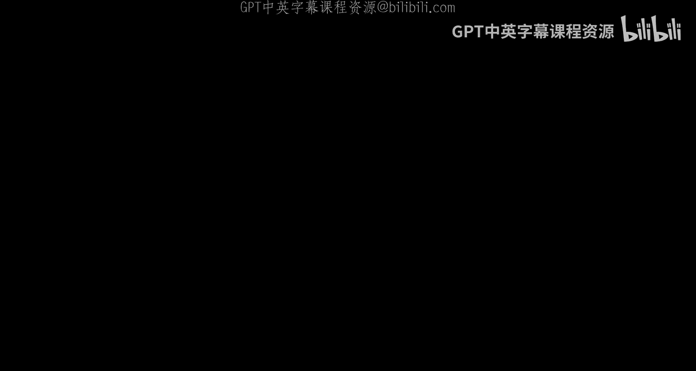
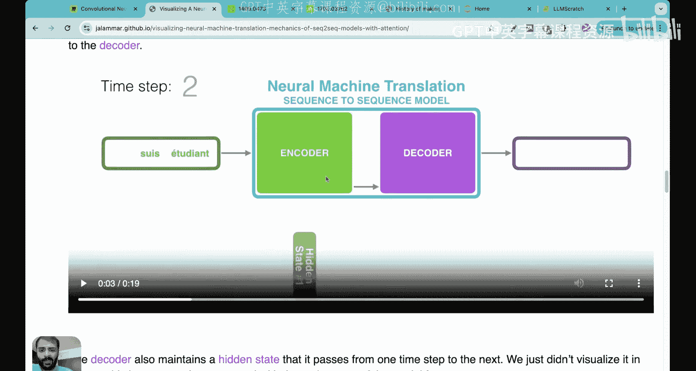
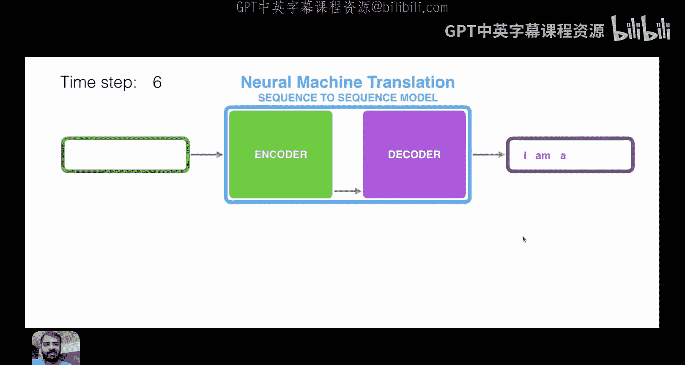
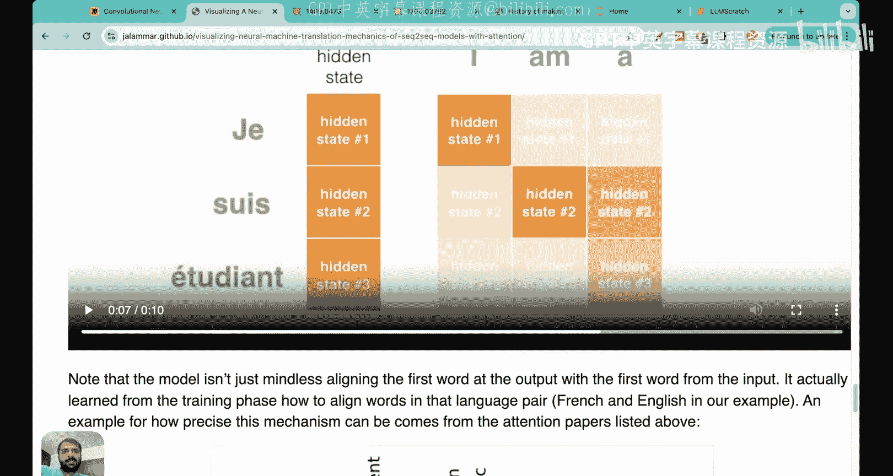
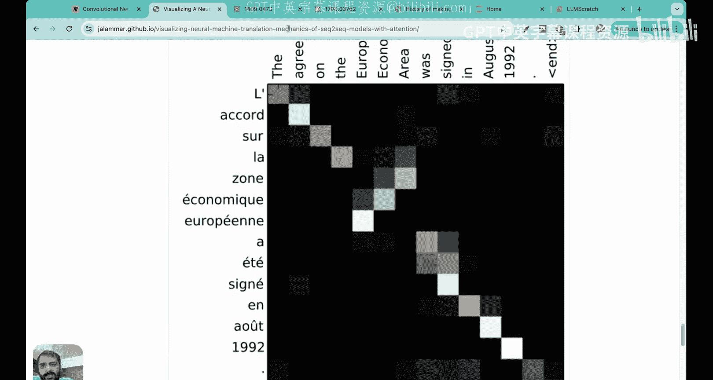
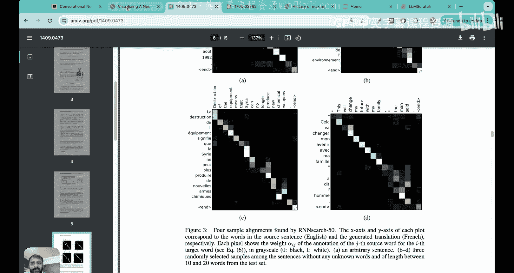
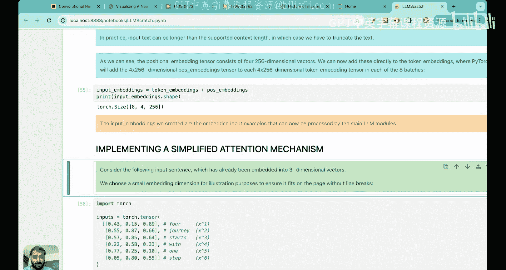

# Vizuara《从零开始搭建大语言模型｜Building LLMs from scratch》中英字幕（Claude-3.7-s） - P13：-13-Lecture 13_ Introduction to the Attention Mechanism in Large Language Models - GPT中英字幕课程资源 - BV1qG8HzUE2D

Hello everyone， welcome to this lecture in theBuild Lage language models from Sctch series。

Up till now in this series we have looked at a number of things in particular we have spent a lot of time discussing the data preparation and the sampling stage of building a large language model in particular if you want to build an entire large language model pipeline it has to be done in three stages。

In stage1， you have to look at the data preparation， then comes attention mechanism。

 then comes the LLM architecture in stage 2 we have the training and the model evaluation and in stage 3 we have the fine tuning。

So we have spent around five to six lectures on the data preparation and sampling part where we looked at world embedding。

 we looked at tokenization， we looked at byte pair encoding， we looked at positional encoding。

Essentially， we have looked at。The entire data pre processing pipeline of the LLM in a lot of detail。

Now it's time to move to the second building block。Of stage1 and that is the attention mechanism。

In one of the earlier lectures of this series， I told all of you that I think of transformers as the secret sauce behind the LLM。

So if transformers is like a car， then attention mechanism is essentially the engine which drives the car。

This is the mechanism， I think which gives so much power to large language models and that's why Chad GPT performs so well。

There are a few lectures on attention mechanism on YouTube but they are not comprehensive at all。

 it's impossible to cover everything related to attention mechanism in one lecture。

It's one of the most important concepts， so I've planned a series of four to five lectures on attention mechanism。

Today's lecture will be a foundational overview where we will understand the introduction to attention mechanism。

 what it is， why it is really needed and the types of attention mechanism then what we will be doing from the next lecture on Earth is well be codinging out the entire attention mechanism completely from scratch we are not going to assume even a single thing。

Okay， so in this lecture， we are going to look at this subsection。

 which is essentially the subsection on attention mechanism。

 So let me switch my color to I think I'll choose。Purple here and lets start looking at attention mechanism in detail so first let me motivate so that you get an intuition of why this name attention mechanism comes and what are we essentially trying to solve here so lets look at this example lets say you are a large language model like GPT and you have received this sentence the sentence is the cat that was sitting on the mat which was next to the dog jumped。

Now as a human I can say that okay there is maybe a cat here the cat was sitting next to a dog and the cat was also on a mat and then as a human when I read this I know that the cat jumped okay but as a large language model if you look at the sentence youll soon realize that this sentence is a bit confusing I can very clearly see that the cat was sitting on the mat if only this were the sentence I could easily analyze that the cat is the main subject in this sentence then the cat was sitting and the object is the mat but the thing is when there are such complex sentences which are also called long-term dependencies where there is this second sentence which is attached。

So then it becomes a bit difficult for the large language model because so after this sentence there will be a number of other sentences。

 right？But the main thing which the large language model needs to really understand from this sentence is that the cat。

 which is the main subject。That subject actually jumped。

So the main the action which the subject perform is jumping。

So the LLM should understand that when it looks at cat。

 the world which it should be paying the most attention to is jumped。

Notice how I use the word attention。So when I look at the word cat， of course。

 sitting is also important because the cat was earlier sitting on the mat。

 but now the cat has jumped。So there are a few words in this sentence。

 which the LLM needs to pay the most attention to。In association with cat。

And if you don't introduce the attention mechanism。

 it's very difficult for the LLM to know that the cat is the one who has jumped。

Maybe if the attention was attention mechanism was not there。

 the LLm would have been confused and it might think oh。

 the dog has jumped or it might think that the main。

Main part of this sentence is the cat is on a mat。So if the attention mechanism was not there。

 maybe the LLM。would have thought that the cat is on the mat， That's it。

It would not know that I have to give a lot of attention to jumped in association with the cat。

This is the broad level intuition why we need to learn about the attention mechanism。

When you have sentences such as this and then there is a big story after this。

 the LLM needs to analyze this sentence and it needs to process。In the relation to a particular word。

 let's say in relation to cat， which other world should I pay the most attention to？

And that's where the attention mechanism comes into the picture it turns out that without attention mechanism。

 if you use a recurrent neural network。Or some other neural network。

 it does not capture the long term dependencies between sentences。

That is the broad level intuition now let's dive deeper into what all we will be covering about attention in the subsequent lectures。

So if you look at the attention mechanism itself， there are essentially four types of attention mechanism。

呃。The main attention mechanism which which is used in GPT generative pre trend transformer and all the modern LLMs is this multi head attention。

And many YouTube videos and courses all many courses just directly start with multi head attention it's a very difficult concept to understand if you directly start learning this so you have to go in a sequential manner so what I'll be covering in this series of lectures is first I'll start with something called simplified self attention。

So this is the purest and the most basic form of the attention technique so that you understand what is attention。

Then we will move to self attention。So here we will also introduce trainnable weights。

Which form the basis of the actual mechanism， which is used in the LLms until this part。

 we are still not at the actual mechanism， but we are building up slowly。

After I cover self attention the next thing which I move to is causal attention This is when things really start to get interesting we are predicting the next world right by looking at the password world so what causal attention does is that it is a type of self attention。

That allows the model to consider only the previous and the current inputs in a sequence and it masks out the future inputs no need to pay too much attention to this right now I am just giving you a broad overview of foil cover in the subsequent lectures when we look at attention。

Today we are not going to cover all of these today we are just going to look at more details about the history of how attention came into the picture。

 why it is needed， why it is better than RNN etc。And then finally， we will move to multied attention。

Only when you understood causal attention and self attention and simplified self attention。

You will be able to understand multi head attention This is the main concept which is actually used in building GPD。

So multiha attention is just basically a bunch of causal attention head stacked together and well code out this multiha attention fully from scratch I'll show you the dimensions how they work etc。

All of that is planned in the subsequent lectures。So this multiha attention is essentially an extension of self attention and causal attention that enables the model to simultaneously attend to information from different representation subspaces don't worry about this just remember that the multi head attention allows the LLM to look at input data and then process many parts of that input data in parallel so for example if this is the sentence the multiha attention allows the LLM to have lets say one attention head looks at this part。

 one attention head looks at this part one attention head looks at this path etc。

This is just a crude description so that you get an understanding of what do you mean by multi head attention？

So I just wanted to show you this overview so that you get an idea of how these four to five lectures are actually planned。

It is impossible as I mentioned to cover all of this in one lecture and that's why I will follow a very comprehensive approach I'll show everything on the whiteboard and then I have this Google collab notebook where everything has already been implemented and we will go through this entire notebook see hiding future words with causal attention and then I also have a section on。

Essentially multiha attention yeah see， so at the end of these four to5 lectures we will be implementing this multiha attention in Python and code it out from scratch。

Okay， for now， let's continue with today's lecture。

 which is an introduction to the attention mechanism and how researchers got to discovering attention。

So let's go back in time a bit because to always appreciate something new。

 we need to know about the history how of how we came to this innovation。

So lets go right at the start where we are modeling let's say long sequences。

 so we have one sequence in English and let's say we want to translate it to the German language。

So what is the problem in modeling along sequences so let' us look at this question what is the problem with architectures without the attention mechanism which came before the LLMs。

So for reference we will start with the language translation model。

 so let's look at this this figure here。So I have words in the English language。

 so can you or let's say I have the German input sentence， which I want to translate to English。

So this is the input sentence， I have the first word， the second word， then I have the third word。

 etc。And I want to translate this into English okay so let's say we do a word by word translation if I translate the first word to English it can if I translate the second word to English its you if I translate the third word it is me the fourth word help so if you translate every German world world by word the translation comes out to be can you me help this sentence to translate。

That is obviously not correct right so the main takeaway here is that the word by word translation does not work and you can also see this in Hindi so if the main text is in English so can you help me and if you want to translate it in Hindi。

So the Hindi translation is Kaa tom Mary Math krogi。

 so Kaai is associated with can that's fine you is associated with tom。

 but Mary is the third world in the Hindi translation right。

 but it is actually the fourth world in the English translation。

 similarly Math is the fourth world in the Hindi translation。

 but help is actually the third world in the English。

So the main point here is that word by over translation does not work in this case。

And that was a major realization when people started modeling long sequences。

And this is a general problem when you deal with sequences。

 you cannot just do word by word translation， you need contextual understanding and grammar alignment。

So whenever you are developing a model， let's say， which translates one sequence to another sequence or tries to find the meaning of a sequence or makes the next word prediction from a sequence。

You need to really understand the context， you need to understand how different words relate with each other。

 what is the grammar of that particular language and only then will you be able to process sequences。

Or only then you will be able to model long sequences of textual information。

That's understanding number one okay， with this understanding。

 what people realized is that we cannot just use a normal neural network。

Because if you have a normal neural letter， it does not have memory。

 so we are going to use this word memory a lot。Just like humans have memory restore stored information about the past。

In order to do a good job in sequence to sequence translation， the models need to have a memory。

 the models need to know what has come in the past why because let's say I have a sentence that Harry Potter went to station number 9。

3 by4 he did this he did this etc。 And then when I come to a sentence which is。

3 to four sentences after the first sentence which is Harry Potter came to station 93 by4。

 I should not forget what came before because the station number 93 by 4 is very important for me to know even if I come at the end of the paragraph so if I am making some prediction at the end of the paragraph and the wordSt comes over there I need to go back to the start I need to have memory of what came at the start that because the station number 93 by 4。

And this happens a lot with textual data if you want to have meaningful outcomes in terms of text summarization next word prediction。

 language translation， you definitely need to have understanding of the meaning and for that you need the model to retain the memory。

So to address this issue that word by translation does not work in this particular case of translation。

People realize that a normal neural network will not work。

 so they augmented a neural network with two sub moduleles。

 the first submodule is an encoder and the second sub moduleule is a decoder。

So what the encoder does is that in the example which we saw it will receive the German text。

And it will read and process the German text and then it will pass it to the decoder and then the decoder will translate the German text back into English；

 this is the simplest explanation of the encoder decoder and there is a nice animation here。

Whi actually shows how the encoder decoder works， so here you can see the input sequence comes in the German language。

 it goes to the encoder。A context is generated by the encoder， it's called as a context vector。

The context vector essentially captures meaning， so it has memory and it captures meaning of okay。

 instead of just world by our translation， what does this sentence represent？And。

The encoder processes the entire input sequence and sends the context over to the decoder so let me play this again。

 the input sequence comes to the encoder it generates a context vector which basically encodes meaning and then the encoder transfers the context vector to the decoder and the decoder generates the output in this case the output is the translated English text okay this is how the encoder decoder blocks work and the mechanism which really employed the encoder decoder blocks successfully is called recurrent neural networks。

So before really transformers came into the picture。

 recurrent neural networks were was that architecture， which was extremely popular。

For language translation， and it really employed the encoder decoder architecture。

It was implemented in the 1980s， so let us look a bit more at how the RNA actually works because when we if we understand how RNA works。

 that's when we understand the limitations of recurrent neural networks and that's when we will really appreciate why the attention mechanism needed to be discovered。

So heres how the encoder decoder in the RNA actually works。

 what happens is that you first receive an input text okay and that let's say is the German German text。

 the input text is passed the to the encoder。What the encoder will do is that at every step。

 it will take the input and it will maintain something which is called as the hidden state。

 This hidden state was the biggest innovation in the recurrent neural networks。

 This hidden state essentially captures the memory。😊，So imagine the first input。

 which is the first German world that comes。The encoder augments it or the encoder maintains a hidden state。

 then you go to the next iteration， then the second input all comes then the hidden state also gets updated so as the hidden state gets updated it receives more and more memory of what has come previously。

And the hidden state gets updated at each step， and then there is a final hidden state。

The final hidden state is basically the encoder output what we saw the context vector over here so when we looked at the context vector which is passed from the encoder to the decoder let's see over so here you see a context vector is passed from the encoder to the decoder this context vector is the final hidden state this is basically the encoder telling the decoder that hey I have looked at the input text here's the meaning of this this text here's how I've encoded it here's the context vector take this final hidden state and try to decode it。

And then the decoder uses this final hidden state to generate the translated sentence and it generates the translated sentence one word at a time。

So heres a schematic which actually explains this pretty well so I have an input text here so this is the first world in German。

 the second world in German， the third world in German and the fourth world in German what the encoder block will do is that it will take each input sequentially and it will maintain a different hidden state so for the first input it has the first hidden state then we move to the next iteration then the second hidden state then the third hidden state and then finally when we have the last input we have this final hidden state the final hidden state essentially contains the accumulation of all previous hidden state so it contains our encapsulates memory。

This is how memory is incorporated， which was missing earlier with just a normal neural network。

 so this is the final hidden state。And then this final hidden state essentially memorizes the entire input。

And then this hidden state is passed to the decoder。And then the decoder produces the final output。

 which is the translated English sentence。So I want to show you another animation of this so that you understand it much better。

So here is how the RnN actually works right so see the input vector number one is the first word in German which needs to be translated so here you will see in this animation how the hidden state gets updated so the first word of German comes then the RN maintains the hidden state0 and here you see。

The hidden state is the hidden state 0 and the input 1 is used to produce the output 1 and then we also have a hidden hidden state 1 then as we move further we have the hidden state 2 hidden state  three hidden state 4 and final hidden state when the last word needs to be processed。

Actually I can show you this again here so this is from a French to English translation using the recurrent neural network look look here so we have French input which is coming here just swing it to the then yeah so the first word goes into the encoder see now we have a hidden so let me expand it so and you play from the start okay so now the first word of French which is J goes into the encoder。

It has went into the encoder right now and the first hidden state is generated see in the orange color great now this hidden state number one and the second input is used again。

Look at this animation again。The hidden state number one and the second input which is SuI SUIS is used。

And then we have the hidden state number two， then the hidden state number two and the input 3。

 which is Ethia will be used to produce the final hidden state。Great。

 this final hidden state hidden state number three essentially contains all the information in the given sequence plus it also contains some memory or some context。

Regarding what came in the past。And now this final hidden state is then passed to the decoder and the decoder produces the output in English one word at a time。

 this is exactly how the recurrent neural network works okay now you might think that awesome right this is already doing sequence to sequence translations and we are translating from one language to another language so why do we need attention mechanism Me is being encoded here and we are passing in the context。

Which means that we will be able to identify how different words of the sequence are related to each other。

 so why do we need attention？Well， there is a big problem with the recurrent neural network and that problem happens because。

嗯。The model the decoder has essentially no access to the previous hidden states。

 so if you look at this video you will see that the decoder has access to only the final hidden state so hidden state 2 and hidden state 2 hidden state 3 and then hidden state 3 is passed to the decoder C。

 the decoder has no access to the previous hidden states。Now， why is this a big problem。

 the reason it's a big problem is because。When we have to process long sequences。

 if the decoder just relies on one final hidden state。

There' is a lot of pressure on the decoder to essentially that one final hidden state needs to have the entire information and for long sequences it usually fails。

Because it's very hard for one final hidden state to have the entire information。

Let me explain this bit more。So as we saw the encoder。Let me change my color here。

 I think let me change it to green。Yeah， so as we saw the encoder processes the entire input text。

The encoder processes the entire input text into one final hidden state。

 which is the memory cell and then decoder takes this this hidden state decoder takes this hidden state to essentially produce an output great。

Now here is the biggest issue with RNN and please pay very close attention to this point because if you understand this you will understand why attention mechanisms are needed。

The biggest issue with the RnN is that a recurrent neural network cannot directly access earlier hidden states。

 as we saw in the video it only accesses the final hidden state。

So the RNN can't directly access earlier hidden states from the encoder during the decoding phase。

It relies only on the current hidden state， which is the final hidden state。

And this leads to a loss or this leads to a loss of context。

 especially in complex sentences where dependencies might span longer distances。Okay。

 so let me actually explain this further， what does it mean loss of context， right？So as we saw。

 the encoder compresses the entire input sequence into a single hidden state vector。

I hope you have understood up till this point now the problem happens let's save the sentence if the input sentence is very long。

If the input sentence is very long， it really becomes very difficult for the recurrent neural network to capture all of that information in one single final hidden state。

That becomes very difficult and this is the main drawback of the RNN so for example let us take a practical case so let's say we take the example which we looked at at the start of the lecture which is the cat that was sitting on the mat which was next to the dog jumped。

And let's say we want to convert this English into a French translation Okay so the French translation will be le Sha whatever I cannot spell this out fully。

 but this will be the French translation for this English sequence Now as I mentioned to you before this English sequence is pretty long。

呃。The RNN or the encoder really needs to capture the dependencies very well。

 so the final hidden state needs to capture that the cat is the subject here and the cat is the one who has jumped。

And this information， this context needs to be captured by the final hidden state and that is very hard if you are putting all the pressure on one final hidden state to capture all these context。

 especially in long sequences。So the key action， which is jumped。Depends on the subject which is cat。

 but also on understanding longer dependencies， so jump depends on cat but we also need to understand that the cat sitting on the mat and the cat is also sitting next to the dog because the dog also might be referred somewhere else in the big text。

So we need to understand many things from this sentence and these are also called as longer dependencies。

So jumped。The action jumped of course depends on the subject cat， but we also to understand this。

 we also need to understand longer dependencies that the cat was sitting next to the dog and the cat was also sitting on the mat。

So to capture these longer dependencies or to capture this。Longer context or difficult context。

 the RNN decoder struggles with this because it just has one final hidden state to get all the information from。

This is called loss of context and loss of context was one of the biggest issues because of which RNN was not as good as the GPT which exists right now。

 which is based on the attention mechanism。Okay， so these are the issues with RNN。

 the decoder cannot access the hidden states of the input which came in earlier。

 so we cannot capture long range dependencies。This is where attention mechanism actually comes into the picture okay we will capture long range dependencies with attention mechanisms and lets see how。

So RNNs work fine for translating short sentences and they did work amazingly actually for quite a while for short sentences。

 but researchers soon discovered that they don't work for a long text because they don't have direct access to previous words in the input。

So when an R and decoder only receives the。Final hidden state。

 right they don't even have access to the the decoder does not have access to all the prior over which came in the input。

 So let's say I'm decoding。Let's say I'm looking at this word。J right。

 let's say I'm looking at the word jumped Cat is a world which has come way prior in the sequence。

 So when I am looking at the word jumped， I need to give a lot of attention to the word cat。

 but an Rnn gets the entire encoded origin of this sentence。

 So how would the RnN know that jump actually if you are looking at jump you should pay a lot of attention to the word cat。

 It does not even have access to this input vector for cat。

This is where attention mechanism actually comes into the picture。Okay， so as I said。

 one of the major shortcoming in the RnN is that the Rnn must remember the entire encoded input in a single hidden state。

Before it passes the encoded input to the decoder。The RNN has to remember the entire encoded input in a single hidden state I am repeating this again because unless you understand this you won't understand why we are learning about attention。

And it's very hard for the RN to encode the entire or to remember the entire encoded input in a single hidden state。

This is when the researchers started looking at other mechanisms and that's when in 2014 researchers developed the so called Baa now attention mechanism for Rs。

So when people think of attention mechanism， they always think of the 2017 paper right attention is all you need。

 but actually attention was introduced in a paper in 2014 which was called neural machine translation by jointly learning to align and translate。

U sadadly， many people don't remember this now， everyone just remembers attention is all you need。

 but remember that this these authors， Bazaow， Benjiio and Kung Yun Cho。

 they were the ones who worked on the first。Pposition of the attention mechanism。

So I just want to give credit here and this attention mechanism was called Bahenna attention mechanism because the author of this paper was whose last name was Bahenna。

So what was the main idea behind this， what the attention mechanism basically。

Prescribed as that okay， lets take the encoder decoder Rnn and let's modify the encoder decoder Rnn so that the decoder can selectively access different parts of the input sequence at each decoding step。

Let me repeat that remember in the original RNN， the decoder only had access to the final hidden state。

But the Ba of attention mechanism says that what if the decoder now can selectively access different parts of the input sequence at each decoding step？

And let me explain to you what this means by a simple figure。

 so lets say we are at this decoding step where we want to so lets say the word is mirror。

 which is the German world。And we want to decode this So we are at this hidden state right now and we want to decode this。

 Okay， if we use the original Rn， we just had access to this final hidden state。

 but now what we say is that when you are decoding this。Hden state。

 what if you have access to all of the input tokens so follow this orange curve which I'm drawing here。

 So what if you have access to this token， what if you have access to this token。

 what if you have access to this token。And what if you have access to this token？

So let's say when you are decoding， you have access to all the tokens and you can decide how much attention to pay to each token。

So， for example I think the German translation for you is do which is do so I know that the maximum attention needs to be paid to this token so that is why you I have marked this with a thick line over here for all the other tokens well we pay less amount of attention。

What this does is that it allows the decoder to access all the tokens so if you are dealing with long sentences we can access all the tokens even in long sentences and decide which token we want to pay more attention to so for example let's take this longer sentence which we have looked at a lot in today's lecture yeah so let's say。

And we will look at it once more again。Yeah， so let's say we are look。

 we are looking at this sentence the。The cat that was sitting on the mat。

Whi was next to the dog jumped， let's say we are looking at this sentence now in the decoder。

 so let's say you are on the decoder part and you are decoding for jump and you are translating it into French。

 what we will do is that instead of just looking at the final hidden state。

 we will have access to all of the words， let's say we have access to all of the input words and not just that we have access to all of the input words and we can also decide how much attention to pay to each of the input world。

So now I will say that， okay， I want to translate。Jmed right so of course a lot of attention should be paid to jumped but I will also pay a lot of attention to cat because the cat is the one who has really jumped so I can decide which tokens to pay the maximum attention to so when I'm translating jumped I will pay attention to jumped and I will pay attention to cat also because now I can access the token for cat this excess itself was not possible in Rn because we could not access the previous input tokens in an R and this was the main problem which was solved by the introduction of the attention mechanism。

So this figure actually explains the general idea behind the Bjana attention mechanism。

Let me zoom onto this figure once Maria， so if you look at this figure here when you are translating from do to English you pay attention to all the input tokens and then you can have this attention weights will basically describe how much you want to pay attention to each input token and that solves the problem of the loss of context which was present in the R。

So essentially using an attention mechanism， using an attention mechanism。

 the text generating decoder part of the network can access all the input tokens selectively。

And as I mentioned， we can decide how much weight to give to each input token。

 so this means that some input tokens are more important than others for generating a given output token。

This importance is determined by the attention weights。

 so this is where the attention weights and the attention score comes into the picture which you will learn about later。

Now， so this paper was introduced in 2014 right this paper is which introduced the Bazana attention mechanism。

 only three years later the main Transers paper came out and that came out in 2017。

So only three years later， researchers found that RNA architectures are not required for building deep neural networks for natural language processing。

And this is when the researchers propose the transformer architecture。

And at the main core of the transformer architecture was the Bajana attention mechanism。

So it was called self attention mechanism but it was really inspired a lot from the Bazana attention mechanism we come to what self attention means Bajana attention did not introduce the term self attention but the Transers's paper which really changed everything for LLMs that paper came in 2017。

It introduced the transformer architecture with a self attention mechanism that was completely based on the bar of attention mechanism。

 this is that paper which came out in 2017。And here you will see attention， attention。

 basically the paper itself is title attention is all you need。嗯。

So this is how attention really came to be the core building block of large language models。

 I just want to explain to you this once more so that I drive this concept home about why attention mechanism helps so let's say again the same sentence this is the sentence the cat that was sitting on the mat which was next to the dog jumped。

And this is the French translation for this。Particular sequence So what the attention mechanism does is that at each decoding step。

So at each decoding step。The model can look back at the entire input sequence。

And decide which parts are most relevant to generate the current world。So， for example。

Lets say we are predicting this word saute which is the French translation for jump so when the decoder is predicting this French translation sortute the attention mechanism allows the decoder to focus on the part of the input。

That corresponds to jumped。So we can selectively look at which part of the input to give maximum attention to。

And this dynamic focus on different parts of the input sequence is what helps the attention mechanism to learn long range dependencies more effectively so remember we looked at how RnN fail to understand or even learn long range dependencies。

One main or key thing of the attention mechanism is this world， which is called as dynamic focus。

So dynamic focus which means that for everyder for every decoding step we can selectively choose which inputs to focus on and how much attention to give to each input that' is why it's called dynamic focus so this dynamic focus on different parts of the input sequence helps us to learn long range dependencies more effectively。

And that's why the attention mechanism actually works so well。

 there is another animation which I want to show you。So here we saw the R n in right。

 let me show you again。 So this is the recurrent neural network here you will see that。

Just the final hidden state which is the hidden state number three is actually passed to the decoding stage Nothing else is passed but now let me show you the modification of this with the attention mechanism so now if we do this with attention added what happens is that youll see that hidden state number one is generated hidden state number two is generated hidden state number three is generated but all of these hidden states are passed to the decoder which means that the decoder at every step has access to all of the hidden states not just the final hidden state number three but even hidden states number one and hidden states number two this is an extremely important point to remember。

Our more thing， which I want to show you here is that yeah， this part。 So let's say。Yeah。

 so let's say we are translating from French to English or here， I think let me play this again。Yeah。

 so lets say we are translating from French to English here again， let us see what is happening here。

 so if we are at the decoder stage we want to generate this word I right for J so this when we are at the decoder state the decoder has access to all of these hidden states 12 and 3 when it is generating the English translation for g。

But what it does is that it gives more preference to the hidden state number1 because it realize that that joy is more important for translation to I。

 similarly when we want to translate Sui S UIS， it actually translates to M。

 so when the decoder is translating this to English it has access to hidden state 12 and 3。

 but it learns that the hidden state 2 is most important for this translation。Similarly。

 when it is translating Ehu theon with the attention mechanism。

 translate it has access to 12 and 3 hidden state， but it learns that the hidden state number three is the most important。

E， so this is how it actually works so at every decoding step we have access to all the different hidden states。

And one more key thing to mention here is that the model isn't just mindlessly aligning the first word at the output with the first word at the input。

It actually learns from the training phase how to align the words in the language pair so remember at the start we saw that you cannot blindly do work toward translation that is not whats happening here。

In the training phase， the attention mechanism actually learns which word to align with which word。

 so which word in the output should be aligned with which word in the input。

So this this graph is actually presented in the 2014 paper and I think this graph is very interesting so you can also take a look at this this is figure number3 in the original the Bana attention mechanism paper so here you can see that lets see European economic area so lets say we want to translate European economic area to French。

It actually translates to。European economic zone， So here it says that in French the order of this world is reversed as compared to English。

So let's see how the model actually learns so European， so it learns this European happens over。

 then economic is here and area is here。So basically the point is that when the attention mechanism learns that European maps to this European economic maps to economic and area maps to Zoom。

 it does it is not just blindly looking at the order because if you see the order。

 European comes at1，2， three，4， fifth。But European， which is the French translation comes at 1，2，3，4。

567， so order is different it is not blindly copying the order or the number at which the world occurs it is actually learning from the training it is learning the dependencies between different worlds and that is how it does does the translation。

I'll be sharing the link to this paper in the information section the 2014 Bano attentionten paper and I'll also be sharing the link to the 2017 attention is all you need papers before we move to self attention I actually want to take a bit of time to tell you about the history of the attention and transformers。

So that you have a timeline in mind。So it all started in 1980。

 1980s is when the recurrent neural networks came into the picture。

And recurrent neural networks introduced this hidden layer。

 the hidden state that was the key innovation here in 1997 came along shorter term memory networks and they were in announcementments compared to LNN compared to RNN so recurrent neural networks had this problem which is called vanish ingredients so when you stack multiple feedback loops together it leads to the vanish ingredient gradient problem long short term memory solve this so we had a long term memory route and a short term memory route and that's how the LSTM actually operates。

But still both of these had problems with respect to longer context。

 which was solved by the Baana attention mechanism in 2014。

 where the decoder can can have access to each of the input state when it is performing the decoing operation and it can selectively decide which input to give more attention to。

Then came the Transers architecture in 2017 and the Transers architecture really used the attention mechanism which was proposed in 2014 in this paper by than our attention mechanism。

 so this is the history we are living in the age right now where people only know about attention and transformers right but work has been going on in this area for the past 43 to 45 years or even more。

So please keep this particular。Figure in mind or historical mind map so that you are aware of how lucky we are to be living in these times where all of the research work has been accumulated for 50 years and now we are reaping the benefits of these scientific advancements these advancements have not just happened in a period of one year or two years or three years。

 they have taken time。 their researchers have were hard over the past half a century to get us to this state。

Okay， so I hope until now you have all understood a flavor and an intuition behind the attention mechanism itself。

 what the Transer's paper did is that it introduced another terminology which is actually called as self attention。

So， self attention is a bit different， so self attention is basically a mechanism that allows each position of the input sequence to attend to all positions in the same sequence。

So， we are not looking at different sequences now when we looked at language translation we looked at converting from English to French or German to English right so we are looking at one sequence and we are looking at another sequence self attention is basically different now instead of giving attention to another sequence all the attention is directed in words。

So we are just looking within a particular sequence。

 so we are looking at different tokens within a sequence and see how these tokens are related to each other that is called as self attention。

So self attention is a key component of contemporary large language models。

So large language models remember are predicting the next world in a given sentence right they can of course do language translation tasks as well。

 but they were predominantly trained for predicting the next world。

And they are able to do translation tasks， which is also called as emergent behavior。

 but they were trained to predict the next world。And thats why they have to so let's say when you want to predict the next world in a sentence。

 you need to know that how different words are related to each other。

 so let's say the cat jumped on a wall next to the dog the dog also jump something like that you need to know when you look at cat which are the other words in this sentence which you should pay the most attention to for dog which are the words you should pay the most attention to so within a sentence itself you are deciding how different words of the sentence are related to each other and which world you should pay more attention to when looking at a particular world thats called self attention。

And self attention module is a key component of contemporary large language models。

 so if you look at how this series has progressed up till now we have looked at preprocessing steps like tokenization world embedding positional embedding but now we have started looking at the LLM architecture itself right and one of the key points here is the self attention module without really understanding attention and self attention we cannot proceed to the LLM training which comes in phase number two of building a large language model。

Okay， so one last thing to mention is that in self attention the self really refers to the attention mechanism's ability to compute attention weights by relating different positions in a single input sequence so as I mentioned we are looking at just one input sequence and we are we are looking at the attention between different tokens of that sequence。

So it learns the relationship between various parts of the input itself。

So this is different than traditional attention mechanisms like the translation task which we saw where the focus is on the relationships between elements of two different sequences so for example if we want to translate from English to German German to French English to Hdi etc we have two sequences right so traditional attention mechanisms look at one part of the sequence and another part of the sequence and how they are related to each other。

In self potential， we basically learn the relationship。Between various parts of the input itself。

So here we learn the relationship between various parts of the input itself。

And that is the difference between traditional attention mechanisms and self attention mechanisms。

Okay， so this is the end of this particular lecture where we have covered so many things we covered the basic intuition of attention。

 but before that I explained to you in a lot of detail about the shortcomings in the recurrent neural networks。

So just one thing if you take away from this lecture is that recurrent neural networks have a major shortcoming and that shortcoming is that they have to remember the entire encoded input in a single hidden state before passing it to the decoder and that is a problem when dealing with long sentences it leads to context loss。

Because the decoder does not have access to the previous inputs。

 this is exactly the problem which is solved by attention mechanisms in attention mechanisms when you are decoding a particular part。

Like let' us say when you are translating do， which is German for you into English。

 the decoder has access to all of the tokens， all of the inputs。

 and then it decides how much attention to give to each input。

This small insight leads to revolution in GT and as you can see Chad GT is so awesome。

 this small insight is at the heart is the engine of all that awesomeness。

Now what Ive demonstrated here is an example of traditional attention because you are looking at one sequence。

 you are looking at this sequence which is in German and then you are looking at this sequence and then you are seeing which parts of the output sequence are more related to which parts of the input sequence this is traditional attention in self attention you just look at one sequence and you look at different parts of that same sequence and how they are related with respect to each other。

As I already mentioned to you before， I have planned three to four more lectures which are coming up in the attention series and what we are going to do in this lectures is that we are going to first start in the next lecture with a simplified self attention。

Well start with the simplified self attention and well code it out in Python。

 then we will move to self attention， we will code it in Python。

 then we will move to causal attention， we'll code it out in Python and then we will move to multih attention and we will code it out。

And we will code this also in Python， so all of the different modules Ill be showing the mathematical formulations on the whiteboard and the rest will code it in Python。

So in the next class， let me show you where we'll begin with in the next class we' will begin with this this part。

 which is implementing self implementing a simplified attention mechanism。

So I also have whiteboards whiteboard notes for this ready。

 and then I'll take you through code remember this is a very serious lecture series where I I don't just want to give you。

The code directly， I want to teach you the theory， make your foundation strong and build everything from scratch in code we can always use a package for this。

Langgen is there so many other packages are there， we don't even need to go into the attention mechanism details if we directly use the package。

 but I don't think that's a good way to learn about large language models the best way is to learn from basics to understand the nuts and bolts of how things work and to build things out from scratch yourself。

I hope you all are enjoying this series thanks a lot everyone。

 there are a number of exciting lectures which are planned ahead and I look forward to seeing you all in those lectures。

。