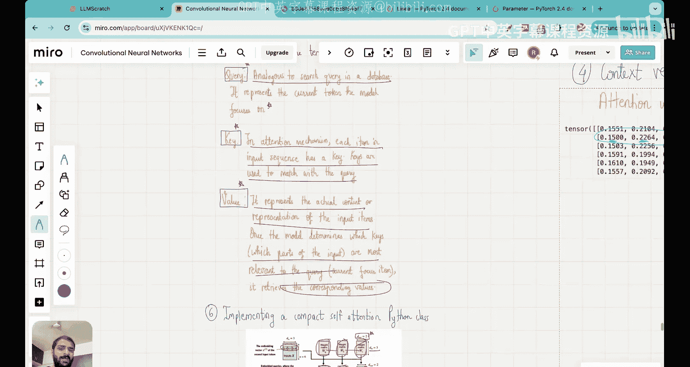

# Vizuara《从零开始搭建大语言模型｜Building LLMs from scratch》中英字幕（Claude-3.7-s） - P14：-15-Lecture 15_ Coding the self attention mechanism with key, query and value ma - GPT中英字幕课程资源 - BV1qG8HzUE2D

🎼Yeah。Hello everyone， welcome to this lecture in theBuild Large languageage Models from Sctch series。

Today I am very excited for this particular lecture because today we are going to look at implementing a self attention mechanism with rainable weights。

We are going to look at key query and value， and we will also see why this self attention mechanism is also called as scaled dot product attention。

So we are now moving very closer and closer to the actual attention mechanism which is implemented in LLMs such as GPT。

Today's lecture will be a great combination of mathematics。Theory。

 intuition and also coding I really enjoyed learning so much about this lecture and preparing the lecture material and I've condensed all the information in today's video so let's get started。

Before we get started， I want to quickly touch upon what we covered in the previous lecture。

In the previous lecture we implemented a self attention mechanism without trainable weights。

 so this is the sentence which we looked at the sentence which we looked at was your journey starts with one step。

And we saw how to convert the embedding vector， the vector embedding for every single token into a context vector for every single token。

And let me take you through the steps we implemented to do that and I'll go to the figure which really illustrates everything yeah so what we did essentially in the last lecture was that。

We broke down the initial sentence into the embedding vectors。

 which were three dimensional input embedding vectors， and then we looked at queries。

 so we took the example of let's say journey which is the second query your journey begins with one step。

And then for each such query we found the attention scores with respect to the input embedding vector。

 so for the first world there is a attention score between the first world and the query for the second world there is attention score similarly for the last world there is a attention score。

This attention score actually quantifies how much importance should be given to each world when we look at the query。

 which is journey。And then based on these attention scores we found the attention weights。

 the difference between the attention weights is that attention weights sum up to1。

 so attention scores and attention weights intuitively mean the same thing they encode information about how much the query vector and the input embedding vector are related to each other and attention weights are normalized which means the sum up to one the way we computed the attention scores is by implementing a dot product operation。

So what we did is we implemented a dot product between the query vector and the input vector。

 so let me show this to you。In figure， so that。You have some reference to compare yeah。

 So what we did essentially was we had this。Journey which is the query vector to find the attention score we found the dot product of this vector with all the other vectors。

And that give the attention scores then we normalize the attention scores to give that to get the attention weights and then finally we use the attention weights to find the context vector so here is the context vector for a journey and similarly we found context vector for all the other vectors for all the other input tokens。

So the steps which we implemented in the last class can be summed up in three categories First we computed the attention scores for that we computed the dot product between the inputs and the query then we computed attention weights which were normalized attention scores and then we computed context vectors so context vectors are essentially the weighted some of the。

Attention weight and the input vectors。So heres a figure which explains how we found the context vector so we found the attention weights for the given query and then let's say the first attention weight was multiplied by the first input vector。

 the second attention weight was multiplied by the second input vector similarly the last attention weight was multiplied by the last input vector and we added all of these vectors to give us the context vector for that given query。

In a similar manner， we found the context vector for all the other queries in the given sentence。

So this is what we implemented in the last lecture and we did not have any trainable waves。

 we did not train anything in the last lecture， everything was fixed the attention course was calculated using the dot product。

The attention weight was just normalization and the context vector was just summation of the。

Attention weights were appliedplied by the corresponding input vector。

Today we are going to look at a more real life situation which is actually implemented and we are going to consider trainable weights if you have not seen the previous lecture I highly recommend you to go through the previous lecture you'll appreciate the current lecture much much more。

Okay， so in this section we are going to learn about the self attention mechanism。

 which is used in the original transformer architecture。

 the GPT models and most other popular large language models。

The self attention mechanism is also called a scaled dot product attention and in this lecture we are going to see why this name comes into the picture and where this name is derived from。

I am following this particular sequence in the attention series in the last lecture we cover simplified self attention in today's lecture we are going to cover self attention with rainable weights in the next lecture well look at causal attention and in the final lecture we look at multi head attention。

As I explained in the previous lecture also it is impossible to cover attention in one lecture。

 That's why I have designed these extensive lectures to teach you the concept in a very proper manner。

 It might get a bit complex at times， but if you understand the concept you will master transformers because this is the heart this is the engine of transformers and I'll show everything from scratch right up to the last dot product I multiple all matrix is directly in front of you so that you understand matrix multiplication it's very important to do things on a hitboard because then the understanding is improved much more。

Okay， so what we want to do in today's lecture is that we want to compute the context vector for every given input token。

 so the objective of today's lecture is the same as the objective was in the last lecture remember what we did previously in the previous lecture we found we took this sentence your journey starts with one step we had the input embedding vector for each of these tokens and then we found the context vector for each of these tokens。

So this graph here shows the input embedding vector for every token and the red。The journey context。

 it shows the context vector for a journey， Similarlyly。

 we found the context vector for all the other。Input vectors to refresh your understanding。

 the context vector can be thought of as an enriched input embedding vector。

 So if you look at the word journey here。The embedding vector for a journey。

 the embedding vector for a journey only encapsulates or encode the semantic meaning。

 but it really contains no information about how that word journey relates to the other worlds right the context vector for a journey on the other hand has more information it not only contains the meaning of journey。

 but it also contains how journey relates to step your with and when。

That's why the context vector is thought of as an enriched embedding vector。Awesome。

 so today what we are going to do is we are going to introduce weight matosis。

Which are eventually optimized when the large language model is screened。Now。

 these trainable weight matrices are very crucial because the model then learns to produce good context vectors。

In the last lecture we just looked at context vectors by essentially taking the dot product to get the attention weights that's it right we did not train anything。

But we will see how these trainable weight mates are constructed and once these weight mat are trained。

 the model can learn to produce good context vector for every token。

So at the heart of this trainnable weight mates are three terminologies， query， key and value。

Let me repeat that again， we are going to implement the self attention mechanism step by step by introducing three trainable weight mats。

The first is called the weight matrix for query， the second is called weight matrix for key and the third is called the weight matrix for value。

 so these three terminologies will show up again and again and again query key and value。

And let me show you a diagram which illustrates what these terminologies actually mean。

So here Ive mentioned here。Step number one。Step number one。

 which we are going to learn in today's lecture， is how to convert input embeddings。

Wwhich are the input vectors into key query and value vectors remember the goal here is the same as the last lecture we want to get from the input embeddings to context embeddings for every token but there are a number of steps to be done and the first step here is to convert the input embeddings into key query and value vectors let's see what we mean by that and how to get these key query and value vectors。

Okay， so here are my inputs。Your journey starts with one step right。

 these are my six inputs and Ive represented these six inputs as three dimensional vectors which you can also see in the graph below so if you look at the input matrix the first row of this matrix represents the three dimensional vector for your。

The word you are the second row of this matrix represents the three dimensional vector for a journey。

 which can also be plotted here， Similarlyly， the last row represents the three dimensional vector for the input tool or the input token step。

Right， this is how the input embeddings are that's given to us Now。

 the next step to construct the query key and value matrix is to look at3。Traninable weight matrix。

 the first trainable weight matrix is called as the query weight matrix。

 The second trainable weight matrix is called as the key weight matrix。

 and the third trainable weight matrix is the value weight matrix。So。

 what we are going to do is that let us look at these weight mes and lets also focus on the dimensions here so the input has dimension 6 by 3 because there are six rows1 row for each input token and y3 because the dimension vector dimension size is 3。

Now， let's look at。呃，Qury key and value trainable weight mes， So this w key W W Q， W K and W V。

 these three mates which I've written over here， Ive initialized them with some random values。

 but these are the ones which are actually trained。We do not know these parameters。

 so we initialize them randomly and then train them。So to get context vectors later。

 which we will see in today's lecture， these are the ones which are optimized。

Now what these matrices do is actually they project the inputs into a different dimension space let me tell you what I mean by that so first lets focus on the query matrix so if you look at the query matrix and if you see the dimensions it is 3 by 2。

So it has three rows and two columns。So， if you multily the inputs。

 if you multiply the input matrix with the query weight matrix。

 what you will get is the resultant matrix which is called as the queries。

 so this is the queries matrix and it is a 6 by 2 matrix。

So what has been done essentially is that each row here still corresponds to the individual world。

 so the first row corresponds to your the second row correspond to journey。

 the third row correspond to begins with one。And step。

But you can see her that the dimension has been changed。

Usually when we train GPT the dimension is preserved。

 but here I am just illustrating that the dimensions can be changed when you multiply with the weight query matrix。

So， the simplest way to think of the query metrics and all the other weight mates is the transformation from lets say three dimensional space into in this case a two dimensional space。

So when we multiply the inputs matrix with the query weight matrix we get the queries matrix。

 which is a 6 by 2 matrix okay so now you can think of each row。

As corresponding to the corresponding input token， your journey begins with one step。

The second weight matrix is the key weight matrix and that is also 3 by2 matrix and very similar to what we did for the queries we will multiply the inputs with the keys weight matrix and then finally we will have the keys matrix which is again a 6 by 2。

We will see what these different mates mean what's the meaning of query key and values。

 but for now let's just look at the mathematical details of the implementation right and similarly to get the values to get the values matrix we have to multiply the inputs with the weight matrix for values and the weight matrix for values is also3 by 2 matrix and when we multiply the inputs with values we again get a 6 by 2 so the way to interpret the。

A query key and the value is that every row of the query key and value essentially represents one token and a representation for that token。

So， henceforth， after we get the queryries key and values we are not going to look at the input embeddings again。

 the input embeddings have been transformed into into three mats， the query， the query matrix。

 the key matrix。And the value matrix and remember this transformation is not fixed the key the key to these transformations are these three weight matric wq Wk and Wv the parameters of these weight mates are to be optimized later thats why these are called as the trainable weight mates。

For now just think that what we have done in this first step is we have taken the input matrix and we have converted the input matrix into three other。

 matrices， queries， keys and values， and the way we have done that conver is by multiplication of the input embedding with the trainable query matrix with the trainable key matrix and the trainable value matrix。

And so we have these three queries， keys and values metrics which is constructed so you might be thinking why do we have these three and how do we get the attention scores。

 how do we get the context vectors don't worry we'll come to all of that but first lets go to code and lets try to implement all of these。

Okay， so I'm going to take you through code right now。

 so the first thing is to construct the inputs so we will have as I mentioned the inputs is essentially a matrix which has six rows。

It has six rows and it has three columns， so that's what I'm going to define here the input is a tensor with six rows and three columns so each row corresponds to a particular word let's say journey is a three dimensional vector so I'm going to run this right now and youll see that this block has been run。

And what we are going to do。Is that the next thing what we are going to do is initialize the query key and the value query key and the value matrix query key and the value weight matrix right and for that we need to define the dimensions right so here the dimensions are3 by 2 the three has to be equal to the vector dimension of the input so that has to match because we are doing a matrix multiplication here so for all of these three query key and value weight matrix the first。

Value of the dimension 3 has to match the vector dimension， but the second dimension can be anything。

So if you when you initialize the query key and the value。

 we are initializing random values and the shape of the matrix is d in comm d out。

I remember D in is just the shape of the input， so we are just looking at one particular vector of the input that' is the vector dimension 3。

 so that' is also the first argument of the shape of the key query and value matrix this exactly what we saw here this first argument has to be same as the vector dimension which is 3。

And the out dimension we are choosing to be two in this case。

So note that in GPT like models the input and output dimensions are usually the same。

 but for illustration purposes we are choosing the input dimension is 3 and the output dimension is 2 over here。

So these are the query key and the value weight mates and each element in these weight matrices has been initialized in a random manner。

 so you can actually see torage。nn dot parameter and you can see the documentation for this。Yeah。

 so what so you can see what it does。 It's。So it is a kind of tensor that is to be considered a module parameter and inside this you can pass some things so what we are doing is that we are passing the parameters to be random values with the shape of d in comm D out which means that the matrix shape for query key and value will be 3 comma 2。

So you can print out the trainable weight matrixes so this is the trainable weight matrix for query。

 it's a33 row by two column tensor， this is the trainable weight matrix for key。

 it's a three row and two column tensor and this is the trainable weight matrix for value this again is a three row and two column tensor awesome。

Some minor things is that we are setting this requires grad right now to false。

But remember that later we are going to train the values in these mats through back propagation。

 so at that time we will need to compute gradients and at that time we will set the requires grad to be equal to true。

Great， so now we have computed the key query and value。

Key query and value weight rain weight matrix right now we have to do the multiplication of the inputs with these matrix to get the queries key and values final matrix so to do that first what we can do is we can look at an individual element so let's say we look at this second element which is journey。

And let's say we want to first convert this second element journey into its corresponding query。

Let me show you how we can do that， but first let me rub。Some other things here so that I can easily。

Show you how we get the key query and value metrics for journey。Okay。

 so what we are doing here is that we are focusing our attention。Also， let me change the color。Yeah。

 so we are focusing on our attention on this second。嗯。

Input vector which is journey and then we want to get the query key and value vector for a journey so currently the input vector is a three dimensional vector now we need to get the two dimensional vector so the way to get that is look at this query keys and values so the second row here will be the corresponding query vector for journey the second row here will be the corresponding key vector for a journey and the second row here will be the corresponding value vector for journey。

So the way you get the the second element is just you take the。You take the journey。

And then you are going to dot product it with this。

Weight matrix Q and similarly for key and similarly for value。

 So this is what we are going to see in code right now。

Instead of directly showing you the matrix multiplication first。

 I wanted to show it to you for each individual element。So remember this。

 if you look at each individual element， this 1 row and three columns so we can multiply it with the query 3 row2 column and that will give us a 102 column。

 which is the query vector for a journey similarly for keys and values。

This is what I'm going to show you in code right now。

So lets look at the second element x2 and x2 has been defined earlier as inputs accessed and the index is1 so since Python has a0 indexing system inputs 1 will essentially be the input for a journey so that is defined by x underscore2 so we are going to find the query corresponding to this x underscore 2 by multiplying it with the weight matrix for query we are going to find the key for the journey vector by multiplying it with the key matrix and we are going to find the value for the journey vector by multiplying it with the value weight matrix and here you can see we get 0。

4306 and 1。4551 which is the query vector for。So I'm just printing the query here。

 so this is the query vector for journey and lets see whether it matches so the query vector for journey was indeed 0。

43 and 1。45 here if you can see。What Im showing in the color right now and that exactly matches what we have in awesome so we are currently moving in the right direction as we can see based on the output the result is a two dimensional1 two dimensional vector。

Now， what we can do is that we can actually obtain the keys and values。

And queries for all the different inputs this is exactly what we had written over here once we get the trainable weight matrix we can just multiply the inputs with these weight matrix and get the get the queries matrix。

 get the keys matrix。Get the keys metrics。And get the values matrix。

 So this is what Im going to show to you in code right now。是。Okay， so to get the keys matrix。

 we just multiply the inputs with the weight matrix for keys to get the values matrix。

 we just multiply the inputs with the weight matrix for values and to get the queries matrix。

 we just multiply the inputs with the weight matrix for query。And let me just run this right now。

 so if you run this， you can just print out the shape of the keys values and queries and as expected it's 6 by 2。

 so you have six rows and two columns。Y6， because there are six input tokens。

 your journey begins with one step and for each input token we have a two dimensional key vector。

 two dimensional value vector and two dimensional query vector。So as we can tell from the outputs。

 we have successfully projected the six input tokens from a 3D input embedding space。

 from a 2D embedding space for the keys， values and queries。Okay。

 so if you have understood up till now you have essentially understood the first part of today's lecture and the first part was how to convert input embeddings。

 how to convert input embeddings into key query and value vectors awesome now we are ready to move to step number two and。

Before that， let me just show you a schematic of what we have done until now。

 so what we have done is that we have the inputs right and we have converted the inputs into their embedding the three dimensional embedding vectors。

Then what we did was we had a key query and value and we multiplied every input with the key query and the value。

So here Im showing keys and values， so you can multiply every input with the keys queries and value to get the key query and value matrix for every single input em。

That is what we have done until now， essentially every input embedding vector has been multiplied with the key query and value crable weight matrix to get the final key query and value matrices for all the inputs so for the rest of the lecture imagine that we dont have the input embeddings at all we will only deal with the key query and value mates。

So now let's move to the next step in the next step。We have to compute the attention course。

What is meant by attention scores， we have to essentially compute that if you are given a query。

 let's say if you are given a particular query。How does the other。Keys attend to that query。

 Let me explain this to you。 So let's say。We have the query for the second。AWorld。

 which is journey and this is the query， which is a two dimensional vector。

 Now we have to find out how does this query attend to the keys for the different input world So you can think of the keys right now as just individual tokens like what we did in the previous class remember in the previous class the query was just the does just that particular token we did not have a separate vector for query we just the journey itself as the query the journey token itself as the query So if ever you get confused in terms of intuition just think of the query as being the token itself although it' is a bit different So what we are essentially doing is。

Finding how that particular query so now we are looking at query number two which is related to journey and we want to see how the other words attend to journey。

 which means that when I am predicting the next world how much importance should I give to your how much importance should I give to journey。

 how much importance should I give to with one and step。So。

 my query is journey and Im going to look at how much importance I need to give to the other world。

 so that' is why we need to find the attention scores between the query and the key。

Remember this intuition is very very important right now what we are essentially doing is that we are finding the attention score between the query and the key in the previous lecture we just found the attention score between the input embedding vector and the other embedding vectors by taking a dot product。

But now remember we don't have the input a bedding space at all， we are in an abstract space。

 we are in the query key and value space。So we are going to find how the query number two attends to the different key vectors and we are going to find it in the exact same manner as we did in the last class remember the mathematical operation which helps us to find whether two vectors are aligned or not。

That is the dot product operation， So let's say this is my query vector。

And if let me show the key vector in some other color。 So let's say this is my query vector。

And let's say this is my key vector。These two vectors are very much aligned with each other right so the dot product will be maximum。

 so it says that when I look at the query I should probably pay more attention to this key vector。

Whereas lets look at another key vector now which is like this。

 So let's say there is another key vector which is like this。

 So now if you look at the query and this second key vector。

 they have an 90 degree angle with each other。 they are not at all aligned。

Which means that when you look at that query， you should not pay attention to this green key over here。

And that is encapsulated by the dot product if you find the dot product between the yellow vector and the green vector。

 they have a 90 degree angle the dot product will be0。That's what we are going to do now。

We are going to find the attention scores between the a particular query and all the other keys remember every every query will have an attention score with all the other keys so for example if you look at query number two for a journey it will have an attention score with key number one it will have an attention score with the key number two and similarly it will have an attention score for the final key。

Which is step so this is what we are going to do next。

And let me show this to you in a pictorial representation right now。Okay。

 so the way we are going to do this is by initially only focusing on the queries and keys。 Okay。

 so let's say we look at so this is our queries matrix。

 which is a6 by2 and I'm going to now focus on the second row of this because I'm going to look at journey I'm going to look at the world journey So the query for the world journey is the second row right now what I actually want to do is I want to find the。

dot product between this query and all the other keys。

 so I want to find the dot product between this query and the first row with the second row with the third row。

With the fourth row， with the fifth row。End with the sixth row。So。

 to essentially find the attention score for the second query。

 all we need to do is we need to take the that particular row and we need to find the dot product with all the other rows of the keys。

 so we have six attention scores。And that those attention scores contain the information that when you look at the query for a journey。

 how much importance should be given to other worlds like your journey begins with one step so this is what we are going to implement in code right now。

So I'm going to look at the keys of one。So I'm going to look at。This keys。

 so keys  two is keys of one， which means the key for journey。Which I have highlighted over here。

 So this， this is actually my keys。Undercore。2。So the keys under scroll to in the code is the keys for journey。

And then what I'm going to do is I'm going to take the dot product between actually before that。

 let me。Right。😔，Yeah， so let me correct that a bit so this actually is queries。So。

 this is actually queries under scroll 2， so query under scroll 2 is is this query。

 so let me reframe that again。So here， what I have is query。Qury underscore 2。

And to find the attention score for this query， I am going to take a dot product between the second query and the keys matrix。

So this is exactly what has been done in the in the code here。 So to find the。

Attention score between the query2 which is the query for a journey we are going to take a dot product between the query and the keys transpose why are we taking a transpose here because look at the dimensions always look at the dimensions the dimensions for query is that it's one the row and it's one the row and its two columns so we cannot directly multiply it with the keys because the keys has six rows and two columns。

Whereas keys transpose， we have two rows and six columns， and that can be multiplied。

So then keys transpose will be 2 by 6 so let me write that dimension down so keys transpose will be 2 by 6 and if you multiply one by 2 matrix with2 by 6 you will at one by 6 so you will get six attention scores for all the different。

For the six input tokens， your journey begins with one step， so that sounds correct。

 So this is what we are going to do over here。So the attention scores2。

 which is the attention score for a journey is just a matrix product between the query for a journey multiplied with the keys transranpose so you get the six attention scores here。

 so as you can see the first attention score is the encodes information about how much journey attends to Europe the second attention score encodes information about how much journey attends to journey the third attention score encodes information about how much journey attends with width。

Similarly， the last attention code encodes information about how journey attends with step。

So the second score is the has because of course journey and journey will be intuitively more aligned to each other。

 but remember these scores don't mean anything right now because we have not trained any of the weight it meises。

This scores will only mean something when you train the weight metaosis so ideally if you have a long paragraph NF journey and step are more related to each other in that paragraph after the metarices are trained this last value which is the attention score between journey and step has to be the highest。

So up till now what I showed you is how to find the attention score the six values of the attention score for one query。

 but now what if you want to find the attention score for all the other queries for the first que second third for fifth6 the simplest way to do that is just for the second query you just multiplied it with the keys transpose right and similarly you do for all queries so why don't you just do a matrix multiplication so you multiply the queries matrix with keys transpose。

And Ive shown this over here for your reference， so this is the queries matrix which is 6 by 2 and the keys transpose is 2 by 6 so of course6 by 2 can be multiplied with the 2 by 6 matrix and ultimately you will get a matrix like this which is a 6 by 6 matrix and that is our attention score matrix。

Now， what does this attention score matrix symbolize so the first row？

Is contains the attention scores between the first query and all the other keys。

The second row contains the attention scores between the second query and all the other keys。

 similarly the last row contains the attention score between the last query and all the other keys。

That is the simple meaning of the attention scores and I am again going to do this in code right now to get the attention scores I just take the matrix multiplication of queries with keys transpose and then you get the six by6 attention scores matrix that's it so we have calculated the attention score between every query with respect to all the other keys awesome。

This is the second step and we have still not yet got to the context vector。

 so the first step was to convert the input embedding vectors to the key query and value the second step was to use the key and the query to get to the attention scores now the problem with these attention scores is that they are not interpretable right ideally I want to be able to let's say if I look at this second。

呃。This second row which are the attention scores for the query journey。

 I want to be able to make the statements like okay pay 10% attention to your pay 20% attention to journey。

 pay 30% attention to step pay 40% attention to width。

 but I am not able to make these interpretable statements because if you look at all these attention scores they do not sum up to one。

These look like random values that they are not summing up to one so we have to do the next step of normalization so normalization serves two purposes first it will help make things interpretcrable so I can make statements like okay when the queryer journey the you pay 20% attention to the first token 30% attention to the final token etc and the second advantage of normalization is that it helps when you do back propag generally in many machine learning frameworks it is better to normalize things so that the scale stay consistent between zero and1。

So， the third step what we are going to do is that we are going to compute these terminology which is called as attention weights so up tillll now we have calculated attention scores that is fine。

Now we are going to just normalize the attention weight。

So that the attention scores in each row sum up to1。

 so there is a difference between attention scores and weights， the meaning is the same。

 but attention weights sum up to1 they are normalized。In the previous lecture。

 what we did for normalization is that we looked at each row and we simply took the soft max， right？

And the softmax function actually ensures that all the elements sum up to one I am not going to cover the softmax implementation in today's lecture because we have already seen it in the last lecture in a lot of detail。

 but remember that softm just make sure that all of the these quantities sum up to1 and they lie between0 and1 and they are positive。

But actually in today's lecture， before we implement softmax。

 there is one more very important step which is actually done。And I'll come to why this step is done。

 but remember that。Before implementing softm， what is done is that all of these values are taken and they are scaled by something which is called as square root of the keys dimension。

 So currently the dimension of the keys is that it's two two dimension right because remember the keys queries and the values matrix we。

We took the three dimensional input embedding and we transformed it into two dimensional。

 so the dimension of the keys in this case is2。So we are going to scale everything by square root of two。

Y2， because if you look at the let's look at the key matrix again。Yeah。

 this is my key matrix right now。 and if you look at every if you look at every。Token here。

 it has two dimensions， right， So that's why we are going to we are going to scale by square root of two。

And you might be thinking， okay， this looks like magic who thought about the square root。

 Why do we do this scaling There is a very nice reason for that and I' am going to come to it for now just remember that after getting the attention score we are going to scale it by square root of D and thats why it's also called a scaled dot product attention remember we saw at the start the scaled we are going to scale by square root of D that that is one of the reasons why its called scaled dot product attention。

So we are going to scale it and then we are going to apply softmax。So。

 when we scale by square root of2 it leads to this matrix over here and then we apply softm so you will see that when softm activation is applied and if you look at each row right now you will see that they sum up to1 so if I look at the second row right now it corresponds to again。

嗯。Journey。So I can now confidently make statements like when the query journey pay 15% attention to your。

 pay 22% attention to journey itself， pay 22% attention to width to begins。

 pay 13% attention to width， pay only 9% attention to one and pay around 18% attention to step。

Remember， these weights are not optimized， but when they are optimized。

 we can make interpretable statements like these。All of the rows will sum up to one you can check these and this is called as the attention weight matrix this is one of the most important step in getting to the context vector please remember this step and we did two things here we scaled by the square root of the dimension and then we implement a softm now let's go go to code and let's implement this in the process we also understand why we do the scaling by square root of D。

ok。Yeah， so we compute the attention weights by scaling the attention scores and using the softm function。

 the difference to earlier when I say earlier it the previous lectures is now we scale the attention scores by dividing them by the square root of the embedding dimension of the keys and that embedding dimensions is 2 so we are dividing by square root of 2。

So let's do the same thing here， so we have this attention scores too。

 so its a6 by6 matrix which we have printed out here。

Actually currently I'm just employing this on the attention scores for the second query okay no problem so attention scores2 is the attention scores for the query2 which is journey so its actually 10 and six columns so what I'm going to do is that I'm going to take this attention scores for journey I'm going to first divide it by the square root of the keys。

Dimenssion And then what I'm going to do is that I'm going to apply softm。

 The reason we do dim equal to -1 is that because we have to sum over all the columns and all the if so that's why when you look at1 row you will see that its sum up to one。

 So two things are important。 This D of k is the dimension Its the keys dot shape minus1 because we are looking at the column remember the keys dot shape is3 by2。

 So when you do keys dot shape and index it by 1 the result will be2。

 So we are going to divide by square root of2。And then by turn。Remember here we are exponenting by 0。

5， so in2 in 2。5 means race 2。5 that is the same as dividing by the square root of 2。

So every element will be first divided by the square root of two in the attention score and then we implement the softm。

So， if you look at the attention weights for a journey you will see that these are the attention weights let us actually check whether these are correct to what we saw yeah so let's look at the second row here the second row is 015。

2264 etc for a journey。And here you will see that the second， the output is exactly the same。

That is a good sanity check and you will see that all of these sum up to one so this is how we calculate the attention weights for one query and similarly we calculate the attention weights for all the queries so if I just replace this with attention scores which is the6 by6 we will get the attention weight matrix which is the 6 by 6 matrix。

Okay now let's come to the question which all of you might be thinking and I don't think this is covered enough in other lectures and other videos but it's a very fascinating thing I took some time to understand this and I have come up with two reasons why we actually divide by the square root of dimension the first reason is stability in learning and let me illustrate this with an example so lets say if you have this tensor of values which is 0。

1 minus 0。2。3 minus 0。2 and 0。5 okay。If you take the softm of this。

Versus now let's say if you multiply this with8 and then you take a soft max so youll see that the soft max of the first is kind of its good right it' is diffused these values are diffused between 0 and 1 but if you look at the soft max of the second tensor you will see that the values are disproportionately high which means that if there are some values in the original tensor if some values are very high and when you take the soft max you will get such kind of peaks in the soft max output。

Ive actually explained this better here， so the softm function is sensitive to the magnitude of its inputs when the inputs are large the difference between the exponential value of each input becomes much more pronounced this causes the softm out output to become peaky where the highest value receives almost all the probability mass and we can check it here so when we multiply with8 you will see that this has the highest value which is4 and when we take the softm。

You will see that the values point a here which is much higher than all the other values in fact it's around 10 to 15 times higher。

 that's what is meant by softm becomes peaky if the values inside the softm are very large so we don't want the values inside the softm to be very large and thats one reason why we scale or divide by the square root to reduce the values itself before taking softm we make sure that the values are not large and that' is why we divide by the square root factor。

So in attention mechanisms particularly in transformers。

 if the dot product between the query and the key vector。

 remember that we are ultimately applying softm on the dot product between query and key right because attention scores are just dot product between query and key and if the dot product becomes too large。

Like multiplying by 8 in the current example， which we saw the attention scores can become very large and we dont want that this results in a very sharp soft match distribution。

And such sharp softm distribution can become so the model can become orly confident in one particular key。

 so in this case the model is become very confident in this fourth key。Or rather this fifth key。

We don't own that because that can make learning very unstable。

That's the first reason why we divide by square root to make sure that the values are not very large and to have stability in learning。

But still， so I knew this reason， but then I was thinking， but why square root？

Why are we dividing by square root why not just only the dimension。

 what is the reason behind dividing by square root and then I came across a wonderful justification for this。

The reason for square root is that it's actually related to the variance。So。

 it turns out that the dot product of Q and k increases the variance because multiplying two random numbers increase the variance。

 so remember that when we get to the attention scores we are multiplying Q and k right the query and the key。

It turns out that if you don't divide by anything， the higher the dimensions of these。

Vctorors whose dot product you are taking， the variance goes on increasing that much。

And dividing by the square root of dimension keeps the variance close to1 let me explain this also with an example。

 so lets say we have a query vector which is generated randomly and a key vector which is generated randomly。

Okay， and currently let's say I'm doing a fire dimensional vector。

 so let's say I have a key vector five dimensional key vector which is sampled from a normal distribution and a fire dimensional query vector sampled from a normal distribution。

And then I am taking a dot product between the query and the key and then I am also in the second case taking dividing by the square root of the dimension okay and I am doing this thousand times so that I can get a distribution over the dot product。

So after I do this a thousand times what I do is I plot the variance before scaling and I plot the variance of the dot product after scaling。

So， the results are surprising if the dimension is equal to 5 the variance of the dot product before scaling is actually very close to 5 if the dimension before scaling is 20 the variance before scaling is very close to 20 this indicate that if the dimensions of the query and key vectors go on increasing and if you don't scale then the variance of the resulting。

Dot product scales proportionately So if you have a100 dimensional key and query vector the variance before scaling will be close to 100 and we can actually test this out So here let me do this0。

And compute variance hundred。So now Im printing this for 100 and let me print this out。Okay。

 I think I should replace this also with under。And let me print this out。Okay。

 so this is exactly what we are predicted right so the variance before scaling in this case is 107。呃。

See so as the dimensions increase the variance increases。 Now。

 look at the power of scaling when you scale by the square root。

 So see here you are scaling by the square root， when you scale by the square root of dimensions。

 no matter how much you increase the dimension， if you see the variance after scaling。

 the variance is always close to one。And that is the reason why square root is used if you dont use a square root。

 the variance will not be close to one， so let me actually not use the square root here and let me do it directly。

If you do it directly， then you will see that the variances after scaling are some random values they are not close to one having the square root actually really。

Having the square root， make sure that。Even if the dimensions increase the variance after scaling remains close to one of the dot product between the query and the key。

 and this is very important。The reason why the variance should be close to one is that if the variance increases a lot。

 it again makes the learning very unstable and we don't want that we want to keep the standard deviation or the variance close so that the learning does not fly off in random directions and the values the variance generally should stay to one that that helps in the back propagation and thats also generally better for。

Avoiding any computational issues。So that is the reason why we want the variance to be close to one。

 so this is the second reason why we especially use square root。

So there are two reasons the first reason is of course we want the values to be as small as possible。

 this helps if the values are not small the softmax becomes peaky and then it starts giving preferential values to keys which you don't want it can make the learning unstable but why square root the reason why square root is because specifically when you take the dot product between query and key to find the attention and if you don't scale as the dimensions of the query and key increase the dot product variants can become huge。

You don't want that because again that will make learning unstable so scaling by the square root makes the variance close to one so if you see after scaling it keeps the variance close to one and that's why we divided by the square root it' very important for you to have this understanding and not many people have this understanding but I hope I have clarified this concept to you and you have appreciated why we are dividing by square root that's why this is also called a scaled dot product attention because you scale by the square root。

Okay， so now until now we have reached a stage where we have essentially computed the attention weights and now we essentially come to the last step。

 which is now we are ready to compute the context vector。

So let's go ahead and actually compute the context vector。

 but first what I want to do is I want to show you。

Pctorially what all we have done until now so lets see what all we have done until now is that let's say if you focus on a particular query we have found the attention score between the query and all the input keys by taking a dot product between the query and the keys so the attention scores are shown in the blue over here and then what we do is we divide by the square root of the key dimension and then we normalize using softm and then we have found the attention weights。

And the attention weights sum up to1。Awesome， so we have reached this stage and the final step essentially is to compute the context vectors。

 so let's come to that right now。So until now you might be thinking that Ive used the key and the query。

 but what about the value， why did we even get the value matrix？

The value matrix will be useful in the final step So remember for every input embedding vector we have also calculated the value vector So the way the context vector is now found out is that we have the attention weights right so we just so for the first input embedding we multiply the value vector with the first attention weight we multiply the second value vector with the second attention weight Similarlyly we multiply the last value vector with the last attention weight and we are going to add all of these together and this is going to give us the final context vector。

It' is very similar to what we did earlier remember earlier we did not have this value vector the value vector was just the input embedding vector but the whole essence here is that now we have calculated the attention weight so now it is time to assign the waittage assign the corresponding weighttage to each input embedding vector or the value vector and sum them up to give the context vector。

I'll show you intuitively what this means in a minute。But let me take you to this。

Whiteboard right now so that I can show you the next step okay。

 so we have calculated the attention weights now and now we will be calculating the context vector。

So let me show you mathematically how we compute the context vector so we have these attention weight which is a 6 by 6 matrix and we have these values which you computed at the start of this lecture we have this value matrix it is a 6 by2 matrix right so the first row are the values for your the second row or the values for journey similarly the six row is the value for step。

Now， let's say we look at journey。And I want to find the context vector for a journey and let's look at the attention ratess for journey it is this second row。

Let me show you intuitively how you find the context way vector for a journey and you will never forget this after I show the illustration。

Okay， so let's say these are the value vectors for other different tokens。

 So this is the value vector for a journey。 And let's say this is 03951 and1 the way we do the。

Context vector calculation is that let's look at the attention weights。

 So the attention weights for the journey are this second row， which means 0。15。2264 etc ceter。

 So this means that I'm paying 15% attention to your。I am paying 22% attention to journey。

I am paying 22% attention to begins。I am paying only 13% to width。Im hoping paying only 9% to win。

And I'm only paying 18% to step。Okay， how do I encode all of this information to find the context vector。

 it is pretty simple。You take the U vector。And you multiply it by 0。

15 because it only contributes 15%。 You take the journey vector， you multiply it by 0。

22 because it only contributes 22%。 you take the begins vector， you multiply it by 0。

22 and 99 because that also contributes only 22% Similarlyly， you take the one vector。

 you multiply it with 0。09 because it contributes very less， you take the step vector。

You multiply it by 0。18 because it only contributes 18% and then you add all of these small contributions together to give you the context vector for a journey。

Let me show you how this looks like。 So your， the attention for your is how much15， right。

 So you will scale。You will scale the a vector， let me show this with a different color。

You will scale the your vector by 0。15。The attention score for journey was 22 so it scaled by 0。

22 for starts was also 0。22 and for width lets see how much it was for width for width it was 0。

13 so for width and when it was very low so for width and when they make very less contributions for step it was around 0。

15 so now you have these six vectors and you will add all of these six vectors together to give you the context vector for journey。

So when you add all of these six vectors together， it will give you the context vector for journey。

If you have this kind of visual representation in mind you will never forget what context vector means now do you understand why the context vector is richer than just the input embedding vector。

 if you just look at the input embedding vector for a journey it has no information about how much attention should be paid to your step when width and starts but now if you since you have this attention weight matrix。

Since you have this attention weight matrix over here you exactly know how much relative importance should be paid to each of the other worlds。

 so you scale the other vectors by that much amount and then you add all the vectors together to get the context vector so the context vector is an enriched vector。

It contains the semantic meaning of journey plus it also contains how all the other words attend to journey remember none of these weights are optimized right now we have just initialized them randomly but when the LLM is traineded all of these context vectors will be perfectly optimized so you would know that in that particular sentence in that particular paragraph which word should journey pay most attention to。

Now this exact thing which I've shown you in the graphical format can be computed in matrix if you just multiply the attention weights with the values so if you multiply the attention weights with the values you are multiplying a6 by6 matrix with a6 by2 so of course the matrix multiplication is possible and the resultant will be a6 by2 matrix like this so this is a6 by2 matrix which is a context vector matrix and each row corresponds to a context vector for that token so if you look at the second row over here the second row corresponds to the context vector for a journey which we have shown over here。

 the first row corresponds to the context vector for your similarly the last row corresponds to the context vector for step。

One exercise I want to give you is that。Use this this visual representation of scaling。

 so take the second row， take journey and use the scaling approach which I showed you in the graphical representation so take the vector for year multiplied by 0。

15， take the vector for journey multiplied by 0。22。

 similarly take the vector for step multiplied by 0。18。

 add them all together and see whether the result matches with the second row or here。

That will give you an intuition of why this matrix multiplication actually gives us the exact same result。

As this graphical intuition based calculation which we did over here。

 but if you forget this matrix formula just remember this scaling based approach which we discussed in this graphical intuition and you will get the exact same value。

So， remember that the context vector matrix is just a matrix product of attention weights and values attention weights multiplied by the values matrix gives us the context vector matrix and this is exactly what we are going to implement in code right now。

So let us go to code。Yeah。So we saw this， we saw the square root。

 and now we are going to implement the context vector。

So remember that context vector first we are going to only see the context vector for a journey and it is the product between the attention matrix attention weight for a journey multiplied by values let me explain this a bit So on the whiteboard what we saw is we just multiplied the entire attention weights with the value right but if you want just the。

contexttex vector for a journey what you can do is just take the second row。

 it will be one by 6 and you multiply it with these values which is 6 by 2。

And then you will get a 1 by2 vector which is the second row and that will be the context vector for a journey so this is what Ive showed over here the context vector2 which is the context vector for journey is just the product of the attention weights for a journey multiplied by the values matrix and the result is 0。

3061 and 0。8210。And let's actually see the result here and that exactly matches the second row which we have 0。

3061 and 0。8210 awesome so our calculation seems to be correct so in the code right now we have only computed the single context vector right now we are going to generalize the code of it to compute all the context vectors it is going to be very simple because now we just multiply the attention weights with the values。

But we will do this in a structured manner we implement a self attention Python class and what this class will do is that it will essentially have a forward method。

 this forward method will compute the keys queries values。

 it will compute the attention scores attention weights and the context vectors all in a very short piece of code。

So lets do that right now before that let us summarize what all we have seen so far so that you will understand the Python class much better so let me zoom out here a bit。

So remember how we started the lecture， we started the lecture with。

We started the lecture with taking the inputs and then multiplying them with query key and the value to get the queries matrix。

 the key metrics and the value matrix okay then remember what we did next then we move to the attention scores we multiplied the queries with the transpose of the keys to get the attention scores so we had the attention scores matrix then what we did is we scaled this by square root of the keys dimension and then we took the soft max this gave us the attention weights then we took the attention weights and we multiplied it by the values matrix and that ultimately gave us the context vector matrix remember this flow so the flow is in four steps step number one is at the left side of the page which is converting the input。

Ebedding into key query value vector step number two is getting the attention scores step number three is getting the attention weights。

 step number four is getting the context vector that's it and we are done。

That's exactly what we are going to implement in this Python class。

So with the LLM implementation which we are going to cover next in one of the subsequent lectures it is very useful to organize the code in a Python class so we cannot keep on writing separate lines of codes like what we did over here right。

 it is just better to have a class so that then we can create an instance of this class and then always return the context vector。

Okay， so we are going to define this class called self attention version1 and it will take two attributes the input dimension and the output dimension the input dimension is the input vector embedding dimension。

 the output dimension is what we want the e query and value dimension in GPT and other LLMs these two are generally similar。

Okay， first thing what we do is when an instance of this class is created this in constructor is automatically called and the query key and the value matrixes matrices are initialized randomly。

 which means that they have a dimension of d in and d out so d in the rows in our case three rows and d out columns。

 two columns and then each element will be initialized in a random manner。

Then what we do is we do the forward pass， what happens in the forward pass is that it takes an input it takes x as the input which is the input input embedding vector that needs to be given as an input to execute the forward method and then in the forward method what we do is we first compute the keys matrix which is x multiplied by the weight trainable weight matrix for key。

 then we compute the query matrix which is x multiplied by the trainable matrix for query。

 then we compute the value matrix which is x multiplied by the trainable matrix for value and this is exactly what we saw on the left side of the board over here。

Here so until now we are at this stage where we are taking the inputs。

 we are multiplying it with the weight matrixes to get the queries。

 keys and the values and now we will go to the right side of the board to compute the attention scores so to get the attention scores we will multiply queries with keys transpose。

So thats exactly whats done here to get the attention scores we multiply queries matrix with keys transpose then we get the attention weights to get the attention weights will of course apply softm but before applying soft max will divide the attention scores every element of the attention scores with the square root of the keys embedding dimension so keys do shape minus1 returns the columns which is embedding dimensions in this case its two columns of the keys matrix so it will be square root of2 the reason we do this division as we saw is first of to make sure the values in the matrix in the attention score matrix are small。

Second， it also helps to make sure that the dot product between thez keys。

And the queries does its variance does not scale too much。

 so we want its variance to be very close to one， that' is why we specifically divide by the square root of the dimension。

And here the dim equal to minus1 just tells the softm that you have to sum across the columns and that's how we make sure that each row if you take each row it sums up to1 so if you look at each row of the attention weight matrix it will sum up to one and then the context vector is just the product of the attention weights and the values this is the last step which we saw the context vector。

Yeah， so this was the last step which we saw the context vector is just the product of the attention weights and the values。

So this is how we compute the context vector。So some key things to mention here in this Pytor code。

 the self attention origin1 is a class derived from NN dot module， so NN dot module。

Which is a fundamental building block of pitorch models and that provides necessary functionalities for model layer creation and management。

As I mentioned to you before the init method initializes trainable weight meizes query key and value for queries keys and values each transforming the input dimension D in into an output dimension d out and during the forward pass which is the forward method what we do is that we compute the attention scores by multiplying queries and keys normalize this course using softmax and finally we create a context vector that is the last step so this is just an explanation of the code I'll share this entire code file with you so you will have this explanation don't worry so let's try to create an instance of this class。

So I'm creating an instance of this class with two with three as the input embedding dimension and d out is equal to2。

So here you see I have created this suprint essay original inputs。

 so these are the six embedding vector， so here is the matrix of the six context vector so directly returned so what this print statement does is that it returns the context vector。

So actually when you do this self attention version 1 and you pass the inputs many things are happening when you pass the inputs these key query value matrix matrices are created attention scores are calculated。

 attention weights are calculated and the context vector is calculated which is returned over here。

So it has six embedding vector so each row corresponds to the context vector so the first row corresponds to the context vector for first token here。

 second row corresponds to the context vector for second token journey etc。

 Similarlyly the last row corresponds to the context token for context vector for step so that's why the dimension the here are six rows and two columns。

So since the inputs contain six embedding vectors we get a matrix during the six context vector remember we have we want6 we want a context vector for each input embedding vector thats the main goal which we started out in today's class and we have achieved that goal over here in a very compact manner in just maybe 10 to 15 lines of code so if you have followed till here it's been a pretty long lecture you should be really proud of yourself because if you have understood until here I believe you have understood the core of the attention mechanism just write these dimensions down once take the dot product yourself and see how the calculations play out on a book or on a piece of paper that's the best way to learn this concept I it all boils down to mat and dimensions。

So as a quick check let's notice the second row0。3061。

8210 and let's see whether it is the same as the context vector for a journey which we have calculated earlier so that's the same So it's a good sanitity check which means we are in the right direction now what we can do is that we can we can actually improve this self attention version one further by changing how these are defined so currently we are using n n dot parameter right the main hypothesis is that why don't we use directly an n dot linear function because it automatically creates the。

Initializes the weight matrix in a manner which is good for computations。

 so instead of just sampling from random values here。

 why don't we use the linear function so that the initialization is done in a proper manner using pytor？

That' is exactly what we do next so we can improve the self attention original and implementation further by utilizing the NN dot linear layers of Pytorch。

W effectively perform matrix multiplication when bias units are disabled。

 so basically we can use n n dot linear to also initialize random values of query key and the value value matrix。

 but the main advantage is that n dot linear has an optimized weight initialization scheme and that leads to more stable and effective model model learning you can of course use n dot parameter also but the main advantage of n dot linear is that it has a stable initialization scheme or rather I should say more optimized initialization scheme since we always use this for all types of neural network tasks so why not essentially。

Use the linear layer， we can just put the bias terms to false because we don't need this we just need to initialize a weight matrix with d in and d out weight weight matrix for query key and value with d in as the rows and d out as the columns but we don't need the bias matrix。

 so you can just use the linear layer and put the bias to false。

So it will initialize these weight matrix， weight mats。

 and that is usually more common practice for implementing the self attention class when we deal with LLMMS。

So similar to here we created an instance of the self attention version one right。

 similarly we can create an instance of the self attention version2 and pass in the arguments as the input dimension and the output so here again we get a six rows and two column tensor。

whichch is the context vectors for all the six input embedding vectors。

 so youll notice that these values are different than these values。

Because the initialization schemes are different。So they use different initial weights for the weight matrix since an N dot linear uses a more sophisticated weight initialization scheme。

So the linear usage of NN dot linear leads to a more sophisticated weight initialization scheme than NN dot parameter I won't go into the details of how the weights are initialized in NN dot linear but you can explore this further。

 that also is an interesting topic but the length of the lecture will increase further。Okay。

 so that actually brings us to the end of today's lecture where we implemented query key value matrix。

 found the attention scores， attention weights and the context vectors for all the input embeddings。

I just want to end today's lecture by showing you a schematic。

 which illustrates what all we have implemented in today's class。Okay， so at the end。

 we implemented this self attention Pythic class， and this schematic actually explains everything。

 So this is our input。 this is our input matrix。 Let me actually show it with a different color。

 So it has6。It has six rows and three columns so let's focus on the second row for now which is the input embedding for journey so then what we do is that we first initialize a weight matrix for query weight matrix for key weight matrix for value and we have to specify two things the input dimension and the output dimension the input dimension here has to be the same as the vector embedding dimension here because we are taking a will take product between the matrix but the output dimension can be anything generally in GPT like LLMs the output dimension is the same as the input vector dimension but here we have chosen a different output dimension。

So then what we do is we multiply all the input embedding vectors with the query weight matrix。

 the key weight matrix and the value weight matrix to get the queries matrix。

 the keys matrix and the values matrix。So remember that these three， the Wq， WK and WE。

 these three are the trainable e matrix， the parameters are initially initiallyized randomly。

 but they are trained as the LLM alone。Okay， so these are the queries， keys and value matrix。

 Then what we do is we take the queries。We take a dot product with the keys transpose and that uses the attention scores which are normalized to give us the attention weight matrix。

So if you look at journey for example， the first value here tells us the attention weight between journey and your。

 the second value tells the attention weight between journey and journey。

 similarly the last value here tells the attention weight between journey and step。

 so this attention weight tells us how much you should attend to each world when the query is journey。

 similarly for all the other rows。Then what we do is that we take the attention rate matrix and take a product with the values。

Take a product with the values。Matrix and then we finally get the context vector。

There are there is one context vector for each。Input embedding vector so since there are six vectors your journey begins with one step。

 the number of rows here is 6， the number of columns of the context vector will will always be equal to the D out dimension which you have chosen here。

For the query， key and the value matrix。So I believe this diagram illustrates what we have learned so far。

呃Okay， so。So self attention involves the trainable weight matrix matesW，WQ， WK and WE。

 these mates essentially transform the input data into queries。

 keys and values which are crucial components of the attention mechanism。Awesome。😊，Now。

 before we end this lecture， I just want to tell you why like what is the meaning behind key query and value and why are we giving these fancy terms like key query and value to these。

So呃。The simplest way to think of query is that it is analogous to search query in a database so it represents the current token the model is focusing on so if you ever find yourself worried about what is the query just look just think of it as the current token the model is focusing on so if I say the query is key if the query is journey I simply mean that currently we are focusing on the word journey that's it。

key in attention mechanism， each item in the input sequence has a key。

 so keys are used to match with the query， so even keys you can think of as items in the input sequence thats it that is the simplest way to think about key。

So the key and the query are important to get the attention to get the attention rate or the attention score。

And then finally value， so value represents the actual content or representation of the input items themselves。

 so once the model determines which keys are most relevant to the query it retrieves the corresponding values。

So， that is where the name comes from so once we find the query we have to find which key or which word relates more to the query or attends to the query that is where these are called keys like in a dictionary setting。

And value the reason these are called values is because when we find the ultimate context vector we use the attention scores and then we use the original input embedding value so what is the representation of the input items that is why this value term comes into the picture。

So that is the underlying reasoning behind the query E and the value。Okay， and in the next lecture。

 what well be looking at is that well be looking at。Causal attention。

So until now we have looked at self attention right in the next lecture lecture we will modify the self attention mechanism so that we prevent the model from accessing future information in the sequence。

And then after that we will be looking at multiha attention which is essentially splitting the attention mechanism into multiple headers so the next lectures are going to be interesting I know these lectures are becoming a bit long but attention is the engine of transformers so to truly understand transformers and to truly understand large language models we have to have these lectures。

And you need to write these things down which I'm teaching you you need to write the course which I will share with you definitely so that you develop an understanding for it the lectures serve as a good starting point to cover all the concepts in a clear manner I take a whiteboard approach intuition theory and coding in a lot of detail。

I don't think any other videos or content explain these concepts in the level of detail which you are covering here but I believe that once you understand the detail and the nuts and bulls that's when you will be confident to work on research problems that's when youll be confident to make new discoveries in the field and I think ultimately it all boil is on to meizes dimensions do product that's it and vector calculus if you understand these you'll really master everythings that's what I believe so thank you so much everyone I hope you're liking these lectures please put your comments in the YouTube comments section and I'll reply to them thanks everyone I'll see you in the next lecture。

。