# Vizuara《从零开始搭建大语言模型｜Building LLMs from scratch》中英字幕（Claude-3.7-s） - P15：-16-Lecture 16_ Causal Self Attention Mechanism  _ Coded from scratch in Python. - GPT中英字幕课程资源 - BV1qG8HzUE2D

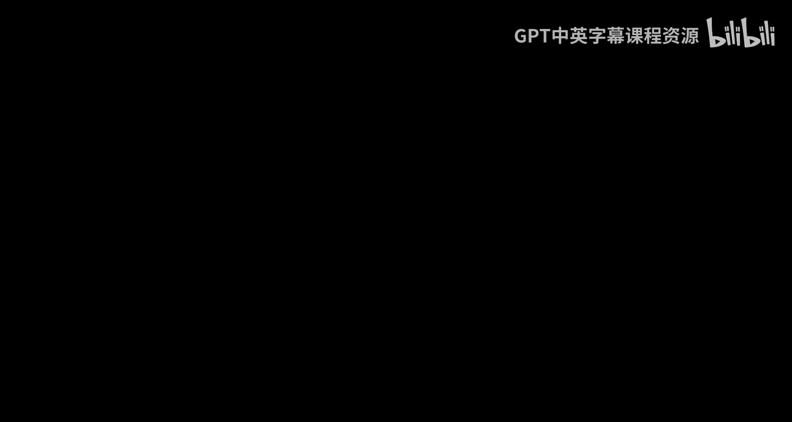

🎼Yeah。Hello everyone， welcome to this lecture in theBuild Lage languageage modelss from Sctch series。

We have been covering attention and the attention mechanism in a lot of detail for the past two or three lectures。

The lectures were long， they were more than one hour each。

 but I think it's extremely important for you to understand the attention mechanism and that's why I am devoting so much time to these set of lectures。

Just to give you a quick recap of what all we have covered so far in this in the first lecture on attention we started with a simplified self attention mechanism without trainnable weights in the previous lecture we added trainable weights and we discuss the self attention mechanism with trainnable weights here we also looked at the concept of key query and values which will revise just in a moment。

And then today， our main aim is to learn about something which is called as causal attention。

After learning about causal attention in the next lecture， we will move to multi head attention。

 which is the actual attention mechanism which is used in GPT and other modern large language models。

I believe this sequential flow is extremely important because if you start understanding multihad attention directly。

 you will not understand the basics you will not understand the nuts and bolts of what exactly is attention。

 how did we get to multiha attention？So let's get started with today's lecture on causal attention。

Okay， first let us revise everything we know about self attention。

 what we have learned in the previous lectures。So the example which we have started looking is this one sentence。

 which is your journey， starts with one step。So you'll see that there are six words。In this sentence。

 the first step of any。Data processing pipeline for a large language model is to convert these world into tokens。

To convert these tokens into token ids and to convert the token ids into vector embeddings。

So here you can see that for each token we have three dimensional vector embeddings so for the token or we have a three dimensionsal vector embedding for the token journey we have a three dimensional vector embedding and for the token step we have a three dimensional vector embedding remember generally one word is not equal to one token because GPT and other modern LLMs user a byte pair encoder which are subver tokens but for the purposes of this lecture I am going to use word and token interchangeably。

Okay， so the first step is to convert all of the tokens into vector embeddings。

 I am choosing a three dimensional vector embedding here just for the sake of demonstration。

 remember that in models like GPT it is common to have vector dimensions of 500，000 or even more。

I have just plotted these vectors and how they look like over here in the three dimensional space these are the input embeddings the goal of any attention mechanism is to take these input embeddings for every vector and convert them into context embeddings or context vectors for every token。

Now what is the difference between input embedding and a context embedding or a context vector。

 so let's say if you look at the journey。This is an input embedding for a journey。

 this green vector which you see over here， which contains which encode some semantic meaning about journey。

But it does not carry any information about how the other words in the sentence。

 such as your step with when how all these words relate to journey。

How much attention should you pay to each of these worlds when you are looking at journey the。

Ebedding vector or the input vector for a journey contains no such information。

 whereas the context vector contains this information。

 the context vector not only contains semantic meaning about journey。

 but it also encodes meaning about how journey relates with all these other words。

So that is the main aim of the attention mechanism to get context vectors for。

Each of our input embedding vectors， why do we need context vectors because it makes the task of the next word predictions much more better。

 much more reliable， because now we are encoding information of how much attention needs to be paid at different words in a sequence of sentences。

So that is the whole aim of attention mechanisms as we saw in the previous lecture the first step is to multiply the inputs with the query matrix。

 the key matrix and the value matrix。When you you do this multiplication you get the query query matrix so there is a difference so this Wq WK and Wv are weight matrices so these are the trainable weight matrix。

 this is the trainable query matrix this is the trainable key matrix and this is the trainable value matrix。

 you multiply the inputs matrix with this trainable weight matrices and then you get the final queries matrix the keys matrix and the values matrix。

That is the first step now remember that this WQ， WK and WV。

 these training weight mats are not fixed。Their parameters need to be trained based on input data and this training is a part of the LLM Currently when we are learning attention mechanisms we are not learning about this training procedure。

 we are only learning about the forward pass procedure。

 how to take input embeddings and how to convert them into context vectors we will come to training and back prop later in this course。

Okay， so once you obtain the queries， keys and the values matrix。

 the next step is to compute the attention scores。To compute the attention scores。

 what we do is we multiply the queries matrix with the transpose of the keys matrix。

So these are the attention scores and each row represents the attention。

Corresponding through to that particular query with all the other keys so let's say if you look at the second row it corresponds to lets say the query for journey because the first row corresponds to your the second row corresponds to journey the third row corresponds to begins etc。

So if you look at the second row。The first。The first value in the second row is basically when you are looking at the query journey。

 how much attention should you pay to the first input embedding vector which is your。

When you are looking at journey how much attention should you pay to the second input embedding vector。

 similarly when you look at the last entry of the second row。

 this encodes information of how much attention should you be paying to the sixth。

Input embedding which step So your journey begins with one step。

 So basically every row contains information that when you're looking at a particular query how much。

Attention should be given to all the other keys in the sentence if you are unclear about this。

 please go through the previous lecture where I have covered this in an extensive amount of detail。

Here I'm just providing a recap so that you you understand or you revise what we have learned so far These are the attention scores The next step is to convert these attention scores into attention weights and the way we do that is first we divide by square root of the key dimension and then we apply the softm activation function again in the previous lecture I have explained why we divide by the square root of the keys dimension and how do we apply the softm but basically these are the attention these are the attention weights which we compute from the attention scores the difference between attention scores and weights is that the intuitively mean the same thing but if you look at each row of the attention weight matrix you will see that each row essentially sum to one so there is a probabilistic meaning associated now when you look at journey you have to pay 15% attention to the first input embedding 22% attention to the second input embedding and finally we can say 18% attention to the last input embedding。

These are the attention weights and the last step is that you take the attention weight matrix and you multiply it by the values matrix remember the keys query and the value matrix have been computed over here。

So you take the attention weight matrix you multiply it by the values matrix and ultimately you get this context vector matrix this is the final vector which we are looking for so here you can see there are six six rows right each row corresponds to the context vector for that particular token so the first row is the context vector for your the second row is the context vector for a journey similarly the last row is the context vector for step。

Okay and in this plot Ive shown the so if you look at the journey vector you will see that this is just the embedding vector the green。

 but if you look at the journey context vector now you'll see that it is different than the journey because it also contains how much attention should be paid to all the other world so the journey context vector is much more richer than journey and the context vectors are what we will be using as inputs for the LLM training so we will get such context vectors for all the input embeddings which we have this is the recap of what we have covered so far。

I hope you are with me until this stage now。What is causal attention and why do we need it so first of all causal attention is also called as mask attention so when you read some research papers and when you see some tutorials you will see that this term is also called as masked attention it is a special form of self attention。

So what this causal attention does is that it restricts the model。

To only consider the previous and the current inputs in a sequence when processing any given token。

So let me explain to you further what this means。This is in contrast to the self attention mechanism which allows access to the entire input sequence at once。

 so remember what we did here when I explain this attention matrix to you this attention score matrix when we look at a particular query such a journey。

 we look at its attention with all the other tokens right your begins one step we do not look at whether these tokens come before a journey or whether they come after a journey。

That's what changed in the causal attention in causal attention when we look at any particular query。

 we only consider the attention of that query with respect to tokens which come before that query。

Let me show you what that means in a moment。So when computing attention scores。

 the causal attention mechanism ensures that the model only factors in tokens that occur at or before the current token in the sequence。

To achieve this in GPPT like large language models for each token process。

 we mask out the future tokens which come after the current token。

Let me show you visually what all of this really means so until now the attention weight matrix which we have seen looks something like this。

 so if you look at the row for a journey you can get the attention weight of journey with all the other tokens right of your journey。

Starts。With。When skip。So this row consists of six values。But the main。Mean numb。

The goal of the causal attention mechanism is that when you look at a particular token such as journey。

 you should only consider the attention course of journey with the words which come before journey such as your and journey。

So there are only two attention scores which are relevant here。

 all the attention scores which come after this point are masked out。

Which means that date no longer exist there set to zero。Similarly， when you look at width。

 let's say you look at width。So before with we have your journey starts with there are four tokens。

 so we have the attention scores for those four tokens。

 but the attention scores for all of the future tokens will be masked out or will be set to0 will be converted to0 whereas if you look at the last word step your journey starts with one step all of these come before step right so we have all the attention scores which are considered nothing will be masked out in the first token your there is nothing which comes before your so then every single thing after your will essentially be masked out。

When we look at masking the context size is also important because remember the context size specifies how many words the LLM can look at before predicting the next word so when I show this matrix I am assuming that this much is the context size the context size is 6。

So this is the main purpose of the causal attention mechanism so we mask out the out the attention weights about the diagonal this is very important if you look out if you look at this second matrix there is a key pattern which you observe over here and that is what we will exploit when we could if you take this diagonal。

And if you look at everything which occurs about this diagonal it is essentially0 right which means that it is essentially masked out students who know about the triangular matrix。

 the the lower triangular matrix and the upper triangular matrix will really relate to this and understand this much better。

 we will come to that in a moment in code， but for now just remember that we mask out the attention weights about the diagonal。

Like this， we said those attention weights to be equal to zero。

And then we normalize the nonma attention weights such that the attention weights sum up to one in each row。

 so your question would be that okay if everything else is set to 0。

 then these weights will no longer sum up to one right will ensure that the normalization is done once more so that whatever attention weights are remaining they indeed sum up to one。

So this is the main idea behind。呃。The causal attention mechanism so this this thing here what I am coloring in red right now。

 which is about the diagonal it is called as the causal attention mask because we are masking out all of those attention weights。

So now let us see how to apply a causal attention mask。So the strategy which will follow is that。

Exactly what we have done over here in the flow map which earlier showed you here what we will do is that we get the attention weights in a similar manner to what we have obtained and then we just set the elements above theagonal we set the elements above the diagonal to be0 and then we renormalize the attention weights that is the strategy which we are going to follow that is also mentioned over here。

So we will first get the attention scores like what we had previously then we get the attention weights。

 this is what we did previously then well add this one step well mask the elements about the diagonal to be0。

 then we will get masked attention scores and then we will again normalize them to get masked attention weights so that we will ensure that each row again some sub to1。

So now let us encode this logic in code。But just remember that all we are doing is we are getting the attention weights and we are zeroing out the elements about the diagonal。

 that's it。Okay， so let us go to code right now and the goal which we have is hiding future world with causal attention。

Now for this， remember that we have worked previously in the previous lecture we have written this self attention version2。

 what this self attention class does is that it it basically takes us through this entire flow child pipeline which I have mentioned over here let me。

Show that yeah this pipeline so what that self attention class in Python which I showed you does is that first it initializes these query key and value weight matrices to random values。

 then it multiplies the inputs with these to get the queries， keys and the value metrics。

 then it multiplies queries with key keys transpose to get the attention scores。

 then it scales by square root of dimension， the softm to get the attention weights。

 and then it multiplies attention weights with values to get the context vector matrix。

So if you see if you take the forward method in this self attention class。

 we basically get the keys queries and the values。 So the these are the the W key W query and the W value are the trainable key query and value weight mates。

 which are initialized randomly and then we multiply them with the。

With the inputs basically to get the keys queries and the values matrix。

 So remember here the way we actually get these keys query and value matrix is that we pass in the input X here and then we multiply that input to the trainable key query and value weight matrix to get the keys the queries and the values So these keys queries and the values which are highlighted in the code are。

These yeah these queries keys and values matrix here， this is the queries。

 this is the keys and this is the values which have been obtained after multiplication of the inputs with the weight mats。

Okay， then what we do is we multiply the queries with the keys transpose to get the attention scores。

 we do a soft then we divide the attention scores with square root of the keys dimension。

 we apply softm to get the attention weights and then we multiply the attention weights with the values to get the context vector this is what is happening in the self attention class self attention version2 so we' will start out with the self attention version2 we will first get the queries and the keys matrix well get the attention scores by multiplication of the queries with the keys transpose。

And then the attention weights will be will。Divide the attention scores with square root of keys will take the softm so these are the attention weight which you have obtained until now we have not implemented the causal attention the inputs over here so let me copy paste the inputs which we had defined those are the six words your journey begins with one step these are the input so let me copy paste the inputs here so that you can look at the entire code at one glance。

Okay， so before this， Im copy pasting the inputs right now。Great， so these are my inputs。

 these are the six words your journey begins with one step and from these input embedding vectors we have got the attention weights so I printed them out right now。

When we get the attention weights， this is where the real implementation of the causal attention mechanism starts out so what we are going to do now is that first we are going to generate a mask。

We are going to generate a mask which looks something like this。 Now。

 this is a mask where you will see that all the elements above the diagonal are equal to 0。

So ideally， that is what we want to do with this attention weight matrix right remember what we saw over here。

Let me take you to that that the visual representation here remember what we saw over here we take the attention weight matrix and all the elements above the diagonal will be set to0 so essentially if we have a mask like this and if we multiply the attention weights with this mask ideally all the elements about the diagonal will be set to0。

So now we are going to construct this mask using the python's trill function。 So what is drill。

 So there are two types of matosis so upper triangular。

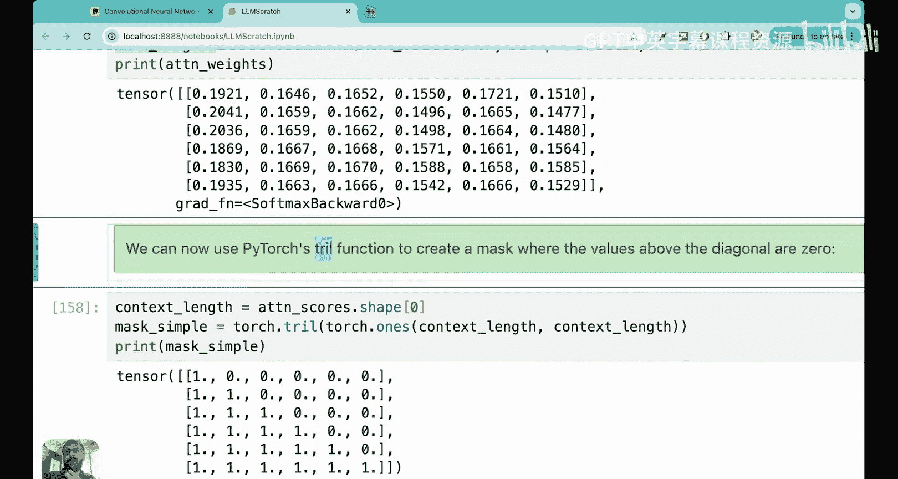

So let us see。

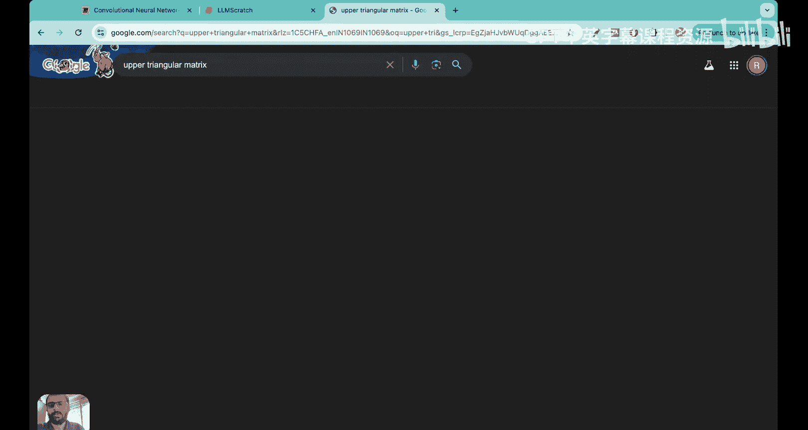

So there is an upper triangular matrix and a lower triangular matrix。

 which I'll just show here the upper triangular matrix essentially looks something like this where all the elements below the diagonal are 0。

 so this is tri U in Python tri U。

In P。Yeah。

This is the upper triangular matrix in Python and this is the lower triangular matrix which is try and lower so try L what this lower triangular matrix does is that all the elements above the diagonal will be equal to 0 so if you search but I should not search anump so we are looking at torch dot3 so first let us look at torage dot。

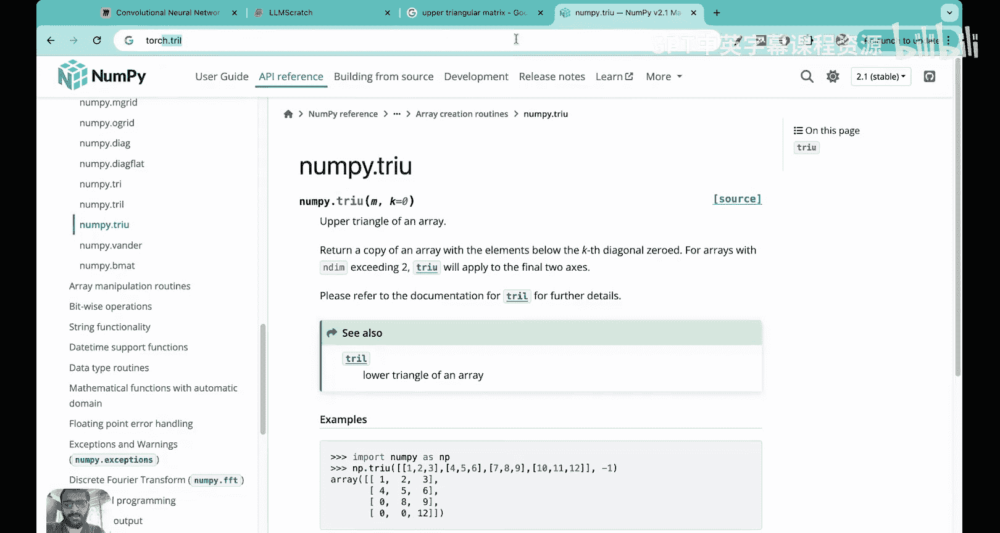

PRu， so this is storage dot PRu， So if we use PRIu it results in an upper triangular matrix what's shown on the left。

 but if you use toch dot p。

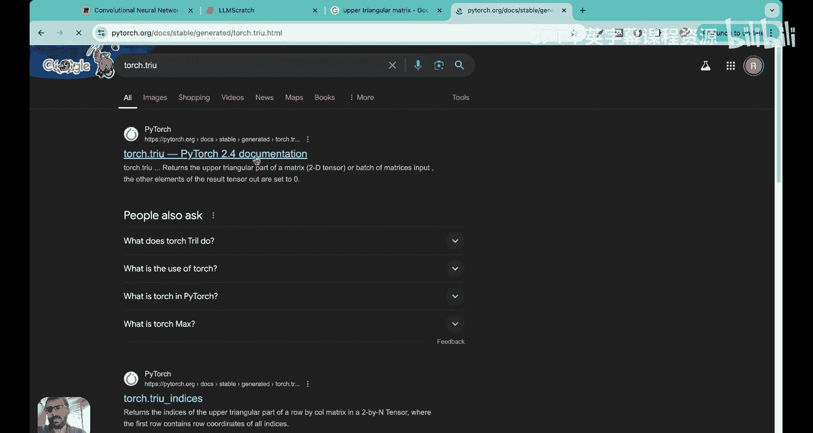

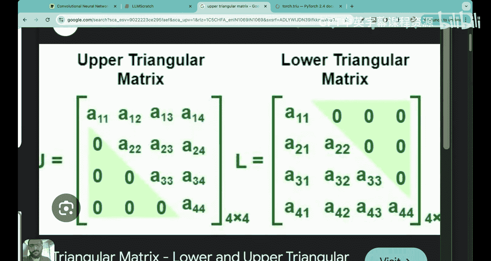

If you storage dot drill， what it will result is it will result in a lower triangular matrix。

 which means that all the elements above the diagonal will be set to 0。

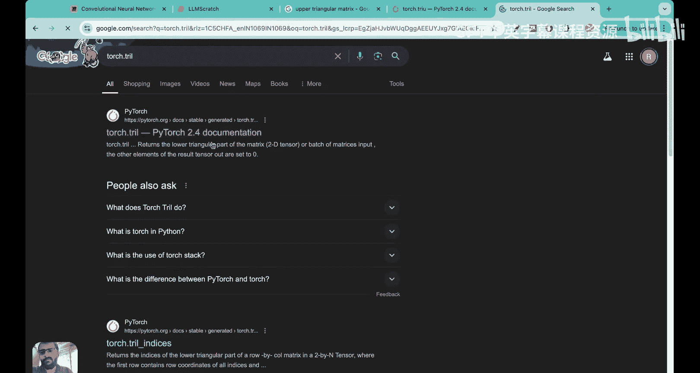

So to construct a mask which looks something like this。

 can you think about whether we need an upper triangular matrix or a lower triangular matrix？Okay。

 so since all the elements above the diagonal are set to 0， we will need a lower triangular matrix。

 so that' is why we use the torsch dot real。And。The reason so in torch dot drill what we have to do we have to pass in what that matrix is going to look like So currently I'm just going to create a matrix of1 and zeros right So what I'll do is that the matrix which I'm going to pass in this torch dot1 context length comm context length So if you print out this let me show you what this matrix actually looks like。

If you print out。This matrix it looks like this and then what I am going to do I am going to apply the the lower triangular matrix function on this matrix。

 so what will it will do is that it will set all the elements above the diagonal to be equal to 0。

So that's exactly what's happened here。So mask simple will be applying the tor dot tri function to this tor dot1 matrix and so when I print out mask simple Ill get this mask where all the elements above the diagonal are equal to0 and remember the length of this mask is specified by the context length why because the context length is how many words the LLM can look at before predicting the next word so if you look at this visual representation here the context length is equal to 6 because the LLM can look at6 words before predicting the next。

So in the example which I have shown the context length is just you can just look at the number of rows of the attention scores matrix or the attention weight matrix。

 so here there are six rows right because we have six tokens and the context length which I am using in this case is6。

So that that is how we create the mask simple and we print it out over here， great。

Now if you multiply the attention weights with this mask what you should if you multiply this attention weight matrix with this mask simple。

 this mask what you should get is that all the elements above the diagonal will be set to0 that is exactly what we are doing so now what we will do is that we define another variable which is called mask underscore simple which is the final attention weight matrix after multiplication of the attention weights with the mask which we have obtained earlier。

And when we print this out we will get this type of attention weight matrix where you will see that all the elements above the diagonal are equal to0 so that's awesome right this is exactly what we wanted。

But the next step is that you will see that these cannot be our attention to weight because each road does not sum up to one。

So then the next step is to normalize the attention to weight so that each row sums up to1 so what we will be doing is that well be taking the sum of each row and then dividing all the elements in that row with the sum。

 so for example if you look at the second row will take the sum of the second row and will divide all the elements of the second row with that sum that way will ensure that all the elements in a row sum up to one。

So this is what we are going to do next。 So we'll take， we'll calculate the sum of each row。

 and then we'll divide each row with the sum。 So then we get the masked simple， normalized。

 So here you will see that we get an attention weight matrix where each each row effectively sums up to one。

 This is amazing。 This is exactly what we need。 This is the main。😊。

Modification introduced by the causal attention mechanism。 Its as simple as this。

 and now we will multiply this with the values matrix to get the context vector matrix。 That's it。

 This is the if you understand this much from this lecture you would have understood 80% what of what I wanted to convey。

Now lets go next so you might be thinking okay， we have already done out done most of the things right。

 so what do we need to do after this？Well， there are some issues so if you look at the causal attention the main purpose of causal attention essentially is to not have any influence of the future tokens right。

 but if you carefully see what we have done here。We have essentially applied softm to the attention scores which we had obtained earlier。

 right？So， this this attention weight matrix even if you look。

 let us say if you look at the second row and if you look at the first two entries of the second row。

 these two entries are already influenced by all the other entries。

 why because when you take the soft max in the denominator you have the exponential sum of all the weights。

So even if you zero out all the future tokens。It is not essentially canceling the influence of the future tokens because the future tokens have already influenced the initial two values when we take the softm。

That is what disadvantage of this approach we are we are employing softm here and then again what we are doing is we are doing this kind of renormalization by。

Dividing with the sum。So this leads to a data leakage problem。

Why data leakage because the although we zero out the elements above the diagonal since we are taking softms before the elements which come in the future do affect the previous elements also。

 so we need a way to avoid this。So there is a smarter way to do this renormalization and let me tell you what that smarter way is。

So， if you look at what all we have done until now。

 so what we did is essentially this we took the attention course， we applied softmax。

 so this already brought in the influence of future tokens， then we mask with  zero。

Then we again normalize the rows and then we got the attention weight matrix right this is what we did right now what if there is a more efficient way so the efficient way is that what if we have the attention scores。

Then we apply something called as an upper triangular infinity mask。

 and then we just apply soft Max ones。This will ensure that there is no leakage problem let me explain what I mean by the upper triangular infinity mask so lets say。

We have the let me first show you the attention scores。

 so let's say we have the attention score matrix， right？

Instead of applying softmax earlier and getting the attention weight matrix what if we replace so lets say for the first row what if we replace these values with negative infinity for the second row we replace these values with negative infinity basically what if we replace all the entries above the diagonal with negative infinity like this。

And then we take the softm。What that will ensure is that anyway when we take the soft max when you do the exponent of negative infinity is going to be 0。

 so when you take the soft max of let us say this row all of these entries will anyway be0 and then they will automatically sum up to1 because we are taking the soft max。

So， this kind of trick will ensure that we are not having the data leakage problem because the attention scores are calculated。

 so now when you look at each row there is no influence of future tokens yet because we have not done the softm then we just replace the elements about the diagonal with negative infinity there is no influence of future tokens now we have cancelled the influence of future tokens。

By replacing them with negative infinity and we have not even done softm now and then we will do softm to this matrix what the softmax will do is that it will kill two birds with the same stone；

 it will replace all of these entries with0 because exponent of negative infinity is anyway 0 and since we are applying softm it will anyway ensure that the sum of every row is equal to 1 so it will ensure that the attention weight matrix the rows all sum of to1。

And that is exactly what we are going to do next so now if if I give you this matrix and if I tell you that you want to replace all the elements above the diagonal with0。

Or negative infinity， which。Whether you will use the upper triangular matrix or whether you will use the lower triangular matrix。

Okay， so let me tell you how this is actually done the way this works is that we first make a upper triangular matrix。

 so let me print this out to show you what we are doing here。So we print this out right now。

In complete input， maybe I need one more bracket over here。Yeah。

 so what we are going to do is that we are going to take。

Again6 by6 matrix of one and we are going to take an upper triangular matrix this time remember earlier we took a lower triangular matrix。

 let me tell you why we take an upper triangular matrix so we take an upper triangular matrix where all of these are ones so what we are going to code later is that we are going to say that look at all of the places where there are ones and replace those ones with negative infinity。

That is the mask which we are going to construct so we have this mask tensor over here which is a vector of essentially zeros but all the elements about the about the diagonal R1 then what we do is we use this attention scores dot mask fill function so what this mask fill function does in tensor flow or tor dot tensor I'll share this link with you what this function does is that。

It looks at the argument first so what's there inside is that we take this mask。

 we take this mask matrix and we find out all of the places where the。

Matrix returns a positive or true value and those are all the places which are above the diagonal right and will replace this。

So what this mask field does is that it looks for all the places where。

This mass matrix has positive values and then in the attention score matrix will replace all of those with negative infinity。

So， effectively what this attention scores dot mask fill function does is that it takes the attention scores matrix and it replaces all of the elements above the diagonal with the negative infinity this is exactly what we wanted。

And now what we do is we take this matrix and we apply torage dot softm so again as we did previously first we take the mass matrix and divide it by the square root of the keys dimension and then we apply the soft max so then that will ensure that all the infinity values will anyway become zero and each row will sum up to1。

So now my final attention weight matrix looks something like this where you will see that the data leakage problem is not there because I apply softms after all of the future elements are set to negative infinity and second all of the attention weight matrix roses sum up to1。

So， the causal attention mechanism is satisfied and also the softm is satisfied the data leakage problem is not there and each row sums up to1 so I have essentially obtained everything which I wanted in calculation of these attention weights。

Guess to Ive written some of these explanations over here so that you can understand it better。

 so masking in transformers sets scores for future tokens to a very large large negative value such as these。

Making their influence in the softmax calculation effectively zero。

The softm function then recalculates attention ratess among the unma tokens this process ensures no information leakage from the mass tokens focusing the model solely on intended data。

Now， since we have got the attention weight matrix。

 we can just simply multiply them with the values matrix to get the context vector， thats it。

This is the implementation of the causal attention mechanism in Python。

 but there is one more additional step which is typically implemented along with the causal attention mechanism and that is implementing the causal attention mechanism with dropout。

So if you are not familiar with dropout， it's actually a deep learning technique where you take a neural letter and you randomly switch on neurons in different layers to zero。

What this does is that usually when you are training。

 some neurons become lazy and they do not do any work because they realize that other neurons are anyway doing most of the work and。

The result is pretty well， so I'll just switch off so that's a lazy neuron problem or a co dependency problem。

What dropout ensures is that。When a lazy neuron sees that the other neuron is switched off。

 it's forced to do the work。That is the simplest way of thinking about it。

 so dropout randomly turns neurons off so it ensures that all the neurons essentially participates and this。

Leads to better generalization， it prevents overfitting and it does better on the test data。

We will show the mean。Advantage of dropout is that it prevents overfitting and improves generalization performance。

In transformer architecture， including models such as GPT dropout in the attention mechanism is implemented and it is applied usually in two specific areas first it is applied after the calculation of the attention scores and second it is after applying attention weights to the value vectors。

So there are two specific ways in which。Dropout can generally be implemented first is after you get the context vector itself after applying attention weights to the value vectors you can implement dropout but the more common weight is to implement dropout after calculation of the attention weights or the attention scores and hence we are going to consider that so essentially what is done in the dropouts is that let's say if we have an attention weight matrix which with causal attention implemented so all future tokens have been masked what we will do is that we will first create a dropout mask what this dropout mask specifies is what all neurons need to be randomly turned off So let's say if we implement a dropout with the probability of 0。

5 this means that on average 50% of the attention weights in each row will be turned off so let's say if you look at the second rope let's say this will be turned off if we look at the third row50% rate so three entries so randomly this will be turned off this will be turned off if we look at the。

Fifth row 50%， so you'll randomly zero out certain elements。

So this this is how dropout is implemented， so this is a dropout mask which you can see over here wherever the mask appears those particular elements will need to be zeroed out so if you look at the fourth row over here。

Let me rub some of the things over here Yeah， so if you look at the fourth row in this dropout mask。

 we have a mass position here。Year and year， so we have a position at 14 and 5 so the first entry will be masked it will be removed the fourth entry will be masked so only two entries are going to survive here 0。

24 and 0。24 so here you can see over here 0。24 and 024 are the only two entry surviving in this row So essentially what the dropout does in very simple terms is that it looks at rows and then it randomly switches switches of attention rates。

With a particular given probability。So now let me implement first dropout in in Python。

 so in the following code example what we are going to do is we are going to use a dropout rate of 50%。

 which means that we are going to mask out half of the attention weights。Later。

 when we train the GP model， we are going to use a lower dropout rate of around 0。1 or 。2。

So in the following code we apply Pythtor dropout implementation to a 6 by6 tensor consisting of just ones for illustration purposes and then we will actually apply it on the attention weight matrix which we have so lets say we have a6 by6 we have an example which is a6 by6 matrix of once let me print it out over here。

诶呀。So， let me print。不een。Example。So let's say we have a matrix 6 by6 so these are all ones then we will implement torage dot n end or dropout 0。

5 what this is going to do is that it will look at each row and then on average it will switch off 50% of the weights。

And what this will do is that since the 50% of weights are switched off measurements 0。5。

 all the other weights are rescaled by that that much amount。

So all the other weights which are not switched off will be rescaled by 2， it will be divided by 0。

5 or they will be multiplied by 2。So， if you look at the first row over here you will see that two weights are switched off if you look at the second row you will switch you will see that four weights have been switched off you look at the third row you will see that one weight has been switched off so remember this is probabilistic。

So if you take 10，000 rows， you will see that on an average 50 percent。

Of every row will be switched off， so that does not guarantee that three exact neurons or three exact weights will be switched off in every row to three or four neurons might be switched off。

 but on an average three neurons will be switched off in every row。

So when applying dropout to an attention rate matrix with the rate of 50% half of the elements with of the matrix are randomly set to0 remember this is probabilistic to compensate for the reduction in active elements the values of the remaining elements in the matrix are scaled up by a factor of2 this is a torage。

t n do dropout is implemented and you can even check this so if I click on torage。

 n do dropout you can see the documentation for the dropout。

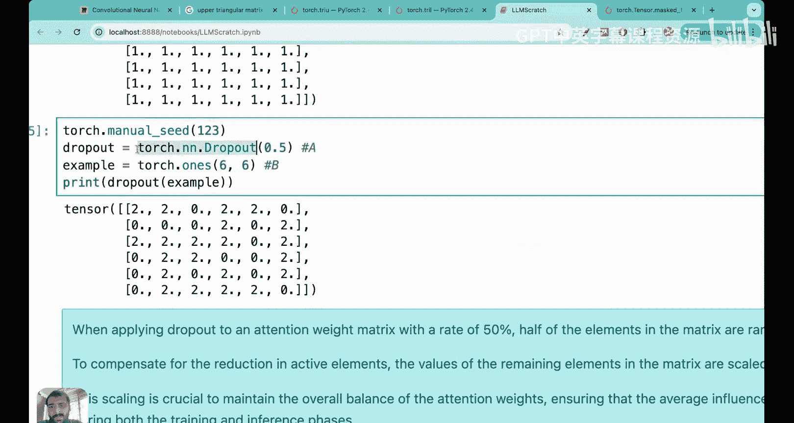

Dropout class in tensorflow or piytorch rather， so this is a pytorch dropout class so youll see that during training randomly zeros out some of the elements with probabilityp outputs are scaled by a factor of 1 upon1 minus p that is exactly the kind of scaling which we are seeing over here。

So the scaling is crucial to maintain the overall balance of the attention weights。

Ensuring that the average influence of the attention mechanism remains consistent during training and inference phases。

Now let us actually take the attention weights which we had over here。

 these were the final attention ratess and we are going to apply dropout layer。So， I take the。

Attention weight matrix and I applied dropout to it and your dropout is being defined as a class and the class takes here an instance of the dropout class is created that the input argument is 0。

5， which means a dropout rate is 0。5。 So here you can see that compared to this。

Versus let's say if you see the attention weight matrix you drop out you will see that some attention weight will be randomly set to 0 and the weights which are not set to 0 will be scaled by 2 so in the first row you will see that this first weight is not set to 0 so it will be multiplied by 2 let's look at the second row so we have 0。

3986 and 0。6014 after implementing dropout both of them are set to 0。

Then let's look at the third row 0。2526。3790。3683 after implementing dropout。

 none of them are set to 0 so since it's probabilistic in nature， some weights will be set to 0。

 some will not but overall 50% of the attention weights will be set to 0。So as you can see。

 the resulting attention weight matrix now has additional elements zeroed out and the remaining ones are re scaled this is exactly what we wanted。

Now we have gained an actual understanding of causal attention and dropout masking。

 we will implement a causal attention class in Python。

So this is also what we are going to see next on the whiteboard。

So the next section which we are going to see is implementing a causal attention class。

 which incorporates causal attention and drop out into the self attention class which we have implemented earlier。

So to do this first I want you to have a visual understanding of what we are going to implement that will make understanding the code so much easier so if you have understood the selfat class when we implement this causal attention its exactly going to be the same except for a few small changes so we will have the inputs we will multiply it with the weight query weight key and the weight value trainable mats then we will obtain the queries keys and the value matrix then we will get the attention course by multiplying queries with keys transfer then what we will do is that we will implement。

We will mask out so all of these diagonals will be replaced with minus all the elements above the diagonal will be replaced with minus infinity。

 then we will do scaling by square root of the dimension and we will do dropout and we will do soft max。

So that will give us the attention weights， so remember now the attention weights。

All the elements above the diagonal will be equal to0 and some of the elements will be randomly switched off because we are implementing dropout。

And then well get the well multiply the attention weights with the values and well get the context vector matrix。

 This is all which we are going to do in the。呃。Causal attention class one more additional step which we are going to do is that we are going to look at batches so this is the first batch right so this is the first sentence your journey begins with one step。

What we ideally want to do is we want to develop。The attention class which can handle multiple sentences at once。

 so what if there is a second sentence also that second sentence can be my name is something something let's say so that second sentence will also be handled in a very similar manner and then I'll get another context weight matrix in a similar manner。

So my the class which I define should be able to handle both of these batches together。

 so lets see how we can implement that。One more thing yeah， so as I mentioned。

 one more thing is to ensure that the code can handle batches consisting of more than one input as I showed you earlier。

So what we are going to do is that we are going to create a simple batch which has two inputs。

 So as we already saw the first input is a six row and a three column matrix now we are just going to add one more input so then the batch will be to a tensor。

 which has。2，So we have two batches and each has6 by three。So this is the incoming tensor。

 which our class should be equipped to handle。 So this results in a 3 d tensor consisting of two input text with six tokens。

 The first text can be your journey begins with one step。

 The second sentence can let's say be my name is。My name is so and so lets say that is the second sentence now why is this 6 by 3 because each sentence has six tokens and each token has three dimensional vector embedding。

So the following causal attention class is very similar to the self attention class except that we are going to add two things we are going to add the dropout and we are going to add the causal must okay so lets go through this class now first what we are going to do is that the shape of the input is now different because now the input shape has the first dimension as the batch size。

Whereas in the self attention class if you scroll up earlier the shape of the input which was there here。

 the shape of the input was just the number of rows were 6 and the number of columns were 3 because it did not have batches but now the shape of the input is different the shape of the input let's say2 by 6 by 3 so first is the batch number or the batch size the second is the number of tokens and the third is the vector embedding dimension。

So B command number of tokens command the embedding dimension is x dot shape。

Then what we do is that we multiply the input with the key weight matrix。

 we multiply the input with the query weight matrix we multiply the input with the value weight matrix to get the keys queries and the values then what we are going to do next is that we are going to multiply the queries with the keys transpose and why we are doing one comma 2 over here because we are only interested in the number of tokens dimension and the input dimensions remember that we are looking at it in batches right so when you look at the first batch when you look at the first batch you only care about the number of tokens and the input dimensions when you look at the second batch you only care about the number of tokens and the input dimensions so when you get the attention scores you multiply you take the queries and you multiply keys do transpose one comma 2。

Let me explain this to you right now yeah so let me explain how this queries and key transpose actually works so now the queries which I have will be in batches right so if you look at the first batch let's say these are the so this is the first token and this is the second token Im just doing two tokens now and if this is the second batch then this is the first token and this is the second token both of these batches are now coming together in the queries whereas if you look at the keys let's say these are the keys。

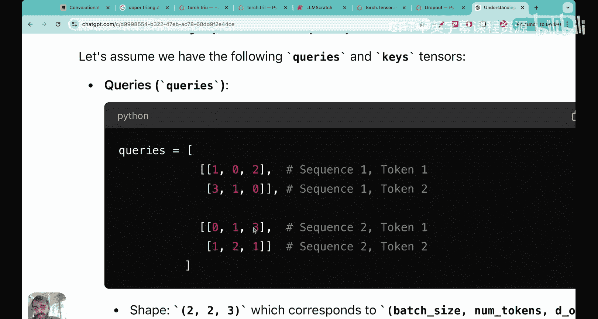

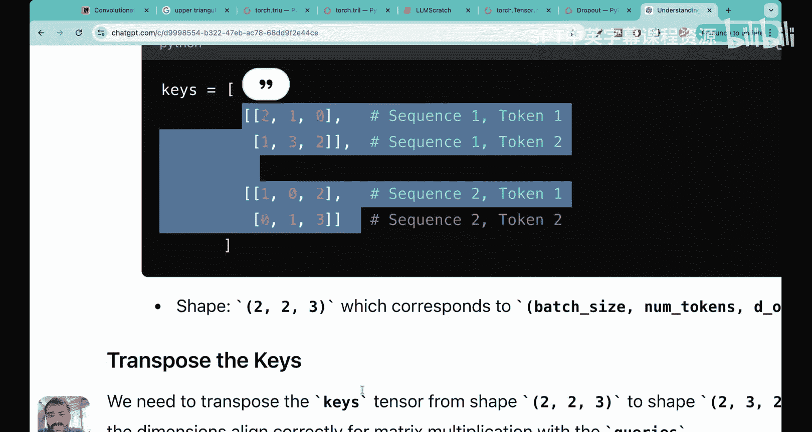

The reason we are taking the keys transpose is that for the queries to be multiplied with the keys the keys need to look like this。

 otherwise the matrix multiplication cannot happen so if you look at the queries。

Now the queries are this and when you do keys dot transpose 1 comma 2。

 they will look something like this， which means that well still have two rows。

But inside the so it was two comma 6 coa 2 right so well still have two rows。

 but inside each row the that particular matrix will be transposed So without transpose the keys look like this and when you do when you do this so when you do keys do transpose one comma2 what will be preserved is that inside the。

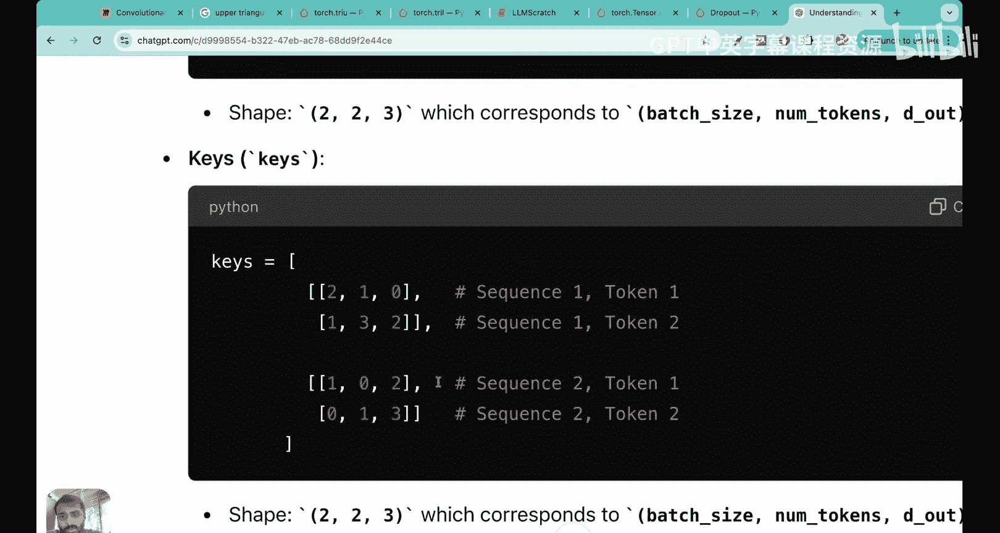

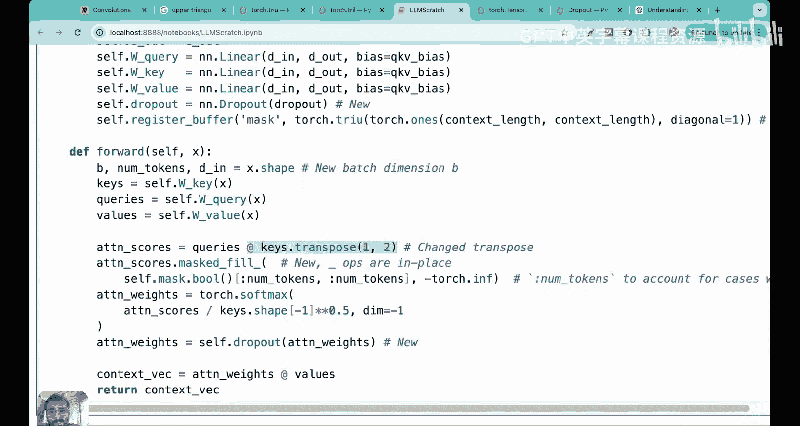

So the rows will be converted into columns so the keys will keys transpose will start looking like this and when you multiply the queries with the keys transpose what will happen is that the batches will be processed sequentially so in the first batch this queries will be multiplied with this keys transpose and you will get a result then this then this queries。

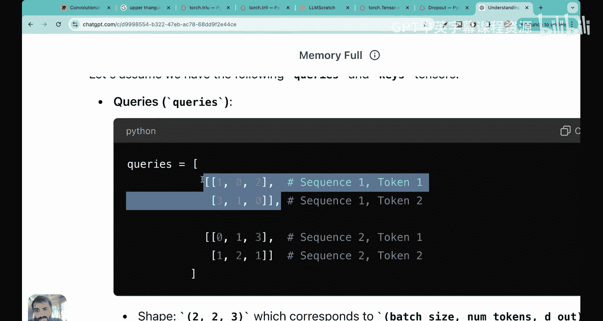

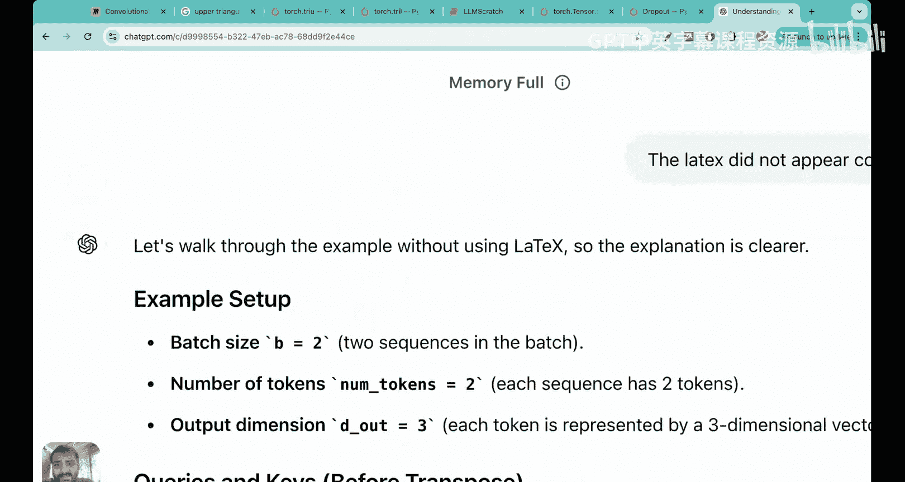

Will be multiplied with this key transpose and you will get a result and both those results will be stacked together so here just the multiplication has been shown and finally you will get the attention scores where both the results have been stacked together。

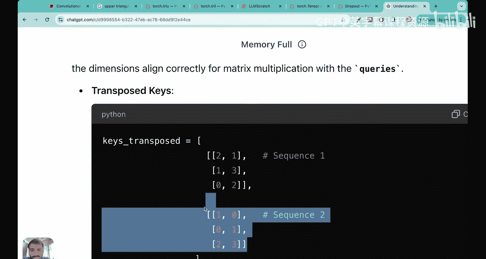

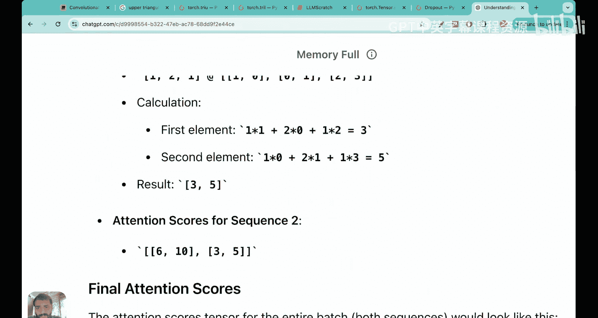

This is all。It actually works in batches。

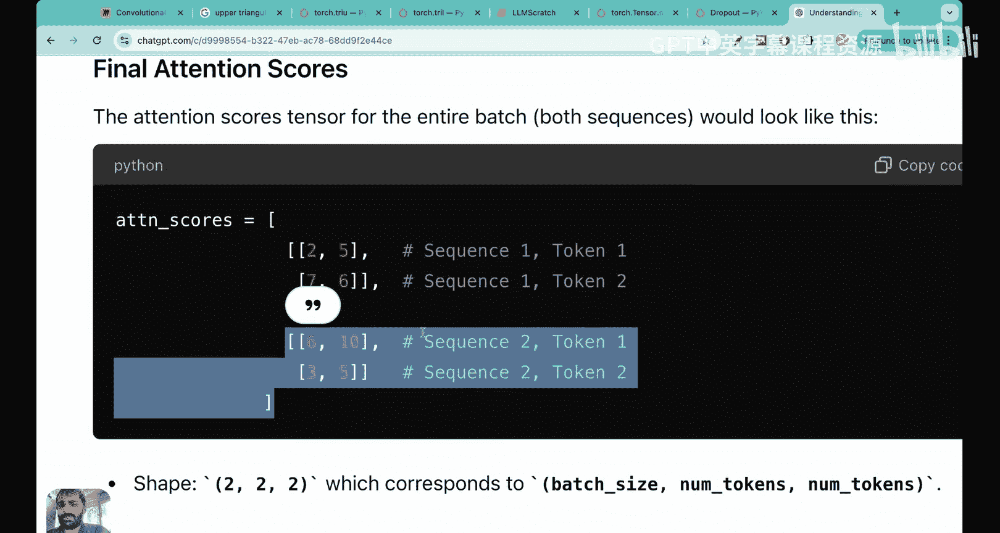

And then what we do is that once we get the attention scores， as I told you earlier。First。

 we are going to。 We are essentially going to。Create， yeah。

 so here we are creating an upper triangular mask， which is of all ones。Except so which is once。

So let's see the upper triangular。So a per triangular my matrix is once above the diagonal right so there are ones above the diagonals and everything below the diagonal is 0 and then wherever there is one those will be replaced with minus infinity in the attention course matrix。

Then what we are going to do is we are going to divide by a square root of the key dimension and we are going to take the soft max。

 This is exactly what we saw。 This is the attention weight matrix where all the rows sum up to1。

And the causal attention mask is applied and then finally what we do is that we apply the dropout to these attention weights and the dropout has been defined over here where the dropout rate is taken as an attribute when we create an instance of the causal attention class。

And then the context vector is a product of the attention weights multiplied by the values。

 and then we ultimately return the context vector。So let's see now how this actually works out in practice so first the context length is badge dot shape of1 because y1 because we have a batchge size of6 so badge dot shape of one will be 6。

And then what we will be doing is that we will be defining a causal attention class with the input dimension of d in。

Now， let's see what D in actually is。 So D in will be。Let's print this out actually。

 let's see what D in is。So I think d in is3 because the vector size is 3 and d out。 So if I print。

Be in。that will be equal to three correct and if I print D out。

 I think that will be equal to two because those are the dimensions which we have used。

Yeah D out will be equal to2 the context length will be equal to 6 and then0 comma 0 is0 do0 is essentially the dropout so here we are saying that don't do so put the dropout rate to be0 So then what we do is that we create an instance of this causal attention class and then we pass in the batch which we have defined earlier so now you can see that here we define a batch where we stack two inputs on top of each other when we process the first input when we process the first input we should get a context vector matrix of size。

So here there are six rows and two columns right so when we process the first input of this batch we will get a context vector of the size6 by 2。

诶。6 by two。 and when we process the second。Input in the batch will get a context vector matrix of size again we will get a context vector matrix of size 6 by 2 so there will be two context vectors of size6 by 2 so the result answer should be 2 by 6 by 2 it will be a 3 d3 dimensional tensor let's see if that is indeed the case。

So now here you can see that Ive passed in my batch of inputs and here are the context vectors。

 here's my resultant answer。 And if you print the shape of the context vector。

 which is the resultant answer， it's 2 by 6 by2 Why because we have two metes of6 by two which we are stack which are stacked on top of each other so you can even print out the。

So you can even print out the。Context vectors now。 So if I do print。Context X。

This will print out the context vectors and you will see that here we get so the first is this is the context vector matrix of the first input。

 this is the context vector matrix of the second input and they are stacked on top of each other awesome。

So which means the causal attention class which we have which we have written。

 is capable of handling batches。I did not explain this thing here which is register buffer so why do we need a buffer when we create this mask so the main thing is that it is not really necessary for all use cases but it offers some advantage here。

So when we use the causal attention class in a large language model。

 buffers are automatically moved to the appropriate device， CPUU or GPU along with our model。

 which will be relevant when training the LLM in future chapters。

 usually matrices or this matrices like this which are fixed which need not need to be trained so this is an upper triangular matrix right all the elements above the diagonal will be one will be one it's a fixed matrix we will not train this。

Usually， it's better to define all of these as the。Using the register buffer。

 because then these are automatically moved to the appropriate device along with our model and since we are anyway not training them。

It' is much more convenient so we don't need to manually ensure that these sensorsors are on the same device as the model parameters avoiding device mismatch errors later when we move to GPU calculations this will be very important so just remember that these masks or these matrices which are not trained it's good to define them using register buffer so that they can be automatically move to the appropriate devices we don't need to ensure that they are on the same device as our model parameters。

So that is an important thing to be aware of the second thing is that here we have used the。

Coant number of tokens so this is to ensure for cases where the number of tokens in the batch is smaller than the supported context size if this were not written that's also fine then the mask will be of the context size。

 but if the number of tokens are smaller than the context size the mask is created only up till the number of tokens this might happen if one of the batch has smaller number of tokens than the context size especially one of the ending batches etc。

But these are edge cases which you now don't need to worry about all you need to understand is that what this class has effectively done is that we have。

Implemented the causal attention mask， which means that all the elements above the diagonal are set to zero。

 and we have ensured that all the rows of the attention weights sum up to1 using the soft max and we have also implemented the dropout clear to ensure generalizability and to prevent overfitting。

So I think this actually brings us to the end of this lecture on the causal attention class。

In the next section， what we will be doing is that we will expand on this concept and implement a multi head attention module that implements several of these causal attention mechanisms in parallel。

 So what the attention mechanism in。GPT and in other LMms。

 what they are doing is that they take these causal attention mechanisms and they stack them together。

So let me show you this graph， this plot of what we have learned so far。So until now。

 what we have learned is that we have learned about causal attention in this section when multiple causal attention heads are stacked together。

 it leads to multi head attention。And that's what's actually implemented in GT。

 but now try to think about it without covering these lectures。

 how can you understand multiier attention directly？Without understanding causal attention。

 you cannot understand multied attention to understand causal attention。

 you need to understand key query value。 That's why I have developed this lecture series so that we cover each module in a sequential manner and in a lot of detail。

 I know the lectures are becoming tough， the lectures are becoming long。

 But if you follow what I'm doing。 And if you implement this code。

 you'll start to understand things in a much better manner。 I believe that all the other tutorials。

 all the other videos on YouTube out there correctly。 They are very short。

 They do not explain all of the details。 I think the devil lies in the details。

 We need to understand the details。 We need to deal with dimensions。

 You need to understand how batches's work。 Why we have a three dimensional tensor。

 Don't be scared of dimensions and mates。 the student who masters dimensions， mattries。

Linear algebra fundamentals， they will really understand what is going on here。

 I am deliberately trying to have a mix of the whiteboard notes and the coding。

In Jupyter notebook so that you understand the basics， the theory as well as you implement the code。

Thank you so much everyone， I'll see you in the next lecture where well call multihad attention in a lot of detail。

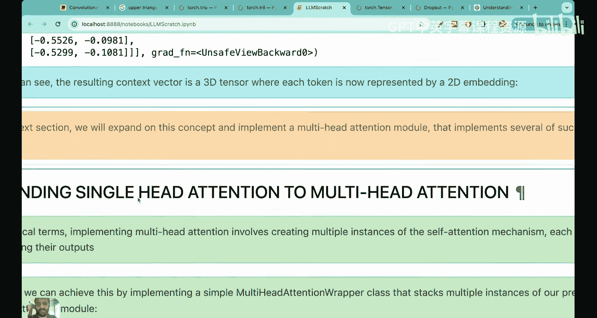

Thanks everybody。

。