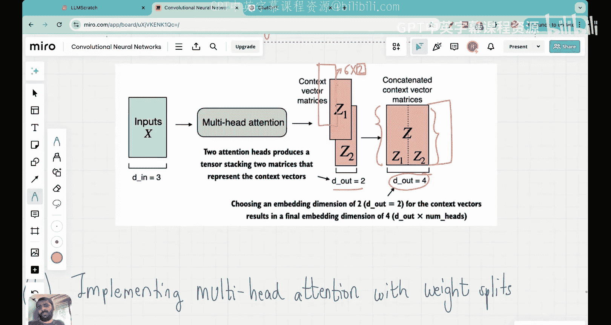

# Vizuara《从零开始搭建大语言模型｜Building LLMs from scratch》中英字幕（Claude-3.7-s） - P16：-17-Lecture 17_ Multi Head Attention Part 1 - Basics and Python code.zh_en - GPT中英字幕课程资源 - BV1qG8HzUE2D

🎼Yeah。Hello everyone， welcome to this lecture in theBuild Lage language models from Sctch series。

Up till now in the attention mechanism part we have covered the following lectures。First。

 we covered the simplified self attention mechanism。

That was the first lecture in this series on attention mechanisms。

Then we looked at self attention with trainnable weights and in the last lecture we looked at causal attention。

Now we have enough ammunition and enough training to finally start understanding about the multi head attention mechanism。

As I've mentioned previously。If you directly start understanding the multi head attention。

 it will be very difficult to understand because it is fairly detailed mathematically as well as coding voice。

 but now I believe that we have developed a strong foundation if you have watched the previous lectures。

 I believe that。With the understanding of simplified self attention。

 self attention and causal attention， we can use these as building blocks to truly understand multiha attention。

In this series we are going to study two types of multi head attention mechanisms。

 the first type is basically by just concatenating the context vector matricosis which is obtained from different query key and value matosis and the second approach is a more unified approach which is more commonly implemented in modern LLMs and modern code base so I'll be dividing this lecture into two parts in the first part we'll be looking at the first type of multi head attention mechanism。

So lets get started before diving into multiha attention I just want to briefly cover what all we looked at in the causal attention mechanism if you have not seen the causal attention mechanism video I highly encourage you to go through that because multi head attention is just an extension of the causal attention mechanism。

Awesome， so the way causal attention works is as follows。

 we have inputs which basically are input embedding vectors corresponding to every single token which we have so if the tokens are your journey starts with one step we have three dimensional vector embeddings for each of these tokens these vector embeddings can be represented in a three dimensional vector space as can be shown here。

The goal of causal attention， multi hair attention and any type of attention mechanism is to start with these input embedding vectors and convert them into context vectors。

Context vectors are a more enriched form of input embedding vectors。

 the input embedding vectors contain semantic meaning of the particular world but do not carry any information about how that word is related to the other words in the sequence so for example if you look at the input embedding for a journey it does capture some semantic meaning of journey but it does not really encode any information about when you look at journey how much attention should be paid to the other world such as step such as your such as width。

And such Jeine。The context vector encodes this information also， and that's why it's an enriched。

Representation as compared to the input embedding vector。Okay。

 so the first step is to basically take the inputs and multiply them with trainable weight mees we have three trainnable weight meores one for the queries。

When for the key？And one for the values。So if you look at the input matrix on each dimensions。

 we have six tokens here and then the vector embedding size so 6 by 3。

 the trainable weight mates have the first dimension is fixed。

 the first dimension has to be equal to the vector embedding size。

 but their second dimension is what we will refer to in today's lecture also as the output dimension。

And then when you multiply the inputs with these three trainable weight matrices for query key and value。

 you get the queries， the keys and the values matrix。

So the dimensions of the queries key and the value matrix will be the number of tokens multiplied by the output dimension。

And the output dimension is determined by this trainnable weight mates now note that when you initialize this trainnable weight mates their parameters are random。

We will train these parameters and optimize them through back propagation。

In this attention series these4 to5 lectures we are not looking at back propagation we will cover that later right now the whole goal is to understand different attention mechanisms like causal attention。

 multi head attention etc。The next step in the causal attention mechanism after getting the queries keys and values is to essentially compute the attention scores。

 so the attention scores are computed by the multiplication of queries multiplied by the keys transpose。

So。The way to interpret the attention score matrix is you look at each individual row so you will see that there are six rows and six columns right so if you look at the second row the second row corresponds to the second token which is journey so your your journey begins with one step so the second row corresponds to journey and each。

Element in the second row basically encodes information about how much that particular token relates to journey or how much importance should we pay to that particular token or input embedding when we are looking at journey so for example this third token this third value encodes the attention between journey and the third third token which is your journey begins so this is begins and journey this is journey and with this is journey and when and this is journey and step。

So basically here you can see that the attention scores are essentially。

There for every query and then you multiply queries with the keys transpose and this value encodes information about when you are looking at a query how much information should be paid to a particular key。

Right， this is the meaning of the attention scores in the causal attention mechanism we do what we do is that we take these attention scores and we look at all the。

Attention scores about the diagonal and we make these attention scores about the diagonal to be equal to 0。

 So let me just show you how that looks like。So let's say we have got the attention scores and let me show it here。

 so let's say we have got the attention course and they look something like something like this。嗯。

Actually， let me show it here itself。The attention scores， which we have obtained。

 look something like this， right， But you can see that。

If you look at the second you look at the second row which is the second row for a journey。

 you will see that journey has an attention score with all the other worlds now in causal attention what we say is that we should only look at words which come before journey so finally when we compute the attention weights when we compute the attention weights。

All the elements above the diagonal should be equal to 0 let me show you what that means。

So here is how the attention weights for a causal attention mechanism actually look like yeah。

 like these。And if you if you don't implement the causal attention mechanism。

 then the attention scores look like something on the left。

 attention weights look like something on the left which I am showing here。

 but when you implement the causal attention mechanism all the attention weights about this diagonal will be essentially switched off。

Why， because if you are looking at journey， you should only pay attention to what comes before journey or and journey。

 if you look at starts， you should pay attention to your journey and starts。Remember。

 since we are predicting the next world， only the worlds which come before a particular over really matter and that's what' is implemented in the causal attention mechanism。

So， we implement this and we get the attention weights like what I showed you below which are zeroed out about the diagonal and then we multiply the attention weights with the values。

When we multiply the attention weight with the values。

 we get the context vector matrix which looks something like this。

So now this context vector matrix has six rows because one for every token and it has two columns which are dictated by the output dimension which we have two in this case。

So the input embedding vector for every token here。

Whi was mentioned earlier here is ultimately converted into a context vector matrix which looks like this。

That is the whole idea behind causal attention， so the only difference between causal attention and normal self attention is that in causal attention these attention weights rate all the elements above the diagonal of these attention weight will be set to0。

And the rows of the attention weight matrix will anyway sum up to one we will ensure that and these attention weights will then be multiplied with the values matrix to get the context vector matrix that is essentially what is happening in the causal attention。

Now there is a provision in the causal attention mechanism where we can do batch where we can process batches。

 so when we input the first batch the first batch has six words your journey starts with one step right this is the inputs。

But the causal attention class which you developed in the previous lecture also can handle the second batch which also let's say has six tokens so for the first batch the output is the context vector matrix which is a 6 by 2 matrix as you can see here and for the second batch there is another context vector matrix which is 6 by 2。

Let me show you the causal attention class which we developed in the previous lecture so this was the causal attention class which we have。

 let me quickly revise it right now， the input X which is the input to the causal attention class has the shape of batch size command number of tokens command the input dimensions。

 so batch size because we can have two batches。So if you look at these two batches。

 which I've shown here right now。嗯。Yeah， so I have shown batch1 and batch2 over here and now lets look at the input if you look at the input for the first batch it's 6 by 2 right its6 by 3 whereas if you look at the input for the second batch that is also 6 by3。

So when you aggregate these batches together， the input dimensions will be。

The input dimensions will actually be2。To multiplied by。2 multiplied by6。Multiped by。3。

2 multiplied by 6 multiplied by 3 that is actually the input dimension which is also being mentioned over here so the input dot shape is the number of batches which is if it's two number of tokens which is6 and the input dimension which is three then what we do is we multiply the input with the trainable key query and value matrix and finally we get the keys queries and values so remember w key w query and w value are the weight mat accesses for the key query and value which we have to optimize and then after multiplication of the inputs with these weight mates we get the keys queries and the value。

What do we do then later is we get the attention scores by multiplying the queries with the keys transpose。

 then we apply a mask。So that we implement the causal attention remember we need to make sure that when we get the attention weights all the elements above the diagonal are0 Ive explained all of this in the previous lecture so I am not going through the details right now and then finally we apply softm to the attention scores and get the attention weights we can also add another layer which is the dropout layer towards the end but that is not strictly necessary and the last step is then multiplying the attention weights with the values to get the context vector。

Now， remember the we had two batches， right， and the input size was2 comma 6， comma 3。

And ultimately when you let us say implement when you create an instance of this class。

 let's say I'm creating an instance of this class and storing it in CA。

 so I have to specify D in which is 3 d out which is 2。

 the context length which is my number of tokens in this case that 6 and the dropout rate that 0。

And then we can get the context vectors remember we have two batches so we have two sets of context vectors。

 the first set will be a tensor， which is6 by 2。Why will it be6 by2 because that's exactly what we have seen on this whiteboard also you can take a look at this context vector which we had obtained ultimately the final context vector which we obtained is6 by2 and there are two such context vectors right so ultimately the context vector shape which we get out is two comma6 comma 2 so that makes sense with what we are seen on the whiteboard this is the causal attention class which we had implemented in the last lecture and the quick summary of how it works。

Now， what we are going to do is we are going to extend this causal attention class a bit into something which is called as the multi head attention mechanism。

So， the term multi head essentially refers to dividing the attention mechanism itself into multiple heads。

And each header will be operating independently。To give you understanding related to code when we get the attention scores here right now or the attention weights from one set of query key and value。

 we say that this is one header， this is one attention header， right。

We are not decomposing into multiple query keys and values there is only one query matrix one there is only one keys matrix。

 one queries matrix and one values matrix， so we have one attention header。

What multiple what multi head attention does is that it extends the causal attention mechanism so that we have multiple heads and each of these heads will be operating independently。

And then what we do in multi head attention is we basically stack multiple single attention head layers together。

So what we will simply do is that we will create multiple instances of the causal self attention mechanism each with its own weights and then combine their outputs it is actually very simple the output which we had obtained before for one attention head will just combine them together and Ill show you how it can be done so as you might have expected this can be a bit computationally intensive but it makes LLMs powerful at complex pattern recognition tasks。

So researchers have found out that， although。When you stack multiple heads the computations which need to be made increase it really helps LLM perform much better and when you look at Cha GPT right now it does have multiple attention heads it none of the modern LLMs work with a single attention head。

So let me show you what it means by stacking multiple attention heads together。

 this diagram actually encapsulates it all。Earlier when I showed you the flow chart。

 we just had one trainable matrix for the query， one trainable matrix for the keys and one trainable matrix for the values right so that was one attention head。

Now， when we look at multi head attention in this figure。

 we have shown an example of having two attention heads。So。

 what we do here is that instead of one trainable weight matrix for the query key and value we have two。

 so here you see we have two trainable weight mates for the query we have two trainable weight mates for the key and we have two trainable weight mates for the values these will be multiplied by the input vector。

Input x and then we get two queries matrix， well look at two keys matrix and we will get two values matrix。

Previously， we just had one query key and value matrix， right？

Then what we will do is that we will multiply the queries with the keys transpose and get the attention weights then we will get the attention scores we will multiply with the value matrix and we will get two sets of context vectors so this is the first set of context vector and this is the second set of context vector。

Earlier we just had one context vector right we had one context vector matrix now we get two context vector mats。

So if you look at this input here， which has been highlighted。This input。07。

2 and1 let me highlight it once more this input 0。7。

2 and1 earlier we converted every three dimensional input input into a two dimensional context vector right but now this 303 dimensional input will be converted into two context vectors each of the output dimension which in this case is 2。

So then what we will do is that we will get these two context vectors and we will concatenate them together to give the ultimate context vector matrix。

So earlier if you see the context vector matrix was 6 by 2。

 so in this case the 6 by 2 and 6 by 2 will be aggregated together and the final context vector matrix size will actually be 6 by 4。

It will be 6 by four。Okay so it actually looks something like this earlier when we applied the single at attention we just got one context vector matrix right。

 but now since we have two attention heads we have two context vector mates and each context vector matrix has a dimension of 6 by 2。

So when you stack these two and you stack them along their last dimension， which is two。

 so the number of rows actually remain the same， but the number of columns increase。

So when you stack these two along the column， the final concatenated context rate vector context vector matrix will be 6 by4。

That's all which is actually happening in multi head attention。

 so let's go to our flow chart and see really what is going on。Okay， so as we saw earlier。

We had this trainable query key and value mats， right？

Now in multiard attention we have multiple of these maticees if we have five attention heads。

 we have five trainnable query matasees， five trainnable key matrices and five crnable value matasees。

Even here we had one one queries matrix， one keys matrix and one values matrix right in multiard attention we have multiple of these。

Similarly we have multiple sets of attention scores we have multiple sets of attention weights and ultimately when we multiply these with the values we have two sets of context vector mates so if we have two attention heads if you look at the first context vector matrix this is from attention head number one。

Which basically means it's from the first set of queries， keys and values if you look at the second。

呃。Context vector matrix， you will see that this is from attention head2。

 so the dimensions of the first。Context vector matrix is 6 by 2 and the dimensions of the second context vector matrix is 6 by 2 Now these are concatenated along the columns。

And so we get a final context vector matrix， which is the dimensions of6 by 4。

That is all what is being implemented in the multi head attention that is why it is called multi header because we are aggregating the output of multiple attention heads。

So if you find yourself getting confused， just remember the main idea what we are doing is that we are just running the attention mechanism multiple times。

 that's it。That is the only thing to remember and this one figure which Ive shown over here really summarizes it all。

 we have multiple copies of the trainable query key and the value matrix here we have multiple copies of the trainable query key and value matrix we have multiple copies of thequeries keys and the value matrix and we have multiple context vector matrices which are stacked together。

Now let us implement multi head attention in code for that you need to remember that we have already implemented the causal attention class and the output of this class is that it returns a context vector correct so just remember this and let's move forward to extended extending single head attention to multi head attention。

So， in practical terms， implementing multiha attention involves creating multiple instances of the self attention mechanism each with its own weights and then combining their outputs so if you create one instance of the causal attention。

You get one context vector， so then you will create another instance of the causal attention。

 you will get another context vector and you will merge them to。

That is exactly what we are going to implement in the code so to do that we we will actually implement a multi head attention wrapper class that stacks multiple instances of our previously。

Implemented causal attention module so here is the multi head attention wrapper class now what is happening in this multi head attention wrapper is actually pretty simple okay so we get the output from the causal attention mechanism which is written over here and we first define number of attention heads so if the number of attention heads is 5。

What we will do is that we will get outputs from well get fire outputs and then we will concatenate them together so first let us look at the forward method its storage dot cat which is x which is concatenation and dimension equal to minus1 y minus-1 because we are concatenating along the columns as we saw before。

And then here you can see we are looping over all the attention head in self dot heads and what is self dot heads so self dot heads is essentially it will create an instance of the causal attention class for how many number of heads so here if you see we are looping over the number of heads so if we specify the number of heads equal to2 we create two instances of the causal attention class and then the results of the two instances will be essentially。

Sttored in this function head of x。Okay and head is essentially in self do heads so what we will be doing is that if number of heads is5 we create five instances of the causal attention class and the outputs what we get the outputs will just concatenate them together along the columns thats it it is as simple as that that's why we learn about the causal attention mechanism earlier because if you directly come to multi head attention you will find it difficult to understand all of these。

So remember d in is the vector dimension of our tokens。

 the input embedding vector dimension d out is the output dimension which we want context length is in this case the number of tokens but it can be anything what you said dropout is the dropout rate。

Okay， so for example， if we use this multi head attention wrap class with two attention heads and causal attention output dimension equal to 2 this results in a four dimensional context vectors because d out into number of heads is equal to 4 so remember what is happening here and that is illustrated in this diagram below。

Take a look at this diagram here。Yeah， take a look at this diagram D out。

I specified earlier so if DO is equal to2 and we have two attention heads then the final output will be  two into 2 which is equal to4 If D equal to 2 and we have three attention heads we will get three context vector mes right so then there will be one more which is added here so then the output of the final concatenated context vector matrix will be。

Basically six rows into this will be six columns， so D will be6 in this case。

That is just what is written here， so the final dimension。

 the column dimension of the context vector is d out into the number of heads。

Now let us actually create an instance of this multi head attention wrapper and see how it's working。

So first we have to specify the batchge。Okay， and I think we have defined the batch earlier。

 so let me actually copy paste that。Let's see where the batch has been defined。

I remember we had defined the batch somewhere earlier。

 and that's why I am implementing it below yeah here。

 So this is where we have defined the batch and the inputs。

 So let me actually bring the inputs here itself so that you have an understanding of。

What the inputs were， so the inputs were six tokens your journey begins with one step here。

 these are the inputs。And this was the batch which we had。

 So let me put all of this together and bring all of this。

To our current code right so before this part， let me just type in the inputs and the batch right so these are my inputs my inputs are six tokens。

Okay， and with three dimensional vector embedding for each now I am going to create a batch。

 so which has two inputs which are stacked on top of each other。

So this is the inputs and I have a batch of two inputs so let me print this so you will see the batch has a shape of2 comma 6 comma 3 correct？

So now my context length is going to be badge or shape of1 because here Im assuming that the number of tokens is equal to the context length which is equal to 6。

 so this is the number of tokens which is equal to6 in this case D in which is the vector embedding dimension is 3 in my case and I am going to use a D out equal to2。

Thats all we need to create an instance of the multi head attention wrapper。

 we need to specify d in which is 3 d out which is equal to 2 context length which is equal to6 dropout will choose to be number equal to 0 and number of heads we are going to choose right now to be equal to 2 I think yeah number of heads equal to 2。

And this bias term is just false， this is for initialization in the trainable weight。

 trainable weight mat access for queries， the keys and the values。Awesome。

 so let me create an instance of this multih attention wrapper and then it it is defined in MH multiheld attention and then after I create an instance I'll pass in the batch which has been defined earlier。

And then the result will be the context vector and let us print out the context vector shape so if you print out the context vector shape you will get it as2 comma 6 comma 4 can you try to think why there is why the shape is2 comma 6 comma 4。

So lets look at each dimension individually， the first dimension is2 because we have two batches。

 so this is the output for the first batch， this is the output for the second batch Now let us look at each output。

So the second dimension is 6， so there are six rows。

 why are there six rows because there are six tokens and we have a context vector for each token that is why there are six rows。

But if you look at the columns for each there are four columns so you might be thinking but d out is equal to2 so there should have only been two columns right so the thing is that there were only two columns for one attention head but now we have two attention heads so the two columns and two columns will be aggregated together and that is why we have four columns in the final context vector matrix。

So， this is the result of the multi head attention wrapper are this is the final context vector matrix which we have after we implement the multi head attention and this is that matrix which is further past to the large language model for the training procedure。

All of these lectures which we had ultimately resulted into this this context vector matrix which we are seeing right now to get to this matrix we have to first learn about we have to learn about causal attention before that we have to learn about query key and values right to learn about causal attention we have to learn about query key and values attention scores attention weights etc。

 then context vector after learning all this right now we have seen that we can concatenate different attention heads together to get the final context vector matrix。

And the values which you see here are not trained。So， these are random values right now。

 but later you will see that when the large language model is traineded these values itself get updated and they get better and better and better and they encode information about how every world relates to other attends to other worlds in a sequence。

So the first dimension of the resulting context vectors is 2 since we have two input text as I already mentioned。

 the second dimension refers to6 tokens in each input 6 and the third dimension refers to the four dimensional embedding of each token y 4 dimensional because two dimensions for d output multiplied by the number of headers which is equal to 2。

 so 2 into 2 equal to 4。Okay so in this section we basically implemented a multi head attention wrapper that combines multiple single attention head modules right it is actually pretty simple if you understand causal attention we are just stacking the outputs of the causal attention along the columns。

Note that these are processed sequentially via the head X for each head right so each output is processed sequentially we first find the output for the first attention head。

 then we find the output for the second attention etc。

 the output is the context vector and then we stack them together。

That actually leads to a lot of inefficiencies， the sequential computing。

We can improve this implementation by processing the different attention heads in parallel。

one way to achieve this is by computing the outputs for all attention heads simultaneously via matrix multiplication Currently what we are doing is that we are looking at one attention head finding finding the output we are looking at second attention head finding the output that is extremely inefficient。

Why don't we essentially combine the output for all the attention head simultaneously and how can we do that let us explore in the next section so this will be the next video where we will be looking at implementing multi head attention with weight splits now this is the actual multi head attention mechanism which is implemented。

In G。The multiha attention with weight splits because it's much more efficient。

 so the next lecture is going to be awesome。Let me see if there is something else to be covered in the current lecture so we looked at this figure yeah。

 I think we have covered everything for today's lecture One last thing which I want to see is that I want to ask chatd GP itself how many。

How many attention heads？We present for training。GP。3。And G code， Let's see。

So here you can see that GPT3， there are 96 attention heads。In the largest version， but for GP4。

 the exact number of attention heads have not been publicly disclosed by Open AI。

 but I assume that it would be much higher than 96 presumably more than 150 even。

But these are the number of attention heads which need to be concatenated together right now in the demonstration we just saw two attention heads。

 but think about the amount of computations if you need to accumulate the results from 96 attention heads together that's why training a large language model requires huge amount of computational resources。

Okay I hope all of you have understood multihaard attention。

 this is the climination of all the previous lectures which you which you diligently I hope have gone through and in the next lecture Ill teach you about multihaard attention with weight splits this is a very interesting lecture which we have planned because I take a handson example with actual values in metaes and I show you how to actually compute exactly the multihirard attention from start to finish。

Thank you so much everyone， I hope you are enjoying these lectures。

 I look forward to seeing you in the next lecture。