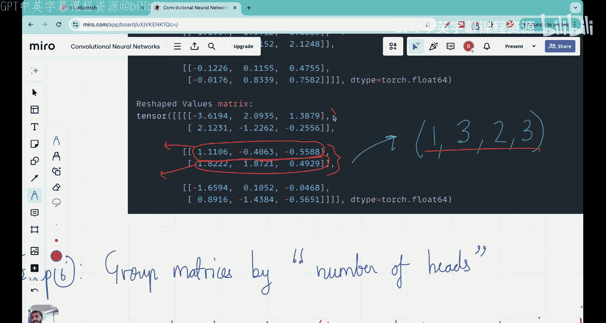
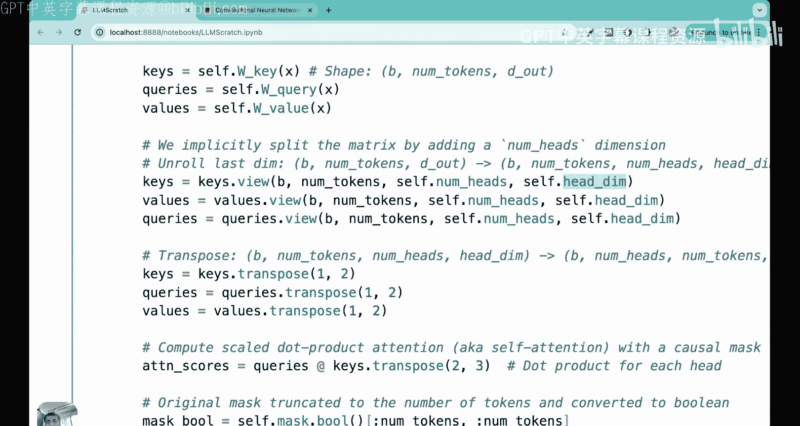
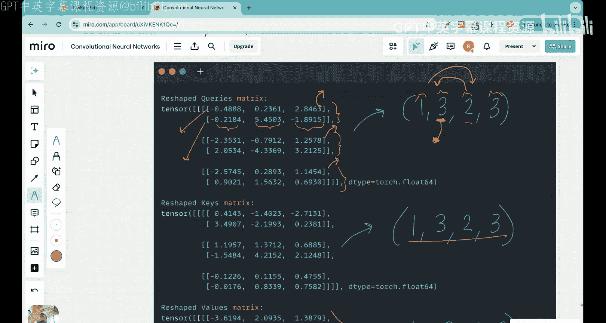
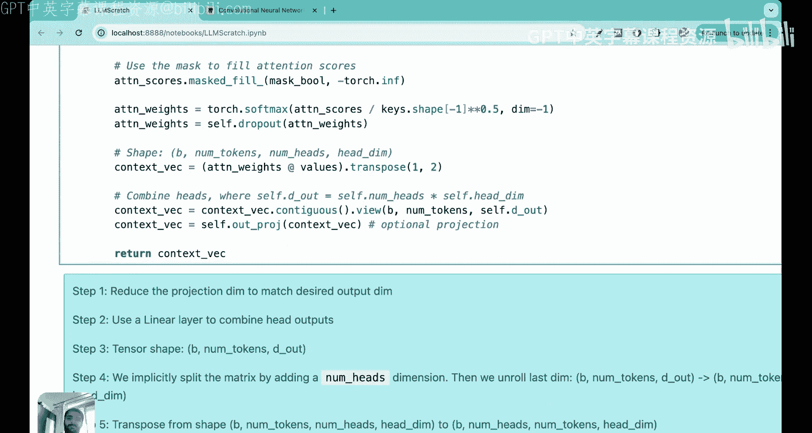

# Vizuara《从零开始搭建大语言模型｜Building LLMs from scratch》中英字幕（Claude-3.7-s） - P17：-18-Lecture 18_ Multi Head Attention Part 2 - Entire mathematics explained.zh_en - GPT中英字幕课程资源 - BV1qG8HzUE2D

🎼Yeah。Hello everyone， welcome to this lecture in theBuild Large languageage modelss from Sctch series。

This is the second part of the multi head attention lectures。In the previous part。

 we looked at implementing multi hair attention in the following way。What we did is that we had the。

Input tokens。 So let me show you this figure which summarizes everything。Yeah。

 so this was the input matrix which we had essentially the number of rows here represent the number of tokens which we have and each token was encoded as a three dimensional input embedding vector。

Right in the first part of the multied attention what we essentially did was we created multiple weight matrices for the query key and the value。

 so if we have two attention heads we will create two weight matrices for the query。

 two weight matrices for the keys and two weight matrices for the values。

And then we will multiply the inputs with these weight mates to get two queries， two keys。

And two values。So the main problem with this approach is that here you can see that there are。

Two matrix multiplications which are needed， as we saw earlier， GPT 3 used 96 attention heads。

So if you have 96 attention heads， you will need 96 multiplications to get the queries matrix。

 96 multiplications to get the keys matrix and 96 multiplications to get the values matrix。

That's not very efficient， right？So， today what we are going to see is that how can we make sure that the number of multiplications are reduced in particular what if we just need to do one multiplication for quick keys。

 well one multiplication for queries and one multiplication for values。

And then once we do one multiplication， then we can split the queries again into two parts。

 we can split the keys into two parts and we can split the values also into two parts for two heads。

And then we can perform the rest so once we get the copies or the multiple matrices for queries keys and values。

 what we can do is multiply queries with keys transposedse to get the attention scores。

 then we can get the attention weights and we can multiply them with the values to get the context vectors。

So， the rest of the procedure can be a bit similar。

 but what if we can reduce the number of matrix multiplications at the start。

 this is what we are going to look at in today's lecture。So。

 let us get started this procedure is called implementing multiha attention with weight splits and it is definitely much more efficient than the multi head attention which we saw previously so in the previous lecture the way we implemented multi head attention was something like this。

We had the causal attention module and we calculated the causal attention module result。

 which is the context vector， the context vector for every single attention head。

And then we concatenated the results from the different。呃。

Context vectors together and that led to a large matrix this was the process now what we are going to do is we are going to follow a slightly different procedure and that is called multi head attention with weight splits and it is much more computationally efficient。

So， the main idea is that in the previous code we had maintained two separate classes。

 we had maintained a class for the multi head attention wrappper and we had maintained a class for the causal attention。

And then we combine both of them into single multiaired attention class so here in the in the top what you can see over here is what we did previously。

We performed two matrix multiplications to obtain the two query mates Q1 and Q Q2 what we are going to do right now is what if the weight matrix which we start out initially itself was a larger weight matrix。

And then we multiply the inputs x with the query matrix to get the queries。And then after that。

 we split the queries into two components。So here you see the difference in the previous case。

 we multiplied x with Wq1 and we multiplied x with Wq2。

But what if you multip x with a wq which is already a large matrix which consists of d out so here you see the dimensions of this initial weight matrix are larger。

And that these dimensions already include the number of heads。So。

 this dimension 4 is the d out which is 2 multiplied by the number of heads so this d out is already specified before。

 so the weight matrix for the queries keys and the values which we specify already will kind of include the head dimension。

And then we when we get the queries， keys and values。

 we will split to them based on the number of headers。😊。

So here we can see where we split the queries matrix into2  Q1 and Q2 because there are two heads。So。

 ultimately the rest of the procedure will remain the same。

 but we are just reducing the number of matrix multiplications。

So if you look at this weight matrix right now， the number of attention head is specified， right？

So how is it specified so d out is equal to 4 and d out is equal to head dimension multiplied by the number of heads。

So， the head dimension is equal to2 because each head has a dimension of 2。

 this is what we had done here each head had a dimension of2。

Each attention head here is you see d out equal to 2 which was implemented in the previous case。

 so each head had a dimension of 2 and there are two heads so the d out in this larger trainable Q matrix already includes number of heads。

I will explain to you in detail what this means right now if you just get an intuitive idea of what we are trying to do。

 that will be very helpful。Okay， so now let us get started with the code。

 so we are going to implement multi head attention with weight splits， right？

So instead of maintaining two separate classes。 So here you can see earlier in our code， we had the。

We had a causal attention class which did all the computations of attention scores。

 attention weights， etc， and then we integrated this causal attention class with the multiha attention wrapper so we had a multiha attention wrapper and we created multiple instances or multiple causal attention objects within this wrapper。

Now the idea is instead of maintaining two separate classes。

 why don't we combine both of these concepts into single multied attention class？Also。

 in addition to just merging the multi head attention wrapper with the causal attention code。

 lets make some other modifications to implement multi head attention more effectively。So。

 as I told you earlier in the multi headd attention wrapper which we had earlier。

 multiple heads are implemented by creating causal attention objects。

And the causal attention class independently performed the attention mechanism earlier。

 and then the results from each attention head were effectively concateated。😊。

Now we are going to implement a class which is called as multi head attention class and we are going to integrate the multi head functionality as well as the causal attention functionality。

 everything within a single class。😊，The way we are going to do this is that。

The this class splits the input into multiple heads by reshaping the query key and value tensors lets see what this means don't worry about this sentence。

In this lecture I have constructed a handson example so that you understand the code which you are about to write。

 So first， let's look at the multiha attention class and how we are going to define it。

 This code right here， which Im showing on the script is at the heart of the transformer mechanism So you see we have the init constructor which is invoked by default and then there is the forward method at the end of the forward method all we are going to do is calculate calculate the context vector for each of the input embedding vector but what happens in the middle。

That is the main key which you really need to understand， okay？

So I could have just taken you through this code， but I have seen that if I take students through this code it becomes very difficult for them to wrap their heads around what exactly is going on especially because if you see the dimensions there are four dimensional tensors which are involved in this code and there is a very good reason for why we need four dimensional tensors。

So if you， if you just go through the code you will you will think that you have understood it but you would not have because there are a lot of certainties with respect to the dimensions。

 so what you are going to do is that we are going to go to the whiteboard and have constructed this example completely from scratch。

So we are going to take a simple example we are directly going to start from the input and we are going to do all the steps。

On the whiteboard， which are implemented in this code。

 then you will find that understanding the code is extremely easy at every step of the code。

 I'm going to take you to the whiteboard and I'm going to explain to you what exactly is going on。

 Okay， so let's get started。 I've tried to distill this down to 11 steps and I will explain everything related to meized dimensions extremely clearly I will not assume anything everything is written down on the whiteboard so that you will not be afraid of this code。

 I have seen several other YouTube videos and。Even want lectures were。

People just explain this as if it is very easy to understand。

 but you need to decompose it into individual layers and explain every single one of them okay。So。

 I am going to start with the forward method and I will explain every single line here step by step so first the forward method takes the input x right lets see what that input looks like and what it means。

So， the first step to the attention make the multi attention with weight splits that code or the multi head attention class is that we have to start with the input。

The way we will specify the input is that the input has three dimensions。

 the first dimension is the batch， the second is the number of tokens and the third is the input dimension right？

What is this D in the D in is basically every token。Is represented by a vector embedding。

 So this D in is the dimension of that vector embedding。So one comma，3。

 comma 6 means that I have three tokens。You can think of one token as one word for simplicity。

 so let's say。The three tokens are the。Gett。Sleeps。Let's say my let's say these are my three wordss。

Then。What we are essentially doing here is that we are converting each of these words。

 we are converting each of these words into six dimensional vector。

 so there will be a6 dimensional vector which is the first row。So which is the first row over here。

So， look at the first rowover here， this is the6 dimensional vector for the this is the6 dimensional vector for cat and this is the6 dimensional vector for sleep。

So you will see that this is a  one by 3 by 6 for simplicity I've taken the batch size equal to1。

Okay， so this is a one by 3 by6 tensor， y 3 by 6 because we have three rows here and we have six columns。

Each row consists of 66 dimensional vectors， so I hope you have understood how the input has been defined。

 so here you can see the input shape is B common number of tokens common input dimensions。

 so I hope you have you have understood this okay now let's come to the next step the next step is what we have to do is we have to essentially decide two things we have to decide what our output dimension is going to be。

And we have to determine the number of headers。This output dimension is basically we have the input input embedding vector for each token right ultimately we will get a context vector for every token so ultimately similar to this input embedding matrix which is3 by which is 3 by 6 we will have a context embedding vector which is3 because we have three tokens multiplied by d out。

So now we have to also decide what is d out which is the con so each each token wheelil have a context vector。

 what is the dimension of that vector we have to decide。

So now I am deciding that D out will be equal to 6 which is same as d in this is typically done in GP based models。

 the D in and the D out are the same。Second thing we also have to decide is how many attention heads do we want to have？

So I have decided that we are having two attention heads right now in GPT the number of attention heads are 96 and the D out is also pretty large but exactly what we are doing right now can be scaled to a larger d out and larger number of heads okay so I am using D out is equal to 6 and number of heads equal to 3 so then each head will have a dimension which is called as head dim。

And we will look at that also later each。Each head will have a dimension of head dim。

 which is equal to。H dim， which is equal to essentially the D out。Divided by the number of heads。

 which is equal to。6 divided by 2 and that will be equal to3。So。

 then the dimension of each head is equal to3 and since there are two heads the total layout out will be equal to 6 okay so this is the second decision point so third decision point which I have to make is that I have to initialize or it is not a decision point rather but it is the third step so the third step which we have to do is initialize trainable weight matrices for the key query and the value so we have to initialize w k wq。

And W okay so remember that the input which we have which for now can be thought to be six rows and three columns has to be multiplied sorry three rows and6 columns so the input is three rows and6 columns so when you construct this to enable weight matrices for the keys query and value their first dimension has to be equal to d in because if you look at the input dimension the input the number of the last dimension of the input is d in。

And for these for D for this input to be compatible with this Wk， Wq and W in multiplication。

 you need the first argument here to be equal to d in。So。

 actually the dimensions of the trainable key query and value matrices are d in multiplied by d out which is 6 by 6 because d in is equal to 6 and d out is equal to 6 so we have to initialize the these three vectors these three matrices rather and I have shown these random initializations here so you can see that wq is a 6 dimension or a 6 by 6 tensor wk is a 6 by 6 tensor and wv is a 6 by 6 tensor。

Let us let me show you in code where these matrices are actually initialized so if you look at the code these matrices are actually initialized in the in constructor。

So W query W key and W value these are trainable weight matrices as you can see the dimensions are d in comma d out and we are using the linear layer of neural networks with the bias equal to0 to set the initial values for these why do we use a neural network linear layer because it is optimized for initializing the weights so it is much better when we do the back propag letter so this is where the the trainable weight matrices for query key and value are initialized in the in constructor so it's called by default when we create or it these mates are created by default when we create an instance of the multi head attention class。

Alright， so up till now we have essentially initialized these trainable weight matrices Wk Wq and W now we move to step number4 step number four is the step from which computations actually start so we have the input now right and we have the these matrices we have trainable keys the trainable queries and the trainable values。

What we will now be doing is that we will multiply the input with these matrices to ultimately get the keys。

 the queries and the values so what are the dimensions of the input the dimensions of the input are 1。

When们。We just write this again the dimensions of the input are when multiplied by。Three。

 because we have three rows multiplied by six columns， correct？And the dimensions of each of these。

Key query and value trainable weight mates are 6 which is d in multiplied by 6 which is d out。So。

 when you multiply the input with these weight mates， the result which you will get is one by 3 by 6。

 so you will get the keys。You will at the keys matrix which is one by 3 by 6。

 you will at the queries matrix which is one by 3 by 6 and you will also get the values matrix here which is one by 3 by 6 lets try to understand what this one3 and6 is so I as I have written over here one is the batch size which we are taken to be1。

Three is the number of tokens。Because we have three tokens and d out is basically the output dimension so the way to interpret these key queries and value matrix is that each row basically corresponds to one token so the first row corresponds to the first token the second row corresponds to the second token and the third row corresponds to the third token and there are six dimensions in each row because each token is a six dimensional representation because d out is equal to 6。

Now let me show you in the code where this is calculated。So。

 if you go down below here you see the keys， queries and values。

 what we have done is that we have passed in the input to this neural later cleaner layer。

 so what this does is that the trainable weight matrixes for the key query and value applied on this input and we get the keys queries and the value matrix as we saw on the white bowl the shape of this is b which is the batch size the number of rows is equal to the number of tokens and the number of columns is equal to the d out which is equal to 6。

Okay， now we move to the next step and this is the step where four dimensional tensors start to come into the picture right so until now we have three dimensional tensors for the keys queries and values right？

Why the fourth dimension needs to come into the picture is that until now these three dimensions are for batch size number of tokens and day out。

 but there is no dimension for the number of headers。诶。Or the head dimension rather。

 So this is where we come to next So what we are now going to do is that we are going to enroll the last dimension of the keys queries and values to include the number of heads and the head dimension。

What this means is that if you look at this last dimension of the keys here， in fact。

 even for queries and values， this is d outright。And D out is essentially a number of heads into head dimension。

 as we have seen earlier。So let me take you yeah so here remember what we saw head dimension is equal to d out divided by a number of heads。

 so d out is equal to head dimension multiplied by the number of heads。So。

 that is what we are actually going to do we are going to unroll the last dimension of the key queries and values to include number of heads and head dimension right so we have d out which is equal to 6 which is a decision which we have made and we have also made a decision with respect to the number of attention heads which is equal to2 so based on these two decision points the head dimension is fixed。

And the head dimension will be equal to 6 divided by 2 which is equal to 3。So。

 what we are going to do next is that we had this one by3 by6 meizes right for the key query and value now we are going to roll them into one by3 by2 by 3。

So now instead of d out， we will have number of heads which is equal to 2。And head dimension。

 which is equal to  three。So let's see what the reshaped keys。

 queries and values matrix actually look like。So when you reshave the keys queries and value matrix they start looking like this and Ill tell you how to interpret four dimensional tensors also so for the sake of simplicity lets first analyze the queries matrix so this matrix is one by3 by2 by3 how do you analyze this four dimensional tensor for now forget about the first which is the number of batches okay so next look at3 so this three is the number of rows so this is my first row。

And this is my first token also， right， this is my second token。

And this is my third token correct that is why there is there is this three now let us look at this two what is this two this two is the number of heads so if I go in each token right now lets see if I go in first if I go in the first token。

The first row corresponds to the first head and the second row corresponds to the second head。

 thats why there is this two。 and if I go within each head Ill see that there is。

There are three dimension， the first dimension， the second dimension and the third dimension。So。

 remember the head dimension is equal to 3， so the way to interpret this matrix is start from the outermost values so 3 y3 because there are three tokens。

 then go to each token， y2 because there are two heads in each token。

 then go within each head y3 because the dimension of each head is 3 each head is a three dimensional vector。

So， in this same way we can analyze the queries， the keys and the value matrix also。

 so the keys matrix will also be one by 3 by2 by 3 and the values matrix will also be one by 3 by 2 by3。

As I mentioned before， let me repeat it again each row here is a token。

 so if you look at the value matrix， lets look at the second row。

 the second row corresponds to the second token。If you now look at the first row of the second row。

 this that is the three dimensional。Head a vector for the first header。

If you look at the second row that is the three dimensional head vector for the second header。

 remember every token has two attention headers so you can think of as two people paying attention to each token because we have two attention heads that is why there are two rows corresponding to every token。

Now， if we come to the code， this line has been mentioned over here。

So see we have to enroll the last dimension so now the d out will be replaced with the number of heads and head dimension so this is exactly what has been done over here keys dot view so now keys will be replaced with keys dot view be common number of tokens common number of heads and head dimension this is exactly what we just saw on the whiteboard so in this step the three dimensional tensors have been converted into four dimensional tensors to include the number of heads and the head dimension。

Great， now we move to the next steps。

所以 you see。If you see this， let us look at this argument， which is3。

So the shape of this is one comma 3， comma 2 comma 3， right now let's look at this first。This。

 this entry， this is three。Now this three is the number of tokens。

 which means that currently these mates are grouped according to number of tokens right so I am saying that this is the first token this is the second token and this is the third token。

And then I further dive into number of heads and the dimensions in each head。

But it turns out that later when we want to compute the attention course。

 the only way the computation can proceed ahead is if we group by the number of headers。So。

 instead of grouping by the number of tokens， I actually want to group by the number of headers and we have two heads here right so I want to flip these dimensions。

I want to flip these dimensions here so that the first row represents the first head。

 the second will represent the second head and each will have a  three by 3。

 let me show you what I mean。

So now what we are going to do is we are going to group the metrics by the number of heads okay so currently the keys queries and the values matrix have the dimensions of one which is the batch3 which is the number of tokens。

2 which is the number of heads and  three which is the head dimension。

So we are grouping with respect to the number of tokens。

 but now I want to group with respect to the number of heads。So again。

 I want to switch the dimensions to be， I want to switch this this to。Let me write it again。

Yeah I want to switch this two with three and these three should come over here。

 so I want the the matrices to have the dimensions of B comm number of heads common number of tokens and head dimension。

 so I want the dimensions to be one comma 2 comma 3 comma 3。

So what I am going to do in the code also youll see we are going to transpose key queries and value and we are going to transpose1 comma 2 now why do we do1 comma 2 over here because Python has0 indexing so index 0 is this since we want to interchange the number of tokens and the number of heads the indexes which we need to transpose our index number1 and index number2 that is why we are doing key queries and value and transpose1 comma 2。

So let us see what the result actually looks like so when you when you make the1 comma 3 comma 2 comma 3 to1 comma 2 comma 3 comma 3 now the transpo queries keys and values start looking like this and now you will see that they are grouped by headed so the first thing what we can do is that lets look at this block。

In the que， so we are analyzing the queries matrix now， the shape of the queries matrix is one。干妈。

Let me write it here again。1， comma 2。管吗？3。Comma3 right that is the essentially the shape of the queries matrix and we are going to analyze this so lets start with this two。

Which is the number of headers so if you look at the first block here。

Let me erase this right now and then draw it again Yeah so if you look at the first block over here which are marking with these curly braces that is the first head。

 if you look at the second block here that is the second head So see now this two because this two comes over here now we can group with respect to number of heads So the first block shows everything with respect to head one and the first row over here is the first token the second row over here is the second token and the third row here is the third token Similarlyly if you look at head number two the first row is the first token the second row is the second token and the third row is the third token。

So now we have the dimensions as number of tokens and head dimensions come last so each token if you see each token has a three dimensional vector because the head dimension is equal to3。

So the reason this helps is because since we can now group with respect to headers we can compute the attention score for each head separately so remember there is one attention score there is an attention score matrix for the head1 and there is an attention score matrix for the head2 and then we are going to concatennate them together right so it makes sense to group with respect to the header and thats why this step exists this key is not transpose it is very difficult for students to understand this unless you see this visual example of why we are essentially doing this transpose。

The main reason we do do this transpose is that here you see， we are grouping with respect to。

We are grouping with respect to number of tokens here。

 but that is not good if you want to compute the attention scores for each head apparently。

 so we group with respect to number of headers so that' is why it' is important to flip number of tokens and number of head dimension。

And that's exactly what we have done。Okay， now let's go to the next step。

 The next step is to find the attention scores。 So remember， now we have the。

We have the queries matrix， we have the keys matrix and we have the values matrix in exactly the shape which we want so now we can do we can go ahead and find the key queries and the keys transpose。

To get the attention score， so let me show you how this is done。First， let me rub all of this。嘅。Okay。

 so now I have rubbed all of this。 So what we are now essentially going to do is that。

This is the head number one right this is the head number one of the queries and this is the head number one of the keys so what this this shape will help us do is that when we do queries multiplied by keys transpose it will directly take the equivalent product of head one of the queries with head one of the keys and then head two of the queries and head two of the keys。

But remember when we take the keys transpose what is really important to us is that now the shape of the keys is b common number of head is common number of tokens and head dimension。

 so what is really important to us is number of tokens and head dimension。So。

 remember the formula for。Calculating the attention score is queries multiplied by keys transpose right so here also we are going to do queries with respect to keys transpose。

 but what exactly do we have to transpose we have to transpose。呃。We have to transpose this。

 so we have to transport the last two dimensions and let me show you what that transpo key matrix looks like yeah。

 so this is the transpo key matrix now here you can see the key matrix。

If you see the first row its 0。4143。 minus1。4023 and minus2。

7131 right so when we do keys transpose keys transpose2 comma 3 it will transpose along the last two dimensions。

 so now that that row which we saw has now become a column over here。So this is the key transpose。

And here is the queries matrix and I've shown the keys transpose over here。

 so the queries matrix dimensions is1 comma 2 comma 3 comma 3。

 the keys transpose dimension is1 comma 2 comma 3 comma 3。

 so they they they are compatible for multiplication and the way the multiplication will now proceed is that the head of1。

Will only be multiplied by the head of one of the keys transpose the head2 here will only be multiplied with the head2 of the keys transpose and ultimately when we do this multiplication we will get the attention scores matrix。

So， this is the attention score matrix which we have and the dimensions of this are b number of heads number of tokens and number of tokens。

 let me show you why。嗯。Okay so if you look at what you are multiplying here。

 the queries dimensions are b common number of heads common number of tokens come a head dimension right and when we do keys transpose。

2 comma 3， the dimensions here are B number of heads head dimensions come number of tokens。

 so essentially you can think about it like we are multiplying two matrices with the dimensions number of tokens comm a head dimension multiplied by head dimension number of tokens so what will the resulted matrix we have a number of tokens rows and number of tokens columns。

And the first two dimensions here will stay the same because they are the same in both of these mat prices we are multiplying。

So， the resultant attention scores will have the dimensions of B number of heads。

 number of tokens and number of tokens。It's fine if you forget these dimensions。

 but you should be able to interpret what is going on here。

So let's see what is going on here remember we we are grouping with respect to head。

 so that stays the same this first。This first block， which I've highlighted right now。

 that is head number one。And this second block， which which I have highlighted right now。

 that is essentially head number two。This is the first thing to understand okay。

 then what we are doing when you look at the let's look at head number one for now。

 if you look at the first row the first row essentially consists of the attention score between of the first word with all the other words right so remember our sentence was the。

Actually， let me write it over here。That will be much better。 So our sentence was the。The cat。

The cat。And here it was sleeps， right？Look at。Let me just write it over area。 the cat sleeps。

 and the same words I'm also going to write over here。 So the first row is。Let me write it over here。

 actually。😔，The first throw is the。The second row is cat。And the third row sleeps。So。

 that is why the final two dimensions are number of tokens common number of tokens because if you look at the second row now。

 if you look at the second row now， the first element of the second row tells us information about the attention between cat and the。

The second element of the second row tells us the information between cat and cat so if the query is cat how much attention should you pay to cat the third element here tells us the information between cat and sleep。

 which means if the query if the query is cat how much attention should you pay to sleep。

So that' is why the shape of the attention matrix for every head is number of token rows and the number of token columns because an attention score exists between each token for every other token。

So， whenever you see these dimensions right don't get confused by it try to always understand the meaning behind it。

 that is why we had so many lectures on the attention mechanism before just so that when we reach this stage understanding all of this becomes easy。

So remember until this stage we have computed the attention score。

 so this is exactly what is done here， remember what we saw on the whiteboard。

To compute the attention scores will take the queries and will multiply with the keys dot transpose 2 comma 3 because in transposing2 comma 3 will make sure that the correct。

Quries attention and the piece transpose product is taken to calculate the attention course。

And this is also implemented in the code， so if you see in the code the attention score is the product is the scaled product between queries and the keys。

Great， so here it shown dot product for each head now you will understand why I am seeing each head because as I showed you before each head has number of tokens come a number of tokens attention scores and for one head its here and for the second head it is below。

Okay， now we come to the next step， the next step is to essentially find the attention attention weights。

 okay。So and if you look at this attention score over here right now。

 you will see that for every token， there is an attention score with respect to every other token。

 right？But that's not whats the mechanism in causal attention。

 What causal attention says is that when you look at the。

You should only look at the attention score between the and what comes before it so the and the。

All the other elements here， so let me show them with a different let me first rub this。So， that。

Yeah。So what causal attention mechanism dictates is that when you look at the first world。

 which is the。Only the attention score between the and what comes before it should survive so all of this should go to0。

If you look at cat only the attention score of the words which come before so though and cat should survive。

 this should go to 0。And when you look at sleeps， attention scores of all you will survive because all the words come before it。

 this is what we are actually going to implement next。So。

 to do that first what we are going to do is we are going to take the attention scores which we have and replace all of the elements above the diagonal with negative infinity。

The reason we replace this with negative infinity is because after this point we are going to implement the soft max function so that each row sums up to1 and when we implement soft max whatever is there in the infinity will automatically go to zero so it it will kill two birds in the same stone will will implement the causal attention mechanism and we also make sure that all the rows sum up to1。

But before we implement softm， we do one more thing。

 we divide every single element here with the square root of the head dimension。

And this when we looked at the lecture for send for attention， we saw why this is done。

 this is essentially to make sure that。The variance between the when we take the dot product between the queries and the keys the variance scales up with the number of dimensions and to prevent the variance from blowing up we have to divide by the square root of the head dimension this also makes sure that the values。

In the。Values before we compute the softm are not very high and that is generally useful for back propagion and leads to stable gradient。

So what we'll be doing is that the head dimension as we saw is three right because the d out is equal to 6 and the number of heads is equal to2 so each head dimension is equal to 3 so we will divide this after replacing the elements above the diagonally with negative infinity we divide this with square root of three which is square root of head dimension and that leads to this matrix over here or this tensor I should say and then we apply softm to this tensor so we make sure that every row here sums up to essentially so if you look at each row in this you will see that its summing up to1 and the reason it sums up to1 is we are applying softm so now I can make claims interpretpreable claims so when I say that when I look at the second token cat I should pay 96% attention to the and I should pay 4 percent attention to cat when I look at sleeps I should pay 4% attention to the I should pay 26% attention to cat。

And I should pay 69% attention to sleeps remember these values are not optimized。

 but when they are optimized when we look at back propagal later。

The fact that these values sum up to1 will carry meaning because we can make interpretable statements such as what I was making right now。

Remember that after we are going to apply softm， the attention weights have exactly the same dimensions as the attention scores。

 which is going to be the batch size， number of heads， number of tokens and number of tokens。

So this is the dimension of the attention weight， which is 1 comma 2， comma 3， comma 3。

So if you look closely to go from attention scores to attention weights we actually we actually have very we have a rich number of steps and it's important for you to understand all of these first what we did is we applied a mask so that all elements about the diagonal are negative infinity then we divided by the square root of the head dimension then we applied softm this is how we got the attention weights now let's see how that is done in the code before that one thing usually we can also implement dropout after this so you can mention a dropout rate which is actually one of the arguments in the。

Mtiered attention class。But here I am not implementing dropout for the sake of simplicity。

 So if you look at the co， we have got the attention scores， the first step， as I said。

 is to create this mask and then apply this mask to the attention scores so that all the elements above the diagonal are negative infinity。

 That's what this step is doing。You heard the。Mask actually has also been defined over hereRC this is the upper triangular mask which is all the elements above the diagonal number 1 then they are replaced with negative infinity and that is applied to the attention scores so this will ensure that all the elements above the diagonal of the attention scores are equal to negative infinity。

And we are only considering context length here， why context length because。

Let's say context length is 3， it means that maximum if three words are given。

 we can make prediction of the next world。So， when we implement this dropout mask we only implement a mask of context length comm a context length。

 there is no point in implementing a bigger mask because anyway we are not going to look at more tokens than the context length at a time。

And if it happens that we are looking at a batch where the number of tokens are less than the context size。

 this statement makes sure that then the mask stops at number of tokens。

But this is a detail which probably you can overlook right now if you are understanding all the other things that is what is the most important if you understand this minor detail it is awesome。

Then the next step is to apply softm but as I told you before applying softm we we divide every element with the square root of the head dimension if you look at the keys dot shape lets look at keys dot shape this is going to be the keys dot shape so keys dot shape of minus1 which means that we are going to look look at the last dimension which is the head dimension so we are essentially dividing by square root of head dimension here and then。

We apply the soft max y dimension equal to minus1 because we need to make sure that all the columns of a row sum up to 1。

And then as I said we can even implement dropout if needed towards the end so up till now we have reached a stage where we have obtained the attention weight is basically and I hope you understand the meaning behind this final attention weight matrix it is not just important to understand how the dimensions work so to make sure you understand the meaning let me go through the meaning of this attention weight matrix once more。

This what I'm highlighting right now is the attention weights for the first header this second block is the attention weights for the second header。

In each attention head a block， you will see that。The size is number of tokens rows and the number of tokens columns。

So， each value is essentially the attention weight between let us say this is the attention weight between this is the attention weight between the second row。

 which is the second token and the second token this is the attention weight between。

The third token is the query and the first token as the key。

 so basically you will see that every single element here has the meaning it essentially encodes the attention weight between the query and the particular key。

Okay， now let us go ahead the last step which we are going to implement is that we have to calculate the context vector remember the aim of all the attention mechanisms is to ultimately compute the context vector matrix and this is exactly what we are going to do。

And to compute the context vector matrix， we take the attention weights and we multiply them with values。

Remember， the value matrix was the matrix which we had computed earlier。

Let me show you where the value matrix was in case you have forgotten it because we have done so many things。

Yeah， so here was the value matrix which we had computed。

 we have not used it until long till only be used in this last step。Okay。

 so the attention weights will be multiplied by the values matrix to get the context vector matrix。

 so lets see how the dimensions work out here okay。

 the attention weights as we looked earlier over here。The attention weights have the dimensions of B。

Coma number of heads。Common number of tokens， common number of tokens。

 and as we saw earlier the values matrix has the dimensions b common number of heads。

Common number of tokens and head dimension so effectively lets see whether these mates can be multiplied so this is number of tokens and number of tokens and that will be multiplied by a number of tokens and head dim。

So， the number of columns here is number of tokens and the number of rows here is number of tokens。

 so the number of columns in the first matrix are matching the number of rows in the values matrix so we can see that these two matrices can essentially be multiplied。

So， multiplication is possible and now let us see how the multiplication will actually work in practice this is the final attention weights matrix here it is mentioned attention scores but I should have called it attention weights remember there is a difference between scores and weights attention weights in in the attention weights each row sums up to one that is not the case with attention scores okay so this is the attention。

weightights and this is my values， this is my values matrix。

 so this one comma 2 comma 3 comma 3 and this one comma 2 comma 3 comma 3 and when we multiply the resultant output will be B comm number of heads。

 command number of tokens。Comma， the head dimension。So。

 here you can see that the context vector output is B common number of heads。

 common number of tokens， comma head dimension which is1 comma 2 comma 3 comma 3。

 let us interpret this again so here you can see that there are two heads so this is head number one and this is head number2。

And in each head there are number of tokens， so if you look at each head there are three rows。

 so each row corresponds to one token， but now if you look at what each row represents each row represents the context vector。

For that particular token and it has the dimensions equal to head dim。

Because headd is equal to  three。So， that is the meaning of this context vector matrix which we have reached but now remember there is a problem here right or not a problem but we have to somehow merge this number of heads and head dimension back together。

Because the resultant context vector matrix， remember what we saw earlier。

 the let me scroll up a bit。So if you if you if you looked at the goal which we had when we started this lecture。

The goal was that the resultant context vector matrix should have the dimensions of。呃。Yeah。

 as I mentioned to you， the goal was that the resultant context vector matrix should have d out right as the dimension so。

We should again pull back the head dimension and the number of heads together so that we can get the result matrix which has the d out dimension preserved。

Whereas lets see what we have obtained until now。Well。

 until now the context vector matrix which you have obtained。

Yeah the context vector matrix which we have obtained has number of heads and head dimensions in separate positions so first what we will do is that we will bring them closer together so that we can then merge them to get the d out so what we are going to do is now we are going to swap this this number of tokens index with the number of heads index。

So that the dimension of the context vector matrix is so that the shape of the context vector matrix is changed。

So， the next step is basically step number 10 and that is to reformat the context vectors so currently the context vector shape is B common number of heads come number of tokens come a head dimension right and I want the number of heads to come here so that they are closer to the head them and I want the number of number of tokens to go here。

So I want the resultant matrix to be。B common number of tokens， common number of heads。

Commahead dimension。So essentially what I will do is after I compute the context vector matrix。

 Ill do a transpose of the first index and the second index。

And so the resulting context vector matrix now， which has the dimensions of b common number of tokens common number of heads comm head dimension looks like this。

So here you see now the interpretation is different now this is my first token now the grouping is with respect to tokens this is my second token and this is my third token and in each token there are two heads so if you look at the first token there are two heads and if you look at the first head this is the vector with respect to the first head the context vector context vector and the second row is the context vector with respect to the second head for the first token。

Now let us see how all of this is implemented in code actually all of what we saw right now is just implemented in one line of code。

 but to understand this we really have to understand first of all how the attention ratess are multiplied with values the multiplication really makes sense and why do we do this transpose one comma 2 the reason we do this transpose1 comma 2 is to get the context vector matrix in this shape。

The reason we get it in this shape is now you can see the number of heads and head dimension are closer together。

So we can merge them into the D out more easily。So here you can see this is what we have reached up until now where the context vector is obtained and it's in the correct format。

 Now， the last step what we have to do is that we have to。Let me show you。

The last step what we have to do is essentially we have to combine the results from multiple heads so see this is the context vector matrix which we have obtained right now right so if you look at the first token which I have highlighted over here this is the first head and this is the second head now what I will do is that when I look at the first token I will combine these two together into one row。

So that it will be6 the dimension will be 6 so so here these are three and these are three right so it will combine the outputs from both of these heads into one output so lets see how this looks like so then the first row will so then will flatten this call flattening will flatten each token output。

Into each row so the head one and head2 outputs are combined together。

 so if you look at the final output the first row consists of merging of the two heads。

For the first token。The second row consists of the merging of the two heads for the second token。

 so for the second row we merge these two outputs into one single row and for the third token we merge these two outputs into a single row so you will see that the this is the third row。

So this now what I what I am showing on the screen here is my final context vector matrix and how to interpret this if you look at the first row。

The first row is the context vector context vector for the first token first row is the context vector for the first token Why does it have six elements because d out is equal to 6 the second row is the context vector for the second token and the third row is the context vector for the third token so overall you see we first split the d out into number of heads and head dimension and now we brought it back together to get the d out so in the final shape you will not see the number of heads it is all merged into this d out so this is my final answer right now。

And the shape of this is1 comma 3， comma 6， which is b comma number of tokens， comma d out。

So this is exactly what is done here。 What we do is that we。

We take this context vector and we reshape it into B comma tokens comma D out why this contiguous is needed is because we want to make sure that when we reshape mattriosis they are in the same blocks of memory so when we reshape tensors let's say and if they are in different memory blocks it becomes difficult so first we make sure that using these contiguous they are in the same memory block then we reshape them。

So that the final output is b which is the batch size number of tokens which is equal to 3 in the example we saw and d out which is the output dimension which is equal to 6 and then there is an optional projection layer towards the end so if you look at the output projection it is again a linear layer and whose parameters can be learnedt。

This is not really necessary， but sometimes it is implemented in practice now this is exactly the entire procedure for how the multi head attention is implemented from scratch and here we saw the multi head attention for the example which we have so the first token is again。

The the second token is cat。And the third token is sleeps。I write this again。

Yeah the third token is sleeps， so you see through this entire procedure we obtained the enriched context vector representations for these tokens。

 similarly when you deal with large volumes of text。You take sentences。

 you break them down into token， then into token IDs。

 then into input embeddings and similar to this procedure。

 you get context vectors for each token which you have。Ideally。

 when we run the actual code we will have multiple batches。

 but I showed only one batch right now for simplicity。So。

To whoever who have reached until this stage I want to say that thank you for following with me for so many lectures I know these lectures are becoming very long but unless I explain every single thing in detail it is very difficult for you to understand all the details so congratulations if you have reached this lecture you have successfully understood how the multihaard attention works and I think there are very few people who really understand this entire piece of code block by block。

Okay， so I'll share this notebook with you and whatever I explain to you on the whiteboard。

 all the steps which I laid out in front of you on the whiteboard。

All of those have been explained here as step1 to step 1 and I have explained added a detailed explanation of the multiair attention class in today's lecture I did not just want to read this but I wanted to construct a practical example to show you how the dimensions actually work。

And it took me a long time to make this example， but now I think it's worth it because it really helped me explain it and I hope you understood it better。

So now we can actually test out the multiha attention class， so here are my inputs。

As I showed you on the whiteboard， we have three tokens and we have six。

 the embedding dimension is 6。The only change here what I'm going to do I'm going to create a batch。

 so Im going going to create a batch of two such inputs and I'm going to stack this batch on top of each other。

So I am going to assume a d out equal to6 exactly what we saw on the whiteboard and context length equal to 6。

 and then we are going to implement the multi head attention class so d in is equal to。6 D out。

Is equal so d in is equal to 6 right because each each token has the input embedding dimension of 6 d out equal to 6。

 the context length which we are using is equal to 6。Then。

Yeah the dropout rate which we are considering is0 we can even include the dropout rate so the dropout rate will change this last layer of dropout and randomly block out some attention weights this is good for generalization and the number of heads equal to2 so we create an instance of this class and then create the context vector matrix and you will see for the first batch the context vector matrix has three rows and six columns lets see if the shape matches what we are seen on the whiteboard。

嗯。Okay， so let me scroll down below。Yeah， this is the final context vector matrix which we have obtained。

Yeah， so this also had three rows。Okay， I think I need to scroll up a bit。

Yeah this is the final context vector matrix which we obtained and this also had three rows and six columns。

 the values might be different because we have done the initializations differently here I have taken the random initializations in the python code there are some other initializations every time you initialize we take from agosian distribution so the values might be different but let's check the shape so this is three comm6 three rows and6 columns and here also we can see that three rows and six columns awesome so the shape matches but youll see that since there are two batches here' is the context vector matrix for the first batch and here is the context vector matrix for the second batch。

So， the multi attention class which we defined is extremely powerful because it can also handle multiple batches at once。

 we can even do 50 data batches and then it will just have one to it will have 50 such contexts vector the matosis。

Okay that's it that brings me to the end of this section or the end of this lecture。

 so in this lecture we implemented the multiha attention class that we will be using in the upcoming lectures to implement and train the LLM。

This code is fully functional but we used relatively small embedding sizes and number of attention heads to keep the outputs readable so as I showed you we only use two attention heads but GPT3 actually use 96 attention heads。

So the smallest GPT2 model had 12L attention heads and a context vector embedding size of 768。

 the largest GPT2 model had 25 attention heads and a context vector embedding size of 1600。

And GPT3 has even higher， so the GPT3 largest model is 96 attention head， I think。

And generally in GPT models the d in is equal to d out in the example which we saw d in is equal to d out equal to 6。

 but here the d in and d out are much larger around 768， etc。Again。

 thank you so much everyone for reaching the end of this attention series。

 it's been one of the longest and most comprehensive series which Ive covered and I really enjoyed learning about all of these things。

I can see that many LLM practitioners。Cannot understand these dimensions。

 or they do not take time to go through understanding the theory the building blocks behind。

How the attention mechanism works。 they just implement the code basiss which are available。

 which completely abstract away all of these things so。

I don't think that is the good way or the correct way to learn about large language models if you want to be a true LLM engineer or a machine learning engineer。

 you have to understand how nuts sand bolts work。Otherwise， you might be able to deploy applications。

 but to make real interventions， you will have to go into the code base， change a few things。

 understand dimensions。As you might have seen， and have stressed this many times。

 dimensions and linear algebra are at the heart of becoming a very strong M L engineer。

 It all comes down to dimensions。 Other students might be scared of four dimensional tensor， right。

 But if you understand how it works based on what I showed to you on the whiteboard。

 my aim is that you should not be scared of these higher dimensional matrices。

 once you write it down。And once you understand what's going on， it really becomes easy。

 That's why I really recommend writing things down。 You can write on a whiteboard。

 You can even write on a piece of paper， but make sure you write things down。

 Then you' will remember them for a longer period of time。

 I hope you all are enjoying these lectures。😊，Thank you so much everyone and look forward to seeing you in the next next lecture where well actually start building the LLM model thanks a lot。

