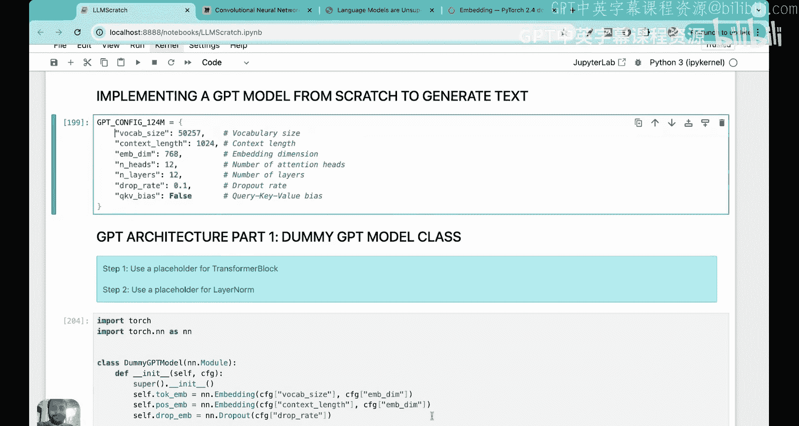

# Vizuara《从零开始搭建大语言模型｜Building LLMs from scratch》中英字幕（Claude-3.7-s） - P18：-19-Lecture 19_ Birds Eye View of the LLM Architecture.zh_en - GPT中英字幕课程资源 - BV1qG8HzUE2D

🎼Yeah。Hello， everyone。Welcome to this lecture in theBuild La language Model from Sctch series。First。

 let me take you through what all we have learned so far in this lecture series。Through this diagram。

 so in this lecture series， we are going to build a large language model completely from scratch。

 and we are going to do that in three stages。In the stage1。

We will lay the foundations for building an LLM in the stage2。

 we will pretrain the LLM and in stage  three we are going to fine tune the LLM。

We are still at stage1， and until now we have covered two aspects of stage 1。

 we have looked at the data preparation and sampling。Which included tokenization。

 vector embeddings and positional embeddings。And very recently。

 we have looked at the attention mechanism in a lot of detail。In particular。

 those of you who have followed the attention mechanism， we had a very detailed。

4our to five lectures which started from simplified self attention， self attention。

 causal attention and multi head attention。If you have not been through these lectures。

 I highly encourage you to go through them because attention really serves as the fundamental building block to understand everything which follows。

If you have watched all the previous lectures and if you have run the code which I have been providing。

 it's amazing and I would like to congratulate you。

That you have reached this part understanding attention is one of the most difficult aspects of understanding large language models。

And if you have reached up till here。The rest of this will be easier for you。

So let us get started in these subsequent lecture videos which are to follow we are going to learn about this part number three which is the large language model architecture as I always do I am going to break this into multiple videos I will not cover everything in one video。

We will cover every single video in a lot of detail and completely from scratch。Today。

 right now it's the first video in the large language model architecture module。So let's get started。

 I think this will be a very interesting module for all of you。

 especially to those of you who have followed until now we have learn about the attention mechanism we learn about input embeddings we learned about position embeddings but all of you must be thinking how does all of this really come together to give me something like a GT Where does the training happen Where does back propag happen where are the neural networks here If you remember at the start I told you that large language models are just deep neural networks where are neural networks and what exactly is the transformer。

We learned about the attention mechanism， and。You must have heard about this that attention mechanism is at the heart of transformers。

 but what really is transformers， when do we do the training and where do we generate the next world as the output。

All of that will become pretty clear to you as we slowly start unraveling this box of the LLM architecture。

I really had a lot of fun learning about this and let's get started。As I told you， LLL architecture。

 I'm planning to cover in four to five videos and today is the first video。

So after learning about the attention mechanism in the previous lectures。

 let us learn about the LLL architecture now。I want to give you initially a view of what the LLL architecture really looks like this is the bird's eye view and we are going to cover every single aspect of this in detail but right now I want to show you what all you have learned and how does that fit in the context of whats to come next。

This always helps in the learning process， imagine if you are getting walking through a forest right and if you want to get to the other side。

 it's always good to know。To track your path to have some kind of feedback like okay。

 this is what you have covered right right now and this is what is next to come so that you can relate what you are learning next with the learnings from the past and that helps you reach the end of the forest in our case。

Learning about how the previous knowledge fits into what we are going to learn about next will really help you learn about LLM in a much better manner。

So initially we started with tokenizing， then we looked at vector embedding and positional embedding。

Final embedding vectors which we had for every token。

 were then converted into context vectors through mask multi head attention。

So the main aim of attention or rather the multihaard attention was to take the input embedding vectors and convert them into context vectors context vectors are a much richer form of representation than embedding vectors because they not only contain semantic meaning of the token but they also contain information about how the token relates to all the other tokens in the sentence。

No。Maask multi head attention forms a very important part of something which is called as the transformer block。

Transformer block is the most important part of the large language model architecture and it's a block which actually consists of many different aspects which are linked together。

 So let us zoom into this transformer block a bit unravel it open this block and see what it contains if you zoom into the transformer block you'll see that it contains a number of things and mask multiha attention forms a part of this So whatever you have learned in the multiha attention comes over here So imagine you have a sentence such as every effort moves you and you want to predict the next word right the first step is to convert each of these into input embeddings or vector embedding so these are。

These and let's say we also add a positional embedding right these embedding vectors are then passed on the transformer block。

 The first part of the transformer block is a layer normal normalization the second is mask multi head attention which converts the input embedding tokens into context vectors These are then passed into a dropout layer。

You can notice this plus signs， so these arrows which run from here to this plus sign they are called a shortcut connections。

 the output of the shortcut connection goes to another layer normalization。

 then we have a feed forward neural network here then another dropout layer is connected and there is one more shortcut。

AConction here。And if you zoom into the field forward neural network further。

 you will see that it has something which is called as the Jlu activation。

If you look at all these terminologies and you think what does it mean， what is layer normalization。

 what is dropout， what is the Jlu activation， why do we have a feed forward neural network here and why are all these things stacked together like this？

That is all what we are going to cover in this video and the four to five videos which are going to follow forward。

 but remember this entire architecture has a large number of trainable parameters and trainable weights。

When the LLM is pretrained， these weights and these parameters are optimized and ultimately we get the output。

The outputs are such that they have the same form and dimensions as the inputs。

 and the outputs are then processed further。Wwhich gives the final text so once we get the output from the transformer block it goes to these output layers and then the which decos the output from the transformer block and we get the next word so every effort moves you was the input if you remember and the next word is for world。

I just wanted to give you this bird's eye view of what exactly is going on and what we are building。

 what you have learned so far and how it fits into what we are planning to learn next。

In these set of lectures which are going to follow we are going to zoom into this transformer block and we are going to understand every single thing which has been mentioned here。

 we will learn about first of all we will learn about how to stack these different layers together which will be in today's lecture then we will dive into each individual layer and learn about them。

Well have a separate lecture on layer normalization。

 a separate lecture on these shortcut connections， a separate lecture on feed for neural network with JO activation will stack all of these together and then finally well have a separate lecture on how this output from the transformer is decod to produce the next world。

Okay케。So I hope you have understood why we learned about the mask multiha attention because if we had not learned about this。

 see this form such a critical part of this transformer block right to learn about this one small block is it took us five lectures spanning over seven hours but that is the importance of the attention mechanism if this block is removed。

If this mass meered block is removed。It's like the large language models would lose all their power。

And then we are back to the age of recurrent neural networks and long， short term memory networks。

Okay， so let us see what we have learned so far we have learned about input tokenization。

 we have learned about embedding token plus positional and we have learned about mask multi head attention okay。

So let me first give you a brief overview of the mass multiard attention in which you have if in case you have forgotten。

So we have the input embedding vectors which are stacked together like this。We have a bunch of keys。

 queries and the value matrices， which are multiplied with the inputs to give the queries the keys and the values。

The queries are multiplied with the keys transpose to give us attention scores。

 which are then converted into attention weights。Attention weights are then multiplied with the values matrix to give us the context vector and since we have multiple attention heads the context vectors are stacked together to give us a combined context vector。

This is what is happening in the multiha attention block。

Now this whole process of what all we have learned so far can be visualized like this also if you have the input text which is every effort moves you it first tokenized and GPT uses a byte pair tokenizer which we learned about before every single token is converted into a token ID。

Every single tokenide is converted into a vector embedding， which is a vectorized representation。

These vector embeddings are passed into the GPT model which consists of the transformer block which I showed you before。

 then there is an output that output is further decoded and that gives us the output text。For GPT2。

 the token embeddings which were used had embedding vector size of 768 dimensions。

 which means each token ID was converted into a vector of 768 dimension and the output is generated such that the dimensions are matched。

 so the output is a 768 dimensional vector for each 768 dimensional input token embedding。

And then we do some post processing with the output so that we generate the next world。

 which is forward。 So every effort moves you forward。Great。

 so what we are yet to learn is the transformer block and we will start learning about this in today in today's lecture will dive slowly deeper and deeper into every single layer of this block in subsequent lectures。

So for these set of four to five lectures， we will not use a toy problem。

 we will not use a toy model， we are directly going to use GPT2。

So we will use the same architecture which was used to build the GP22 model。

 so if you look at this paper。This was the paper which introduced GPT to。

And if you look at the models， which they had， they had。

They had a small model and they had a large model which has 1542 million parameters If you look at the small model it had 117 million parameters。

 this was revised later to be 124 million parameters which is what we are going to use for these set of lectures and for the rest of this video series as well so we are going to construct an NLM 124 million parameters which has 12 layers what are these layers which means we have 12 transformer blocks。

And D model which is the vector embedding size is 768。

 these are the parameters which we are going to use in today's lecture and also in the rest of the lectures。

呃。So why are we using GPT2 and not GPT 3 or GP4 one reason is that GPT2 is smaller。

 so it is better to run it locally on our local machine。

And second reason is that open AirI has made only GPT2 weights public Open air has really not made the weights of GPT3 and GPT4 public yet。

So that's the thing with open source right open air is closed source right now， whereas metas。

 Lama models are open source， so all weight have been released。

So that's why we are sticking with GP2 because its weights have been made public。

 we load these weights later in one of the subsequent videos。

So here is the configuration which we are going to use and to all those who are watching the video you can pause here and try to understand whether you understand every single terminology here we have covered all of these in the previous lecture so I am going to pause here and ask you to also pause on your end and try to think about these terminologies I'll anyway explain each of these terminologies but I want you to just give it a shot and try to understand。

Okay， so so let's go step by step， the first is the vocabulary size。

This means that every we start with a vocabulary。The GPT2 uses a byte pair encoder right so it's a subboer tokenizer。

 so the vocabulary is how many subboers are basically there。

This will be used for tokenization so if the vocabulary is a word level tokenization so if the sentence is every step moves you forward then the vocabulary will have every step moves you forward so that way the tokenization will happen but if you use a byte pair encoder with GPT2 uses it's a sub word tokenizer so the vocabulary size is 50257 and it may contain of characters it may contain sub wordss it may contain full words also but this is the vocabulary size which we deal with when we consider。

呃。GPT2 this will be very useful for tokenization so when we do tokenization what happens is we have a vocabulary and there are tokens in the vocabulary and there is a token ID with respect to every single token。

And whenever whenever a new text is given to us using that vocabulary that text is converted into tokens and then those tokens are converted into tokenidees if some text does not belong to the vocabulary that' is called as the out of vocabulary problem。

 the byte pair encoder does not face this issue because it's a subor tokenizer。

We have covered about vocabulary size in our lecture on embedding。

 so if you are unclear about this please refer to that the second is the context length the context length basically refers to how many maximum words are used to predict the next world。

So if there is context length is 1024 which was actually used in GPT2。

 we are going to look at 1024 words and we are going to predict the next word maximum there will be no case when we are looking at 2000 words let's say in predicting the next word when I say word I am actually meaning token here。

Whi is not exactly correct because GPT2 uses the Bte pair encoder a tokenizer。

 which is subworl tokenization scheme。But for the sake of this lecture。

 if I use word and token interchangeably， it is because it is good for intuition。

The second thing is the embedding dimension now every token in this vocabulary which we have will be projected into a vector space such as this so for example the tokens are your journey starts with one step here is a three dimensional vector representation of every single token right。

And the embedding should be such that the meaning is captured so for example。

 if journey and starts are more similar in meaning they would be closer together in this embedding space so this is a three dimensionmensional embedding space in GPT2 we are using a 768 dimensional embedding space its very difficult to show this over here but you can imagine a 768 dimensional embedding space in which the words are projected now if you are thinking how do we learn about these projections how do we know which vector journey corresponds to now that's also trained in GPT2 when we look at the transformer block you will see that the embedding itself is not fixed we are going to train the embedding layer so that every world is embedded correctly so that semantic meaning is captured。

The next thing is the number of heads and these are the number of attention heads which are equal to 2L so if you look at this diagram over here I told you that multiple queries keys and values matrix matrices are created right so the more the number of attention heads the more the number of these mates are created。

So if we have 12 attention heads， it means there will be 12 such queries， keys and volume mates。

So here the number of heads is 12 number of layers is the number of transformer blocks remember this is different than the number of attention heads number of layers is how many such layers are we going to have so this is one one transformer block layer and it includes multi head attention so within this one layer there will be 12 attention heads。

But in terms of these transformer blocks itself， there can be 12 blocks。

 so it is not necessary that the number of layers and number of heads are similar。

Here we are using 12 transformer blocks。Whi we will see later how they are stacked up together。Okay。

 so number of layers is 12 then drop rate is basically the dropout rate and query key value bias is or Q KV bias is the bias term when we initialize the query key and the value matrix by default this is always set to false。

Okay so the number of transformer blocks one more thing which I want to mention here is that we are looking at the GPT2 small model which use 12 transform which uses 12 transformer blocks right but as we saw over here they have four models of GP2 so if you go from left to right here you will see small the medium has 24 transformer blocks the large has 36 transformer blocks and the largest which is extra large that is 48 transformer blocks and you will see that the dimensionality also increases from left to right we are using 768 dimension GP to small but if you go from left to right you will see that 10241280 and finally the GP to extra large has a dimensionality of 1600。

Okay， so I hope you have understood this this configuration。

And what we are now going to do is that now I'm going to take you to code and Im going to build a GPT placeholder architecture。

What does this mean this basically means that whatever I showed you over your rate， this thing。

This thing， whatever I showed you， I know that you have not yet understood the layer normalization the shortcut connection even the transformer block what it exactly has what the speed forward neural network is what the Jlu activation is right now what I want to do is I just want to create a skeleton for our code where these different blocks will come in together we'll code them later in subsequent parts and well have a separate lecture for each of them but right now well build a GPT placeholder architecture which we also call as the dummy GPT model。

This will actually give a bird's eye view of how everything fits together。

 so here I've shown a bird's eye and this is a bird's eye view。😊。

So the reason this bird's eye view is again very important is that you will see what we are planning to do in these subsequent lectures and that' is why the skeleton is very important。

 especially for a complicated topic like the LLA architecture where multiple things have to fit in together first let's zoom out and see what all has to fit in together and then in subsequent lectures we will start coding it out。

So I am going to take you to port right now， this is the GP configuration 124 million parameters which we are going to use。

 so lets jump right into it。Okay so now what we are going to do is we are going to implement the GPT model from scratch to generate text and Ill show you exactly how the code is executed but at every single step of the code I'll again take you to the whiteboard so that you can visualize what every parameter means it is very important for you to read a sentence of the code and to visualize how it looks like only then youll really understand the code so this is the GPT configuration which we covered on the whiteboard I hope you have understood the meaning of every single terminology here if not just look up the meaning once more or go through our previous lectures but it' is very important that you don't just ski through it without understanding the meaning。

Okay， now as I told you we are going to build the GPT architecture。

 so this is a dummi GPT model class， well use a placeholder for the transformer block。

 we'll use a placeholder for the layer normalization okay。

So first let me give you a broad overview of what all do we have here。

 so we have a Dmmi GP model over here and it has the forward pass。

What this forwarder or rather I should call it the forward method what this forwarder method does is that it takes an input and at the end of this forward world method we are going to print out the output this is what we are aiming to do so if you look at the figure which let me show this figure to you。

Here this is the main thing right so what that forward method does is that it takes an input。

Which basically can just be these words。And then the aim of this is to the aim of the forwarder pass is to give you the next world in this case the next world is forwarder so that is the output So all of what we want to implement somewhere lies in the middle。

 right。So there are two main blocks which will be very important to us so there is first the transformer block we are going to create a class for the transformer block not in this lecture but in later lectures and we are going to create a class for the layer normalization let me show you where these come into the picture so if you look at the transformer block over here the transformer block consists of all of these things right and layer normalization is a very important part of it。

Layer normalization will also be implemented before the transformer and after the transformer。

 but it is also present within the transformer itself。

 so we will have a transformer block in which we will put all of these things what I am showing here and we will have a separate layer normalization block。

The reason we are having a separate layer normalization block is that it comes in the transformable block that' is fine。

 but it also comes at other places， so its better to define a separate class of it。

So this is the class which will define later， not now， this is the class which will define later。

 not now。Now let us see what what this forward method is actually doing okay so the forward method first takes in an input。

And let me show you what that input actually looks like。嗯。Okay， so。

I have just made some visualizations over here so that you understand what's going on yeah。Okay。

 so the forward method is going to take an input right and the input， let's say is this same thing。

 let me write it over here。What's that input the input is。Every effort moves you。

Let's say this is the input which is passed to the forward world method。Let me write over here。

 right， and I'm going to write this with a different color。 So let's say the input is。Every。

Every effort。Mose。有。Okay great， so this is my input right now。

 the way this will be fed to the forwarder method is that let me actually show you that。

So we are going to feed this input to the forward method doing something like this。

So let us say every effort moves you is the input right we are first going to use the thick token tokenizer which is a byte pair encoder and we are going to convert these tokens into token IDs。

So remember the workflow which we saw earlier。Every token here see every token is essentially converted into token ids。

And then everything later after this point happens within the GP model class but。Till this stage。

 we have to do it outside and then pass the token IDs to the GPT model class。

So now we have this every effort moves you right this will be converted into token ID this will be converted into token ID this will be converted into token ID and this will be converted into token ID right the first step is that every token ID。

Will will be converted into token embedding。呃。And so what that means is every token ID。

 so let's say this is ID 1。Let's say this is ID 1， this is ID 2。

 this is ID3 and this is ID 4 right each of these token ID will need to be converted into 768。A 7。

68 vector。A 768 vector embedding essentially that is going to be the input embedding。

And the way we are going to do that is that we are going to first create a token embedding layer。

And for that we will use the NN dot embedding in pieytorch what this layer actually does is that it creates this matrix which is called as the token embedding matrix。

 it has rows which is equal to the model vocabulary size and every row basically corresponds to one token IDD。

And every row the length of every row is essentially 768 so now if you want to find the vector embedding for ID number1 let's say ID number1 is 44 you just look at the 44 throwover here and you get the 768 dimensional vector if you want to look at the let's say for effort the ID is 64 you look at ID number 64 for effort you get the 768 dimensional vector similarly you let's say the ID for U is 85 or rather 40000 you go downward and you get you go to the 40000 row and you get the 768 vector 768 dimensional input embedding vector。

Now thats why this token embedding matrix is also called as the lookup matrix。

 you just pass in the token Aires and it gives you the vector embeddings。

Remember that all of the parameters here here everywhere in this token embedding matrix they will be initialized randomly for now and we will train these parameters so when we initialize this token embedding layer it initializes the parameters from a Gasian distribution。

And then their initial is randomly later when we do back propag。

 we will train these for now when when you look at all these embedding midrices。

 just just know that their values are random for now。Okay。

 so the first step is to convert all of these tokens into。

Token embeddings which are 768 embedding vectors and you will see that that has been done over here。

So when you go to the forward method， first what you do is you look at the input shape right the input shape is basically batch size which are the number of rows and the sequence length。

Which is essentially the length of the number of tokens which we are considering。 So， for example。

 let us look at this。This is for example one such batch right so I have in this batch2 the batch length the batch size is two so there are two rows in this tensor and the number of columns are the number of tokens which I'm going to use for now let's just look at one batch so I'm feeding in four tokens and which are my input inputs and then I want to get the next word so every effort moves you forward which will be the next word right。

So that's where the shape is batch size and sequence length。 The batch size is in the example。

 which I showed you， there are two batches So two rows and sequence length is the number of tokens。

 basically great。 So the first thing what we are going to do is that we are going to。

Create the token embeddings out of the input input index。

 which is the inputs which we have given Now take a look at these inputs and just look at the first batch The first batch is a list of token id which which have been mentioned over here what we do with this token ids is we will then query or look up the token embedding matrix and then retrieve those input embedding vectors so for this token id there will be a 768 dimensional vector for this token id there will be a 76 dimensional vector etc so you might be thinking where is that embedding matrix so that has been created in the init constructor which is invoked by default so see first we have a token embedding matrix which has been created the number of rows of this matrix are equal to the vocabulary size exactly what we have written over here。

🎼The number of rows of this token embedding matrix is equal to the vocabulary size and the number of columns of this token embedding matrix is the embedding dimension why because every token or every token ID has a 768 dimensional vector associated with it so the number of columns which are there is equal to the 768 so for every token ID essentially there will be 768 columns。

So this is the embedding token embedding weight matrix which has been created using this pieytorch embedding class and what we are doing here essentially in the forward world method is that we are looking at the input token ids which have been mentioned in our batch and we are going to look up that token embedding matrix and we will get the token embeddings for the inputs so we will essentially have four four768 dimensional vectors for the first batch and we have four768 dimensional vectors for the second batch。

Great， the next step which we are going to do after getting the token IDs is we have to get the positional embedding。

So remember up till now we have a 7608 dimensional vector for ID 1。

 a 7608 dimensional vector for ID 2， a 7608 dimensional vector for ID 3 and a 7608 dimensional vector for ID number4。

Now what we are essentially going to do is that we are going to add a positional embedding to each of these four vectors okay so for that first we need a positional embedding weight matrix very similar to the token embedding weight matrix so remember the positional embedding really depends on the context size because。

At for will take。Let's say context size is 1024 at max we will use 1024 tokens to predict the next word right so we just need to know the let's say the position is1。

So let's say the position is one。We need a positional embedding vector for this position。

 If the position is 3 or two， we need a position embedding vector for this position。 Similarlyly。

 if the position is 1，0，2，4。 We need a positional embedding vector for this。

 We don't need a positional embedding vector for 1，0，2，5。 Why， because we are not。

 we are not looking at。The context window of 10225。

 we are only going to look at maximum 1024 tokens at once and predict the next world。So。

 that is why the number of rows in the positional embedding matrix is the equal to the context size。

 but if you see the number of columns they are still equal to the embedding size and that is important because we are going to add the positional embedding vectors to the token embedding。

To the token embedding vectors so here there are four token embedding vectors of 768 dimensions each right to each of these we will have four positional embedding vectors so now every effort moves you let's say so it position number one position number two position number three and position number four right so we will at the positional embedding vector corresponding to first position second position third position and fourth position and we will add them。

To each of these token embedding vectors。The context size is 1024。

 but for now I am just showing you a simple version of four context size。

But the main point I am trying to illustrate here is that once we get the token embedding vectors for these four tokens。

 we will add them with the positional embedding vectors。Okay。

 so here you can see that first positional embedding matrix is also initialized when this in constructor is called and the number of rows here are equal to the context length。

 which is exactly what I showed you。Over here the number of rows are equal to the context length or the context size and the number of columns are equal to the embedding dimension so this is again a n end dot embedding which is very similar to the embedding class or exactly the same embedding class which we use for token embedding again these will be initialized randomly for now we will train them later。

Now， what we will be doing is that based on the positions the in the tokens。

We are going to query or we are going to look up the positional embedding matrix so tor dot arrange sequence length。

 what this will go this is going to do is that it will look at the token length so in this case the token length lets say right now the token length is equal to4 right the token length is equal to4 in this batch which I have given so it will arrange it as012 and 3 and it will get the positional embedding。

It will get the position of embedding vectors for row number0， row number one。

 row number two and row number three。And then it will then what we are going to do is we are going to add the token embeddings for the four tokens and we are going to add the positional embeddings for the four tokens。

So the x the we had the input initial right the way it' has been transformed is like this。

 so the four tokens which we had in every batch。Well convert them into 7608 dimensional input vectors we then add the 7608 dimensional positional vectors to each of them and then finally we have a 7608 dimensional。

呃。Embbedding vector for each of these totals。Awesome。

 so now next what we are going to do is the next step is something which is called as drop EMmb。

 which is the dropout embedding So this is just the dropout rate So what it will do is that it will take these it will take the embedding vectors for。

All the tokens and it will randomly turn off some way to values use This generally helps the generalization performance and prevents overfitting we look at this in detail in one of the next classes after we get these。

Ebedding vectors， let me show you the figure what happens next so once we get these embedding vectors as I showed you over here。

嗯。Yeah， actually， let me show it over here。Yeah， so once we get these token IDs and the token embeddings。

 right， we will then pass it to the GPT model， which essentially consists of the transformer block。

And then。The output is generated so after we get the yeah so after we get the input embedding and after we add the positional embedding next what we have to do is we have to pass it through the entire transformer block and also we later have a layer normalization layer。

So this is exactly what is done over here after we get these embeddings and we apply the dropout layer we then pass it through the transformer block so in this one step actually several things are happening in this one step what we are doing is that we are implementing multiha attention we are implementing a dropout layer we are implementing shortcut connections we are implementing layer nor we are implementing feed forward neural network with JO activation then another dropout layer。

And then remember， we have 12 of these transformable blocks in GPT2。

And then finally we have another final norm which is the layer normalization layer towards the end and the important step which I want to highlight in today's lecture is this last step which is the output which we have which are called as logics and there is a reason why they are called as logics so let me explain that to you。

嗯，O。Okay， so when we reach the。When we reach the output。

 what we will be having is that we have four tokens。

And each of those four tokens will have a 768 dimensional representation that is the output vector right。

 but now we want to predict the next world。Based on the input token， based on the input sentence。

 the input sentence， as I mention as every effort moves you。

 we have to somehow predict the next word which is forward。

So after all of the transformer blocks have been implemented。

 the output is such that for every token。For every token。We have a 768 dimensional vector。

That's the output。 Now， what the main thing is that how will we predict the next world。

 And so the way this is done is that。The final output matrix which we have will have this format there will be four tokens which are the number of rows but there will be columns which is equal to vocabulary size which is 5hi0257 and let me tell you why so if you look at token number one actually before that when we look at an input batch every effort moves you there are actually four prediction tasks which are happening here。

You have you first look at one word every and you predict the next word which is effort。

 then you look at the next which is every effort。This becomes an input in the next and then you predict the next world。

Then the next input is every。Effort。Moves。And then you predict you only then there is the four task which is every effort moves you and then you predict the next world which is forward so when you look at this input batch which is four tokens or a context length of four in this case we are actually doing four prediction tasks so when you look at token number one which is every we need to predict what whats the next token right。

Out of the vocabulary， what has the highest probability of coming next？So if you look at the rows。

 there will be the column length will be 50257 and every element here will represent probabilities。

So you will then take that element， which is the highest highest probability。

 So let's say that is the 40000。That is the 4，000 column over here。

 so then we look at the vocabulary， we will look at the 4，000 token in the vocabulary。

which are and that seems to have the highest prior probability will choose only that token which has the highest probability so that is the 40000 column and then that 40。

000 column will be effort。Now similarly when you look at token2 so the input will be every effort right and then you will again look at the row and you will see that column number which has the highest probability and let's say this column number is 20。

000 so you look at the token corresponding to 20，000 in the vocabulary of 50257 and that should be moves。

Similarly， every effort moves you will be the input and will again have a token corresponding to you and then every effort moves you will be the input and then well have a token corresponding to forward。

So thats why the output which we expect will have this format which has these tokens。

 which is the input sequence length and in this case is equal to4 and the vocabulary size will be 50257 and then this will essentially give us an idea of what the next world will be at every single prediction stage since there are four input output prediction tasks in this input sentence。

So that's why if you look at the output head later when you print out the output dimensions it dimensions will be the number of tokens and the number of columns will be equal to vocabulary size so even if you look at the output head dimension remember when you reach up till this point the number of rows are equal to the number of tokens which is4 number of columns is the embedding dimension which is 768 that will be multiplied by this neural network which has 768 rows and50 to57 columns so ultimately the result which will come in logits will have four rows and 5hi0257 columns very similar to。

Very similar to what we have seen over here， four rows and 50257 columns don't worry in the subsequent lectures we have a separate lecture for each of each of these but right now I just wanted to show you this overall thing of what we are going to implement when we reach the end of the next 4 to5 lectures we will get these logicits matrix so that we know what the next world in the prediction is。

Now see here what we are doing is that we have taken two texts every effort moves you text number one which is also batch1 and the second text is every day holds up right so we are creating a batch which has two texts and the first step as I mentioned is to get the tokenidees so these are the tokenidees these four tokennetes for the first batch these are the four tokenitees for the second batch what we do then is that we create an instance of the damage GP model with the configuration as I mentioned about with the configuration as this。

Right and although we have not defined anything over here and everything is placeholder right now。

 we can still run this code。Nothing is initialized there right so this block currently does nothing and even this layer currently does nothing but we can still execute this code and get the output so what will happen is that these two blocks will not essentially do anything but we can still it is a functional code so we will still get the logics so lets see what the result is。

So we are passing this batch to the model right now and let's see the output shape so once we pass in this batch try to visualize the steps which are happening right and your visualization should follow this workflow。

For now think of the worko first I have this first look at only one batch so I have four token ids these are the four token ids these four token ids will be converted into 768 dimensional input embedding vectors then I will add positional embedding vectors to each of them the resultant will be passed through。

Let's see what the result here the result until will you pass through a dropout layer then Ill have then will go through the transformer block then the result will go through the another。

Normalization layer， which is also called as layer normalization layer and then until this point when I reach this stage the output will have four rows corresponding to the four tokens and 768 columns because the embedding dimension is 768 thats for one batch Now this will go through the output embedding output head which is the final neural network and then the result will be number of tokens which is4 and  p0 to 57 columns。

Because I want to now get loits and see which one。Which word should come next。

 So here you can see the result for the first batch。There are four rows。And then 5，0，2，5，7 columns。

This is exactly similar to the output which I was showing you over here。

 the output logic should have four tokens as the rows and 50257 columns and similarly for the second batch there are four rows and 50257 columns each parameter here should ideally represent the probability of the next token。

Remember when you look at these four tokens there are four input output tasks happening here。

 not just one so every is the first input and effort should be the first output Every effort is the first is the second input and moves should be the second output Every effort moves should be the third input and you should be the third output every effort moves you should be the final input and the output should be forward So right now these these outputs are random because we have not trained anything but ultimately we just add the backproagal algorithm and then all of these probabilities will start to make sense Later will also apply softms etca to these logics so that theyll be between 0 to1。

Okay， so here you can see that the output tensor has two rows corresponding to the two text samples。

 this first row corresponds to the first text sample。

 the second row corresponds to the second text sample， each text sample consists of four tokens。

Soken first to correspond to first token second to the second token etc。

 and each token is a 50257 dimensional vector which matches the size of the tokenizes vocabulary so yeah here you can see each token is a 50257 dimensional vector and it encodes the probability of what should come next。

The embedding has 50257 dimensions because each of these dimensions refers to a unique token in the vocabulary at the end of this series of lectures when we implement the post processing code well convert these 50257 dimensionary vectors back into token IDs which we can decode into whatever comes next。

Okay， so in this lecture we have looked at a top down view at the GPT architecture。

 what are the inputs， what are the outputs etc and。

I hope you have gotten a sense of what all we are going to implement in the subsequent lecture so in the next lectures well go through every single block sequentially so my next lecture is planned for layer normalization then after that we have a lecture on feed forward neural network with Jlu activation then we have a lecture on shortcut connections and we will have a lecture on how all of these come together in the transformer block and then finally well have the entire GPT model implementation and the last lecture will be generating text from output tokens so this logics matrix which is there right which you obtained over here。

Where was that？Yeah， here is the logicits matrix which was written。

 how to convert this into the next word， well see that in the last lecture in this series of lectures。

Okay， so that that actually brings me to the end of this lecture。

 I want to leave you with this one image。This one image so what we have learned right now is this GPT backbone so we have started this series with understanding the GPT backbone but remember this GPT backbone consists of layer normalization。

 Jlu activation feed forward network and shortcut connection and all of these actually come together all of this feed in together。

嗯。To make what is called as the transformer block。That's why it's called transformer so you might be thinking what exactly is the transformer and why do we say that attention is the heart of it the reason people say attention mechanism is the heart of transformer because if if you unlock or unravel the transformer block you'll see that the mass multiered attention is a crucial component of it but there are several other components which you also should be aware of and we will cover that I hope you have got a bird's eye view which I plan for in today's lecture thank you everyone I hope you are having a lot of fun with these whiteboard notes as well as through this coding assignments。

As well as through this coding part， the transformers lectures。

 which came before were a bit complicated。But now it's getting a bit easier so you have been through the hard part of the course so congrats for that and now comes the very interesting part later thanks everyone I look forward to seeing you in the next lecture。

。

