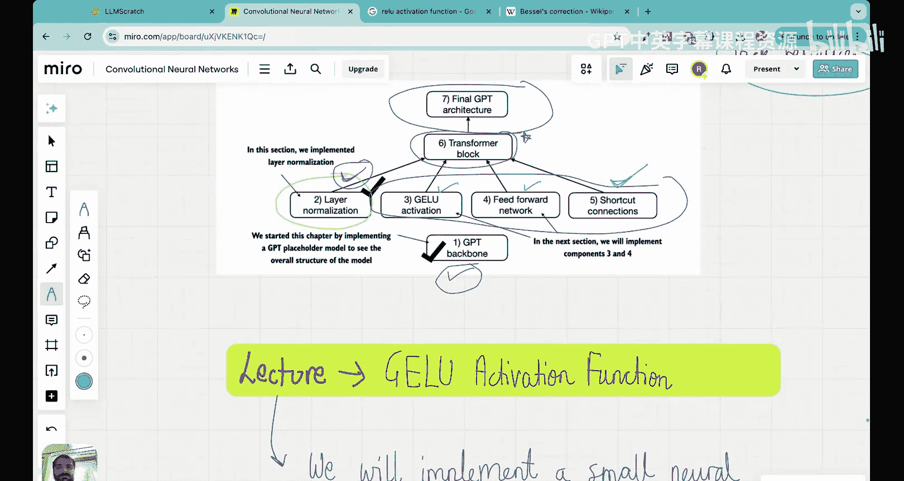

# Vizuara《从零开始搭建大语言模型｜Building LLMs from scratch》中英字幕（Claude-3.7-s） - P19：-20-Lecture 20_ Layer Normalization in the LLM Architecture.zh_en - GPT中英字幕课程资源 - BV1qG8HzUE2D

🎼Yeah。Hello everyone， welcome to this lecture in theBuild Lage languageage models from Sctch series。

In today's lecture， we are going to look at one specific component of the large language model architecture and that is layer normalization。

Before that let me quickly recap what we covered in the last lecture in the last lecture we essentially had a bird's eye view of how the LLM architecture looks like。

So what we are going to do is that the LLL architecture consists of several components which are arranged together。

Yes， in the previous lecture we constructed this GPT backbone。

 which is like a dummy class which will hold all these components。

 The first component is the layer normalization Jlu activation then the feed forward neural network and then shortcut connections these four components make up the transformer block which is one of the key components of the entire GPT architecture。

So let me show you how this looks like So if you zoom into the transformer block you will see that the transformer block has a number of layers which are stacked together。

 you have a layer normalization followed by the mask multihead attention layer followed by the dropout layer you have the shortcut connections then another layer normalization a feed forward neural network dropout layer and then another shortcut connections etc。

 If you zoom into the feed forward neural network you will see that it consists of linear neural network layer along with the Jlu activation function。

All of these are stacked together in a format which looks something like this。

 so let me take you to the broadest level view， look something like this。

 so you have the input text which you tokenize then you pass it into the GPT model。

In the GPT model we first do the token embedding， then add the positional embedding vectors。

 pass these input embeddings to the transformer block within the transformer block it goes through all the layers which I just showed you and then we have the output layers which essentially decode the output from the transformer block and we predict the next world from the input This is what happens inside the GPT architecture and we are going to start looking at every single component of this GPT architecture today we are going to look at this component which is called as layer normalization。

So if you look at layer normalization it actually comes up at multiple places within the transformer block itself if you see before the multihaed attention we have a layer normalization after the multiha attention also we have a layer normalization so the layer normalization comes within the transformer block at multiple places and actually it also comes outside of the transformer block。

That's why it's important to define a separate class for the layer normalization when we code the GPT architecture。

In the last lecture， we looked at this dummi GPT model class。

And the goal year was to put all of the different components together so that you get a birds eye view without really coding to many of these components。

So what happens in this GPT modeling class is that there is this forward method which takes in the input。

And then we convert the input into token embeddings。

 we add the positional embeddings to the token embeddings。

 the resulting embedding vector we add the dropout layer to it。

 we pass it through the transformer blocks then even after it comes out from the transformer we have a normalization layer as I showed you within the transformer block itself there is a normalization layer before the attention head and after the attention head and after we come out of the transformer block there is another normalization layer and then there are output processing steps and the output is returned right。

So to execute this forward method we need to define several things so when an instance of the demmi GPPT model class is created we define this transformer blocks and for that we need to create a separate class called demi transformer block which will ultimately become just transformer block when we learn about what happens in the transformer and then we also create a separate class for layer normalization why do we create a separate class because layer normalization not just happens in the transformer otherwise we would have just written this procedure here but as you can see even after the input comes from the transformer we pass it through another layer of normalization so that's why it makes sense to define a separate class of layer normalization in today's lecture we are going to dive deep into this class how to create this class what exactly does layer normalization do and why do we need it in the first place。

So let's get started diving deep into layer normalization。Okay。

 so the reason layer normalization comes into the picture is that when we look at the transformer block。

 as you can see number of these layers are stacked on top of each other right so there are a huge number of parameters。

coming from each of these layers and we have to train these parameters initially well train these initialize these parameters to random values。

 but through back propag we will train these parameters so that the next word is predicted correctly。

So we need to make the training process more efficient and that is where layer normalization becomes very important。

 it turns out that training deep neural networks with many layers can be challenging predominantly due to two things it can either lead to a vanish gradient problem or it can lead to an exp gradient problem and this leads to unstable training dynamics。

So， the first advantage of layer normalization is that it improves really the stability and the efficiency of neural network training。

So let me zoom into this further and explain this if you consider a deep neural network like this。

 you have an input layer and then you have multiple hidden layers which are stacked together after the input layer right and you have the output layer。

So what happens is that when you do a forward pass so initially when the weights are initialized randomly you do a forward pass and you get the outputs and then what you do is that based on the gradients you do a backward pass and you try to update these parameters so eventually for every of these hidden layers you will have gradients of the loss with respect to the parameters so when you look at every layer think of layers as accumulating gradients every layer will have a certain set of gradient values which will get updated after every iteration right。

Now， since we are doing the backward pass， let's say if we want to find the gradients of this layer。

The gradients of this layer will depend a lot on the output of this layer because we are doing backward pass let me show it with a different color yeah so the output of this layer I am showing with the red color and if you want to find the gradients of the first layer it depends on this red colored outputs since we are doing the backward pass now it turns out that if the layer output if this layer output which which Im showing by red right now if this is too large or this is too small that affects the gradients。

So if the layer output is too large or too small then gradient magnitudes can become too large or too small now think about what will happen if gradient magnitudes become too large let's say so if you are back propagating and the gradient magnitude in this layer becomes too large what will happen when you back propagate essentially you are multiplying different gradients together right so if the gradient here becomes too large by the time you reach the first layer the gradient would have exploded to a very large value that is called as the gradient explosion。

On the other hand， if the gradient of the last layer or one of the intermediate layers is very small。

 when you are propagating backwards， till the time you reach the first layer or the second layer。

 the gradient will become very small。What will happen when the gradient becomes very small we will not update the parameters because the parameter updates depend on the gradient magnitude if the gradient is too small learning will stagnate if the gradient is too large will lead to that will lead to an unstable learning procedure so both small gradients and large gradients lead to unstable training dynamics we do not want unstable training dynamics。

And one reason for the unstable training dynamics is that if layer outputs themselves are very large or small。

 as I mentioned， layer outputs affect the gradient values。

 so if we control the magnitude of the layer outputs。

 we can ensure that the gradient magnitudes themselves do not become too large or too small。

Batch normalization helps this batch normalization helps。

Keep the outputs of the layers to certain specific values and prevent the magnitude of the output from being too large or too small。

And that's what keeps the gradient stable which leads to stable training dynamics that's one of the first reasons why batch normalization or I should call it layer normalization there is a difference right so I should actually call this layer normalization batch normalization is something different and well come to that later。

Today we are only going to look at layer normalization in which the outputs coming from every layer are normalized。

The second advantage of layer normalization is that it prevents this problem which is called as internal covarierate shift so what happens is that as training proceeds the inputs to every layer can change let's say we look at the second layer right in in first training iteration the inputs can have a distribution like this in the second training iteration maybe the inputs are skewed。

So the input distribution which every layer receives can change according to the iterations and what that leads to is that it makes training very difficult so if the input distribution to every layer is changing the weights the updating the weights becomes very hard and that delays the convergence of the parameters and that delays the overall solution reaching and optimal value we dont want that layer normalization really helps to prevent this layer normalization。

Make sure that since we are normalizing， which means that as we see the variance of the standard deviation is kept to1。

 we make sure that the mean and standard deviation of the output from every layer is fixed。

And this reduces the problem of internal coerate shift which accelerates convergence。

So there are two main reasons why layer normalization is employed。

 the first reason is that it keeps the training procedure stable by preventing the vanishing gradient or the exploding gradient problem and the second major reason for using layer normalization is that it prevents or reduces the problem of internal covariate shift。

And that accelerates convergence and we get to a result faster。

So that's why layer normalization is employed not just in the GPT or the LLM architecture。

 which we are going to see right now， but in fact in many deep learning architectures。

 layer normalization is very frequently used。Okay케。

So what exactly is the main idea of layer normalization it is very simple so we will look at a specific layer and we will look at the outputs of that specific layer and what we do is that we will adjust those output so that they have a mean of0 and they have a variance of one。

Let me illustrate this through a simple example， let's say you are looking at a neural network and these four are the outputs from one specific layer of the neural network。

 right？So the four outputs are x1， x2， x3 and x4， and x1 is equal to 1。1 x2 is 0。8 x3 is 2。

3 and x 4 is 4。4。In layer normalization， what you do is you find two quantities。

First you find mean of this so the mean will just be x1 plus x2 plus x3 plus x4 divided by 4 so in this case it will be 2。

15 and the second thing which you do is you find the variance so the variance will be 1 by4 because there are four quantities here and then will sum up x1 minus the mean whole square plus x2 minus the mean whole square plus x3 minus the mean whole square plus x4 minus the mean whole square so that gives the variance value now what we do is we perform the normalization procedure which means that for every variable we subtract the mean and we divide by the square root of the variance which is the standard deviation so x1 will be replaced by x1 minus mu divided by square root of variance x2 will be replaced by x2 minus mu divided by square root of variance x3 will be replaced by x3 minus mu divided by square root of variance and x4 will be replaced by x4 minus mu divided by square root of variance。

So when you do this normalization， which leads to these four values。

Do you notice something about these four normalized values。

 if you add these together in the numerator you will have x1 plus x2 plus x3 plus x4 minus 4 times mu。

So that will be zero。Which means that the mean of this these normalized values is equal to0。

 and if you compute the variance of these normalized values through this formula。

 you will see that the variance of。These normalized values is actually equal to1。

That is the most important thing is which you should realize or you should understand is that after performing the normalization procedure。

 the values which you get these four values， their mean is equal to0 and their variance is equal to 1。

That's the whole idea behind normalization。in normalization。

 we adjust the outputs of every layer of neural network to have mean0 and variance of1。

 and it turns out that this simple procedure helps us in the stability neural network training and it also helps us reduce the problem of the internal covariator shift。

So let us actually see this in code， but before that I want to tell you where the layer normalization is used and we discuss this at the start of the lecture but the input is converted into an input embedding then we add the token embeddings and then here right we feed it before going into the multi head attention we have a layer normalization layer so that the inputs to the multiha attention are normalized even after the multihaard attention there is a layer normalization layer before feeding into the neural network module within the transformer block remember this blue block here is the transformer block so the layer normalization layer appears two times here and then it appears once more again outside the transformer。

So in GPT and modern transformer architecture layer normalization is typically applied before and after the multi head attention module like what we have seen over here and it also appears once before the final output layer and we saw this when we quoted in the last lecture here if you see within the transformer block layer normalization appears two times before and after the multi head attention but even before the output it we employ it once so overall it appears three times thats why we need to define a separate class of the layer normalization。

This one figure which I've shown over here actually illustrates the procedure of layer normalization。

Let's say we have a neural letter clear， these are the five inputs。

To the neural network right and these are the six outputs of the neural network without the normalization you will see that their mean is not equal to 0 and their variance is not equal to 1。

But after we perform normalization on these layer outputs。

 which means that from every output here we are going to subtract the mean and divide by the square root of the variance。

 so youll at these as the resultant values after applying layer normalization and if you take a mean of these values you will get that mean is equal to0 and the variance of these values is equal to 1。

This is the simple illustration。Which describes。What happens underneath the hood for layer normalization now what we are going to do is that I am going to take you through code and we are going to implement layer normalization first on a neural network which looks like this and then we are going to create a separate class of layer normalization which we can integrate within our GPT architecture so let's jump into code right now。

Allright， so here's the code file for layer normalization。

The first thing which we are going to do is start out with a simple example to illustrate how layer normalization is implemented in practice。

 and then we will actually fill out this layer normalization class which we had created in the previous lecture。

So let' us get started what we are doing here is that we are essentially let me take you to the whiteboard to demonstrate what we are doing here。

We have a simple neural network clear and the neural network is constructed such that we have two batches of inputs。

 so here is batch number 1 and here is batch number 2 and each batch has 5 inputs so batch number 1 has x1 x2 x3 x4 x5 and batch number 2 has x1 x2 x3 x4 h5 x5。

Now here we are looking at one layer of neurons and there are six neurons here。

So when these inputs essentially pass through this first layer of neurons。

 we have the output which is produced。And there will be6 outputs for batch number 1。

 which is y1 y2 y3 y4 y5 y6， and there will be6 outputs for batch number 2。

 y1 y2 y 3 y4 y5 y6 so if you look at the inputs，The shape of the inputs will be two rows and five columns because we have two batches and each batch will have five inputs right then we have a sequential layer which essentially takes in five inputs and it has six outputs。

This sequential layer is this。This second layer， which I have shown you over here。

 this layer of six neurons and after every neuron here we essentially have the re activation function。

So which has been mentioned over here， if you don't know what rail activation function is。

 it's fine for this lecture， we don't need to understand this。

The output of the layer is that the layer is then applied on this input batch and we get the output。

Can you try to understand why the shape of the output is like this so here you can see that we have two rows and we have six columns。

If you look at the first row， this represents the six outputs from the first。Btch。

 and if you look at the second row， this represents the six outputs from the。Second batch。

And that is what exactly being shown here y1 y2 y6 and batch2 has y1 y2 up till y6。

 so this can be y1 this is y2， this is y3， this is y6 for batch 1 and this is y1 this is y2 and this is y6 for batch number2 okay so this is the layer which we have and now what we are going to do is that after this layer we are going to apply the batch normalization sorry we are going to apply the layer normalization。

So here I have simply explained that we have a neural network which consists of a linear layer followed by the relu activation layer to quickly illustrate what the relu activation function actually looks like。

 take a look at this this image over here。So if x is positive the rho is just y equal to x。

 but if x is equal to negative the railo is 0， so there is a non nonlinearity here that is the yellow activation function。

Now， what we are going to do as I mentioned is we are going to apply layer normalization。

 so the way it is applied is very similar to the hands on example which we saw on the whiteboard over here this example。

This same thing will be applying to the first batch。

And the same thing we'll be applying to the second batch。

So what we will be doing is that when you look at the first batch， we will do y1 minus。

So y1 will be replaced by y 1 minus mu divided by。Square root of。

We write this again divided by square root of variance。Y 2 will be replaced by y2 minus mu。呃。

Divided by a square root of variance。And like this similarly， the last output， which is y6 here。

Y 6 will also be replaced with the。W 6。Minus。Mu。Divided by。Square root of。Vience。

And first we process the first batch and then we process the second batch in a very similar manner。

So now let's go to code to see how this is done。So now what we are going to do is that we we have the output which is this tensor right and then we are doing output dot mean dimension equal to minus1。

 y dimension equal to minus1 because we have to take the mean along the columns。

So first we look at the first batch outputs and we want to take the mean of this。

 so we do output dot mean dimension equal to minus1 and this keep dimension equal to true that is very important because if we don't include keep dimension equal to true the return mean would be a two dimensional vector instead of a two into one dimensional matrix so essentially if you。

Use keep de equal equal to true the output which you get for the mean is this。

So the first value here corresponds to the mean of the first batch。

 the second value here corresponds to the mean of the second batch since we use keep dim equal to true the shape of this output is that it's a matrix or rather。

Yeah， it's a  two into one dimensional matrix over here right now。

 if we did not use S de equal 22 this would not be a matrix。

 in fact it could just be a two dimensional vector。

And that is generally not good because it's good for the dimensions to be preserved as we are doing all of these calculations。

Similarly for the variance， what we are doing is that we are taking the variance across the column for both the batchges and we use cube de equal to true。

And then you print out the mean and then you print out the variance for every batch so for the first batch of data the mean is 0。

1324 for the second for the first batch of data the variance is 0。

0231 for the second batch of data the mean is 0。2162170 and for the second batch of data the variance is 0。

0398。So remember the two。2 commands which we have used are dim equal to minus1 because we have to perform that operation along the columns and keep D equal to true because we have to retain the dimension of the final mean and the various matrix which we have if we did not use keep D equal to true later when we subtract this mean from every individual element it will lead to some problems so we want to avoid that。

So in this text over I have just explained why we used KeepDM equal to true and why we use dimension equal to my minus1。

 so if you have some confusion along those lines， please read this text when I share this Google or when I share this Jupyter notebook with you。

Great， and now what we are going to do is that we are going to subtract。The mean， so like over。

 we are going to subtract the mean and divide by the square root of variance。

So we have the output matrix which is there， we are going to subtract the mean。

 which is now again you can see the mean is also a tensor which has two rows and one column。

And we are going to subtract the mean from the output and we are going to divide by the square root of variance。

 this is the mean normalization step。So this is my output now and the normalized layer outputs are given like this。

The first row again corresponds to the normalized outputs of batch 1。

 the second row corresponds to the normalized outputs of batch number two。

So here I am just printing out the mean and variance of the batch1 and batch2。

 so if you look batch1 and batch2， so if you look at the mean you will see that the mean of the first batch is almost close to 0。

 this is 10 to minus 8 which is really very close to 0 we can approximate it to 0。

For the second batchge， the mean is again very close to 10 race to minus 8 again。

 that's almost equal to0。And if you look at the variance for both the batches youd see that the variance is equal to1 awesome this is exactly what we wanted right which means that the layers have been normalized now so note that the value 2。

9 into 10 to minus8 is the scientific notation for 2。

9 multiplied by 10 to minus8 this value is very close to 0 but not exactly 0 due to small numerical errors in Python what we have is this we can turn on the turn off the scientific mode so currently the scientific notation is on。

That is why we are getting these values which have been represented in the scientific notation。

 we can turn off the scientific notation and then let's print out the mean and the variance so youll see that the mean for both the batches is equal to 0 and the variance for both the batches is equal to1。

Great， and now well achieve the goal which we started out this lecture with we want to create a class for layer normalization。

What would be the。Output of this class， basically this class will take in the the output of a layer and it will apply the normalization to that。

 So lets look at where this layer normalization step is implemented So the layer normalization step is implemented here。

The layer normalization step is implemented here so at both of these places when we get when the inputs are received to this block and when the input is received to this block。

We have certain number of tokens。Which is， let's say， let's say we are looking at the。

Context size for the number of。Embbedding vectors， which we have。

 but the main thing which I want to point out is that。

The number of columns which we have is equal to the embedding size。

And this is the embedding vector dimension which we are using， so for GPT2。

 this embedding size is equal to 768。So， when we look at the。

So when we look at let' us say the first row over here。

 the first row corresponds to the embedding for the first token which is an input to this layer normalization right so we will take the mean and we will take the variance along the column dimension which is 768 so we will take the mean of all of this and take the variance and then do the normalization similarly we willll do this for every single row。

For the input to this layer normalization as well as the input to this layer normalization。

 so if you see the dimension where an instance of this class is created we have to pass in the embedding dimension。

Why do we have to pass in the embedding dimension Because we will see that we are going to implement something like scale and shift These are crnable parameters。

 but the size of this scale and shift will be governed by the embedding dimension and that is the same as the input vector to the layer norm module and that will be the same as the output vector。

So the input to the layer norm module will have certain number of rows but it will have embedding columns。

 the output of the layer normalization which is normm x will have the same dimensions as the input because normalization does not change dimensions and we are going to scale the output with the scale and shift I to that in a moment。

So， the main part of this layer normalization class is the forer method which takes in the input which I described so when you think of the input think of the input as having certain number of rows。

But mostly focus on the number of columns which will be the embedding dimensions in each row。

 let's say we have 768 embedding dimension so in the first step what we do is that along the column we take the mean。

Exly similar to what we actually did over here， just keep this example in mind。

Then what we do is along the column， we take the variance and then we subtract。

The mean and then we divide by the square root of variance note that we have added this small variable epsilon。

 So this is a small constant which is added to the variance to prevent division by0 during normalization So we don't want to divide by the square root of0 right so we add a small。

Variable here， which is called self dot epsilon or epsilon。

 so this is the output of the normal earlier normalization， but we do one more step here。

 which is we multiply by the scale and we multiply by the shift。

So let me explain what the scale and shift are。Just like we are training。

 we are going to train the embedding parameters， the positional embedding parameters。

 the neural network parameters in the GPT architecture， the scale and shelf the scale and shift。

Are two trainable parameters which have the same dimension as the input that the LLM automatically adjusts during training。

If it is determined that doing so would improve the model's performance on the training task。

So this allows the model to learn appropriate scaling and shifting that best suits the data it is processing so you can think of it as knobs turnable knobs or fine tuning parameters。

 which we have added just to make sure that。The layer normalization proceeds smoothly or if we want to tweak the layer normalization a bit we can always do it with this scale and with this shift These are trainable parameters。

 which means we don't specify the values of these parameters at the start。

And remember that the these scale and shift have the embedding dimension so that we can multiply the scale and the output of the normalization layer together so remember when you look at each row each row has 768 dimensions right？

or the embedding dimensions and this cell dot scale is again a vector which has embedding dimensions。

 so you can do element twice multiplication here and then you can do an element twice addition here。

And the epsilon parameter is set to a small value such as pan to minus5 but the main step which is been performed in this normalization layer is that we take the input and then every row of the input we subtract with the mean。

 subtract the mean and divide by the square root of variance so that the mean of the resultant row is0 and the standard deviation of the variance is equal to well。

That's it， this is the layer normalization class and。

When we bring all the elements of the GPT architecture together。

We will see that we'll replace this dummy class now with the layer normalization class。

 which we just defined。I just have one small note towards the end。

 which is regarding biased variances。So in our variance calculation method we have opted for an implementation detail by setting unbiased equal to false so here。

 so you might be thinking what happens if unbiased equal to true right if unbiased equal to true will apply something which is known as Bessel's correction。

And in Besel's correction， when we do the variance calculation。

 we divide by n minus1 instead of dividing by n like what we did right now。

So if you look at this this。Implementation， which I did on the whiteboard to calculate the variance I' am dividing by n right。

 which is the number of。嗯。A numberumb of inputs。If we do the besels correction。

 were divide by n minus1， so this 4 is replaced by 3。

This does not matter too much in the case of large language models where the embedding dimension n is so large that the difference between n and N minus1 is practically negligible。

If you are interested to learn about the cells correction。

There are many good articles on this and you will see that it is the use of n minus1 instead of n in the formula for sample variance。

 and that leads to an unbiased variance。

But for now， it totally works for us if we set the unbiased equal to false。

 it does not lead to too much of a difference。So the reason we chose this approach is to ensure compatibility with GPT2 models normalization layers。

 and it reflects tensor close default behavior， which is to set unbiased equal to false。

This was actually what was used to implement the original GPT2 model。

 and thats why we are also using unbiased equal to fall over here。

So now that we have defined a class for layer normalization。

 lets try the layer normalization in practice and apply it to the batch input right so we have defined this batch over here。

This batch over here lets try to pass in this batch through the layer normalization layer so I am defining a layer normalization class I'm creating an instance of it and as I told you over here we need to pass in the embedding dimension right so Im saying that the embedding dimension is equal to5 so I'm taking in batch example so lets see where batch example has been defined。

Yeah， so this is the batch example I'm taking in this example and then what I'm doing is that I am applying the layer normalization layer to this batch。

And then it will do all of these steps which I have mentioned over here first it will find the mean over all the dimensions and then it will essentially find the variance。

 it will track the mean and then your device square a root of variance so let me go to the batch example again and tell you what it is going to do。

Let me print out the batch example actually right over here。So， if you print out。

Print out the batch example。 you will see that it's this right。

 So what this layer normalization will do is that it will first take the mean of this subtract mean from all of these elements and divide all of these elements by square root of。

The variance of this first batch， then it will do the same for the second batch。

 And then when you get the mean and the variance of the resulting output。

So output under scroll Ln is my resulting output and if you get the mean and the variance you will see that the mean for both the batches is 0 and the standard deviation or the variance for both the batches is equal to 1。

So as we can clearly see based on the results， the layer normalization code works as expected。

And normalizes the value of each of the two inputs such that they have a mean of0 and variance of one。

So I hope you have understood this concept I try to explain this through through whiteboard as well as through code and I hope that you have understood the basics as well as the coding aspect of it。

Now let's see what all we have learned in this lecture so far。

 so in this lecture what we have learned is that。We learn about layer normalization。

And lets see how this fits into the context of the entire GPT architecture。

 so to master the GPT architecture we need to learn all of these building blocks in the previous lecture we learned about the GPT backbone。

In this lecture we looked at layer normalization in the next lecture we are going to look at this thing called Jelu activation。

 then we will look at feed forward network and then we will look at shortcut connections。

So in separate lectures， we are going to cover all of this and then you will see that all of this essentially comes together to teach us about the transformable block。

And only then we will be fully equipped to understand the GPT architecture。

I don't think there are any other YouTube videos out there which cover the GPPT architecture from scratch in so much depth。

 but I believe this much understanding is necessary for you to truly understand how the LLM architecture works。

One last point which I need to mention is that in this lecture sometimes I said batchsh normalization and then I correct it to layer normalization right if you also have this confusion remember that layer and batchsh normalization are very different from each other。

In layer normalization， we usually normalize along the feature dimension， which is the columns。

And layer normalization does not depend on the batch size at all。No matter what the batch size is。

 we just take the output of every layer and normalize it based on the mean and the standard deviation batch normalization on the other and we do the normalization for an entire batch so it definitely depends on the batch size。

Now， the main issue is that the available hardware typically dictates the batch size if you if you don't have too powerful of a hardware。

 you might need to use a lower batch size。So batch normalization is not that flexible because it depends on the batch size depends which depends on the available hardware on the other hand layer normalization is pretty flexible。

It leads to more flexibility and training for it leads to more flexibility and stability for distributed training。

So if you are in environments which lack resources and hardware capabilities are not there。

 which leads to low batches， etc， or if you don't want to care about batch size。

 you want the normalization to be independent of the batch size。

 layer normalization is much better in terms of flexibility。

So don't make the error or don't make the confusion between layer normalization versus batch normalization。

This brings us to the end of today's lecture as I mentioned in the subsequent lectures we'll talk about Jlu we'll talk about feed forward network and we'll also talk about shortcut connections and then later we'll see how all of it comes together to make the GPT architecture thank you so much everyone and I look forward to seeing you in the next lecture。

。

