# Vizuara《从零开始搭建大语言模型｜Building LLMs from scratch》中英字幕（Claude-3.7-s） - P1：-01-Lecture 1_ Building LLMs from scratch_ Series introduction.zh_en - GPT中英字幕课程资源 - BV1qG8HzUE2D

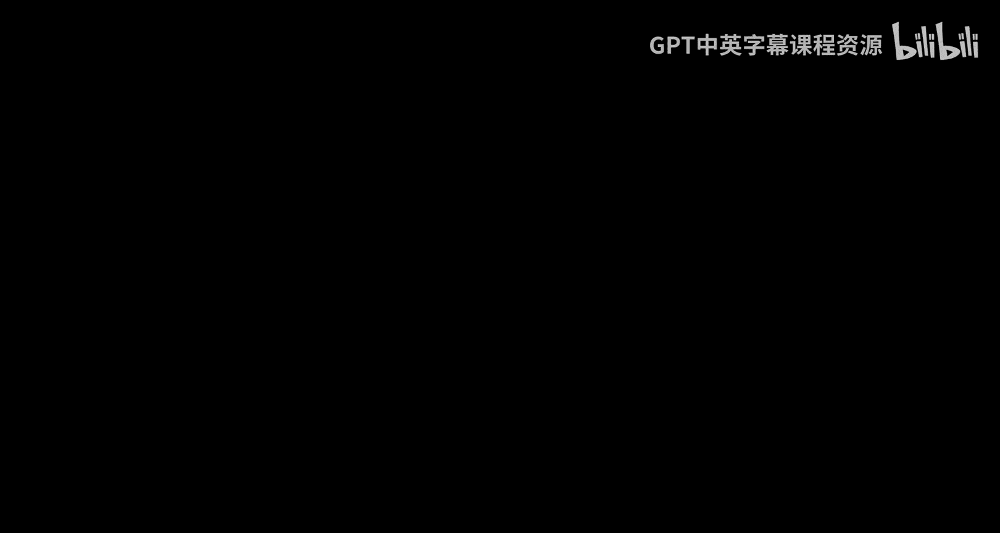

🎼Yeah。Hello， everyone。Welcome to the introductory lecture in this series。

 which is titledBuild a La Laage Model from scratch。My name is Dr。 Raj Danecker。

 I graduated from IIT Mads with a BT in mechanical engineering in 2070。After that。

 I did my PhD from the Massachusetts Institute of Technology MIT。

I graduated from MIT with a PhD in machine learning in 2022 since then I've come back to India and we are all on a mission。

To basically make AI accessible to everyone。At Vijara， which is our YouTube channel。

 we have made several playlists now on machine learning， on deep learning。

 and the main approach or the philosophy， which we really follow when we teach is to teach everything from the basics not to assume anything。

 teach you the nuts and bolts of every single concept。

The real reason behind this series is that as we all know。

 large language models and generative air are transforming everything around us。

Startups are forming in this space， companies are switching to large language models for various tasks。

 the jobs in this field are rising a lot。But many people。

 when they are learning about this field are making one common mistake。

They directly switch to the applications， they directly run some Google Collab notebook。

 they follow some YouTube video and directly run a code。But very few people really understand。

How large language models actually work？Very few people actually know the nuts and the bowls。

 which make large language models really so powerful。

Wouldn't it be amazing if you can build a large language model？Completely from scratch。

Wouldn't that make you feel very confident about this subject？

Very few people have this knowledge right now， and I'm making this YouTube playlist。

 which will be a very comprehensive playlist showing you everything about building an LLM from scratch。

The way I'm making this playlist or the way I will make videos in this playlist is to teach you everything from the basics as a beginner without assuming anything and at the end of this playlist you will have built an LLM from scratch successfully all by yourself。

You will see that after this point， everything which comes later， all the application parts。

 everything will just start seeming extremely easy to you。

So that's the whole philosophy behind making this lecture series it takes a huge amount of effort on our part to make this series because as you will see and I'll show you in some time to make every lecture we are going to make detailed lecture notes I'll share those lecture notes with you and all the videos in this series will be available completely for free。

Okay， so now I'm going to tell you a bit about my story of learning LLMs。

Then I am going to tell you a bit about what exists right now the material which is already available on the internet for learning Ls。

 why it is so inadequate， why it is so insufficient and what we are trying to do new with this playlist so lets get into the video so let me take you back in time of it to show you how large language models looked like in maybe 1960s。

Or where the field of natural language processing was really about 50 to 60 years back。

 so this is one of the first chatbots which humans developed it's called as Eliza it was supposed to be a therapist。

And let's see how it works。 So first this interface asks me to choose my language。

 so I'm choosing English。来自过问。こい。So then Eliza tells me how do you do please tell me your problem。

 so then let me type。I'm trying to learn。About。Large language models。But， I am finding。Its difficult。

Could you provide。Some sources。For me to start with。Then Eliza asks。

 is it because you are trying to learn about large language models that you came to me then I say yes？

And then Eliza says， you seem to be quite positive。And then Eliza says， you are sure， you see。

 this conversation is proceeding nowhere。This was the state of large language models to6 years 50 to 60 years back。

It's not a very good right fast forward to Cha GT and you ask。

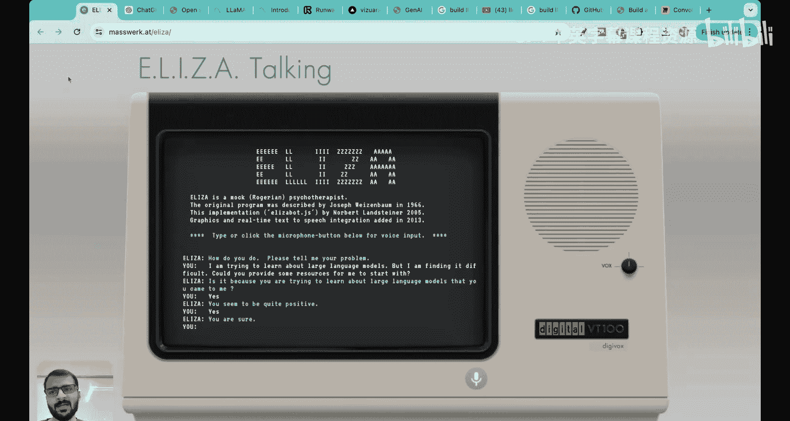

What are large language models？Or let me ask the same thing which I asked over here。

I am trying to learn about。Large language models。Tell me some resources。

And then you will see the response by Ch GPT， it's extremely useful。

 it's to the point and it gives me books， it gives me online courses， it gives me research papers。

 this is exactly what I need so you see this simple illustration shows that we are living in an age where we should be very lucky that the research on natural language processing and large language models is at such a stage。

Where。LLMs such as GPT are very powerful， they are very sophisticated。

If youre not familiar with chat GPT， that's fine， we are going to be building our own GPT in this playlist。

 so you learn about it along the way。But I showed you this demonstration for you to appreciate the times we are living in right now。

 LLmMS have become really powerful。And that's the first motivation to really learn about them。

There are several more things which are happening as I'm making this video。

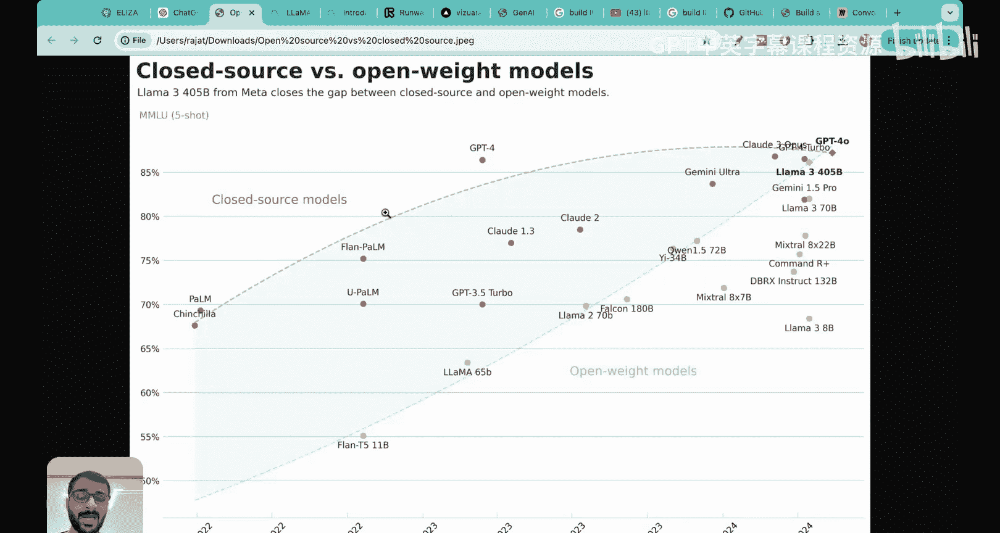

Facebook released their Lama 3。1， which is one of their most capable large language models of Gi date。

And this is an open source model， which means that the entire architecture of the model is available for free。

Or rather it's available to the public， anyone can see the architecture。

 the models released by open AI are usually closed source。

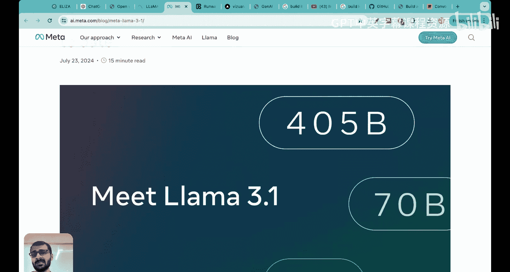

Which means they don't release the weights， the architecture。

 not too many things are known about the model itself。

So here is a graph which shows closed source versus open source models in 2022 when the field of large language models was booming。

 most of the things were pretty closed source when GPT4 was released in 2023， it blew the world away。

 everyone was surprised， everyone was happy to see the functionality but still it was a closed source model。

Now in 2024， can you see the gap between the open source and closed source model is slowly decreasing and when Lama 3。

1 is released you can see that it performs at the same level as GPT4 which is closed source。

This is to say that all the information which you need is available right now as open source models。

 you should just be willing to learn。If you are not sure what's open source， closed source models。

 what's this Lama 3，40，5 B， I'll explain to you about all of these things as we proceed with the lectures。

Now text is one thing right there are many other things which generative AI as a field is capable of there is also a lot of confusion with many people regarding what is generative AI what are LLMs really but generative AI is a broader subset and it includes language it includes video audio 3D models all the things so have a look at some of these videos。

Don't these videos look incredibly realistic this video than this video， the waves video。

 this particular video， you will be surprised to know that all of these videos are made by artificial intelligence。

These videos are not shot on camera。 They are made by AI。

This is the power of a generative AI currently。Finally， when we work with schools。

 we have developed our own AI application， so this is Vi UR's AI application。Or application on LLms。

Here you can see that there are a huge number of functionalities， for example。

 you can click on MCQ generator。And you can just type in the topic， let's say gravity。

And you can click on generate。Now you will see that within a matter of seconds。

 the large language model which is powering this application。

 will generate a set of multiple choice efficiency right here。

We are providing this application to teachers all of this was impossible to even imagine just four to five years back but now large language models and generative AI are changing every single thing around us in fact what is probably more relevant to all of you watching this video is the global generative AI job market and just look at this growth it' is incredible。

Of。And this is the projected job market it' is expected to grow about five to six times in the next five years。

Generrative air large language models is an extremely useful skill and the need for this skill is only going to increase in the future。

So this again brings me to the question that if someone wants to learn about large language models。

How do they go about doing this？

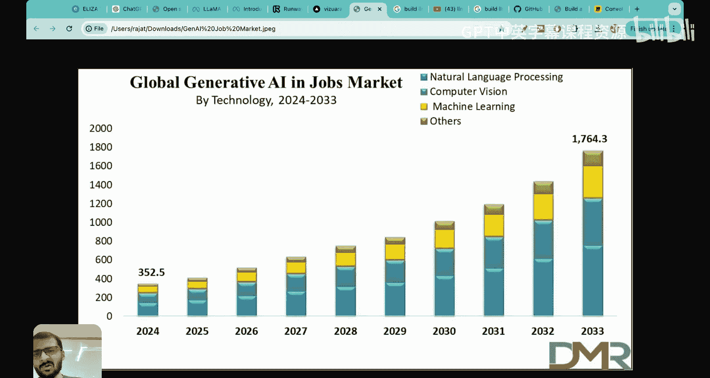

So let's say you go to Google and you search build LLMs learn we say which means you want to learn about large language models。

 there are a number of courses which show up really over here now if you go to many of these courses you will see let's say build LLM map it's about app development it does not teach you how to build a large language model from scratch。

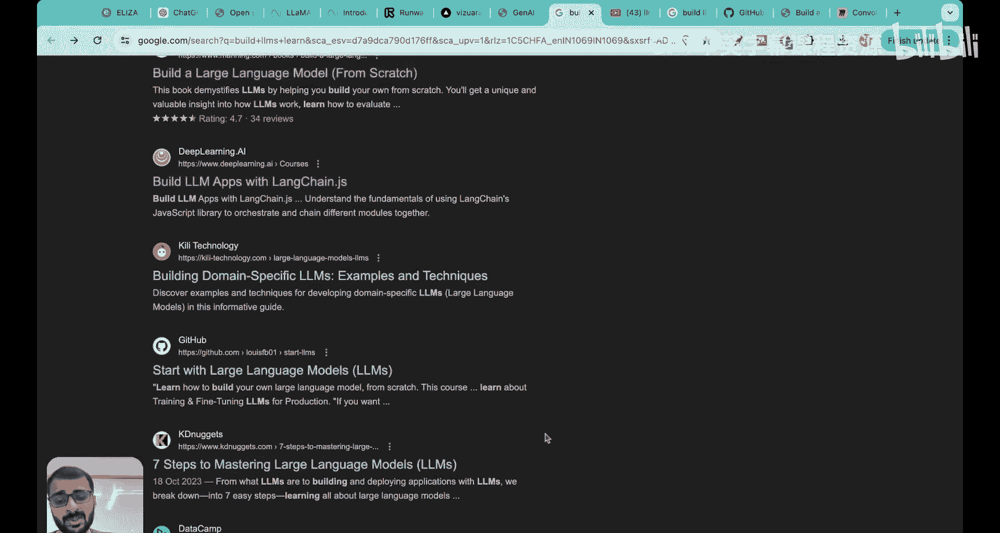

Here is another course master large language model concepts if you look at this course description right。

 they don't teach you how to build an LLM from scratch at all。

 they don't teach you the nurse and bowls it's a pretty quick course。

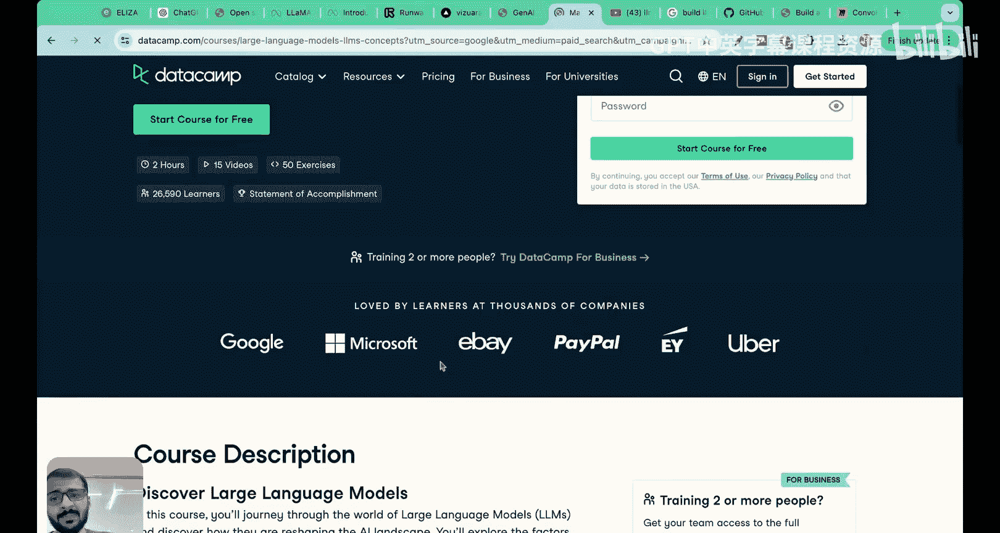

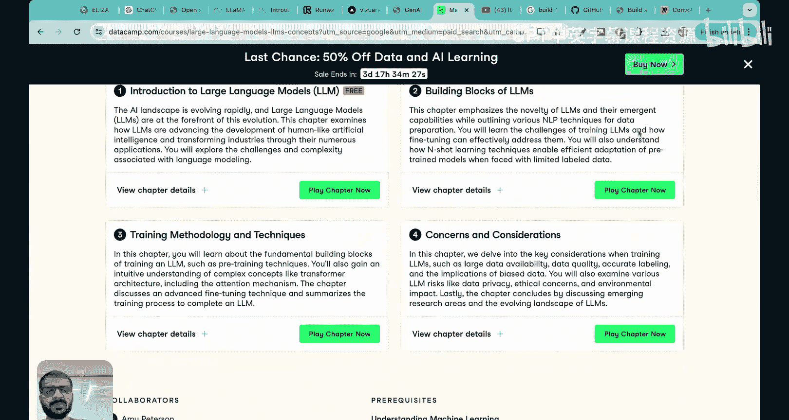

This is also not what I'm looking for what Im looking for is one course which teaches me the foundations in a lot of detail and in a lot of depth I want to know about the foundations because I want to build an LLM from scratch so that my skill set is improved and so that I feel confident about giving generative A and even LLM job interviews this is what I'm looking for really I don't total quick crash course I want something in depth。

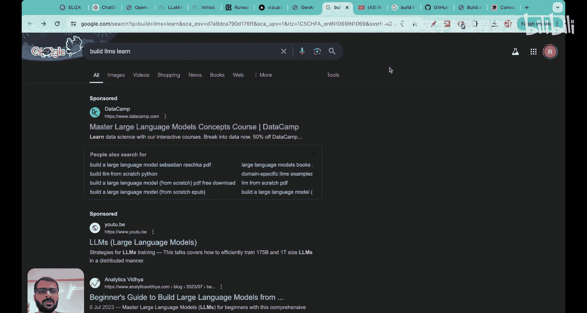

Then I go to YouTube and search about LLM from scratch this is the first video which shows up or rather it's the first playlist you'll see that there are 18 chapters in this playlist but each of these chapters is again only 10 15 minutes。

And again， I'm a bit demotivated seeing this because I'm not looking for this either。

 I'm looking for a massive deep technical course which teaches me how to build an LLM right from the very basics。

There is Andre Kpath is building a GP course， but if you look at this course it's actually quite complex。

 it's not an easy course at all。 He starts right in the middle of。

A concept and it is not meant for beginners and in just 90 minutes again this is not what I'm looking for here is another creator large language models from scratch but you see the red barrier I tried taking this course and I finished three hours of this but again this is not explained well it is not explained from scratch。

I want to make a course which people understand right from the very basics and none of the courses on YouTube on Google are satisfying that need。

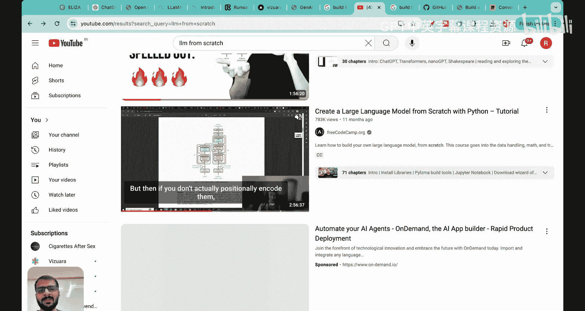

Lili， very Laili I came across this book by an author called Sebastian Raashka。

 I think it's one of the best books on large language models。

 I purchased this book and this is going to serve as the reference material for our course。

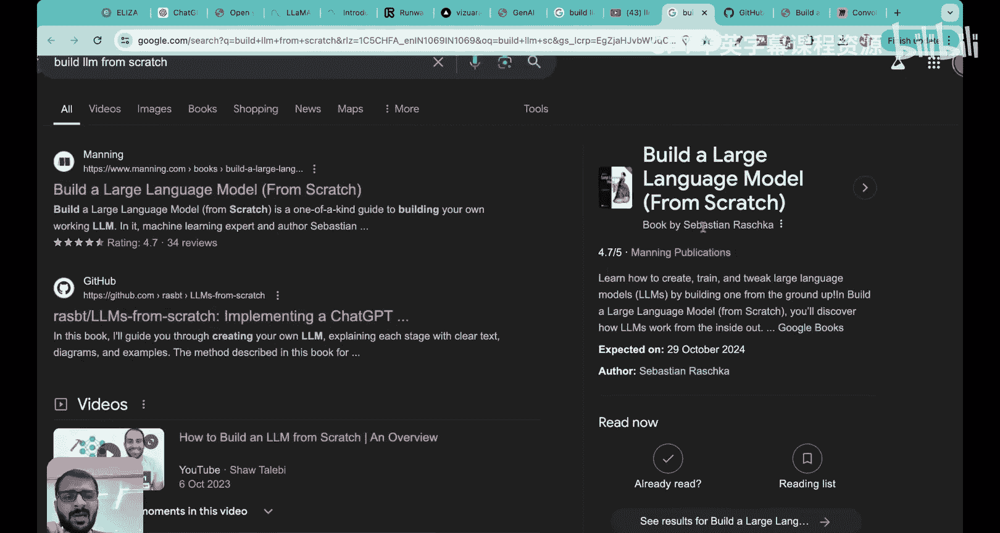

What Im going to do is that this is the 408 page book I'm going to convert every single aspect of this book into a set of videos I'll probably have 35 40 or maybe 50 videos in this playlist。

Similar to my playlist for machine learning and deep learning and whatever is given here right。

 I'll convert it into。I'll convert it into video format so for example here are some of the notes which I've already started to make we'll start covering this when we move to the next lecture look at these notes what I've done over here is that I have built my understanding from this book over here and to transfer my understanding to all of you I have started writing on a whiteboard every single thing in detail。

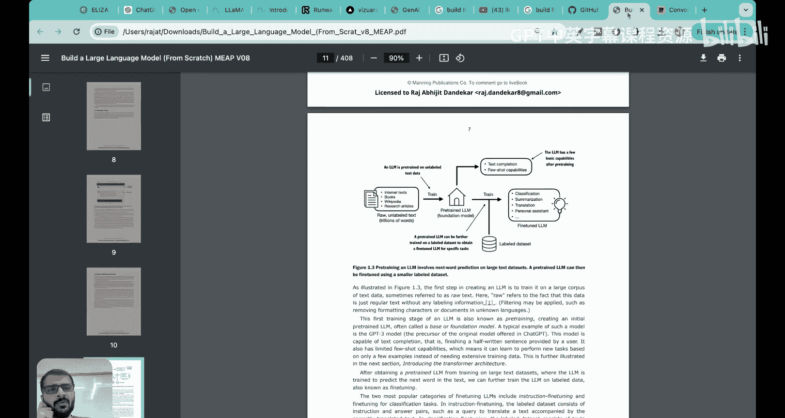

Look at this and I'm trying to make it as interesting as possible and as fundamental as possible。

 so this is going to be the next lecture intro to LLMs so Ive finished making the notes for this and I've finished making the notes for the lecture after that as well stages of building an LLM。

So basically Im making I'm in the process of making all these notes。

 but I'm making the videos simultaneously so that I am also motivated and I am also on track Eventually this will be a massive lecture notes of maybe 200 to 300 pages。

And。There will be 50 to 60 videos based on this you'll learn everything right from the very basics。

 nothing will be assumed， everything will be spelled out and these set of videos will be perfect for serious people who want to transition to large language models really and want to understand LLMs the right way。

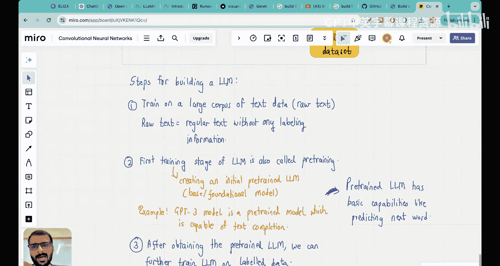

Okay so this is the main idea for the course another thing which I want to say is that you might have heard of applications like language chain this is a tool which helps you build LLM apps but again it's not useful if you don't know how to build an LLM yourself many students directly start deploying apps as I mentioned before but I personally don't think that's the right way to learn about LLMs you need to know how to build an entire large language model from scratch and will teach you that in this playlist。

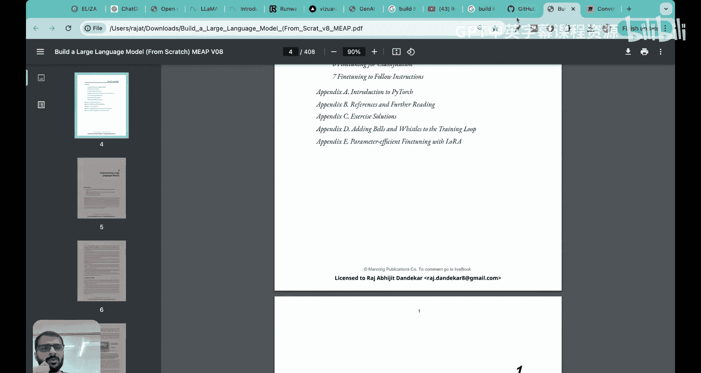

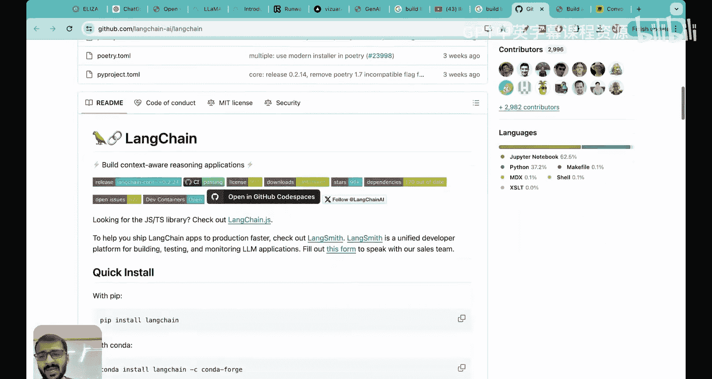

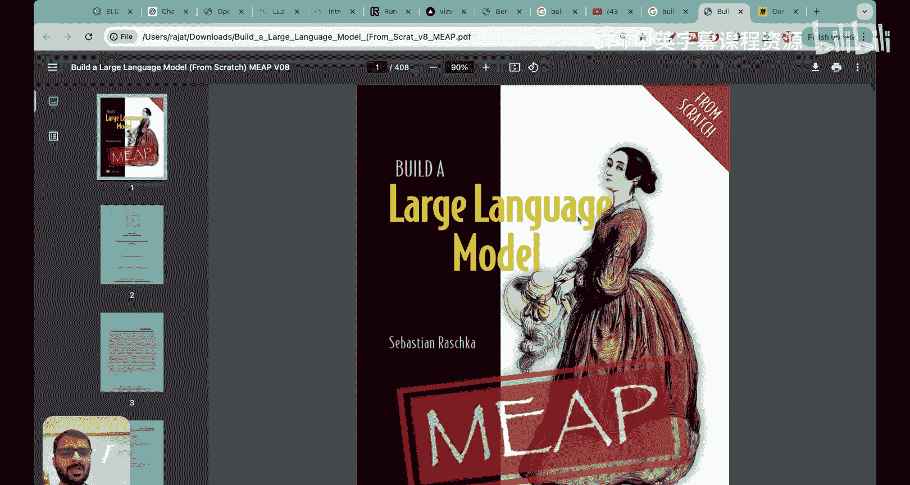

Finally， the goal is to equip all of you so that you feel confident in front of an interviewer right？

If you have just deployed applications by cloning some GiHub repository。

 then if someone asks you a detailed question about key query and values， let's say。

 or positional embedding or positional encoding， you need to be in a position to say that I have built this from scratch so I know the details better than anyone else。

That's really going to position you in a different boat than all the other people。

So this is the main objective of this course， this is going to be the outline of this course we are going to follow all the top table of contents which have been mentioned over here and I'm going to convert those into video lecture formats and it's going to be an awesome series it's going to be a detailed series。

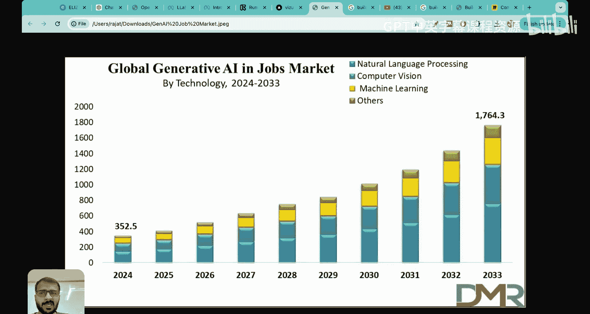

So if this seems of interest to you， please mention in the comments so that I also feel motivated to build subsequent videos and as I mentioned the plan is to release everything all of this content completely for free so that you all can benefit from it。

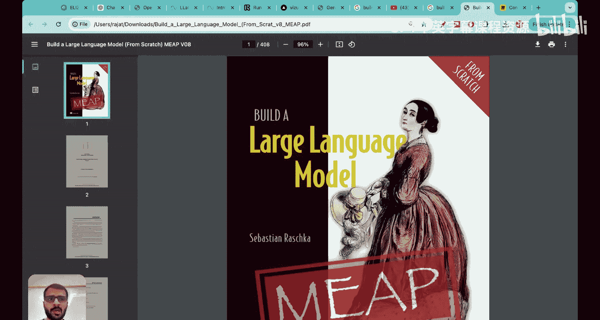

Okay， thank you so much everyone， and I look forward to seeing you in the next lecture where we will cover introduction to large language models and we will cover all these things what you are seeing in the whiteboard right now。

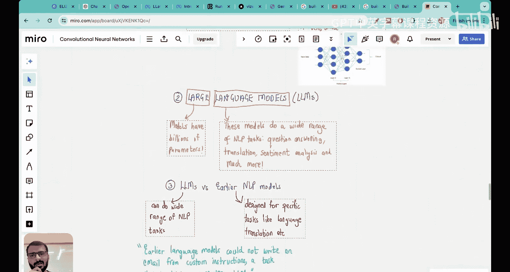

Thanks everyone， see you in the next picture。

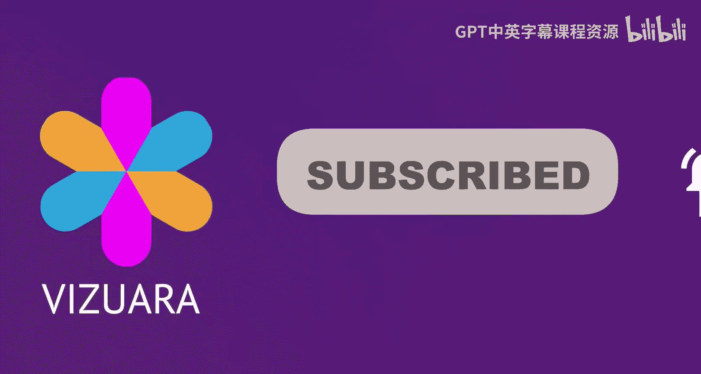

。