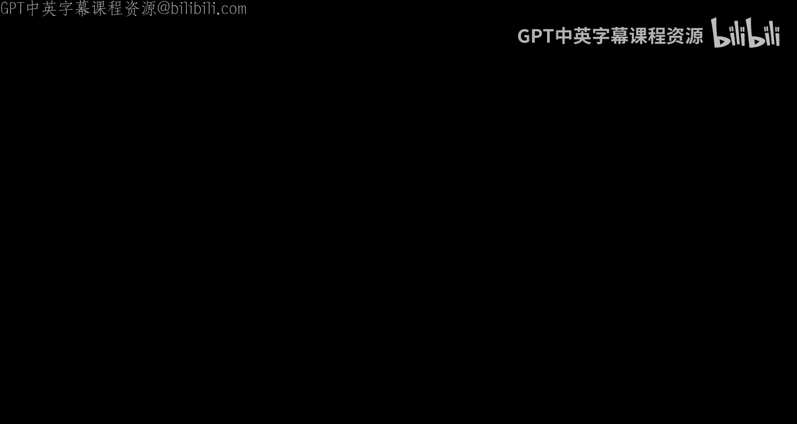
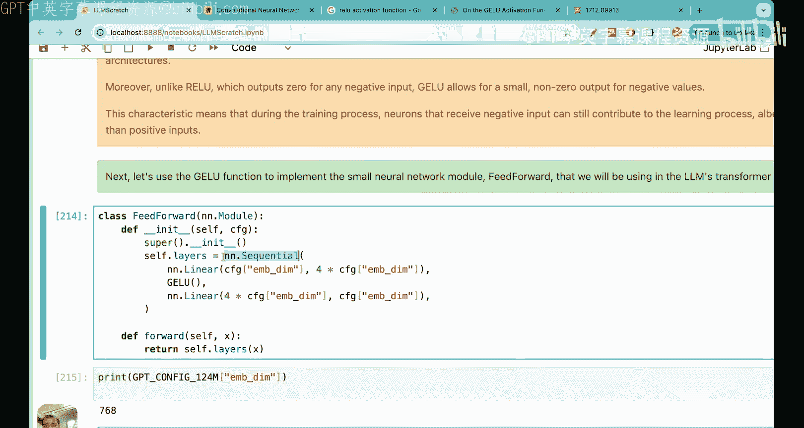
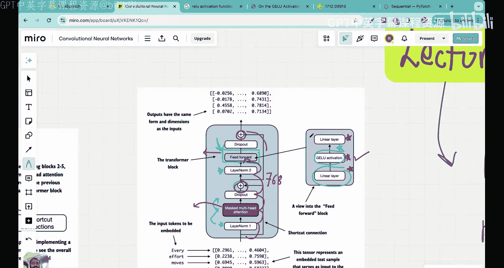

# Vizuara《从零开始搭建大语言模型｜Building LLMs from scratch》中英字幕（Claude-3.7-s） - P20：-21-GELU Activation Function in the LLM Architecture.zh_en - GPT中英字幕课程资源 - BV1qG8HzUE2D

🎼Yeah。Hello everyone， and welcome to this lecture in theBuild Lage languagegu Model from Sctch series。

In these set of lectures， we have been learning about the LLM architecture in a lot of detail。

If you want to learn about the LLL architecture， it is very important that you understand all of these building blocks from bottom through top in the previous lecture we covered about the GPT backbone which is essentially a dummy code。

With the bird's eye view where you see all the different components together without coding any of them and since the last lecture we have started looking at each individual component and coding them out in Python in the previous lecture we looked at this building block called layer normalization and today's lecture is going to be completely focused on the second building block。

Wwhich is the Jlu activation function along with this feed forward neural network so today actually we are going to cover two of these blocks which have been shown over here the Jlu activation and the feed forward neural network in the next lecture we also be looking at shortcut connections and then all of these building blocks will come together to form the transformer block which is the beating heart of the GPT architecture。

So let's continue along our journey and make incremental progress towards understanding the transformer block as I mentioned the goal。

 the objective of today's lecture。Is to understand the Jlu activation along with the field forward neural network So let us get started with today's lecture to give you an overview of what the transformer block actually looks like Here is the architecture of the transformer block zooming into this transformer。

So the transformer block consists of many layers which are stacked together。

 and that's why we have to learn about each of these layers separately。

The first is the layer normalization layer。The input then is normalized and it's passed to the multiha attention。

 we have a dropout layer after that this plus sign indicates that there is a shortcut connection then we have another layer normalization layer we learn about layer normalization in the previous lecture the output of this second layer normalization passes into a feed forward neural network which is what we are going to learn about in today's lecture and when you put a microscope to this feed forward neural network and try to really understand what it consists of you will see that it consists of linear layers which are common in any neural network but it consists of this Jlu or Galu activation。

Which is。You might be hearing about this for the first time。

 even if you have used deep learning frameworks， people generally use relu， Tage， sigmoid， etc。

 but this Jlu activation or Galu activation is new to most of the people。

Everything else in this field for our neural network is same as traditional neural networks。

 but this Jlu activation is something which is a bit different。

So well be covering this part also in a lot of detail so I just wanted to show you this so that you you have some context about what why we are learning this lecture and after you understand the feed for our neural network and Galu after today's lecture you will be able to essentially understand most of these components over except for the shortcut connection which well look at in the next lecture。

Okay， so let's begin。So the goal of this lecture is to implement a small neural network submodule that is part of the LLM transformer block and when I say neural network sub moduleule I am especially referring to this field forward block which has been mentioned here this this field forward block I am referring to this block we want to write a code to。

好。To integrate this block， this feed forward neural network block。

Okay so now let us first learn about the Galu or the Jlu activation function I'm going to call it Jlu for the rest of this lecture。

 but the way you call it does not really matter as long as you understand what the function is what does it represent and why don't we use the common activation functions like graylu。

So two activation functions which are very commonly implemented in large language models are the J loop and the Swig loop。

In today's lecture， we are going to specifically look at the Glu。

So before we look at that first let' us understand about the rail activation function this is how the rail activation function actually looks like for x which is greater than 0 the rail activation function returns the same value as the input but if x is less than0 the raillu activation function returns0 so if you plot the rail activation function as a function of x you will see that the curve looks something like this its flat for negative values of x and then it is linear。

Already you can start seeing some problems with this right it is not differentiable at x equal to0 there is a sharp jump over here and for all the values of x less than 0 this is equal to 0 so if you integrate this in neural networks it often leads to a dead neuron problem which means that if the output from one layer is negative and if a low activation function is applied to it the output becomes 0 and then it stays zero because。

Because we cannot do any learning after that。So the neurons which are associated with that particular output they don't contribute anything to the learning process once the output of the neuron becomes negative and that's called as the dead neuron problem so learning essentially stagnateates of course Relu has a huge number of other advantages thislineity which is introduced over here makes neural networks expressive it gives the power to neural networks but the reason we are we are looking at the disadvantages of Relu is that understanding the disadvantages of Relu will open an opportunity for us to learn about the Jlu activation function and why it is used in large language models。

So， first let us start understanding about the mathematical representation of the Jlu activation function so mathematically the Jlu activation function is the product of x which is essentially just the identity variable so Jlu of x equal to x into this phi of x。

And essentially phi of x is the cumulative distribution function of the standard Gaussian distribution。

So I just have this opened over here， so a standard Gaussian cumulative distribution function looks like this as a function of x。

 so the galu is a product of x multiplied by this。And then， if you actually。

Try to understand what is happening so let us look at this phi of x for x greater than0 so if x is very high you see that it is almost equal to 1 so which means that for positive values of x we are slowly tending to1 which means that the for very positive values of x the gallu of x will tend to x into 1 which is x so for very high values of x this will almost tend to the linear function which is quite similar to the positive branch of rhlu but what happens to the negative values of this is pretty interesting the negative values here you can see that they are not equal to0。

So， x will be multiplied with these negative values and that is why for negative values of x gallu will not be0 like it is in the re activation function。

So now what we can do is that instead of using this complicated cumulative distribution function。

 what people generally do is that they use。An approximation for the Jlu activation and the approximation which was actually used for training Gp2 looks something like this。

 So here you can see that galu of x is equal to 05 multiplied by x multiplied by 1 plus 10 h square root of 2 by by into x plus this cu viter no need to worry about this term。

 but just know that instead of worrying about this p of x which is the cumulative distribution function and。

There is also Gaussian involved and it is a bit difficult to compute phi of x it' is better to use numerical approximation approximations right so when GPT2 was trained the Jlu function which they actually used was was this approximation approximation which is very close to the actual Jlu function right now if you want to compare this with the raillu function here I have shown the plots of the Jlu activation function along with the raillu activation function I want you to pause the video for a while here and try to look at the similarities and differences between these two。

Okay so the first thing which should immediately be clear to all of you is there are a lot of differences for negative values of x so for x less than 0 you can see that the gallu activation function is not really0。

 so if you zoom into this further you will see that for most of the values of x it is not 0 it tends to0 but it is not 0 whereas the rhlu activation function for x less than 0 is 0 throughout。

Also， if you look at the positive values of x， you will see that this is kind of not exactly linear here for short values of x。

 but for large values of x， it is fully linear。which is exactly what is happening for the re activation function。

 so although this positive side of the Jelu looks like y equal to x it is not exactly y equal to x there are some minor differences。

But you can say that for x greater than 0 it is almost similar to the raylu for x greater than 0。

 but for x less than 0 there are big differences which start to emerge which actually make Jlu much better than the raylu。

So what are the advantages of the Jlu over the raylu activation function Well the first advantage which you immediately see from this graph over here is you can see that Jlu activation is smooth throughout right here there is a discontinuity in the raylu there is a discontinuity at x equal to0 which makes it not differentiable Jlu activation on the other end is smooth throughout so it is differentiable across all x that's the first advantage the second advantage is that it' not zero for negative x so that solves the dead neuron problem even if the output of a neuron after is negative even if it goes through Jlu it will not become zero so the neuron won't become dead it will still keep on contributing to the learning process that's the second reason so first reason is differentiability second reason is it prevents the dead neuron problem and third reason is that it just seems to work better than raillu when we do experiments with LLms。

So， as always activation functions are hyperparameters right so we need to test out multiple activation functions to see which one performs better and we have generally seen that Jlu performs much better in the context of large language models compared to raillu。

So now what I want to do is that first I want to go to code and I want to write a class for the Jlu activation function。

 write create a class for the Jlu which implements the forward world pass。

 which is that it essentially implements the。This function， which I showed over here。

 So if you look at this function。Whenever JO receives an input X。

 it transforms it into this through this function and then if you get this output as shown in this JO activation function。

So what Im doing here is that I' am creating a class called Jlu and what Im doing here is that I' am defining a forward method which takes in an input x and it returns this value it returns 0。

5 into x into 1 plus 10 h square root of to by pi into x plus 0。

0 44 into x is to 3 this is exactly what has been written over here in this black box over here the reason we are using this is because the same activation function was used for training GPT2。

And remember， when we are constructing the LLL architecture here we are mimicking the parameters used in the smallest model of GPT 2。

So now we have created a class for the Jlu activation awesome so here Ive written a simple plot function we just plots the Jlu and the raillu activation function and it compares them side by side we already looked at these two plots on the whiteboard and we saw the similarities and differences between them so here I have just summed up the points because of which the Jlu activation function is used in LLMs so as we saw the smoothness of the Jlu can lead to better optimization properties during training as it allows for more nuanced adjustments to the model parameters so its fully differentiable raillu has a sharp corner at zero which can sometimes make optimization harder especially networks that are very deep。

Especially in networks that are very deep or have complex architectures。Unlike Relu。

 which outputs  zero for any negative input， Jlu allows for small non zero output values。

 so it prevents the dead neuron problem。So， this means that during the training process neurons that receive negative input can still contribute to the learning process in raillu neurons which receive negative input just get an output of0 so they become dead。

 they don't contribute to the learning process this problem is avoided in the raillu。

In Jluory Jlu avoids this dead neuraln problem and that's why it's used in the case of large language models。

 Now what we are going to see next is that okay， now that we understand about the Jlu activation function。

 we are going to actually look at the architecture of this feed forward neural network So you see when you zoom into the neural network you will see that there is a linear layer here there is a Jlu activation here and there is another linear layer here So up till now we understood about the Jlu activation right。

 but now I want to tell you a bit about what the linear layer actually looks like。

So let let's go to that part of the whiteboard and let me show you how the linear layer looks like okay。

So this is how the feed forward neural network actually looks like don't worry if it looks a bit complicated it is actually quite simple so let's say we receive a token so let's say the feed forward neural network receives a token and the number of the dimensions of the token is equal to the embedding dimension and for GPT2 the smallest size that is equal to 768 so let's say this is the embedding dimension of the token which means that every token is projected into 768 dimensional space。

So as this token passes through the different layers of the transformer block。

 which we saw over here。The good thing about this transformer block is that the dimensionality of the token is preserved so even if we pass from year to year to year to year and finally we go to the input of the feed for the dimensionality of the token remains 768 throughout this entire procedure and thats sort of the big advantages of the way the transformer block is constructed。

So keep this embedding dimension in mind as you try to understand the neural network architecture。

 right？So here we can see that these are the inputs to the neural network。

 it's a 768 dimensional input vector and this is the first linear layer over here。

All of these weights which you can see connected to the neurons and then here you can see here is the second linear layer。

 so you might be thinking what is the number of neurons which is used。

So the number of neurons whiches used over here is four times。The number of inputs here。

 So the number of neurons here will be 4 multiplied by。

So let me write this so the number of neurons here will be4 multiplied by 768 so this will be close to 33200 neurons over here so in the first layer what happens is that the inputs are projected into a larger dimensional space just so that we make the neural network more expressive and capture the properties between the inputs and in the second layer the inputs are compressed back to the original embedding size so the output which is received from this neural network has the same dimensions as the input it matches the original input dimensions so the output dimensions will also be equal to 768。

So the dimensionality of the input is preserved through this neural network as well。

 the expansion so you can think of this neural network as an expansion contraction neural network。

And remember that expansion contraction neural networks are very powerful because they preserve the size of the input but at the same time they allow to explore they allow for a richer exploration space so what happens is that when we expand this when we in the first linear layer we do an expansion right projecting into a dimension which is four times larger we can capture more properties between the inputs and that's what essentially makes transformers so powerful due to layers like these if this layer was not there probably we would have missed out the capturing the meaning between some sentences when we predict the next word。

So that's why this layer is very important。 So you can think of the neural network， essentially as。

Taking one token and then modifying each dimension of this token place by place because the input is 768 dimension the output is also 768 dimension and we are looking at one token at a time so this is very different than the attention mechanism right in the attention mechanism we look at one token and we look at the relationship of that token with other tokens in the neural network that's not in this speed forward neural network we don't consider other tokens at all we just look at one token and then we pass the input。

And then each dimension of the input is modified， and then we get the output。So。

 that is the difference between the feed for our neural network and essentially this multi attention module。

Which we saw， let me yeah， so let me zoom in here。Yeah that is the difference between the feed forward module。

 this feed forward module， it only focuses on the specific token and the multiered attention which we saw earlier and because that looks at the relationship of one token with other tokens as well。

Awesome， now what we can actually do is that let us go to Python code and implement the speed for our neural network。

With the expansion and contraction， it's again shown over here what we are going to consider in Python so what we are going to do is that we are going to look at an input which essentially has three tokens and each token。

Has the size of 768。And that too we are going to look at two such batches， so in batch number one。

 we have three tokens。In batch number two， we have three tokens and each token will have a size of 768。

 Now remember what happens in the first linear layer just look at one token at once。

The 768 is projected into 3072 dimensional space， then we have the Jlu activation function after this linear layer so after this first layer there is a Jlu activation function which we learned about earlier。

Remember the JO activation preserves the dimension so the input to the Jlu is 3072 dimension the output is 3072 now the final layer compresses so the input dimension to the final layer is 3072 and the output dimension is 768 so if you see the output tensor dimension it is exactly the same as the input tensor。

Two batches， three tokens in each batch and 768 the embedding dimension of each token。

So I hope you have understood the visual nature of the neural network which you are about to construct because if that is the case。

 you will really understand what's going on in the code very deeply。So。

 we are going to construct this class which is called as feed for all and when an instance of this class is created this unit constructor is called by default and what it does is that it creates this self dot layers which is basically NN dot sequential so if you are not aware of N dot sequential you can。

It's a pietor module basically for constructing or chaining。A neural network together。

So essentially you can define multiple layers and create a neural network by adding these different layers together that's why it's called sequential So here what we are doing is that first if you see we have a GPT configuration and let me actually pull that configuration here once more so that you are aware of the configuration which we are using yeah so this is the GPT configuration which we are using and I'm going to paste it over here so that it is a reference。

Okay， so yeah， so here I'm going to paste the GPT architect the GPT configuration which we are using Now lets look at how the sequential layer is constructed first we have a linear layer which we saw on the whiteboard and the input dimension of this linear layer is the number of embedding dimension which is 768 for GP and the output of this linear layer dimensions are4 into 768 because see the first layer is the projection layer so it takes in an input of the embedding dimension and it outputs4 into 768 then we have a Jlu activation function and then we have the second layer the input to the second layer is 4 into 768 and the output of the second layer is 768。

So the CFfG embedding dimension is that this we are taking this configuration and we are looking at the embedding dimension。

 which is 768。And if you print this out if you print GPT config 124 million embedding dimension you will see that it's 768 right so this is the feed forward neural network which is constructed it has expansion so you can think of this as expansion let me write a comment here actually this is expansion。

Then this is the activation。The Jlu tuition， and then finally we have the contraction。

So it is a three step process expansion activation contraction and this speed forward neural network is constructed like this right and then we have the forwarder method which just returns the output。

From this layer， so it will do the expansion， it will do the Jlu。

 it will do the contraction and it will return the output。

And remember that the output has the same dimensional size as the input， right？

So Ive just written some text over here as we can see in the preceding code。

 the field for our module is a small neural network consisting of two linear layers and a Jlu activation function right in the 124 million parameter GPT2 model GPT model it receives the input batches with tokens that have an embedding size of 768 as we saw earlier。

Now we can actually， now we have everything in shape。 Now we can actually。

Create an instance of this field forward class and remember we have to pass in the configuration which we have earlier constructed so that it can extract the embedding dimension right so we create an instance of this field forward class and pass in the GPT configuration which we are using one more thing to mention is that this Jlu is basically the Jlu class which we had defined earlier at the start of this lecture。

So， that is available to the feed forward feed forward class okay so now I will define an input x so as we saw on the whiteboard x will have two batches each batch will have three tokens and the embedding dimension of each token is going to be 768。

That is the input。 Now， when I。I create an instance of the feed forward class FF and then pass the input to this instance so what will happen when the input goes through this instance it will。

And，This in constructor will be called so self dot layers will be defined and a neural network will be constructed with this architecture and then the forward method will be called when the forward method will be called first the expansion will be applied on the input then the activation will be applied and then the contraction will be applied and all along the size of the input will be preserved so then the output will have the same size as the input and you can print out the output shape which is 2 by 3 by 768 again it's the same size as the input as we are seen on the whiteboard。

So， the feed forward module which we implemented this in this lecture plays a crucial role in enhancing the model's ability to learn from and generalize the data。

Why can I do that because although the input and the output dimensions are same。

 it internally expands the embedding dimension into a higher dimensional space through the first linear layer。

 this expansion is followed by a nonlinear Jlu activation and then a contraction block back to the original dimension with the second linear transformation。

So such an expansion contraction design allows for the exploration of a rich representation space and thus it enhances the model's ability to learn from and generalize the data always remember that when you learn about these neural network architectures first ask the question why is it even there。

 what if I remove this？You will see that if you remove it the model's ability to learn from data is hamper significantly and remember that in GPT2 we have 12 transformer blocks and each transformer block will have a feed for our neural network like this so we will have 12 neural network like this so 12 expansion contraction blocks now imagine the exploration power which our model has。

Okay， the second thing which I really want to highlight here。

 which I also highlighted at the start is that there is a uniformity in the input and the output dimensions when we look at the GPT2 architecture。

 this simplifies the architecture by enabling the stacking of multiple layers。

And this makes the model much more scalable。So。Let me explain this once more。

Yeah when we looked at this transformer block at every single layer as I mentioned at every single layer normalization multihead dropout fade for neural letter the dimension is preserved throughout so that way we can stack multiple layers together because we don't have to worry about dimensional mismatch that's one of the biggest advantages of this transformer block it' is very flexible that way and we can stack multiple layers on top of each other and that makes the model much more scalable。

Okay， so this actually brings us to the end of this lecture where we covered about the Jlu activation function and the feed forward neural network to which the Jlu activation function is linked。

So now in this entire GPT architecture we have now covered four things we have covered the GPT backbone。

 we have covered layer normalization in the previous lecture and in today's lecture we covered the Jlu activation along with the feed forward neural network in the next lecture we are going to look at shortcut connections so shortcut connections are these basically this plus signs if you would have seen if you zoom into this transformer block there are these plus signs here right this plus this plus signs with an arrow。

This plus sign here with an arrow， these are shortcut connections and you might be wondering what they are。

 what they do we learn now all about that in the next lecture。

I hope you are understanding everyone from these lectures and please try to execute the code which I am sharing after every single lecture that way the conceptual understanding and the code understanding will also develop much further I am deliberately splitting these lectures into separate so that you understand and discover about each model of the GPT architecture on your own without confusing you too much thank you so much everyone and I look forward to seeing you in the next lecture。

。

