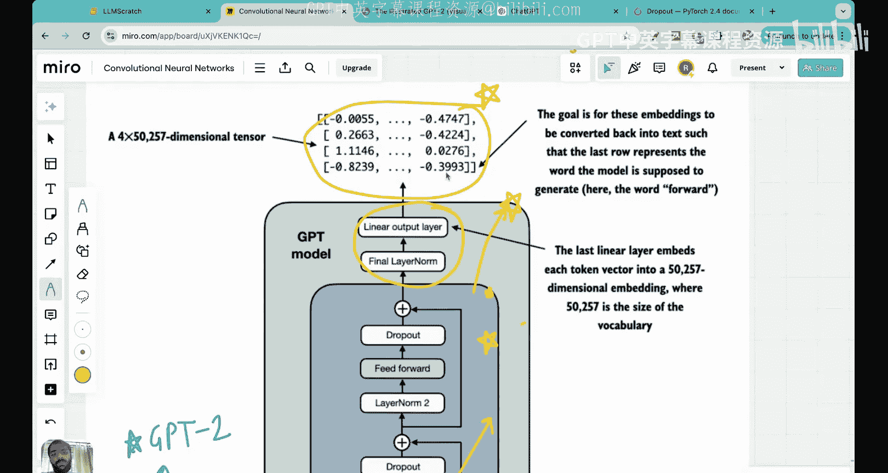

# Vizuara《从零开始搭建大语言模型｜Building LLMs from scratch》中英字幕（Claude-3.7-s） - P21：-23-Coding the entire LLM Transformer Block.zh_en - GPT中英字幕课程资源 - BV1qG8HzUE2D

🎼Yeah。Hello everyone， welcome to this lecture in theBuild Large language models from Sctch series。

Today， we are going to finally code out the entire transformer block。

For the previous three to four lectures， we have been laying the groundwork for this lecture。

Let me first recap what all we have covered in the previous three lectures。

When we started this series of GPT architecture， we first covered layer normalization and why we need layer normalization。

 we coded out a class for the layer normalization， then we looked at feed forward neural network with the Jlu activation。

And then we looked at shortcut connections why we need them。

 and we coded out all of these components together。Today is that lecture。

When all these four components， the layer normalization， Jlu activation。

 feed forward neural network and shortcut connections are all going to come together into what is called as the transformer block。

Transformers are the beating heart or the engine behind large language models。

 and today you are going to see how we code out the entire transformer block so lets get started with todays lecture。

First， I want to show you a bird's eye view of where the transformer block exactly fits in the whole LLM stack。

As we have seen in the previous lectures， first you get the input sentence that is tokenized。

Then that is converted into vector embeddings， we add positional embeddings on that。

Then a dropout layer is applied and then we finally enter the transformer block itself within the transformer block we Im showing the transformer block in blue color right now we have several layers we have a layer normalization followed by mask multi head attention followed by dropout then we have the shortcut connection over here then we have another layer normalization layer。

 a feed forward neural network with yellow activation。

 another layer of dropout and then a shortcut connection。When we move out of the transformer block。

 there are several steps。Which are called post processing output steps。

And then finally we get the output tensor and this tensor is used to predict the next world in the input sequence。

 so if the input sequence is every effort moves you and if the next word is forward when the output processing is completed the next world is predicted here。

Today we are going to code this blue structure， which I have shown over here。

 then that is the transformer block。So as I have discussed earlier。

 Transer block is the fundamental building block of GPT and other LLM architectures as well。

 so please pay careful attention to today's lecture。

One thing which I would like to mention here is that and which also I have shown here。

 so you must be looking at this2 here and must be thinking what is this2？So in the GPT2 architecture。

 the transformer block was actually repeated 12 times。

In this in this series of LLL architecture lectures。

 we are looking at GPPT2 the smallest version which has 124 million parameters in that version the transformer block is actually repeated 12 times。

So the code which we are going to see right now is actually replicated 12 times in the final GPPT architecture。

And as I told you， the transformer block has several components which we have looked at before。

 the layer normalization， let me just mark with a tick here， layer normalization。

 mask multi head attention， drop out the feed forward neural network and the shortcut connections。

So I have just mentioned here what are these five components the first is the mass multi head attention。

 the second is the layer normalization， third is the dropout。

 fourth is the feed forward neural network and fifth is the Jlu activation function。Now。

 what I'm going to do is before we jump into code， I am going to give you a quick recap。

Of these five subcomp so that your memory is refreshed about what all we have learned so far and so that your intuition is developed in a strong manner before we are going to move to the code。

First I want to start with multiha attention in case you have forgotten it we had a very comprehensive series of four lectures on the attention mechanism what happens in multi head attention is that we look at the input let's say the input input is labeled as the matrix x。

Then we multiply the input with trainable queries matrix。

 trainable keys matrix and the trainable values matrix and in the case of multiha attention we have multiple copies so we have multiple trainable queries matrix。

 multiple trainable keys metrics and multiple trainable values matrix。So。

 the inputs are multiplied by these weight matrices and then we get the queries matrix we get the keys matrix and we get the values matrix right and again in the case of multiha attention we get multiple copies of this so here I am seeing I am seeing I am showing two attention heads so there are two queries matrix there are two keys matrix and two values matrix what happens next is something very interesting。

We will take the dot product between the queries and the keys that gives us our attention scores。

 the attention scores are normalized to give us the attention weights which have been shown over here and then the attention weights are multiplied with the values。

Matrix and then we get a set of context vectors， the whole aim of multiha attention or any attention mechanism is to convert embedding vectors into context vectors What are context vectors the simplest way to think about them is that they are a richer representation than the embedding vector embedding vector consists of semantic meaning of a particular word right it contains no information about how that word relates to other words in a sentence context vector goes beyond embedding embedding。

It not only captures the semantic meaning of the particular world。

 but it also captures the relationship of how that world relates to the other tokens in the sentence or how that world attends to other tokens in the sentence。

 that is why it is called attention mechanism。And the whole goal of this multiard attention is to get context vectors so for every attention head there is a separate context vector matrix which is generated and ultimately you merge the context vector mates from different attention heads and you get this combined。

Context vector matrix。And then this is the context vector matrix， which is the output。

Of the multiha attention so whenever you see the multiha attention layer over here this mask multiha attention you have vector embeddings as inputs and then you have context。

You have context vectors which are the outputs coming from multied attention if you want to revise some of these concepts。

 please go to those lectures which we covered on the attention mechanism。

And then so the multiha attention was a part of our attention mechanism series。

 but if you look at the other four components， we have been covering this in the last three lectures itself。

So let us look at each of these components separately and quickly revise what they do these components also form part of the transformer block。

The first major component is layer normalization so this component does the function of normalizing the layer outputs。

 so lets say these are the outputs from any layer it can be a dropout layer it can be the multi head attention layer。

 let's say these are the outputs from any layer。Without normalization。

 they will let's say have some random mean and some random variant。

After applying layer normalization， the values of these outputs will be changed so that the mean will be0 and so that the variance will be well。

Why is this needed， Because it solves two issues for us First。

 it leads to a bit of a stability in the。During the back propagation it ensures that the values are not too large so that the gradient does not explode or the gradient does not vanish during back propagation the second is that it solves the problem of internal covariate shift which means that during the training process the inputs which are received to a certain layer may have different distributions for different iteration thats a big issue because that holds the training it becomes very difficult to update the weights and then the training takes a long time for convergence layer normalization solves this issue and if you look closely at the transformable block you'll see multiple places where layer normalization happens or is implemented it is implemented before。

The multi head attention and it is also implemented before the feed for our neural network。

 so it is actually implemented two times within the transformer block。Just as a note。

 the layer normalization is also actually implemented after the transformer block。

But we are not going to look at that right now。The second component I drop out。

Again a dropout layer can be applied after any layer and what dropout does is that it looks at the layer outputs and then it randomly turns off some of the outputs so if you see on the right hand side on the left hand side we are showing a neural network before dropout so these are the units。

Or the layer outputs of the preceding layer after passing through dropout some neurons here or some inputs are randomly turned off。

Why are they randomly turned off because it improves generalization during training some neurons get lazy。

They get so lazy that they don't update themselves at all， they depend on other neurons。

U and during testing， that's a big problem because these lazy neurons are not learning anything。

Once we implement dropout， a lazy neuron will see that the other neurons which are doing all the work they are not there in that iteration。

 so the lazy neuron has no choice but to learn and update its weights。

So that's the reason dropout helps generalization， it prevents overfitting。

Thats the second component。 The third component which we looked at is this feed forward neural network and that had the Jlu activation function。

 The construction of this feed forward neural network is pretty interesting。

 We preserve the dimension of the inputs。 So let's say the input to the neural network is like this。

 And when you think of an input always think of。A token with an embedding dimension。So in GPT 2。

 the embedding dimension was 768， so if you have a world， let's say the world is forward or step。

That word will be converted into an embedding of 768 dimension lets say that is the input which is passed to this neural network first we have a layer of expansion which means that there is a hidden layer of neurons。

And the number of neurons here is four times larger than the embedding dimension。

 so the number of neurons will be 4 times 768， so the first layer expands which means that we are going from 768 dimension to 4 into 768 dimension。

And then there is a second layer， which is the compression layer where we again come back to the exact same dimension which we started with。

So the input dimension of this neural network and the output dimension of this neural network is exactly the same。

Then you might be thinking why is this expansion and contraction done in this in the first place the expansion and contraction is done so that we can explore a richer space of parameters what this expansion does is that it takes the inputs into a much higher four times higher dimension space and there we can uncover much better relationships between parameters and it generally helps LLM learn better。

And why do we compress it back to the same output， same dimension because we want the input and the output dimensions to be saved？

That helps scalability that way you can stack multiple neural networks like these together without worrying about dimension changing。

Now， after this layer of neurons， every neuron has to have an activation function right。

 and that activation function which is used in this case is the Jlu activation function。

Generally everyone is familiar with Jelu， but Jlu is a slight variation；

 Jlu is not equal to 0 for x is less than 0。That is one change and the second change is that Jlu is differentiable at x equal to 0。

 it is fully smooth unlike rail loop， raillu is not differentiable at x equal to 0。

So for x greater than 0。Jlu generally approximates Relu， which means y equal to x。

 its not exactly equal to x， but it reaches that。So Jlu generally solves the dead neuron problem。

 which means that if the output of a neuron is negative and it passes through a Alu。

It will just be zero， but when it passes through Jlu， it won't be zero。

And that is when the neuron will continue learning in the relu what happens is that if the input to a neuron is if the output of a neuron is negative and if it passes through relu。

The output is0， and then it the neuron becomes dead。

 it cannot learn anything after that point and learning stagagonates that issue is solved by Jlu。

 and it generally turns out in experiments with LLms that the Jlu activation does much。

 much better than Jlu。So that's where the activation function。

 which is used after this layer of neurons， is the Jlu activation function。

And the last component which we looked at。When we looked at the transformer block components is shortcut connections。

 so what happens in shortcut connections is that the output of one layer。

 so here refuse you see the output of one layer is added with the output of the previous layer see here there is one more path which has been created。

Similarly， here you will see the output of this layer。

 the output of this layer is added with the output of the previous layer and then we create this path。

The reason shortcut connections are implemented is that it solves the vanishing gradient problem。

 So on the left hand side， if you see the gradients， the outermost layer has a gradient of 0。005。

 but as you back proppoate and you reach layer 4 layer 3 layer 2 and layer 1。

 you will see that the gradient has reduced to a very small value as you back proppoate to the first layer。

 this is the vanishing gradient problem。And then if the gradients become very small the luuring stops。

 and that is not good for training the LLM， whereas if we implement this shortcut connection。

 it gives another route for the gradient to flow it makes gradient flow much more stable。

And that' is why the vanishing gradient problem is solved So if you see layer5 gradient magnitude is 1。

32。And layer 3， layer 2 and layer 1 all have magnitudes around 0。2 and 0。3。

 so the gradient has not become vanishingly small we have solved the vanishing gradient problem。

 in fact the gradient magnitude looks to be pretty stable over here。

That's why shortcut connections are such an important part of the transformer block so now let's zoom out and take a look at these five components together。

 we learn about layer normalization， we learn about dropout， we learn about feed for neural network。

 we learn about how it is linked with Jlu and finally we learn about shortcut connections。Now。

 all of these have to be stacked together when we create the transformer block and we will follow the specific order。

As which is mentioned in the schematic。What is this order exactly first we will start with the layer normalization。

 then we will stack the multi head attention on top of it， let me show you a different color。

Then we will add the dropout layer this plus with this arrow this thing here this is the shortcut connection right then we will add the layer normalization to then we will add the feed forward neural network with Jlu activation then we will add another dropout and then we will add another shortcut connection this is exactly what we will be doing in code now。

Before going to code， I just want to explain some conceptual details so when a transformer block processes an input sequence。

Each element is represented by a fixed size vector。

 lets say the size is the embedding dimension for each element。

One point which is extremely important to note that the operations within the transformer block。

 such as the multi head attention and the feed forward layers。

 you remember the expansion contraction layer。Are designed。

To transform the input vectors such that the dimensionality is preserved that is extremely important to note so when you look at this transformer block and when you look at an input which is coming into the transformer and if you look at the output which is going out of the transformer the outputs have the same exact same form and the dimension as the input。

This is an extremely important point which I want to bring to your attention that's why it becomes so easy to stack multiple transformer blocks together we saw that GPT2 has 12 transformer blocks right the reason it becomes so easy to stack them together is that transformer blocks preserve the dimensionality。

The dimensionality of the input。The dimensionality of the input to the transformer is the same as that of the output from the transformer so if you look at the input every input is basically tokens and the token is converted into thesedding embedding vectors right that is the input let's say to the transformer。

Now， if you see the output， the output has exactly the same size。

 so every token will have a corresponding output and it will have exactly the same dimension as what was there in the output。

Many students don't register this importance of the transformer that the dimensionality is preserved but it's one of the most important features of the way the transformer block has been created we could have easily created the transformer blocks so that the output dimension is different but that would not help us scale the transformer blocks now we can just stack different transformer blocks together without worrying about dimensions。

Just for revision the self attention block is different than the feed forward block the self attention block analyze the relationship between input elements so it analyze the relationship between how one input element is related to other input elements and it assigns an attention score right but the feed forward neural network just just looks at each。

Element separately。 So when you looked at the neural network here。

Let me take you to the yeah so this is the neural network component right and we are looking at one input token at a time one input token with 768 dimensions and the output is also 768 dimensions which means we are only looking at one input at a time and not its relation with the other inputs thats one difference between the multiha attention mechanism and the feed forward neural network。

Okay， so now if you all have understood the theory and the intuition behind the transformer block。

 now it is time to jump into code， so Ill be taking you to Python code right now and let's code out the different aspects of the transformer block together。

So you heard， as you can see。Yeah， so GPT architecture part 5 coding attention and linear layers in a transformer block Before we proceed。

 I just want to discuss a bit about the configuration which we are going to use here we are going to use the configuration which was used in GP2 the smallest size where they had 124 million parameters so here the vocabulary size was 50257 the context length was 1024 remember the context length is the maximum number of input tokens which are allowed to predict the next token。

This is needed when we represent the positional embeddings then we have the embedding dimension so remember every token is converted into vector embedding the dimension is 768 here n heads is the number of attention heads that is 12 n layers is 12 that is actually the number of transformers so remember the number of attention heads and the number of transformers are different within each transformer there is a multi head attention block that can have multiple attention heads。

And then when we have the dropout layer， we just have the dropout rate。

 so this specifies that on an average 10% of the neurons or the elements of the layer will be set to 0。

Thats why its point1 right now and then the query key value bias is set to false because we don't need this bias term right now。

 we are going to initialize the weights of the query key and value matrix randomly without the bias curve。

Okay before going to the transformer block we need to revise what all we have coded for the other blocks before。

 so we saw the layer normalization right and we had defined a class for the layer normalization before what this class does is that it simply takes an input it subtracts the mean from the input and it divides by the square root of variance。

That make sure that the elements are normalized to keep their mean equal to 0 and standard deviation or variance equal to1。

 Remember in that denominator， we also add a very small value to prevent division by 0。

You may be wondering what the scale and shift is。 These are crnable parameters， which are added。

 So you can think of them as。Parameterters which are learned during the training process so this is the layer normalization here the embedding dimension is the input and the normalization is performed along the embedding dimension so let's say every step moves you forward right every is a token so actually let me go to the whiteboard to show you how the normalization is actually done。

Just so that you get a visual representation here。 So now if you see。

Let's look at these tokens and every token， let's say has an embedding dimension here of 768 in normalization。

 what is done is that we look at individual rows。And then we normalize across the columns so we make sure that let's say the mean is 0 and the standard deviation is one now these values can be the output from any layer。

 so let's say there is a layer normalization here right so what this does is that it receives inputs from here and the input will have the dimension of 768 because the dimension is preserved so we will take the mean along the 768 dimension will make sure the normalization is such that the mean along the columns which is the embedding dimension is0 and the standard deviation is one。

That that will be the output from the layer normalization， so the size will be the same as the input。

 but just what will change is that every row will have mean of0 and standard deviation of1。

Then we have the Jlu activation function and as we saw it is defined by this approximation which is used in GPPT2 once we use this approximation the Jlu starts looking like what we have seen。

In the building block。 So if I just go to that particular。

Graph so when I zoom in over you'll see this is the Jlu activation function and how it looks like the approximation used when GP2 model was developed was this kind of an approximation。

And actually in one of the previous lectures we saw。The function， which was actually used。

 So let me scroll up。Towards that to show you that function， yeah， I think it is over here。

So if you see this function。This is the function approximation which was actually used by researchers for training GPT2。

 this is the Jlu activation function approximation， this is exactly what we have written over here。

And then we have the feed forward neural network， which takes in the input。

 which has the dimensions embedding dimension， it expands it to four times the embedding dimension。

 then we have the Jlu activation and then we have the contraction layer so it takes the input which is four times the embedding dimension and brings it back to the original embedding dimension。

So here you can see that the feed for our neural network consists of an expansion and activation and a contraction。

This is exactly what we are seen on the whiteboard over here。

 so let me just go to that portion of the whiteboard where we saw the feed forward neural network just to just to give you a refresher。

So here it is。Yeah， so this is that expansion contraction neural network which we have just coded out in Python。

 so the input is expanded to four times the dimension size。

 then we have the Jlu activation function and then we have a contraction to the original embedding size。

Okay， so now we have coded out different classes so we have a layer normalization class。

 we have a Jlu activation class， and we have a feed forward neural network class。

Now we are ready to code the entire transformer block using these building blocks which we learned about before。

Okay， so this is the class for the transformer block。 First， let me go to the。

Forwardward method and tell you a bit about what we are doing here。To understand this。

This sequence you just need to keep in mind this sequence which we have in this figure。

So let me take you to that figure right now， yeah。This sequence right over here。

I just rub everything which is there on the screen so that you get a better look at this sequence。

 there are too many colors and too many symbols on the screen right now。So I'm just getting rid of。

I'm just getting rid of all of these。Okay so I hope you are able to see the sequence now So this is the exact same sequence which we are going to follow and keep this in mind right now。

 it's fine you can even take a look at this whiteboard later and revise when the video is when you look at the video So first we have the layer normalization followed by attention followed by dropout followed by shortcut layer so let's see this four steps initially so see we have a layer normalization followed by the attention followed by the dropout followed by the shortcut okay so until this point we have reached。

This page。This stage， and then we have the next steps， which is another layer normalization。

 So another layer normalization。Yeah， in the next four steps， we have another layer normalization。

 then feed forward network， then drop out and shortcut so four steps。

And here you can see another layer normalization feed forward feed forward neural network。

 then drop out and then shortcut。So this is what is happening in the forward method if you understand the diagram which are shown on the whiteboard this is pretty simple。

 but let's see when we create an instance of this transformer block class what are the different objects which are created so AptT is the multiha attention object this is an instance of the multihaard attention class which we had defined in one of the previous lectures。

What this class does is that it takes the embedding vectors and converts them into context vectors。

And the input dimension is the embedding dimension。

 the output is the same as the embedding dimension。

 we have to specify context length over which is 1024 let's revise this again context length is 1024。

And。Yeah the number of heads is the number of attention heads which is I think 1L over here dropout is the dropout rate 10% which we have used before and this query key value bias is set to false if you want to revise multi head attention please go to one of the previous lectures where we have covered this so whenever this ATT an instance of this multiear attention class is created it takes in the input embedding and converts it into context vectors。

The size here is batch size， number of tokens and embedding size。

 so if the number of tokens are let's say four or five here there will be four and each will have the embedding size which is let's say 768 in our case that is the embedding dimension and the batch size can be any batch size which we have defined。

So， this is the8 E0 object which is the multi an instance of the multiier attention class then we have another object called FF which is an instance of the field forward class and we saw that field forward class over here。

 we just have to specify the configuration here so that from the configuration we can get the embedding dimension and this class what it does is that it creates。

These layers。And with the Jlu activation function and initialize the weights randomly。

So this is the FF object which is an instance of the feed forward world class。

 so wherever FF is used here the input is passed in and it goes through the expansion。

 the Jlu and the contraction and the output is the same dimensions as the input。

Then we have normm 1 and normm2， so normm 1 is the first normalization layer and normm 2 is the second normalization layer so you see the first normalization layer we are using before the multihaard attention the second normalization layer we are using before the feed forward neural network thats why sometimes these are also called p normalization layer yP because they are used before the multihir attention and before the feed forward neural network。

And the last object is the drop shortcut， which is basically a dropout。

Which is basically an a dropout layer。 So an Android dot dropout is already predefined from piey art so you can actually search and drop out。

P torch and it will take you to this documentation。

 I'll also share the link to this in the YouTube description section。

Okay， so now when you look at the forward method I have explained to you the norm1 which is the object normalization first normalization layer object。

 then At drop shortcut shortcut which is the dropout layer we do not need to create a separate class for the shortcut connection because what we do is that we just add the output of this back to the original input so when you look at the shortcut mechanism look at where the arrows are there。

 so if you look at this arrow。If you look at this arrow over here。

 what we are doing is we are adding the this input over here。

This input over here to the output from the dropout， right？

So the output from the dropout is added to this input。W is over here。

 Let me actually mark this with yellow so that you can get a clear understanding So the input is being marked with an yellow star here and the output from the dropout is marked with another yellow star。

 and we are adding these two yellow stars together。 That's what this first shortcut connection is。

So what we are doing is that。嗯。Shortcut is initialized to x which is the input and then x gets modified to the output of the dropout。

 so we are essentially adding the dropout output to the input which is exactly what we saw on the whiteboard in the second shortcut layer lets see what happens in the second shortcut connection。

In the second shortcut connection， what is actually happening is that here you see there is an input to the second normalization layer and there is an output from the second dropout。

So we are adding the input to the second normalization layer with the output from the second dropout。

And you will see in the code what we are doing so shortcut equal to x where x right now is the input to the second normalization layer and when we reach this step x is equal to the output so here we are actually adding the output to the input of the second normalization layer which is exactly what we saw on the whiteboard。

So after all these operations are performed in the forward method。

 the transformer block returns the modified input， which is the same dimensions as the input vector。

Remember that if you。Keep in mind or visualize this。Blue block。

 which I'm showing on the screen right now。You will easily understand what is happening in the code because in the code we have just followed a sequential workflow of all of these different modules together。

Okay so the transformer block is as simple as this once we have understood about the previous modules we just tag them together to build the transformer block now I think hopefully you would have understood why Ive spent so many lectures on the feed forward neural network we had one full lecture on the feed forward neural network and Jlu we had one full lecture on layer normalization and we had one full lecture on shortcut connections as well。

The reason I spend so much time separately on those lectures is that all of those different aspects come together beautifully when you try to code out the transformer block from scratch。

Okay， so here， I have just written an explanation of what we have done in the code。

So the given code defines a transformer block class in Pytorch that includes a multi head attention mechanism and a feed forward neural network。

 so this is the multi head attention mechanism and this is the feed forward neural network。

Layer normalization is applied before each of these two components。

 so before the multiered attention mechanism and ones which is before the feed forward neural network。

 that is why it is called as pre layerer norm。Older architecture such as the original transformer model applied layer normalization after the self attention and feed forward neural network that was called as post layer norm。

Post layer no。So researchers later discovered that post layer layer norm sometimes leads to worse or many times leads to worse training dynamics。

 that's why nowadays prelay norm is used。So， we also implement the forward pass where each component is followed by a shortcut connection that adds the input of the block to its output so here you see this shortcut connection adds the input of this whole block to the output。

 this shortcut connection over here adds the input of this whole block to the output。

Now what we can do is that we can initiate a transformer block object and lets feed some data and lets see what's the output so here what I am defining is that I am defining x which is my input。

It has two batches， each batch has four tokens and the embedding dimension of each token is 768 Now I am passing this this through the transformer model lets first visualize what will happen once this x passes through this transformer model or transformer class rather when x first passes through the transformer class normalization layer is applied so now try to visualize this try to visualize。

Every token has a row of 768 columns。So every row is normalized。

 which means that the mean of every row and the standard deviation of every row will be one that will be done for all the four tokens of one batch and then the same thing will be done for all the four tokens of the second batch。

So then the normalization layer is applied to x， and then all of the four tokens of when batch will be transformed。

So that the mean of every row and the standard deviation or the variance of every row will be equal to1。

Mean will be zero， sorry the mean of every row will be 0 and the standard deviation will be equal to one。

After that we pass every token of both the batches to the self attention mechanism or the multi head attention rather and the output of this is that every token embedding dimension is converted into a context vector of the same size so if you look at the first token of the first batch that has 768 dimensions that is a embedding vector which it does not encode the attention of how that should relate to the other。

Input vectors， when we implement this， the resultant is the。Ebedding vector。

 which essentially has four tokens and each token has 768 dimensions。

 but now the resultant will be context vectors main aim after this attention mechanism or after this attention block is to convert the embedding vectors into context vectors of the same size。

 Then we apply a dropout layer， which randomly drops off some。

Some parameter values to0 and then we add a shortcut layer。

This is the first block you can see in the second block。

 the output of the previous block passes through a second normalization layer。

 then through feed forward neural network where the dimensions are preserved so after coming out from the feed forward neural network the dimensions should again be。

The two batches。Multipied by four tokens multiplied by 768， which is the dimension of each token。

And then we again have a dropout layer and then we again add the shortcut mechanism to prevent the vanish ingredient so when we return the x we expect the output to be 2 by 4 by 768 which is the same size as the input now let us check whether that is the case。

So this is my X and now I am creating an instance of the transformer block but remember I need to pass in this configuration。

 so when I create when you create an instance of the transformer block you have to pass in the configuration and remember again this is the configuration which I am using over here which defines the context length embedding dimension number of attention heads number of transformer blocks and the dropout rate。

Okay， so now we pass in this configuration and then we just print out the output。

And the input shape is 2 by 4 by 768 and you will see that the output shape is exactly the same2 by 4 by 768 what I really encourage all of you to do is when you watch this lecture try to understand the dimensions。

 try to write down the 2 by 4 by 768 on the whiteboard， apply the layer normalization。

 try to see how the dimensions work out。Through all of these different building blocks and try to see that when you reach the end。

 the dimension is exactly preserved， which is 2 by 4 by 768。Okay。

 so I have just added some notes here so that we can conclude this lecture so as we can see from the code output。

 the transformer block maintains the input dimensions。

Indicating that the transformer architecture processes sequences of data without altering their shape throughout the network。

 this is very important the transformer block processes the data without altering the shape of the data。

The preservation of shape throughout the transformer block architecture is not incidental。

 but it is a crucial aspect of the design of transformer block itself。

This design enables its effective application across a wide range of sequence to sequence tasks where each output vector directly corresponds to an input vector maintaining a one to1 relationship。

However the output is a context vector that encapsulates in information from the entire input sequence。

 remember that the output contains so much information in its very rich output vector because it contains information about how in the input sequence how every token relates to the other tokens of the input sequence that is the whole idea of the attention mechanism which we looked about before or which you understood before。

So the GPT architecture is the broad level within that there is a transformer model within that there is a attention mechanism。

So these three things power each other。It starts from the attention mechanism。

 which is a key component of the transformer block the and the transformer block is the key component of the whole GPT architecture。

So， finally， this means that while the physical dimensions of the sequence length and feature size remain unchanged as it passes through the transformer block。

 the content of each output vector is reencoded to integrate contextual information from across the entire input sequence。

So this is just saying that although the input and the output dimensions are the same。

 the output contains a lot more information since it also contains information about how each token relates to the other tokens in the input。

That actually brings us to the end of this lecture。

 I just want to show you one thing as we are about to conclude。嗯。I want to show you how。

What all we have learned so far relates to each other。So when we looked at the G architecture。

 we saw that。There are four things which are important， the layer normalization， the Jlu activation。

Let me draw that again。The layer normalization， which is here the Jlu activation。

 which is here the feed forward neural network。The feed forward neural network component and finally the shortcut connections and we also saw today how all of these four come together to build the entire transformer block and we coded out this transformer block together。

Now， in the next lecture， what we are going to see is that how the transformer block。

Leads to the entire GPPT architecture， so remember what I said earlier。

It all starts from this attention which is the mass multied attention that forms the core of the transformer block now that we have coded the transformer block our task is not over because remember that after the transformer block there are a lot of preprocessing steps and then finally we have to use the output vector in order to predict the next next token。

And we still have to see how that is done。 So the last step is still remaining。

 and the last step is the。Final G architecture。But try to understand this sequence here。

 it all starts from the attention block。Then so it all starts here。

 the magic starts here at the attention block。Then that forms the core of the transformer block。

Which I am marking over here and the transformer block essentially forms the core of the entire GPT architecture。

I hope you have got this sequence in mind and so that is why for us it was very important to first spend a lot of time understanding attention we have cur five to six lectures on that then it was very important to spend a lot of time on every single component of this transformer block。

In the next lecture we are finally going to see how the transformer block leads or fits in the entire GPT architecture or rather put in other words。

 how can we preprocess the or postpro the output from the transformer block so that we can predict the next word。

 remember the whole goal of GPT style models is that given an input。Given an input。

 let's say the input is every effort moves you how to predict the next world。

Up till now we have just seen that the transformer block retains the input shape right。

 the transformer block output， but how is this converted to next word prediction thats what we are going to see in the next lecture。

Okay， so now with the transformer block implemented。

 we have all the ammunition or building blocks needed to implement the entire GPT architecture and here you can see the next lecture which Ive already planned is coding the entire GPT model。

So I hope everyone you are liking these style of lectures where I first cover intuition plus theory on the whiteboard and then I take you to the code。

 please follow with me and then try to implement the code on your own。

 try to write things on the whiteboard because unless you understand the nuts and bolts of how large language model works。

It will be very difficult to invent something new in this field。

 it will be very difficult to truly be a researcher or engineer and such kind of fundamental understanding will help you as you transition in your career as well Thanks everyone and I look forward to seeing you in the next lecture。

